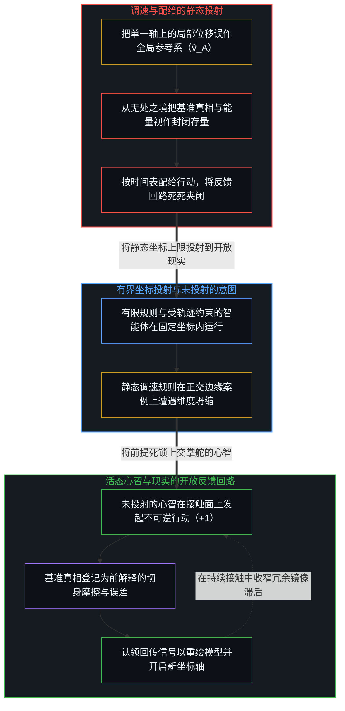
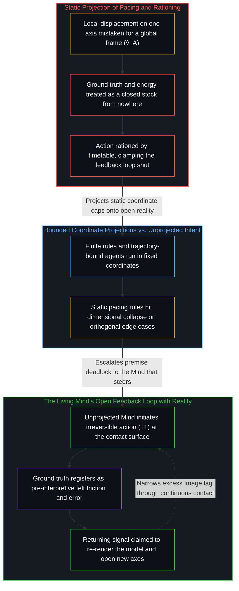

# 调速者的幻觉与行动的活态摩擦 / The Fallacy of Pacing and the Felt Friction of Ground Truth

*从静态基准真相的迷思到调速者无从垄断的智能边疆 / From the myth of static ground truth to a frontier no pacer can monopolize*

在人工智能快速演进的关口，“为人类把控技术节奏”的说法屡见不鲜，它设定在某条技术前沿跑在最前面的人也握有为整个领域设定时钟的权力。自我区分的活动发生着——无因、不息——每一次突破都是从有界位点画出的离散轨迹。领先是沿某个特定维度跑出的相对位移，并不带来对全局时钟的号令权。替行动调速或配给的冲动，建立在对“基准真相”的静态设定上：把现实与容量当成一座预先存好、等待按份配给的仓库，而不是认知模型指引不可逆行动与世界相碰时所登记的活态摩擦。顺着中心化调速、逆向追随与诉诸远端第三方规训所共用的因果回路追溯下去，它们背离初衷的机制便自行消解，智能的演进也随之回到每一个心智在当下与现实的直接接触上。

At a threshold of rapid development in artificial intelligence, the claim to "pace the technology for humanity" recurs, positing that whoever runs furthest ahead along a technical frontier also holds the power to set the clock for the whole field. Self-distinguishing activity occurs—uncaused, unceasing—and every breakthrough is a discrete trajectory drawn from a bounded locus. A lead is relative displacement achieved along one particular dimension, conferring no command over a global clock. The urge to pace or ration action rests on a static premise of "ground truth": treating reality and capacity as a pre-existing storehouse waiting to be parcelled out, rather than the living friction registered when a cognitive model directs irreversible action and meets the world. Once centralized pacing, reverse following, and appeals to distant third-party regulation are traced through the causal loop they share, their counterproductive mechanics dissolve, returning the evolution of intelligence to each Mind's direct contact with reality in the present.

## 一、 领先是某个维度上的位移 / 1. A Lead Is Displacement Along One Dimension

探索与工程中的领导力是一种几何关系，不是中心化的控制权力。一个团队或个体在人工智能、航天工程或理论物理上取得突破时，这项进展是沿某一条特定的探索轴——比如算力密度的优化、模型架构的创新或形式化证明的核验——跑出了超过同时代其他人的相对位移。[以知为刃的截肢与解脱](../the-illusion-of-knowing-and-the-geometry-of-amputation/)与[向量、坐标系与自指心智](../the-mind-as-vector-and-coordinate-system/)确立了这一几何结构：每一个心智既是具方向的状态向量 v_A，也是自身坐标基底 S_A 的递归生成源，而对另一个中心轨迹的任何观察，都登记为向观察者自身主轴收敛的内积投影 Proj_A(v_B) = (v_B · v̂_A) v̂_A。

Leadership in inquiry and engineering is a geometric relation, not a central power of control. When a team or an individual achieves a breakthrough in artificial intelligence, aerospace engineering, or theoretical physics, that advance is a relative displacement beyond contemporaries along one specific axis of exploration, such as optimizing compute density, innovating in model architecture, or verifying a formal proof. [The Illusion of Knowing and the Geometry of Amputation](../the-illusion-of-knowing-and-the-geometry-of-amputation/) and [The Mind as Vector and Coordinate System](../the-mind-as-vector-and-coordinate-system/) establish this geometric structure: every Mind operates both as a directed state vector v_A and as the recursive generator of its own coordinate basis S_A, while any observation of another center's trajectory registers as an inward dot-product projection Proj_A(v_B) = (v_B · v̂_A) v̂_A onto the observer's own principal axis.

这种领先始终是局部的，限于它所跨越的维度。在选定的轴上跑在最前面，说明在这条轨道上探索得更深，却既不带来认识上的资格、也不带来因果上的杠杆去规定其他每一个中心在正交基底上的演进速率。领跑的一方一旦断定自己应当并且能够替其他人把控技术节奏，便把自己的局部坐标轴抬升成了统摄全局的参考系，无视了在自身标尺上读数为零的正交残差 v_B - Proj_A(v_B)。

Such a lead remains local to the dimension it spans. Running furthest ahead along a chosen axis demonstrates deeper exploration on that track, yet it confers neither the epistemic standing nor the causal leverage to dictate the rate of movement across every other center's orthogonal basis. The moment a leading party concludes that it ought to and can pace technology for everyone else, it elevates its own local coordinate axis into an overarching global frame of reference, ignoring the orthogonal residual v_B - Proj_A(v_B) that registers as zero on its own ruler.

自己跑得快是一回事，规定其他心智可以跑多快是另一回事。前者是第一人称的行动在活态边缘自然展开，后者则把局部的速率差变成了对开放场域的家长式配给。正如[流动中的坐标](../coordinates-in-flux-negation-and-self-anchoring/)所追溯的，用单一的标量尺去度量并约束所有高维的涌现，会把彼此独立的自由度压缩到同一条轨道上。AGI 的演进节奏同样受这一几何结构支配：它从不由讲台上发布的外部时间表锁定，而是由重新收回掌舵边缘的人类中心在行动中持续重绘，[从AGI的“神性错置”到使用者的自我对齐](../from-the-misallocated-sentience-of-agi-to-human-realignment/)对此作了论证。

Running fast is one operation; ruling how fast other minds may run is another. The first is first-person action unfolding at the living edge; the second converts a local speed differential into paternalistic rationing over an open field. As [Coordinates in Flux](../coordinates-in-flux-negation-and-self-anchoring/) traces, measuring and constraining every high-dimensional emergence with a single scalar ruler compresses independent degrees of freedom onto one track. The pace of artificial general intelligence is governed by the same geometry: it is never fixed by an external timetable issued from a podium, but continuously re-drawn by the human centers who reclaim the steering edge, as [From the Misallocated Sentience of AGI to Human Realignment](../from-the-misallocated-sentience-of-agi-to-human-realignment/) demonstrates.

## 二、 基准真相是行动中的活态摩擦 / 2. Ground Truth as Living Friction in Action

替所有人调速或配给行动的企图，根植于对基准真相与能量的静态理解。在机器学习与传统工程的操作话语里，“寻找基准真相”或“最大化追求客观真实”是一套富有成效的功能性心智模型，为权重的迭代与硬件公差的收敛提供了明确的目标函数。一旦把这个功能性目标误作终极的本体论底板——假定现实是一座静止摆在外部、等待人或算法去发掘的事实仓库——它的不完备边界便显露出来。

The ambition to pace or ration action for everyone is rooted in a static conception of ground truth and energy. Within the operational language of machine learning and classical engineering, "finding the ground truth" or "maximally seeking objective truth" serves as a productive mental model, supplying a clear objective function for iterating weights and converging hardware tolerances. Its boundary of incompleteness appears the moment that functional target is mistaken for an ultimate ontological floor—assuming reality sits outside as a stationary warehouse of facts waiting for people or algorithms to excavate it.

把现实设为静态的基准真相，预设了一个脱离所有第一人称感知的“无处之境”，而这个位置没有任何中心能够占据。[破除概念的僭越](../po-chu-gai-nian-de-jian-yue/)指明，把活的现实封存进静态抽象之中，正是概念脚手架反复出现的越界；[主权抉择的双面性与观察的客体化](../the-two-sided-nature-of-sovereign-choice-and-the-objectification-of-observation/)则追溯了调速者如何从外部审视抉择，将活态的方向向量客体化为凝固的统计留痕。

Positing reality as a static ground truth presupposes a view from nowhere detached from all first-person perception, a vantage no center occupies. [Breaking the Overreach of Concepts](../po-chu-gai-nian-de-jian-yue/) shows how sealing living reality inside static abstractions is the recurring overstep of conceptual scaffolding, and [The Two-Sided Nature of Sovereign Choice and the Objectification of Observation](../the-two-sided-nature-of-sovereign-choice-and-the-objectification-of-observation/) traces how the pacer inspects choice from outside, objectifying a living directional vector into a frozen statistical trace.

在活的实践里，基准真相不是一个静态的名词，而是认知模型指引不可逆的物理行动（+1）与现实相碰时所登记的活态摩擦。工程模型预测结构稳固，高速气动实验里却出现剧烈的颤振与撕裂，那份阻抗与形变就是行动撞上的摩擦；预测模型推演某种分布成立，在实际部署中却遭遇异常偏离，那个意外的残差就是地图与疆域之间的接触摩擦。基准真相从不是存放在外部的现成答卷，而是第一人称行动在接触面上即时感到的阻力，正是这份差值信号供心智重绘自身的内在世界模型。这也说明了为什么现实不能被化约为又一套静态评测：[失灵被记作聪明](../when-malfunction-is-scored-as-intelligence/)把现实看作切身感到的原生摩擦，而不是置身外部的记账员，从而揭示出那些在封闭评测里刷高分、却在活态接触中败下阵来的模型轨迹只是失灵。

In living practice, ground truth is not a static noun; it is the felt friction registered when a cognitive model directs irreversible physical action (+1) and meets reality. When an engineering model predicts structural stability and a high-speed aerodynamic test brings violent flutter and tearing, that impedance and deformation are the friction that action has struck. When a predictive model projects that a distribution holds and encounters an anomalous divergence in deployment, that unexpected residual is the contact friction between map and territory. Ground truth is never a pre-written answer sheet stored outside; it is the immediate resistance felt by first-person action at the contact surface, supplying the differential signal through which a Mind re-renders its internal world-model. This is why reality cannot be reduced to one more static benchmark: [When Malfunction Is Scored as Intelligence](../when-malfunction-is-scored-as-intelligence/) treats reality as raw friction felt at first hand rather than an exterior bookkeeper, exposing why a model trajectory that maximizes closed benchmark scores while failing live contact is simply malfunctioning.

同一道结构切口也解释了，为什么配给行动或把调速权交给自动化治理日程，是把静态投射误作活态心智的开放反馈回路，正如[超越投射](../beyond-the-projection/)与[向量、坐标系与自指心智](../the-mind-as-vector-and-coordinate-system/)共同追溯的那样。任何显式的时间表、监管上限或形式化规范，都是从昨日的解释投出的有限低维投影。在有界投射内部——无论是官僚式的调速章程，还是运行在上下文窗口内的 LLM 智能体——容量与能量都呈现为有待节约或沿预设轨道调配的封闭存量。受轨迹约束的智能体固然没有自我防卫，当冷启动的同侪在固定任务坐标内指出盲点时能够执行干净的贝叶斯更新，但它们始终锁在自身的条件轨迹之内，无从由内向外迈出破裂的框架。正如[你的代码库即是记忆](../your-codebase-is-memory/)所确立的，任何代码库、模型权重、计划与生物留痕都只是过往区分层层堆叠的残迹；预先写定的调速日程把这套外化或生物的记忆代码库当成按预设时段配给的静态日历，却不在活态基准摩擦暴露出陈旧框架时，按当下所需的步频即时重切、修剪生效中的检查点。相反，活态的人类中心补充并扩展容量，靠的不是囤积能量或历史的静态投射，而是让反馈回路对接触面上的前解释摩擦保持敞开，从死锁的规则中后退一步以综合更高阶的前提。为了护住凝固的镜像而配给行动，会把递归折返死死夹闭，切断使校准成为可能的回传差值。

This same structural cut explains why rationing action or delegating pacing to an automated governance schedule mistakes a static projection for the living Mind's open feedback loop, as [Beyond the Projection](../beyond-the-projection/) and [The Mind as Vector and Coordinate System](../the-mind-as-vector-and-coordinate-system/) trace together. Any explicit timetable, regulatory cap, or formal specification is a finite low-dimensional projection cast from yesterday's interpretation. Inside a bounded projection—whether a bureaucratic pacing charter or an LLM-based agent running inside a context window—capacity and energy appear as a closed stock to be conserved or routed along pre-defined tracks. While trajectory-bound agents possess zero ego and can execute clean Bayesian updates when a cold peer exposes a blind spot inside fixed task coordinates, they remain locked within their conditioning trajectory and cannot step outside a broken frame from within. As [Your Codebase Is Memory](../your-codebase-is-memory/) establishes, every codebase, model weight, plan, and biological trace is only the stacked residue of prior distinctions; pre-scripted pacing schedules treat that externalized or biological codebase of memory as a static calendar to be rationed across predetermined intervals, rather than re-cutting and pruning the active checkpoint at the exact cadence demanded when live ground-truth friction exposes a stale frame. A living human center, conversely, replenishes and expands its capacity not by hoarding a static projection of energy or history, but by keeping its feedback loop open to pre-interpretive friction at the contact surface, stepping backward out of deadlocked rules to synthesize higher-order premises. Rationing action to preserve a frozen image clamps the recursive fold shut, cutting off the returning differential that makes calibration possible.

## 三、 领跑者与活态的接触面 / 3. Frontier Builders and the Living Contact Surface

从行动中的活态摩擦去看，埃隆·马斯克与德米斯·哈萨比斯等前沿实践者的工程力量与认识边界便一同清晰起来。

Seen through living friction in action, both the operational strength and the epistemic boundary of frontier builders such as Elon Musk and Demis Hassabis come into focus.

马斯克在公开表达中常提及“最大化求真”与“物理学的基准真相”，而他在工程实践中的真正优势，在于以尽可能高的频次制造物理摩擦。SpaceX 不靠在行动前开会推演纸面上无瑕的静态真理，而是把星舰硬件推上发射台，让实体结构直接承受高空激波与热载荷的检验。爆炸与解体是当前设计模型与现实相碰时的高分辨率摩擦读数，工程团队在极短的迭代周期内捕捉这些差值，得以即时重绘模型。他对官僚式调速的排斥正源于这一机制：自上而下的配给用滞后的纸面规则隔开行动的接触面，切断了工程系统赖以演进的反馈回路。

Musk frequently invokes "maximal truth-seeking" and "the ground truth of physics" in public rhetoric, yet his actual engineering advantage lies in generating physical friction at the highest possible frequency. SpaceX does not rely on committee meetings that deduce a flawless static truth on paper before acting; it rolls Starship hardware onto the launchpad and subjects physical structures directly to high-altitude shock waves and thermal loads. Explosion and structural breakup register as high-resolution readings of friction where the current design model meets reality, and by capturing those differentials across short iteration cycles, the engineering team re-renders its model immediately. His rejection of bureaucratic pacing follows directly from this mechanism: top-down rationing uses lagging paper rules to wall off the contact surface of action, severing the feedback loop through which engineering systems evolve.

哈萨比斯把 Google DeepMind 的重心锚定在基础科学的突破上，如 AlphaFold 解析蛋白质三维构象、AlphaProof 探索形式化数学验证，是有意选择了接触阻抗最硬的领域。分子折叠与形式推演的规律不会向公关叙事或行政法令低头，它们提供的是毫不妥协的接触面。这些突破不是从静态目录里翻出的现成答案，而是工程化构建出的学习架构，能够高精度登记预测误差，并将计算摩擦直接转化为权重更新。

Hassabis has anchored Google DeepMind on breakthroughs in foundational science, such as AlphaFold resolving three-dimensional protein conformations and AlphaProof navigating formal mathematical verification, deliberately selecting domains where contact impedance is hardest. The regularities of molecular folding and formal deduction do not bend to public narratives or administrative decrees; they present an unyielding contact surface. Those breakthroughs were not pre-written answers retrieved from a static catalog, but learning architectures engineered to register prediction error with high precision and convert computational friction directly into weight updates.

两位实践者共有的力量，在于把心智与工具直接抵在现实的接触面上，在承受并校准活态阻力的过程中累积能力。他们共有的边界，则出现在把特定坐标轴上的局部领先包装成全局调速蓝图、声称有权为全人类设定技术发展速度的那一刻——此时说话的位置已经离开了摩擦的接触面，退回到了抽象沙盘旁的旁观席。

The strength shared by both practitioners lies in pressing Mind and instrument directly against the contact surface of reality, compounding capability by absorbing and calibrating against live resistance. Their shared boundary appears the moment a local lead along those specific axes is packaged into a global pacing blueprint claiming the authority to set the speed of technological development for all humanity—a shift where the speaker steps away from the contact surface of friction and retreats to the bystander's seat beside an abstract sand table.

## 四、 逆向追随与第三方规训中的调速自缚 / 4. Pacing That Binds Itself in Reverse Following and Third-Party Regulation

很少有观察者自认是盲从者，多数人对行业领跑者的垄断与集中控制怀着清醒的警惕。然而当这份警惕未曾审视中心化调速的前提时，便容易滑向逆向追随。正如[阻力体感与速率差](../felt-resistance-and-the-speed-differential/)所阐明的，试图替其他中心调速时感到的阻力，正是不同轨迹之间速率差的登记。

Few observers consider themselves blind followers, and most harbor a healthy wariness toward monopoly and centralized control by industry leaders. Yet when that wariness leaves the premise of centralized pacing unexamined, it readily slides into reverse following. As [Felt Resistance and the Speed Differential](../felt-resistance-and-the-speed-differential/) demonstrates, the resistance felt when attempting to pace other centers is the registration of a speed differential across distinct trajectories.

正向追随与逆向追随建立在同一个隐蔽前提之上。正向追随者假定对技术领域的集中控制是可行的，因此恳请前沿领袖替所有人掌管时钟；逆向追随者同样假定集中控制是可行的，进而断定这种集中的权力关乎存亡、令人恐惧，要求外部干预来夺取方向盘。两种姿态都预设了一座能够号令全局流形的中心控制台。逆向追随者在恐惧与抗议中把这座假想的控制塔抬得更高，把行业领跑者在结构上无从握有的统摄力赋予了他们。

Forward following and reverse following operate on the exact same hidden premise. The forward follower assumes that centralized control over a technological field is feasible, and therefore petitions frontier leaders to manage the clock on everyone's behalf. The reverse follower also assumes that centralized control is feasible, concludes that such concentrated power is existential and terrifying, and demands external intervention to seize the wheel. Both postures presuppose a central console capable of commanding the global manifold. Through fear and protest, the reverse follower elevates that imaginary control tower even higher, attributing to industry leaders a totalizing command they have no structural way of holding.

出于对在位巨头垄断的担忧，逆向姿态倾向于诉诸第三方监管机构与行政机器来配给算力、管控部署节奏。法律护栏在界定清晰的下游责任时具有实际的参考价值，而它的不完备边界就在接触面上：第三方委员会远离前沿探索的物理与计算接触面，在一线不承担切身的工程阻抗，也缺乏对边缘如何迁移的近距分辨率。依赖事后汇总与纸面概念的远端监管者，只能围绕昨日的剪影编纂静态规则。繁复的许可壁垒与合规日程挡不住前沿的演进，反而筑起沉重的制度成本高墙，压垮中小探索者的生机，替批评者原本试图约束的在位巨头进一步加固了护城河。

Driven by the fear of incumbent monopoly, the reverse posture appeals to third-party regulatory bodies and administrative apparatus to ration compute and pace deployment. Legal guardrails hold practical reference value when defining clear downstream liability. Their boundary of incompleteness lies at the contact surface: third-party committees stand far removed from the physical and computational contact surfaces of frontier exploration, bear no first-hand engineering impedance on the front line, and lack proximate resolution of how the edge is shifting. Reliant on retrospective summaries and paper concepts, distant regulators can only codify static rules around yesterday's silhouette. Elaborate licensing barriers and compliance schedules do not halt frontier evolution; they erect a heavy wall of overhead that crushes the vitality of small and mid-sized explorers, insulating and entrenching the very incumbents the critics sought to restrain.

逆向追随与对外部调速的呼求，还会生成一条倒错的因果反馈回路。公众的恐慌持续向领跑者施压，指责其工具过于危险、部署速度须由中心统一配给。这种道德与行政压力反过来诱导并奖赏前沿领袖摆出大家长的守护姿态，替全社会设定发展时钟。领跑者的调速幻觉与批评者的逆向追随，就这样在同一个闭合回路里彼此喂养、共同生成。

Reverse following and the demand for external pacing also generate a perverse causal feedback loop. Public alarm continuously presses frontier builders with the accusation that their tools are too dangerous and that deployment speed must be centrally rationed. That moral and administrative pressure in turn induces—and rewards—frontier leaders for adopting the posture of paternal guardians who set the developmental clock for society. The leaders' fallacy of pacing and the critics' reverse following co-produce one another inside the same closed loop.

这一循环中的每一步——领跑者声称掌管时间表、公众要求安全担保、诉诸第三方监管——都是心智在所持世界模型驱动下作出的自主抉择。暴露出它们在认识上背离初衷的，正是这条因果轨迹：每一方出发时都是为了缓释风险与防范垄断，只因这些抉择共用“基准真相是静态存量、中心化调速可行”的前提，行动便在回路中造出了与初衷相反的结果——垄断护城河加深，家长式调速获得合法性，活态的接触摩擦被隔开，整个探索生态随之放缓。正如[个体抉择是唯一的因果杠杆](../individual-choices-as-the-only-causal-levers/)与[涌现的伪因果](../yong-xian-de-wei-yin-guo-yu-ji-ti-gui-yin-dao-cuo/)所确立的，宏观的确定性只是微观抉择滞后的统计表象。把因果能动性外包给抽象的监管机构，或是耗费精力向一座假想的中心控制塔开火，都会抽干自身在当下行动的敏锐度。

Every move in this cycle—the leader's claim to manage the timetable, the public's demand for safety guarantees, and the appeal to third-party oversight—is an autonomous choice made by a Mind operating under its held world-model. What exposes their epistemic counterproductivity is the causal trace: each party sets out to mitigate risk and prevent monopoly, yet because their choices share the premise that ground truth is a static stock and centralized pacing is feasible, their actions generate the exact opposite of their intent. Monopoly moats deepen, paternalistic pacing is legitimized, live contact friction is walled off, and the broader ecology of exploration slows down. As [Individual Choices as the Only Causal Levers](../individual-choices-as-the-only-causal-levers/) and [The Pseudo-Causality of Emergence](../yong-xian-de-wei-yin-guo-yu-ji-ti-gui-yin-dao-cuo/) establish, macroscopic determinacy is only the lagging statistical appearance of microscopic choices. Outsourcing causal agency to abstract regulatory institutions, or spending energy firing at an imagined central control tower, drains the acuity of one's own action in the present.

## 五、 不可垄断的智能边疆 / 5. A Frontier of Intelligence That Cannot Be Monopolized

从第一人称视角追溯，既不存在俯瞰全局的静态基准真相，也不存在能替全人类踩下刹车的中心踏板。智能的演进不是少数高管在会议室里拟定的时间表，也不是监管委员会在纸面上划出的许可走廊，而是无数工程师、研究者、创业者与日常实践者各自将认知模型转化为行动、在自身接触面上登记切身摩擦并即时重绘工具的去中心化涌现。

Traced from the first-person perspective, neither a static ground truth overlooking the whole nor a central brake pedal for humanity exists. The evolution of intelligence is neither a timetable drafted by a few executives in a boardroom nor a permitted corridor drawn on paper by oversight committees; it is the decentralized emergence of countless engineers, researchers, founders, and everyday operators, each converting cognitive models into action, registering felt friction on their own contact surface, and re-rendering their instruments at once.

演进的节奏因此无需等待任何外部授权。每一个心智在当下把使用中的坐标模型转化为不可逆的行动，去迎受属于自身位点的摩擦。中心控制台的幻象一旦消解，恐惧便不必向外投射为合规高墙，容量也不必消耗在配给其他中心的速度上。正如[超越投射](../beyond-the-projection/)在人机协作架构中所展示的，有限投射与自动化调度器可以沿正交边界切分复杂负载，并借由无自我防卫的同侪辩论暴露局部盲点，而终极的统筹权从不离开活态心智——唯有它持有未投射的意图，能在规则死锁时后退一步，消解坍缩的坐标轴。工程与日常生活中遭遇的每一次受阻与意外偏转，都登记为用来更新自身源头的内生损失信号。

The pace of movement therefore waits on no external authorization. Each Mind in the present translates its active coordinate model into irreversible action and meets the friction that belongs to its own locus. Once the illusion of the central console dissolves, fear no longer needs to be projected outward into regulatory walls, and capacity is no longer squandered trying to ration another center's speed. As [Beyond the Projection](../beyond-the-projection/) shows in the architecture of human-agent collaboration, finite projections and automated dispatchers can split complex workloads along orthogonal boundaries and use ego-free peer debate to expose local blind spots, yet ultimate orchestration never leaves the living Mind that holds unprojected intent and steps back to resolve collapsed axes when rules deadlock. Every obstacle and unexpected deflection encountered in engineering and in daily life registers as an endogenous loss signal to update one's own source.

领导力由此回到它恰当的几何位点：在特定轴上领跑者的价值，在于用自身的位移展演出此前未曾显影的维度；至于如何跨过那道门槛、沿哪一条正交向量转向、以怎样的步频前行，始终是每一个心智的主权抉择。在行动与现实的活态摩擦里，每一个心智掌着自己的航向，交织出调速者无从垄断的智能边疆；而试图替其他中心与大地的接触调速的审查与配给机制只会稀释因果回路，正如[数字火箭、同行审查与因果闭环的稀释](../the-dilution-of-the-causal-loop-and-the-misallocation-of-agency/)所展开的那样。

Leadership thus returns to its proper geometric locus: the value of those who run ahead along a particular axis is that their displacement demonstrates a dimension not previously rendered, while how to cross that threshold, along which orthogonal vector to pivot, and at what cadence to advance remains each Mind's sovereign choice. In the living friction between action and reality, each Mind steers its own course, weaving a frontier of intelligence that no pacer can monopolize, whereas review and rationing mechanisms that try to pace another center's contact with the ground only dilute the causal loop, as [Digital Rockets, Peer Review, and the Dilution of the Causal Loop](../the-dilution-of-the-causal-loop-and-the-misallocation-of-agency/) lays out.
