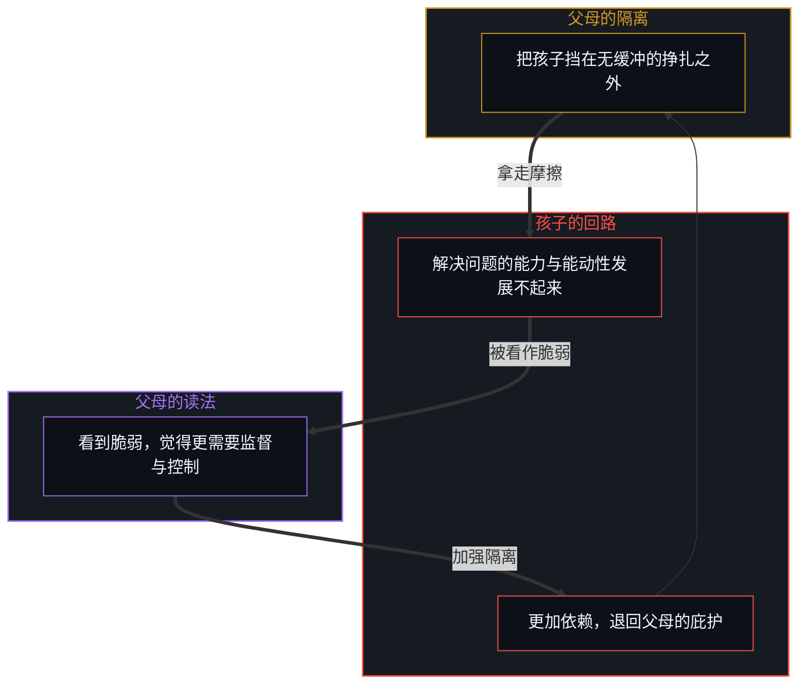
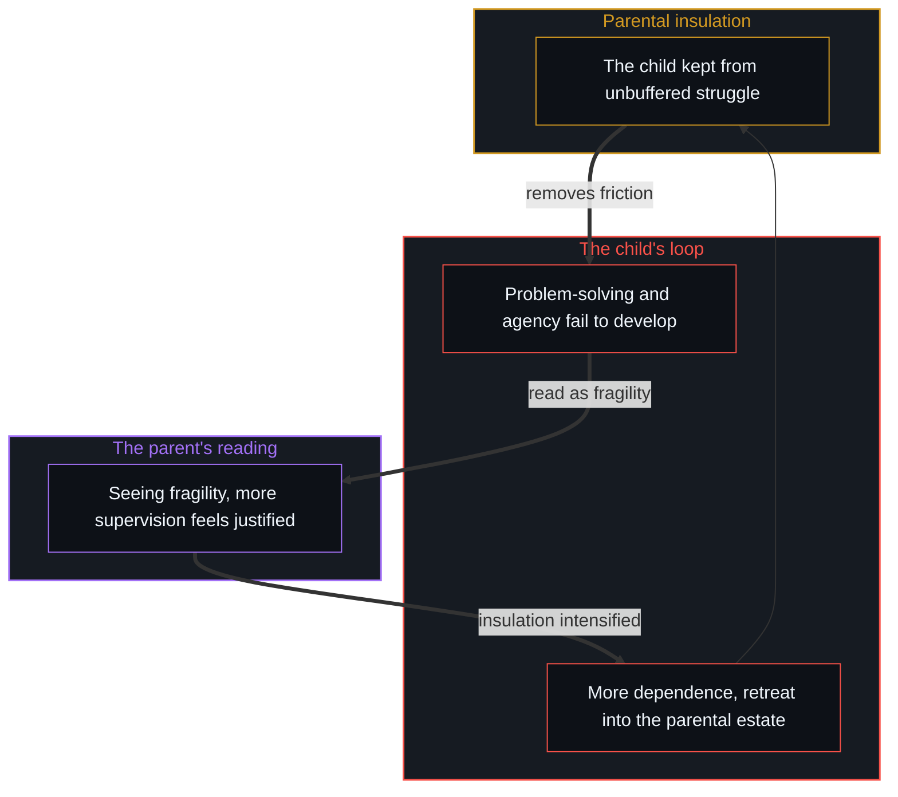

# 成功之后的育儿谬误 / The Fallacy of Post-Success Parenting

*能力在直面摩擦的决定里炼成；把盈余当作公式、把孩子隔绝在外，就会将它拆毁。 / Capability forms in decisions under friction; making surplus a formula and insulating children dismantles it.*

模仿成功者养育孩子的习惯，这个常见的冲动带着一次干净的因果倒置：它把成功之后对累积盈余的消费，与当初创造能力的生成引擎混为一谈。旁观者指着硅谷高管限制屏幕时间、推迟给孩子智能手机、为孩子定制低技术的教育，把这当作成功的蓝图，就把累积财富带来的保护性红利，误认成了能力的原因。

The common impulse to imitate the child-rearing habits of the successful carries a clean causal inversion: it confuses the post-success consumption of accumulated surplus with the generating engine that first created capability. Onlookers pointing to Silicon Valley executives who limit screen time, delay smartphones and arrange bespoke low-tech educations as a blueprint for success take the protective dividends of accumulated wealth for the cause of competence.

把隔离变成一个模型，成功之后的家庭就造出一座过度设计的温室，拿走了任何心智建立切身能力所必需的原始摩擦、不确定与自主的决定。

By turning insulation into a model, the post-success household builds an over-engineered greenhouse that removes the raw friction, uncertainty and self-directed decision-making any Mind needs to build lived capability.

## 一、 榜样的错觉 / 1. The Role-Model Illusion

把精英的育儿当作教导的模型，结构上的错误在于一个没被审视的基线不对称：成功者的孩子从一个高得多的起点出发。一位富有的高管在低技术的环境里、配着定制的家教与洁净的自然度假养育孩子，是在动用先前胜利的红利，而不是在执行当初炼成自己能力的那个生成过程。[宏观现象的生成图谱](../the-generative-atlas-of-macroscopic-phenomena/)与[成功的几何学](../the-geometry-of-success/)都分析过，宏观的结果不能靠观察顶峰上胜者的静态状态来理解。如今限制技术的这些人，之所以成了强大而能适应的行动者，恰恰是因为他们成长的岁月在原始的摩擦里度过：不经过滤、自我引导的探索，在严重的资源约束下高强度的试错，与自己选择的后果直接、不加缓冲的接触。

The structural error in treating elite parenting as a model to teach from lies in an unexamined asymmetry of baseline: the children of the successful start from a far higher point. A wealthy executive raising children in a low-tech setting with bespoke tutors and pristine nature retreats is deploying the dividends of a prior victory, not running the generating process that forged their own competence. As both [The Generative Atlas of Macroscopic Phenomena](../the-generative-atlas-of-macroscopic-phenomena/) and [The Geometry of Success](../the-geometry-of-success/) analyse, macroscopic outcomes cannot be understood by observing the static state of the winner at the summit. Those who now restrict technology became formidable, adaptive actors precisely because their formative years were spent in raw friction: unfiltered, self-directed exploration, intense trial and error under severe resource constraint, and direct, unbuffered contact with the consequences of their choices.

看这些人在获得巨大的地位、财富与安全之后做什么，再把成功之后的生活方式误认成产生成功的公式，就是幸存者偏差：像看一个运动员赢得冠军后怎样休息，就断定休息是胜利的引擎。

Looking at what these people do after reaching great status, wealth and security, and taking that post-success lifestyle for the formula that produced success, is survivorship bias: like watching how an athlete rests after winning a championship and concluding that resting was the engine of victory.

## 二、 后见的归因错误 / 2. The Hindsight Attribution Error

这种扭曲的一个主要来源，是成功者自己的后见之明。回看一条复杂的、几十年的轨迹，心智难以持住过去那段混乱、无法预先计算的现实，于是造出回溯的公式。成功的父母说服自己，胜利来自整齐、风格化的美德：读了某些经典，严格遵守了晨间的作息，避开了现代的干扰。这种回溯的讲述，正是[涌现的伪因果](../yong-xian-de-wei-yin-guo-yu-ji-ti-gui-yin-dao-cuo/)所详述的那种错误：把因果的力量归给下游的描述性器物，而忽略了生成的那个基元，在现场的不确定之下执行的微观决定。

A main source of this distortion is the hindsight of the successful themselves. Looking back over a complex, decades-long trajectory, the Mind struggles to hold the chaotic, uncomputable reality of its past and manufactures retrospective formulas instead. Successful parents persuade themselves that their victory came from tidy, stylised virtues: reading certain classics, keeping a strict morning routine, avoiding modern distractions. This retrospective storytelling makes exactly the error detailed in [The Pseudo-Causality of Emergence](../yong-xian-de-wei-yin-guo-yu-ji-ti-gui-yin-dao-cuo/): crediting causal power to downstream descriptive artifacts while ignoring the generating primitive, micro-decisions made under live uncertainty.

成功从来不是一张静态习惯清单的机械输出，而是在没有剧本的取舍里不断导航、自己承担利害、愿意接受失败的全部代价而生成的；结局里也装着落到这个人头上的东西。成功的父母想把回溯的配方传下去时，交给孩子的是一座陈列着死结论的博物馆，而不是在压力下做选择的那份活的能力：正如[你的代码库即是记忆](../your-codebase-is-memory/)所追溯的，他们把自身已经定型的检查点当作外化的记忆代码库移交出去，剥离了当初炼成它的现场摩擦与失败分支，同时把孩子隔在直面后果、亲手书写并修剪自身记忆的过程之外。

Success was never the mechanical output of a static list of habits; it was generated by continual navigation of unscripted trade-offs, having one's own stake in the game and being willing to accept the full cost of failure, and the outcome also holds what fell to that person. When successful parents try to pass on retrospective recipes, they hand their children a museum of dead conclusions rather than the living capacity to choose under pressure—delivering their own finished checkpoint as an externalized codebase of memory stripped of the live friction and failed branches that forged it, as [Your Codebase Is Memory](../your-codebase-is-memory/) traces, while insulating the child from authoring and pruning a memory of their own through direct consequence.

## 三、 父母的过度自信 / 3. Parental Overconfidence

过去在市场或职业上的胜利，常常养出父母的过度自信。掌握了一个领域，软件工程、金融或企业管理，成功的父母就以为这给了自己认识上的权威，去“设计”另一个有意识的行动者的人生。不保持[引导不是占有](../guidance-is-not-ownership/)所确立的照看者姿态，成功的父母就占了驾驶座：把孩子的未来当作一个定制的工程项目，安排每一项课外活动、每一个社交圈子与每一份智识的输入，想书写目的地，而不是提供一个发射台。

Past victory in a market or profession often breeds parental overconfidence. Having mastered one domain, software engineering, finance or corporate management, the successful parent assumes this grants the epistemic authority to "architect" the life of another conscious agent. Instead of keeping the stance of stewardship established in [Guidance Is Not Ownership](../guidance-is-not-ownership/), the successful parent takes the driver's seat: treating the child's future as a bespoke engineering project, arranging every extracurricular activity, every social circle and every intellectual input, trying to write the destination instead of providing a launchpad.

这种过度自信自我设限。[论教育、共振与给人真东西](../on-education/)与[作为因果干扰的情感支持](../emotional-support-as-causal-interference/)都探讨过，父母的管理装置越“有效”、越全面，孩子独立发展的天花板就越低；拿走了一切敞开的空间与不确定，父母自信的蓝图就成了一个让人透不过气的笼子。

This overconfidence limits itself. As both [On Education, Resonance, and Giving Someone the Real Thing](../on-education/) and [Emotional Support as Causal Interference](../emotional-support-as-causal-interference/) explore, the more "effective" and comprehensive a parent's management apparatus becomes, the lower the ceiling on the child's independent development; with all open space and uncertainty removed, the parent's confident blueprint becomes a cage with no air.

## 四、 复制路径的陷阱 / 4. The Path-Cloning Trap

与过度自信一起来的，是一种长期的复制路径的倾向：期望孩子复制父母具体的轨迹，上同样的精英学校，进认可的职业，采纳父母的世界观。父母过去的路带来了不容否认的财富与声望，孩子的任何偏离，就不被看作自主的探索，而被看作不理性的偏差：孩子想在一个没铺好路、高方差的领域里走出自己的方向时，会遇到微妙的否定、焦虑或公开的反对；父母要求服从一张历史的地图，没认出地形已经变了；孩子自己的好奇被放在维护家族既有社会地位之下。[好奇先行](../curiosity-first-the-hidden-engine-of-talent-and-development/)说过，切身的能力只沿着一个人自己好奇的敞开前沿复利。父母把孩子塞进继承来的模板，就阻断了那份推动深度精通的好奇探索，换上空洞而顺从的文凭主义。

Along with overconfidence comes a chronic tendency to clone the path: expecting the child to replicate the parent's specific trajectory, attend the same elite institutions, enter approved professions and adopt the parent's worldview. Because the parent's past path brought undeniable wealth and prestige, any divergence by the child is seen not as self-directed exploration but as an irrational deviation: when the child wants to make a direction of their own in an unpaved, high-variance field, they meet subtle invalidation, anxiety or open resistance; the parent demands compliance with a historical map, not recognising that the terrain has already changed; the child's own curiosity is placed beneath preserving the family's established social standing. As [Curiosity First](../curiosity-first-the-hidden-engine-of-talent-and-development/) puts it, lived capability compounds only along the open frontier of a person's own curiosity. A parent who forces a child into an inherited template stalls the following of the curiosity that drives deep mastery and puts hollow, compliant credentialism in its place.

## 五、 依赖的陷阱 / 5. The Reliance Trap

精英育儿里有一个悖论：高得多的起点，并不总是转化成一代超过一代。理论上，一个拥有巨大物质安全、顶级导师与全球人脉的人，有最好的基础去承担大胆的、历史性的冒险，去探索敞开的科学前沿、建造激进的技术，或追求为生存所迫的人负担不起的创造。可这个机制常走向另一边：父母巨大的成功加上被缓冲的环境，造出一个依赖的陷阱。环境拿走了独立解决难题的生存必要；风险的心理不对称，失败带着不如著名父母的难堪，成功只是满足了基线的期望；个人的成就被一再归功于父母的影响，内在的能动感被侵蚀。

Elite child-rearing holds a paradox: a far higher starting point does not always turn into one generation surpassing the last. In theory, someone with great material security, top-tier mentorship and global networks has the best foundation for bold, historic risks, exploring open scientific frontiers, building radical technologies, or pursuing creative work that someone under survival pressure could never afford. Yet the mechanism often runs the other way: the parent's towering success together with the cushioned environment builds a reliance trap. The environment removes the vital necessity of solving hard problems independently; the psychology of risk is asymmetric, failure carrying the embarrassment of falling short of a prominent parent while success only meets baseline expectations; and personal achievements are credited again and again to parental influence, eroding the inner sense of agency.

[自我价值感与所有权](../ownership-and-self-worthiness/)与[外部归因是个人进步的障碍](../wai-bu-gui-yin-ge-ren-jin-bu-de-zhang-ai/)都表明，自我价值与韧性只在认领自己结果的闭合反馈回路里生成。财富与父母的管理吸收了错误决定的全部冲击，心智就缺少磨利内部能力所需的误差信号。[价值、货币与财富的生成机制](../the-generative-mechanics-of-value-money-and-wealth/)把这一点形式化：非自己挣来的盈余使控制论的损失函数饱和，让个人能力的发展沉睡。

As both [Ownership and Self-Worthiness](../ownership-and-self-worthiness/) and [External Attribution Is the Obstacle to Personal Growth](../wai-bu-gui-yin-ge-ren-jin-bu-de-zhang-ai/) show, self-worth and resilience are generated only in the closed feedback loop of owning one's outcomes. When wealth and parental management absorb the full impact of poor decisions, the Mind lacks the error signals it needs to sharpen inner competence. [The Generative Mechanics of Value, Money, and Wealth](../the-generative-mechanics-of-value-money-and-wealth/) formalises this: unearned surplus saturates the cybernetic loss function and puts the development of personal capability to sleep.

## 六、 负反馈回路与舒适的错觉 / 6. The Negative Feedback Loop and the Illusion of Comfort

这个动态建立起一个自我加强的回路，被物质的舒适遮住，多半看不见：父母把孩子挡在无缓冲的挣扎之外；孩子发展不出稳健的解决问题的能力与独立的能动性；看到孩子的脆弱，父母觉得加强监督与控制理所当然；孩子更加依赖，退回父母庇护的舒适安全里。一个人可以过一种非常舒适、有教养的生活，却仍是一场过去胜利的附属，而不是一台自己发起的因果引擎；得到了一切优势，唯独缺了要紧的那一样：在没铺好的地形上挣扎、失败、建立自己能力的自由。父母想拿走的约束，是孩子的自由在起作用，[约束的样子不是自由的失去](../the-look-of-constraint-is-not-the-loss-of-freedom/)展示了这一点。

This dynamic sets up a self-reinforcing loop that, masked by material comfort, mostly goes unseen: the parent keeps the child from unbuffered struggle; the child fails to develop robust problem-solving and independent agency; seeing the child's fragility, the parent feels more supervision and control are justified; and the child grows more dependent, retreating into the comfortable safety of the parental estate. A person can live a very comfortable, cultured life while remaining an appendage of a past victory rather than a self-originating causal engine, given every advantage except the one that matters: the freedom to struggle, fail and build capability of their own on unpaved ground. The constraint parents try to remove is the child's freedom at work, as [The Look of Constraint Is Not the Loss of Freedom](../the-look-of-constraint-is-not-the-loss-of-freedom/) shows.

## 七、 越过镀金的笼子 / 7. Beyond the Gilded Cage

说到底，一个人对自己人生的责任，仍在这个人自己身上。在一个被精心安排、期望很高的家庭里长大，并不免除成年人的作者身份；只是它带来一份反讽的负担：孩子得到的不是切身的发展支持，常常要花大量认知与情感的精力，去越过父母施加的那些不必要的、人为的约束。父母的蓝图、复制的路径与镀金的事无巨细的管理，并非任何支持，而是披着保护外衣的摩擦。

In the end, responsibility for a person's life stays with that person. Growing up in a carefully arranged, high-expectation household does not remove an adult's authorship; it only adds an ironic burden: instead of developmental support, the child often has to spend great cognitive and emotional energy getting past the unnecessary, artificial constraints the parents imposed. Parental blueprints, cloned paths and gilded micromanagement are not support at all, but friction dressed as protection.

任何想推翻、替代或预先决定个人能动性的干预，按其机制都是适得其反的：能动性是人的能力的生成引擎，从外面绕过它，产生的是发展上的萎缩；多少金钱资本、社会杠杆或父母的好意，都补不上亲身经历、自己书写的试错的缺席。成功者的孩子要成熟起来、越过自己的出身，最终得做父母当年做过的事：完整认领自己的选择，不让父母的过度自信决定自己的目的地，迎着走自己的路那份原始、不加缓冲的挣扎。

Any intervention that tries to override, replace or predetermine a person's agency works against itself by its mechanism: agency is the generating engine of human capability, bypassing it from outside produces developmental atrophy, and no amount of financial capital, social leverage or parental good intention makes up for the absence of first-hand, self-written trial and error. To mature and move beyond their origins, the children of the successful eventually have to do what their parents once did: fully own their choices, refuse to let parental overconfidence decide their destination, and meet the raw, unbuffered struggle of making their own way.

## 八、 能力的来源 / 8. The Source of Capability

理解能力，要沿着它实际生成的方向追因果之箭：能力在底层的挣扎、适应、失败与没有剧本的微观决定里炼成，从不在登顶之后采纳的隔离生活里。父母的照看不在于设计一座镀金的、没有摩擦的温室，而像一个发射台：提供身体的安全、情感的稳定与基础的因果模型，培养一种带来信任而不强加目的地的支持关系，然后走出车子，让这个人去面对世界的原始摩擦。[破除概念的僭越](../po-chu-gai-nian-de-jian-yue/)说清了这种隔离的控制论机制：清除了无缓冲的摩擦，父母无意中抹掉了发展中的心智调整内部权重所需的首要损失函数，把下一代困在一个解不开的双重束缚里。

Understanding capability means following the causal arrow in the direction it is actually generated: competence is forged in the struggle, adaptation, failure and unscripted micro-decisions at the bottom, never in the insulated life adopted after reaching the summit. Parental stewardship lies not in designing a gilded, frictionless greenhouse but in working as a launchpad: providing physical safety, emotional stability and basic causal models, building a supportive relationship that brings trust without imposing a destination, then stepping out of the vehicle and letting the person face the world's raw friction. [Breaking the Overreach of Concepts](../po-chu-gai-nian-de-jian-yue/) spells out the cybernetic mechanics of this insulation: clearing away unbuffered friction, parents unknowingly erase the first loss functions a developing Mind needs to adjust its inner weights, leaving the next generation in a double bind with no way out.

一段人生不能由代理书写。切身的能力，只在一个人拥有空间、许可与自由，去穿过自己的前沿、打自己的仗、书写一条属于自己的轨迹时出现。

A life cannot be written by proxy. Lived capability appears only when a person has the space, permission and freedom to cross their own frontiers, fight their own battles and write a trajectory that is their own.
