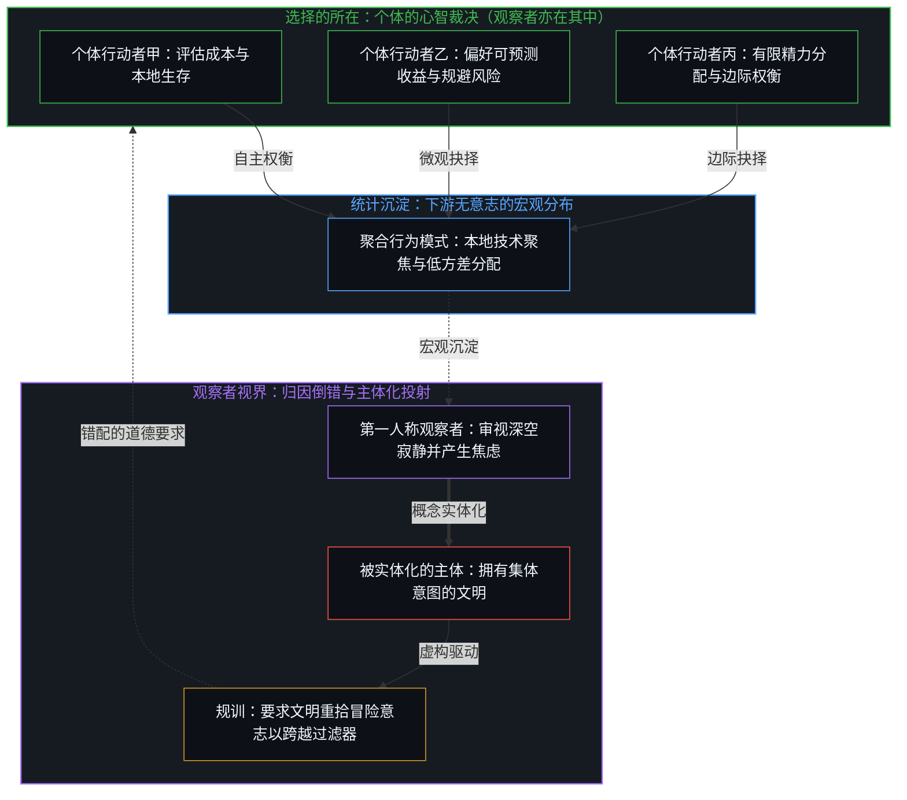
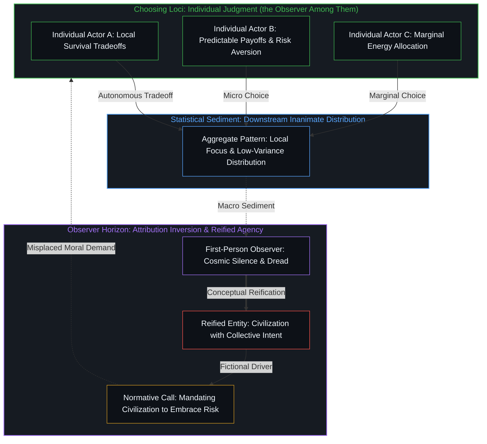
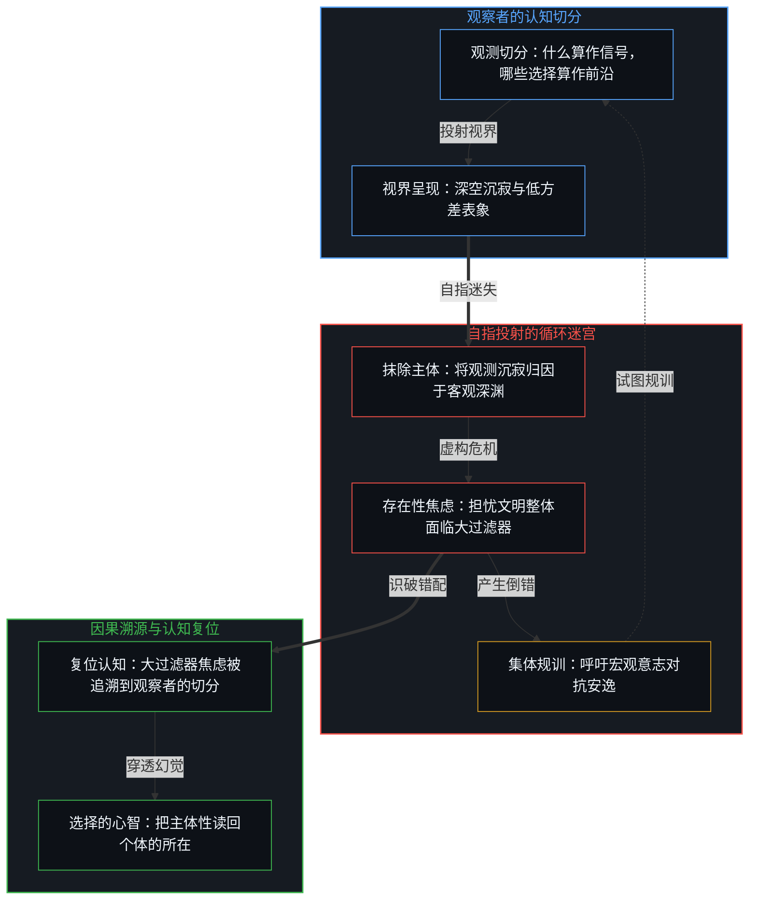
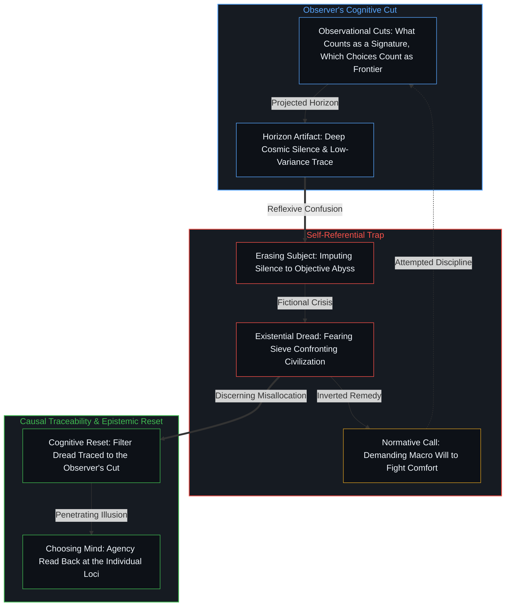
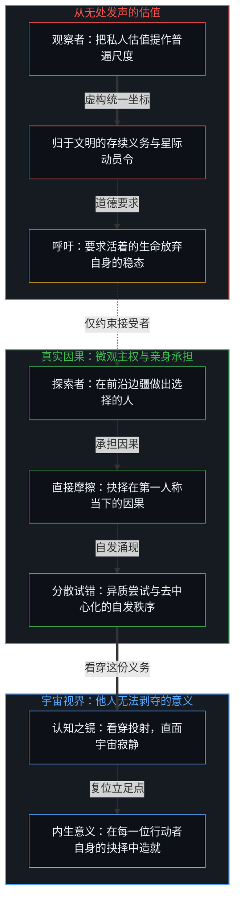
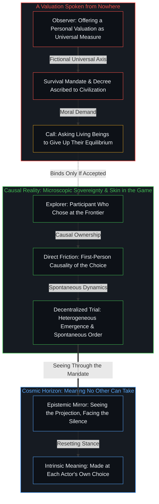

# 费米悖论、主体性错配与大过滤器的投射

*文明无意志；视大过滤器为集体失败即实体化聚合选择 / A civilization has no will; reading the Great Filter as collective failure reifies aggregate choices into a phantom subject.*

费米悖论登记下银河系广袤时空与可探测技术信号缺失之间的张力，而大过滤器假说则把这种宇宙寂静读作证据，表明通往星际扩张的路上至少有一步发生的概率极低。然而，将瓶颈归咎于一个贪图安逸、规避高方差风险或丧失探索动力的“文明”，是把微观抉择的聚合分布实体化为幽灵般的决策主体。把大过滤器读作文明意志衰退的那种不安，并非前方横亘着宇宙深渊的证据，而是观察者先划出观测切分、随后又在解释中试图将自身从图景里抹去的产物。

The Fermi Paradox registers the tension between the vast scale of the galaxy and the absence of detectable technological signatures, while the Great Filter hypothesis reads this cosmic silence as evidence of at least one highly improbable step on the path to interstellar expansion. Yet attributing this barrier to a "civilization" that chooses comfort, avoids high-variance risk, or loses exploratory drive reifies the aggregate distribution of microscopic choices into a phantom decision-making entity. The unease that reads the Great Filter as a civilization's failing will is not evidence of a cosmic precipice, but an artifact of an observer who draws an observational cut and then attempts to explain the observing subject out of the picture.

## 一、 宇宙寂静与宏观系统的主体化假想 / 1. Cosmic Silence and the Reification of Civilizational Agency

费米悖论起源于一次观测上的未探测：在尺度辽阔、历史悠久的银河系中，尽管按德雷克式的估算（其本身极不确定），智能理应在别处涌现，却没有探测到任何明确的地外技术文明信号。罗宾·汉森提出的大过滤器假说由这一寂静推断：从无生命的物质到扩张且持久的生命之间，必然存在至少一个发生概率极低的跃迁台阶。每当对这一假说的讨论转向人类自身，便迅速演变为对现代文明安排的诊断：那道致命的门槛是在我们的演化过去之中，还是横亘在前方？伴随这一追问而来的，是对规避风险、制度对可预测性的偏好、资源流向本地舒适的深切忧虑，仿佛人类正作为一个统一的整体在稳定中窒息。

The Fermi Paradox arises from a non-detection: despite the vast age and scale of the galaxy, and Drake-style estimates, themselves highly uncertain, that intelligence should emerge elsewhere, no unambiguous signatures of technological civilizations have been detected. The Great Filter hypothesis proposed by Robin Hanson infers from this silence that at least one transition step between dead matter and expanding, lasting life must be extraordinarily improbable. Whenever discussions of this hypothesis turn inward toward humanity, they quickly morph into a diagnosis of modern civilizational arrangements: does the lethal threshold lie in our evolutionary past, or does it loom ahead? Along with this inquiry comes an acute anxiety regarding risk aversion, institutional preference for predictability, and the allocation of resources toward local comfort, as though humanity were suffocating in stability as a single unified body.

此类讨论反复暴露出一种将宏观聚合实体化的思维定势。舒适导向的资源配置、官僚机构对可预测性的偏好、对单行星生存脆弱性的忽视，被频频描述为“文明”本身的倾向，随之而来的是一项道德规训：人类必须恢复愿意承受前沿风险的开拓精神，否则便无法通过未来的过滤器。然而，正如在[主体性的错配](../the-misallocation-of-agency/)与[涌现的伪因果](../yong-xian-de-wei-yin-guo-yu-ji-ti-gui-yin-dao-cuo/)中所剖析的，体制、社会或文明并不具备独立的主体性或意志。能动只在活着的个体之处被施行。千千万万个体在自身所处的局部信息、激励机制与生存成本约束下做出取舍，其行动的统计汇聚自然呈现出特定的宏观分布；这一分布是微观选择完成之后的下游结果，其本身既没有意图，也没有选择、适应或失败的能力。

Such discussions consistently expose a cognitive habit of reifying macroscopic aggregates. Resource allocation toward comfort, bureaucratic preferences for predictability, and indifference to single-planet vulnerability are routinely characterized as tendencies of "civilization" itself, followed by a normative demand: humanity must recover an appetite for frontier risk to pass the filter ahead. Yet as analyzed in [The Misallocation of Agency](../the-misallocation-of-agency/) and [The Pseudo-Causality of Emergence](../yong-xian-de-wei-yin-guo-yu-ji-ti-gui-yin-dao-cuo/), an institution, society, or civilization possesses no independent agency or will. Agency is exercised exclusively by living individuals. When millions of individuals select among available options under their local information, incentives, and cost constraints, the aggregate distribution of their actions displays distinct statistical patterns; these patterns are downstream consequences of choices already made, possessing neither intentions of their own nor the capacity to choose, adapt, or fail.

将因果推力与规训责任指派给“系统”，并非对一个外在实体的中立报告，而是观察者实施的又一次个体主体性投射。观察者把离散的个体抉择产生的统计规整性，捆成一个能够做出宏观选择的虚构集体实体，随后对这个幽灵表面上的瘫痪表示惊愕。如[剩余个人主义](../residual-individualism/)所追溯的，剩下的唯一有效的杠杆，是个体在当下约束中采取的行动。被读作宏观技术减速的现象，不是某个集体实体有意识地选择了安于现状，而是离散的行动者在当下的边际权衡与切身摩擦中分配精力所留下的沉淀。把统计沉淀倒置为原动力，是把因果的所在从做出选择的个体挪进了一个词里。

Imputing causal efficacy and normative accountability to "the system" is not a neutral report of an external entity, but an additional projection of individual agency performed by the observer. The observer takes the statistical regularities produced by separate individual choices, binds them into a fictional collective entity capable of macroscopic choice, and then expresses dismay at this phantom's apparent paralysis. As traced in [Residual Individualism](../residual-individualism/), the only operative levers that remain are the acts individuals take under their present constraints. What reads as macroscopic technological deceleration is not a conscious choice made by a collective entity to embrace complacency, but the sediment of discrete actors allocating effort under immediate marginal tradeoffs and felt friction. Inverting statistical sediment into a prime mover moves the locus of causality from the choosing individuals into a word.

## 二、 观察者的观测切分与抽离悖论 / 2. The Observational Cuts and the Observer's Reflexive Trap

把大过滤器读作对文明意志之判决的那种焦虑，是由这一主体性错配催生的。观察者首先执行了一次观测切分：将那些行动能够产生可探测星际标志（如戴森球、射电信标或行星级扩张）的行动者，与那些选择偏向本地均衡、计算致密化或低能耗地面适应的行动者割裂开来。这里画了两道切分，却被读成一道：什么算作信号，使深空的寂静显现；哪些抉择算作前沿，使扩张表面上的消退与精力的向内集中显现。随后，观察者试图绕开划出区分的自身，去解释这道切分本身造就的差异——把进行解释的主体从图景中抹去，假装一场客观的悲剧正独立地在宇宙空间中展开。

The dread that reads the Great Filter as a verdict on civilization's will is generated by this misallocation of agency. The observer first executes an observational cut, drawing a stark distinction between agents whose actions yield detectable interstellar markers (Dyson swarms, radio beacons, or planet-scale expansion) and agents whose choices favor local equilibrium, computational densification, or low-energy terrestrial adaptation. Two cuts are drawn here and read as one: what counts as a signature renders the silence of the cosmos visible; which choices count as frontier renders the apparent waning of expansion and the inward concentration of effort visible. The observer then seeks an explanation for the difference produced by this very cut that avoids returning to the agent who drew the distinction. In doing so, the observer attempts to explain the subject of the explanation out of the picture, pretending an objective tragedy is unfolding independently across cosmic space.

正如在[意识归属与量子割点](../consciousness-ascription-and-the-quantum-cut/)中所追溯的，观测结果从来不是孤立客体的内在属性，而是观察者通过特定界面与世界发生作用时所确立的因果边界。在费米悖论的场景中，同样不存在一个独立于观测的“外在过滤器”。宇宙的寂静，并不是一台向外张望的被动记录装置所碰上的客观障碍；它是活着的心智施行观测切分的后果，同时杂糅了切分另一侧的一切：是否有其他智能出现、在何种距离与时间，以及它们做了什么。未被探测并非独立于切分之外残留的客观事实，而是切分本身产生的未登记：什么才算作可辨识的文明信号，本身就是被划出的区分之一；一旦设定了这些准则，准则未被满足便只是其自身的运作输出，此外再无任何脱离观看的立足点，可供人断定银河系本身是空的。正如在[折叠的连续谱](../the-continuum-of-the-fold/)中所探讨的，运行在相距悬殊的时标与反馈时延上的自指回路，可能在彼此那里全然不被登记；而在主体性维度上，深空的寂静背后，同样不存在一个等待被拯救或被解释掉的宏观文明主体。因果链条只经由那些产生可观测规整性的微观个体，以及在这些规整性之间划分界线的观察者。

As traced in [Consciousness Ascription and the Quantum Cut](../consciousness-ascription-and-the-quantum-cut/), an observed outcome is never an intrinsic property of an isolated object, but the causal boundary established when an observer engages reality through a specific interface. Within the Fermi Paradox, there is likewise no external filter standing independent of observation. The silence of the cosmos is not an objective obstacle encountered by a passive recording device gazing outward; it is the consequence of an observational cut enacted by living minds, combined with whatever lies on the far side of it: whether others arose at all, at what distance and time, and what they did. Non-detection is not a residual fact that survives the cut, but the non-registration produced by the cut itself: what counts as a signature is itself one of the distinctions drawn, and once those criteria are in place, their non-fulfillment is simply the operational output of the criteria, leaving no further vantage from which the galaxy can be inspected as empty independently of the looking. As explored in [The Continuum of the Fold](../the-continuum-of-the-fold/), self-referring loops running at far-apart time scales and feedback latencies may not register to one another at all; across the axis of agency, behind the cosmic silence there is likewise no macroscopic civilizational subject waiting to be redeemed or explained away. The causal chain runs only through individual actors generating regularities, and through the observer who draws distinctions among them.

一旦观察者把微观选择的统计涌现当作集体实体的蓄意取向，继而又为这一转换造就的寂静倍感焦虑，便已困入自指的迷宫。这份焦虑并非源于前方已探明的某道险关，而是源于观察者搭起了一套抹去自身参与的框架，随后迷失在自己的构造里。大过滤器讨论中的那份不安，出自一位划出区分、随后把自己在划分中的角色留在账外的观察者。只要主体性仍被安放在一个集体抽象之中，悖论就一直得不到澄清，并演变为对一场没有记录显示的灾难的焦虑。

Once an observer converts the statistical emergence of discrete actions into the conscious intent of a collective entity, and then registers dread at the silence produced by that conversion, they become trapped in a self-referential maze. The dread does not come from any step anyone has traced ahead; it comes from the fact that they have installed a framework that erases their own participation and then become disoriented within their own construct. The unease in discussions of the Great Filter comes from an observer who has drawn a distinction and then left their own role in drawing it out of the account. As long as agency is placed in a collective abstraction, the paradox stays unclarified and turns into anxiety over a doom no record shows.

## 三、 道德规训的倒错与微观主权的因果锚点 / 3. The Normative Inversion and the Locus of Microscopic Sovereignty

这种将主体性错置于系统的模式，在当代科技加速主义与末日存亡叙事中达到顶峰。采纳大过滤器假说的观察者，常把星际扩张说成一种必须由“文明”集体承担的义务，并把对地面上当下生活的专注称为安于现状。这一呼吁是一次越界：个别观察者以“文明存续”之名，把自己的估值提作他人的尺度，要求活着的生命为一项星际工程放弃当下的生存稳态；它只约束那些接受它为尺度的人。正如在[向量与投影的迷局](../the-vector-and-the-puzzle-of-projections/)中所追溯的，不存在一个高居于各个心智之上的超然宇宙坐标系，来评定它们各自目的的有效性；所谓“文明的存续义务”，是特定的行动者仿佛从“无处之见”发言，把自身的向量提作普遍律令。

This misallocation of agency reaches its climax in modern narratives of technological acceleration and existential risk. Observers who take up the Great Filter often present interstellar expansion as a duty that "civilization" must collectively shoulder, and call the focus on immediate terrestrial life complacency. The call is an overreach: one observer, in the name of civilizational survival, offers their own valuation as the measure for others, asking living beings to give up their immediate equilibrium for a cosmic project; it binds only those who accept it as their measure. As traced in [The Vector and the Puzzle of Projections](../the-vector-and-the-puzzle-of-projections/), there is no detached cosmic coordinate system standing above individual minds to rank the validity of their purposes; the alleged "survival mandate of civilization" is a specific actor speaking as if from a "view from nowhere", offering their personal vector as a universal imperative.

前沿扩张从来不是靠一个虚构的“文明意志”下达动员令而推进的。人类在航海、航空乃至计算技术上的突破，即便资金经由王室与军方而来，也是由身处未知边缘的具体个人承担的。他们每一位都在那里做出选择，无论所取的前提是好奇、一纸赦令还是战时指令；这一选择的因果在第一人称当下留在了他们身上，即便其成本被摊给了他人。探索在每一个个体承担异质尝试、并在自身所在承受其后果之处继续。当有人主张以集体存续之名把全社会的资源押上高方差的赌局时，这一主张只约束接受它的人；在它被接受之处，它所汇集的资源流向提议者选定的尝试，而离开了他人本会选择的那些尝试。

Frontier expansion never proceeds from a decree issued by a fictional civilizational will. Even where the money came through crowns and war ministries, breakthroughs in navigation, aviation, and computation were carried by individuals at the edge of the unknown. Each of them chose there, whether the premise they took was curiosity, a pardon, or a wartime mandate, and the causality of that choice stayed with them in the first-person present, even where its cost was spread to others. Exploration goes on wherever individuals take up heterogeneous trials and meet their consequences at their own locus. When some propose to commit society's resources to a high-variance wager in the name of collective survival, the proposal binds only those who accept it; where it is accepted, the resources it gathers go to the trials its proponents choose, and away from those others would have chosen.

认清大过滤器叙事中的主体性错配，并不触动星际探索：它仍在原处，是任何愿意承担它的人都可做的选择。心智一旦认出切分是自己画的，恐慌便退去，第一人称的立足点始终就在原处。费米悖论不是悬在人类头顶的、不可更改的末日判决，它是一面镜子，观察者在其中可以看见：关于宇宙寂静的焦虑与关于制度衰败的指控，都出自观察者自身的切分，并由做出切分的心智承担。抵达群星并不需要一个集体的巨灵。正如[你的代码库即是记忆](../your-codebase-is-memory/)所追溯的，文明在器物、档案与代码库中留下的只是外化的记忆库，而非拥有独立意志的集体心智；每一位行动者的抉择本就在自己手中，亲身迎向日常与前沿的人，便在自己的所在，于寂静的天空下造就他人无法剥夺的意义。

Discerning the misallocation of agency within the Great Filter narrative leaves space exploration where it was, a choice open to whoever takes it up. The panic drops when the mind sees the cut as its own, and the first-person ground is where it always stood. The Fermi Paradox is not an immutable sentence of doom hanging over humanity; it is a mirror in which the observer can see that the dread over the cosmic silence and the charge of institutional decay come from cuts the observer drew, and rest with the mind that draws them. No collective leviathan is needed to reach the stars. What is called a civilization—its institutions, archives, and technological signatures—is an externalized memory repository in the exact sense of [Your Codebase Is Memory](../your-codebase-is-memory/): durable traces left by prior cuts that carry no steering edge or will of their own. Every new step still fires at an individual locus, and whoever meets daily life and the frontier with their own skin in the game makes, right there, a meaning no one else can take, under the silent sky.
