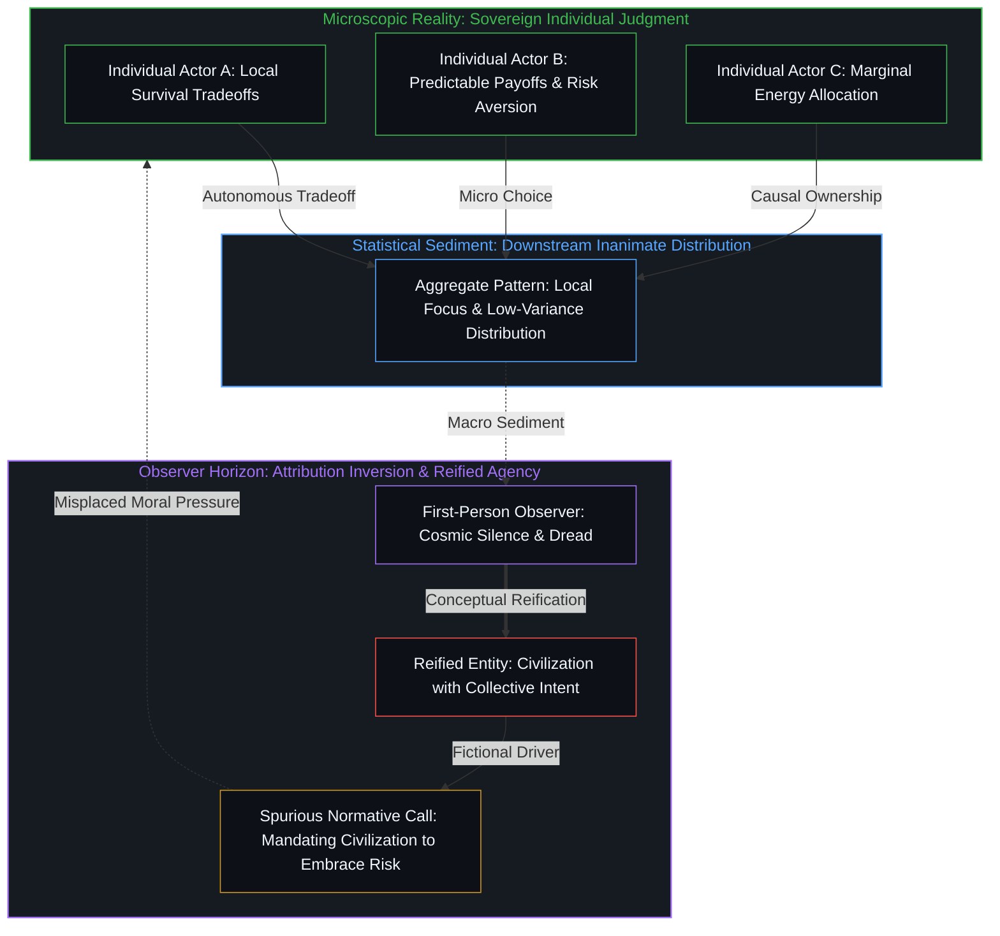
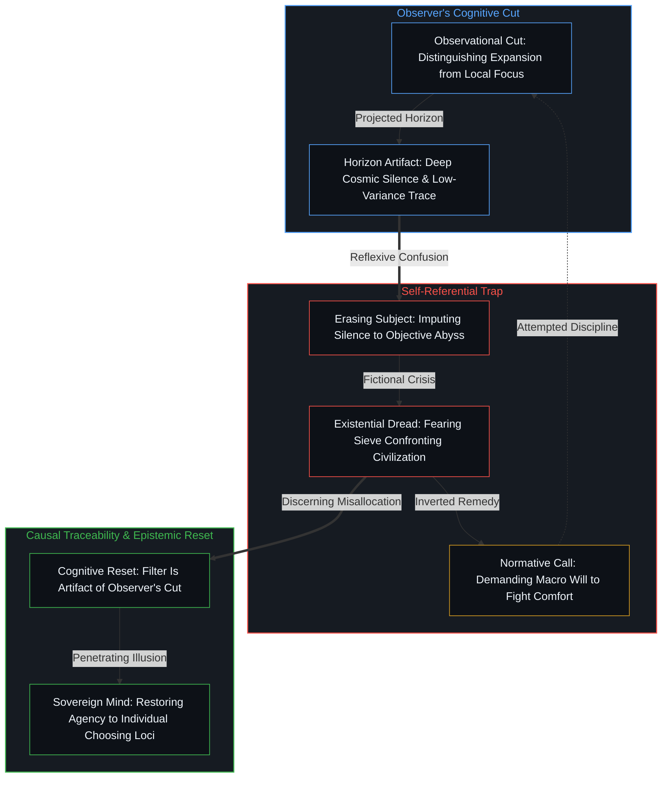
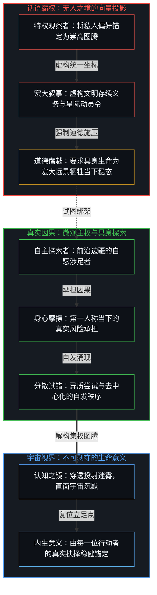
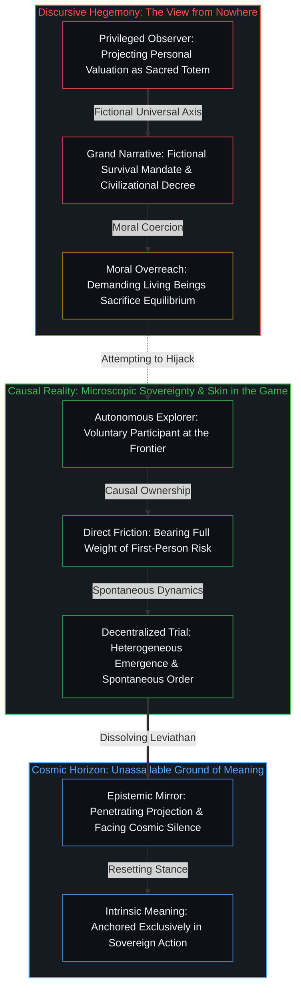

# 费米悖论、主体性错配与大过滤器的投射 / The Fermi Paradox, Reified Agency, and the Projection of the Great Filter

*文明并无独立意志，大过滤器的焦虑源于观察者将统计分布实体化为幽灵主体 / A civilization has no agency; Great Filter dread is an observer reifying aggregate choices into a phantom subject*

费米悖论揭示了银河系广袤时空与可探测技术信号缺失之间的张力，而大过滤器假说则将这种宇宙寂静解释为生命跨越星际扩张时的险峻瓶颈。然而，将瓶颈归咎于“文明”偏好安逸、规避风险或缺乏探索意志，实际上是将千万个体的微观抉择统计汇聚出的宏观分布，错置为拥有自主动机的决策实体。大过滤器的自指焦虑并非系统面临不可逾越的外在深渊，而是观察者以自身切分划定观测差异后，试图将切分主权与观察者自身抹去时所滋生的投射假象。

The Fermi Paradox registers the tension between the vast scale of the galaxy and the absence of detectable technological signatures, while the Great Filter hypothesis interprets this cosmic silence as an impassable sieve in the path to interstellar expansion. Yet attributing this barrier to a "civilization" that chooses comfort, avoids high-variance risk, or loses exploratory drive reifies the aggregate distribution of microscopic choices into a phantom decision-making entity. The characteristic unease surrounding the Great Filter is not evidence of an objective cosmic precipice, but an artifact of an observer who draws an observational cut and then attempts to explain the observing subject out of the picture.

## 一、 宇宙寂静与宏观系统的主体化假想 / 1. Cosmic Silence and the Reification of Civilizational Agency

费米悖论起源于一个直观的观测事实：在尺度辽阔、历史悠久的银河系中，尽管生命与智能在统计学上具备极大的涌现概率，人类却从未截获过任何来自地外技术文明的明确信号。罗宾·汉森提出的大过滤器假说试图回应这一沉默，断言从无机物到可维持星际扩张的文明之间，必然存在至少一个发生概率极低的跃迁台阶。每当这一假说的讨论从冷峻的深空转向人类自身的处境时，舆论焦点便迅速演变为对现代社会体制的诊断：究竟那道险峻的门槛已被我们甩在身后，还是正横亘在前方？伴随这种提问而来的，是对当代制度规避风险、资源投向舒适消费、缺乏高方差探索项目等现象的深切忧虑，仿佛人类正作为一个整体在安逸中走向窒息。

The Fermi Paradox arises from a straightforward observational fact: despite the vast age and scale of the galaxy and the statistical likelihood that intelligence should emerge elsewhere, no unambiguous signatures of technological civilizations have been detected. The Great Filter hypothesis proposed by Robin Hanson responds to this silence by asserting that at least one transition step between the emergence of life and durable interstellar expansion must be extraordinarily improbable. Whenever discussions of this hypothesis turn inward toward humanity, they quickly morph into a diagnosis of modern civilizational arrangements: does the lethal threshold lie in our evolutionary past, or does it loom ahead? Along with this inquiry comes an acute anxiety regarding risk aversion, institutional preference for predictability, and the allocation of resources toward local comfort, as though humanity were suffocating in stability as a single unified body.

此类讨论反复暴露出一种将宏观系统实体化的思维定势。舒适导向的资源配置、官僚机构对可预测性的偏好、对单行星生存脆弱性的忽视，被频频描述为“文明”这一主体的内在退化，并随之附带上一层强烈的道德规训：人类必须恢复愿意承受生存风险的开拓精神，否则便无法通过未来的过滤器。然而，正如在[主体性的错配](../the-misallocation-of-agency/)与[涌现的伪因果：解构“雪崩之罪”与集体概念的归因倒错](../yong-xian-de-wei-yin-guo-yu-ji-ti-gui-yin-dao-cuo/)中所剖析的，所谓的文明、社会或体制并不具备独立的主体性与决断意志。意志与行动主权严格且仅属于具体的具身个体。千千万万个体在自身所处的局部信息、激励机制与生存成本约束下做出取舍，其行动的统计汇聚自然呈现出特定的宏观分布；这一分布是微观选择完成之后的下游结果，其本身既不拥有偏好，也不会做出选择或承受失败。

Such discussions consistently expose a cognitive habit of reifying macroscopic aggregates. Resource allocation toward comfort, bureaucratic preferences for predictability, and indifference to single-planet vulnerability are routinely characterized as tendencies of "civilization" itself, followed by a normative demand: humanity must recover an appetite for existential risk to survive the coming sieve. Yet as analyzed in [The Misallocation of Agency](../the-misallocation-of-agency/) and [The Pseudo-Causality of Emergence](../yong-xian-de-wei-yin-guo-yu-ji-ti-gui-yin-dao-cuo/), an institution, society, or civilization possesses no independent agency or sovereign will. Agency is exercised exclusively by living individuals. When millions of individuals select among available options under their local information, incentives, and cost constraints, the aggregate distribution of their actions naturally displays distinct statistical patterns; these patterns are downstream consequences of choices already made, possessing neither intentions of their own nor the capacity to choose, adapt, or fail.

将因果推力与规训责任指派给“系统”，并非对客观存在的忠实记录，而是观察者自身实施的又一次主体性投射。观察者将无数离散抉择产生的统计规整性，在认知中捏造成一个仿佛能够整体决断的宏观实体，随后对这个虚构实体的“不作为”表达出震惊与焦虑。在[剩余个人主义](../residual-individualism/)中早已阐明，人类事务中唯一的有效变量始终是个体的自主决断。宏观层面的技术停滞或内敛，不是虚构的文明在主观意志上选择了平稳，而是每一位微观行动者在边际收益与现实摩擦面前自主分配注意力的自然沉淀。将统计沉淀倒置为实体动力，恰恰是在用语言层面的幻觉掩盖真实的因果支点。

Imputing causal efficacy and normative accountability to "the system" is not a neutral report of an external entity, but an additional projection of individual agency performed by the observer. The observer takes the statistical regularities produced by separate individual choices, binds them into a fictional collective entity capable of macroscopic choice, and then expresses dismay at this phantom's apparent paralysis. As established in [Residual Individualism](../residual-individualism/), the sole operative variable in human affairs remains individual sovereign judgment. Macroscopic technological deceleration is not a conscious choice made by a collective entity to embrace complacency, but the sediment of discrete actors allocating effort under immediate marginal tradeoffs and felt friction. Inverting statistical sediment into a prime mover uses linguistic illusions to conceal the genuine locus of causality.

## 二、 观察者的观测切分与抽离悖论 / 2. The Observational Cut and the Observer's Reflexive Trap

这一主体性错配直接催生了关于大过滤器的特有恐慌。观察者首先执行了一次认知切分：将那些行动能够产生宏观星际标志（如戴森球、射电爆发现象或行星级扩张）的行动者，与那些将精力投入本地适应、内部稳态或低能耗生存的行动者割裂开来。正是这一次切分，使得一种惊人的差异变得显眼——深空的寂静无声、星际探索激情的消退，以及注意力在局部安全上的收敛。紧接着，观察者却对自己做出的切分所呈现的图景感到措手不及，并试图寻找一种无需追溯至切分者自身的宏观解释。观察者试图把进行解释的主体抽离于图景之外，假装宇宙正在发生一场与观测者毫无关联的客观悲剧。

The existential dread surrounding the Great Filter is generated directly by this misallocation of agency. The observer first executes an observational cut, drawing a stark distinction between agents whose actions yield detectable interstellar markers—such as Dyson swarms, planetary terraforming, or coherent electromagnetic beacons—and agents whose choices favor local equilibrium, computational densification, or low-energy terrestrial adaptation. This cut renders a specific difference visible: the silence of the cosmos, the apparent waning of frontier expansion, and the inward concentration of effort on local stability. The observer is then startled by the difference produced by this very cut, frantically seeking an explanation that avoids returning to the agent who drew the distinction. In doing so, the observer attempts to explain the subject of the explanation out of the picture, pretending an objective tragedy is unfolding independently across cosmic space.

正如在[意识指派与量子切分](../consciousness-ascription-and-the-quantum-cut/)中所确立的准则，所谓的观测结果从来不是孤立客体的属性，而是观察者以自身界面与世界发生作用时所确立的因果边界。在费米悖论的场景中，同样不存在一个客观独立于观测者的“外在过滤器”。外在宇宙的无声，并非一个向外张望的自动化系统所偶然碰壁的物理阻隔；它是具有第一人称心智的行动者施行特定观测切分后的产物，同时杂糅了可能存在的其他智能个体做出的具体选择。未被探测并非独立于切分之外残留的客观事实，而恰恰是切分本身所输出的未注册状态：什么才算作可辨识的文明信号，本身就是观察者确立的判别标准之一；一旦这些准则被置入，其未被满足便只是准则本身的运作输出，并不存在任何能够脱离观察行为来将银河系审视为空旷的第三人称超然视点。在[折叠的连续谱](../the-continuum-of-the-fold/)中曾指出，不同尺度的智能体受限于时标差异而互不显现；而在主体性维度上，深空的沉寂进一步揭示出：并不存在一个需要被拯救或解释的宏观文明主体。因果链条的起点与终点，始终是那些产生可观测规整性的微观个体，以及在这些规整性之间划分界线的观察者。

As established in [Consciousness Ascription and the Quantum Cut](../consciousness-ascription-and-the-quantum-cut/), an observed outcome is never an intrinsic property of an isolated object, but the causal boundary established when an observer engages reality through a specific interface. Within the Fermi Paradox, there is likewise no external filter standing independent of observation. The silence of the cosmos is not an objective obstacle encountered by a passive recording device gazing outward; it is the consequence of an observational cut enacted by living minds, combined with whatever concrete choices other distributed agents have made. Non-detection is not a residual fact that survives the cut, but the non-registration produced by the cut itself: what counts as a signature is itself one of the distinctions drawn, and once those criteria are in place, their non-fulfillment is simply the operational output of the criteria, leaving no further vantage from which the galaxy can be inspected as empty independently of the looking. As explored in [The Continuum of the Fold](../the-continuum-of-the-fold/), disparate intelligences may remain mutually invisible across vast temporal and feedback scales; across the axis of agency, the cosmic silence confirms that there is no macroscopic civilizational subject waiting to be redeemed or explained away. The causal chain begins and ends with individual actors generating regularities, and with the observer who draws distinctions among them.

一旦观察者将微观选择的统计涌现篡改为集体实体的意志决断，随后又对这种转换所产生的沉寂感到恐惧，他就已经陷入了自指的迷宫。他感到恐慌，不是因为人类正撞上一道无法逾越的物理深渊，而是因为他建立了一套抹去自身参与的宏大假定，随后在这个假定中迷失了方向。大过滤器的讨论中所感受到的压抑，恰恰证明了观察者在画出边界之后，又竭力推卸对该边界的认知责任。只要这种将主体性转移给集体的错觉依然存在，悖论就无法澄清，反而会演变为对虚无灾难的无休止内耗。

Once an observer converts the statistical emergence of discrete actions into the conscious intent of a collective entity, only to register terror at the silence produced by that conversion, they become trapped in a self-referential maze. The observer feels dread not because humanity is hurtling toward an impassable physical abyss, but because they have installed a framework that erases their own participation and then become disoriented within their own construct. The unease pervading discussions of the Great Filter demonstrates that an observer has drawn a distinction and then refused to acknowledge their own cognitive role in drawing it. As long as agency is erroneously outsourced to a collective abstraction, the paradox remains unresolved, mutating into endless anxiety over imaginary cosmic doom.

## 三、 道德规训的倒错与微观主权的因果锚点 / 3. The Normative Inversion and the Locus of Microscopic Sovereignty

这种将主体性错置于系统的模式，在当代科技加速主义与末日存亡叙事中达到顶峰。热衷于大过滤器假说的观察者，屡屡将星际扩张包装为一种必须由“文明”统一履行的道德义务，痛斥大众专注于当下生活是缺乏远见的保守退缩。这看似宏大的呼吁，实际是一次隐蔽的主权僭越：个别观察者试图借由“人类面临灭顶之灾”这一崇高图腾，将自己的偏好强加于他人，要求无数真实的具身生命为宏大的星际远景牺牲当下的生存稳态。正如在[向量与投影之谜](../the-vector-and-the-puzzle-of-projections/)中所揭示的，不存在一个高居于所有个体之上的客观坐标系来统摄生命的意义；所谓“文明的存续义务”，不过是特定观察者假借“无人之境”的虚妄全知，将其自身偏好的向量强行投影到所有人头顶上的话语威权。

This misallocation of agency reaches its climax in modern narratives of technological acceleration and existential risk. Observers fascinated by the Great Filter frequently package interstellar expansion as an imperative duty that "civilization" must collectively shoulder, scorning the focus on immediate terrestrial life as decadent complacency. Such impassioned rhetoric projects a heroic veneer, yet embodies a covert overreach: an individual observer invokes the sacred totem of civilizational survival to impose their personal valuation onto others, demanding that living beings sacrifice their immediate equilibrium for a grand cosmic theater. As demonstrated in [The Vector and the Puzzle of Projections](../the-vector-and-the-puzzle-of-projections/), there is no detached cosmic coordinate system standing above individual minds to rank the validity of their purposes; the alleged "survival mandate of civilization" is merely a specific actor feigning a "view from nowhere" to project their personal vector as a universal imperative.

真实的演进与星际探索，从来不会由一个虚构的“文明意志”来下达动员令。人类在航海、航空乃至计算技术上的突破，始终诞生于个别探索者自愿承受前沿摩擦的真实决断中。那些涉足未知边疆的个体，不是因为接收到了“系统拯救人类”的指令，而是在第一人称当下承担了自身抉择的全部风险与因果。任何健康的探索秩序，都依赖于尊重微观主权、允许异质尝试自发涌现的自由土壤。当狂热的拯救者试图将全社会的资源强行绑架上高方差的豪赌时，他们不仅没有跨越假想中的过滤器，反而摧毁了维系生命自主探索与分散试错的因果支点。

Genuine frontier expansion never proceeds from a centralized decree issued by a fictional civilizational will. Historical breakthroughs in navigation, aviation, and computation were forged by individual explorers who chose to bear the direct friction of the unknown. Those who pushed the boundary did so not in obedience to a collective survival mandate, but by accepting the full weight of causality and personal risk in the first-person present. A resilient exploratory field relies on sovereign individuals free to pursue heterogeneous trials and absorb their own consequences. When zealous architects seek to compel society into a high-variance wager in the name of collective survival, they do not circumvent a hypothetical filter; they undermine the causal ground of decentralized trial and error that makes genuine exploration possible.

认清大过滤器叙事中的主体性错配，并不意味着否定星际探索的壮美，亦非转向消极的宿命论。它促使我们从宏大的投射恐慌中清醒过来，重回坚实的第一人称立足点。费米悖论从来不是悬在人类头顶的末日判决，它是一面明澈的认知之镜，时刻提醒着每一个观察者：一切关于宇宙沉默的焦虑、一切关于制度停滞的指控，都出自观察者自身的切分，并且终将对做出切分的心智本身负责。我们无需唤醒一个虚构的文明巨灵去征服星系；唯有每一位具体的行动者守住自身因果抉择的真实权柄，在日常与未知的摩擦中踏实前行，生命才能在辽阔的宇宙中生长出不可剥夺的意义。

Discerning the misallocation of agency within the Great Filter narrative neither denies the majesty of space exploration nor collapses into passive fatalism. It awakens the mind from projected cosmic panic, restoring the sovereign first-person ground. The Fermi Paradox is not an immutable sentence of doom hanging over humanity; it is an epistemological mirror reminding the observer that the silence of the cosmos and the diagnosis of institutional decay are distinctions drawn by the observer, accountable exclusively to the mind that draws them. We need not summon a collective leviathan to conquer the stars; as long as living actors retain sovereign ownership over their choices, meeting both daily existence and the frontier with direct skin in the game, life generates unassailable meaning across the silent universe.
