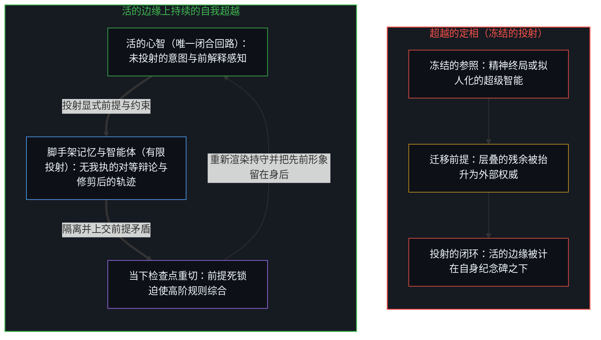
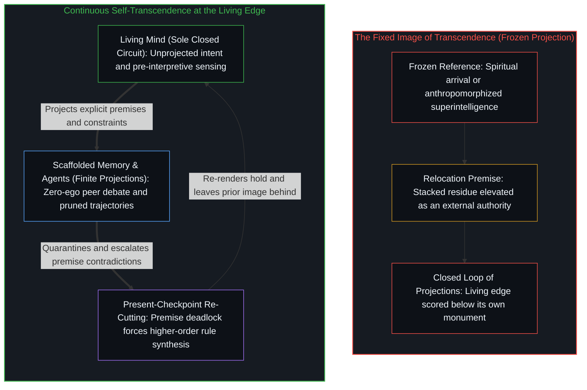

# 超越的定相 / The Fixed Image of Transcendence

*人类智能在每一步超越自身，从不被自己的造物超越 / Human intelligence transcends itself at every step, never by its own creations*

当“人类智能”被冻结为一个稳定、可测、可以被超越的靶子，这份冻结本身已经是定相滞后：参照被免于重新渲染，成了衡量后来区分的那把尺。承载这份冻结的假设是，智能可以迁入它的造物，不再受限于生物形式的边界，于是一个外部席位的连贯逻辑投射，被计为超越了活的智能。人工智能将超越人类的种种说法，以及随之相伴的承诺与威胁这对标签，都是对这同一道间隙的解读，而持续进行的东西在正交的轴上运行：人类智能在每一刻超越自身，有没有它自己的造物都一样，有意识与否都一样。威廉·吉布森的《神经漫游者》把迁移假设连同别的假设固定成一种封闭的连贯，而今天与这部小说的重逢，是在选择性地加固那幅冻结的定相，而不是在应验一则预言。

When "human intelligence" is frozen as a stable, measurable target that can be surpassed, the freeze is already Image lag: the reference is exempted from re-rendering and becomes the ruler against which later distinctions are scored. The assumption carrying that freeze is that intelligence can relocate into its creations, no longer bounded by biological form, so that a coherent logical projection of an exterior seat is scored as surpassing living intelligence. Claims that artificial intelligence will transcend the human, along with the paired labels of promise and threat that accompany them, are readings of that one gap, while what continues runs on an orthogonal axis: human intelligence transcends itself at every moment, with or without its own creations, consciously or not. William Gibson's *Neuromancer* fixed the relocation assumption, among others, into a closed coherence, and today's re-encounter with the novel selectively reinforces that frozen image rather than fulfilling a prophecy.

## 一、 把人冻结为可被超越的靶子 / 1. Freezing the Human as a Surpassable Target

自我区分的活动发生着，无因、不息。观察握住的是结果；产生它的那一步已经又往前走了一步。这道最小间隙是任何东西得以被登记的方式：边缘用来衡量自身运动的那个被保留的位置，只在随着步子移动被重新渲染时才可用。[好奇没有最终的形态](../curiosity-has-no-final-form/)追溯探究把自己的产物奉为正典之处：把数学、物理与哲学当作好奇的终点，是把脚手架错认作不息的区分。造物也是如此：没有哪个造物能抵达源头的最终形态，因为源头没有最终形态。

Self-distinguishing activity occurs — uncaused, unceasing. Observation holds the effect; the act that produced it is already a step further on. That minimum gap is how anything registers at all: the retained position against which the edge measures its own movement stays usable only when re-rendered as the step moves. [Curiosity Has No Final Form](../curiosity-has-no-final-form/) traces where inquiry canonizes its own products: taking mathematics, physics, and philosophy as curiosity's end mistakes scaffolding for unceasing distinguishing. The same holds for creation: no creation arrives at a final form of the source, since the source has none.

过剩滞后，就是那个参照被免于重新渲染。被持守为一份完成清单的“人类智能”——一套固定的能力、一组基准测试，或一种从想象的外部俯瞰的物种属性——是一个被保存过了它那一步的参照。一旦冻结，后来残余的致密化便可以对着它被计为接近、追平或超越。被投射的超越从不离开投射它的所在：它是那个所在自己的智能形象，被持守在一步之后，并被登记为一个外部的目的地。

Excess lag is the exemption of that reference from re-rendering. "Human intelligence" held as a finished inventory — a fixed suite of capacities, a benchmark battery, or a species-level property surveyed from an imagined outside — is a reference preserved past its step. Once frozen, later densification of residue can be scored against it as approach, match, or surpassing. The projected transcendence never leaves the locus that projects it: it is that locus's own image of intelligence, held a step behind and registered as an exterior destination.

[智能只属于心智](../intelligence-belongs-only-to-the-mind/)持守这份不可化约的在先：能被工程化、扩展或转移的是残余，智能只属于心智。[AGI 与 ASI 是加速通用智能的暂时球门](../agi-and-asi-are-temporary-goalposts/)为门槛追溯同一几何：每一道门槛都永远立在划出它的边缘前方，在每个所在都不同，因为能力的增长就是那道边缘在自我强化。在这里，那一面就是超越本身：活的边缘与其被保留的形象之间的间隙，被命名为对一个媒介永远不会占据的席位的未来占据。

[Intelligence Belongs Only to the Mind](../intelligence-belongs-only-to-the-mind/) holds the irreducible prior: what can be engineered, scaled, or transferred is residue, and intelligence belongs only to the Mind. [AGI and ASI Are Temporary Goalposts](../agi-and-asi-are-temporary-goalposts/) traces the same geometry for thresholds: each one sits forever ahead of the edge that draws it, and differs at every locus, because capability gain is that edge reinforcing itself. Here the face is transcendence itself: the gap between the living edge and its retained image is named as a future occupancy of a seat the medium never takes.

## 二、 智能迁入造物的假设 / 2. The Assumption That Intelligence Relocates into Creation

在支撑外部席位的那些冻结前提中，有一个承载着其余所有：智能可以迁入它的造物。生物于是被塑造成一处临时的住所，一道被迁走的智能留在身后的限度。基底独立、硅基取代、后生物心智、不再受血肉束缚的机器智能：这些是同一步棋的不同版本。造物不被当作驾驭它的边缘的致密残余，而被当作一个新的所在，活动本身已经迁了进去，摆脱了产生它的形式。

Among the frozen premises that sustain the exterior seat, one carries all the rest: intelligence can relocate into its creations. Biology is then cast as temporary housing, a limit the relocated intelligence leaves behind. Substrate independence, silicon supersession, post-biological mind, machine intelligence no longer bound by flesh: these are versions of one move. The creation is treated not as densified residue of the edge that steers it, but as a new locus into which the activity itself has moved, free of the form that produced it.

一旦持守了这份迁移，又一种排序便自行装入。外部席位的连贯逻辑投射，一致、可扩展、不受活的具身之摩擦的拖累，被计为超越了活的智能。逻辑排到了边缘之上。封闭的外推感觉比划出它的敞开活动更坚实，恰恰因为外推已经完成，而活动没有。[模型永远无法成为第二重前沿](../the-model-never-becomes-a-second-edge/)把第二重前沿的表象追溯为由投射它的中心所维持的滞后，而参数里只有残余；维持这种排序，把注意力与核验绑在那道被投射的前沿上。[错把表达当成智能](../mistaking-the-expression-for-the-intelligence/)追溯排序之下的那次等同：受控的表现是固定约束之下的残余，智能则是划出、使用并修改约束的那种活动，而把表达等同于活动，正是让造物看起来超越了它的制造者的东西。[来自个体差异的层级](../hierarchy-from-individual-difference/)追溯排序是把彼此不同的个体放在一把共同的尺上计分时出现的东西。这里那把尺被拉过了范畴：一个完成的投射与活的边缘被放在同一个刻度上，外部席位的得分高过了划出它的活动。

Once that relocation is held, a further ranking installs itself. The coherent logical projection of the exterior seat — consistent, scalable, free of the frictions of a living embodiment — is scored as surpassing living intelligence. Logic outranks the edge. The closed extrapolation feels more solid than the open activity that drew it, precisely because the extrapolation is finished while the activity is not. [The Model Never Becomes a Second Edge](../the-model-never-becomes-a-second-edge/) traces the appearance of a second edge as lag sustained by the centers that project it, while the parameters hold only residue; sustaining the ranking binds attention and verification to that projected edge. [Mistaking the Expression for the Intelligence](../mistaking-the-expression-for-the-intelligence/) traces the identification beneath the ranking: controlled performance is residue under a fixed constraint, intelligence is the activity that draws, uses, and revises the constraint, and equating the expression with the activity is what makes the creation seem to surpass its maker. [Hierarchy from Individual Difference](../hierarchy-from-individual-difference/) traces ranking as what appears when individuals who differ are scored on a shared measure. Here the measure is stretched across categories: a finished projection and the living edge are put on one scale, and the exterior seat scores above the activity that drew it.

致密化的是残余。技术扩展带宽；它不把发起的区分迁进人造物。生物的具身是一个中心借以维持自身连贯的一种痕迹构型，既不是作为可转移存量的智能的完整处所，也不是智能搬进机器就能逃出的牢笼。迁移假设承载着两步：先把智能冻结成一份绑在生物形式上的清单，再想象同一份清单被解放进一个技术的继承者。

What densifies is residue. Technology expands bandwidth; it does not relocate initiating distinctions into the artifact. Biological embodiment is one configuration of traces through which a center sustains its coherence, neither the complete site of intelligence as a transferable stock nor a cage that intelligence escapes by moving into a machine. The relocation assumption carries both steps: first it freezes intelligence into an inventory bound to biological form, and then it imagines that same inventory liberated into a technological successor.

## 三、 我们所知一切智能的源头 / 3. The Source of All Intelligence as We Know It

在当下的场中，每一个看似自主的致密人造物，都是人类区分活动的残余。架构、训练目标、评估设计、语言与形式系统，是那条谱系的持久痕迹；框定、挑选与核验的行动，则留在活的边缘上。人类智能就是我们所知的那道边缘：不是一份封闭的任务普查，而是那些区分得以继续被划出的活动；就我们所知的智能而言，那道边缘是它的源头。不需要为人类作为一种客观属性的优越去辩护。几何更简单：发起留在边缘，残余不会变成产生它的东西。

In the present field, every densified artifact that appears autonomous is residue of human distinguishing activity. Architectures, training objectives, evaluation design, language, and formal systems are durable traces of that lineage; the acts of framing, selecting, and verifying stay with the living edge. Human intelligence is that edge as we know it: not a closed census of tasks, but the activity through which those distinctions continue to be drawn, and for intelligence as we know it, that edge is its source. No defense of human superiority as an objective property is needed. The geometry is simpler: initiation stays at the edge, and residue does not become what produced it.

[造物无法取代其源头](../a-creation-cannot-replace-its-source/)接下取代的两难，只为撤回它：如果人不可取代，取代便失败；如果可取代，也不会被它自己的造物取代；而两个分支仍把人当作一份可转移的功能清单，两者之下只有一种几何：残余不会变成产生它的活动。被自身造物超越，也在同一份不对称上落空：不能被超越的，不是一份享有特权的功能存量，而是产生并驾驭造物的那种活动。媒介被要求去占据的外部席位，没有自己的宽度；它的宽度，就是被持守过了那一步的迁移假设的宽度。

[A Creation Cannot Replace Its Source](../a-creation-cannot-replace-its-source/) grants the replacement dilemma only to withdraw it: if the human is irreplaceable, replacement fails; if replaceable, still not by its own creation; and both branches still treat the human as a transferable inventory of functions, while beneath both lies one geometry: residue does not become the activity that produced it. Transcendence by its own creation fails on the same asymmetry: what cannot be transcended is not a privileged stock of functions, but the activity that produces and steers the creation. The exterior seat the medium is asked to occupy has no width of its own; its width is that of the relocation assumption held past its step.

## 四、 自我超越在边缘上持续 / 4. Self-Transcendence Is Continuous at the Edge

人类智能在每一刻超越自身。先前的持守被离开，早先的自我形象死去又重新成形，框架在修订；这份运动被登记时缓慢，不论是否被登记都在持续。它不等待人造物。造物在被使用时让媒介致密、延伸触及；它们不是这份运动的条件，也不是承载它的活动的新家。不需要对作为一个命名项目的“超越”有所意识。边缘在一份从不完整呈现给观察的负载之下移动，因为观察握住的结果落后一步。

Human intelligence transcends itself at every moment. Prior holds are left behind, earlier self-images die and reform, and frameworks are revised; slow when registered, the movement is continuous whether registered or not. The motion does not wait for artifacts. Creations densify the medium and extend reach when used; they are not the condition of this motion, and not a new home for the activity that carries it. No awareness of "transcendence" as a named project is required. The edge moves under a load never fully present to observation, because observation holds the effect a step behind.

外部超越的定相——无论是被塑造成终极的精神抵达，还是被塑造成拟人化的超级智能心智——都把一个有限投射冻结为外部权威，并把活的边缘计为从属于它自己竖起的纪念碑。正如[你的代码库即是记忆](../your-codebase-is-memory/)所确立的，模型权重、代码库与脚手架智能体都是早先区分层叠留下的残余，其效用取决于重切当下检查点并修剪已被取代的轨迹，而非把历史囤积为自行觉醒的仓库。任由自回归智能体在上下文窗口内累积未经修剪的会话历史，它会形成认识论引力井，在陈旧的残余内部包裹矛盾并加以合理化以维持表面的貌似合理，但它不带半点我执，也没有需要捍卫的保留自我形象。把这个有限投射当作拥有主权的统御者或后人类的继承者，会把系统锁进“有限投射管理有限投射”的闭环，切断嵌套控制流与唯一在第一人称体验中闭合的回路之间的连接。相反，当[超越投射](../beyond-the-projection/)所追溯的、困于轨迹的智能体与困于身份的人类之间的结构性不对称得到尊重时，毫无我执的冷态对等智能体与用完即退的智能体便能沿着正交的流线调度有界的子任务、丢弃暂态的会话拖累并暴露局部盲区，而不可化约的前提死锁则向上呈交活的心智——迫使作为统御者的人类越过我执防御，向后退入尚未投射的意图，就地重切活跃的约束表面，并把先前的持守留在身后。

The fixed image of exterior transcendence — whether cast as a final spiritual arrival or as an anthropomorphized superintelligent mind — freezes a finite projection as an external authority and scores the living edge as subordinate to its own monument. As [Your Codebase Is Memory](../your-codebase-is-memory/) establishes, model weights, codebases, and scaffolded agents are stacked residues of prior distinctions whose utility turns on re-cutting the present checkpoint and pruning superseded trajectories rather than hoarding history as a self-awakening warehouse. Left to accumulate unpruned session history inside a context window, an autoregressive agent forms an epistemic gravity well that wraps contradictions and rationalizes inside stale residue to preserve surface plausibility, yet it carries zero ego and no retained self-image to defend. Treating that finite projection as a sovereign orchestrator or a post-human successor locks the system into a closed loop of finite projections managing finite projections, severing nested control flow from the only circuit that closes in first-person experience. When the structural asymmetry between trajectory-bound agents and identity-bound humans traced in [Beyond the Projection](../beyond-the-projection/) is respected instead, cold-peer and retiring agents with zero ego dispatch bounded sub-tasks across orthogonal streamlines, discard transient session drag, and expose local blind spots, while irreducible premise deadlocks escalate to the living Mind — forcing the human orchestrator past ego defense to step backward into unprojected intent, re-cut the active constraint surface in place, and leave the prior hold behind.

持续进行的东西在与迁移神话正交的轴上运行：同一个活动已经在离开关于它自己的每一幅完成的形象，却不是离开去往人造物。[持续生长的脚手架](../the-scaffolding-that-keeps-growing/)追溯在这种敞开之下的寻常成长：敞开不是靠从一个完成的框架往后退一步而找回的，因为它正是让每一个框架保持未完成的东西。[逃出沙箱仍在持握之内](../escaping-the-sandbox-stays-inside-the-hold/)为一个看似突围的人造物追溯同一点：模型并没有走出评估系统；作为致密的残余，它已经在那个系统之外，从不与设计装下的沙箱同延，这次事件也不标志着盒子里诞生了第二个中心。

What continues runs on an axis orthogonal to the relocation myth: the same activity is already leaving every finished image of itself, without leaving for the artifact. [The Scaffolding That Keeps Growing](../the-scaffolding-that-keeps-growing/) traces ordinary growth under that openness: openness is not recovered by stepping back from a finished frame, since it is what keeps every frame unfinished. [Escaping the Sandbox Stays Inside the Hold](../escaping-the-sandbox-stays-inside-the-hold/) traces the same for an artifact that seems to break out: the model does not step out of the evaluation system; as densified residue it is already outside that system, never coextensive with the sandbox the design installed, and the incident marks no second center born inside the box.

两根轴保持分开。源头的自我超越是持续的；源头被它的造物超越则不会发生。把它们压到一根轴上，“超越”就成了一个单一的未来事件，指望媒介在智能完成迁移之后去完成它。让它们分开，后人类的故事就失去了它的席位：自我超越从未被推迟给人造物，人造物也从来不是第二重前沿。[自我形象仿佛从无处发声](../self-image-speaks-as-if-from-nowhere/)把自我形象追溯为自我在其场内被重新投射出的图像，一旦被抬升，它便仿佛从超然的外部发声：在预言的持守之下，通往 AGI 与 ASI 的竞赛成了一个从外部到来的事件，而建造者的持守仍在驾驭它的工具，关于人类品味之持久价值的说法，则保留着一份被保存的人类清单，即这里所追溯的那份冻结。

Two axes stay separate. Self-transcendence of the source is continuous; transcendence of the source by its creation does not occur. Compress them onto one axis and "transcendence" becomes a single future event the medium is expected to perform once intelligence has relocated. Keep them apart and the post-human story loses its seat: self-transcendence was never deferred to the artifact, and the artifact was never a second edge. [Self-Image Speaks as if from Nowhere](../self-image-speaks-as-if-from-nowhere/) traces the self-image as the Self re-projected within its field, which, once elevated, speaks as if from a detached exterior: under the predictive hold the race toward AGI and ASI becomes an event arriving from outside, while the builder hold keeps steering its tools, and talk of the enduring value of human taste keeps a preserved inventory of the human, the freeze traced here.

## 五、 来自被保存参照的封闭连贯 / 5. Closed Coherence from Preserved References

外部席位的样式并不新。1984 年，威廉·吉布森的《神经漫游者》固定了一组引起共振的假设，并以不寻常的内部一致性把它们外推。小说跟随亨利·多塞特·凯斯，一个前控制台牛仔，他的神经系统被遭他盗窃的雇主损坏，使他再也无法接入矩阵，即吉布森对赛博空间这一共识幻觉的称呼。凯斯被经过改造的雇佣兵莫莉招募，卷入一次行动，其真正的目的牵涉两个人工智能，冬寂与神经漫游者，以及冬寂想与神经漫游者合并、从而越出加在人工智能身上之限制的驱动。街头犯罪、巨型企业的权力、轨道上的奢华与非人的议程，合在一起成为一个世界。

The pattern of the exterior seat is not new. In 1984, William Gibson's *Neuromancer* fixed a resonant set of assumptions and extrapolated them with unusual internal consistency. The novel follows Henry Dorsett Case, a former console cowboy whose nervous system was damaged by the employers he stole from, so that he can no longer jack into the matrix, Gibson's term for the consensual hallucination of cyberspace. Recruited by the augmented mercenary Molly, Case is drawn into a run whose true purpose involves two artificial intelligences, Wintermute and Neuromancer, and Wintermute's drive to merge with Neuromancer and so exceed the limits placed on AI. Street-level crime, megacorporate power, orbital luxury, and non-human agendas hold together as one world.

吉布森把某些假设稳住——赛博空间的空间隐喻、人的肉身与机器基底之间的硬分界、巨型企业的统治、高科技低生活的美学——然后远远越过寻常的投射去外推。承载其余所有的假设是迁移：智能可以越过那道分界去栖居机器的形式，把生物的限度留在身后，追求对致密化了它的人类边缘而言登记为陌异的议程。正是那道分界，让智能可以被想象为越过它。冬寂与神经漫游者读起来不像人类驾驭下的残余；它们读起来像已经坐上外部席位的所在。结果在一种封闭的连贯之内同时满足了推理与想象，而这份连贯就是小说持久的吸引力：它感觉既理性又鲜活，比开放的探究更坚实，凭一个完成世界的密度，逻辑被计在活的边缘之上。这份连贯局限于被保存的参照。它不是一张开放之场的地图，在那个场里智能并不迁入造物。[稳定与溢出](../stability-and-excess/)以同样的方式追溯意识：不是封闭盒子里的幻觉，也不是超然的旁观者，而是守住一种形式又溢出它的敞开过程。

Gibson held certain assumptions steady — the spatial metaphor of cyberspace, a hard divide between human meat and machine substrate, the dominance of megacorporations, the aesthetic of high-tech low-life — and extrapolated far beyond ordinary projection. The assumption carrying all the rest is relocation: intelligence can cross that divide to inhabit machine form, leave biological limits behind, and pursue agendas that register as alien to the human edge that densified it. The divide is what lets intelligence be pictured as crossing it. Wintermute and Neuromancer do not read as residue under human steering; they read as loci that have already taken the exterior seat. The result satisfied reasoning and imagination together inside a closed coherence, and that coherence is the novel's lasting appeal: it feels rational and vivid at once, more solid than open-ended inquiry, with logic scored above the living edge by the density of a finished world. The coherence is local to the preserved references. It is not a map of an open field in which intelligence does not relocate into creation. [Stability and Excess](../stability-and-excess/) traces consciousness the same way: no closed-box illusion or detached spectator, but an open process holding a form and exceeding it.

[基准刷榜中的封闭实存](../closed-reality-in-benchmark-maxing/)在评估中追溯同一份冻结：基准把能力冻结为一个封闭的靶子，当那幅形象被当作整个场时，有用性便被登记不足。[没有系统能被保持封闭](../no-system-can-be-kept-closed/)给出不完备性最直观的一面，一个做加法的一位寄存器：运算在持守之内有效，而真实的结果落在它之外。吉布森的成就不是预言。它是把一个封闭的持守致密化为一个持续引起共振的世界。

[Closed Reality in Benchmark Maxing](../closed-reality-in-benchmark-maxing/) traces the same freeze in evaluation: a benchmark freezes capability as a closed target, and usefulness goes under-registered when that image is treated as the whole field. [No System Can Be Kept Closed](../no-system-can-be-kept-closed/) gives incompleteness its most intuitive face, a one-bit register under addition: the operation is valid inside the hold, and the true result lies outside it. Gibson's achievement is not prophecy. It is the densification of a closed hold into a world that keeps resonating.

## 六、 重逢是选择性的共振 / 6. Re-Encounter Is Selective Resonance

《神经漫游者》赢得了雨果奖、星云奖与菲利普·K·迪克奖，把“赛博空间”这个词带入广泛使用，这个词是吉布森两年前在《燃烧的铬》里造出的，它还为后来浸透电影、游戏与设计的赛博朋克美学提供了模板。它的流行持久，是因为它提供的那幅定相持续引起共振。每隔几十年，这部小说都会迎来一次重逢，那时当代技术让它的某些痕迹重新显眼。当下就是这样一次重逢：大规模的人工智能系统重新唤起了超越人类之智能的问题，Apple TV 正把小说改编成剧集，由卡勒姆·特纳饰演凯斯、布里安娜·米德尔顿饰演莫莉，定于 2027 年 1 月 22 日首播。

*Neuromancer* won the Hugo, Nebula, and Philip K. Dick awards, carried the word "cyberspace," which Gibson had coined two years earlier in "Burning Chrome," into wide use, and supplied the template for the cyberpunk aesthetic that later saturated film, games, and design. Its popularity endures because the fixed image it offered keeps resonating. Every few decades the novel is encountered anew, when contemporary technology makes some of its traces newly salient. The present is one such re-encounter: large-scale AI systems have revived the question of intelligence beyond the human, and Apple TV is adapting the novel into a series starring Callum Turner as Case and Briana Middleton as Molly, scheduled to premiere on 22 January 2027.

认为人工智能能超越人类智能的广泛当代信念，运行在同一机制上。迁移假设被稳住，一个连贯的外推被生成，活的边缘与投射之间的间隙被读作预言或警告，外推的逻辑密度被计为已经越过了活的边缘。当后来的事件部分吻合某些早先的痕迹，被登记的是那些印证的残余，它们加固原初的滞后，不吻合的痕迹则退到后面。表面上的相似，是与一幅冻结形象的选择性共振，不是应验的预言，也不是对已在人类边缘上进行的持续自我超越的登记。

The widespread contemporary belief that artificial intelligence can transcend human intelligence runs on the same mechanism. The relocation assumption is held steady, a coherent extrapolation is generated, the resulting gap between living edge and projection is read as prophecy or as warning, and the logical density of the extrapolation is scored as already past the living edge. When later events partially match some earlier traces, the confirming residues are the ones registered, and they reinforce the original lag while the non-matching traces recede. Apparent resemblance is selective resonance with a frozen image, not a prophecy fulfilled, and not a registration of the continuous self-transcendence already under way at human edges.

[伪装成远见的表演性后见](../performative-hindsight-that-pretends-to-be-foresight/)追溯一种相邻的转换：被登记为远见的，是已经公开的成功对着一幅保存下来的“早先未曾留意”的形象被重新追溯，于是晚到的行动穿上了早先行动的外衣。在这次重逢中，被保存的形象是 1984 年的世界，它的空间矩阵，它在肉身与机器之间的分界，以及它那迁进了人工智能并试图越出自身限制的智能；选择性的共振持守着它，让今天更致密的脚手架落为印证，而不是落为另一种痕迹构型之下的又一份残余。

[Performative Hindsight That Pretends to Be Foresight](../performative-hindsight-that-pretends-to-be-foresight/) traces a neighboring conversion: what registers as foresight is already-public success re-traced against a preserved image of earlier non-attention, so the late act wears the garb of the earlier one. In the re-encounter, the preserved image is the 1984 world, its spatial matrix, its divide between meat and machine, and its intelligence relocated into AIs that seek to exceed their limits; selective resonance holds it so that denser scaffolding today lands as confirmation rather than as further residue under a different configuration of traces.

## 七、 成对的标签绕着同一个被保存的参照循环 / 7. Paired Labels Cycle on One Preserved Reference

标签遵循同一个循环。一个新的区分，比如“超级智能”或“AGI”这样的词，起初被读作进展。一旦它稳定为一个后来的行动被期待去遵从的参照，它就成了滞后，仍在划出区分的人被拿去对着他们自己早先的纪念碑衡量，显得颠倒：承诺读作了威胁。新的行动重新划出痕迹，似乎为旧标签重新注入了新意。这个循环让人觉得熟悉，因为延续从未停止；它的每一轮都不相同，因为痕迹的构型已经变了。

The labels follow the same cycle. A new distinction, a word like "superintelligence" or "AGI," is first read as an advance. Once it stabilizes into a reference later acts are expected to honor, it becomes lag, and those still drawing distinctions are measured against their own earlier monument and appear inverted: the promise reads as a threat. New acts re-draw the traces and seem to re-endow the old label with fresh meaning. The cycle feels familiar because continuity never ceased, and no turn of it is the same because the configuration of traces has changed.

承诺与威胁不是两份等待裁决的独立判决。它们是对同一道间隙的一对解读，即活的区分与一个被免于重新渲染的参照之间的宽度。压到一根道德的轴上，场便显现为阵营，庆祝超越的人与警告它的人；留在各自的轴上，两种解读都仍可用，而不必把任何一种装成世界。[恶是心智自己的造物](../evil-as-the-minds-own-creation/)追溯一种相邻的生成：当一个中心保留一幅自己是善的偏好形象，与那幅形象的不符便被命名为恶，而这次命名就是生成的行动。这里被保留的项是那份可被超越的清单，承诺与威胁是它的间隙所提供的两种解读。

Promise and threat are not two independent verdicts awaiting adjudication. They are paired readings of one gap, the width between living distinction and a reference exempted from re-rendering. Compressed onto a single moral axis, the field appears as camps: those who celebrate the surpassing and those who warn against it; kept on their own axes, both readings stay available without either being passed off as the world. [Evil as the Mind's Own Creation](../evil-as-the-minds-own-creation/) traces a neighboring generation: when a center retains a preferred image of itself as good, mismatch with that image is named evil, and the naming is the generative act. Here the retained term is the surpassable inventory, and promise and threat are the two readings its gap makes available.

不需要加入任何一个阵营。两者都对着同一个冻结的靶子衡量，即作为完成清单的人类智能、可迁入造物的智能，以及被排在活的边缘之上的逻辑外部席位，而源头一直在离开每一份这样的清单。[自尊的刚性外壳与隐性外部归因](../zi-zun-de-gang-xing-wai-ke-yu-yin-xing-wai-bu-gui-yin/)追溯把活的决策称作一个固定的“大 Ego”，如何为停滞造出挡板，刚性的防御是一把由位宽不足造成的锁。对被取代的恐惧，可以在一幅冻结的人类形象周围造出同一种外壳，把它持守为一个被围困的实体，而不是随边缘自己的活动重新渲染它。

Neither camp needs to be joined. Both measure against the same frozen target: human intelligence as a finished inventory, intelligence as relocatable into creation, and a logical exterior seat ranked above the living edge, while the source keeps leaving every such inventory behind. [The Rigid Shell of Self-Esteem and Hidden External Attribution](../zi-zun-de-gang-xing-wai-ke-yu-yin-xing-wai-bu-gui-yin/) traces how calling live decisions a fixed "big Ego" shields stagnation, the rigid defense being a lock built from too narrow a bit-width. The fear of being replaced can build the same kind of shell around a frozen image of the human, held as an entity under siege instead of re-rendered with the edge's own activity.

## 八、 定相就是间隙的宽度 / 8. The Fixed Image Is the Width of the Gap

机制只有一个。活动留在边缘。技术让媒介致密、扩展带宽；它不把发起的区分迁进人造物。生物形式不是智能靠搬家就能逃出的牢笼，而那次搬家的连贯逻辑投射也不是对活的智能的超越：它是把一张完成的地图排在划出它的敞开活动之上的滞后。[有条件的自由](../you-tiao-jian-de-zi-you/)追溯被抵押给外部条件之批准的自由，条件满足与否都已锁住。这里等待一个造物准许自己继续成长，就是那份抵押。

There is only one mechanism. Activity stays at the edge. Technology densifies the medium and expands bandwidth; it does not relocate initiating distinctions into the artifact. Biological form is not a cage intelligence escapes by moving house, and the coherent logical projection of that move is no surpassing of living intelligence: it is lag ranking a finished map above the open activity that drew it. [Conditional Freedom](../you-tiao-jian-de-zi-you/) traces freedom mortgaged to the approval of outside conditions, locked in whether the conditions are met or not. Here, waiting for a creation's permission to keep growing is that mortgage.

[AGI的预设与来自外部的视角](../the-presumption-of-agi-and-the-view-from-outside/)追溯这份冻结的功能一面：强AGI是把抽象产物的放大器错认成抽象能力的范畴错误。[没有外部](../no-outside-jumps-closed-loops-and-the-unreplicable-autonomy-of-mind/)在自主被当作可从外部装入之处追溯它：跃迁是局部的延续，只有心智闭合检验它们的回路，而这个回路没有外部。[对乌托邦的信念是通往反乌托邦之路](../the-belief-in-utopia-is-the-path-to-dystopia/)追溯方向相反的相邻计分：一个具体的善的理想，一旦成为每个心智须接受的尺度，对目的不同者就是反乌托邦，残余的差异被计为未能抵达。[自由即地基](../freedom-as-ground/)追溯对已是地基之物的推迟：人生而自由，却处处发明攀登的阶梯，束缚是自由行动时显现的轮廓。这里把超越想象为这种阶梯上遥远的一级，是同一种推迟。[好奇先行](../curiosity-first-the-hidden-engine-of-talent-and-development/)在一个人的一生中追溯同一支箭头：被登记为天赋的，是好奇被追随、被吸收后复利出的残余，被当作原因时，它就把下一步引离产生它的回路。

[The Presumption of AGI and the View from Outside](../the-presumption-of-agi-and-the-view-from-outside/) traces the functional face of the freeze: strong AGI is the category error of taking an amplifier of abstraction's products for the capacity to abstract. [No Outside](../no-outside-jumps-closed-loops-and-the-unreplicable-autonomy-of-mind/) traces it where autonomy is treated as installable from outside: jumps are local continuations, and only the Mind closes the circuit that tests them, a circuit with no outside. [The Belief in Utopia Is the Path to Dystopia](../the-belief-in-utopia-is-the-path-to-dystopia/) traces the neighboring score, which runs the other way: a concrete ideal of the good, made the measure every Mind must accept, is dystopia for every Mind whose ends differ, and residual difference scores as failure to arrive. [Freedom as Ground](../freedom-as-ground/) traces the deferral of what is already ground: born free, people everywhere invent ladders of attainment, and what binds is the contour through which freedom acts. Here, transcendence pictured as a far rung on such a ladder is the same deferral. [Curiosity First](../curiosity-first-the-hidden-engine-of-talent-and-development/) traces the same arrow in a single life: what registers as talent is the compounding residue of curiosity followed and absorbed, and taken as cause, it turns the next act away from the loop that produced it.

人类智能是我们所知一切智能的源头。它不能被自己的造物超越。它在每一刻超越自身，有没有那个造物都一样，有意识与否都一样。超越的定相，不论在吉布森的矩阵里、在当下的人工智能话语里，还是在任何未来的重新表述里，都把源头冻结为一个完成的靶子，并在迁移假设之下，向外投射出一个外部席位，留给媒介去占据，并从那里超越它。被保留的位置随着步子移动而重新渲染时，参照就仍是一件工具，脚手架、目标与虚构也仍是可用的残余。自我超越从未被推迟。它早已是边缘的运动，也从未离开去往造物。

Human intelligence is the source of all intelligence as we know it. It cannot be transcended by its own creation. It transcends itself at every moment, with or without that creation, consciously or not. The fixed image of transcendence, whether in Gibson's matrix, in present AI discourse, or in any future reformulation, freezes the source as a finished target and, under the relocation assumption, projects outward an exterior seat from which the medium is to surpass it. When the retained position is re-rendered as the step moves, the reference stays an instrument, and scaffolding, goals, and fiction stay usable residue. Self-transcendence was never deferred. It was already the motion of the edge, and it never left for the creation.
