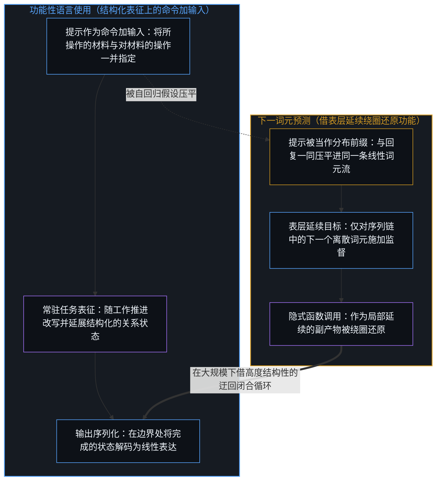
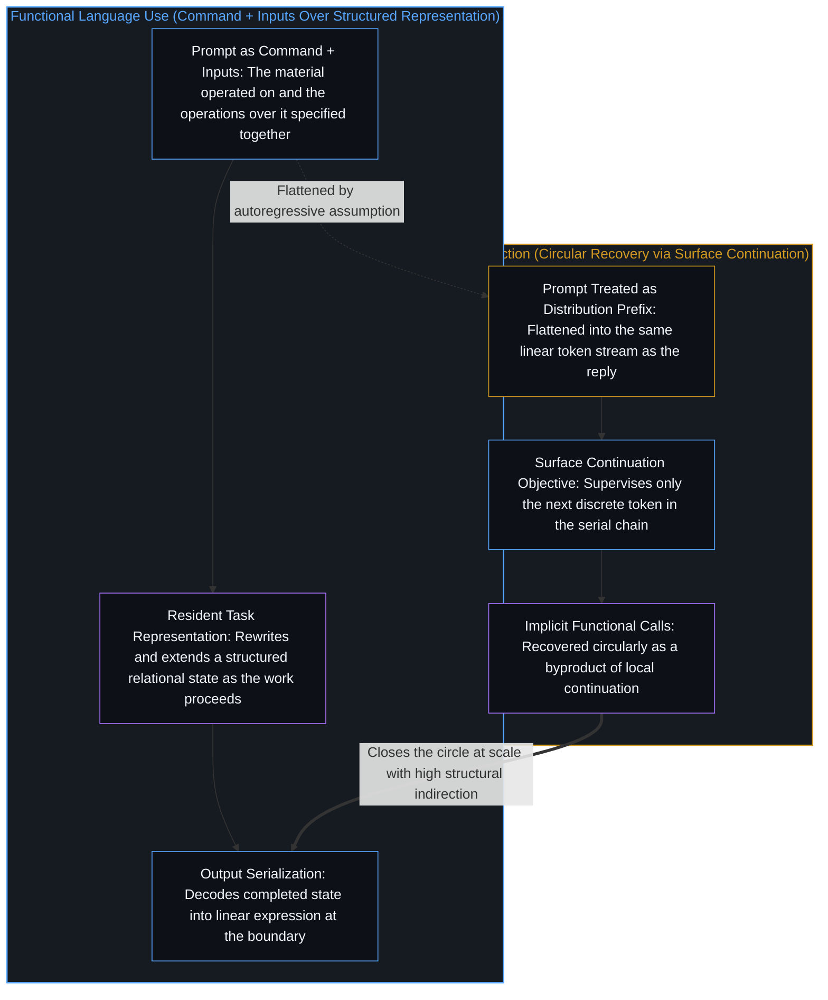
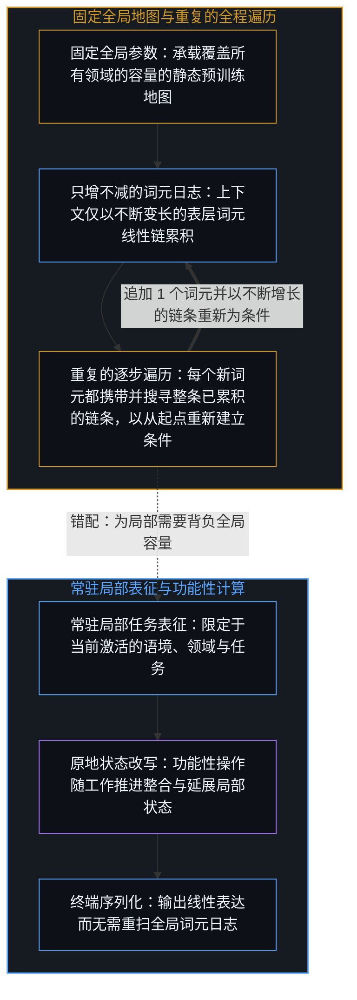
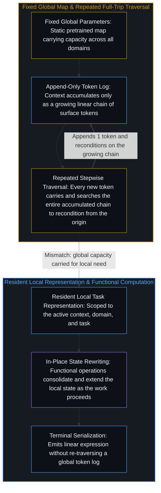

# 固定地图与重复的行程 / The Fixed Map and the Repeated Trip

*语言的双重性让循环能够闭合，但闭合并不消除每次从起点重走的代价。 / The duality of language lets the circle close, yet closing does not erase the cost of restarting every step from the origin.*

下一词元预测产出了当前在用的能力最强的语言模型。它极为有效。它也极为低效，且这种低效是结构性的。这一方法优化的是序列化表达的延续，把预测与压缩的对偶推向规模化，即[开放场域中的无损知识不自洽](../lossless-knowledge-of-an-open-field-is-incoherent/)在文本痕迹上追溯的那一对偶。语言的使用则以还原所意指的意义、计算互补的结果为中心。二者借由语言的双重性彼此关联，却并非同一过程。有效性表明，这条绕圈的路径能够在大规模下走通。但它并不表明，这条路径就是非走不可的那一条。

Next-token prediction has produced the most capable language models in current use. It is highly effective. It is also highly inefficient, and the inefficiency is structural. The method optimizes the continuation of serialized expressions, scaling the prediction-compression dual that [Lossless Knowledge of an Open Field Is Incoherent](../lossless-knowledge-of-an-open-field-is-incoherent/) traces over textual traces. Language use centers on the recovery of intended meanings and the computation of complementary results. The two are related through the duality of language, but they are not the same process. Effectiveness shows that the circular route can succeed at scale. It does not show that the route is the one that must be taken.

## 一、 序列化是表达的属性，不是意义的结构 / 1. Serialization Is a Property of Expression, Not the Structure of Meaning

言说与书写迫使意义进入离散单元构成的线性序列。这是信道的约束。意义本身登记在心智作出区分之处：它是结构化的、关系性的、多维度的，投射自[维度即投影](../dimensions-are-projections/)所追溯的高维区分场域。单一意图可以具有共时的多个侧面；一个概念可以具有并非按从左到右排列的内部结构；一份共同理解可以是一种联合构型，而非一串不断变长的字符。下一词元预测直接运作于序列化表达之上，哪怕切分边界如[学到的边界与给定的尺度](../learned-boundaries-and-the-given-rate/)所考察的那样随语境自适应调整。训练目标与生成回路都在词元链上运作。任何关系结构都是从这些线性序列的模式中按统计方式重建出来的。序列位置与内容之间的同一道分野，也在长上下文注意力索引内部再度显现：按位置对相邻键作池化的块稀疏索引器会把彼此不同的转折抹成一片，并在一千万词元规模下把注意力层预填充时间的 98% 花在扫描寻键上；[潜空间稀疏注意力](https://arxiv.org/abs/2610.42147)则按内容相似性而非序列位置对键作层级聚类——然而这些簇是在编码自序列前缀的键之上形成的，因此这一归组本身依然是从词元链中按统计方式重建出来的。互补的或整体的各个侧面必须先从词元流中还原出来，再重新序列化回词元流之中。这一架构并非在任务的常驻结构化表征上运作，而是在意义已经被表达出来的序列形式上运作。

Speech and writing force meaning into a linear sequence of discrete units. That is a constraint of the channel. Meaning itself registers where a Mind distinguishes: structured, relational, and multi-dimensional, projected from the high-dimensional field of distinctions that [Dimensions Are Projections](../dimensions-are-projections/) traces. A single intention can have simultaneous aspects; a concept can have internal structure that is not ordered left-to-right; a shared understanding can be a joint configuration rather than a growing string. Next-token prediction operates directly on the serialized expressions, even when segmentation boundaries adapt per context as [Learned Boundaries and the Given Rate](../learned-boundaries-and-the-given-rate/) examines. The training objective and the generation loop both work on the token chain. Any relational structure is reconstructed statistically from patterns in those linear sequences. The same split between sequence position and content reappears inside long-context attention indexing: where block-sparse indexers that pool adjacent keys by position blur distinct turns and spend 98% of attention-layer prefill time at ten million tokens scanning for keys, [Latent Sparse Attention](https://arxiv.org/abs/2610.42147) groups keys hierarchically by content similarity rather than sequence position — yet those clusters are formed over keys encoded from the serial prefix, so the grouping is itself reconstructed statistically from the token chain. Complementary or holistic aspects must be recovered from, and then re-serialized into, the token stream. Rather than operating on a resident, structured representation of the task, the architecture works on the serial form in which meaning has already been expressed.

## 二、 提示是命令加输入，不是前缀 / 2. A Prompt Is a Command Plus Inputs, Not a Prefix

在实际使用中，提示充当的是命令加输入——一份应当被执行以产出互补结果的规约。它更接近一次函数调用，而非一段有待续写的前缀。下一词元预测则将提示当作与所期望的续写同属一个分布的前缀。指令微调、RLHF 与工具使用接口教会模型：某些前缀之后跟着某些续写，借此把模型推向功能性行为；它们使分布专门化的方式，正是[机器智能作为人类智能的组合反馈回路](../machine-intelligence-as-the-combinatorial-feedback-loop-of-human-intelligence/)所追溯的逐层条件化。这种函数调用依然是隐式的、绕圈的，而非原生的。模型获得有用的语言级功能，是把表层续写做对的副产物，而非架构的首要对象。

In actual use a prompt functions as a command plus inputs — a specification that should be executed to produce a complementary result. This is closer to a function call than to a prefix that should be continued. Next-token prediction treats the prompt as a prefix belonging to the same distribution as the desired continuation. Instruction tuning, RLHF, and tool-use interfaces push models toward functional behavior by teaching that certain prefixes are followed by certain continuations, specializing the distribution through the successive conditioning layers traced in [Machine Intelligence as the Combinatorial Feedback Loop of Human Intelligence](../machine-intelligence-as-the-combinatorial-feedback-loop-of-human-intelligence/). The functional call remains implicit and circular rather than native. The model arrives at useful language-level functions as a byproduct of getting the surface continuation right, not as the primary object of the architecture.

## 三、 语言的双重性使循环可以闭合 / 3. The Duality of Language Lets the Circle Close

语言同时包含原始感知材料（表层形式）与抽象（处理那些感知的功能性操作）。相对于施加其上的操作而言，已经编码的表层表达充当了被操作的材料。这两个层级都作为标记留在同一媒介之中：[信息是什么](../what-information-is/)将这些标记同登记它们的行动区分开来，[抽象的阶梯与可执行的实体](../the-ladder-of-abstraction-and-the-executable-entity/)则追溯它们如何在施动权留驻于心智的前提下获得可执行性。正因为这两个层级——所操作的材料与对材料的操作——共处于同一媒介之中，模型才得以单靠语言进行训练。表层模式携带着生成它们的抽象操作的信息。下一词元预测并不直接监督功能层。它监督的是序列化表达。在重建下一段表层形式时，模型必须隐式还原出足够多的底层结构，才能作出准确的局部预测。由此浮现出来的是一组隐式的语言级函数调用。循环得以闭合。这正是该方法有效的原因。而这个循环之所以巨大，是因为唯一的训练信号来自表层。功能上的胜任力是延续的副产物，而非优化的首要对象。

Language contains both raw perceptual material (the surface forms) and abstractions (the functional operations that process those perceptions). Relative to the operations executed over them, the surface expressions, already encoded, serve as the material operated upon. Both levels are left in one medium as marks, which [What Information Is](../what-information-is/) holds apart from the act that registers them, and which [The Ladder of Abstraction and the Executable Entity](../the-ladder-of-abstraction-and-the-executable-entity/) traces becoming executable while agency stays with the Mind. Because both levels — the material operated on and the operations over it — are present in the same medium, a model can be trained on language alone. The surface patterns carry information about the abstract operations that produced them. Next-token prediction does not directly supervise the functional layer. It supervises the serialized expressions. In reconstructing the next piece of surface form, the model must implicitly recover enough of the underlying structure to make accurate local predictions. What emerges is an implicit collection of language-level functional calls. The circle can close. That is why the method is effective. The circle is large because the only training signal is the surface. Functional competence is a byproduct of continuation, not a primary object of optimization.

## 四、 固定的地图与每次从起点重走的行程 / 4. A Fixed Map and a Trip Restarted From the Origin at Every Step

每一个生成步骤都要重新以目前已累积的整条因果链为条件。这里没有随工作推进而被改写与整合的任务常驻中间表征——只有一份只增不减、不断变长的词元日志。哪怕 KV 缓存免去了对先前键值的重复计算，且稀疏选择只读取其中少数几项，每一步依然要背负整段不断增长的历史，并在其中搜寻所要读取的内容。由于没有随工作推进而原地改写与整合的常驻任务表征，横跨这段历史的每一处多步关系都必须在每次读取时重新组合一遍——即[真正稀缺的不是记忆，而是持续的重新追溯](../the-real-scarcity-is-not-memory-but-continuous-re-tracing/)所追溯的仓库边界。正如潜空间稀疏注意力的作者所指出的，聚类降低的是寻找键的代价，而非存储它们的代价，因此 KV 缓存依然随上下文线性增长；而在一千万词元规模下，单事实召回保持在 90% 以上，多条目组合却在稀疏注意力与全注意力下同样跌至 19% 或更低，这与这样一次前向计算相一致：寻键变得更廉价，读取时的重组却原地未动。参数——即那张地图——在推理时是固定的，以慢权重快照与前馈开链的方式运作，[层层皆是语境](../context-engineering-essay/)与[持续学习作为表达与模拟](../continuous-learning-as-expression-and-simulation/)追溯的正是这一点。生成过程遍历一份预训练表征，而不改变它。上下文仅以新增词元的形式增长，每一步都要再度携带并搜寻它们；模型对任务的表征并不会作为一个常驻对象而演进。模型质量的提升、推理优化与硬件升级，增加的是单位时间内所能执行的同类重复工作的总量。机器以更快的速度跑完了更多趟重复的行程。过程本身并未因此减少重复。更高的分辨率与更快的遍历并不改变这趟行程的性质。每一步依然从当前链条的起点重新开始遍历。地图依然固定。

Each generation step reconditions on the entire causal chain accumulated so far. There is no resident intermediate representation of the task that is rewritten and consolidated as the work proceeds — only an append-only token log that grows. Even when a KV cache avoids recomputing earlier keys and values, and sparse selection reads only a few of them, every step still carries the entire growing history and has to find within it what to read. With no resident task representation rewritten and consolidated in place, every multi-step relation across that history has to be composed again at each read — the storehouse boundary [The Real Scarcity Is Not Memory, But Continuous Re-Tracing](../the-real-scarcity-is-not-memory-but-continuous-re-tracing/) traces. As the Latent Sparse Attention authors note, clustering reduces the cost of finding the keys, not of storing them, so the KV cache still grows linearly with the context; and at ten million tokens, single-fact recall holds above 90% while multi-item composition falls at or below 19% across sparse and full attention alike, consistent with a pass where cheaper key lookup leaves read-time composition where it was. The parameters — the map — are fixed at inference time, operating as the slow-weight snapshot and open feedforward pass that [Context All the Way Down](../context-engineering-essay/) and [Continuous Learning as Expression and Simulation](../continuous-learning-as-expression-and-simulation/) trace. Generation traverses a pretrained representation without changing it. Context grows only as additional tokens that every step carries and searches again; the model’s representation of the task does not evolve as a resident object. Improvements in model quality, inference optimizations, and hardware increase the volume of the same repetitive work that can be performed per unit time. The machines do more of the repeated trips more quickly. The process itself does not become less repetitive. Higher resolution and faster traversal do not change the nature of the trip. Every step still restarts its traversal from the beginning of the current chain. The map remains fixed.

## 五、 局部需要与全局容量的错配 / 5. The Mismatch Between Local Need and Global Capacity

大多数实际需要所要求的，是一张针对特定语境、领域或任务的高准确度局部地图，即手头目的所要求的粒度，[精度与分辨率](../precision-and-resolution/)辨析的正是它；而如[数据是局部的，智能是分配的](../data-is-local-intelligence-is-allocated/)所追溯，模型所携带的汇总规律在心智向其分配地位之前始终只是残余。在全局权重冻结的下一词元预测下，这种局部准确度是靠携带并反复遍历一份大得多的全局表征换来的。其中大部分容量与当前的局部地图无关，却必须在场且随时可访问。这一架构没有原生的方式去维护一张精准的常驻局部地图并仅在其上运作。因此，相对于大多数使用的实际范围而言，容量是过度配置的；而每次重走全程的结构又迫使模型将整段序列化表达一直保留在那里，以供重新以之为条件。假如一个过程持有任务的常驻局部表征，并随功能性计算的推进原地改写它，而意义仍留驻于发出指令、读取结果的心智，那么它就无须背着一张全局地图与一段不断变长的序列化记录，在每一步去搜寻并重新以其为条件。

Most practical needs require a highly accurate local map for a specific context, domain, or task — the grain the purpose in hand calls for, which [Precision and Resolution](../precision-and-resolution/) isolates; the aggregate regularities a model carries remain residue until a Mind allocates them a status, as [Data Is Local, Intelligence Is Allocated](../data-is-local-intelligence-is-allocated/) traces. Under next-token prediction with frozen global weights, that local accuracy is obtained by carrying and re-traversing a much larger global representation. Most of the capacity is irrelevant to the current local map, yet it must be present and accessible. The architecture has no native way to maintain a precise, resident local map and operate only on it. Capacity is therefore over-provisioned relative to the actual scope of most uses, and the repeated full-trip structure forces the model to keep the entire serialization available for reconditioning. A process that held a resident local representation of the task and rewrote it as the functional computation proceeded — while meaning remained with the Mind that issues and reads — would not need to carry a global map and a growing serialization to search and recondition on at every step.

## 六、 结构性的低效并不否定有效性 / 6. Structural Inefficiency Does Not Negate Effectiveness

这些低效是结构性的：每次重走全程、重新以整条链为条件，为局部任务携带固定的全局地图，借由表层模式绕圈还原功能，以及把每一个中间步骤都序列化。这些代价并非在同一组假设下继续扩大规模就能填平的暂时工程缺口；其中的缘由，[Token 效率、模拟与无法弥合的间隙](../token-efficiency-emulation-and-the-unclosable-gap/)与[规模化回路](../the-scaling-loop/)已从轨迹压缩与循环的侧面作了追溯。它们源于在推理时固定一张全局地图，同时将序列化表达当作监督与工作状态二者的首要对象。语言具有双重性，因此这条绕圈的路径能够走通。稠密的下一词元监督加上规模，即便隔着这层迂回，也足以还原出有用的隐式功能。其结果是流畅而能干的模型，但这一结果并不抵消那些结构性代价。一种方法若每多迈出一步都必须再度携带并搜寻已累积的路径，同时还要保有一张庞大的固定地图，它可以极为有效，而在底层任务上依然极为低效。当前假设下的有效性，并不意味着这些假设是必要的。这一过程是靠用规模支付其结构性代价而取得成功的，而非靠消除这些代价。边界依然敞开：关于语言必须如何建模的那些假设，是由构建并使用这些模型的心智所选择的，而非语言的使用本身所要求的。

The inefficiencies are structural: repeated full-trip reconditioning, a fixed global map carried for local tasks, circular recovery of function through surface patterns, and the serialization of every intermediate step. These costs are not temporary engineering gaps that further scaling within the same assumptions will close, for reasons [Token Efficiency, Emulation, and the Unclosable Gap](../token-efficiency-emulation-and-the-unclosable-gap/) and [The Scaling Loop](../the-scaling-loop/) trace from the side of trajectory compression and circulation. They are consequences of treating the serialized expression as the primary object of both supervision and working state while holding a global map fixed at inference. Language is dual, so the circular route can succeed. Dense next-token supervision plus scale is sufficient to recover useful implicit functions despite the indirection. The result is fluent and capable models, and that result does not cancel the structural costs. A method that must carry and search the accumulated path again in order to take one more step, while keeping a large fixed map, can be highly effective and still be highly inefficient at the underlying task. Effectiveness under the current assumptions does not imply those assumptions are necessary. The process succeeds by paying its structural costs with scale, not by removing them. The boundary remains open: the assumptions about how language must be modeled are chosen by the minds that build and use the models, not required by the use of language itself.
