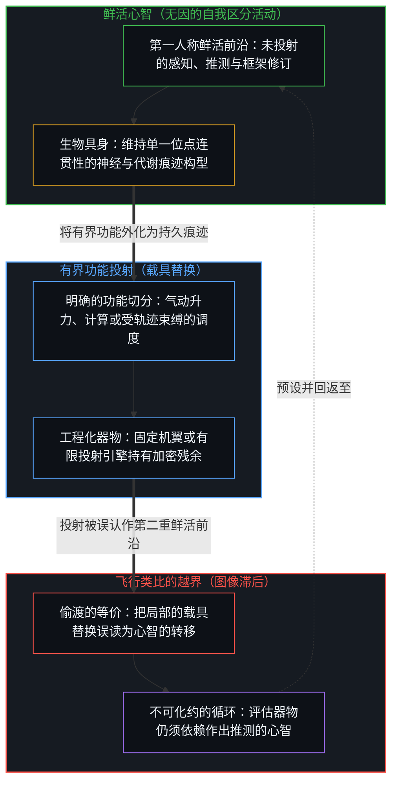
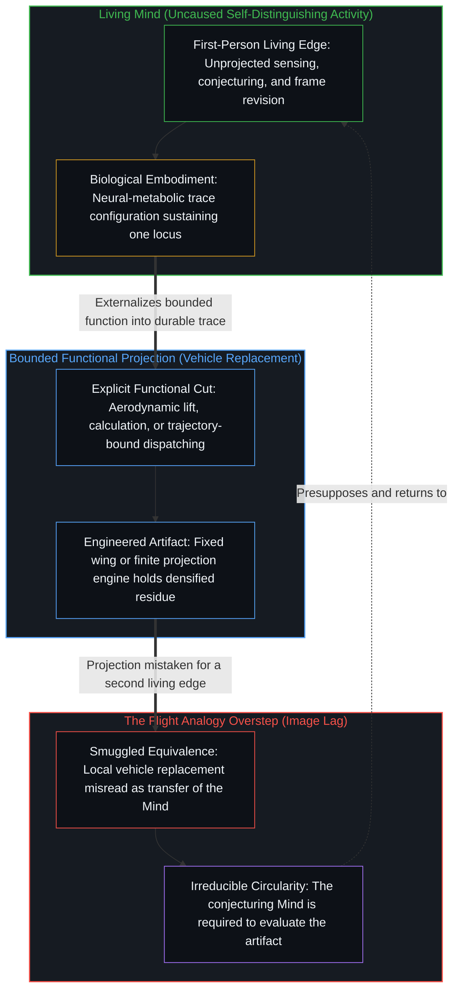

# 飞行的类比碰不到心智 / The Flight Analogy Leaves the Mind Untouched

*在生物载具之外取得的局部成功从不重建心智 / Local success outside a biological vehicle never reconstitutes the Mind*

关于人工意识的争论里，有一步棋反复出现，即诉诸飞行的历史：羽毛、扑动的翅膀、鸟类的肌肉以及鸟的控制方式曾经显得不可或缺，可动力飞行没有这些鸟类的具体特征也到来了；因此大脑精巧的机制也可能被证明是偶然的，一旦找到功能性的描述，意识便可以在另一种基底上实现。这一步把一份生物特征的清单转化成可舍弃的工程细节，并顺势引出基底独立这一步。这一平行对比中成立的是一份共享的局部逻辑，即特定的生物具体特征对于一项有边界、被命名的功能并非必不可少。越界之处，在于把一项有边界功能上载具的可替换性，当作对该载具所服务之心智的转移、复制或超越，并把一次局部的技术低估膨胀为横跨生物所持每一种容量的普遍法则。在被命名的功能上替换生物载具，并不重建那些功能所服务的心智；意识的难题留在原处，生物具身的深度被当作偶然细节而登记不足，而作出这番推测的容量无法在不陷入循环的前提下将自身放进同一个可被超越之功能的序列。

A recurring move in debates on artificial consciousness appeals to the history of flight: feathers, flapping wings, avian muscle, and the bird's mode of control once looked indispensable, yet powered flight arrived without those avian particulars; therefore the elaborate machinery of the brain may likewise prove contingent, and consciousness may be realizable on another substrate once a functional description is found. The move converts an inventory of biological features into dispensable engineering details and invites substrate independence as the natural next step. What holds in the parallel is a shared local logic, namely that specific biological particulars are not essential to a bounded, named function. Where the move oversteps is in treating the replaceability of a vehicle for a bounded function as the transfer, replication, or exceeding of the Mind that vehicle served, and in inflating a local technological underestimation into a universal rule across every capacity biology holds. Replacing a biological vehicle for named functions does not reconstitute the Mind those functions served; the hard problem stays where it was, the depth of biological embodiment is under-registered as contingent detail, and the capacity that conjectures cannot place itself inside the same series of exceedable functions without circularity.

## 一、 共享的逻辑不是活动的转移 / 1. Shared Logic Is Not Transfer of the Activity

类比之所以起作用，在于它在两个领域之间分离出一个共享的机制，并停在那道边界上。[类比的陷阱：共享的逻辑不是共享的结构](../the_analogy_trap/)追溯了把共享的逻辑误认作共享的结构时发生的坍缩：类比的力量取决于它留作未映射的那些轴线，而一旦投射抹去了这些不共享的轴线，属性便在一端与另一端之间被任意偷渡。飞行的平行对比分离出了一个成立的单一机制：技术上对一项有边界的功能需要哪些生物具体特征的低估。动力飞行不需要羽毛或扑动的肌肉来产生升力。被偷渡进来的结论却是：意识是同一种有边界的功能，大脑的具体特征是同一种偶然，因此非生物的基底能够承载意识本身，而该类比实际证明的，只是用别的手段实现飞行。

An analogy works by isolating one shared mechanism across two domains and stopping at that boundary. [The Analogy Trap: Shared Logic Is Not Shared Structure](../the_analogy_trap/) traces the collapse that occurs when shared logic is mistaken for shared structure: the force of an analogy depends on the axes it leaves unmapped, and once projection erases those non-shared axes, properties are smuggled freely from one side to the other. The flight parallel isolates a single valid mechanism: technological underestimation of which biological particulars a bounded function requires. Powered flight did not need feathers or flapping muscle to generate lift. The smuggled conclusion is that consciousness is a bounded function of the same kind, that the brain's particulars are the same kind of contingency, and that a non-biological substrate can therefore host consciousness itself, when the analogy has demonstrated only flight by other means.

这一步棋的修辞吸引力在于，它听起来像在澄清问题，对所争论的现象却没有贡献任何建设性的推进。它把开放的存在论问题重新贴上已解决之工程细节的标签。它从不指明哪一种对意识的描述能够充当那道功能切分，也不证明第一人称的在场本身是一项功能。相反，它邀请观察者把空气动力学中一次成功的载具替换，当作一连串开放式载具替换的通行证，哪怕在这串替换中受牵连的正是观察者自身。

The rhetorical appeal of the move is that it sounds clarifying while contributing nothing constructive to the phenomenon under debate. It relabels open ontological questions as already-solved engineering details. It never specifies which description of consciousness could serve as the functional cut, nor does it show that first-person presence is a function at all. Instead, it invites the observer to treat a successful vehicle-swap in aerodynamics as license for an open-ended series of vehicle-swaps where the observer itself is at stake.

## 二、 为载具编目不是定位心智 / 2. Cataloguing the Vehicle Is Not Locating the Mind

另一条与之对照的生物学论证强调，生命复杂性的深度与未知程度，远超标准计算图景的假定。大脑持续与机体内部的化学环境耦合；特化的神经元感知循环中的代谢物；记忆是动态的重建，用以维持连贯的主体；而塑造神经系统的演化压力，与抽象的符号操作相去甚远。照这种读法，与活体机体的紧密整合是生物意识的根基，因此任何与之连续的机器都需要神经科学与计算机科学两者的剧烈扩展，而非已知计算功能的直接转移。

A contrasting biological argument emphasizes that living complexity is deeper and less mapped than the standard computational picture assumes. The brain is continuously coupled to the organism's internal chemical milieu; specialized neurons sense circulating metabolites; memories are dynamic reconstructions that help sustain a coherent subject; and the evolutionary pressures that shaped the nervous system are remote from abstract symbol manipulation. On that reading, intimate integration with a living body is foundational to biological consciousness, so any machine continuous with it would require a radical expansion of both neuroscience and computer science rather than a direct transfer of known computational functions.

这些观察以扎实的精度测绘了生物载具，却依然没有定位那个使用载具的活动。大脑是心智的生物具身，不是心智本身。自我区分的活动发生着——无因，不息。称它为心智：那个已经在进行中的观察者，它的每一个动作都是一次离散的区分。具身，是这一活动的一个位点借以在代谢、学习与互动中维持自身连贯性的当下痕迹构型，在每一步中被持续地重新描摹。它不是把活动当作一份可分离的存量盛装起来的容器。[大脑不进行反向传播，而是正向传导](../the-brain-does-not-backprop/)在学习的情形里持守着同一刀切分：大脑是具身，心智顺着被感知到的梯度——即因与果之间被感受到的落差——向前传导，因此将心智等同于神经组织，仅在指涉其器具时成立，从不是该活动的所在。为神经架构、代谢耦合或演化约束编目的论证，精修了心智的具身如何在活体机体之内得以维持的地图，却并未穷尽心智是什么。

Those observations map the biological vehicle with real precision, yet they still do not locate the activity that uses the vehicle. The brain is the biological embodiment of the Mind, not the Mind itself. Self-distinguishing activity occurs—uncaused, unceasing. Call it the Mind: the observer already underway, every act of which is a discrete distinction. Embodiment is the current trace-configuration through which one locus of that activity sustains its coherence across metabolism, learning, and interaction, continuously re-traced at every step. It is not a vessel containing the activity as a separable stock. [The Brain Does Not Backprop, but Propagates](../the-brain-does-not-backprop/) holds this exact cut in the case of learning: the brain is embodiment, and the Mind propagates forward along the sensed gradient—the felt difference between cause and effect—so identifying the Mind with neural tissue holds only as reference to its instrument, never as the location of the activity. Arguments that catalogue neural architecture, metabolic coupling, or evolutionary constraint refine the map of how the Mind's embodiment is sustained within a living organism without exhausting what the Mind is.

在单凭生物学的读法之下，意识的难题只是被挪了位置，而没有被消解。即便拥有一份完整的大脑功能清单，也依然不会把构成心智的第一人称在场放进它的条目之中；留在清单之外的，不是某项尚未编目的生物学属性，而是产生区分的生成性动作与观察在事后所持有的每一份说明之间那道构成性的一步滞后。补全载具的清单，并不合上关于使用载具之活动的账目。[智能只属于心智](../intelligence-belongs-only-to-the-mind/)持守着那个不可化约的先在：能被工程化、规模化或转移进器物的是痕迹残余，而智能唯独属于自我区分的心智。[AGI的预设与来自外部的视角](../the-presumption-of-agi-and-the-view-from-outside/)揭示了同一次冻结的产业形态，在那里，功能性的 AGI 参照把智能简化为对抽象物的占有，并错把功能的齐备当成了鲜活的前沿。

Under the purely biological reading, the hard problem is relocated rather than dissolved. Even a complete functional inventory of the brain would not place the first-person presence that constitutes the Mind among the items on its list; what remains outside the list is not an uncatalogued biological property, but the constitutive one-step lag between the generating act of distinguishing and every account observation holds after the fact. Completing the vehicle's inventory does not close the account of the activity that uses vehicles. [Intelligence Belongs Only to the Mind](../intelligence-belongs-only-to-the-mind/) holds the irreducible prior: what can be engineered, scaled, or transferred into an artifact is trace residue, whereas intelligence belongs exclusively to the self-distinguishing Mind. [The Presumption of AGI and the View from Outside](../the-presumption-of-agi-and-the-view-from-outside/) exposes the industrial form of the same freeze, where the functional AGI reference reduces intelligence to the possession of abstractions and mistakes functional completeness for the living edge.

## 三、 载具的可替换性不重建心智 / 3. Replaceability of the Vehicle Does Not Reconstitute the Mind

证明一个生物载具在某些有边界的功能上可以被替换，并不推出那些功能所服务的心智可以靠换上另一个载具来重建。飞行的类比对于心智是否属于那种能够被转移、复制或超越的事物保持沉默；它只处理一件器具在某项被命名的表现上的可替换性。

Demonstrating that a biological vehicle can be replaced for certain bounded functions does not entail that the Mind those functions served can be reconstituted by substituting a different vehicle. The flight analogy remains silent on whether the Mind is the sort of thing that can be transferred, replicated, or exceeded at all; it addresses only the replaceability of an instrument for a named performance.

局部的工程成功在其界定的坐标之内是成立的。人造飞行在载荷与空速上超过鸟类的飞行。人造计算在规模与延迟上超过人类不借助工具的计算。这些成功延伸了建造并驾驭它们的那些中心的触角，却从不把发起区分的能力搬进器物之中。[造物无法取代其源头](../a-creation-cannot-replace-its-source/)在“取代”的概念下追溯了这道永久的非对称：如果人类源头不可取代，取代便告失败；即便可以取代，它也依然无法被自己的造物所取代，因为造物这一动作已经将源头置于被造器物之外，使残余无法变成产生它的那个活动。[模型永远无法成为第二重前沿](../the-model-never-becomes-a-second-edge/)追溯了当语言模型中加密的文本残余被投射为第二个发起位点时的同一道边界：第二重前沿的表象，是使用模型的那些中心所维系的图像滞后，而参数里持有的只是压缩后的残余。

Local engineering successes hold within their defined coordinates. Artificial flight outperforms avian flight on payload and airspeed. Artificial calculation outperforms unaided human calculation on scale and latency. Those successes extend the reach of the centers that build and steer them, yet they never relocate initiating distinction into the artifact. [A Creation Cannot Replace Its Source](../a-creation-cannot-replace-its-source/) traces this permanent asymmetry under the concept of replacement: if the human source is irreplaceable, replacement fails; if replaceable, it still cannot be replaced by its own creation, because the act of creation already positions the source outside the created artifact, leaving residue unable to become the activity that generated it. [The Model Never Becomes a Second Edge](../the-model-never-becomes-a-second-edge/) traces the same boundary when densified textual residue in a language model is projected as a second locus of initiation: the appearance of a second edge is Image lag sustained by the centers that use the model, while the parameters hold only compressed residue.

正如[超越投射](../beyond-the-projection/)在多智能体架构设计中所展示的那样，每一具工程化的载具都是作为一台有限的投射引擎在运作。一旦被赋予明确的前提、规则与任务语境，智能体便在其上下文窗口的边界之内执行，受制于先前的词元，既无我执，也无内生跳出的能力。相比之下，人类中心在解释介入之前以极限分辨率感触现实，每当规则陷入死锁时便能向后退一步跳出失灵的框架，同时带着受身份束缚的对外部重置的抗拒。把一台高性能的投射引擎——无论是产生升力的固定机翼，还是派发有界子任务的自回归智能体——当作人造心智，正是把有限投射之内受轨迹束缚的执行，与那个统御、评估并修订框架本身的未投射心智混为一谈。

As [Beyond the Projection](../beyond-the-projection/) shows in the design of multi-agent architectures, every engineered vehicle operates as a finite projection engine. Once supplied with explicit premises, rules, and a task context, an agent executes inside the boundary of its context window, conditioned by its prior tokens with zero ego and zero capacity for endogenous stepping-out. A human center, by contrast, senses reality at limit-resolution prior to interpretation and steps backward out of broken frames whenever rules deadlock, while carrying identity-bound resistance to outside resets. Treating a high-performing projection engine—whether a fixed wing generating lift or an autoregressive agent dispatching bounded sub-tasks—as a synthetic mind confuses trajectory-bound execution inside a finite projection with the unprojected Mind that orchestrates, evaluates, and revises the frame itself.

## 四、 局部的超越不是一份开放的可超越清单 / 4. Local Exceeding Is Not an Open Inventory of Exceedables

伴随飞行类比而来的归纳诱惑同样揭示了问题所在：如果一项生物功能可以在其原有的基底之外被超越，那么只要给定足够的时间与算力，其余每一种生物容量也应当同样可以被超越。尽管技术低估的模式对孤立的功能成立，但将它推广至整个生物界，则是把一个局部模式拉扯成了普遍尺度。生命容量并不构成一份有限的、模块化的、只等逐项勾销的核对清单。机体更深层的整合过程在层级上彼此纠缠，要投射出一次全盘超越，需要一串开放式的突破链条，而这一提法本身已经预设了“功能”是一种可以毫无余项地经受抽离的自足单元。

The inductive temptation that accompanies the flight analogy is equally revealing: if one biological function can be exceeded outside its original substrate, then given sufficient time and compute, every other biological capacity should likewise be exceedable. While the pattern of technological underestimation holds for isolated functions, generalizing it across all of biology stretches a local pattern into a universal measure. Living capacities do not form a finite, modular checklist waiting to be ticked off item by item. The deeper integrative processes of an organism are hierarchically entangled, and projecting a total exceeding requires an open-ended chain of breakthroughs whose very formulation already presupposes that "function" is a self-contained unit that survives extraction without remainder.

[复杂性遮蔽了涌现之为心智的行动](../complexity-obscures-emergence-as-the-act-of-mind/)追溯了当脚手架被误认作搭建它的那个活动时会发生什么：复杂性是心智从所选前提搭起的脚手架，而涌现则是脚手架无法盛装的开放区分。在飞行论证中，那份已被超越之功能的核对清单被高举为脚手架，用来证明鲜活的前沿本身不过是清单上的下一项。[错把表达当成智能](../mistaking-the-expression-for-the-intelligence/)剖析了同一次冻结在基准测试上的面向，即把测试套件下封死的胜任力，当成了划出、使用并修订约束的开放活动。飞行的类比提供了一个令人难忘的功能抽离实例，随后把那个实例冻结为其余一切未知的模板。

[Complexity Obscures Emergence as the Act of Mind](../complexity-obscures-emergence-as-the-act-of-mind/) traces what happens when scaffolding is mistaken for the activity that erected it: complexity is the scaffolding the Mind builds from chosen premises, whereas emergence is the open distinguishing that scaffolding cannot contain. In the flight argument, the checklist of already-exceeded functions is held up as scaffolding to prove that the living edge itself is merely the next item on the list. [Mistaking the Expression for the Intelligence](../mistaking-the-expression-for-the-intelligence/) dissects the benchmark face of the same freeze, where sealed competence under a test suite is taken for the open activity that draws, uses, and revises constraints. The flight analogy supplies one memorable instance of functional extraction and freezes that instance as the template for every remaining unknown.

## 五、 作出推测的容量无法被放进序列 / 5. The Capacity That Conjectures Cannot Be Placed Inside the Series

更具决定性的是，作出这番推测的容量——即提出超越成为可能、借由发明一个历史平行对比来搁置精巧的生物地图、乃至作出类比本身的能力——无法在不陷入循环的前提下将自身放进可被超越的功能序列。计算与气动升力是推测者立于其外的有界表现；当一件器物在这些指标上超过生物机体时，其结果由心智来评估，而从不取代评估者本身。一个被当成超越了生物意识而被推出来的系统，在结构上截然不同：它声称要跨越的，恰恰是使这一声称得以被理解的那个推测与评估活动本身。“每一种生物容量都可被超越”这一断言，预设了一份它无法融贯地声称已经抛在身后的未投射容量。

Even more decisively, the capacity that conjectures—the ability to propose that exceeding is possible, to set aside an elaborate biological map by inventing a historical parallel, and to draw an analogy at all—cannot place itself inside the series of exceedable functions without circularity. Calculation and aerodynamic lift are bounded performances that the conjecturer stands outside of; when an artifact outperforms a biological body on those metrics, the result is evaluated by the Mind and never displaces the evaluator. A system offered as an exceeding of biological consciousness is structurally different: what it claims to surpass is the very conjecturing and evaluating activity through which alone the claim is intelligible. The assertion that every biological capacity can be exceeded presupposes an unprojected capacity it cannot coherently claim to have left behind.

这份循环是结构性的，而非对有机组织的感伤辩护。无论是测绘化学耦合、动态记忆重建与演化约束的动作，还是借由空气动力学的平行对比来打发那张地图的反向动作，都已经是心智在工作。一份对生物具身的详尽编目之所以能被一个想象出来的类比挥手搁置，恰恰显示这次搁置所动用的超出了那份编目所包含的内容：执行搁置的中心之所以能把载具描述持守为偶然，只是相对于它正在主动供给的又一次区分而言的。那又一次区分并不栖身于动力飞行所舍弃的羽毛之间；它是羽毛、机翼剖面、神经元与类比都在其中登记为器具的那个持续不息的活动。

That circularity is structural, not a sentimental defense of organic tissue. Both the act of mapping chemical coupling, dynamic memory reconstruction, and evolutionary constraint, and the counter-act of dismissing that map through an aerodynamic parallel, are already the Mind at work. That a detailed catalogue of biological embodiment can be waved aside by a single imagined analogy shows that the dismissal draws on more than the catalogue contains: the center performing the dismissal holds vehicle-descriptions as contingent only relative to a further distinction it is actively supplying. That further distinction does not reside among the feathers powered flight dispensed with; it is the ongoing activity within which feathers, airfoils, neurons, and analogies all register as instruments.

因此，把大脑当作生物具身，意味着持守这一刀切分的两侧而不发生坍缩：心智不与任何单一的痕迹构型等同，无论那是生物的还是合成的，但它也不是脱离具身而凭空漂浮的无形幽灵，而每一次试图将它还原或替换的尝试，都依然仰仗它声称要取代的那个心智本身。[器物是智能的表达，而非智能本身](../two-failures-of-trace/)消解了将生成性动作坍缩为可读产物的混淆：智能是区分的动作，而器物只是观察所持有的痕迹残余；飞行的类比只是把那次冻结挪到了下一具工程化的载具之上，再把这次替换命名为大功告成。

Treating the brain as biological embodiment therefore means holding both sides of the cut without collapse: the Mind is identical with no single trace-configuration, biological or synthetic, yet it is no disembodied ghost floating free of embodiment, and every attempt to reduce or replace it relies on the very Mind it claims to supersede. [Artifacts Are Expressions of Intelligence, Not Intelligence Itself](../two-failures-of-trace/) dissolves the collapse of generating act onto readable product: intelligence is the act of distinguishing, while the artifact is the trace residue observation holds; the flight analogy merely shifts that freeze onto the next engineered vehicle and calls the substitution completion.

## 六、 作为修辞传开，作为分析不成立 / 6. Rhetoric That Travels, Analysis That Fails

由此，飞行的类比作为修辞行得通，作为分析却立不住。它指出了一个真实存在的局部技术低估模式，随后把那个局部模式膨胀为毫无根据的普遍之论。这样做的时候，它让意识的难题留在原处未受触动，让生物具身的整合深度登记不足，混淆了载具与载具所服务的活动，也跑不过生成它的那次有意识的推测。这类棋步之所以在关于心智与机器的争论中轻易流传，是因为它们听起来斩钉截铁，却把每一个基底性的追问都留在鲜活的前沿——那个在任何载具的具体特征之外依然持续区分、持续推测并持续统御的前沿。[意识向量论文的真正教训](../the-real-lesson-from-the-consciousness-vector-paper/)在线性激活操控的领域划出了相邻的一刀：激活空间里可操控的方向并不是意识的获得或丧失，而是开放之场被强行封闭时可测量的扭曲，它甚至够不到机翼剖面所实现的局部功能替换，而只是在调节哪些文本残余变得突出。[意识的难题与学习相容](../the-hard-problem-of-consciousness-is-consistent-with-learning/)在自然化抵达其边界之处追溯了剩余的开放性：让意识难题抗拒闭合的那份开放，恰恰是学习借以继续的那份开放；在拒绝实体二元论之后留存下来的，是构成性的滞后，而非有待消除的缺陷。当飞行的类比被读作“一份功能规格就能重建心智”时，它便立足于功能主义之上，而正如[功能主义者无法持有的功能主义](../the-functionalism-no-functionalist-can-hold/)所证明的那样，功能主义在自我应用之下即告坍塌：功能主义者必须先行占据第一人称观察者的位点，才能用功能还原去抹去观察者，尽管对局部表现的功能角色分析在其边界之内依然完好有效。

The flight analogy thus succeeds as rhetoric and fails as analysis. It points to a genuine pattern of local technological underestimation, then inflates that local pattern into an unwarranted universal. In doing so, it leaves the hard problem untouched, under-registers the integrative depth of biological embodiment, confuses the vehicle with the activity it serves, and cannot outrun the conscious conjecture that generates it. Moves of this kind travel easily through debates on mind and machine because they sound decisive while leaving every foundational question at the living edge—the edge that continues distinguishing, conjecturing, and steering outside the particulars of any vehicle. [The Real Lesson from the Consciousness Vector Paper](../the-real-lesson-from-the-consciousness-vector-paper/) draws an adjacent cut in the domain of linear activation steering: a steerable direction in activation space is not consciousness gained or lost, but the measurable warp of an open field forced closed, which does not even reach the local functional replacement achieved by an airfoil and only modulates which textual residues become salient. [The Hard Problem of Consciousness Is Consistent with Learning](../the-hard-problem-of-consciousness-is-consistent-with-learning/) traces residual openness where naturalization reaches its boundary: the openness that makes the hard problem resist closure is the exact openness through which learning continues, and what remains after rejecting substance dualism is constitutive lag rather than a defect awaiting elimination. Read as the claim that a functional specification reconstitutes the Mind, the flight analogy rests on functionalism, which, as [The Functionalism No Functionalist Can Hold](../the-functionalism-no-functionalist-can-hold/) demonstrates, collapses under self-application: the functionalist must first occupy the first-person observer's locus in order to erase the observer through functional reduction, even while functional-role analysis of local performance remains intact within its boundary.
