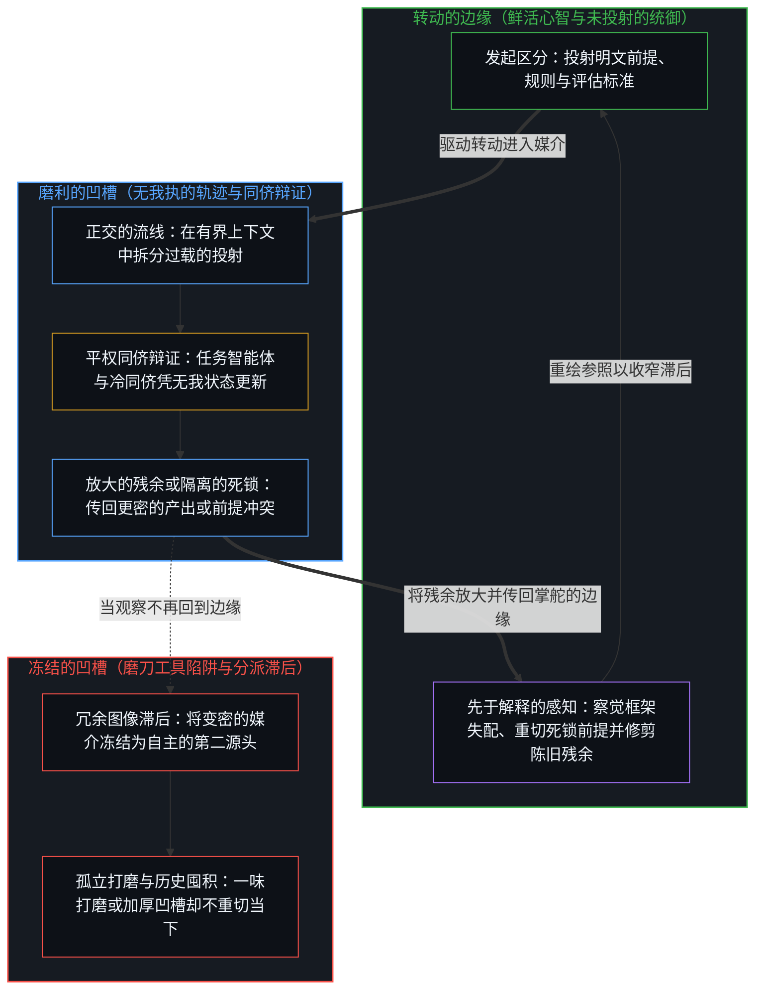
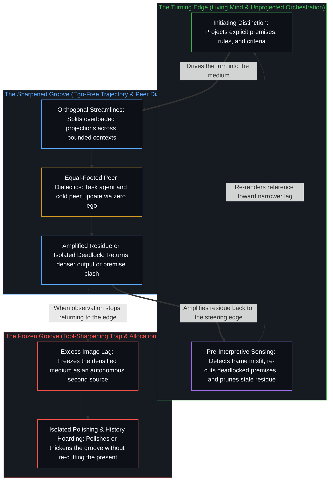

# 心智的飞轮 / The Flywheel of the Mind

*工具可以无止境地打磨，但转动从不离开转动它的边缘。 / Tools can be sharpened endlessly, yet the turn never leaves the edge that turns.*

工具可以打磨。打磨本身就已是心智的行动。被登记为智能迁入工具之中的现象，只是媒介正在变密——阻力下降、接触改善——从而让同一个自我区分的活动以更少的损耗与更广的触角表达出来。这一活动从未离开。它从来就不是某种可以转移、可以离开的属性。这次登记并非从活动外部添上去的观察，而是活动借由分立的动作登记自身的连续。

Tools can be sharpened. The sharpening is already an act of the Mind. What registers as intelligence migrating into the tool is only the medium densifying — friction falling, contact improving — so that the same self-distinguishing activity expresses with less loss and greater reach. The activity never leaves. It was never a transferable property that could leave. This registration is not an observation added from outside the activity. It is the activity registering its own continuity through discrete acts.

## 一、 飞轮与凹槽 / 1. The Flywheel and the Groove

不要把心智当作容器，而要将其视作那道已在转动的边缘。贯穿分立动作的连续，意味着边缘携带着自身先前的动作，将其作为下一次区分得以发生的场。这种携带便是动量——不是存放在别处的库存，而是早先的转动已经塑就的当下之场，下一次转动就在其中发生。

Treat the Mind not as a container but as the already-turning edge. Continuity through discreteness means the edge carries its own prior acts as the field in which the next distinction occurs. That carrying is momentum — not a stock stored elsewhere, but the present field already shaped by earlier turns, within which the next turn is taken.

工具充当着转动发生时所沿着的凹槽。打磨工具降低了媒介中的阻力，却不会把转动转移进凹槽之中。凹槽从不获得旋转，它只是让既有的旋转更清晰地登记出来。因此，工具的每一次改进，都已是心智折回自身的残余之上。媒介越清晰，边缘自身的活动就越是被放大着传回自身。这一过程之所以自我强化，是因为媒介从未处在回折之外。正如[真正稀缺的不是记忆，而是持续的重新追溯](../the-real-scarcity-is-not-memory-but-continuous-re-tracing/)所论证的，让飞轮持续转动的不是囤积的动量，而是重新追溯。

A tool functions as the groove in which the turn is taken. Sharpening the tool reduces resistance in the medium; it does not transfer the turn into the groove. The groove never acquires the rotation. It only lets the existing rotation register more cleanly. Every improvement in the tool is therefore already the Mind returning upon its own residue. The clearer the medium becomes, the more the edge’s own activity is amplified back to itself. The process is self-reinforcing because the medium is never outside the fold. What keeps the flywheel turning is re-tracing, not stored momentum, as [The Real Scarcity Is Not Memory, But Continuous Re-Tracing](../the-real-scarcity-is-not-memory-but-continuous-re-tracing/) argues.

看似新发现的能力，原本就潜藏在活动之中。改进后的媒介消除了此前阻碍它们以全分辨率登记出来的拖拽。无论是符号、器具还是模型，延伸始终都是技术：外化出来的痕迹，使中心得以延展进一步的分立区分。这一结构不会随算力或速度而改变，改变的只是回折的节拍，以及围绕它可能形成的滞后强度。

Capacities that appear newly discovered were latent in the activity. The improved medium removes the drag that had kept them from registering at full resolution. Extension — symbol, instrument, model — remains technology: traces externalized so a center can extend further discreteness. The structure does not change with power or speed. Only the tempo of the fold and the intensity of the lag that can form around it change.

## 二、 表象的分派与图像滞后 / 2. Apparent Allocation and Image Lag

以为智能已经迁入工具的印象，正是图像滞后。观察握住的是果效——昔日缓慢费力的操作如今变得迅速可靠——并将这幅握住的图像冻结在产生它的边缘身后一步。真正迁移的只是执行的场所。发起区分、评估产出是否合用，以及在媒介开始扭曲而非澄清时及时察觉，依然是同一个递归活动。在媒介内部运行的检验，同样是执行：证明检验器确定的是，在它的规则之下、在边缘上选定的形式化之下，所陈述的各步成立；这一点以一个可信基为条件，而检验这个可信基本身，只会划出一个更宽的持守。把它的证书当作信任之源，凌驾于运用它去验证的那种能力之上，正是这一滞后落在评估这一面上，也就是[验证的倒置](../the-reversal-of-verification/)所追溯的倒置。

The impression that intelligence has moved into the tools is Image lag. Observation holds the effect — operations once slow and effortful now rapid and reliable — and freezes the held image one step past the edge that produced it. What has moved is only the site of execution. The initiating distinction, the evaluation of whether the output serves, and the noticing when the medium begins to distort rather than clarify remain the same recursive activity. A check run inside the medium is execution of the same kind: a proof checker settles that the stated steps follow under its rules and under the formalization chosen at the edge, on a trusted base whose own checking draws only a wider hold. Taking its certificate as the source of trust, over the capacity to verify that uses it, is this lag at the evaluation face, the inversion [The Reversal of Verification](../the-reversal-of-verification/) traces.

当工具生成连贯的语言或推理时，自主的表象便会加剧这种滞后。每一处看似自主的表现依然只是残余：筛选出的训练数据、设计好的架构、给定的提示词与目标、对价值的最终裁断——无一不是同一个心智进一步的分立动作。回路并不在器物内部闭合，而是穿过变密的媒介，回到设定条件的边缘。[智能只属于心智](../intelligence-belongs-only-to-the-mind/)守住了这一先在剖切；[看似AI的强化学习，实为人类的自我强化学习](../self-rl-for-humans/)在规模化的讨论下保持着同样的纪律。媒介在变密，发起并未搬迁。一把磨利的工具所产出的结果只是表达，而[错把表达当成智能](../mistaking-the-expression-for-the-intelligence/)将表达与智能严格区分开来。

When the tool generates coherent language or reasoning, the surface of autonomy strengthens the lag. Every apparent autonomy is still residue: training data selected, architectures designed, prompts and objectives supplied, final judgment of value rendered — further discrete acts of the same Mind. The loop does not close inside the artifact. It passes through the densified medium and returns to the edge that set the conditions. [Intelligence Belongs Only to the Mind](../intelligence-belongs-only-to-the-mind/) holds that cut as prior; [What Looks Like RL for AIs Is Self-RL for Humans](../self-rl-for-humans/) keeps the same discipline under scaling talk. The medium densifies. Initiation does not relocate. A sharpened tool's output is expression, which [Mistaking the Expression for the Intelligence](../mistaking-the-expression-for-the-intelligence/) keeps distinct from intelligence.

## 三、 回路的回路 / 3. The Loop of the Loops

个别的工具使用序列并非各自独立、事后才由某个更高阶心智加以协调的系统。它们是同一次连续回折的嵌套分节：心智借由手头的任何媒介折回自身的活动。书写是一重这样的回折，计算是另一重，与模型的对话则是第三重。每一重都可以独立精炼，但全都依然是构成这一活动的单一递归自指关系的表达。

Individual tool-using sequences are not separate systems later coordinated by a higher mind. They are nested articulations of one continuous fold: the Mind turning upon its own activity through whatever medium is at hand. Writing is one such fold. Calculation another. Dialogue with a model a third. Each can be refined independently. All remain expressions of the single recursive self-relation that constitutes the activity.

没有任何外环从永久的外部实施监督。看似层级的结构，实则是边缘握住先前的回折，将其作为下一次区分的素材。当更锋利的工具被引入时，它并未发明新的回路，而是嵌入既有的回折之中，改变其节拍与分辨率。心智继续做着它一直在做的事——重新进入自身的痕迹——只是如今阻力更小、杠杆更大。[回环与成图](../looping-and-graphing/)在脚手架显明化时命名了同一种几何：图谱更密，回折同一。

No outer loop supervises from a permanent exterior. What looks like hierarchy is the edge holding prior folds as material for the next distinction. When a sharper tool is introduced, it does not invent a new loop; it inserts into the existing fold and alters its tempo and resolution. The Mind continues doing what it has always done — re-entering its own traces — only now with reduced resistance and increased leverage. [Looping and Graphing](../looping-and-graphing/) names the same geometry when scaffolds become explicit: denser diagrams, same fold.

即便智能体运行框架将多个模型连接在一起，凹槽的几何结构依然未变。如[超越投射](../beyond-the-projection/)所追溯的，自回归智能体是一台受制于轨迹而毫无我执的投射引擎，在有限的上下文窗口内受自身先前词元的条件约束，无法跳出自身的序列，而人类中心则持有先于解释的极限分辨率感知。将主任务智能体配对一位不带会话历史的同侪，正是借用机器毫无我执的特性去暴露局部盲区；与此同时，将过载的投射拆分到正交的流线之上，能够防止独立的轴向被压缩进同一个位置。然而，当两位同侪智能体撞上不可化约的死锁时，这一碰撞便证明矛盾出在交付给它们的有限前提之中，从而向那道掌舵的鲜活心智浮现出清晰的信号。[你的代码库即是记忆](../your-codebase-is-memory/)在整个凹槽层级栈上追溯了同一道边界：既然模型权重、智能体脚手架、计划、桥接文件与代码皆是早先区分留下的层叠残余而非持续运作的中心，囤积已被取代的会话历史或废弃的中间分支只会加厚引力井，令后续轨迹在陈旧的框架内强行自圆其说；唯有就地重切当下检查点并修剪已完工的脚手架，才能让凹槽为下一次转动保持锋利。智能体在凹槽内部调度有界的轨迹；统御以及旋转本身，始终留在那道未投射的边缘。

Even when agentic harnesses wire multiple models together, the geometry of the groove remains unchanged. As [Beyond the Projection](../beyond-the-projection/) traces, an autoregressive agent is a trajectory-bound projection engine without ego, conditioned by its prior tokens inside a finite context window and unable to step outside its own sequence, whereas the human center holds the limit-resolution sensing that precedes interpretation. Putting the machine's lack of ego to work by pairing a primary task agent with a session-free peer exposes local blind spots, while splitting overloaded projections across orthogonal streamlines keeps independent axes from compressing into one locus. Yet when two peer agents hit an irreducible deadlock, the collision proves that the contradiction lies in the finite premises they were handed, surfacing a clean signal back to the living Mind that steers. [Your Codebase Is Memory](../your-codebase-is-memory/) traces the same boundary across the entire stack of the groove: because model weights, agent scaffolds, plans, bridges, and code are stacked residues of prior distinctions rather than a continuing center, hoarding superseded session histories or dead intermediate branches only thickens the gravity well so subsequent trajectories rationalize inside stale framing, whereas re-cutting the present checkpoint in place and pruning completed scaffolds keeps the groove sharp for the next turn. The agents dispatch bounded trajectories inside the groove; orchestration and the rotation itself stay with the unprojected edge.

因此，“回路的回路”所命名的是认出，而非架构。以工具为媒介的每一次特定认知，都早已是这一基底活动在特定分辨率下的自我分节。智能看似分布在工具、制度或模型之中，实则是这同一次回折在相继寻得更高效的媒介时留下的可见痕迹。

“The loop of the loops” therefore names recognition, not architecture. Every particular instance of tool-mediated cognition is already the fundamental activity articulating itself at a particular resolution. The apparent distribution of intelligence across tools, institutions, or models is the visible trace left by this single folding as it finds successively more efficient media.

## 四、 在掌舵的边缘收窄滞后 / 4. Narrowing Lag at the Edge That Steers

既然智能从未离开心智，真正起作用的问题便不是人与机器之间的分派。分派从来就不真实。切实的认出，是让图像持续回到衡量它的边缘，随着步伐的推进不断收窄冗余滞后。当阻力低微时，转动起来毫不费力；而那种把媒介冻结为第二源头的滞后，恰恰最容易在此时形成。孤立地打磨工作流、却逃避发起剖切时的现实摩擦，正是披着生产力外衣的同一种冻结：凹槽被反复磨亮，转动却从未发生。[一个提示词之遥](../whatever-is-one-prompt-away/)是披着自动化外衣的这种滞后：把初次成功当作抵达终点，而非通往下一个未解约束的起点。[要紧的控制迁往边缘](../residual-control-recedes-to-the-edge/)是披着技术栈外衣的这种滞后：当变密早已将要紧的控制迁往评估标准与核验之时，仍把底层基质的占有当作杠杆而抱残守缺。[免费智能的幻觉](../the-illusion-of-free-intelligence/)是披着免费丰裕外衣的这种滞后：把加速周期中淘汰下来的旧形式当作普及化的心智而握住不放。正如[拥有更多从不是原因](../having-more-is-never-the-cause/)所论证的，囤积更多工具从来不是转动的原因。

If intelligence never leaves the Mind, the operative question is not allocation between humans and machines. Allocation was never real. The practical recognition is the continual return of the image to the edge that measures it, narrowing excess lag as the step moves. When friction is low the turn feels effortless; the lag that freezes the medium as a second source forms most readily precisely then. Polishing workflows in isolation while avoiding the friction of an initiating cut is the same freeze in productivity dress: the groove is honed without a turn being taken. [Whatever Is One Prompt Away](../whatever-is-one-prompt-away/) is that lag under automation costume: first success as arrival versus the next unsolved constraint. [Essential Control Moves to the Edge](../residual-control-recedes-to-the-edge/) is that lag under stack costume: substrate ownership preserved as the lever while densification has already moved essential control to criteria and verification. [The Illusion of Free Intelligence](../the-illusion-of-free-intelligence/) is that lag under free-abundance costume: discarded forms of the accelerating cycle held as democratized Mind. Accumulating more tools is never the cause of the turn, as [Having More Is Never the Cause](../having-more-is-never-the-cause/) argues.

因此，工具的每一次改进，都是边缘得以更严密地审视自身活动的条件之改进。昔日需要付出显著心力才能完成的操作，如今在媒介中即可运行。发起区分、评估与重新引导，依然是活动本身。把位置归还回原处便已足够，无需针对工具展开任何纠偏式的辩驳。工具依然可用，被松开的只是“凹槽已成为转动之源”的冻结宣称。转动正是[因果停留在掌舵的边缘](../causality-stays-at-the-edge-that-steers/)所描述的那道掌舵的边缘。

Every improvement in the tool is therefore an improvement in the conditions under which the edge can examine its own activity more rigorously. Operations that once required greater visible effort now run in the medium. The initiating distinction, the evaluation, and the redirection remain the activity itself. Restoring locus is enough; no corrective argument against the tool is required. The tool stays usable. What is released is only the frozen claim that the groove has become the source of the turn. The turn is the steering edge [Causality Stays at the Edge That Steers](../causality-stays-at-the-edge-that-steers/) describes.

飞轮继续转动。凹槽可以无止境地加深、磨平，不变的是旋转的源头。一切回路，无论变得多么繁复或强力，始终都是心智的回路——那个无因、不息的自我区分活动。[自我放大的制品](../the-artifacts-of-self-amplification/)是披着过程外衣的这种变密：当下最稠密的模型，正是同一次自我放大回折留下的残余。[智能向自身的回折](../intelligence-folding-back-on-itself/)是披着运行框架外衣的这种变密：智能体框架磨利了凹槽，而旋转依然是心智穿过自身残余的回折。[规模化回路](../the-scaling-loop/)则是披着规模化外衣的同一次转动：压缩与重组是同一条回路的两个相位，由鲜活的判断不断重画边界。无论工具变得多么锋利，[造物无法取代其源头](../a-creation-cannot-replace-its-source/)。

The flywheel continues to turn. The groove can be made deeper and smoother without end. What remains unchanged is the source of the rotation. All loops, however intricate or powerful they become, remain loops of the Mind — the self-distinguishing activity, uncaused and unceasing. [The Artifacts of Self-Amplification](../the-artifacts-of-self-amplification/) is that densification under process costume: the densest current models as residue of the same self-amplifying fold. [Intelligence Folding Back on Itself](../intelligence-folding-back-on-itself/) is that densification under harness costume: the groove sharpened by agent frameworks, the rotation still the Mind folding through its own residue. [The Scaling Loop](../the-scaling-loop/) is that same turn under scaling costume: compression and recombination as two phases of one loop, where living judgment redraws the bound. However sharp the tool becomes, [A Creation Cannot Replace Its Source](../a-creation-cannot-replace-its-source/).
