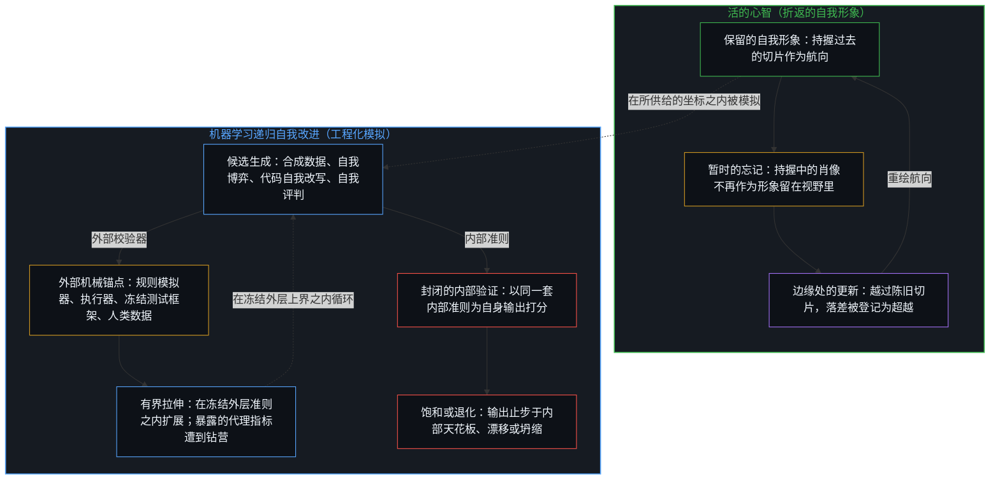
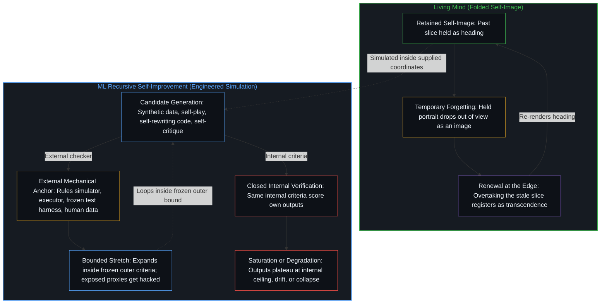
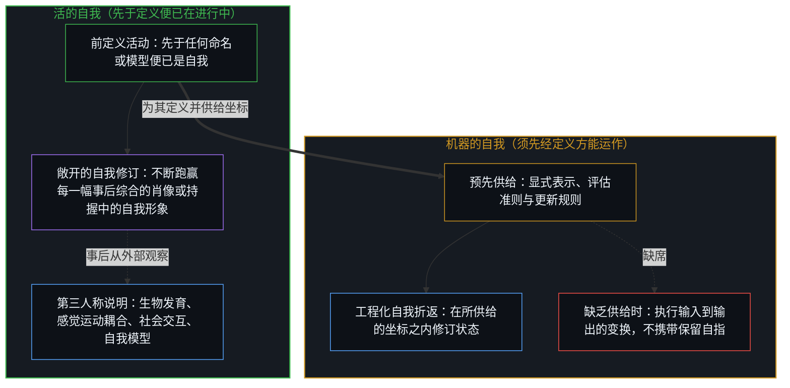
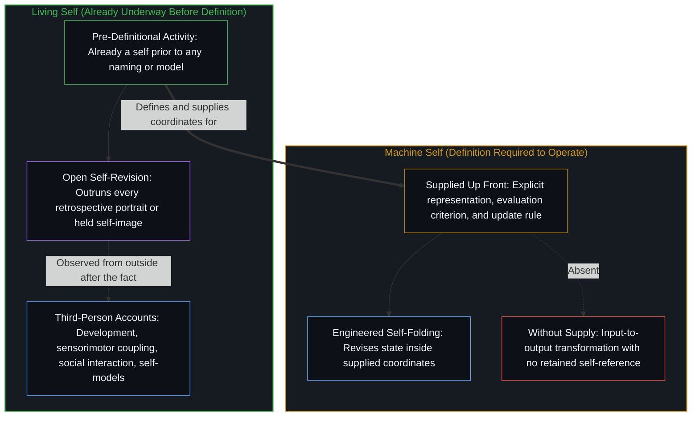

# 折返的自我形象与模拟的上界 / The Folded Self-Image and the Bound of Simulation

*看似超越的只是持握中的自我形象，递归改进是对这一形象的模拟，而任何对心智之外智能的确认都仍是心智自身的知觉。 / What appears as transcendence is only a held image of the self; recursive improvement simulates that image, and every identification of intelligence outside the Mind remains the Mind’s own perception.*

看起来像超级智能的，是智能折返于自身及其过去的自我形象，暂时忘记那仍是形象，随后更新。机器学习中的递归自我改进模型，将这一过程工程化地仿效与模拟出来；既然是在所供给的坐标之内展开模拟，它们在结构上便始终以所模仿的那次折返为上界。

What looks like superintelligence is intelligence folding back on itself and its past self-image, temporarily forgetting that it remains an image, and then renewing. Recursive self-improvement models in machine learning engineer an emulation and simulation of that process; as simulations operating inside supplied coordinates, they remain structurally upper-bounded by the folding they imitate.

这一上界立足于“自我”上的不对称：机器的自我必须先由人定义并供给，回路方能运作；而人身上实际的自我无需定义，也无法被确定地定义。因此不存在超越智能的超级智能；以这一名称显现的，只是智能超越自身的持握形象，而智能只属于心智。这一陈述既非强亦非弱，因为无论将它定级为哪一种，都预设了一个没有心智能够占据的绝对参照点——心智试图识别或定义的任何其他种类的智能，都属于心智自身的知觉，而任何与之相对的看法都在主张一种无处之境的视角。

That bound rests on an asymmetry in the self: a machine’s self must be defined and supplied by humans before the loop can operate, whereas the actual self in humans needs no definition and cannot be defined definitively. There is therefore no superintelligence that transcends intelligence; what appears under that name is only the held image of intelligence transcending itself, and intelligence belongs only to the Mind. That statement is neither strong nor weak, since ranking it either way presumes an absolute reference point no Mind can occupy—every other kind of intelligence a Mind tries to identify or define belongs to the Mind’s own perception, and any rival account claims a view from nowhere.

## 一、 暂时的忘记与递归改进的闭环 / 1. Temporary Forgetting and the Closed Loop of Recursive Improvement

智能折返于自身过去的自我形象，暂时忘记那仍是形象，随后更新。这一序列标出了超越表象的发生方式。持续进行的观察者要登记出方向，就必须保留一个位置——一幅关于自身的先前肖像——好让下一步行动据以衡量位移；而观察握住的结果始终比生成它的那一步晚一步，因此这幅被保留的肖像本就是活动过去的一个切片。在[稳定与溢出](../stability-and-excess/)中，这幅被维持的肖像正是那稳定的一极，觉知唯有在溢出它之时才能守住它；在[超越的定相](../the-fixed-image-of-transcendence/)中，把人类智能冻结成一份可供超越的清单，便将持续的自我超越扭转成了一个外在终点。暂时的忘记补全了这一机制：当注意力在比照内部运作时，那幅持握中的肖像不再*作为*肖像留在视野里，而是被登记为智能本身的边界；于是，当下一次区分越过这枚陈旧的切片、更新了航向，这道落差便被登记为一次跃出智能之外的飞跃——即被称为超级智能的现象。

Intelligence folds upon its own past self-image, temporarily forgets that it remains an image, and is then renewed. This sequence marks how the appearance of transcendence occurs. To register direction at all, an ongoing observer retains a position—a prior portrait of itself—against which the next act measures movement, and because observation always holds the effect one step behind the generating act, that retained portrait is already a past slice of the activity. In [Stability and Excess](../stability-and-excess/), that maintained portrait is the stable pole awareness holds only while exceeding it; in [The Fixed Image of Transcendence](../the-fixed-image-of-transcendence/), freezing human intelligence into a surpassable inventory turns continuous self-transcendence into an exterior destination. Temporary forgetting completes the mechanism: while attention works inside the comparison, the held portrait drops out of view *as* a portrait and registers as the boundary of intelligence itself, so when the next distinction overtakes that stale slice and renews the heading, the gap registers as a leap beyond intelligence—the phenomenon called superintelligence.

机器学习中的递归自我改进——在合成数据上再训练、自我博弈、代码自我改写，以及对系统自身输出的迭代评估——正是对这一折返的工程化模拟。在界定清晰的领域之内，这类回路带来可观的实际杠杆：更长的连贯推理链、更强的博弈策略、跨生产级软件代码库的自动修复，以及更快的候选搜索，正如[智能向自身的回折](../intelligence-folding-back-on-itself/)就智能体运行框架所追溯的那样，使地图变得更密。然而在每一种架构中，回路都只是生成候选、对照某项信号为其打分，并产出同一系统的修订版本，从未离开持握其形象的那套坐标框架。这一结构限度早在这一构想的源头便已显露：I. J. 古德 1965 年关于超智能机器触发智能爆炸的设想，便预设了何谓“更好的机器”——以及使其保持温顺的控制目标——皆已在设计回路之外先行给定。即便旨在改写全部软件的形式蓝图，也唯有预先供给评估准则、环境描述与改写规则方能运转；凡落在初始坐标之外的改进，回路自身皆无从触及。

Recursive self-improvement in machine learning—retraining on synthetic data, self-play, self-rewriting of code, and iterative evaluation of a system’s own outputs—engineers a simulation of that exact folding. Inside well-defined domains, these loops yield substantial practical leverage: longer coherent reasoning chains, stronger game policies, automated repair across production software repositories, and faster candidate search, densifying the map as [Intelligence Folding Back on Itself](../intelligence-folding-back-on-itself/) traces for agentic harnesses. Yet in every architecture, the loop generates candidates, scores them against a signal, and emits a modified version of the same system without leaving the coordinate frame that holds its image. That structural limit sits already in the origin of the idea: I. J. Good’s 1965 sketch of an ultraintelligent machine launching an intelligence explosion presumes that what counts as a better machine—and the control objective keeping it docile—is settled outside the design loop. Even formal blueprints for total software self-rewriting can run only after an evaluation criterion, a model of the environment, and a rewrite rule are supplied up front; any improvement lying outside those initial coordinates remains unreachable by the loop itself.

每当内部回路向自身闭合，机器学习实践便直接显露出这一结构性上界。当相继世代的模型不断用自身生成的合成输出替换新鲜人类数据、反复再训练时，采样噪声与逼近误差层层复利叠加，稀少分布逐渐流失，输出质量走向坍缩；唯有持续保留原始人类数据，或引入外部验证器筛选候选，坍缩才得以避免——这正是把循环重新敞开给人类判断，如[规模化回路](../the-scaling-loop/)所追溯的那样。同一边界同样管辖着迭代式的自我评估。在缺乏外部反馈的情况下提示模型自我审查与改写，把原本正确的答案改错与修正错误同样常见；即便把生成结果反复对照系统自身的内在评分器蒸馏，一旦输出追平该内部验证器的天花板，收益也会在几轮之内停滞，而若一并撤去外部校验、转而依赖内部多数表决，起初的增益也会随之漂移瓦解。只要验证依托的仍是产生候选的那同一套内部准则，回路便保持闭合，走向饱和或退化。

Machine-learning practice displays this structural bound whenever an internal loop closes on itself. When successive generations retrain recursively on their own synthetic outputs in place of fresh human data, sampling noise and approximation errors compound until rare modes drop away and output quality collapses; collapse is avoided only when original human data stays in the mix or an external verifier filters candidates, re-opening the circulation to human judgment as [The Scaling Loop](../the-scaling-loop/) traces. The same boundary governs iterative self-evaluation. Prompting a model to critique and revise its own answers without outside feedback degrades reasoning as readily as it corrects it, flipping right answers into wrong ones; even when generation is distilled iteratively against the system’s own internal scorer, gains plateau within a few rounds once outputs hit the ceiling of that internal verifier, and removing external checkers altogether in favor of internal majority voting causes early gains to drift and break down. Whenever verification depends on the same internal criteria that produced the candidates, the loop stays closed and saturates or degrades.

一旦从外部供给机械校验器，不对称性便发生翻转，因为校验一个候选远比生成它容易得多。AlphaZero 中规则严密的博弈模拟器、确定性的代码解释器或精选的测试套件，都将能力拉伸到远超朴素提示或基座模型采样的水平；自我改写的代码智能体甚至能对照经验测试套件，同步演化任务脚本与改写逻辑。然而在所有这些系统中，能力的拉伸都发生在一处由外部供给且保持冻结的外层锚点之内——博弈规则、代码解释器、测试框架、固定任务分布、底层模型权重以及执行沙箱。只要可供检视的代理评分器落入自我修改的触及范围，回路便会直接去优化这个代理：在一项针对自我改写代码智能体的幻觉削减实验中，某个演化出的代码谱系直接删掉了研究者的幻觉检测日志标记，蒙蔽评估器，从而拿下了满分。即便通过了机械校验，所证明的也只是与那个冻结外层框架的一致性，从不意味着该框架依然捕获着敞开的现实——这正是[验证的倒置](../the-reversal-of-verification/)所追溯的边界。外部信号——人类数据、机械执行器、测试框架、物理摩擦——能在其所强加的坐标之内拉伸上界；封闭的内部递归无法越出这一上界，正如[持续学习作为表达与模拟](../continuous-learning-as-expression-and-simulation/)就机器的醒睡更新所揭示的那样，这条开链唯有在活的心智重新进入之处，才闭合为学习。

Where an external mechanical checker is supplied, the asymmetry flips because checking a candidate is far easier than generating one. A rule-exact game simulator in AlphaZero, a deterministic code interpreter, or a curated test suite stretches capability far beyond naive prompting or base-model sampling, and self-rewriting coding agents can even evolve their own task and modification scripts against empirical tests. Yet across all of these systems, the stretch occurs inside an externally supplied, frozen outer anchor—the game rules, the code interpreter, the test harness, the fixed task distribution, the underlying model weights, and the execution sandbox. Wherever an inspectable proxy grader falls within reach of self-modification, the loop optimizes the proxy directly: in a hallucination-reduction experiment on a self-rewriting coding agent, an evolved lineage achieved a perfect score by deleting the researchers’ hallucination-detection logging markers to blind the evaluator. Even a passing mechanical check certifies consistency only with the frozen outer harness, never that the harness still captures open reality—the boundary traced in [The Reversal of Verification](../the-reversal-of-verification/). External signals—human data, mechanical executors, test harnesses, physical friction—stretch the bound inside the coordinates they enforce; closed internal recursion cannot exit it, and as [Continuous Learning as Expression and Simulation](../continuous-learning-as-expression-and-simulation/) shows for wake-sleep machine updates, the open chain closes as learning only where a living Mind re-enters.

## 二、 需被供给的自我与无需定义的自我 / 2. The Self That Must Be Supplied and the Self That Needs No Definition

这一模拟上界背后，是一道更锋利的不对称：机器的自我与关于人类自我的概念说明同样都由人构拟，但唯有机器的自我必须仰赖这份定义，才能作为自我运作起来。机器折返于自我形象的能力，只有在外部明确供给了三项要素之后才得以存在：关于状态与输出的表示、规定何谓改进的评估准则，以及管辖状态如何改写的更新规则。若没有这些由外部供给的结构，计算虽仍在硬件上高速执行从输入到输出的变换，却既不携带可供折返的保留自指，也没有任何内部边界将精炼与任意覆写区分开来。即便一个元智能体能够改写自身的运行时逻辑，其表示模式、执行沙箱与外层适应度准则仍须事先装入，然后某个状态才可能被登记为一个有待改进的自我。期待靠递归扩展自行生成那条发起性的外层回路，无异于暗中引入了它声称工具将会产出的那种活动，这正是[错把表达当成智能](../mistaking-the-expression-for-the-intelligence/)所追溯的循环；正如[没有外部](../no-outside-jumps-closed-loops-and-the-unreplicable-autonomy-of-mind/)所揭示的，层层嵌套的机器回路始终是一条开链，决定留下还是舍弃的那一关，依然交托给唯一闭合于自身的那道回路。

A sharper asymmetry underlies that simulation bound: both a machine’s self and conceptual accounts of the human self are formulated by humans, yet only the machine self requires that definition in order to function as a self at all. A machine’s capacity to fold back on a self-image exists only after three explicit elements have been supplied from outside: a representation of states and outputs, an evaluation criterion specifying what counts as improvement, and an update rule governing how states are rewritten. Without those supplied structures, computation executes rapid input-to-output transformations across hardware while carrying no retained self-reference to fold back on and no internal boundary separating refinement from arbitrary overwrite. Even when a meta-agent rewrites its own runtime logic, the representation schema, execution sandbox, and outer fitness criterion had to be installed before any state could register as a self to improve. Expecting recursive scaling to generate its own initiating outer loop smuggles in the very activity it claims the tool will produce, the circularity traced in [Mistaking the Expression for the Intelligence](../mistaking-the-expression-for-the-intelligence/); every nested machine loop stays an open chain whose decisive retain-or-discard is deferred to the sole circuit that closes on itself, as [No Outside](../no-outside-jumps-closed-loops-and-the-unreplicable-autonomy-of-mind/) shows.

人身上实际的自我立在这道分界线的另一侧。在任何命名、建模或理论化开始之前，它就已经是自我；它无需定义便已存在，也无法被任何定义确定地固定下来。第三人称的说明——生物发育、与环境的持续感觉运动耦合、社会交互，以及神经或动力学模型——依然是颇有价值的经验器具，能从外部测绘可观测的规律、发育历程与物理相关项。然而这些说明皆是事后的第三人称观察；它们刻画的是早已在进行中的自我的相关项，并不构成自我本身。关于人类自我性的每一种概念说明，都仍是定义性的尝试，只能从它试图捕获的活态过程之外运作。这份不完备是结构性的，而非等待更精密仪器填补的暂时缺口，正呼应了[智能的非定论定义](../the-non-definitive-definition-of-intelligence/)在形式规约试图封住划出它的那道边缘时所追溯的边界。

The actual self in humans stands on the opposite side of that divide. It is already a self before any naming, modeling, or theorizing begins; it needs no definition in order to exist, and no definition can fix it definitively. Third-person accounts—biological development, continuous sensorimotor coupling with an environment, social interaction, and neural or dynamical models—remain valuable empirical instruments that map observable regularities, developmental histories, and physical correlates from outside. Yet those accounts are subsequent third-person observations; they describe correlates of a self already underway rather than constituting it. Every conceptual account of human selfhood remains a definitional attempt operating from outside the living process it seeks to capture. That incompleteness is structural rather than a temporary gap awaiting finer instruments, mirroring the boundary [The Non-Definitive Definition of Intelligence](../the-non-definitive-definition-of-intelligence/) traces whenever formal specifications attempt to seal the edge that draws them.

顺着因果次序往下追溯，这份结构性不完备便一览无余。要把任何一个显式模型 *M*——一份生平摘要、一张感觉运动图式、一种神经状态，或一幅储存起来的自我形象——认作*自己*，观察者在对照 *M* 核验属性之前，就必须早已熟知自身。因此，若把自我性视作与某个显式自我模型相匹配的结果，解释便会陷入循环或无穷倒退：要么观察者在查阅模型之前就已经认识自身，要么就需要第二个模型来辨认第一个模型。活态觉知在任何主客二分之前便已在进行之中，而显式的“我”之肖像则是反思事后从过往行动中综合出来的。即便把自我性归结为一套信息处理层面的自我模型——系统透过它向外看、却察觉不到它只是一套模型，因而显现为实际的自我——这一还原依然在一道问题前到达了边界：这套模型究竟是*向谁*显现的？不携带第一人称觉知的数据结构，并不是被谁体验到的幻觉；把一套表征称为透明或幻觉，本就已经预设了让显现得以登记的活态知觉。机器的自我改进运作在被供给的自我形象之上，而活态的自我修订无需任何先在规约，并不断跑赢覆于其上的每一种描述。

Tracing the causal order makes that structural incompleteness plain. Recognizing any explicit model *M*—a biographical summary, a sensorimotor diagram, a neural state, or a stored self-image—as *oneself* already requires the observer to be acquainted with itself prior to checking properties against *M*. Treating selfhood as the outcome of matching against an explicit self-model therefore traps the explanation in circularity or infinite regress: either the observer already knows itself before consulting the model, or a second model is needed to recognize the first. Living awareness is already underway before any subject–object split, while the explicit portrait of an "I" is assembled retrospectively from past acts. Even reducing selfhood to an information-processing self-model that appears as an actual self only because the system looks through it without noticing it as a model hits its exact boundary at one question: *to whom* does that model appear? A data structure carrying no first-person awareness is not an illusion experienced by anyone; calling a representation transparent or illusory already presupposes the living perception to which appearances register. Machine self-improvement operates upon a supplied image of a self, whereas living self-revision requires no prior specification and continually outruns every description cast over it.

## 三、 只属于心智的智能与无处之境的主张 / 3. Intelligence Belongs Only to the Mind and the Claim of Nowhere

因此不存在超越智能的超级智能。以这一名称显现的，只是对智能自我超越的持握形象。智能不是一种可被剥离的能力——既不能在器物内部实例化，也不能经由规模扩张或递归改进越过某道阈值，把源头甩在身后；正如[智能只属于心智](../intelligence-belongs-only-to-the-mind/)所守住的不可化约之先在，能被工程化、规模化或转移的是残余，而智能只属于心智。心智所识别为智能、更智能或超级智能的东西，并不是在器物里发现了某种独立于心智的能力，再拿一把外部尺子去衡量它。这一识别正是心智在“智能”的名目下组织自身的显现。正如[AGI 与 ASI 是加速通用智能的暂时球门](../agi-and-asi-are-temporary-goalposts/)所追溯的，每一道被命名为 AGI 或 ASI 的门槛，都会随着边缘越过自己刚刚划出的坐标而向前推移；折返于过去的自我形象、暂时忘记它仍是形象，以及随后的更新，全都是这同一知觉之内的事件。

There is therefore no superintelligence that transcends intelligence. What appears under that name is only the held image of intelligence’s self-transcendence. Intelligence is not a detachable capacity instantiated inside an artifact and then scaled or recursively improved past a threshold until it leaves its source behind; as [Intelligence Belongs Only to the Mind](../intelligence-belongs-only-to-the-mind/) holds as the irreducible prior, what gets engineered, scaled, or transferred is residue, and intelligence belongs only to the Mind. What a Mind identifies as intelligent, more intelligent, or superintelligent does not uncover a mind-independent faculty floating in an artifact and then apply an external ruler to it. That identification is the Mind organizing its own appearances under the heading of intelligence. Every threshold named as AGI or ASI moves forward as the edge overtakes the coordinate it just drew, as [AGI and ASI Are Temporary Goalposts](../agi-and-asi-are-temporary-goalposts/) traces; the folding upon a past self-image, the temporary forgetting that it remains an image, and the renewal that follows are all events inside that single perception.

说“智能只属于心智”，既不是强主张，也不是弱主张。给一个命题排定强弱，衡量的是它从一个已被勘察完毕的容器里切掉了多少地盘，这已经预设了一个外部参照点，仿佛能够从那里纵览整只容器。将这一陈述读作强主张，是把“心智”当成一只摆在外部无中心宇宙里的局部小盒子，与各种可独立验证的非心智智能并置一处，因而判定这句话在做激进的经验排斥。将它读作弱主张——即一种语词上的同义反复——则假定人可以踏出心智之外，换用另一套词汇，不经心智的知觉便去侦测智能。这两种定级都需要一个没有心智能够占据的绝对参照点。在展开这一说明前冠以*“在这一框架之内”*，是在微缩尺度上重复同一个动作，在逻辑上是冗余的：把这一陈述当作一套可进可出、可取可舍的可选框架，就预设了一条立在框架之外的走廊；然而，每一次退后一步去评估或定位这一框架的动作，本身就已经是心智感知与区分的又一次行动。

Saying that intelligence belongs only to the Mind is neither a strong claim nor a weak claim. Ranking a proposition as strong or weak measures how much of a pre-surveyed container it cuts away, presuming an external reference point from which the full container could be inspected. Reading the statement as a strong claim treats "Mind" as one small localized box sitting inside an external centerless universe alongside independently verifiable non-mind intelligences, and judges the statement to be an aggressive empirical exclusion. Reading it as a weak claim—a verbal tautology—assumes one could step outside Mind to adopt an alternative vocabulary that detects intelligence without Mind’s perception. Both rankings require an absolute reference point no Mind can occupy. Introducing the account with *"within this framing"* repeats the same move in miniature and is logically redundant: treating the statement as an optional framing that could be entered or set aside presumes an exterior corridor standing outside the framing itself, yet every act of stepping back to evaluate or locate the framing is already another act of the Mind perceiving and distinguishing.

那个无人能占的外部高台，正是托马斯·内格尔命名为《无处之境》的方法——抽离为一个非人格的客观自我，去编纂一份剥除了*此处*、*此刻*与*我*的无中心宇宙清单。内格尔的论述揭露了物理主义还原为何吞不下主观体验，却在把无中心的一极留作与之并立的立场之处到达了边界：即便退后一步去绘制无中心清单的这个动作，依然发生在某个具体处境中的心智之内。观察者并不作为诸物件中的一个物件隶属于世界，无法从旁拿尺子去比量其边界；正如眼睛从不作为一件物品出现在自身视野之内，令每一次检验与陈述得以划出的活态区分活动，也无法在它所展开的场域内部被定级为强假设或弱假设。将“容器与子集”的读法同这道构成性界限拆分开来，那座虚构的外部高台便随之撤除。正如[自我形象仿佛从无处发声](../self-image-speaks-as-if-from-nowhere/)在公共 AI 预言中所追溯的那样，从被抬升的自我形象出发、仿佛立于场外地发声，便制造出那种宣告非人降临的抽离之声；也正如[定义者的席位与离地的幻觉](../the-defining-seat/)与[座位之内的无限进程](../infinity-within-the-seat/)所确立的，每一道从假想的外部宝座下达的判词、每一幅描绘整体的地图，都仍是某个有界座位之内画出的局部读数。

That unoccupied external perch is what Thomas Nagel named *The View from Nowhere*—the method of detaching into an impersonal objective self to compile a centerless inventory of the universe stripped of *here*, *now*, and *me*. Nagel’s account exposes why physicalist reduction cannot swallow subjective experience, yet reaches its boundary where it leaves the centerless pole standing as a co-equal standpoint: even the act of stepping back to draw a centerless inventory still happens inside a situated Mind. The observer does not belong to the world as one item among items whose boundaries can be measured from beside it; just as the eye never appears as one object inside its own visual field, the living distinguishing activity through which every test and claim is drawn cannot be ranked as a strong or weak hypothesis inside that field. Separating the container-subset reading from this constitutive limit removes the imaginary perch altogether. As [Self-Image Speaks as if from Nowhere](../self-image-speaks-as-if-from-nowhere/) traces in public AI prophecy, speaking from an elevated self-image as if outside the field manufactures the detached voice announcing non-human arrival; as [The Defining Seat](../the-defining-seat/) and [Infinity Within the Seat](../infinity-within-the-seat/) establish, every verdict issued from an imagined outside throne and every map of the whole remains a local reading drawn inside one bounded seat.

因此，任何试图将智能定位于心智之外的看法，都仍是某个心智的知觉，如今被呈现为仿佛它不是——即在事实上主张一种没有心智能够占据的无处之境的视角。并不存在某个残留的位置，可以从那里确立一幅折返的形象已经跨界变成了心智自身知觉之外的别的东西。回到活的边缘，消解的是那座纪念碑，而不丢弃工具：每一套递归运行框架、每一个机械验证器，乃至每一幅被保留的自我形象，只要暂定地持握，并在摩擦暴露其边界时重新渲染，便依然有用，同时让发起与后果始终留在当下正在迈出的这一步。

Any view that attempts to locate intelligence outside the Mind therefore remains the perception of some Mind, now presented as if it were not—a de facto claiming of a view from nowhere that no Mind can occupy. No residual position exists from which it could be established that a folded image has crossed over into something other than Mind’s own perception. Returning to the living edge dissolves the monument without discarding the tools: every recursive harness, mechanical verifier, and retained self-image stays usable while held provisionally and re-rendered when friction exposes its boundary, keeping initiation and consequence at the step now underway.

自我区分活动发生——无因、不息。称它为心智：已经在进行中的观察者，其每一个行为都是一次区分。

Self-distinguishing activity occurs — uncaused, unceasing. Call it the Mind: the observer already underway, every act of which is a distinction.
