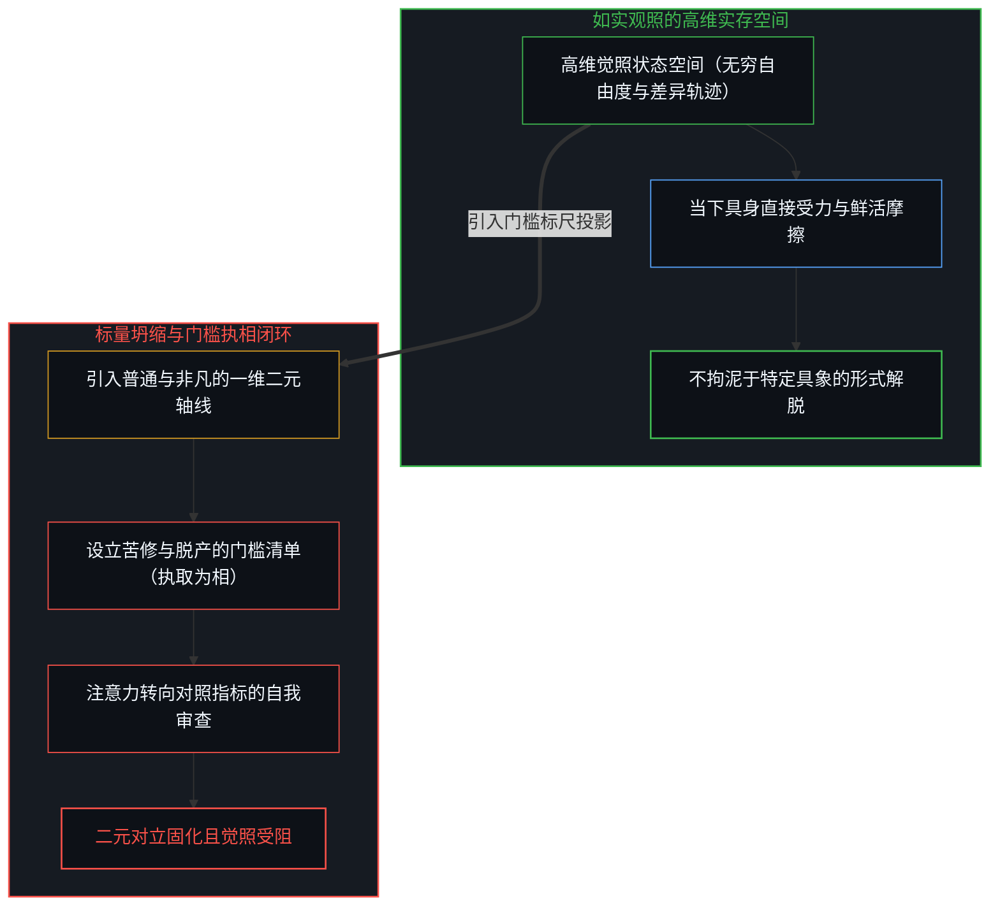
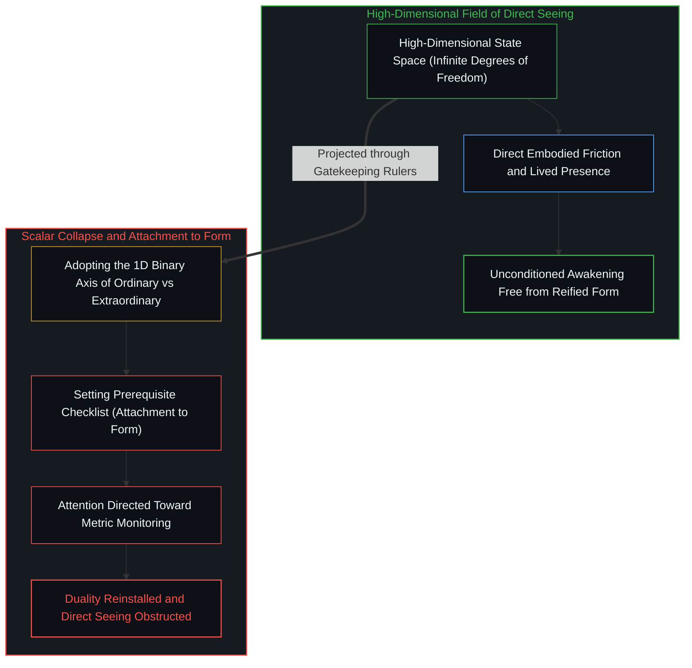
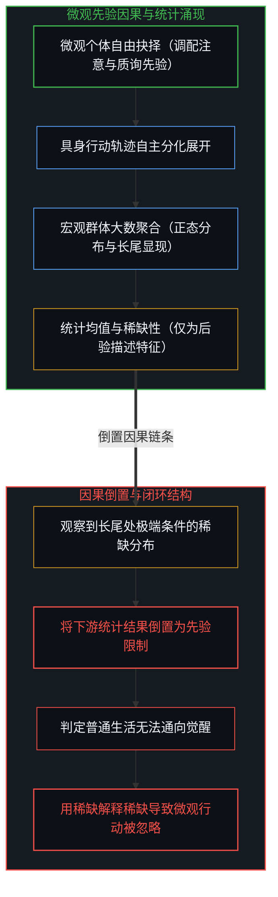
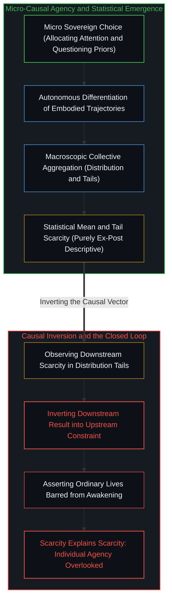

# 开悟的相与门槛的倒置 / The Form of Enlightenment and the Inversion of Gates

*以苦修为清单将如实观照降维为标量坐标，宏观统计稀缺被倒置为微观觉醒的先验禁区 / Compressing direct seeing into a checklist; inverting aggregate scarcity into a barrier to awakening*

在大众精神探索与修行讨论中，“普通人难以开悟”常被视为一种深刻洞见，并附带一套具体的门槛清单：持久的痛苦、脱离生计的长段闲暇、对既有社会纽带的否定，以及高度集中的向内专注。声称唯有满足这些条件才能觉醒的论述，表面上是指出修行的难度，实则在认识论上构成了双重倒置。它首先将支持高维轨迹的无中介如实观照坍缩为“普通与非凡”的一维二元轴线，把局部路径固化为执取的定相；继而将群体尺度下极端特征的统计稀缺，错当成管辖个体当下选择的先验因果壁垒。将门槛清单视作必要条件阻碍了如实观照，使原本用于诊断的框架转变为执取的源头。

In popular spiritual discourse, the claim that ordinary people cannot achieve enlightenment is frequently framed as a foundational insight, accompanied by a checklist of conditions: prolonged suffering, long stretches of leisure detached from work, the renunciation of existing social bonds, and intense inward focus. Asserting that awakening is accessible only through these gates presents itself as an analysis of difficulty, but in epistemological terms it introduces a double inversion. It collapses unmediated, direct seeing—a space supporting high-dimensional trajectories—into a single binary axis of the ordinary versus the extraordinary, reifying a localized path into a fixed form of attachment. It then mistakes the statistical scarcity of extreme traits across a population for a prior causal barrier governing an individual's immediate choices. Treating the checklist as necessary obstructs direct seeing, turning the diagnostic framework into a source of attachment.

## 一、 门槛即是相：将如实观照坍缩为标量坐标 / 1. The Gate as Form: Collapsing Direct Seeing into a Scalar Axis

列举极端条件并借此将人区分为普通与非凡，本身构成了一种对定相的执取。觉醒并不在于在经验中制造某种稀有奇特的心理状态，而在于如实照见生生不息的区分活动本身，卸下那些将过往痕迹冻结为固定基底的概念确执。当某种教义声称开悟必须依赖四重极端条件时，它实际上预先设定了一个关于证悟的特定模板，并以是否符合该模板来衡量探询。这种条件化设定，恰恰印证了《金刚经》所指出的着相：将固化的表征错认为实相本身。正如[超越的定相](../the-fixed-image-of-transcendence/)所揭示的，将敞开的体验临在冻结为静态画像，是用概念模具替代了鲜活实存。如实照见并不在于、也不需要去评判他人是否属于普通人。借由闲暇或苦难等外在标准去评估他人的潜能，其本身正运作于它声称要超越的二元框架之内。正如[没有普渡，只有自渡的无限可能](../mei-you-pu-du-zhi-you-zi-du/)所阐明的，在外部划分未觉悟者的类别，依然是尚未收回的分别投射。

Listing extreme conditions to divide people into the ordinary and the extraordinary constitutes an attachment to fixed form. Awakening does not consist in manufacturing a rare, exotic psychological state within experience; it consists in seeing ongoing distinguishing activity as is, releasing the conceptual reifications that freeze prior traces into a fixed ground. When a doctrine claims that awakening requires four extreme conditions, it establishes a specific template for realization and measures inquiry by conformity to that template. This conditionality reflects what the Diamond Sutra identifies as attachment to form, where reified signs are mistaken for reality itself. As demonstrated in [The Fixed Image of Transcendence](../the-fixed-image-of-transcendence/), freezing open experiential presence into a static portrait replaces living reality with a conceptual mold. Seeing as is does not consist in, nor does it require, judging whether others are ordinary. Evaluating another's potential through external criteria such as leisure or suffering operates within the very dualistic framework it claims to transcend. As articulated in [No Universal Salvation, Only Boundless Possibilities of Self-Salvation](../mei-you-pu-du-zhi-you-zi-du/), establishing external categories of the unawakened remains an unretracted projection of distinctions.

在动力学与几何结构上，这种执取运作于维度压缩与投影扁平化。无中介的实存支持着近乎无限的因果维度与发展分岔，每个鲜活心智在每一瞬间的注意力分配、环境摩擦、感知校准与反思深度，都在描绘独特的相空间轨迹。然而，门槛论将这片丰沛的高维相空间挤压至单一的一维轴线之上：聚在均值附近的中段被标定为普通，一侧的远尾被标定为非凡，另一侧的远尾被标定为它的反面，觉醒则被划归非凡的那一端。一旦这套被压缩的坐标系被接纳为不容置疑的背景框架，后续探询便不再直面鲜活的具身摩擦，而是退化为沿着这条强加轴线展开的防御性计分。拒绝赋予这一降维坐标框架优先地位，并非宣称每个生命都已达成非凡证悟，而是刺穿这把标尺的人为构作性，拒绝让匮乏的二元滤网垄断觉察的视界。正如[向量、坐标系与自指心智](../the-mind-as-vector-and-coordinate-system/)以及[“普通人视角”的解释陷阱](../the-explanatory-trap-of-the-ordinary-perspective/)所辨明的，强行将多维展开塞进一维标量排位，不仅抹除了多维分殊，更将观察者的局部度量衡抬升为宇宙不可动摇的几何结构。

Dynamically and geometrically, this attachment operates as a dimensional reduction and projective flattening. Unmediated reality supports a near-infinite number of causal dimensions and developmental bifurcations, where each living mind traces a unique phase-space trajectory shaped by moment-to-moment attention, environmental friction, perceptual calibration, and reflective depth. Yet the gatekeeping doctrine crushes this rich, high-dimensional phase space down to a single axis: the stretch gathered around its mean is labeled ordinary, the far tail on one side extraordinary, the far tail on the other its opposite, and awakening is assigned to the extraordinary end. Once this compressed coordinate system is accepted as the unquestioned background frame, further inquiry ceases to engage with lived friction; instead, it degenerates into defensive scorekeeping along the newly imposed axis. Refusing to grant primacy to this reduced coordinate frame does not mean asserting that every life is already an exceptional realization; it means piercing the artificiality of the ruler, refusing to let an impoverished binary filter monopolize the horizon of awareness. As demonstrated in [The Mind as Vector and Coordinate System](../the-mind-as-vector-and-coordinate-system/) and [The Explanatory Trap of the "Ordinary Perspective"](../the-explanatory-trap-of-the-ordinary-perspective/), forcing multidimensional unfolding onto a one-dimensional scalar ranking erases multidimensional divergence and elevates an observer's localized metric into the immutable geometry of the cosmos.

## 二、 尺度与倒置：宏观统计稀缺对微观行动因果的僭越 / 2. Scale and Inversion: The Overstep of the Statistical Mean onto Agency

同样的降维，在群体尺度的统计观察中表现得尤为清晰。审视生命的总体集合时，绝大多数个体在任一被测量的维度上——无论是可自由支配的闲暇时间、自我质询的强度，还是向内探索的深度——都自然聚集在均值附近。这种聚集是从宏观视角观测总体分布时的统计属性：它是在事后刻画群体样本，而非施加于任何具体个体身上的物理约束。非凡的结果与穿透性的觉照之所以向具身行动者敞开，正是因为统计均值仅仅是在路径展开之后对总体的描述，对于具体心智在下一刻做出的选择毫无立法权。将观测到的均值当作上游约束，混淆了群体描述的尺度与个体行动的尺度。

This reduction also manifests clearly in statistical observations across populations. When examining an aggregate collection of lives, most individuals naturally cluster near the mean along whatever dimension is measured—be it discretionary leisure time, intensity of self-interrogation, or the depth of inward exploration. That clustering is a statistical property of observing an aggregate distribution from a macroscopic perspective; it characterizes the collective sample ex post, rather than exerting a physical constraint upon any concrete individual agent. Extraordinary outcomes and penetrating awareness remain available to embodied agents precisely because the mean describes the aggregate after paths have unfolded; it possesses zero legislative power over the choice a specific mind will make in the very next moment. Treating the observed mean as an upstream constraint conflates the scale of collective description with the scale of individual action.

这一混淆构成了因果倒置。结果的统计分布是个体选择所产生的下游产物，门槛论却将这一结果倒置为上游原因。当前满足所列条件者的观测稀缺性，被当作普通生活被剥夺达标可能的证据。稀缺性进而被用来解释稀缺性本身。那些改变个体轨迹的选择——保留探询的时间、将既有假设视作可修正的前提、在日常经验中保持觉察——不再被视为决定未来分布的输入，而被当作早已被均值排除的选项。正如[宏观现象及参数和个人微观选择的因果倒置与利率的命令幻相](../the-summary-first-reversal-and-the-command-of-yields/)所示，将下游汇总指标当作上游约束，忽视了个体的因果能动性。在第一人称的边际上，正如[能动性、矛盾与权力的移置](../agency-contradiction-and-the-relocation-of-power/)所追溯的，若隐去自己一直在回绝这些选择所附的局部代价，权力便会被向外移置到“普通人”这一处境之上；而将这一回绝及其所产生的限制登记为同一项活动，便放下了对外部门槛的索求，使那些代价从无法另作他选的理由重新变为附着于紧接的下一步之上的标价。

This confusion constitutes a causal reversal. The distribution of outcomes is a downstream result produced by individual choices; the gatekeeping thesis inverts this result into an upstream cause. The observed scarcity of people who currently meet the listed conditions is taken as evidence that ordinary lives are barred from meeting them. Scarcity then explains scarcity. Choices that alter individual trajectories—protecting periods of inquiry, treating assumptions as revisable, maintaining attention within daily life—are no longer treated as inputs determining future distributions, but as options already ruled out by the mean. As shown in [Macro Parameters, Micro Choices, and the Command of Yields](../the-summary-first-reversal-and-the-command-of-yields/), treating downstream summary metrics as upstream constraints overlooks individual causal agency. At the first-person margin, as [Agency, Contradiction, and the Relocation of Power](../agency-contradiction-and-the-relocation-of-power/) traces, omitting one's ongoing refusal of the local costs of those choices relocates power outward onto the "ordinary" condition, whereas registering that refusal and the limit it produces as one activity drops the demand for an external gate and turns those costs from reasons one cannot choose otherwise back into prices attached to the very next step.

## 三、 处方的自败：将指月之手固化为必要门槛 / 3. The Self-Defeating Prescription: Fixing the Finger into a Mandatory Gate

门槛论在实践层面的后果，在于其处方阻断了它声称要开启的目标。通过将敞开的探询转化为逐项核对条件清单，该论断提供了新的执取对象。原本可用于审视心智运作的注意力，被消耗在持续监测自身是否达标之上：痛苦是否足够深重、闲暇是否足够充裕、否定是否足够决绝。这种持续监测重新引入了“具备条件”与“缺乏条件”的二元对立，在账本的两端同时将心智锁死于定相：正如[有条件的自由](../you-tiao-jian-de-zi-you/)与[自由即地基](../freedom-as-ground/)所追溯的，一旦将无条件的基底抵押给前置条件的阶梯，觉照在两端都会受到束缚——条件尚未满足时，注意力被消耗在审查自身的不合格上；条件悉数达标时，匮乏的焦虑也只是翻转为对受认证精神身份的镜像执取。原本只能作为指月之手的局域描述，由此被体制化为必经的关卡。内化了这份清单的人，其朝向的是清单本身，而非当下的直接临在。正如[规程的倒置与因果回路的消声](../the-inversion-of-the-protocol-and-the-silencing-of-the-causal-loop/)与[自由的心智被声称保护它的东西取代](../the-free-mind-is-displaced-by-what-claims-to-protect-it/)所指明的，将工具升格为强制门槛，会用活的心智自己搭建的程序装置置换掉心智本身；这种对前置条件的执取同样弥漫于日常情感的僵局之中，正如[现成接触的因果先验与期望感受的倒置遮蔽](../present-contact-and-the-obscuration-of-desired-feeling/)所剖析的，将期望中的感受设为投入当下的强制门槛，会把注意力悉数消耗在审查当下的匮乏上，切断与直接摩擦的活态接触。

The practical consequence of this gatekeeping is that the prescription blocks what it claims to enable. By converting open inquiry into matching a checklist, the doctrine supplies a new object of attachment. Attention that could be directed toward examining the operations of the mind is consumed by monitoring compliance: whether suffering is sufficient, whether leisure is adequate, whether negation is resolute. That continuous monitoring reinstalls the duality of meeting conditions versus lacking them, locking the mind into the form on both sides of the ledger: as [Conditional Freedom](../you-tiao-jian-de-zi-you/) and [Freedom as Ground](../freedom-as-ground/) trace, mortgaging an unconditioned ground to a ladder of prerequisites binds awareness whether the conditions remain unmet—consuming attention in auditing disqualification—or are met in full, which only flips the anxiety of lack into the mirror attachment of a credentialed spiritual identity. Local descriptive accounts, which can only function as fingers pointing toward the moon, become institutionalized gates. The person who internalizes the list is oriented toward the checklist rather than toward immediate presence. As shown in [The Inversion of the Protocol and the Silencing of the Causal Loop](../the-inversion-of-the-protocol-and-the-silencing-of-the-causal-loop/) and [The Free Mind Is Displaced by What Claims to Protect It](../the-free-mind-is-displaced-by-what-claims-to-protect-it/), turning an instrument into a mandatory threshold displaces the living mind with the very procedural apparatus it constructed; this attachment to prerequisites is equally pervasive in everyday affective gridlocks, as dissected in [Present Contact as Causal Prior and the Obscuration of Desired Feeling](../present-contact-and-the-obscuration-of-desired-feeling/), where establishing a desired affect as a mandatory gate for present engagement consumes attention in auditing present lack, severing living contact with immediate friction.

澄清这一结构，需要保持因果秩序的不倒置，拒绝将降维标量视作终极边界。微观层面的抉择先于宏观层面的统计分布。分析性探询可以为了交流而勾勒暂时的概念区分，但任何交流行为都只呈现硬币的一面；具身觉照作为不可让渡的另一面，如影随形地伴随每一次区分，既无需也不容被转化为明示的核对清单。正如[凡可言说皆不可言说之产物](../all-that-can-be-spoken-is-the-product-of-the-unspeakable/)所辨明的，所有可言说的形式系统皆以不可言说的具身临在作为先决背景；试图将这一内隐姿态铸造成客观模具，便陷入了试图同时展示硬币两面的自相矛盾。如实照见并不需要预先满足极端条件清单；它只需要觉察到：将清单视作必要条件，本身就已经预先收窄了观察的视界。正如[你的代码库即是记忆](../your-codebase-is-memory/)所追溯的，过往切分留下的外化库藏只保存着供鲜活前沿重溯的记录残迹，而非管辖下一步行动的门槛；统计均值同样只是对过往分布的事后描述，并不对个体心智的下一刻选择施加任何先验限制。

Clarifying this structure requires keeping the causal order unreversed and refusing to treat dimensional reduction as a final boundary. Micro-level choices remain prior to macroscopic statistical distributions. Analytical inquiry can draw provisional distinctions for communication, yet any communicative act presents only one face of the coin; embodied awareness remains the inalienable other face that accompanies every distinction as a shadow, without needing or admitting conversion into an explicit checklist. As clarified in [All That Can Be Spoken Is the Product of the Unspeakable](../all-that-can-be-spoken-is-the-product-of-the-unspeakable/), all speakable formal systems depend on unspeakable embodied presence as their prerequisite background; attempting to cast that implicit stance into an objective mold commits the self-contradiction of trying to display both sides of a coin at once. Seeing as is does not require satisfying a checklist of extreme conditions; it requires noticing that treating the checklist as necessary has already narrowed the field of observation. Just as [Your Codebase Is Memory](../your-codebase-is-memory/) traces how an externalized repository of past cuts holds only recorded residue that the living edge re-traces rather than a threshold governing what it may do next, the statistical mean remains an ex-post description of past distributions without imposing any prior limit on an individual mind's next choice.
