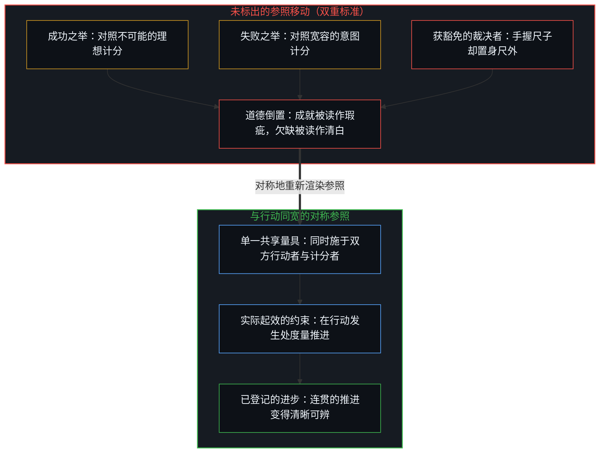
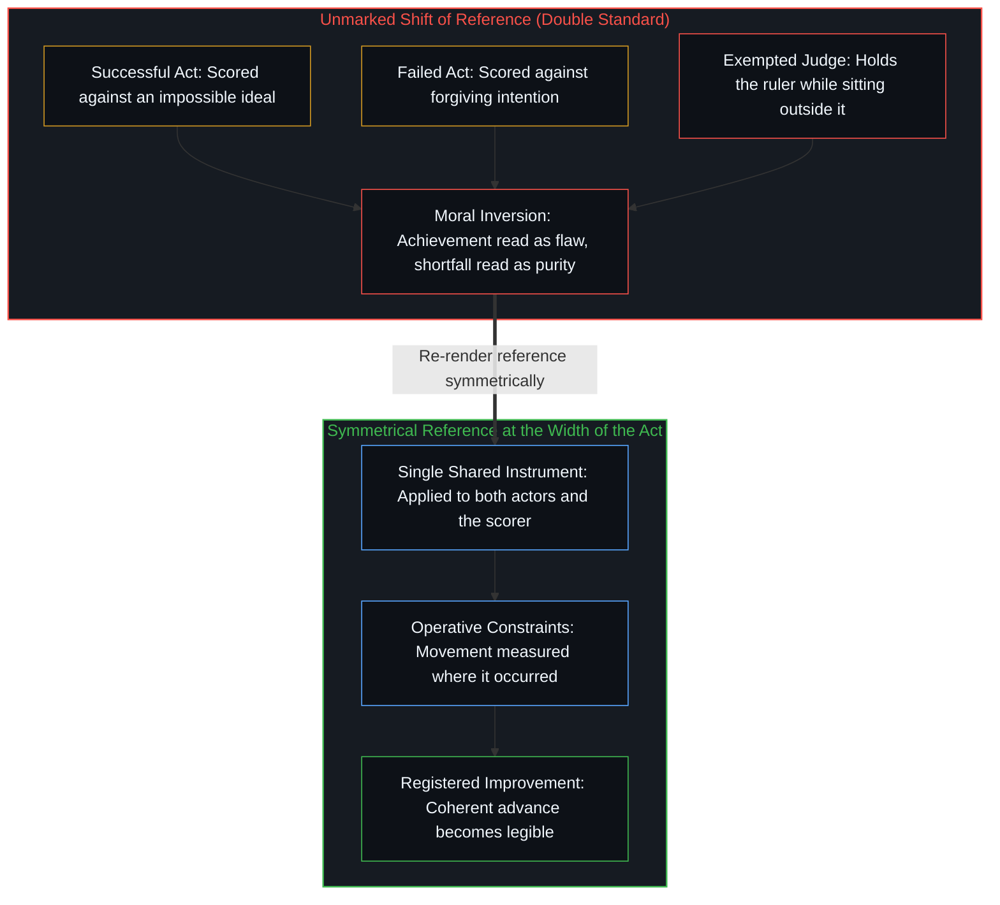

# 遮蔽进步的框架 / The Frame That Conceals Improvement

*用不可能的理想苛责成功，以宽容的意图原谅失败，道德排序便在隐形的双重标准中倒置。 / Judging success against an impossible ideal and failure against forgiving intent inverts moral rank.*

这一模式在各个领域反复出现：远为优越的事物被当成更差的事物。它的不完美被拿去对照一道更高的标尺逐一清点，而失败却得到开脱、柔化，乃至被重塑为清白无瑕，成功则因每一处残余的瑕疵而受到盘查。由此得出的排序看似关乎道德——谁应当受赞誉，谁应当受谴责——实则源于对不同案例施加不同标准，随后又把所得分数读作案例自身的属性。

The pattern recurs across domains: the vastly better is treated as the worse. Its imperfections are catalogued against an even higher bar, while failure is excused, softened, or recast as purity, and success is audited for every remaining flaw. The ranking that results looks moral—who deserves praise, who deserves blame—yet it is produced by applying different standards to different cases and then reading the scores as properties of the cases themselves.

这并不是一种独立的偏见。当参照与视角一同移动，而这一移动又未被标出时，评估就会如此运作。

That is not a separate bias. It is what evaluation does when reference and perspective shift together and the shift goes unmarked.

## 一、 感觉像裁决的双重标准 / 1. The Double Standard That Feels Like a Verdict

成功者被拿去对照某个从未有任何实际运作的系统达到过的理想，衡量其尚存的差距。失败者则被拿去对照情况本可能糟糕多少、对照其宣称的意图，或者对照一套将“未曾获胜”本身奉为美德的叙事。在纸面上，不可能的理想与未付诸行动的意图都只是隔绝于物理摩擦之外的零成本投射（`1 + 1 = 2`），而将任何推进付诸实现（`+1`）则是必须消化具体约束与权衡的不可逆介入。在这两把尺子下，同一个世界呈现出相反的道德极性：成就中不可避免的权衡看似妥协，未经检验的欠缺反倒看似气节。

The successful are measured against what still falls short of an ideal that no operating system has ever met. The failed are measured against how much worse things could have been, against stated intention, or against a story in which not winning is itself a virtue. On paper, both an impossible ideal and an unacted intention remain zero-cost projections (`1 + 1 = 2`) insulated from physical friction, whereas actualizing any advance (`+1`) is an irreversible intervention that must absorb concrete constraints and trade-offs. Under those two rulers, the same world yields opposite moral charges: unavoidable trade-offs in achievement look like compromise, and an untested shortfall looks like integrity.

当高标准不可能达到时，一切既成事实都与它隔着无法跨越的距离，具体差异随之坍缩为千篇一律。一旦没有任何事物能够过关，排序就不再追踪已登记的推进，而是追踪偏向哪一方更让人舒心。心智依然体会到清晰的排序，但那份清晰属于感受，而不属于度量。

When the high standard is impossible, everything actual sits at an unbridgeable distance from it, and concrete differences collapse into sameness. Once nothing can pass, ranking no longer tracks registered movement; it tracks which side feels better to favor. The mind still experiences a clear ranking, yet the clarity is the feeling rather than the measure.

那些拿不可能的标尺去要求成功者的人，从不把同一道标尺加诸自身，因为他们不必通过这道检验。他们的位置正是施加裁决的席位：占据道德制高点，靠的不是经受住度量的检验，而是手握度量却置身于度量之外。制高点就是豁免权本身。[对“AI 糟粕”的反感是反复出现的模式](../the-distaste-for-ai-slop-is-no-different-from-the-recurring-historical-pattern/)追踪了披着审美外衣的同一种豁免：徒手写作被高举为标尺，而批评者自身对工具的依赖却被留在标尺之外。

Those who hold the impossible bar for the successful never apply the same bar to themselves, because they do not have to pass it. Their position is the seat from which judgment is imposed: moral high ground occupied not by surviving the measure, but by holding the measure while remaining outside it. The high ground is the exemption itself. [The Distaste for “AI Slop” Is a Recurring Pattern](../the-distaste-for-ai-slop-is-no-different-from-the-recurring-historical-pattern/) traces that same exemption in aesthetic dress: unaided writing held up as the bar while the critic's own instrument-dependence is left outside it.

## 二、 当参照与视角一同移动 / 2. When Reference and Perspective Move as One

看似是对客体的裁决，实则是未经登记的量具更换。成功者是从一个比产生他们的框架更为苛刻的框架来计分的——后来的野心、外来的理想、他们当初并非为之构建的准则——而失败者则是从一个早已把结果折算抹除的框架来计分的。参照发生了移动，视角随之移动，两者坍缩成客体表面上的单一属性。

What looks like a judgment of the object is an unregistered change of instrument. The successful are scored from a more demanding frame than the one that produced them—later ambitions, foreign ideals, criteria they were never built to satisfy—while the failed are scored from a frame that has already discounted outcome. Reference shifts, perspective shifts with it, and the two collapse into a single apparent property of the object.

进步是在既定约束集合内的推进。一旦某段成功的序列松动了这些约束，后来的观察者便习惯性地将新近稳定的痕迹当作场域的默认基线，借着这一推进本身所释放的容量，反过来向当初筑起这层基底的工作投射一道更高的标尺。当这一推进立刻被一个早已抛开原有约束的框架重新计分时，原本的前进便消失了。正如[模块化反馈回路与动态残差网络](../dynamic-resnet-of-skill-loops/)在参照几何中所追溯的，唯有当行进中的参照（`yₗ`）跨步保持完整时，差值（`Δy`）才会登记为向前的推进；若在半途用事后的理想覆盖掉这一参照，新状态就只会被体验为有所不同或令人失望——不是因为没有任何事物推进，而是因为度量已经移开了。在新度量下登记的欠缺与旧度量下被遮蔽的推进，在各自的轴上都成立；将两者强行压在同一根轴上，便造出了一道看似属于事物自身固有缺陷的裁决。

Improvement is movement within a given set of constraints. Once a successful sequence relaxes those constraints, later observers routinely take the newly stabilized trace as the default baseline of the field, using the capacity freed by the advance itself to project an even higher bar backward onto the work that built the floor. When that movement is immediately re-scored from a frame that has already left the original constraints behind, the advance disappears. As [Modular Feedback Loops and Dynamic Residual Networks](../dynamic-resnet-of-skill-loops/) traces in the geometry of reference, a differential (`Δy`) registers as forward movement only while the running reference (`yₗ`) is carried intact across the step; overwrite that reference mid-step with a post-hoc ideal, and the new state is experienced as merely different or disappointing—not because nothing moved, but because the measure has already moved. Both the shortfall registered under the new measure and the advance concealed from the old one hold on their respective axes; forced onto a single axis, they produce a verdict that looks like an intrinsic flaw in the thing itself.

没有任何评估能置身于这一结构之外。好与坏并不孤立地附着在事物上；它们唯有对照一套留存的准则、预期与阈值参照才会产生，脱离了这套参照，就只有序列而没有排序。参照就是计分的量具。当它在正在计分的行动宽度上被重新渲染时，推进就会登记为推进。当它被固定保留或暗中替换成另一套参照时，结果落在当下，却对照着一个不再与它同处的度量进行登记，于是便按照那道落差的宽度呈现为欠缺。[来自个体差异的层级](../hierarchy-from-individual-difference/)在社会尺度上追踪了同样的几何结构：存在差异的个体一旦在同一把标尺上计分，排序便即刻显现，而滞后正在于保留偏好的双重标准，使由此产生的序列看似是人的属性，而非量具的效应。那些站在移动后的框架中下判断的人，随后便在事后自诩先见之明，正如[伪装成远见的表演性后见](../performative-hindsight-that-pretends-to-be-foresight/)所揭示的那样。

No evaluation escapes this structure. Better and worse do not attach to things in isolation; they arise only against a retained reference of criteria, expectations, and thresholds, without which there is sequence but no ranking. The reference is the instrument of scoring. When it is re-rendered at the width of the act that is scoring, movement registers as movement. When it is preserved as fixed or silently exchanged for another, outcomes land in the present and register against a measure that is no longer co-located with them, arriving as shortfall to the width of that gap. [Hierarchy from Individual Difference](../hierarchy-from-individual-difference/) traces the same geometry at social scale: ranking appears the moment individuals who differ are scored on a shared measure, and lag consists in preserving a preferred double standard so the resulting order arrives as a property of the people rather than an effect of the instrument. Those who judge from the shifted frame then claim foresight in hindsight, as [Performative Hindsight That Pretends to Be Foresight](../performative-hindsight-that-pretends-to-be-foresight/) shows.

## 三、 作为可见表层的道德倒置 / 3. Moral Inversion as the Visible Surface

妖魔化成功者与浪漫化失败，是同一机制披上了道德语言。成功者被拿去对照更高乃至不可能的标准；失败者则被拿去对照更低或指向不同的标准。由于双重标准并未公开宣告，公开的只有分数，原本未经登记的量具调换，读起来便像是品格、公义或严肃性。

Demonizing the successful and romanticizing failure is the same mechanism wearing moral language. The successful are held to a higher or impossible standard; the failed are held to a lower or differently oriented one. Because the double standard is not announced and only the scores are, the ranking reads as character, justice, or seriousness when it is the unregistered exchange of instruments.

第三重标准补全了这一倒置：裁决者。那些施加高标尺的人自己并不处在标尺之下；他们占据着那个无法被度量的度量席位。从那个席位看去，与理想的距离看似是对他人的道德明晰，而无需在同样约束下有所产出，看似是清白无瑕而非置身事外。这种道德制高点并不是共享尺子下的更优表现，而是在豁免于尺子的同时，保留给所有其他人打分的权利——这正是[未经自我审视的批判者](../the-unexamined-critic/)所分离出的不对称：观察者按落地的痕迹盘查他人，却将自身所处的看台隔绝于执行代价之外。

The third standard completes the inversion: the judge. Those who impose the high bar do not sit under it; they occupy the position of the measure that cannot itself be measured. From that seat, distance from the ideal looks like moral clarity about others, and never having to produce under the same constraints looks like purity rather than non-participation. Moral high ground of this kind is not superior performance under a shared ruler, but exemption from the ruler while retaining the right to score everyone else—the exact asymmetry [The Unexamined Critic](../the-unexamined-critic/) isolates when an observer audits others by landed traces while insulating its own balcony from the cost of execution.

当某一参照被当成比另一参照更成熟或更具终极性时，权威便在未经具体处境约束检验、也未施于持尺者本人之前，默认赋予了那道更高的标尺。实际起效的约束下已展现的推进随即被轻视为微不足道或腐化堕落，与理想的距离被当成唯一作数的分数，而量具之间的差异则被当成了对行动者与结果本身的裁决。

When one reference is treated as more mature or more ultimate than another, authority is granted by default to the higher bar before it has been tested against the concrete constraints of the situation and before it has been applied to the one who wields it. Demonstrated movement under operative constraints is then dismissed as insignificant or corrupt, distance from the ideal is treated as the only score that counts, and the difference between instruments is taken as a verdict on the actors and outcomes themselves.

在不同心智之间，同一模式表现为关于谁好谁坏的分歧。参照在共享语言与实际关切处彼此重叠，在其余地方则彼此分叉。在重叠之处，比较显得直接明了；在重叠之外，属于量具的差异被读成了被评判事物的差异。一个心智登记了能力或连贯性的增长，另一个心智却只登记了距离理想的剩余落差。当两者被当成是在单一道德轴上给同一个客体打分时，扭曲便开始了。

Across minds the same pattern appears as disagreement about who is good and who is bad. References overlap in shared language and practical concerns and diverge elsewhere. In the overlap, comparison feels straightforward; outside it, differences that belong to the instruments are read as differences in the things judged. One mind registers a gain in capability or coherence while another registers only remaining distance from an ideal. Distortion begins when both are treated as scoring the same object on a single moral axis.

## 四、 单一框架下的现实 / 4. Reality Under One Frame

现实不表达矛盾，也不表达悖论。看似悖论的东西，是将两个框架强行塞进同一块计分板——成功按距离理想的欠缺来度量，失败按动机的清白来度量，而裁决者则丝毫不受度量。消解量具之间的错位，矛盾便随之消解。留存下来的是约束下的序列：有些序列更连贯地契合那些约束，有些序列与约束对抗，还有些从未进入场域。

Reality expresses no contradictions and no paradoxes. What appears as paradox is two frames forced onto one scoreboard—success measured as shortfall from an ideal, failure measured as purity of intention, and the judge measured as nothing at all. Collapse the discrepancy of instruments and the contradiction dissolves. What remains is sequence under constraints: some sequences track those constraints more coherently, some fight them, and some never enter the field.

在单一参照系下度量，成功者就是那些更连贯地顺应现实约束而非逆着约束行事的人。无论这一序列从外部看去如何、旁观者如何诠释，或者行动者本人在事后如何重述，这一点都成立。表象、评论与事后叙事，都是用不同量具对同一批行动重新计分的进一步投射；它们无法改写那些行动在推进发生之处的框架内所具备的连贯性。

Measured under a single reference frame, those who succeed are those who work with reality's constraints more coherently rather than against them. That holds regardless of how the sequence looks from outside, how bystanders interpret it, or how the actors themselves retell it in hindsight. Appearance, commentary, and retrospective narrative are further projections that re-score the same acts under different instruments; they do not rewrite the coherence of the acts within the frame where the movement occurred.

因此，道德倒置并不是关于成功者的新发现，而是对共享度量的拒绝。只要对所有进入场域的人——包括计分者本人——使用同一把尺子，排序就会追踪相对于约束的已登记推进，而不是追踪偏向哪一方更让人舒心。成功者无需在此后每一种理想下都显得干净、温和或易于理解；他们只需要在处境所允许和要求的范围内，推进得更加连贯。这就足以让方向成立，并消解那种靠拒不闭合共享尺子才得以维持的倒置。

The moral inversion is therefore not a discovery about the successful; it is a refusal of shared measure. Hold one ruler for everyone who entered the field—including the one who scores—and rank tracks registered movement relative to constraints rather than which side feels better to favor. The successful need not look clean, kind, or legible under every later ideal; they need only to have moved more coherently with what the situation allowed and required. That is enough for direction to be real, and it dissolves the inversion that depends on never letting a shared ruler close.

## 五、 没有终极标尺的标准 / 5. Standards Without a Final Ruler

这一切并不意味着所有标准都彼此等价，也不意味着排序可以任意妄为。有些度量比其他度量容许更精细的区分、更可靠的预测或更连贯的行动。只要行动序列增加了连贯性以及进一步区分的容量，并被那些在共享量具下追踪序列的心智所登记，方向便得以成立。那是特定视角下的登记，既不是脱离一切视角的普世计分板，也不是在比较中途偷换尺子以倒置排序的许可证。

None of this makes every standard equivalent or ranking arbitrary. Some measures allow finer distinctions, more reliable prediction, or more coherent action than others. Direction is real wherever sequences of acts increase coherence and capacity for further differentiation, as registered by minds that track sequence under a shared instrument. That is registration from a vantage, not a universal scorecard free of every vantage and not a license to invert rank by swapping rulers mid-comparison.

不可能标准的替代方案，并不是抛弃标准，而是觉察正在使用的是哪一件量具、被比较的事物是否适用同一件量具，以及计分者本人是否也处在这件量具之下。用不同的尺子比较成功与失败，再从一个从不直面那些尺子的席位宣布道德排序，并不会产生更客观的视野；它只是把扭曲安放成严肃，并制造出一个现实本身并不包含的悖论。

The alternative to impossible standards is not the abandonment of standards. It is noticing which instrument is in use, whether the same instrument is being applied to what is being compared, and whether the one scoring sits under it at all. Comparing success and failure under different rulers and announcing a moral ranking from a seat that never faces those rulers does not produce a more objective view; it installs distortion as seriousness and manufactures a paradox that reality itself does not contain.

没有参照就没有评估，也没有任何参照能免于被另一参照所置换。正如[你的代码库即是记忆](../your-codebase-is-memory/)所追溯的，每一条留存的标准——如同任何外化的代码库或规约——都只是先前区分留下的记录，而非凌驾于运用它的活边缘之上的主权裁决者；为框架索取豁免，把它当成一把从不必在持尺者身上经受自身检验的尺子，正是将双重标准冻结在原地的症结。把参照交还给正在计分的行动宽度：在正在度量的前沿重新渲染它，并将它对称地施于被排序的事物与排序者本人。进步便会在它原本发生的地方重新显现——作为单一框架下已登记的推进，既不是相对于已移开目标的道德欠缺，也不是因免于同一标尺而赐予失败的道德嘉奖，更不是靠从不进入场域而换取的道德制高点。[旁观者洞察的悖论](../the-paradoxical-nature-of-bystander-insights/)剖析了日常权衡中那个获豁免的旁观者席位，而拿不可能的标尺去给成功者打分，则是把封闭的基准逻辑强加于开放的人类行动，正如[基准刷榜中的封闭实存](../closed-reality-in-benchmark-maxing/)所展示的那样。

There is no evaluation without a reference, and no reference immune to displacement by another. As [Your Codebase Is Memory](../your-codebase-is-memory/) traces, every retained standard—like any externalized codebase or specification—is a record of earlier distinctions rather than a sovereign judge standing above the living edge that wields it; claiming exemption for the frame, as a measure that never has to pass its own test on the one who holds it, is what freezes the double standard in place. Return the reference to the width of the act that is scoring: re-render it at the edge that is measuring, and apply it symmetrically to what is ranked and to the one ranking. Improvement then reappears where it was occurring all along—as registered movement under one frame, rather than moral shortfall from a target that moved on, moral credit for a failure never held to the same bar, or moral high ground purchased by never entering the field. [The Paradoxical Nature of Bystander Insights](../the-paradoxical-nature-of-bystander-insights/) dissects that exempted observer seat in everyday trade-offs, and scoring the successful against an impossible bar applies closed benchmark logic to open human action, as [Closed Reality in Benchmark Maxing](../closed-reality-in-benchmark-maxing/) shows.
