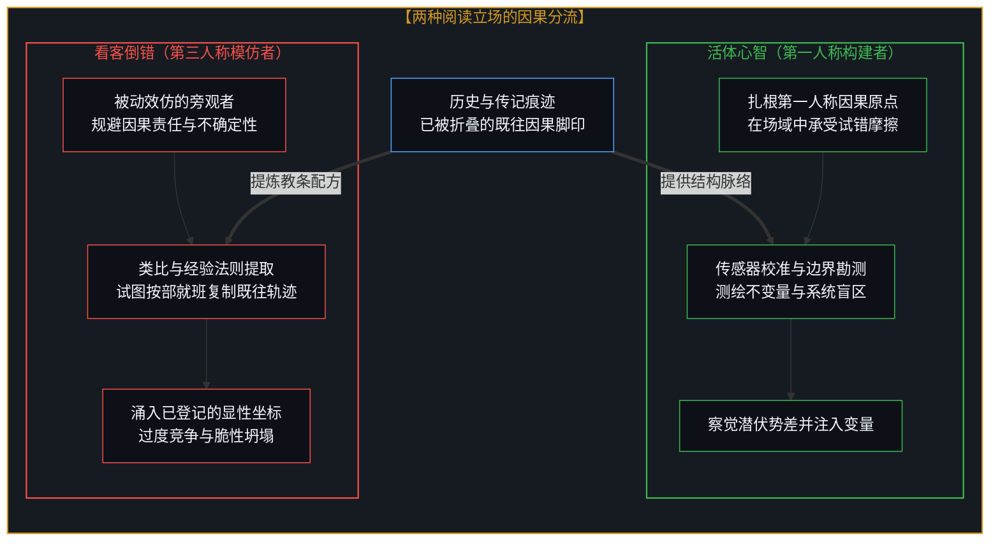
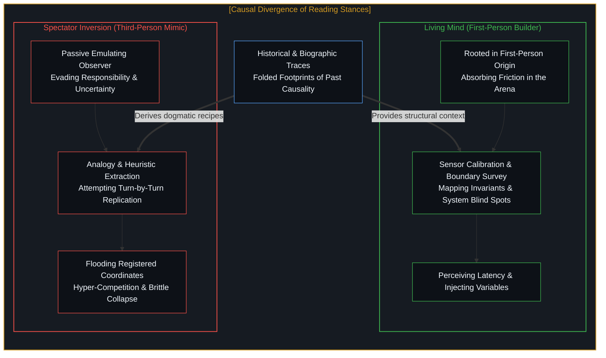
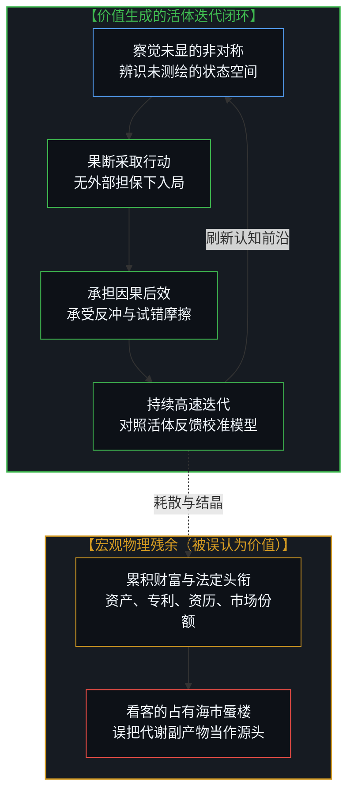
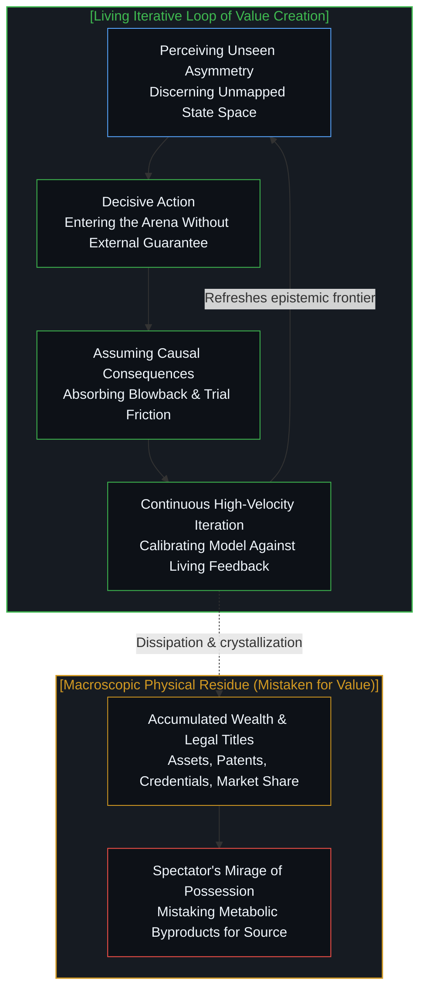
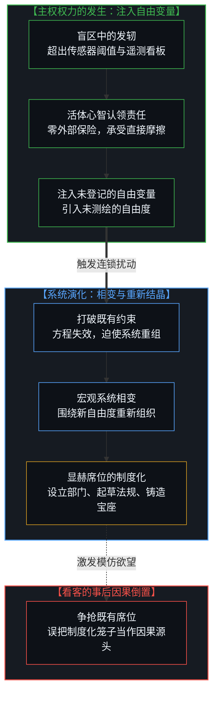
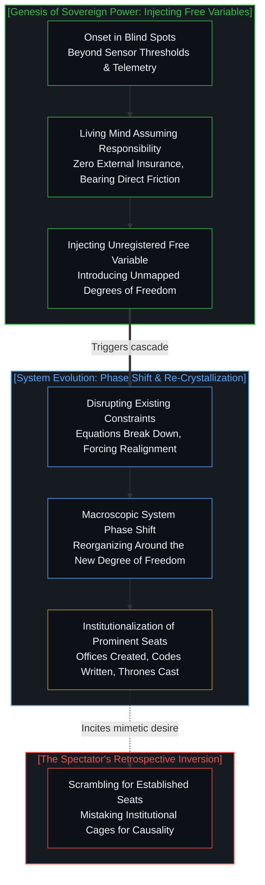

# 隐性自由变量与权力的事后幻相 / The Invisible Free Variable and the Retrospective Illusion of Power

*价值源于感知与迭代而非占有，权力源于注入隐性变量而非占据席位 / Value arises from iterative perception, not possession; power from invisible variables, not seats.*

传记与历史叙事热衷于将宏大的成就描摹为一种事后可见的清晰轨迹，引得无数效仿者试图通过类比与经验法则复制胜利的果实。然而，事后归因无法解释跃迁本身的生成；价值不是静态存量的占有，而是察觉未显的非对称、基于察觉采取行动、对后效承担责任并持续迭代的活体闭环；权力也并非在系统相变完成后占据显赫席位，而是在发轫之初主动认领因果责任，向复杂织体注入隐性自由变量的决断。

Biographies and historical chronicles habitually depict monumental triumphs as clear, legible trajectories after the fact, tempting countless emulators to reproduce success through analogy and heuristic playbooks. Yet retrospective attribution cannot account for the genesis of the leap itself. Value is not the passive possession of accumulated stock, but a living loop of perceiving unseen asymmetries, acting upon them, bearing the full weight of consequences, and iterating continuously. Likewise, power is not the occupation of a prominent seat once a system has already undergone its phase change, but the sovereign willingness to shoulder responsibility and inject an invisible free variable into the complex fabric of reality at its onset.

## 一、 传记的看客陷阱：痕迹的类比与因果的倒错 / 1. The Spectator's Biographic Trap: The Analogy of Traces and Causal Inversion

在大众商业文化与[成功学](../cheng-gong-xue/)中，传记阅读与历史探究长期占据着受人尊崇的地位。以聚焦创始人的长篇播客与大部头传记为代表，人们沉迷于拆解行业巨头如何卡住分销咽喉、创新先驱如何力推端到端整合、或者统帅如何在战场侧翼调度骑兵。数以百万计的看客抱着近乎宗教式的虔诚研读这些叙事，认定既然人性延续不变，只要通过类比从既往脚印中提取出行动法则，并投射到当下的挑战中，就能推演出对等的胜局。这种思维定势预设：卓越的成就遵循一条已经铺就的轨道，后人只需借助清晰的视野看清前人的脚印，便能绕过探索的迷雾。

In popular commercial culture and [Theories After Success](../cheng-gong-xue/), the reading of biographies and historical inquiry has long held a revered status. Exemplified by long-form founder podcasts and encyclopedic biographies, culture is obsessed with dissecting how a titan seized a distribution bottleneck, how an innovator enforced end-to-end integration, or how a general maneuvered cavalry across a flank. Millions of spectators consume these narratives with near-religious devotion, convinced that because human nature endures, one can extract operational rules from past footprints through analogy, project them onto current challenges, and engineer an equivalent triumph. This mindset presumes that exceptional achievement follows a paved rail, requiring only a clear optic on historical footprints to bypass the fog of exploration.

关键在于，卓越的践行者确实如饥似渴地研读历史与传记，历史参照与校准的效用显而易见。但对于在直接摩擦中搏杀的创造者而言，阅读历史从来不是为了寻找操作手册，而是将既往轨迹当作一面高维的校准之镜：用来调校自身的感知传感器，认清重压之下反复浮现的心理盲区，勘测组织衰退与系统摩擦的不变量。旁观者犯下的因果倒错，在于将这种事后的校准支架当成了生成性因果本身；看到卓越的创始人书架上摆满史书，便以为阅读传记和套用历史类比生成了他们的成就，恰如看见冠军穿着某双跑鞋冲过终点线，便断定正是这双跑鞋造就了奔跑的步幅。这一分野取决于心智是否扎根在第一人称因果原点：锚定于这一原点的心智深知因果的生成杠杆在于自身当下的抉择，历史只是外在的标尺；一旦这一参照向外转移，历史痕迹便会取代主体性，将效仿者困在僵化的教条之中。

Crucially, accomplished practitioners voraciously read history and biographies; the utility of historical reference and calibration is clear. Yet for creators wrestling with direct friction, historical reading is never an operational manual. Instead, they use past trajectories as a high-dimensional mirror for calibration: to tune their perceptual sensors, recognize recurrent psychological blind spots under stress, and map the invariants of organizational decay and system friction. The spectator commits a causal inversion by mistaking this retrospective calibration scaffolding for generative causality itself. Observing that accomplished founders keep libraries of history, the imitator assumes that reading biographies and applying historical analogies generated their triumph, much like observing a champion cross the finish line in a specific shoe and concluding the footwear authored the stride. This divergence hinges on whether the Mind remains rooted in the first-person causal origin: a Mind anchored at this origin recognizes that the generative lever of causality resides within its own immediate choices, with history serving merely as an external gauge; once that reference shifts outward, historical traces displace agency, trapping the emulator within rigid dogma.

当效仿者试图通过类比与经验法则来引导行动时，他们不可避免地跌入了凝固痕迹的盲区。类比只能在已被登记和命名的既有坐标之间运作；它要求源系统与目标系统在结构上对称，这意味着获准进入类比视野的要素，都是系统账本中早已被清晰记录的存量信息。一旦某种操作打法或战略动作能够通过历史类比被清晰表述，它就已经转化为公开的约束，资本与人群会瞬间涌向这一显性坐标，将信息盈余抹平。依靠类比去寻找演化的前沿，就如同只因路灯下更明亮，便只在路灯下寻找遗失的钥匙。追根溯源，这种依赖源于[观察者的隐身与无损传递的妄念](../the-invisible-observer-and-the-delusion-of-lossless-transmission/)所追溯的机制：看客幻想行动者的决策逻辑可以脱离具体的处境、不付摩擦代价地无损提取，却遗忘了剥离观察者的模型早已失去了因果根基。正如[未历摩擦的心智与借来的全能](../the-unfrictioned-mind-and-borrowed-omnipotence/)所阐明的那样，未曾亲身承受探索试错摩擦的心智，哪怕借用再精密的历史模型，其模拟出的全能也会在遭遇未登记现实时瞬间碎裂。

When emulators attempt to steer action through analogy and heuristic rules, they inevitably fall into the blind spot of frozen traces. Analogy can only function across previously registered, named coordinates. It requires structural symmetry between the source and the target, which guarantees that every element admitted into the analogy consists of established, legible information already logged in the system's ledger. The moment an operational playbook or strategic move can be clearly articulated via historical analogy, it has already transformed into a public constraint. Capital and crowds instantly converge on that explicit coordinate, extinguishing any informational surplus. Seeking an evolutionary frontier through analogy is like searching for lost keys exclusively beneath a streetlamp because the light is brighter there. At root, this reliance stems from what [The Invisible Observer and the Delusion of Lossless Transmission](../the-invisible-observer-and-the-delusion-of-lossless-transmission/) traces: spectators imagine that an actor's decision logic can be extracted losslessly from its situated ground without paying the cost of friction, forgetting that a model stripped of its observer loses its causal footing. As demonstrated in [The Unfrictioned Mind and Borrowed Omnipotence](../the-unfrictioned-mind-and-borrowed-omnipotence/), a Mind that has never absorbed the personal friction of exploratory trial can borrow the most intricate historical models, yet its simulated omnipotence shatters the moment it encounters unregistered reality.

## 二、 价值的拓扑结构：察觉与迭代的闭环，而非存量的占有 / 2. The Topology of Value: The Perception-Iteration Loop, Not the Possession of Stock

在看客的常规视野中，“价值”几乎总是被具象化为一系列可见的占有物。社会的账本习惯于用累积的资产规模、资产负债表上的净值、独占专利或制度头衔来度量价值。这种静态的存量观给人植入了一种幻相：仿佛价值是一种被锁在银行金库或镌刻在股权凭证上的坚硬实体，只要占有了这些标的，便自动获得了生成它们的创造力。效仿者因而将精力耗费在占有的争夺上，用借来的资历与外在徽章装点自身，试图通过跻身既有财富形态的持有者行列来验证自身的价值。

In the conventional gaze of the spectator, "value" is almost invariably reified into a catalog of visible possessions. Societal ledgers measure value through accumulated asset volumes, balance sheet net worth, proprietary patents, or institutional titles. This static view of stock instills the illusion that value is a solid substance locked inside bank vaults or inscribed upon equity certificates, and that possessing these entities automatically confers the generative agency that produced them. Emulators consequently spend their effort contending for possession, adorning themselves with borrowed credentials and external badges, attempting to validate their worth by joining the ranks of those holding established forms of wealth.

反之，从第一人称因果的动态视角切入，价值呈现出截然相对的拓扑结构。价值从不由静态的占有界定，它是一种**活体的主权能力**：能够察觉他人忽略的潜伏失衡与契机，基于这种非对称的察觉果断行动，为这一行动在物理世界中引发的反冲承担因果责任，并在持续的摩擦与反馈中高速迭代。一家坐拥巨额资本储备的企业，一旦丧失了内部察觉未知与承受探索摩擦的能力，这些储备便会在轻微的环境变动下沦为沉重的负债；反之，一个运转着这一完整迭代闭环的活体心智，哪怕被剥夺全部有形资产、置入荒野，也能劈开崭新的价值通道。

In contrast, from the dynamic vantage of first-person causality, value presents an opposing topology. Value is never defined by static possession; it is a **living sovereign capacity**. It is the ability to perceive latent imbalances and opportunities that others overlook, to act decisively upon that asymmetric perception, to assume complete causal responsibility for the physical reverberations of that act, and to iterate rapidly through continuous friction and feedback. An enterprise possessing massive capital reserves will watch those reserves turn into crushing liabilities under slight environmental shifts if it loses the internal capacity to perceive the unmapped and bear exploratory friction. Conversely, a living Mind exercising this complete iterative loop, even if stripped of all tangible assets and cast into wilderness, carves open fresh conduits of value.

宏观世界所记录的可见资产、货币与契据，是这一活体因果闭环留下的代谢残余。如同生物体在代谢能量交换中分泌出外骨骼作为副产物，累积的财富代表了过往察觉、决断与摩擦所凝固的脚印。将占有误认为价值，等同于将石化的骨骼误认为能够自主代谢的呼吸活体。正如[主体性的折现](../the-discount-on-agency/)、[前台的寓言与缺席的因果倒置](../the-receptionist-parable-and-the-causal-inversion-of-absence/)与[你的代码库即是记忆](../your-codebase-is-memory/)所追溯的，一旦行动者将注意力从重新切分当下的原初生成闭环转移到对历史残余的防御性囤积上，便会加深陈旧框架的引力势阱，将自身的主体性打折，退化为等待结构性淘汰的被动组件。

The visible assets, currencies, and deeds recorded by the macroscopic world are the metabolic residue left behind by this living causal loop. Just as a biological organism secretes an exoskeleton as a byproduct of its metabolic energy exchange, accumulated wealth represents the frozen footprint of past instances of perception, decision, and friction. Mistaking possession for value is equivalent to mistaking a petrified skeleton for a breathing organism capable of self-directed metabolism. As traced in [The Discount on Agency](../the-discount-on-agency/), [The Receptionist Parable and the Causal Inversion of Absence](../the-receptionist-parable-and-the-causal-inversion-of-absence/), and [Your Codebase Is Memory](../your-codebase-is-memory/), the moment an actor shifts attention from the primary generative loop of re-cutting the present to the defensive hoarding of historical residue, they deepen the gravity well of obsolete framings and discount their own agency, reducing themselves to a passive component awaiting structural obsolescence.

## 三、 权力的深层拓扑：注入隐性自由变量，而非占据显性席位 / 3. The Deep Topology of Power: Injecting Invisible Free Variables, Not Occupying Visible Seats

比价值更易遭受认知扭曲的，是“权力”这一概念。在历史编年与大众媒体的叙事中，权力总是与宏观相变的显性波峰绑定在一起。当一个行业发生板块重组，当一个帝国崩塌，或当一家企业完成历史性并购时，聚光灯总是打在那些端坐于显赫席位的人物身上：签署条约、颁布法令、接受公众欢呼。旁观者自然生出一种信念，认为权力就是“在可见的相变期占据发号施令的席位”。由此，政治博弈与组织晋升退化为围绕既有席位的零和争夺，人们相信只要夺取高处的宝座，就能自动接管支配该领域的系统力量。

Even more vulnerable to cognitive distortion than value is the concept of "power." In historical chronicles and mass media, power is routinely fused with the visible crest of macro phase transitions. When an industry undergoes tectonic reorganization, when an empire collapses, or when an enterprise executes a historic acquisition, the spotlight falls exclusively upon figures occupying prominent apex seats: signing treaties, issuing decrees, and receiving public acclaim. Observers naturally develop the conviction that power is the act of "occupying the commanding seat during a visible phase shift." Consequently, political maneuvering and corporate climbing degenerate into zero-sum battles over existing seats, operating under the belief that seizing the high throne automatically transfers the systemic force that governs the domain.

追溯因果序列会显露出截然不同的几何结构：**权力是在复杂系统发轫之初，主动认领责任并向其中注入未登记“自由变量”的意愿与能力**。要把握这一区分，需要对约束变量与自由变量加以对照。一个稳定成型的复杂系统由“约束变量”所界定：制度化的协议、显性的定价机制、成文的法规、僵化的组织架构与可见的考核指标。这些约束变量彼此咬合，构成一张内部一致却僵硬的因果网格。任何试图在既有席位上行使权威的人，都受这张网格本身所束缚，只能在既定方程内部微调参数。正如[权力的镜像握手](../the-mirror-handshake-of-power/)所阐明的，这种表象权威不过是顺从者为逃避责任而让渡主体性所拼凑出的借来质量，一旦被动的顺从动摇，便会随之瓦解。

Tracing causal sequence exposes a different geometry: **power is the willingness and capacity to assume responsibility and inject an unregistered "free variable" into a complex system at its onset**. To grasp this distinction, one must contrast bound variables with free variables. A stable, established complex system is defined by "bound variables": institutionalized protocols, explicit pricing mechanisms, codified statutes, rigid org charts, and visible metrics. These bound variables interlock, forming an internally consistent yet rigid causal lattice. Anyone attempting to wield authority from an established seat is bound by this very mesh; they can merely nudge parameters within predefined equations. Such apparent authority, as demonstrated in [The Mirror Handshake of Power](../the-mirror-handshake-of-power/), is an illusion constructed from the borrowed mass of subjects surrendering their agency to evade responsibility, liable to dissolve the moment that passive compliance falters.

生成性权力起源于一个正交的维度：当活体心智拒绝受制于既有方程，在系统未测绘的边界处引入一个自由变量时，权力便由此发生。在发轫之初，这一变量是隐性的：现有的传感器无法检测它，管理看板没有测量它的列项，市场未曾给它标价，法典也没有为它设立分类。正因为它是隐性的，**系统无法提供任何保险、共识或制度庇护**。注入这一自由变量的行动者，必须以自身的认知带宽、声誉与生存为注，独自承受这一未建模的自由度撞击既有机器时所释放的全部动荡。正如[自由变量的同构与先验主权](../zi-you-bian-liang-de-tong-gou-yu-xian-yan-zhu-quan/)与[残余与自由变量](../the-residue-and-the-free-variable/)所确立的，这构成了因果权力的起始一步。

Generative power originates in an orthogonal dimension: it arises when a living Mind refuses to be bounded by existing equations and introduces a free variable into an unmapped boundary of the system. At its onset, this variable is invisible. Current sensors cannot detect it, management dashboards possess no column for its measurement, markets have assigned it no price tag, and legal codes offer it no category. Precisely because it is invisible, **the system cannot provide insurance, consensus, or institutional shelter**. The actor injecting this free variable must stake their own cognitive bandwidth, standing, and survival, shouldering all the turbulence unleashed when an unmodeled degree of freedom strikes the incumbent machine. As established in [The Isomorphism of Free Variables and Prior Sovereignty](../zi-you-bian-liang-de-tong-gou-yu-xian-yan-zhu-quan/) and [The Residue and the Free Variable](../the-residue-and-the-free-variable/), this constitutes the initiating step of causal power.

当这一隐性自由变量在系统内部持续激荡，使既有方程无法维持原有的均衡时，整个装置便被迫发生宏观相变，围绕这个闯入者重新组织与结晶。直到此时，原本隐性的自由度才被登记为交互主体的事实。在这一节点上，官僚体系建立部门来管理它，监管机构起草法规来约束它，商学院编写案例来解释它，传记作家则挥笔写下辉煌的胜利篇章。相变之后竖立起的显赫席位，只是为了容纳这个已被驯化的变量而打造的镀金笼子。看客们争相抢夺笼子，却忽略了主权权力在自由变量注入未测绘边界、尚无记录的那一刻，便已完成了它的因果运作。

As this invisible free variable reverberates through the system, rendering existing equations incapable of preserving equilibrium, the entire apparatus is forced into a macroscopic phase transition, reorganizing and crystallizing around the intruder. Only then does the once-invisible degree of freedom register as an intersubjective fact. At that juncture, bureaucracies erect departments to manage it, regulatory bodies draft statutes to govern it, business schools construct case studies to explain it, and biographers write glowing accounts of the triumph. The prominent seat erected post-transition is a gilded cage designed to house an already-domesticated variable. Spectators contend to claim the cage, overlooking that sovereign power completed its operative work at the unrecorded instant when the free variable was injected into the unmapped boundary.

## 四、 自指的界限与第一人称因果原点 / 4. The Self-Referential Boundary and the First-Person Causal Origin

任何试图将成功与权力法典化为客观、可转移教条的努力，都会撞上自指不完备性的壁垒。正如库尔特·哥德尔在数理逻辑中所确立的，一个形式系统无法在系统内部同时证明自身的完备性与内部一致性。一切看似严丝合缝的事后叙事，都唯有通过**拒绝将自身的解释机制应用于其生成前提**，才能维持内部的一致性。正如[验证的倒置](../the-reversal-of-verification/)所追溯的，固定持守内部的自洽并非连贯：当事后剧本或经验证的方法被当作信任的根基，而非由持续区分的能力所读取的痕迹时，这一持守便向内闭合，将未建模的残余排除在自身之外。如果从创始人传记中提炼出的操作准则构成了一门闭合的科学，那么它在付诸应用时理应普遍成立。然而，一旦所有行动者都部署这套经验法则，模型所承诺的非对称盈余便随之消失；更关键的是，这套教条无法解释创始人自身的生成起点——因为创始人之所以能实现突破，恰恰在于打破了当时占统治地位的经验法则，在毫无庇护的情况下踏入了未被建模的虚空。

Any endeavor to codify success and power into an objective, transferable doctrine encounters the barrier of self-referential incompleteness. As Kurt Gödel established within mathematical logic, a formal system cannot demonstrate both its completeness and internal consistency from within. Every retrospective narrative that appears airtight maintains its internal consistency solely by **refusing to apply its own explanatory machinery to its generative premises**. As [The Reversal of Verification](../the-reversal-of-verification/) traces, internal consistency inside a fixed hold is not coherence: when a retrospective playbook or verified method is held as the ground of trust rather than as a trace read by the capacity that keeps distinguishing, the hold closes and leaves the unmodeled residue outside itself. If the operational maxims extracted from a founder's biography constituted a closed science, they would hold universally under application. Yet the moment all actors deploy the heuristic, the asymmetric surplus promised by the model vanishes. More decisively, the doctrine cannot account for the founder's own genesis—because the founder broke through by violating the reigning heuristics of their day, stepping unprotected into an unmodeled void.

这种理论上的规避，与现代物理学中的基础争论互为镜像。在[双生子佯谬与隐秘观察者](../the-twin-paradox-and-the-hidden-observer/)中，狭义相对论设定一切惯性运动都是关系性的，在任意惯性系之间保持不变性；然而，当面对重逢的双生子究竟谁更年轻的佯谬时，标准解释为了维持一致性，却悄然在后台引入了一个未经承认的宇宙背景参考系，将加速处理为客观的非相对偏离。事后成功学犯下了同样的障眼法：它兜售一套表面客观、无需承担无对冲个人风险的操作手册，暗中却寄生在活体心智无法投保的孤注一掷之上。它宣称是方法论框架孕育了先驱，却掩盖了因果发生的次序——正是先驱在没有框架可用时挺身行动的意愿，才使得事后书写这套方法成为可能。

This theoretical evasion mirrors foundational debates in modern physics. In [The Twin Paradox and the Hidden Observer](../the-twin-paradox-and-the-hidden-observer/), special relativity posits that all inertial motion is relational, holding invariance across arbitrary inertial frames. Yet, when confronted with the paradox of which reunited twin has aged less, the standard resolution maintains consistency by quietly smuggling in an unacknowledged cosmic background frame to treat acceleration as an objective non-relative departure. Retrospective success theories commit an identical sleight of hand: they peddle an ostensibly objective manual free of unhedged personal risk, while secretly resting upon the uninsurable gamble of a living Mind. They proclaim that the methodical framework birthed the pioneer, obscuring the causal sequence in which the pioneer's willingness to act without a framework made the subsequent writing of the method possible.

走出看客席位，始于不再将凝固的脚印当作立足的根基。历史编年与创始人传记唯有作为在行进途中照出悬崖与泥潭的反射之镜，才不失为清醒的工具。没有任何书页能替他人承担未知的重量，也没有任何类比能赐予生成性权力。价值不是从外部夺取并锁入金库的战利品，而是在辨识未显之物、依此决断行动、承担因果后效并在摩擦中迭代所锻造出的能力；权力也不是在他人舞台上争夺的华丽坐席，而是敢于向未测绘的边缘注入隐性自由变量，并为其激起的波澜承担全部个人责任的决断。在当下的切近现场，第一人称参与的摩擦始终是因果得以展开的唯一锚点。

Stepping out of the spectator's gallery begins when frozen footprints are no longer held as ground. The annals of history and founders' biographies remain instruments of clarity only as reflective mirrors revealing cliffs and quagmires while one is already in stride. No page can bear the weight of the unknown on another's behalf, and no analogy can bestow generative power. Value is not a trophy taken from without and locked inside a vault; it is the capacity forged through discerning the unseen, acting upon that distinction, shouldering consequences, and iterating under friction. Power is not a decorated chair contested on someone else's stage, but the willingness to inject an invisible free variable into the unmapped edge and bear full personal responsibility for its wake. In the immediate present, the friction of first-person participation remains the sole anchor through which causality unfolds.

究竟是将历史视为校准之镜而非教条枷锁、将价值视为动态迭代而非静态存量、将权力植根于注入变量而非占据席位，皆取决于心智是否扎根在第一人称因果原点。正如[验证中因果权能的分配](../the-allocation-of-causal-power-in-validation/)所追溯的，一旦心智撤离这一原点，将因果权能移交到第三人称的既有程式中，一切对历史、策略与权威的追逐便会退化为模仿；唯有锚定在发起行动并承担全部后效的原初支点上，活体心智才能催生出任何既有方程都未曾预设的相变。

Whether one treats history as a calibration mirror rather than a dogmatic shackle, conceives of value as dynamic iteration rather than static stock, and roots power in injecting variables rather than occupying seats hinges on whether the Mind remains rooted in the first-person causal origin. As [The Allocation of Causal Power in Validation](../the-allocation-of-causal-power-in-validation/) traces, the moment the Mind vacates this origin and relocates causal power into third-person formulations, every pursuit of history, strategy, and authority degenerates into mimicry. Only by anchoring at the primary pivot of initiating action and shouldering its full wake does a living Mind catalyze transitions unanticipated by any existing equation.
