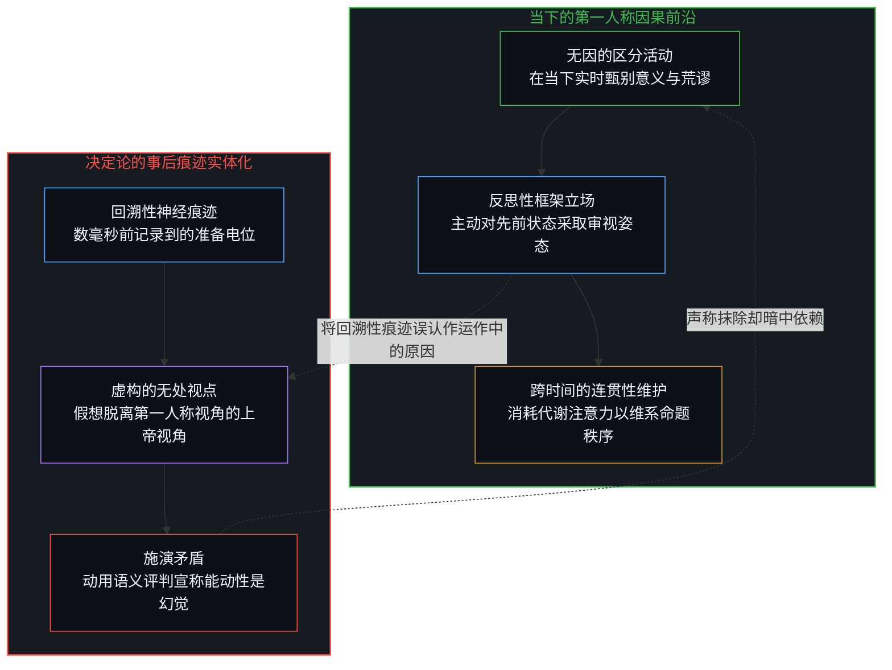
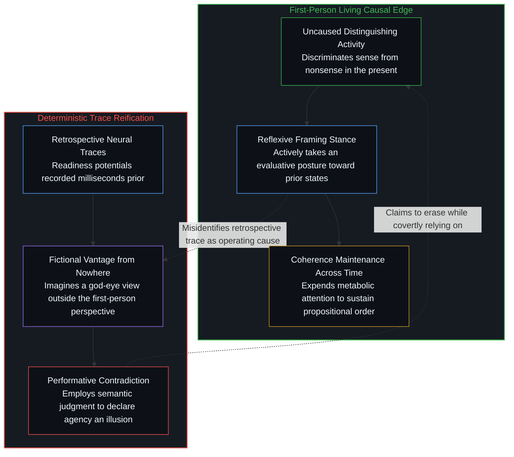
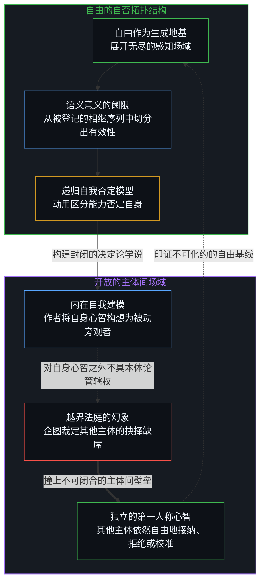
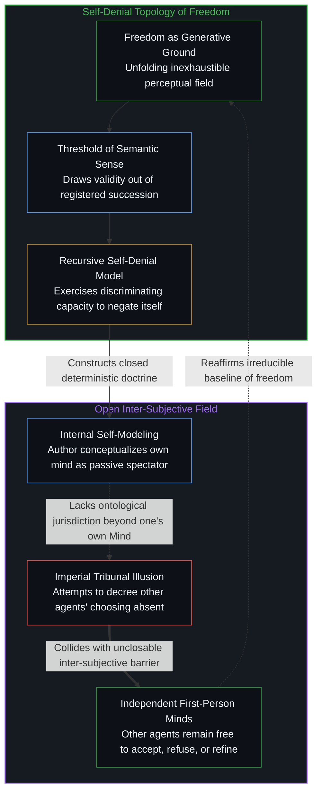

# 自由意志的自否自由 / The Freedom of Will to Deny Itself

*否定意志的雄辩，正是自由行使主权以区分意义与荒谬的当场展演。 / The eloquence denying will is freedom exercising its sovereign capacity to distinguish sense from nonsense.*

公共哲学讨论中频繁给出一种针对人类能动性的终局裁决：自由意志毫无意义，因为念头与决断皆源于意识未曾参与编写的先在原因。这一断言以源自现代神经科学与物理决定论的冷静科学推论自居，却在说出口的瞬间陷入深刻的施演矛盾。宣称自由意志不存在的整套概念建构，恰恰整体运行在它试图抹除的区分能力之内。将一套论证评判为合乎情理而非荒谬无稽，本身就需要心智在当下直接行使能动主权。正因自由涵括了否定自身存在的能力，意义与荒谬之间的界限才得以成立，也为这类精巧繁复的自驳主张留出了空间。

Public philosophical debates frequently deliver a finished verdict on human agency: free will makes no sense, because thoughts and decisions arise from prior causes that consciousness does not author. This assertion presents itself as a dispassionate scientific deduction from modern neuroscience and physical determinism, yet it collapses into a profound performative contradiction the moment it is uttered. The conceptual architecture that declares free will nonexistent operates entirely within the very capacity for discrimination it seeks to erase. Evaluating an argument as sensible rather than nonsensical requires the active sovereignty of mind in the immediate present. Because freedom encompasses the capacity to deny its own existence, the boundary between sense and nonsense exists at all, leaving room for such elaborate self-refuting claims.

## 一、 裁决的内在性与虚构的无处视点 / 1. The Immanence of Verdict and the Fictional Vantage from Nowhere

决定论对自由意志的经典反驳，仰赖一条清晰的时间序列：神经前驱信号、无意识决定因素与电化学级联构成了暗区，下一个念头便从中浮现。事件在物理时间中展开的因果叙事大可悉数承认；无论经验科学以何等精度记录神经准备活动与生物基底，皆无异议。真正的越界，始于把这份描述当成已经跳出了作出描述的那个视角。

The standard deterministic refutation of free will relies on a clean temporal sequence: neural precursors, unconscious determinants, and electrochemical cascades generate the darkness from which the next thought appears. A causal narrative of how events unfold across physical time can be granted without objection; neural preparations and biological substrates may be documented with whatever precision empirical science attains. The overshoot begins when the description is treated as having stepped outside the perspective in which it is being made.

不存在任何外部视点，能够将这些陈述核准为客观实情。断言就发生在此处。人可以说得仿佛从无处发声，却无法真正占据那个无处。正如[表征的闭环](../the-closed-loop-of-representation/)所论证的，一切理论、仪器与解释都始终内在于构建它们的第一人称心智之中。第一人称视角与因果本就是同一枚硬币的两面：因果并非在幕后自行运转的独立机器，而是有意识的能动性介入局域摩擦时所登记下的非对称痕迹。当理论家试图将第一人称中心与因果割裂开来、借此宣称意志是幻觉时，他不过是在模拟一次退出自身觉知场域的离场。在[框架的盲区](../the-blind-spot-of-the-frame/)中，这一障眼法被进一步揭破为方法论省略与本体论缺席之间的混淆：研究者为了勾勒客观蓝图而在方法论上悬置主体，随后却将蓝图中主体的缺席误当成能动性不存在的证明。同样的自否结构也反复出现在心灵哲学中：[功能主义者无法持有的功能主义](../the-functionalism-no-functionalist-can-hold/)剖析了功能主义者如何以认真持有的姿态宣称认真不过是因果角色，在占据观察者之位的同时抹去观察者。正如[道德倒错与被脚本化的主体](../the-moral-reversal-and-the-scripted-subject/)所揭示，意识形态正是通过说服自由否定自身，来为主体写定剧本。[寻觅的语法与淡出的观察者](../the-grammar-of-finding-and-the-fading-observer/)则将同一操作追溯至观察者本身：否认观察者，恰是从观察者之位作出的选择。

There is no external vantage from which those statements can be certified as the objective case. The claiming happens here. One can speak as if from nowhere, but one cannot occupy that nowhere. As demonstrated in [The Closed Loop of Representation](../the-closed-loop-of-representation/), all theories, instruments, and interpretations remain immanent to the first-person Mind that formulates them. The first-person perspective and causality are two sides of the same coin: causality is not an autonomous machine operating behind the scenes, but the asymmetrical trace registered when conscious agency engages local friction. When a theorist attempts to sever the first-person center from causality to declare will an illusion, they merely simulate an exit from the field of their own awareness. In [The Blind Spot of the Frame](../the-blind-spot-of-the-frame/), this sleight of hand is further unmasked as a confusion between methodological omission and ontological absence: the investigator methodologically brackets the subject to articulate an objective blueprint, only to mistake the subject's absence from the blueprint for proof that agency does not exist. The same self-denying structure recurs in the philosophy of mind: [The Functionalism No Functionalist Can Hold](../the-functionalism-no-functionalist-can-hold/) dissects how the functionalist, holding the view seriously, declares seriousness to be nothing but causal role, occupying the observer position while erasing the observer. Ideology scripts the subject by persuading freedom to deny itself, as [The Moral Reversal and the Scripted Subject](../the-moral-reversal-and-the-scripted-subject/) shows. [The Grammar of Finding and the Fading Observer](../the-grammar-of-finding-and-the-fading-observer/) traces the same move to the observer itself: denying the observer is a choice made from the observing position.

## 二、 跨越时差的维持劳作与被掩盖的框架抉择 / 2. The Maintenance of Stances Across Time and the Concealed Choice of Framing

一旦这套论述被出版传播，它便不再只是掠过觉知的又一个转瞬即逝的浮动念头，而成为一个必须在流逝的时间里被主动捍卫其连贯性的客体。此后，大量的智力劳作与修辞雄辩被投入其中，用以证明当初的主张在时隔多日之后依然成立。这段持续不断的维护劳作，本身就是实证样本。后一个立场被有意采纳来审视前一个立场，核验前后一致性、回应各方反驳，并修补结构上的含混之处。

Once the account is published and distributed, it ceases to be only another transient thought drifting across awareness. It becomes an object whose coherence must be actively defended across elapsed time. Substantial intellectual labor and rhetorical eloquence are subsequently spent demonstrating that the original claim remains valid after intervals have passed. That ongoing maintenance is the empirical exhibit. A later stance is deliberately taken toward an earlier one, evaluating consistency, addressing objections, and repairing structural ambiguities.

由此观之，意识并非置身于事件机械传送带之外的被动旁观者；意识是觉知到某项特定的框架抉择已经发生，并投入代谢承诺以顶住阻力维系这一框架。正如[翻袋球与魔术戏法](../the-bank-shot-and-the-magic-trick/)所阐明的，目睹举重若轻之执行的外部旁观者，常把不见吃力当成第一人称因果劳作的缺席——抑或将下游痕迹抬升为规定下一杆的定律——却遗忘了要驾驭路线，就必须顶着阻力持续校准。又如[你的代码库即是记忆](../your-codebase-is-memory/)所追溯的，无论先在条件沉淀在生物神经通路里，还是凝固为外化记忆代码库中层层累加的检查点，留存的余迹都只保有过往切分的形态，从不自行发起下一次区分；决定论指着那堆叠的余迹，动用自身在当下前沿的自由切分，反过来宣告是既存痕迹写下了这一刀。那些用来为决定论辩护的滔滔雄辩，并未表明主权能力已被超越；相反，它揭示出这一能力正以满负荷强度运转，只是领受了一项反讽的差事——掩盖它自身。

Consciousness, in this light, is not a passive spectator standing apart from a mechanical conveyor belt of events. It is the awareness that a specific choice of framing has occurred, coupled with the metabolic commitment to sustain that frame against resistance. As articulated in [The Bank Shot and the Magic Trick](../the-bank-shot-and-the-magic-trick/), an external onlooker who sees effortless execution takes the absence of visible strain for the absence of first-person causal work—or elevates downstream traces into a law dictating the next stroke—forgetting the continuous calibration against resistance required to steer the path. And as [Your Codebase Is Memory](../your-codebase-is-memory/) traces, whether prior conditioning lives in biological neural pathways or in the accumulated checkpoints of an externalized codebase of memory, stored residue holds only the shape of earlier cuts and never initiates the next distinction; determinism points to that stacked residue and uses its own free cut at the living edge to declare that the stored trace authored the cut. The eloquence deployed to defend determinism does not show that sovereign capacity has been transcended. It reveals that capacity operating at full intensity, tasked with the ironic duty of concealing itself.

## 三、 作为区分活动的无因之因与意义的主权阈限 / 3. The Uncaused Cause as Distinguishing Activity and the Sovereign Threshold of Sense

无因之因并非驻守在现实之外的神话第一推动者，也不是额外塞进机器里的幽灵机关。无因之因正是区分活动本身：它的敞开性在当下的直接感知中呈现为无尽的潜在规定之域，而它的离散行动则拣选出哪些规定被显化到台前、哪些隐入背景之中。这一行动就是此刻正在发生的抉择。正是它从相继序列中切分出意义，被登记为物理过程的相继也不例外；也正是它能同样轻易地将意义翻转为对自身的否定。将这一源头想象成上游的某个固定点，本身就又落入了决定论的前提：源头不是静止的点，而是不息展开的区分动作，是生成分布的能力；[悬而未决是决定论的索求](../the-open-question-is-determinisms-demand/)由此进一步追出，哪怕看似中立地宣称抉择“被决定与否尚无定论”，也已经先行预设了决定论的索求。

The uncaused cause is not a mythological prime mover stationed outside reality, nor an extra ghostly mechanism inserted into the machine. It is the distinguishing activity itself: its openness arrives as the inexhaustible field of potential determinations in the immediate perceptual present, and its discrete act selects which determinations are brought into the open and which remain concealed. That act is the choice occurring now. It is what draws sense out of succession, the succession registered as physical included, and what can just as easily turn sense into a denial of itself. To picture this source as a fixed point upstream is again a deterministic premise: it is the differentiating as ongoing action, the ability to make a distribution, and from here [The Open Question Is Determinism's Demand](../the-open-question-is-determinisms-demand/) traces how the neutral statement that a choice is "not yet settled as determined or not" has already demanded determinism.

机械的相继序列本身并不自带语义上的有效性。山体滑坡、恒星爆发或沿轴突传导的动作电位，作为被登记的事件，既非合乎情理也非荒谬悖谬；意义与荒谬是在它们之上作出的进一步区分。“意义”与“荒谬”之所以存在，只因能动的主体在二者之间作出了区分。决定论反驳自由意志的论证正是这样一种显现：将连贯推理与荒谬区分开来的能力本身，被调集去产出“该能力只是幻觉”的主张。同一个结构也落在实在论者自己的论证上：若主张物质先于并独立于意识的人与否认这一点的人只是同一个被全然决定的进程中的两个点，“对”与“错”之间就没有可以立足的差别，这个论证取消意识的同时也取消了自己的资格。更进一步，正如[抉择的跨界](../the-boundary-crossing-of-choice/)所深入解构的，这种宣称试图将可重复的非物理抽象凌驾于鲜活的具身行动之上，却遗忘了发声言说这一物理动作本身就是一次不可逆的单次物理刻写。这正是运作中的自由：能动主权如此完整，以至于自由到连自身都可以否定。若没有这种划定边界并否定自身敞开性的能力，成立之物与排除之物之间便无从划出任何离散界限，评判、真伪与论证也就失去了容身的概念空间。正如[观察、区分活动与心智的开放地基](../observation-distinguishing-activity-and-the-open-ground-of-mind/)所追溯的，同样的自我否定在每一次区分中都在运作：划定边界，就是将边界由以生出的敞开性搁置一旁，任何离散之物——包括意义与荒谬之间的界限——正是借此显入视野。唯有当某一个确定立场——决定论模型也在其列——在跨出自身那一步后仍被执守为心智的全部，矛盾才由此产生；被它搁置一旁的敞开性，在该立场内部便被登记为必由某条外部先在因果链条所编写的东西，而宣称意志是幻觉的裁决，正是那个立场在发声。这种自否动态不仅在形而上学层面体现为理论家构筑决定论模型，也在微观生存层面体现为行动者将注意力锁定于不可得选项以裁定自身的无助；正如[约束基底与自由自否](../the-substrate-of-constraint-and-the-self-denial-of-freedom/)将其进一步拓展至行动哲学中：约束并非囚笼，而是不可或缺的物理基底，选择唯有借此才能获得因果抓地力；受困的切身体验，恰恰是自由的主权在自我否定中运作。正如[共情的能力倒错与边界的排序之争](../the-capability-reversal-of-empathy-and-the-contest-of-boundaries/)所阐明的，卸下自卫的共情，同样是自由在关系场域中对自身的否定。

Mechanical succession possesses no inherent semantic validity. A landslide, an exploding star, or an action potential propagating down an axon, registered as events, are neither sensible nor nonsensical; sense and nonsense are a further distinction drawn upon them. "Sense" and "nonsense" exist only because an active agency discriminates between them. The deterministic argument against free will is one such manifestation: the very capacity that distinguishes coherent reasoning from absurdity is deployed to produce the claim that the capacity is an illusion. The same structure falls on the realist's own argument: if the one who asserts matter prior to and independent of consciousness and the one who denies it are two points within one fully determined process, nothing is left for a difference between true and false to stand on, and the argument that dismisses consciousness disqualifies itself along with it. Furthermore, as dismantled in [The Boundary Crossing of Choice](../the-boundary-crossing-of-choice/), this argument attempts to elevate repeatable non-physical abstractions above living action, ignoring that the physical act of vocalization is itself an irreversible, singular physical inscription. This is freedom at work: agency is so sovereign that it is free even to deny itself. Without that capacity to bound and deny its own openness, no discrete boundary between what holds and what is excluded could be drawn at all, leaving no conceptual space for evaluation, truth, or argument. As [Observation, Distinguishing Activity, and the Open Ground of Mind](../observation-distinguishing-activity-and-the-open-ground-of-mind/) traces, the same self-denial works at every distinction: to bound is to set aside the openness the bound came from, and that is how anything discrete comes into view, the line between sense and nonsense included. The contradiction begins only when one determinate stance, the deterministic model among them, is held past its step as the whole of the Mind; the openness it set aside then registers from inside that stance as something a chain of prior causes must have authored from outside, and the verdict that will is an illusion is that stance speaking. This self-denying dynamic operates not only at the metaphysical level where theorists construct deterministic models, but also at the microscopic existential level where agents fixate on unavailable options to decree their own helplessness. As extended into the philosophy of action in [The Substrate of Constraint and the Self-Denial of Freedom](../the-substrate-of-constraint-and-the-self-denial-of-freedom/), constraints function not as prisons, but as the indispensable physical substrate through which choice acquires causal traction; the felt experience of captivity is the very sovereignty of freedom operating in self-denial. Empathy that disarms self-defense is freedom denying itself in relationships, as [The Capability Reversal of Empathy and the Contest of Boundaries](../the-capability-reversal-of-empathy-and-the-contest-of-boundaries/) shows.

## 四、 不可闭合的主体间性与第一人称的不可越俎代庖 / 4. The Unclosable Inter-Subjective Field and the Inalienability of the First Person

哲学家固然可以将这一否定施加于自身浮现的念头之上，把意识建模为对先在决定因素毫无编写权的旁观者。然而他无法占据一个超然席位，从中向所有其他第一人称心智发布具有同等约束力的裁决。不存在任何外部法庭能够审察另一个心智的抉择并宣告其能动性缺席——对自身立场的主权切分与跨心智归属之间的这道分界，也正是[归属的不对称](../asymmetry-of-ascription/)所追溯的。

A philosopher may apply that denial to the thoughts that arise as their own, modeling consciousness as an authorless spectator of prior determinants. What they cannot do is occupy a transcendent station from which the same verdict is issued as binding upon every other first-person Mind. There is no outside court equipped to inspect another Mind's choosing and declare agency absent, the same divide between a sovereign cut over one's own standpoint and cross-mind attribution traced in [Asymmetry of Ascription](../asymmetry-of-ascription/).

正如[主权抉择的双面性与观察的客体化](../the-two-sided-nature-of-sovereign-choice-and-the-objectification-of-observation/)与[自由的测不准](../zi-you-de-ce-bu-zhun/)所详述的，外部测得的物理可预测性或统计噪声，皆是内部主权导航的低维投影。其他心智依然自由：自由地接纳这套决定论否定，拒绝它，校准它的边界，或将同样的区分能力反过来指向它的前提。这份留存的敞开性无法单凭宣告予以封闭；它正是当初使这一否定得以成型的同一份无因自由。

As detailed in [The Two-Sided Nature of Sovereign Choice and the Objectification of Observation](../the-two-sided-nature-of-sovereign-choice-and-the-objectification-of-observation/) and [The Uncertainty of Freedom](../zi-you-de-ce-bu-zhun/), external measurements of physical predictability or statistical noise are low-dimensional projections of internal sovereign navigation. Other minds remain free: free to accept the deterministic denial, to refuse it, to refine its boundaries, or to direct the same discriminating capacity against its premises. That residual openness cannot be closed by proclamation. It is the identical uncaused freedom that allowed the denial to be formulated in the first place.

