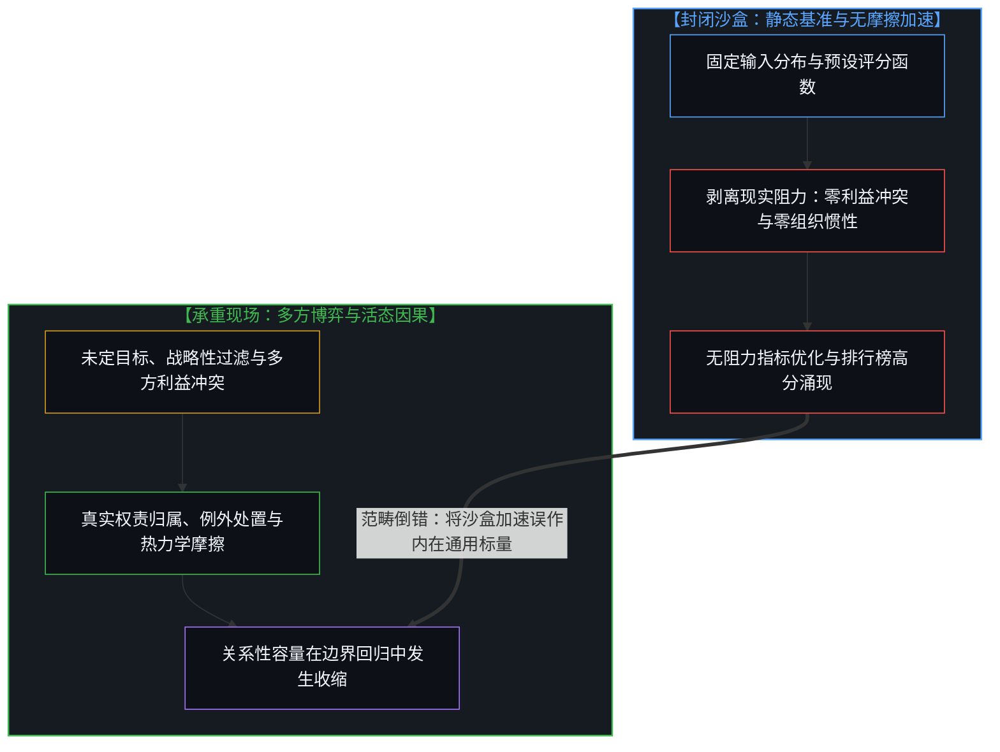
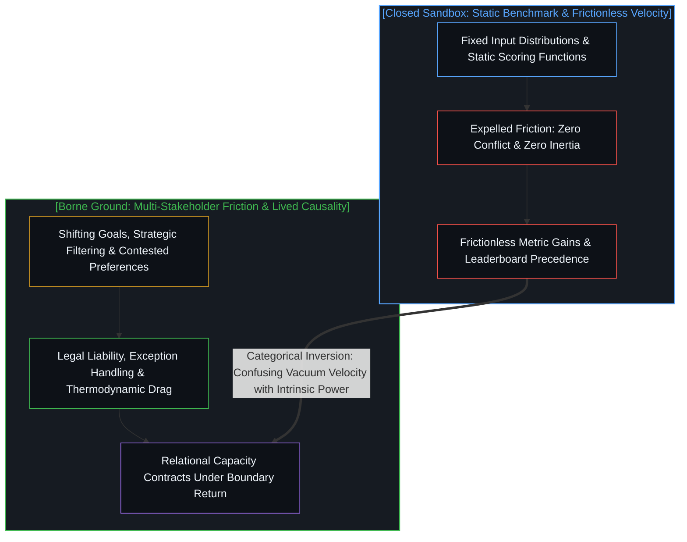
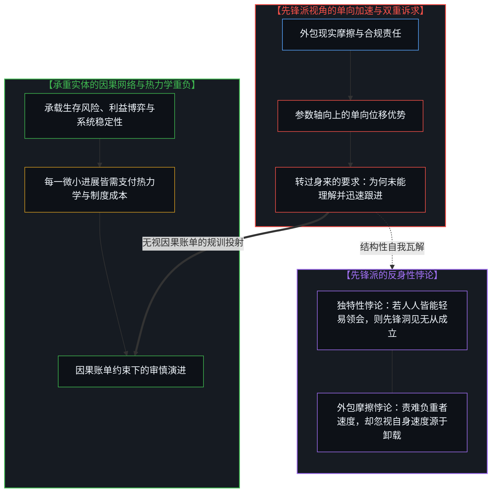
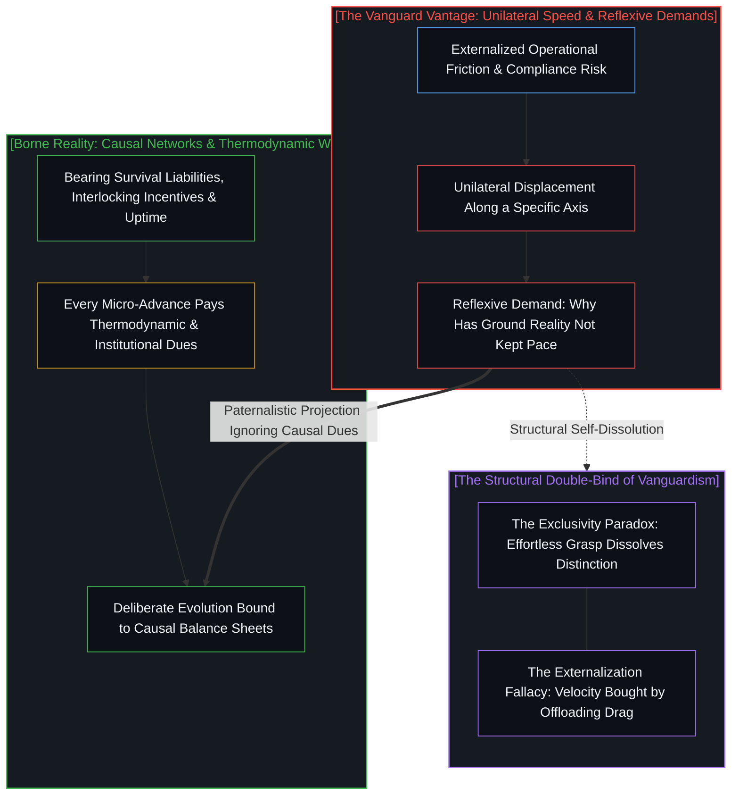

# 无摩擦先锋与承重之地的迟滞 / The Frictionless Vanguard and the Lag of Borne Weight

*剥离现实约束换取的指标加速，在承重界面中显露为关系性容量的收缩。 / Acceleration bought by shedding constraints contracts into relational capacity when meeting borne weight.*

一场关于本地人工智能落地困难的讨论，揭开了一个普遍存在的结构性错觉：在受控基准测试中表现卓越的系统，一旦切入真实的协作网络，其表现出来的能力就会发生急剧收缩。提出疑问的人站在无摩擦的抽象高地，对身处重重现实约束中的行动者感到困惑，甚至反过来质问负重前行者为何未能迅速跟进。这种姿态包含着深刻的形式不对称：领跑者的速度是通过在计算沙盒中剔除最棘手的协同阻力而换取的，而地面行动者的迟缓，正是承载并消化那些被技术模型排斥在外的现实重荷所付出的因果代价。

A discussion regarding the deployment hurdles of local artificial intelligence opens into a pervasive structural distortion: systems that achieve extraordinary scores under controlled benchmarks exhibit a sharp contraction in effective capacity the moment they enter real collaborative networks. Those posing questions frequently operate from a frictionless vantage of abstraction, gazing bewildered at actors immersed in operational constraints, and even asking why those bearing heavy loads have not kept pace. This stance harbors a profound formal asymmetry: the pioneer's velocity is purchased by systematically expelling the most intractable coordination frictions from the computational sandbox, whereas the ground-level actor's apparent lag represents the causal cost of absorbing and managing the very burdens the model cast aside.

## 一、 剥离摩擦的封闭沙盒与标量领先的幻象 / 1. The Frictionless Sandbox and the Illusion of Scalar Superiority

在标准化评测体系中，任务边界被严密限定。输入的分布是已知的，评分函数在测试开始前便已固定，评估所依据的数据集在测试全过程中保持静止，没有任何外部利益相关方能够在模型运行期间临时修改目标。在这些严苛的静止约束下，优化的方向清晰明确，排行榜上的分数得以迅速累积。领跑者所感受到的遥遥领先并不是凭空捏造的幻觉，它在基准测试设定的封闭边界之内具备可验证的真实性。然而这种领先是高度条件化的：它只相对于一个剥离了最困难因果环节的理想化切片而成立。人类行动者之间的目标冲突、战略性隐瞒与筛选后的残缺信息、随时位移的责任认定、组织运作中的沉重惯性以及例外情况的密集涌现，都被统统隔绝在考场之外。技术进步在高度简化的无菌空间内被量化打分，而针对落地进度的质疑却被投射向了考场之外的开放世界。

Within standardized evaluation regimes, task boundaries are rigorously narrowed. Input distributions are known, scoring functions are fixed in advance, test datasets remain stationary throughout the evaluation, and zero external stakeholders can alter the objective while the model is executing. Under these stationary constraints, optimization pathways are unambiguous, and leaderboard gains accumulate swiftly. The pioneer's sensation of being far ahead is not a manufactured fantasy; it possesses verifiable validity within the closed boundaries circumscribed by the benchmark. Yet this precedence is conditional: it holds relative only to an idealized slice from which the most intractable causal frictions have been excised. Goal conflicts between human agents, strategically filtered information, shifting accountability lines, organizational inertia, and the continual eruption of exceptions are sealed outside the examination chamber. Progress is scored inside this simplified space, yet the demand for adoption is projected outward onto the open field.

当技术人员将基准测试的得分直接等同于通用解决能力时，便犯下了一个严重的范畴倒错：将关系性的动态容量，误认作了模型权重所内生的独立标量。在既有评测哲学中，人们倾向于把智能设想为一种如同物体质量或电荷那样的内在属性，以为排行榜上的高分代表系统已经具备了在任意场景下调度因果链条的通用动能。正如在 [模型永远无法成为第二重前沿](../the-model-never-becomes-a-second-edge/) 与 [行走的切线与绊跌的球体](../the-walking-tangent-and-the-stumbling-sphere/) 中所阐明的那样，计算模型所沉淀的只是前人外化痕迹的致密压缩，它自身并不包含未曾历经碰撞的自主起源。所谓能力，始终是特定模型与其运行环境之间的界面耦合关系。在去除了阻力的真空管道中，即使极微弱的推力也能制造出惊人的加速度；但若将这种加速度当作发动机能够拉动万吨货列的证明，就是将边界条件的真空特权，错置为了执行机构的内在神力。

When practitioners equate benchmark performance directly with general problem-solving competence, they commit a categorical inversion: mistaking relational capacity for an intrinsic scalar property lodged within model weights. Dominant evaluation philosophies envision intelligence as an inherent property analogous to mass or electrical charge, assuming high leaderboard marks signify autonomous potency capable of directing causal chains across arbitrary domains. As established in [The Model Never Becomes a Second Edge](../the-model-never-becomes-a-second-edge/) and [The Walking Tangent and the Stumbling Sphere](../the-walking-tangent-and-the-stumbling-sphere/), computational models hold compressed residues of externalized traces; they generate zero autonomous origin unformed by prior friction. Capability remains a relational coupling between an unencumbered model and the specific constraints governing its operating environment. Inside an evacuated vacuum tube, minute force generates breathtaking acceleration; mistaking that frictionless velocity for proof that the motor can haul a heavy freight train confuses the privileges of an artificial boundary with the intrinsic power of the engine.

## 二、 承重界面的边界回归与有效容量的收缩 / 2. The Return of Borne Constraints and the Contraction of Effective Capacity

当同样的模型走出实验室并被置入真实的机构运作时，此前被人为剔除的因素便重新涌入，使得任务本身的维度急剧膨胀。在真实的协同网络中，孤立的符号推理只占工作总量的极小一部分。海量的认知与工程精力不可避免地转移到了语义对齐、意图澄清、异常捕获、合规校验以及权责划定之上。系统在现场表现出来的有效容量相对于基准测试指标发生了明显回缩，这并不是因为模型本身的权重发生了损耗，而是因为模型被要求解决的问题在边界重构后被放大了数倍。领先感的成立，依赖于那些干扰变量的持续缺席；一旦真实的因果链条闭合，实验室测试与落地实践之间的落差便显现为一种合乎逻辑的结构性必然，而非无法解释的外部意外。

When these systems depart the laboratory and enter organizational operations, the previously banished factors rush back in, expanding the dimensionality of the task. Within live collaborative networks, isolated symbolic inference accounts for a tiny fraction of total operational labor. The vast majority of cognitive and engineering effort shifts toward semantic alignment, intent clarification, exception mitigation, compliance verification, and the distribution of legal liability. Effective capacity displayed on the ground contracts relative to benchmark metrics, not because the model's weights degraded, but because the problem the weights must resolve grew by orders of magnitude once realistic boundaries returned. The appearance of technological precedence depends upon the absence of operational variables; the moment authentic causal chains close, the discrepancy between lab metrics and field deployment manifests as an expected structural consequence rather than a perplexing mystery.

这种结构性张力再现了一个古老的认识论分野：能够对既往事实进行事后重构的理论模型，并不天然具备在新的严苛约束下介入并重塑当下事态的因果能力。解释既往的描述力，不会自发转化为干预当下的实操力。正如在 [抽象的阶梯与可执行实体](../the-ladder-of-abstraction-and-the-executable-entity/) 以及 [任务的分派与后果的不可让渡](../the-delegation-of-the-task-and-the-inalienability-of-consequences/) 中所展现的那样，能够流畅作答固定题目的系统，并不由此获得重构企业复杂博弈与动态偏好的行动主权。真正的试金石在于系统能否在剧烈的现实摩擦中改变真实决策的演进轨迹，而不在于它能否在事后用完备的词汇复述自己被评分时的题面。那些把测试高分当作可迁移能力的观点，必须直面这个无法回避的差额：为何在基准测试未曾覆盖的领域，系统始终高度依赖人类在现场充当因果脚手架。环境依存性框架消化了这一差额而无需任何特设假说，容量的收缩是所测对象边界变化的结果，而非统计过程的偶然误差。

This structural tension reflects an enduring epistemological distinction: theoretical frameworks capable of reconstructing completed events do not automatically possess the causal potency to intervene and reshape unfolding processes under novel, unforgiving constraints. Descriptive prowess after the fact does not spontaneously convert into live operational intervention. As demonstrated in [The Ladder of Abstraction and the Executable Entity](../the-ladder-of-abstraction-and-the-executable-entity/) and [The Delegation of the Task and the Inalienability of Consequences](../the-delegation-of-the-task-and-the-inalienability-of-consequences/), a system capable of answering fixed questionnaire items does not thereby acquire the agency required to reorganize conflicting preferences and shifting institutional dynamics. The authentic touchstone is whether a system alters the trajectory of critical decisions under friction, not whether it can fluently narrate the static conditions under which it was scored. Perspectives that treat benchmark scores as directly transferable competence must reckon with the residual: why systems excelling on leaderboards require intensive human scaffolding precisely where tasks diverge from the test suite. The environmental-dependence framework absorbs this discrepancy without ad-hoc hypotheses: the contraction of capacity reflects an expansion of the operational boundary, not an anomaly of measurement.

## 三、 先锋派的转折困境与理解不对称的双重缠绕 / 3. The Vanguard's Reflexive Dilemma and the Double-Bind of Comprehension

当技术探索者凭借高度抽象的符号运算在无摩擦跑道上疾驰时，一种转折性的认知困局便悄然成型。领跑者沉醉于自身在特定参数轴线上取得的单向位移，随后转过身来，带着困惑甚至不满审视身后的地面行动者，质问对方为何难以理解自己的前沿构想，为何没有以同样的速度跟进。这一质问在逻辑结构上陷入了自我瓦解的悖论。如果某种知识、技能或技术洞见确如先锋派所自称的那样独特而超前，那么它必然建立在极其特异且复杂的局部认知脚手架之上；倘若身处其他边界条件中的大众能够轻而易举地对其形成无损理解，那么这种洞见从一开始就不复具备所谓傲视群伦的独特性与领先性。先锋派既渴望占有稀缺独创性带来的优越声望，又要求外部世界以零成本迅速共鸣并消化这一独创性，这种期待将彼此排斥的评价标准强行缝合在了一起。

When technological pioneers sprint along frictionless tracks via abstract symbolic manipulation, a reflexive dilemma takes shape. Enamored with unidirectional displacement along an isolated parametric axis, the pioneer turns around, gazing with perplexity and impatience at actors on the ground, demanding to know why they fail to grasp vanguard paradigms and why they have not accelerated at a comparable pace. This demand collapses under its own structural contradiction. If a specialized body of knowledge or technical skill is genuinely as singular and advanced as the pioneer asserts, it must depend upon an idiosyncratic, highly specialized scaffolding; if observers situated in different boundary conditions could effortlessly comprehend and replicate it, that knowledge would lose its claim to rarity and distinction. The vanguard demands both the prestige of scarce foresight and the costless, immediate adoption of that insight by the wider world, suturing mutually exclusive criteria into a single claim.

更深层的因果盲区在于对负重成本的系统性无视。跑得快是一回事，背负着全套生存与运转代价奔跑则是另一回事。在 [调速者的幻觉与行动的活态摩擦](../the-fallacy-of-pacing-and-the-felt-friction-of-ground-truth/) 与 [未历摩擦的心智与借来的全能](../the-unfrictioned-mind-and-borrowed-omnipotence/) 中已有详尽剖析，领跑者的高速之所以能够达成，正是因为它在设计上享有豁免权：它不需要承担法律诉讼风险，不需要向相互掣肘的部门协调预算，不需要在硬件断电或网络中断时维持供水与医疗系统的持续运转。地面机构的所谓迟钝与谨慎，并非认知的懒惰，而是它们在以肉身与资本直接承载着维系系统运转的沉重因果账单。要求满载货物、穿越暴风雨的重载列车，去追赶真空管道中空载飞驰的磁悬浮实验舱，是将外包摩擦所获得的特权速度，当成了对负重世界进行规训的合法筹码。

A deeper causal blind spot lies in the systematic discounting of borne costs. Moving rapidly is one matter; running while shouldering total operational and survival burdens is quite another. As analyzed in [The Fallacy of Pacing and the Felt Friction of Ground Truth](../the-fallacy-of-pacing-and-the-felt-friction-of-ground-truth/) and [The Unfrictioned Mind and Borrowed Omnipotence](../the-unfrictioned-mind-and-borrowed-omnipotence/), the pioneer's velocity is achieved through institutional exemption: it bears zero legal exposure, negotiates zero interdepartmental budgetary friction, and carries zero obligation to keep water or surgical systems running when grids fail. The deliberation and measured cadence of ground-level enterprises is not cognitive inertia; it is the physical price of absorbing the thermodynamic and institutional costs that maintain operational continuity. Demanding that a fully loaded freight train traversing a tempest match the velocity of an unburdened test vehicle in a vacuum treats the privileges of externalized friction as an entitlement to lecture the world carrying the load.

## 四、 活态心智的界面自觉与主权驻留 / 4. Interface Awareness and Sovereign Action at the Living Edge

理解了这一结构性错位，第一人称心智便既不会陷入先锋派居高临下的自恋幻觉，也不会滑向对技术前沿嗤之以鼻的反智虚无。真正的认知清醒建立在对界面边界的清晰划定之上。前沿探索者沿着特定数学或工程轴向所取得的位移具有无可否认的价值，它拓展了人类在低阻力沙盒中探寻因果可能性的探针长度；但探索者必须清醒地意识到，这种领先是局部的维度位移，并非统摄全局演进时钟的控制塔。当探索者转过身来面对世界时，他所面对的不是等待启蒙的迟钝学生，而是各自在不同因果坐标系中消化特定摩擦、支付热力学代价的独立主体。

Grasping this structural misalignment frees the first-person mind from vanguard solipsism without collapsing into reactive anti-intellectual nihilism. Authentic epistemic clarity rests upon the precise demarcation of interface boundaries. Advances achieved by technical explorers along mathematical or engineering axes possess undeniable exploratory value, extending the reach of probes testing causal possibilities in low-drag sandboxes. Yet pioneers must recognize that this velocity represents localized dimensional displacement, not ownership of a universal control tower directing the global progression clock. When turning around to face the world, the pioneer encounters not sluggish pupils awaiting enlightenment, but sovereign agents absorbing distinct frictions and paying thermodynamic dues across disparate coordinates.

工具的真正健康尺度始终只保持一步之宽。正如在 [知识问题与分派的幻觉](../the-knowledge-problem-and-the-illusion-of-delegation/) 与 [阻力体感与速率差](../felt-resistance-and-the-speed-differential/) 中所确立的判准，模型是极其高效的致密媒介，它能够放大人类心智的探索带宽，却永远无法代理心智在真实阻力面前所作出的主权裁决与责任承担。在本地人工智能或任何新兴范式的落地过程中，将模型部署在本地硬件上虽然消除了云端通信的延迟，却丝毫没有触碰人际博弈与组织流程中的深层阻力。只有当评测协议开始将不确定性、多方冲突以及持续的责任反馈纳入考量，技术能力才能与现实生产力达成真实的对齐。在此之前，那句“他们为何跟不上”的困惑便不攻自破：承重之地从来没有掉队，它只是在持续支付着让整个文明免于坍塌的全部真实账单。

The proper width of any tool remains strictly one step wide. As established in [The Knowledge Problem and the Illusion of Delegation](../the-knowledge-problem-and-the-illusion-of-delegation/) and [Felt Resistance and the Speed Differential](../felt-resistance-and-the-speed-differential/), models serve as dense externalized media that multiply the reach of conscious exploration, yet they cannot proxy the sovereign judgment and accountability borne by minds encountering friction. In the deployment of local artificial intelligence or any emerging paradigm, moving computation on-premise eliminates network latency while leaving human conflict, legal liability, and organizational inertia untouched. Only when evaluation protocols incorporate ambiguity, multi-stakeholder friction, and persistent accountability will measured technical potency align with authentic operational transformation. Until then, the bewildered question of why others have not kept pace dissolves: the ground of borne weight has never fallen behind; it has simply been footing the total thermodynamic bill that keeps the world upright.
