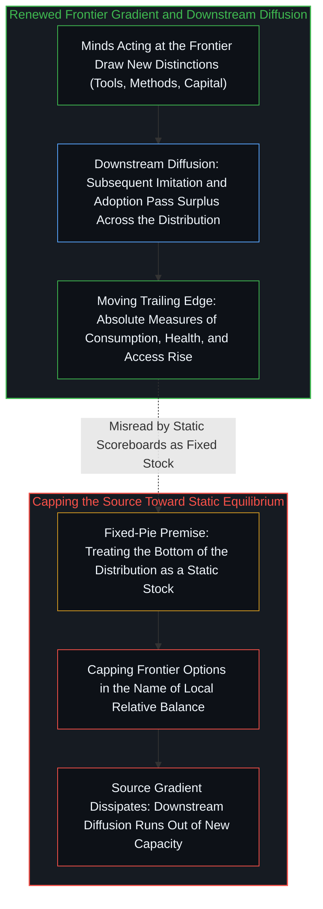
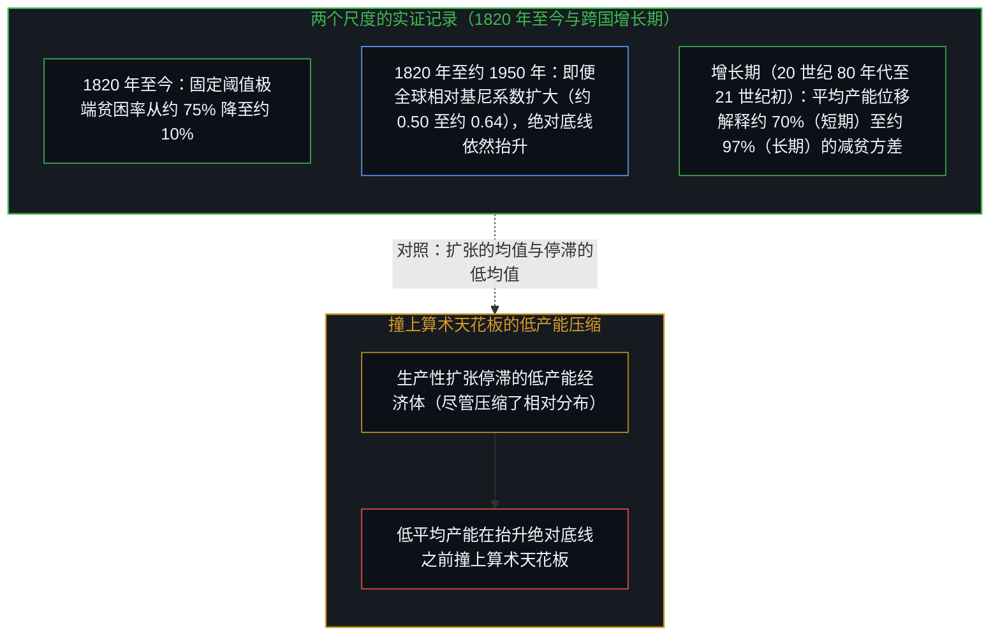
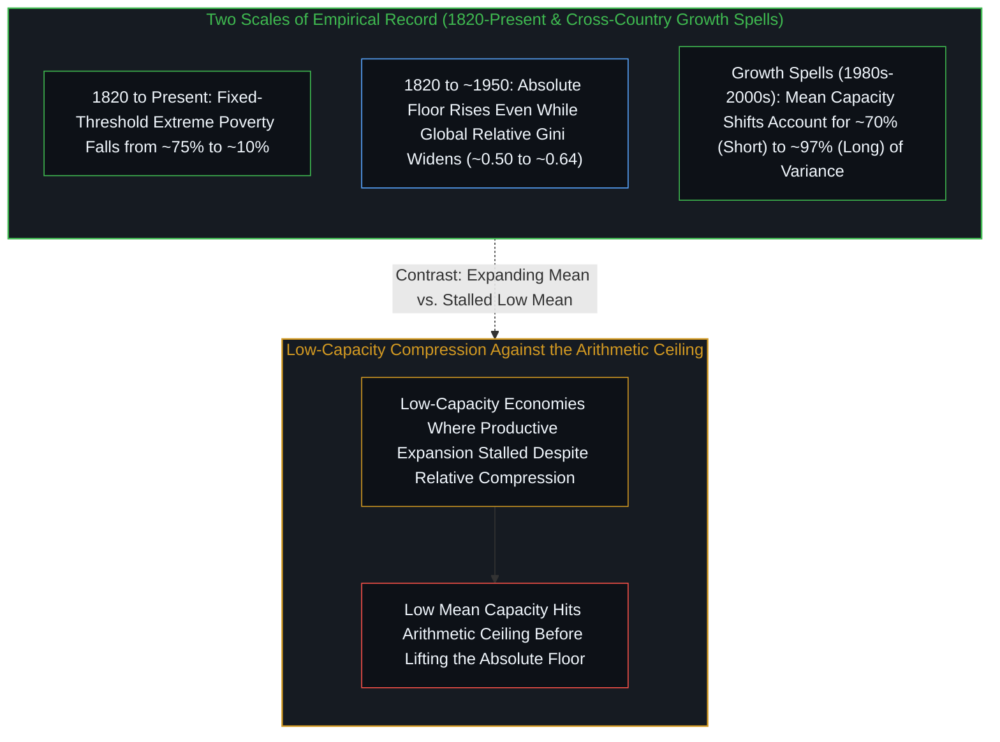
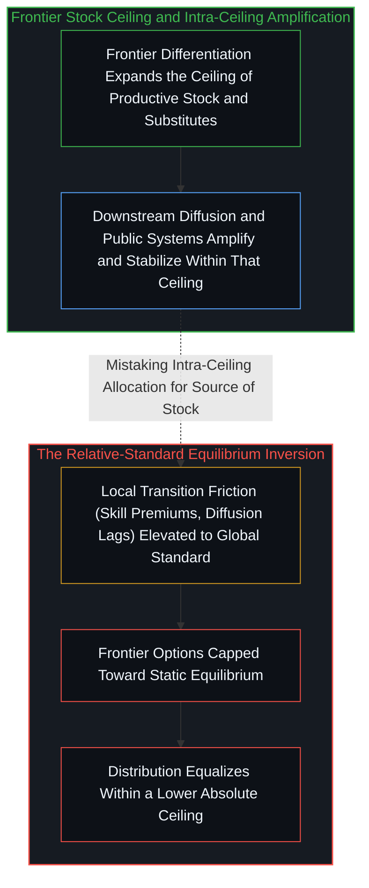

# 前沿抬升底线 / The Frontier Lifts the Floor

*分布的绝对底线是前沿产能的后随边缘；它随新梯度的扩散而抬升，而非在源头被压向均衡时得以上移。 / The absolute floor of a distribution is the trailing edge of frontier capacity; it rises as new gradients diffuse, not when the source is capped toward equilibrium.*

围绕物质充足度的通行争论，常将经济分布的底部当作等待瓜分的固定存量，把前沿扩张与底线结果摆在封闭账本上充当相互竞争的优先项。从自我区分的活动追溯，登记为分布绝对底线的，实则是产能的后随边缘：这份产能由处于前沿的心智不断生成，再经由其他心智随后选择模仿、采纳、另造替代品，向整个分布扩散开来。纵观两百年来的减贫历程与跨国增长期数据，绝对底线随前沿梯度的更新与延展而抬升，而在局部转型摩擦被越界外推为“将源头压向静态均衡”的依据时停滞。

Conventional debates over material adequacy treat the bottom of an economic distribution as a fixed stock awaiting division, setting frontier expansion and floor outcomes as competing priorities on a closed ledger. Traced from self-distinguishing activity, what registers as the absolute floor is instead the trailing edge of capacity that Minds at the frontier keep generating and that diffuses outward across the whole distribution through other Minds' subsequent choices to imitate, adopt, and build substitutes. Across two centuries of poverty reduction and cross-country growth spells, the absolute floor rises as frontier gradients are renewed and extended, and stalls when local transition friction is overextended into a warrant to cap the source toward static equilibrium.

## 一、 后随边缘与产能梯度 / 1. The Trailing Edge and the Gradient of Capacity

自我区分的活动发生着，无因，不息。一切区分皆由此显现：离散与连续、痕迹与中心、局部与全局。这一活动本身无从限制，也无从止息；在经济生活中，处于前沿、率先发起的特定心智——此处“前沿”是由所作抉择占据的位置，而非一份固定的人员名册——划出新的区分，其痕迹累积为持久的生产性产能，如[生产、消费与心智的区分](../production-consumption-and-the-minds-distinction/)所追溯。登记为分布底部的，并非等待被均等化的固定存量，而是由不断扩展的前沿活动所生成的产能后随边缘。凡前沿选项保持敞开、产能持续推进之处，后随边缘便随之移动。凡政策或制度约束将向前沿位置敞开的选项压向静态均衡之处，后随边缘便随之停滞。

Self-distinguishing activity occurs, uncaused and unceasing. From this, every distinction appears: discrete from continuous, trace from center, local from global. That activity itself can never be constrained or stopped; within economic life, particular initiating Minds at the frontier—where the frontier is a position taken by the choices made rather than a fixed roster of people—draw new distinctions whose traces accumulate as durable productive capacity, as traced in [Production, Consumption, and the Mind's Distinction](../production-consumption-and-the-minds-distinction/). What registers as the bottom of a distribution is not a fixed stock waiting to be equalized. It is the trailing edge of capacity generated by that expanding frontier activity. Where frontier options remain open and the capacity advances, the trailing edge moves. Where policy or institutional constraints narrow the options open to frontier loci toward static equilibrium, the trailing edge stalls.

不妨设想一间由热源取暖的屋子。屋子变暖，是因为来自活跃热源的热量向全屋扩散；若把热源封死，再重新分配屋里原有的空气，屋子并不会变暖。在经济生活中，这种向外扩散并非被动的物理流动：如[私人残差与社会剩余的因果次序](../the-causal-order-of-private-residuals-and-social-surplus/)所追溯的那样，它经由其他心智随后重溯、竞争性模仿、采纳与替代的行动而推进，将前沿收益的绝大多数传递至下游消费者手中，底线正是由此抬升。凡前沿的生产率梯度得到维系与延展、使其盈余持续向下游扩散之处，消费、健康与可及性的绝对指标便随之上升；当源头梯度以局部平衡之名被削平时，这些指标便陷入停滞。源头的静态均衡终结了进一步的扩散，正如[没有区分的效率是没有存在的运动](../efficiency-without-differentiation/)所确立的那样，抹平分化便终结了抬升后随边缘的扩张。

Consider a room warmed by a heat source. The room warms because heat from an active source diffuses outward across the room; it does not warm by redistributing the air already present after capping the source. In economic life, that outward diffusion is not a passive physical flow: as [The Causal Order of Private Residuals and Social Surplus](../the-causal-order-of-private-residuals-and-social-surplus/) traces, it proceeds through other Minds' subsequent acts of re-tracing, competitive imitation, adoption, and substitution that pass the overwhelming bulk of frontier gains downstream to consumers, which is how the floor rises. Absolute measures of consumption, health, and access rise where gradients of productivity at the frontier are sustained and extended so their surplus continues to diffuse; they stall when the source gradient is flattened in the name of local balance. Static equilibrium at the source ends further diffusion, and as [Efficiency Without Differentiation Is Movement Without Existence](../efficiency-without-differentiation/) establishes, flattening differentiation ends the expansion that lifts the trailing edge.

## 二、 两百年绝对记录与增长期分解 / 2. The Two-Century Absolute Record and Spell Decompositions

历史记录在两个截然不同的证据尺度上映照出这一因果次序。在 1820 年至今的两百年跨度上，按固定绝对阈值衡量的极端贫困人口比例从全球人口的约四分之三降至今日的约十分之一——[百万亿地平线之外](../beyond-the-hundred-trillion-horizon/)追溯了这一文明扩张的分母，而[遮蔽进步的框架](../the-frame-that-conceals-improvement/)则展示了浮动的相对标尺如何在底线抬升时通过不断重置标准来掩盖这一绝对增益。即便在十九世纪至二十世纪中叶（1820 年至 1950 年左右）全球公民间相对差距扩大的时期（全球基尼系数从约 0.50 升至 0.64 后方才趋平），这一绝对底线依然在抬升；而在东亚与南亚推行市场化改革并采纳新技术之后，绝对贫困的下降进一步加速。反过来，那些生产性扩张停滞的低产能经济体，即便压缩了国内的相对分布，其绝对底线也鲜有移动，因为在平均生产性产能低下的地方，国内再分配远在抵达基本物质充足之前便已撞上算术天花板。

The historical record reflects this causal order across two distinct scales of evidence. Over the two-century horizon from 1820 to the present, extreme poverty measured against a fixed absolute threshold declined from roughly three-quarters of the world population to around one-tenth today—a civilizational expansion whose denominator [Beyond the Hundred-Trillion Horizon](../beyond-the-hundred-trillion-horizon/) traces, while [The Frame That Conceals Improvement](../the-frame-that-conceals-improvement/) shows how a moving relative yardstick can hide that absolute gain by resetting the standard as the floor rises. That absolute floor rose even across the nineteenth through mid-twentieth centuries (1820 to around 1950) when global between-citizen relative gaps widened (with the global Gini rising from roughly 0.50 to 0.64 before plateauing), and the decline in extreme poverty accelerated in East and South Asia after market-oriented reforms and technology adoption. Conversely, low-capacity economies where productive expansion stalled saw little movement in the absolute floor even when domestic relative distributions were compressed, because at low mean productive capacity domestic redistribution hits an arithmetic ceiling long before basic material adequacy is reached.

在二十世纪晚期跨国增长期（二十世纪八十年代至二十一世纪初）这一较短时间跨度上，贫困变化的方差分解反映出同样的非对称性：平均收入的位移解释了跨国减贫方差的绝大多数——在短期增长期中约占七成，在长期增长期中高达九成七——而相对分布的变动只占其余部分。横截面均值从不主动发起那些推动它右移的右尾突破，[平均值是残余，不是引擎](../the-average-is-residue-not-the-engine/)阐明了其中缘由；但放到时间轴上看，后随边缘正是随着前沿突破扩大平均生产性产能而抬升的。

Across the shorter horizon of late-twentieth-century cross-country growth spells (the 1980s through the 2000s), variance decompositions of poverty changes reflect the same asymmetry: shifts in mean income account for the overwhelming bulk—from roughly 70 percent over short spells to as much as 97 percent over long ones—of the cross-country variance in poverty reduction, while shifts in relative distribution account for the remainder. While [The Average Is Residue, Not the Engine](../the-average-is-residue-not-the-engine/) shows why a cross-sectional average never initiates the right-tail breakthroughs that move it, across time the trailing edge rises as frontier breakthroughs expand mean productive capacity.

## 三、 局部摩擦痕迹与全局越界外推 / 3. Local Friction Traces Versus Global Overextension

局部的观察在各自适用域内依然成立。快速转型期间技能溢价会扩大。扩散在不同地区与行业之间并不均匀，如[技术变革的局部陷阱](../the-local-trap-of-technological-change/)围绕重构既有存量所需的互补资本所追溯的那样。制度能力调节着传导速度，而相对指标也可以独立于固定阈值绝对指标而变动。从局部位置看，最先被登记的，是自己相对身边同侪的眼前位次，如[进步叙事中的症候与原因](../symptom-and-cause-in-the-narratives-of-progress/)所追溯。然而，当这些局部痕迹被拿来当作封顶前沿梯度本身的依据——当转型期扩大的相对差距被当作必须放缓源头才能抬升绝对底线的证据，或当扩散触达的不均衡被当作扩张次于均等化的证据时，它们便成了越界外推，重演了[财富转移政策与价格下限中的原因错置](../the-reversal-of-causality-in-wealth-transfer-policies-and-price-floors/)所剖析的因果颠倒。局部痕迹描述的是转型的摩擦与时滞；它们描述的是这份产能的摩擦，却并不生成这份产能。

Local observations remain intact inside their domains. Skill premiums widen during rapid transitions. Diffusion is uneven across regions and sectors, as [The Local Trap of Technological Change](../the-local-trap-of-technological-change/) traces across the complementary capital required to reconfigure a legacy base. Institutional capacity modulates transmission, and relative measures can move independently of fixed-threshold absolute measures. From a local locus, immediate relative standing against nearby peers is what registers first, as [Symptom and Cause in the Narratives of Progress](../symptom-and-cause-in-the-narratives-of-progress/) traces. These local traces become overextensions when they are taken as grounds to cap the frontier gradient itself—when rising relative gaps during a transition are treated as evidence that the absolute floor requires slowing the source, or when uneven reach is treated as evidence that expansion is secondary to equalization, repeating the causal inversion dissected in [The Misallocation of Cause in Wealth-Transfer Policies and Price Floors](../the-reversal-of-causality-in-wealth-transfer-policies-and-price-floors/). The local traces describe transition friction and timing; they do not generate the capacity whose friction they describe.

## 四、 存量上限、替代与均衡坐标 / 4. Stock Ceilings, Substitution, and the Equilibrium Coordinate

前沿扩张设定了生产性存量的上限；再分配与公共系统则在这一既往与持续扩张所生成的上限之内运作并起稳定作用。如[价值、货币与财富的生成机制](../the-generative-mechanics-of-value-money-and-wealth/)与[公共支出不创造资本](../public-spending-does-not-create-capital/)所确立的那样，转移支付与公共开支并不生成它们所支取的产能。能够维系广泛底线保障的高产能国家，建立在既往与持续的生产性扩张之上，而限制前沿选项则会缩减可供放大的存量基数。沿着历史记录看，环境约束曾在局部制约特定的技术构型——这种约束唯有当心智以所持标准为参照感知到边界时才被登记，如[气候问题只作为感知被登记](../the-climate-problem-registers-only-as-perception/)所追溯；而把单一技术的局部 S 型曲线平台期当作文明天花板，则是把封闭假定下的饱和误作了复利增长的终结，如[封闭的假设把复利挤成 S 曲线](../closed-assumptions-squeeze-compounding-into-s-curves/)所展示的那样。凡前沿梯度保持敞开之处，更高密度的替代品与效率提升便扩展了可行集。相对位置可以独立于绝对产能而调整，然而不扩展产能便压缩相对位置，只能在更低的绝对上限之内实现均等。

Frontier expansion sets the ceiling of the productive stock; redistribution and public systems move and stabilize within whatever ceiling prior and ongoing expansion has produced. As [The Generative Mechanics of Value, Money, and Wealth](../the-generative-mechanics-of-value-money-and-wealth/) and [Public Spending Does Not Create Capital](../public-spending-does-not-create-capital/) establish, transfers and public outlays do not generate the capacity from which they are drawn. High-capacity states that sustain broad floor protections sit on prior and ongoing productive expansion, and constraining frontier options reduces the stock available for amplification. Along the historical record, environmental constraints have bound particular technical configurations locally—registering only when a Mind perceives a boundary against a held standard, as [The Climate Problem Registers Only as Perception](../the-climate-problem-registers-only-as-perception/) traces, while treating a single technique's local S-curve plateau as a civilizational ceiling mistakes a closed-assumption saturation for the end of compounding, as [Closed Assumptions Squeeze Compounding into S-Curves](../closed-assumptions-squeeze-compounding-into-s-curves/) shows. Where frontier gradients remained open, higher-density substitutes and efficiencies expanded the feasible set. Relative position can be adjusted independently of absolute capacity, yet compressing relative position without expanding the capacity equalizes within a lower absolute ceiling.

将局部相对位置安放为全局标准的坐标系——[工时排名把充足度冻结成一张记分牌](../the-hours-ranking-freezes-adequacy-as-one-scoreboard/)所剖析的记分牌冻结——把静态均衡当成了进步。分布的绝对底线，随着处于前沿的心智不断更新梯度而抬升，这梯度的盈余一路扩散到后随边缘。

A coordinate system that installs local relative position as the global standard—a scoreboard freeze dissected in [The Hours Ranking Freezes Adequacy as One Scoreboard](../the-hours-ranking-freezes-adequacy-as-one-scoreboard/)—treats static equilibrium as an advance. The absolute floor of the distribution rises as Minds at the frontier renew the gradient whose surplus diffuses to the trailing edge.
