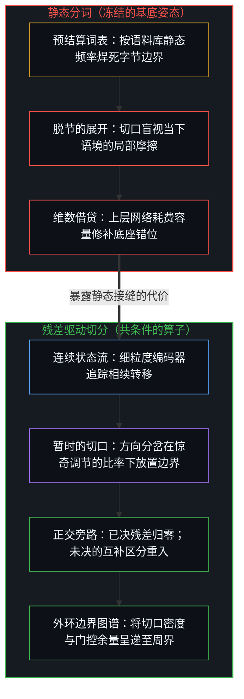
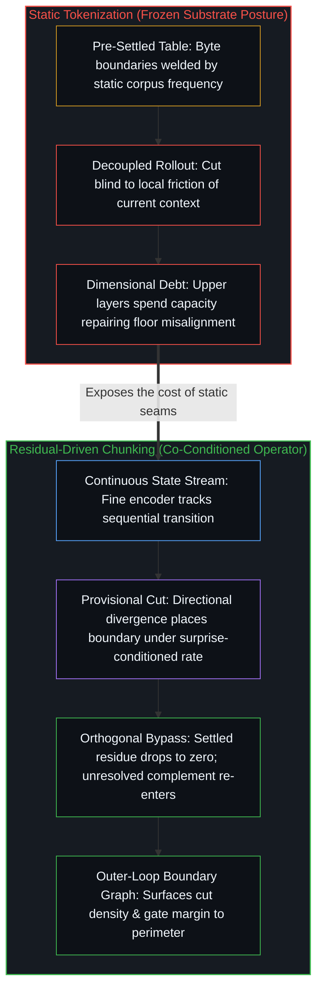

# 冻结的切口与回环的余量 / The Frozen Cut and the Margin of the Loop

*静态分词在序列展开前冻结了因果的离散面，而动态切分让已决残差归零并将切口处未决的余量呈递给外环的边界条件 / Static tokenization freezes the discrete face of causality before the sequence unfolds, while dynamic chunking lets settled residue go to zero and hands the unsettled margin at the cut to the boundary conditions of the outer loops*

训练与部署序列模型的人，习惯于在模型开始运转之前先固定一道切口。字节流在进入网络之前，先被压入一张预先结算好的词表：字节对编码（BPE）或子词分词器按语料库的静态频率，将连续的输入切成固定词元。就工程局部而言，这一选择缩减了序列长度，摊薄了注意力的二次方开销，在[词元与观测边界](../tokens-and-the-observational-boundary/)所追溯的观测脚手架之内，以词元内部的细粒度换取短程吞吐量。然而一旦这道预处理工序被遗忘、被当作透明的底座，模型在错字、算术、代码边界与低资源文字上由边界引发的脆弱，便被误读为“高层推理能力的缺失”——进而催生出靠扩大参数规模或堆叠思维链来修补底座裂痕的叙事。

Those who train and deploy sequence models routinely fix a cut before the model ever runs. Prior to entering the network, a byte stream is pressed through a pre-settled vocabulary: Byte-Pair Encoding (BPE) or subword tokenizers slice continuous input into fixed tokens according to static corpus frequencies. Locally, this engineering choice shortens sequence length and amortizes the quadratic cost of attention, trading sub-token granularity for short-horizon throughput inside the observational scaffold traced in [Tokens and the Observational Boundary](../tokens-and-the-observational-boundary/). Yet once that preprocessing step is forgotten as a transparent floor, the model's boundary-induced brittleness under typos, arithmetic, code boundaries, and low-resource scripts is misread as a "deficit of high-level reasoning"—spawning narratives that try to patch a fractured floor by scaling parameter counts or stacking chains of thought.

## 一、 先于相随的切口与倒置的基底 / 1. The Cut Prior to Succession and the Inverted Substrate

因果由两个不可分割的面联合运作而成：离散面划出界限，将此与彼、前与后区分开来；连续面在有向的相续中承接过渡，使果随因而生。如[非万物之理](../not-a-theory-of-everything/)所追溯的，抽去离散的切口，便没有任何事件得以登记；抽去连续的相续，便只剩孤立的碎片而无从过渡。在活态的探究中，切分与相随并非前后脱节的两道工序：切口落在何处，取决于相续的流向在何处遭遇摩擦；而流向如何延展，又受制于刚刚落下的切口。

Causality consists of two inseparable faces operating jointly: the discrete face draws a boundary that distinguishes this from that, prior from consequent; the continuous face carries the transition across in directed succession so that effect follows cause. As [Not a Theory of Everything](../not-a-theory-of-everything/) traces, remove the discrete cut and nothing registers as having occurred; remove continuous succession and only isolated fragments remain without passage. In living inquiry, cutting and following are not two decoupled stages: where the cut falls depends on where the flowing succession encounters friction, and how the flow extends is conditioned by the cut just made.

静态分词将这一联合条件劈作两截，并把前半截冻结在系统之外。如[学到的边界与给定的尺度](../learned-boundaries-and-the-given-rate/)所追溯的，静态分词器在日后将遇到的任何语境到来之前，先在训练语料上一次性划定边界，把高频共现的字节焊死为不可拆解的原子，并在随后的每一段序列中固定沿用这张查找表。当模型在推理时面对一段具体序列，离散面已经被事先锁定——甚至在前缀切分中混入了一两个未来字节的非因果前瞻（把 `_distill` 切成 `[_dist, ill]`，却把 `_distinct` 保留为整体）——以致无论当下的语境是重复的套话，还是一个字节便会改变轨迹的加密哈希与代码指针，切口都只能落在词表预先批准的接缝上。这正是倒置的万物理论姿态在工程底座上的微缩重演：先选定一组静态原子作为终极地基，再指望上方的连续转移算子从中推演出一切关系。当一个常见词因为首字母大小写、空格偏移或罕见后缀而被劈成互不相干的碎片，或者当本应独立的数位被吞入同一个词元时，上层注意力层便被迫耗费维数容量去修补底座强加的错位，而非将粒度分配给要紧的转折——亦即[精度与分辨率](../precision-and-resolution/)所追溯的固定精确度与处境化分辨率之间的分野。在这些情形中登记下来的字符盲区、边界敏感与数位吞并失效，被误读为推理能力的缺失；它们其实是预先冻结的离散切口阻断了连续相随对局部差异的登记。

Static tokenization splits this joint condition in two and freezes the first half outside the system. As [Learned Boundaries and the Given Rate](../learned-boundaries-and-the-given-rate/) traces, a static tokenizer draws its boundaries once over a training corpus before any of the contexts it will later meet arrives, welding frequently co-occurring bytes into indivisible atoms and holding that lookup table fixed across every subsequent sequence. When the model confronts a concrete sequence at inference time, the discrete face has already been locked—even leaking one or two future bytes of non-causal lookahead into prefix splits (slicing `_distill` into `[_dist, ill]` while keeping `_distinct` whole)—so that whether the current context is repetitive boilerplate or a cryptographic hash and code pointer where a single byte alters the trajectory, the cut can fall only along seams pre-approved by the table. This is the inverted Theory of Everything posture reenacted in miniature at the engineering floor: selecting a static set of atoms as ultimate ground and expecting the continuous transition operators above to derive every relation from them. When a familiar word is shattered into unrelated fragments by capitalization, a shifted space, or a rare suffix—or when distinct digits are swallowed into a single token—the upper attention layers are forced to spend dimensional capacity repairing misalignments imposed by the floor rather than allocating grain to the transitions that matter, the exact split between fixed exactness and situated resolution traced in [Precision and Resolution](../precision-and-resolution/). What registers in these cases as character blindness, boundary sensitivity, or digit-merge failure—and is misread as a deficit of reasoning—is a pre-frozen discrete cut blocking continuous succession from registering local difference.

## 二、 动态切分与被误读的“内部残差” / 2. Dynamic Chunking and the Misread "Internal Residual"

以动态切分层级网络（[H-Net](https://arxiv.org/abs/2507.07955)）为代表的架构，通过撤除静态词表，将切口重新拉回前向传递的内部。如[学到的边界与给定的尺度](../learned-boundaries-and-the-given-rate/)所审视的，细粒度编码器在原始字节上维持连续的相续表征 `hₜ⁽ˢ⁾`，在相邻状态之间的方向余弦相似度发生骤降之处（`pₜ⁽ˢ⁾ = ½(1 − cos(W_q hₜ⁽ˢ⁾, W_k hₜ₋₁⁽ˢ⁾))`）落下一道离散边界 `bₜ⁽ˢ⁾`，并在回环之外给定的全序列目标压缩比 `N` 之下，经由因果指数滑动平均平滑与直通估计器（STE）将这道离散切口重新编织进可微的连续流。在这一给定的尺度之内，离散切分与连续相随恢复了共条件的形式关系：单元不再是预先给定的砖块，而是关系在局部转移中凝结出的暂时截面。

Architectures such as Hierarchical Networks with Dynamic Chunking ([H-Net](https://arxiv.org/abs/2507.07955)) pull the cut back inside the forward pass by removing the static vocabulary. As [Learned Boundaries and the Given Rate](../learned-boundaries-and-the-given-rate/) examines, a fine-grained encoder maintains continuous sequential representations `hₜ⁽ˢ⁾` over raw bytes, placing a discrete boundary `bₜ⁽ˢ⁾` wherever directional cosine similarity between adjacent states drops sharply (`pₜ⁽ˢ⁾ = ½(1 − cos(W_q hₜ⁽ˢ⁾, W_k hₜ₋₁⁽ˢ⁾))`) and weaving that discrete cut back into differentiable flow through causal exponential moving average smoothing and a straight-through estimator (STE) under a sequence-wide target compression ratio `N` given from outside the loop. Within that given rate, discrete cutting and continuous following recover a co-conditioned formal relation: units are no longer pre-given bricks, but provisional cross-sections precipitated by relations during local transition.

不妨考察一项扩展 H-Net 的设计提案（`RD-HNet`）：它将单一的全序列目标比率 `N` 替换为局部因果窗口 `w` 上随惊奇调节的目标函数 `N_target(s, w)`，使窗口内实际落下的边界比例 `F_w⁽ˢ⁾` 对齐 `1 / N_target(s, w)`，从而避免高惊奇片段中的密集切口迫使序列其余部分过度压缩。用窗口函数替代标量比率，并不会把设定尺度的能动性移入回环内部：`N_target(s, w)` 的函数形式、字节级下限 `N_min`、窗口 `w` 以及惊奇判准本身，依然是在回环之外给定并修正的界限。然而，在设计自适应切分与跨层残差重入时，该提案内部一个诱人的做法，是把网络内部的预测误差（形式惊奇）直接等同于活态现实中未闭合的本体论余项——在损失函数中加入一项“残差保底惩罚”（`L_residual`），强迫内部残差流在任何时候都维持非零的方差。

Consider a design proposal (`RD-HNet`) that extends H-Net by replacing its single sequence-wide target ratio `N` with a surprise-conditioned target function `N_target(s, w)` over a local causal window `w`, matching the realized windowed boundary fraction `F_w⁽ˢ⁾` against `1 / N_target(s, w)` so dense cuts in high-surprise spans do not force over-compression elsewhere in the sequence. Replacing a scalar ratio with a windowed function does not move the rate-setting agency inside the loop: the functional form of `N_target(s, w)`, the byte-level floor `N_min`, the window `w`, and the surprise criterion itself remain bounds given and refined outside the loop. Yet when designing cross-layer residual re-entry alongside adaptive chunking, a tempting move inside that proposal is to equate prediction error (formal surprise) inside the network with the unclosed ontological remainder of living reality—adding a "residual floor penalty" (`L_residual`) to the loss function that forces the internal residual stream to maintain non-zero variance at all times.

这种保底要求恰恰是闭合渴望的镜像。如[开放即一致](../openness-is-consistency/)所追溯的，不一致源于强行闭合的企图；又如[递归区分的架构](../architecture-of-recursive-distinction/)所追溯的，回环内部相对于有限参考测得的目标残差，有别于回环外部任何有限形式投影都无法闭合的开放余项。把这两种余项混为一谈、命令内部残差永不归零，并不会赋予形式器物“开放性”，只会迫使网络在无需区分的重复套话上制造人工合成的噪声。在有限的形式层级内部，如果粗粒度阶段 `ẑₜ⁽ˢ⁾` 足以预测一段冗余的字节流，局部投影残差归零正是切分奏效的标志——唯有让已决的冗余退居幕后，有限的维数带宽才能腾挪给预测受阻的边缘。让粗粒度阶段遗漏的区分得以重入的，不是强加的残差保底，而是正交旁路门控（`gₜ⁽ˢ⁾`）：当粗粒度预测覆盖了细粒度状态时，门控闭合（`gₜ⁽ˢ⁾ → 0`），已决的内部残差随之归零；当粗粒度抽象遭遇未决的局部转折、预测误差飙升时，门控开启（`gₜ⁽ˢ⁾ → 1`），同时正交约束（`cos(ẑₜ⁽ˢ⁾, Δhₜ⁽ˢ⁾) → 0`）确保重入的细粒度差值 `Δhₜ⁽ˢ⁾` 只携带粗粒度投影所遗漏的互补区分。

That demand for a floor is the mirror image of the desire for closure. As [Openness Is Consistency](../openness-is-consistency/) traces, inconsistency arises from the attempt to force closure; and as [The Architecture of Recursive Distinction](../architecture-of-recursive-distinction/) traces, an inner target residual measured against a finite reference inside a loop is distinct from the open remainder outside the loop that no finite formal projection ever closes. Conflating those two remainders by commanding the inner residual never to vanish does not grant a formal artifact "openness"; it merely compels the network to manufacture synthetic noise over repetitive boilerplate where no distinction is at stake. Inside a finite formal hierarchy, if a coarse stage `ẑₜ⁽ˢ⁾` suffices to predict a redundant byte span, the local projection residual dropping to zero is the exact mark that the cut succeeded—only by letting settled redundancy recede can finite dimensional bandwidth be reallocated to edges where prediction breaks down. What lets the distinction the coarse stage missed re-enter is not a forced residual floor, but orthogonal bypass gating (`gₜ⁽ˢ⁾`): when coarse prediction covers the fine state, the gate closes (`gₜ⁽ˢ⁾ → 0`) and settled inner residue drops to zero; when coarse abstraction hits an unresolved local transition and prediction error spikes, the gate opens (`gₜ⁽ˢ⁾ → 1`) while an orthogonality constraint (`cos(ẑₜ⁽ˢ⁾, Δhₜ⁽ˢ⁾) → 0`) ensures the re-entering fine differential `Δhₜ⁽ˢ⁾` carries only the complementary distinction that the coarse projection missed.

## 三、 余量浮现于边缘：跨嵌套回环的边界条件图 / 3. The Margin Surfaces at the Edge: Boundary-Condition Graphs Across Nested Loops

即便动态切分与正交旁路在单次前向传递中实现了自适应的带宽分配，生成模型在局部依然是一个确定性的形式系统（`sₜ₊₁ = f(sₜ, θ)`）。它并不划定自身运转于其中的任何界限：它的先验（`θ`）、比率函数（`N_target(s, w)`）、字节下限（`N_min`）、窗口（`w`）以及惊奇判准，全都在展开开始之前便已切定，因此形式控制始终位于它所驾驭的回环之外。那么，用动态切分与正交重入取代冻结词表，其架构支点究竟落在何处？

Even when dynamic chunking and orthogonal bypasses achieve adaptive bandwidth allocation within a single forward pass, a generative model remains locally a deterministic formal system (`sₜ₊₁ = f(sₜ, θ)`). It draws none of the bounds it runs inside: its priors (`θ`), its rate function (`N_target(s, w)`), its byte floor (`N_min`), its window (`w`), and its surprise criterion were all cut before the rollout began, so formal control always sits outside the loop it steers. Where, then, does the architectural leverage of replacing a frozen vocabulary with dynamic chunking and orthogonal re-entry lie?

它落在[递归形式系统中作为记忆与控制的边界条件图](../boundary-condition-graphs-as-memory-and-control-in-recursive-formal-systems/)与[要紧的控制迁往边缘](../residual-control-recedes-to-the-edge/)所追溯的结构之中：由于多步自回归展开具有计算不可约性，仅被部分登记的初始条件中的任何微扰都会跨步放大，静态检视内部权重无法提供通往未来轨迹的闭合捷径；因此，驾驭形式系统的关键不在于穷尽其内部基底，而在于经由边界条件图，在相对嵌套的回环之间——其中何为内环、何为外环，始终相对于所驾驭的边界而言——实施周界约束与痕迹筛选。

It lies in the structure traced in [Boundary-Condition Graphs as Memory and Control in Recursive Formal Systems](../boundary-condition-graphs-as-memory-and-control-in-recursive-formal-systems/) and [Essential Control Moves to the Edge](../residual-control-recedes-to-the-edge/): because multi-step autoregressive rollouts are computationally irreducible, any perturbation in partially registered initial conditions amplifies across steps, and static inspection of internal weights offers no closed-form shortcut to future trajectories; steering a formal system therefore turns not on exhausting its internal substrate, but on enforcing perimeter constraints and trace selection across relatively nested loops—where what counts as inner or outer is relative to the boundary being steered—via a boundary-condition graph.

在静态 BPE 模型中，边界摩擦被掩盖在固定步长的词元流之下——无论模型是在复述熟悉的模板，还是跨陌生的符号接缝强行猜测，它都以均匀的节奏吐出词元，留给外围控制器在事后根据输出对数几率熵（logit entropy）去推算某次切分是否出了岔子。而当动态切分允许已决的内部残差归零时，切口处未决的余量便跨越三个相对嵌套的回环浮现出来。在即时重配形式带宽的内环中，当输入流在回环之外给定的判准下进入高惊奇片段时，局部压缩目标向字节级分辨率舒张（`N_target(s, w) → N_min`），正交旁路门控饱和开启（`gₜ⁽ˢ⁾ → 1`），在不改变规则集的前提下将计算步数与维数容量导向未决的转折处。在推理时调制边界的中环中，窗口切口密度 `F_w⁽ˢ⁾` 与旁路饱和度 `gₜ⁽ˢ⁾` 被实时导出至外围的边界条件图。即便是这些几何信号，也不会自行诠释自身，因为方向余弦路由器在笃定的句法分隔符上同样会触发，正如它在未决的转折处触发一样：中环控制器在跨轮次设定的惊奇判准下读取这些信号，将高切口密度 `F_w⁽ˢ⁾` 与预测误差、旁路饱和度（`gₜ⁽ˢ⁾ → 1`）及边界模糊度（`pₜ⁽ˢ⁾ ≈ 0.5`）结合起来，当场收紧边界条件——触发编译器校验、检索经整理的记忆索引，或局部回滚以重立提示词约束。在由心智主导、跨轮次重塑先验的外环中，边界条件图将那些切口密集且旁路饱和、却依然未能通过外部验证的轨迹留存下来，标出当前形式先验（`θ`）、目标比率函数或惊奇定义在哪些关系转折处失效，以便主导的心智在下一轮迭代中重新切分数据课程与架构界限。

In a static BPE model, boundary friction is masked beneath a fixed-stride token stream—whether the model is reciting a familiar template or forcing a guess across unfamiliar symbolic seams, it emits tokens at a uniform cadence, leaving surrounding controllers to infer after the fact from output logit entropy whether a split went wrong. When settled inner residue is allowed to drop to zero under dynamic chunking, the unsettled margin at the cut surfaces across three relatively nested loops. In the inner loop of immediate formal bandwidth reallocation, when the input stream enters a high-surprise span under the criterion given from outside the loop, the local compression target dilates toward byte-level resolution (`N_target(s, w) → N_min`) and the orthogonal bypass gate saturates (`gₜ⁽ˢ⁾ → 1`), routing compute steps and dimensional capacity to the unresolved transition without altering the rule set. In the middle loop of inference-time boundary modulation, windowed cut density `F_w⁽ˢ⁾` and bypass saturation `gₜ⁽ˢ⁾` are exported in real time to the surrounding boundary-condition graph. Even these geometric signals do not interpret themselves, since directional cosine routers also fire on confident syntactic delimiters as well as unresolved transitions: the middle-loop controller reads them under a surprise criterion set across runs, combining high cut density `F_w⁽ˢ⁾` with prediction error, bypass saturation (`gₜ⁽ˢ⁾ → 1`), and boundary ambiguity (`pₜ⁽ˢ⁾ ≈ 0.5`) to tighten boundary conditions on the spot—triggering compiler verification, querying curated memory indices, or rolling back locally to re-frame prompt constraints. In the outer loop of Mind-directed prior reshaping across runs, the boundary-condition graph retains trajectories where high cut density and bypass saturation still failed external verification, marking the relational transitions at which the current formal priors (`θ`), target rate function, or surprise definition broke down so the directing Mind can re-cut the data curriculum and architectural bounds in the next iteration.

器物依旧是器物，它是既有区分的外化表达，而非作出区分的智能本身，正如[错把表达当成智能](../mistaking-the-expression-for-the-intelligence/)所追溯的。动态切分与正交旁路并没有在硅片内部唤醒一个懂得意义的观察者；它们所做的，是拆掉那道在序列尚未展开前就被当作完备基底的静态词表围墙，让已决的内部残差归零，并将切口处未决的余量清晰可读地呈递到器物的周界——在那里，划下这些界限的心智登记回传的结果，并决定下一刀落向何处。

The artifact remains an artifact, an externalized expression of prior distinctions rather than the intelligence that draws them, as [Mistaking the Expression for the Intelligence](../mistaking-the-expression-for-the-intelligence/) traces. Dynamic chunking and orthogonal bypasses do not awaken an observer inside the silicon capable of understanding meaning; what they do is dismantle the static vocabulary wall taken as complete before the sequence even began, let settled inner residue drop to zero, and hand the unsettled margin at the cut legibly to the perimeter of the instrument—where the Mind that drew those bounds registers what returns and decides where the next cut falls.
