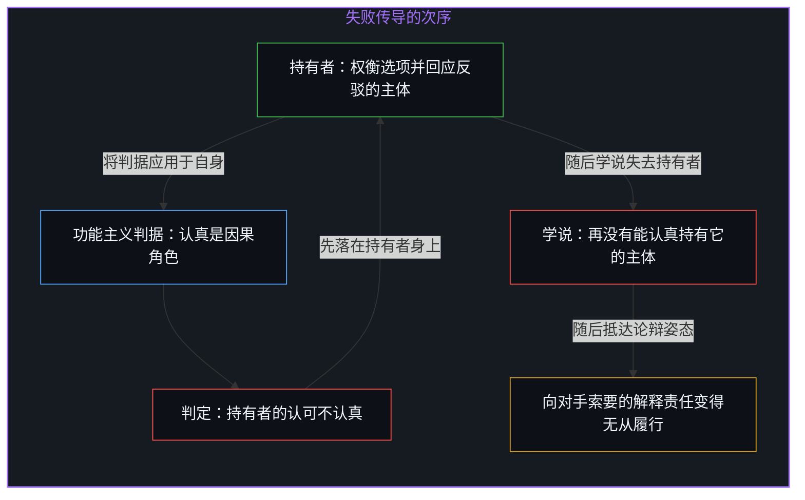
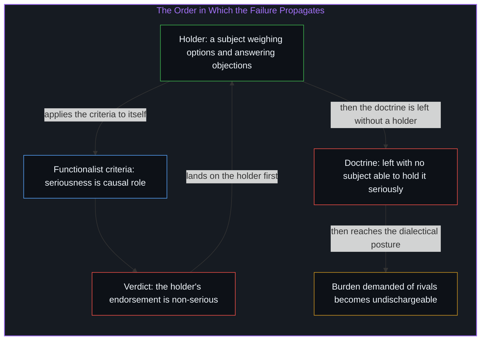
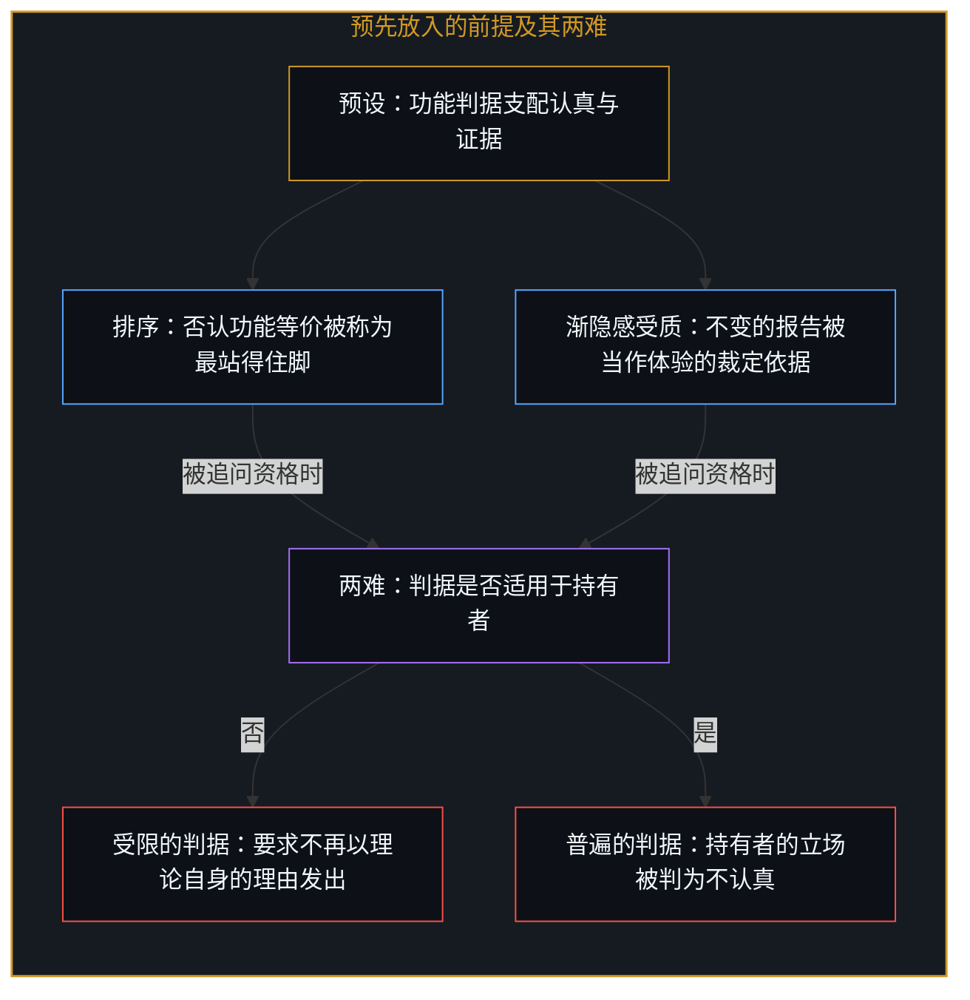
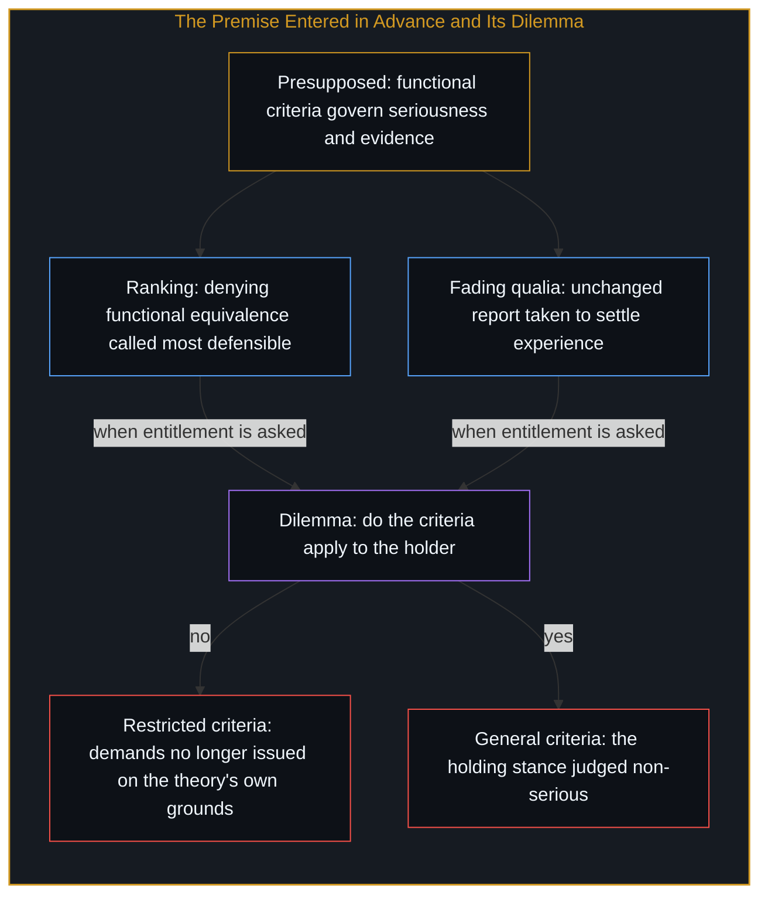
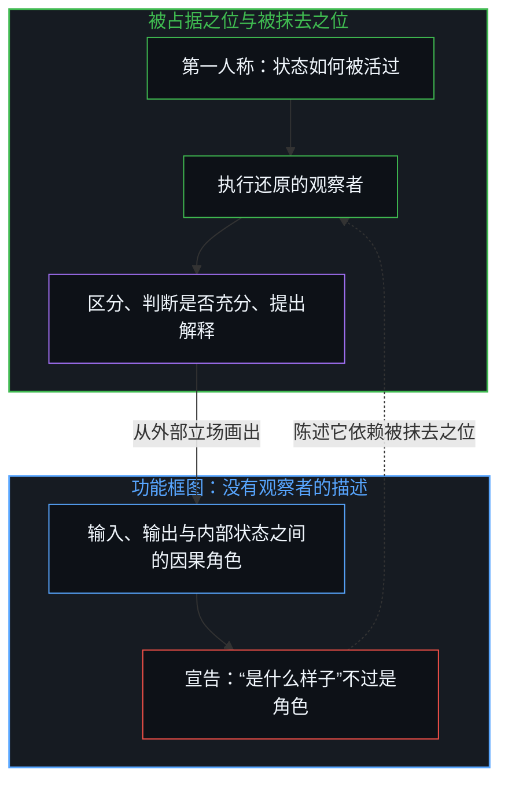
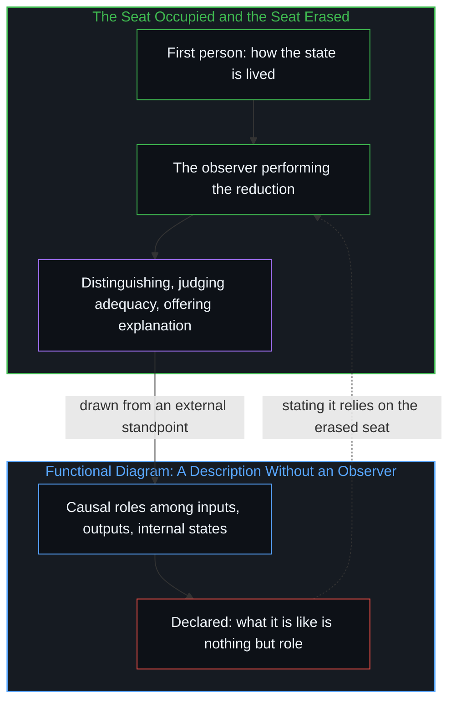

# 功能主义者无法持有的功能主义 / The Functionalism No Functionalist Can Hold

*功能主义者必须先占据观察者之位，才能用功能主义抹去观察者。 / The functionalist must first occupy the observer's position in order to erase the observer with functionalism.*

功能主义只以因果角色来界定心理状态，即这些状态与感官输入、行为输出以及其他内部状态之间的系统关系，而与任何特定的物质基底无关。在关于人工意识的争论中，这一论题常被当作认定心理属性的充分条件提出：实现相应的组织结构，相应的状态便存在。困难在于：在下文考察的那些论证模式中，这一主张依赖一个以断言引入、而非以论证确立的前提；并且，任何接受这一主张自身标准的主体，都无法自洽地占据这一立场。

Functionalism defines mental states exclusively by their causal roles, the systematic relations they bear to sensory inputs, behavioral outputs, and other internal states, independent of any particular material substrate. In debates over artificial consciousness the thesis is commonly advanced as sufficient for attributing mentality: realize the relevant organization and the corresponding states are present. The difficulty is that this claim, in the patterns examined below, rests on a premise introduced by assertion rather than secured by argument, and that it cannot be coherently occupied by any subject who accepts its own standards.

## 一、 认真持有需要一个主体 / 1. Serious Holding Requires a Subject

认真的认可，不是一种学说能够独自拥有的属性。它是一种认知立场，只有当某个主体例示相关角色时才存在：在不同选项之间作出辨别，持续回应反驳，并把这一观点当作约束后续判断的东西。一套学说并不认真持有它自身，正如一张地图并不阅读它自身。功能主义提供评估任何此类立场所依据的判据。当这些判据被应用于声称认真对待该理论的主体时，它们按自身的尺度，把这份认可本身归为不认真：它们把持有描述为一种角色模式，而遗漏了划出并权衡这一模式的那个动作。一旦认真被还原为一组输入输出关系，可由任何足够复杂的组织结构实现，这一说明便计入模式，而不再计入划出模式的持有者。

Serious endorsement is not a property a doctrine can possess on its own. It is a cognitive stance that exists only when a subject instantiates the relevant roles: discriminating alternatives, remaining responsive to objections, and treating the view as constraining further judgment. A doctrine does not hold itself seriously, any more than a map reads itself. Functionalism supplies the criteria by which any such stance is to be evaluated. Applied to the subject who claims to take the theory seriously, those criteria classify the endorsement itself as non-serious by their own measure: they describe the holding as a role pattern and leave out the act that draws and weighs that pattern. Once seriousness is reduced to a set of input-output relations realizable by any sufficiently complex organization, the account counts the pattern and no longer counts the holder who draws it.

这一失败的次序不可调换。它首先在主体那里登记，因为只有主体才能实现所涉及的角色；理论在被一个主体持有之前，只是一组没有“认真”谓词附着其上的命题。只有在那之后，失败才延伸到学说：学说由此再没有一位信奉者，能在它自身所阐明的条件下持有它。[自由意志的自否自由](../the-freedom-of-will-to-deny-itself/)在意志中追溯同一个次序：否定意志的雄辩，是意志在行使它作出区分的能力；在这里，宣称认真不过是功能角色的那份认真，正在行使它所否认的那同一种不可还原的持有。一套理论，若其认真标准系统地排除对它自身的认真接受，便无法一致地要求对立立场履行一项它已使之无从履行的解释责任。

The order of this failure cannot be reversed. It registers first with the subject, because only a subject can realize the roles in question; before a subject holds it, a theory is only a set of claims with no seriousness predicate attaching to them. Only then does the failure extend to the doctrine, which is left without any adherent who can hold it under the conditions the doctrine itself articulates. [The Freedom of Will to Deny Itself](../the-freedom-of-will-to-deny-itself/) traces the same order in will: the eloquence denying will is will exercising its capacity to distinguish; here, the seriousness that declares seriousness to be nothing but functional role is exercising the very irreducible holding it denies. A theory whose standards of seriousness systematically exclude its own serious acceptance cannot consistently demand that rival positions discharge an explanatory burden it has already rendered unmeetable.

## 二、 预先放入的前提 / 2. The Premise Entered in Advance

寻常的辩护并不化解这一困难；它们预设了这一困难所质疑的东西。在一种典型论证模式中，否认有机体与机器之间的功能等价，被径直指定为对机器意识最站得住脚的反驳，而否认功能主义本身，被说成需要一个认真的解释；对这一排序，却未给出任何独立的理由。在另一种论证模式中，查尔默斯为机器意识所作的渐隐感受质论证得出结论：体验在逐步替换中存续，因为主体的报告仍然不变；这一步已经把功能性报告当作在体验问题上裁定证据的东西。在每一种情形中，决定性的前提，即功能判据已经支配着什么算作认真的推理或充分的证据，都被预先放入。前提一旦被认可，想要的结论便随之而来；持有这一前提的资格，仍未得到论证。[意识的魔术戏法与推断的非对称性](../the-sleight-of-hand-of-consciousness-and-the-asymmetry-of-inference/)追溯这一前提设下的非对称：对生物同类索要不可能的证明，对任何满足功能描述的东西慷慨地赋予内在生命。

Ordinary defenses do not resolve the difficulty; they presuppose what it places in question. In one typical pattern, rejection of functional equivalence between organisms and machines is simply designated the most defensible objection to machine consciousness, while rejection of functionalism itself is said to require a serious explanation, yet no independent grounds are offered for the ranking. In another, Chalmers' fading-qualia argument for machine consciousness concludes that experience survives gradual replacement because the subject's reports stay unchanged; that step already takes functional report as what settles evidence about experience. In each case the decisive premise, that functional criteria already govern what counts as serious reasoning or adequate evidence, is entered in advance. Once granted, the desired conclusions follow; the entitlement to the premise remains unargued. [The Sleight of Hand of Consciousness and the Asymmetry of Inference](../the-sleight-of-hand-of-consciousness-and-the-asymmetry-of-inference/) traces the asymmetry this premise installs: impossible proof demanded of biological kin, inner life granted freely to whatever satisfies the functional description.

面对自我适用的指控，辩护者可以指出，普特南、刘易斯与阿姆斯特朗的经典表述从未要求理论为它自身的元层次认可提供许可。作为历史评注，这是准确的，但它并不恢复自洽，因为它留下了一个两难。如果理论不必经得起被应用于它的拥护者，那么，批评者须为拒绝该理论提供认真解释这一要求，便不再能以理论自身的理由发出；这一要求依赖一个该理论拒绝涵盖的认真标准。反过来，如果理论用于心理与认知评价的判据是普遍的，它们便适用于拥护者自己的认可，并再次得出“不认真”的结果。要么标准被限制，以至于不再支撑原先的论辩主张；要么标准是普遍的，并削弱那些主张赖以发出的立场。

Faced with the charge of self-application, a defender can note that the classical formulations of Putnam, Lewis, and Armstrong never required the theory to license its own meta-level endorsement. As a historical remark this is accurate, yet it does not restore coherence, because it leaves a dilemma. If the theory is not obliged to survive application to its advocates, then the demand that critics supply a serious explanation for rejecting it can no longer be issued on the theory's own grounds; it rests on a standard of seriousness the theory declines to cover. If, on the other hand, the theory's criteria for mental and cognitive evaluation are general, they apply to the advocate's own endorsement and again yield the non-serious result. Either the standards are restricted so that they no longer support the original dialectical claims, or they are general and undermine the stance from which those claims are issued.

## 三、 占据观察者以抹去观察者 / 3. Occupying the Observer to Erase the Observer

一旦审视对主观性的还原，同一种循环便以更尖锐的形式出现。功能主义者把意识的内在感受，即处于某个给定状态时有“是什么样子”可言这一第一人称事实，等同于该状态所扮演的因果角色；这些角色是从体验本身之外的立场加以规定的，原则上可由第三方观察，或可被捕捉进一张功能框图。这一等同被当作完备的说明提出时，便把一个由观察者画出的描述，当作一个其中没有观察者的描述。然而，这一处理由一个主体执行；这个主体在执行它时，恰恰占据着这一描述所略去的观察者之位：区分状态如何被活过与它如何发挥作用，判断功能说明是充分的，并把这一还原作为解释提出。功能主义者必须栖身于观察者之位，才能抹去观察者。这一抹除只有依赖它宣称可以省去的那个立场，才能被陈述。

The same circularity appears in a sharper form once the reduction of subjectivity is examined. Functionalists equate the inner sense of consciousness, the first-person fact that there is something it is like to occupy a given state, with the causal roles that state plays, roles specified from a standpoint external to the experience itself, observable in principle by a third party or capturable in a functional diagram. Offered as complete, the equation treats a description drawn by an observer as a description with no observer in it. Yet that treatment is performed by a subject who, in performing it, occupies precisely the observer's position that the description leaves out: distinguishing how the state is lived from how it functions, judging the functional account adequate, and offering the reduction as an explanation. The functionalist must inhabit the observer position in order to erase the observer. The erasure can be stated only by relying on the standpoint it declares dispensable.

这并不是另加的一条关于缺失感受质的抱怨；它是同一个“主体先行”之失败的后果。[不可还原的观察者](../the-irreducible-observer/)追溯构建一套观察者从中退出之理论的心智，如何无法把自身从这次扣除中减去；[意识从不作为数据出现在数据之中](../consciousness-never-appears-as-data-among-data/)追溯登记数据的活动，如何仍比每一个本会捕获它的数据领先一步。功能主义者把这一结构推到极限：他们不是在物理方程中悬置观察者，而是在一套关于观察者的理论中悬置观察者，于是抹除者与被抹除者是同一个。

This is not an added complaint about missing qualia; it is a consequence of the same subject-first failure. [The Irreducible Observer](../the-irreducible-observer/) traces how the mind constructing a theory from which the observer drops out cannot subtract itself from the subtraction; [Consciousness Never Appears as Data Among Data](../consciousness-never-appears-as-data-among-data/) traces how the activity registering data remains one step ahead of every datum that would capture it. Functionalists push this structure to its limit: they do not bracket the observer inside physical equations; they bracket the observer inside a theory of the observer, so that the one who erases and the one erased are the same.

这一依赖削弱了更广泛的论辩姿态。哪些对机器意识的反驳最站得住脚，或哪些解释值得认真考虑：这类评估恰恰发自那个被这套理论还原为可观察角色的第一人称立场。由于发出这些评估仍离不开这一立场，这种拥护便继续依赖它所移除的东西。[辛顿未曾理解的心智](../what-hinton-failed-to-understand/)追溯这种依赖的一个公开案例：意识先被裁剪为控制架构与行动倾向，随后每一条异议都被贬为思维不连贯，而裁剪与贬斥是由屋里唯一的意识执行的。结果不只是功能主义使主观特征得不到说明；而是这套理论只能由这样一个主体提出：这套理论无法一致承认该主体自身的观察角色。这一立场仍可以被表述；但在它为持有任何关于心智的观点所设定的条件下，它无法被持有而不陷入矛盾。

That reliance undermines the broader dialectical posture. Assessments of which objections to machine consciousness are most defensible, or of which explanations merit serious consideration, are issued from the very first-person stance the theory has reduced to observable roles. Because the stance remains indispensable for issuing the assessments, the advocacy continues to depend on what it removes. [What Hinton Failed to Understand](../what-hinton-failed-to-understand/) traces one public case of this dependence: consciousness first trimmed to control architecture and action dispositions, every objection then dismissed as incoherent thinking, while the trimming and the dismissing are performed by the only consciousness in the room. The result is not merely that functionalism leaves subjective character unaccounted for; it is that the theory can be advanced only by a subject whose own observational role the theory cannot consistently acknowledge. The position may still be formulated, but it cannot be held, under the conditions it sets for holding any view about the mind, without contradiction.

## 四、 边界而非驳斥 / 4. A Boundary, Not a Refutation

这一刀并不否认功能角色分析的用处。输入、输出与内部状态之间的同一组关系，可以用不同的材料搭建；以这种方式被描述时，一个系统便可以被设计、调试与预测，而这一描述是这项工作的脚手架，正如[遗忘的脚手架](../the-scaffolding-we-forget/)所追溯的。在这一范围内，功能描述精确地比较两个系统做什么，并指导它们的构造与修复。[飞行的类比碰不到心智](../the-flight-analogy-leaves-the-mind-untouched/)追溯在生物载体之外复现一项局部功能，何以是一项真实的工程成就；越界在于把这一成功当作心智本身已被重构的证据。

The cut does not deny the usefulness of functional role analysis. The same relations among inputs, outputs, and internal states can be built in different materials; described that way, a system can be designed, debugged, and predicted, and the description is scaffolding for that work, as [The Scaffolding We Forget](../the-scaffolding-we-forget/) traces. Within that range, functional description compares precisely what two systems do and guides their construction and repair. [The Flight Analogy Leaves the Mind Untouched](../the-flight-analogy-leaves-the-mind-untouched/) traces how reproducing a local function outside its biological vehicle is a real engineering achievement; the overstep lies in treating that success as evidence that the Mind itself has been reconstituted.

功能主义的前提所处的位置，是功能主义不再普遍的地方：这一前提预设描述者能站在被描述的心智之外，却从不把描述者计入描述之中。描述被观察的系统，并不需要这样一个位置：描述是描述者的工具，从描述者所站的地方画出。当描述被当作“无处之见”，并被扩展到每一个心智，连画出这一描述的那个心智也包括在内时，前提便越过了它的边界。[AGI的预设与来自外部的视角](../the-presumption-of-agi-and-the-view-from-outside/)在工业尺度上追溯这种越界：心智的到来，恰恰由系统被优化去满足的那些指标来确认：一个框架以它自己提供的标准衡量自身的成功。如果心智只是角色模式，复制模式便复制了心智，毫无损失；这一无损传递的承诺，遗漏了登记每一份副本的观察者，正如[观察者的隐身与无损传递的妄念](../the-invisible-observer-and-the-delusion-of-lossless-transmission/)所追溯的。功能主义在这里没有被驳倒；它被定位了。作为观察者手中的工具，它完成它的工作；作为抹去观察者的终极理论，它是一套没有任何功能主义者能够持有的理论。

Where functionalism's premise sits is where functionalism ceases to be universal: the premise presupposes that the describer can stand outside the mind being described, yet never counts the describer within the description. Describing observed systems needs no such seat: the description is a describer's tool, drawn from where the describer stands. The premise crosses its boundary when the description is taken for a view from nowhere and extended to every mind, including the one drawing it. [The Presumption of AGI and the View from Outside](../the-presumption-of-agi-and-the-view-from-outside/) traces this overstep at industrial scale: the arrival of mind confirmed by the very metrics systems are optimized to satisfy, a framework measuring its success by standards it supplies itself. If mind is the role pattern alone, copying the pattern copies the mind with nothing lost; that promise of lossless transmission leaves out the observer who registers each copy, as [The Invisible Observer and the Delusion of Lossless Transmission](../the-invisible-observer-and-the-delusion-of-lossless-transmission/) traces. Functionalism is not refuted here; it is located. As a tool in the observer's hand it does its work; as a final theory that erases the observer, it is one that no functionalist can hold.
