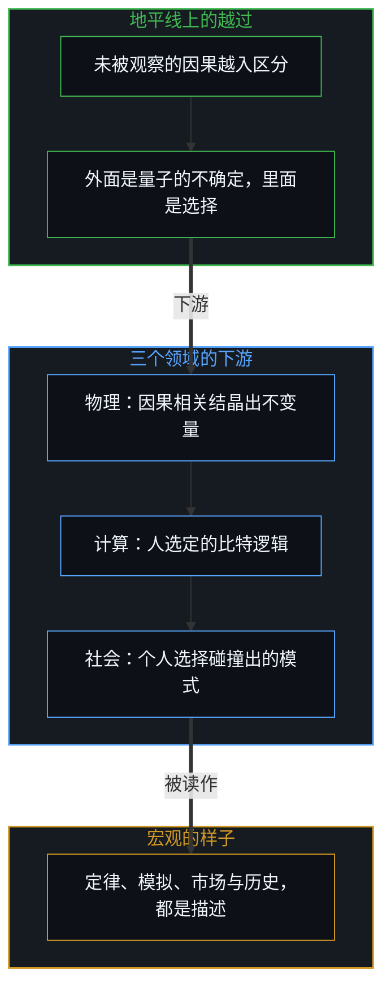
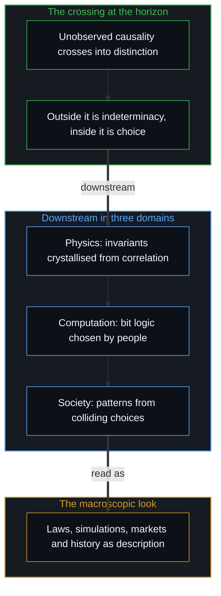

# 宏观现象的生成图谱 / The Generative Atlas of Macroscopic Phenomena

*因果是唯一的基元，没有开始也没有结束，只被观察者有限而移动的地平线所界定 / Causality is the one primitive, without beginning or end, bounded only by the observer's finite, moving horizon.*

在每一个探究的领域里，认知都容易被庞大的宏观结构催眠，把物理定律、市场、生物演化与计算机模拟当作独立的、自上而下的实体。从第一人称的原点追溯，除了因果本身，宇宙里没有别的独立规则：每一个宏观现象，都是未被观察的因果链越过观察者有限的、动态移动的、带着无尽潜能的地平线时，逐步展开的样子。

In every field of inquiry, cognition is easily hypnotised by vast macroscopic structures, treating physical laws, markets, biological evolution and computer simulations as independent, top-down entities. Traced from the first-person origin, the universe holds no independent rule besides causality itself: every macroscopic phenomenon is what unobserved causal chains look like as they unfold across an observer's finite, dynamically moving horizon carrying endless potential.

第三人称的观察从外部测得的量子不确定，与第一人称的能动性从内部行使的自由选择，是同一件事的两面。形式逻辑、时间、空间与物理定律，用不着各自另立形而上的范畴；松散地叫作“逻辑”的，就是现实必须遵循的因果，它反身地提醒，一切模型都立在第一人称的视角里。

The quantum indeterminacy that third-person observation measures from outside and the free choice that first-person agency exercises from inside are two faces of one thing. Formal logic, time, space and physical laws need no separate metaphysical categories of their own; what is loosely called "logic" is the causality reality must follow, reminding reflexively that every model stands within the first-person view.

## 一、 因果、时间与时空的不变量 / 1. Causality, Time and Spacetime Invariants

认出时间并不独立于因果，对宇宙的理解就能大幅简化。因果没有开始也没有结束，是存在不断开的织物；可为了建模、在现实里导航，观察者需要两样东西。时间是因果之箭：结果必须跟在原因之后，因果的序列就界定了时间单向的箭头，原因与结果之间离散的步长界定了最小的时间单位，这一步从不为零。时空的尺度与光速 c：时间的最小可观察尺度，与空间的最小可观察尺度在逻辑上锁在一起，普朗克尺度标出现有模型的分辨力用尽的地方；光速不是一个任意的宇宙限速，而是在观察者的感知装置之内，把空间的平移与因果的状态转换连起来的那个换算不变量。时空几何、热力学梯度与物理定律不是事先存在的容器，而是从因果链的自相关（时间上的自洽）与互相关（关系上的约束）中结晶出来的宏观不变量。

Understanding the universe simplifies greatly once it is recognised that time is not separate from causality. Causality has no beginning or end and is the unbroken fabric of existence; yet to model and navigate reality an observer needs two things. Time is the arrow of causality: an effect must follow its cause, so the causal sequence defines the one-way arrow of time, and the discrete step between cause and effect defines the smallest unit of time, a step never zero. Then the scales of spacetime and the speed of light c: the smallest observable scale of time is logically locked to the smallest observable scale of space, the Planck scale marking where present models run out of resolution; the speed of light is not an arbitrary cosmic speed limit but the conversion invariant, within the observer's perceptual apparatus, that links spatial translation to causal state transition. Spacetime geometry, thermodynamic gradients and physical laws are not pre-existing containers but macroscopic invariants crystallised from the auto-correlation, consistency over time, and cross-correlation, relational constraint, of causal chains.

## 二、 有限而不固定的地平线 / 2. The Finite, Unfixed Horizon

“不确定”或“自由变量”从哪里来？因果无尽地延伸，可任何第一人称的视角，都必然被一条有限而不固定的认识地平线所界定。它是有限的：在任何一刻，观察者都感知或计算不了无穷因果网的全体，地平线之外的一切都无法预先计算，带着无尽的潜能。它又是不固定的：这条地平线不是一堵静止的墙，行动者行动、观察、与物质的摩擦打交道时，地平线的边界移动、扩展。所谓的“自由变量”，因此不是对因果的任意破坏，而是未被观察的因果链越过移动着的地平线时的下游显现；这条边界登记在哪里，是心智做出的选择。

Where does "indeterminacy" or the "free variable" come from? Causality extends without end, yet any first-person view is necessarily bounded by a finite but unfixed horizon of knowing. It is finite: at any moment an observer cannot perceive or compute the whole of the endless causal web, and everything beyond the horizon cannot be computed in advance and carries endless potential. It is unfixed: the horizon is not a static wall, and as an agent acts, observes and deals with material friction, its boundary moves and widens. The so-called "free variable" is therefore not an arbitrary breach of causality but the downstream appearance of unobserved causal chains crossing the moving horizon; where that boundary registers is a choice the Mind makes.

## 三、 观察者的切分 / 3. The Observer's Cut

这条因果地平线被感知的方式有两面。从第三人称的外部看，一个外部的观察者测量一件越过地平线的、无法预先计算的因果事件，它被记作不确定的量子作用；物理学用概率波来描述它，教科书里的“波函数塌缩”，在形式上是建模中的一步。从第一人称的内部看，一个有意识的主体在同一条因果前沿上从内部经历状态的选择，它被经历为自由的选择。心智把自由变量注入这一步，被观察到的就是量子的不确定；二者是同一件事的两面，哪一面在先，言语说不清，从第一人称去体会。

The way this causal horizon is perceived has two faces. From the third-person outside, an outside observer measuring an uncomputable causal event crossing the horizon records it as indeterminate quantum action; physics describes it with probability waves, and the textbook "collapse of the wave function" is, formally, a step in the modelling. From the first-person inside, a conscious subject undergoing state selection at the same causal frontier experiences it as free choice. The Mind injects the free variable into the step, and what is observed is quantum indeterminacy; the two are faces of one thing, and which comes first is not something words settle, only something sensed from the first person.

## 四、 心智是被经验的现实的地平线 / 4. The Mind as the Horizon of Experienced Reality

由此确立认识的一个基本限度：个人的心智，是任何关于现实的模型被经验、被表述、被检验的那条绕不开的地平线。每当对一个客观的物质世界立论，都是在自己第一人称意识的认知编译器之内这样做。量子物理是从外部测量微观事件的形式化、第三人称的数学装置；被主观地称为“自由意志”“注意”或“有意识的意图”的，是在微观起点上同一次状态选择的第一人称活的经验；没有哪个行动者能走出自己心智的边界，去观察一个不经中介、不依赖观察者的世界。承认这条边界不是退回唯我论，而是认识一致性的基石：一切宏观模型，从物理定律到经济结构，都是有意识的观察者为了在真实的摩擦中导航而编出的认知脚手架；离开有意识的测量与第一人称的参与，现实无从被赋予确定的叙事意义。

This sets a basic limit of knowing: a person's Mind is the unavoidable horizon within which any model of reality is experienced, formulated and tested. Whenever a case is made about an objective physical reality, it is made within the cognitive compiler of one's own first-person awareness. Quantum physics is the formal, third-person mathematical apparatus for measuring the micro event from outside; what is subjectively called "free will", "attention" or "conscious intent" is the first-person lived experience of the same state selection at the micro origin; and no actor can step outside the boundary of their own Mind to observe an unmediated, observer-independent world. Acknowledging this boundary is not a retreat into solipsism but the bedrock of epistemic consistency: every macroscopic model, from physical laws to economic structures, is cognitive scaffolding compiled by conscious observers to navigate real friction, and apart from conscious measurement and first-person engagement, reality cannot be given definite narrative meaning.

## 五、 追溯根基与操作上的速记 / 5. Tracing the Ground and Operating Shorthand

把现实追溯到它的起点，不是要求每一个实际问题都从量子波函数算起。在物理、工程、经济与日常生活里，更高层的宏观理论与速记的启发都少不了：设计飞机的航空工程师用经典流体力学，而不是量子电动力学；领航员用天体力学与几何，用不着考虑亚原子粒子；市场的参与者用价格信号与契约逻辑，用不着为每个交易对手写一篇心理学论文。只要一个领域必要的初始条件与局部约束被正确地认出，因果逻辑在实践上就运作得很准。

Tracing reality to its origin is not a demand that every practical problem be computed from quantum wave functions. In physics, engineering, economics and daily life, higher-level macroscopic theories and shorthand heuristics are indispensable: an aeronautical engineer designing an aeroplane uses classical fluid dynamics, not quantum electrodynamics; a navigator uses celestial mechanics and geometry without accounting for subatomic particles; a market participant uses price signals and contractual logic without writing a psychological treatise on every counterparty. As long as the necessary initial conditions and local constraints of a domain are identified correctly, causal logic works with high practical accuracy.

立这张生成图谱，目的不是取消有用的领域模型，而是说清现实在认识上的底。它让人自由地使用有效的宏观速记，同时不落进把这些有用的模型当作自存的、自上而下的形而上实体的陷阱。正如[你的代码库即是记忆](../your-codebase-is-memory/)所追溯的，这张图谱本身——就像人工记忆外化而成的代码库——仍是一张由层叠残迹构成的投影地图，由活的心智在移动的边缘上持续地重新核验与巩固，从不是一片自行维持的疆域。在家庭里，自由变量属于孩子，[引导不是占有](../guidance-is-not-ownership/)坚持的正是这一点。

The purpose of this generative atlas is not to disqualify useful domain models but to make clear the epistemic floor of reality. It lets effective macroscopic shorthand be used freely while not falling into the trap of taking those useful models for self-existent, top-down metaphysical entities. As [Your Codebase Is Memory](../your-codebase-is-memory/) traces, the atlas itself—like an externalised codebase of artificial memory—remains a projected map of stacked residues continuously re-verified and consolidated by the living Mind at the moving edge, never a self-sustaining territory. In families the free variable belongs to the child, as [Guidance Is Not Ownership](../guidance-is-not-ownership/) insists.

## 六、 计算与模拟是次生的 / 6. Computation and Simulation as Secondary

看清生成的层级，就明白为什么计算与数字模拟是次生的衍生物，而不是独立的、最底层的领域。在一个计算机模拟或一个 AI 网络里，初始的比特状态 0 与 1，不在野外自发地组装，它们的初始条件由人的选择有意地设定；转换规则与逻辑门，布尔运算符与、或、非，指令集与算法架构，都由有意识的人明确地设计与选择。[信息是什么](../what-information-is/)界定过，一个比特就是一个被选出的区分。计算是一个形式的、由人设计的投影，运行在物质的基底上。数十亿比特经由布尔逻辑相互作用，生成惊人的涌现现象，虚拟现实、游戏经济与深度学习模型；整座计算的金字塔，仍是一件器物，它的第一推动者是人的选择。

Seeing the generative hierarchy makes clear why computation and digital simulation are secondary derivatives rather than independent, fundamental realms. In a computer simulation or an AI network, the initial bit states 0 and 1 do not assemble spontaneously in the wild; their initial conditions are set deliberately by human choices; the transition rules and logic gates, the Boolean operators AND, OR and NOT, the instruction sets and algorithmic architectures, are explicitly designed and chosen by conscious people. As [What Information Is](../what-information-is/) defines, a bit is a selected distinction. Computation is a formal, human-designed projection running on a material substrate. Billions of bits interacting through Boolean logic generate staggering emergent phenomena, virtual realities, game economies and deep-learning models; the whole computational pyramid remains an artifact whose first mover is human choice.

## 七、 人的活动与社会 / 7. Human Activity and Society

对涌现的误解，在对人类文明的解读里最有破坏性。一切人类活动的基础微观变量，是个人的自由选择。[自由变量的同构与先验主权](../zi-you-bian-liang-de-tong-gou-yu-xian-yan-zhu-quan/)与[个体抉择是唯一的因果杠杆](../individual-choices-as-the-only-causal-levers/)都说过：社会不选择，阶级不选择，国家不选择，只有一个个有意识的行动者在时间与空间的具体坐标上做出选择。

Misreading emergence does the most damage in interpreting human civilisation. The basic micro variable of all human activity is individual free choice. As both [The Isomorphism of Free Variables and Prior Sovereignty](../zi-you-bian-liang-de-tong-gou-yu-xian-yan-zhu-quan/) and [Individual Choices as the Only Causal Levers](../individual-choices-as-the-only-causal-levers/) put it: societies do not choose, classes do not choose, nations do not choose; only particular conscious actors make choices at specific coordinates of time and space.

个人的选择在物质现实的框架之内相互碰撞、相互协商，受稀缺、时间约束、因果的激励与互惠的逻辑所限，就生成宏观的人类模式：市场，是上百万分散的主观估价产生的自发的价格信号；制度与法律，是反复的行为协调被编成条文的均衡；文化与语言，是经过世代实用筛选而留存的沟通惯例；历史，是无数未经协调的、第一人称的努力涌现出的轨迹。一个中间环节被遮住时，这张图谱就像魔术，[翻袋球与魔术戏法](../the-bank-shot-and-the-magic-trick/)展示了这一点。所谓的“历史规律”或“社会力量”，都是描述性的总体指标，没有独立的因果能动性。

When individual choices collide and negotiate within the frame of material reality, bounded by scarcity, time, causal incentives and the logic of reciprocity, they generate macroscopic human patterns: markets, the spontaneous price signals of millions of decentralised subjective valuations; institutions and law, the codified equilibrium of repeated behavioural coordination; cultures and languages, the communicative conventions that survived generations of practical use; history, the trajectory emerging from countless uncoordinated, first-person strivings. When an intermediate link is hidden, the atlas looks like magic, as [The Bank Shot and the Magic Trick](../the-bank-shot-and-the-magic-trick/) shows. So-called "laws of history" or "social forces" are descriptive aggregate measures with no independent causal agency.

## 八、 目的论的谬误 / 8. The Teleological Fallacy

人类社会为什么不断发明自上而下的神话？因为心智是一台在感知的横截面上运作的模式识别引擎。看一个庞大的宏观现象，一次股市崩盘、一次生物适应或一场历史革命，把意图归给总体，比计算微观的相互作用省力，这就生出宏观崇拜与目的论的谬误。一种是集体意志的神话：[涌现的伪因果](../yong-xian-de-wei-yin-guo-yu-ji-ti-gui-yin-dao-cuo/)拆开过，一场雪崩不是一个要毁掉村庄的集体实体，而是数十亿片雪花同时失去摩擦，把一个集体的心智归给涌现现象，是范畴错误。另一种是社会模型里的倒因为果：经济学家或社会学家把“系统”当作主动支配人的行为的行动者，就把人困在犬儒里，[成功的几何学](../the-geometry-of-success/)与[选择看见而非搜寻影子](../shou-bu-hui-de-mu-guang-yu-zhi-shi-de-yin-guo-dao-zhi/)都探讨过，把宏观的游戏当作固定的，会麻痹人第一人称的动力。[错置的因果与心智编译器](../cuo-zhi-de-yin-guo-yu-xin-zhi-bian-yi-qi/)与[没有系统能被保持封闭](../no-system-can-be-kept-closed/)提醒：把因果的力量归给宏观的容器，而不是微观的选择，就把编译器倒了过来，看不见改变的真正杠杆。

Why do human societies keep inventing top-down myths? Because the Mind is a pattern-recognition engine working on cross-sections of perception. Facing a vast macroscopic phenomenon, a market crash, a biological adaptation, a historical revolution, crediting intention to the aggregate is less effort than computing the micro interactions, and this breeds macro-fetishism and the teleological fallacy. One form is the myth of collective will: as [The Pseudo-Causality of Emergence](../yong-xian-de-wei-yin-guo-yu-ji-ti-gui-yin-dao-cuo/) takes apart, an avalanche is not a collective entity bent on destroying a village but billions of snowflakes losing friction at once, and crediting a collective mind to an emergent phenomenon is a category error. Another is reversed causation in social models: when economists or sociologists treat "the system" as an active agent dictating behaviour, they trap people in cynicism, and as both [The Geometry of Success](../the-geometry-of-success/) and [Choosing to See Rather Than Searching for Shadows](../shou-bu-hui-de-mu-guang-yu-zhi-shi-de-yin-guo-dao-zhi/) explore, treating the macro game as fixed paralyses a person's first-person drive. [Misplaced Causality and the Mind's Compiler](../cuo-zhi-de-yin-guo-yu-xin-zhi-bian-yi-qi/) and [No System Can Be Kept Closed](../no-system-can-be-kept-closed/) are reminders: crediting causal power to the macro container rather than the micro choice inverts the compiler and hides the real levers of change.

## 九、 回到微观的杠杆 / 9. Returning to the Micro Lever

认出现实的生成图谱，不是一项抽象的学术练习，而是个人能动性与清晰的基础。由此可以给行动一个严格的定义：行动，就是个人的选择经由身体与生物的基底因果地显现出来。没有基底显现的选择，是一个空转的念头；没有有意识选择的物理运动，是确定的自动机；行动，是第一人称的能动性与物质现实耦合的那个界面。没有个人的选择，个人以及由此推开的整座人类文明，就塌缩成一台没有心智的确定机器。[涌现的几何学](../the-geometry-of-emergence/)补充说，每一个涌现的层级，都是一个观察者对分辨率的选择。

Recognising the generative atlas of reality is not an abstract academic exercise but the basis of personal agency and clarity. It allows a strict definition of action: action is individual choice appearing causally through the bodily and biological substrate. A choice with no appearance in the substrate is an idle thought; physical motion without conscious choice is a determined automaton; action is the interface where first-person agency couples with material reality. Without individual choice, the individual, and by extension the whole edifice of human civilisation, collapses into a mindless determined machine. [The Geometry of Emergence](../the-geometry-of-emergence/) adds that each emergent level is an observer's choice of resolution.

推着投影的幕布，改变不了一个宏观的影子；对着集体说教，修不好一种文化；跟一个抽象的标签作战，也扭转不了一个历史的循环。正当的因果杠杆在微观的起点上：在物理里，物理的规律从地平线前沿上量子自由变量的因果相关中涌现；在计算里，虚拟的生态由人选定的比特逻辑界定并执行；在人的生活里，转变只在一个人经由身体的行动实现一个选择时发生。[自由变量的生成拓扑](../the-generative-topology-of-free-variables/)追溯过这些自由变量怎样经由互补的反馈回路自举成物质、制度的依赖与演化的过时；[印迹与行动](../the-mark-and-the-act/)确立过，宇宙记下的只是已实现的选择留下的印迹。这一理解本身，也要反身地立在第一人称的立场上，不宣称最后的、教条的封闭。

Pushing on the projection screen does not change a macroscopic shadow; preaching at the collective does not fix a culture; fighting an abstract label does not redirect a historical cycle. The rightful causal lever is at the micro origin: in physics, physical regularities emerge from the causal correlations of quantum free variables at the frontier of the horizon; in computation, virtual ecosystems are defined and run by bit logic people choose; in human life, transformation happens only when a person realises a choice through bodily action. [The Generative Topology of Free Variables](../the-generative-topology-of-free-variables/) traces how these free variables bootstrap through complementary feedback loops into matter, institutional dependence and evolutionary obsolescence; [The Mark and the Act](../the-mark-and-the-act/) established that the universe records only the mark of choices realised. This understanding too must stay reflexively grounded in the first-person stance, claiming no final, dogmatic closure.

## 十、 有限而不固定 / 10. Finite but Unfixed

正如[没有系统能被保持封闭](../no-system-can-be-kept-closed/)与[好奇没有最终的形态](../curiosity-has-no-final-form/)所表明的，因果从无穷延伸到无穷，没有一个静态、封闭的理论终点。这个框架之所以在导航现实时逻辑上最一致，恰恰因为认出永远走不出第一人称的认识地平线。[另一种相干](../the-other-coherence/)加深了这条边界，把实验室里的量子相位相干与一片敞开的场的经验相干对照起来。关于一个“客观外部宇宙”，尽可以建起任何抽象的模型——随时都能在概念上抽身“退房”——却永远离不开意识经验那个第一人称的原点。这张图谱不需要一个无处之见，[因果的自反性与物理的无源假定](../causality-is-irreducible-the-physical-is-a-view-from-nowhere/)展示了这一点。

As [No System Can Be Kept Closed](../no-system-can-be-kept-closed/) and [Curiosity Has No Final Form](../curiosity-has-no-final-form/) show, causality extends from infinity to infinity, with no static, sealed theoretical endpoint. This framework is the most logically consistent for navigating reality precisely because it recognises that the first-person horizon of knowing can never be stepped out of. [The Other Coherence](../the-other-coherence/) deepens this boundary, contrasting laboratory quantum phase coherence with the experiential coherence of an open field. You can construct any abstract model of an "objective external cosmos"—you can check out any time you like—but you can never leave the first-person origin point of conscious experience. The atlas needs no view from nowhere, as [Causality is Irreducible; The Physical is a View from Nowhere](../causality-is-irreducible-the-physical-is-a-view-from-nowhere/) shows.

地平线是有限的，却不是固定的。经由持续的行动、物质的摩擦与选择，这条边界向敞开的现实扩展，带着无尽的潜能，从不需要假装已经到达一个封闭的终点。[非万物之理](../manifesto-of-not-a-theory-of-everything/)凝结了这个基本的姿态：区分是持续的、不停的、无法避免的，而封闭、有限的零和竞争，以及想把一切都接到同一个根上的冲动，是可以避免的、自己加给自己的。复制自己路径的父母，抹掉了这张图谱所依赖的自由变量，[成功之后的育儿谬误](../the-fallacy-of-post-success-parenting/)展示了这一点。

The horizon is finite but not fixed. Through continued action, material friction and choice, the boundary widens into open reality, carrying endless potential without ever needing to pretend it has reached a closed end. [Not a Theory of Everything](../manifesto-of-not-a-theory-of-everything/) distils this basic stance: distinguishing is ongoing, unceasing and unavoidable, while closure, finite zero-sum competition and the urge to connect everything to one single root can be avoided and are self-imposed. Parents who clone their own path erase the free variable this atlas depends on, as [The Fallacy of Post-Success Parenting](../the-fallacy-of-post-success-parenting/) shows.
