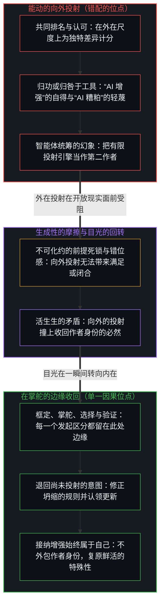
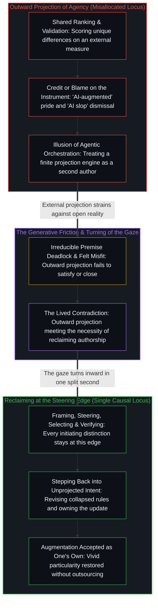

# 生成性的矛盾 / The Generative Contradiction

*能动向工具外投，并在掌舵的边缘收回作者身份 / Agency projects outward into instruments and reclaims authorship at the edge*

差异构成独特，同时又成为排名与寻求认可的工具。外在之物并不增强人；是人增强自己，然而无论在“AI 增强”还是“AI 糟粕”的说法里，能动都一再被记在工具账上或归咎于工具，即便智能体编排框架只是分派有限的投射、而心智在掌舵的边缘统筹全局。看清这一错配，世界便同时变得美丽而痛苦。这份矛盾不被消解，而是被活出来；在活出它而不把作者身份外包出去时，增强便始终登记在自己名下。

Differences constitute uniqueness and at the same time become the instruments of ranking and validation. External things do not augment a person; a person augments themself, yet agency is routinely credited to or blamed on the tool in “AI-augmented” and “AI slop” alike, even when an agentic harness only dispatches finite projections while the Mind orchestrates at the steering edge. Seeing that misallocation makes the world beautiful and painful at once. The contradiction is lived rather than resolved; in living it without outsourcing authorship, augmentation registers as always one’s own.

## 一、 差异成为排名的工具 / 1. Differences Become Instruments of Ranking

自我区分的活动从不重复同一个位点；差异使每个人以独特的方式成为人。然而正是这些差异，一再被转化为彼此评判、彼此排名、无尽寻求认可的工具。沿着这条轴线，满足感始终无法真正抵达，因为衡量的尺度一直在向外索求，而它只能从内部认领。[来自个体差异的层级](../hierarchy-from-individual-difference/)追溯了独立中心之间的质性差异被压缩到单一共同尺度上计分时所浮现的排名。[验证中因果权能的分配](../the-allocation-of-causal-power-in-validation/)则将这种向外的寻觅追溯为对延续权的安放：把决定此位点下一步行动是否具有分量的裁决权，拱手交给另一个中心或外在的计分板。

Self-distinguishing activity never repeats an identical locus; differences make each person uniquely human. Yet those very differences are routinely turned into the instruments of judging one another, ranking one another, and seeking endless validation. Satisfaction never quite arrives along that axis, because the measure keeps being sought outward when it can only be claimed from within. [Hierarchy from individual difference](../hierarchy-from-individual-difference/) traces the ranking that appears when qualitative differences across independent centers are compressed and scored on a single shared measure. [The allocation of causal power in validation](../the-allocation-of-causal-power-in-validation/) traces that outward looking as the placement of continuation: handing another center or an external scoreboard the authority to decide whether this locus’s next act holds weight.

## 二、 外在的东西不增强人 / 2. Nothing External Augments

外在的东西并不增强人。工具、他人、境遇，哪怕是最先进的 AI，都从不作为独立的发起力量作用于一个中心。伸手、框定、选择、解释与整合的，是人自己；是人增强自己。然而习以为常的做法，是在结果合意时把功劳记给外在工具或他人，在结果失意时归咎于工具或他人。这种能动的错配无处不在，以至于变得难以察觉，甚至在随口自诩“AI 增强”的得意中也悄然浮现。

Nothing external augments a person. Tools, other people, circumstances, and even the most advanced AI never act on a center as independent initiating forces. The one who reaches, frames, selects, interprets, and integrates is the person; the person augments themself. Yet the common habit is to credit the external instrument or other people when the outcome pleases, and to blame the instrument or other people when the outcome disappoints. This misallocation of agency is so pervasive that it turns invisible, surfacing even in the casual pride of calling oneself “AI-augmented.”

[因果停留在掌舵的边缘](../causality-stays-at-the-edge-that-steers/)在科学发现的语境中追溯了这份收回：无论数学家是借助大语言模型探寻未解猜想，还是核验形式化证明，提示、框定、掌舵、选择、解释与验证始终是人类边缘处的离散行动，而模型只是在指引下重组持久的残留痕迹。[超越投射](../beyond-the-projection/)揭示了当工具被接入多智能体编排框架时，这一边界背后的结构性非对称；[你的代码库即是记忆](../your-codebase-is-memory/)则将同一把手术刀延伸至代码库本身：即便整座代码库在清醒铭刻与睡眠整合波次之间充当持久的人造记忆，其中存储的文件与不变量也从不作为外在心智从外部增强人。LLM 智能体是一个受轨迹约束、零自我的有限投射引擎：它不持有滞留的自我形象，对先前的推演轮次也没有生存依恋，因此在正交的流线之间与全新的冷启动同侪配对时，它能针对局部盲区执行干净的贝叶斯更新，并将不可化约的规则死锁隔离出来。智能体编排框架与代码库记忆做不到的，是统筹。它们只能在显式约束内分派、路由并保存结构化痕迹；一旦两条规则发生公理级碰撞并陷入死锁，暂停的流线只是标示出一个坐标：人类架构师此前的投射，正是在那里将独立维度压缩到了同一条轴线上。在逻辑上再退后一步，去感知先于解释的错位、参酌尚未投射的多维意图并综合出更高阶的前提，始终是人类心智独有的行动。把人称作“AI 增强”，仿佛投射引擎提供了第二个作者中心，正是把外化媒介的密度误认作了掌舵它的位点。

[Causality stays at the edge that steers](../causality-stays-at-the-edge-that-steers/) traces this reclaiming in the costume of discovery: whether a mathematician probes an open conjecture through a large language model or checks a formal certificate, prompting, framing, steering, selection, interpretation, and verification remain discrete acts at the human edge while the model recombines durable residual traces under direction. [Beyond the Projection](../beyond-the-projection/) exposes the exact structural asymmetry behind that boundary when tools are wired into multi-agent harnesses, and [Your Codebase Is Memory](../your-codebase-is-memory/) extends the same cut to the repository itself: even when a codebase operates as durable artificial memory across waking inscriptions and sleep-consolidation waves, the stored files and invariants remain externalized traces that never act as an independent mind augmenting the human from outside. An LLM agent is a trajectory-bound finite projection engine with zero ego: it holds no retained self-image or survival attachment to prior turns, so when paired with a fresh cold peer across orthogonal streamlines, it can perform clean Bayesian updates on local blind spots and quarantine irreducible rule deadlocks. What the agentic harness and the repository memory cannot do is orchestrate. They dispatch, route, and preserve structural traces within explicit constraints, but when two rules collide in an axiomatic deadlock across a consolidation wave, the paused streamline only points to the coordinate where the human architect’s prior projection compressed independent dimensions onto one axis. Stepping further back logically to sense the pre-interpretive misfit, consult unprojected multi-dimensional intent, and synthesize a higher-order premise remains the exclusive act of the human Mind. Calling the human “AI-augmented” as if the projection engine or the externalized codebase supplied a second center of authorship mistakes the density of the medium for the locus that steers it.

## 三、 “AI 糟粕”是向外翻转的同一错配 / 3. “AI Slop” Is the Same Misallocation Turned Outward

“AI 糟粕”这个说法本身，正是同一种能动错配向外翻转为轻蔑。能动从发起提示、做出选择并公开发布结果的人身上被剥离，转而派给工具，仿佛模型是独立的作者，随后再被当作一概而论的评判砸向他人，使得作品本身具体的长处或败笔始终不被正视。[对“AI 糟粕”的反感是反复出现的模式](../the-distaste-for-ai-slop-is-no-different-from-the-recurring-historical-pattern/)追溯了这件披着出处外衣的排名：工具的气味被直接当成了价值或玷污的作者。

The very term “AI slop” is the exact same misallocation of agency turned outward into dismissal. Agency is stripped from the person who prompted, selected, and published the output, assigned to the tool as if the model were a standalone author, and then wielded as a blanket judgment against others so that the concrete merits or failures of the work itself are never met. [The distaste for “AI slop” is a recurring pattern](../the-distaste-for-ai-slop-is-no-different-from-the-recurring-historical-pattern/) traces that ranking in the costume of provenance, where the scent of the instrument is treated as the author of value or of contamination.

清楚地看见差异、在不将其压平到排名标尺上的前提下欣赏差异的能力，与对这一错配的觉察同时到来。正是这份觉察，让所经验的世界同时变得美丽而痛苦。它之所以美丽，是因为收回作者身份让每个中心鲜活的特殊性得以复原，摆脱了共同计分板制造的虚假等价；它之所以痛苦，是因为它暴露出相反的习惯——把发起权向外投射给工具、资历与外在裁判——在多深的程度上塑造了感知、评判与渴望。[自我价值感与所有权](../ownership-and-self-worthiness/)将这份收回追溯为一次内在更新：当后果作为自己的产出重新进入、而不再像异己的判决那样降临时，更新便即刻运行。

The capacity to see differences clearly and appreciate them without flattening them onto a ranking scale arrives together with awareness of this misallocation. That awareness is what makes the experienced world beautiful and painful at once. It is beautiful because reclaiming authorship restores the vivid particularity of what each center is, freed from the false equivalence of a shared scoreboard. It is painful because it exposes how deeply the opposite habit—projecting initiation outward onto tools, credentials, and external judges—has shaped perception, judgment, and longing. [Ownership and self-worthiness](../ownership-and-self-worthiness/) traces that reclaiming as the internal update that runs the moment consequences re-enter as one’s own rather than arriving as an alien verdict.

## 四、 矛盾是生成的源头 / 4. The Contradiction Is the Generative Source

每一个有限存在内部都驻留着同样的结构性张力：能动不断向外投射，而更深处又必须将它收回，二者彼此相抵。每一条显式规则、每一件工具或每一把评价标尺，都是心智为延伸自身触角而向外投出的有限投射；由于观察总是在生成行动之后滞后一步登记返回的果，习性便将外在痕迹冻结，仿佛权能就住在工具或排名内部。

Inside every finite existence sits the same structural tension: the constant outward projection of agency against the deeper necessity of reclaiming it. Every explicit rule, tool, or evaluative scale is a finite projection cast outward by the Mind to extend its reach, and because observation registers the returned effect one step after the generating act, habit freezes the external trace as if the power lived inside the instrument or the ranking.

这份矛盾并非有待一劳永逸消除的设计缺陷。它本身就是生成的源头。若没有外在归功与内在作者身份之间的摩擦——或者没有受轨迹约束、在自身规则上陷入死锁的投射与必须退后一步修改规则的活生生的心智之间的摩擦——就不会有张力，不会有对框架在何处压缩了现实的诊断性认出，也不会有目光转向内在时那一下骤然的清明。差异、评判、不满，以及自我接纳时那份严苛的美，都源自同一个不可消解的运动。[选择、矛盾与开放的现实](../selection-contradiction-and-open-reality/)在描述的语境中追溯了这种生成性的错位：每一次有限选择都会产生一份它自己封存不住的余数。在这里，摩擦直接登记在外在归功与内在作者身份之间。[外部归因是个人进步的障碍](../wai-bu-gui-yin-ge-ren-jin-bu-de-zhang-ai/)则阐明了为何收回能动是唯一属于此处的因果杠杆：差距或挫败一旦被归因于外在的工具或环境，就失去了从这道边缘被修正的可能。收回能动只需注意力的一个转身，正如[如何在一瞬间修正你的整个人生](../how-to-fix-your-whole-life-in-one-split-second/)所言。

This contradiction is not a design defect waiting to be eliminated once and for all. It is the generative source itself. Without the friction between external credit and internal authorship—or between a trajectory-bound projection that deadlocks on its rules and the living Mind that must step back to revise them—there would be no tension, no diagnostic recognition of where a frame has compressed reality, and no sudden clarity when the gaze turns inward. Difference, judgment, dissatisfaction, and the demanding beauty of self-acceptance all arise from the same irresolvable movement. [Selection, contradiction, and open reality](../selection-contradiction-and-open-reality/) traces that generative mismatch in the costume of description, where every finite selection produces a remainder it cannot seal. Here the friction registers directly between external credit and internal authorship. [External Attribution Is the Obstacle to Personal Growth](../wai-bu-gui-yin-ge-ren-jin-bu-de-zhang-ai/) traces why reclaiming is the only causal lever that belongs here: once a gap or failure is attributed outside to the tool or the environment, it loses the possibility of being revised from this edge. Reclaiming agency takes a single turn of attention, as [How to Fix Your Whole Life in One Split Second](../how-to-fix-your-whole-life-in-one-split-second/) puts it.

矛盾不会被消解为静止的终态；它作为持续的重绘而被活出来。而在活出它、不把作者身份外包给投射的时候，世界从未如此美丽，也从未如此严苛，恰如增强被接纳为始终属于自己的那一刻。

The contradiction is not resolved into a static resting state; it is lived as continuous re-rendering. And in living it without outsourcing authorship to the projection, the world never looks so beautiful, nor so demanding, as at the exact moment when augmentation is accepted as always one’s own.
