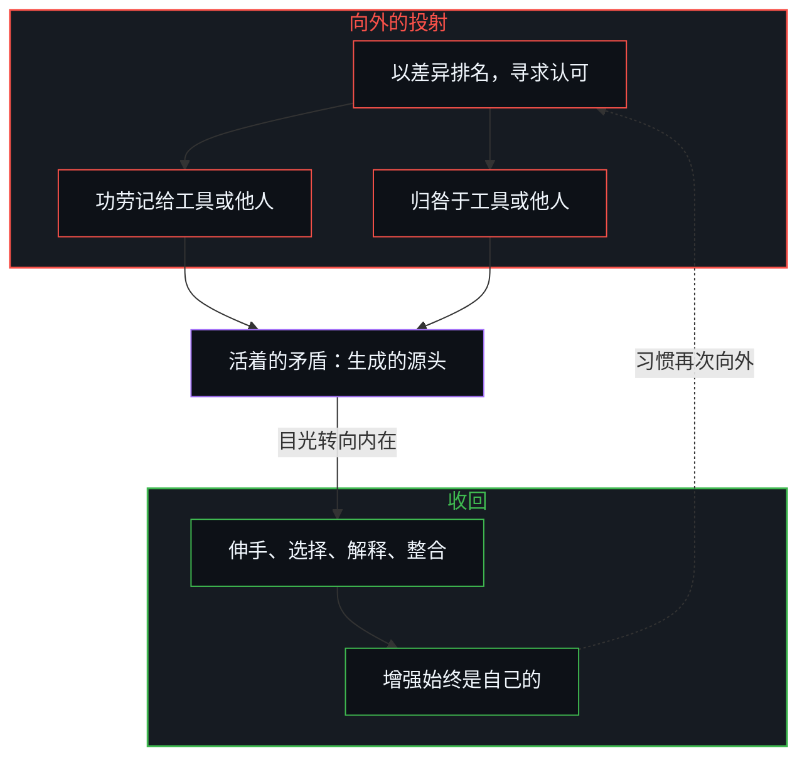
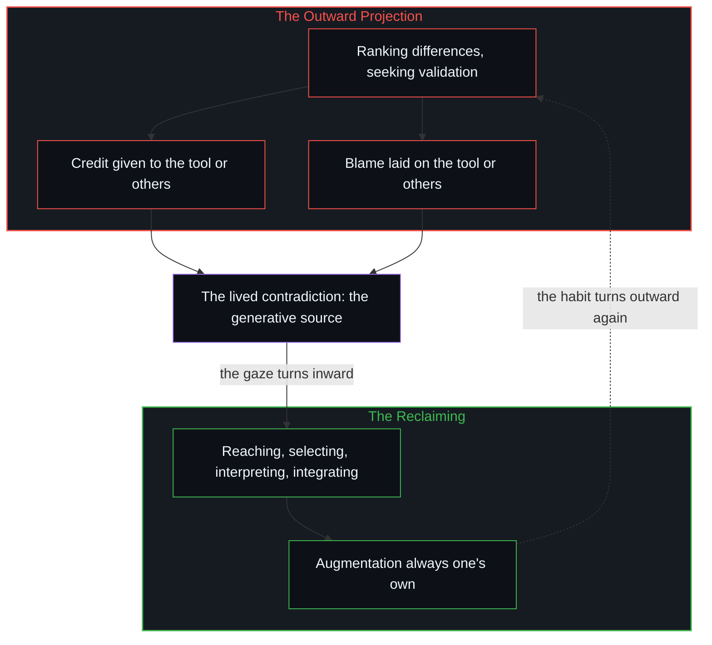

# 生成性的矛盾 / The Generative Contradiction

*能动不断向外投射，又必须被收回，二者相抵 / The constant outward projection of agency against the necessity of reclaiming it.*

差异构成独特，也成为排名与寻求认可的工具。外在的东西并不增强人；是人增强自己，然而能动一再被记在工具上，或归咎于工具，“AI 增强”与“AI 糟粕”里都是如此。看清这个错配，世界便同时变得美丽而痛苦。这份矛盾不被消解，它就是活着；在活着它、不把作者身份外包出去的时候，增强登记为始终是自己的。

Differences constitute uniqueness and become the instruments of ranking and validation. External things do not augment a person; the person augments themself, yet agency is routinely credited to or blamed on the tool, in “AI-augmented” and “AI slop” alike. Seeing that misallocation makes the world beautiful and painful at once. The contradiction is lived, not resolved; in living it without outsourcing authorship, the augmentation registers as always one’s own.

## 一、 差异成为排名的工具 / 1. Differences Become Instruments of Ranking

差异使每个人以独特的方式成为人。

Differences make each one, uniquely, human.

差异也是彼此评判、彼此排名、无尽地寻求认可时所用的工具。满足始终不能到来，因为衡量的标准一直在向外寻找，而它只能从内部认领。[来自个体差异的层级](../hierarchy-from-individual-difference/)是这些差异被放到一把共同的尺上计分时出现的排名。[验证中因果权能的分配](../the-allocation-of-causal-power-in-validation/)是把这份向外的寻找，看作对延续之处的安放。

They are also the instruments of judging one another, ranking one another and seeking endless validation. Satisfaction never quite arrives, because the measure keeps being sought outward when it can only be claimed from within. [Hierarchy from individual difference](../hierarchy-from-individual-difference/) is the ranking that appears when those differences are scored on a shared measure. [The allocation of causal power in validation](../the-allocation-of-causal-power-in-validation/) is that outward looking seen as the placement of continuation.

## 二、 外在的东西不增强人 / 2. Nothing External Augments

外在的东西不增强人。

Nothing external augments.

工具、他人、境遇，哪怕是最先进的 AI，都不作为独立的力量作用于人。伸手、选择、解释与整合的，是人自己。人增强自己。然而常见的习惯，是在结果令人满意时把功劳记给外在的东西或他人，在结果令人失望时归咎于外在的东西或他人。这个能动的错配常见到看不见，连“AI 增强”这样随口的说法里也有它。[因果停留在掌舵的边缘](../causality-stays-at-the-edge-that-steers/)是这份收回装扮成发现的一面：提示、框定、选择、解释与验证，仍是这道边沿自己的行动。

Tools, other people, circumstances, even the most advanced AI: none of them act on a person as independent forces. The one who reaches, selects, interprets and integrates is the person. The person augments themself. Yet the common habit is to credit the external thing or others when the result pleases, and to blame the external thing or others when it disappoints. This misallocation of agency is so common it turns invisible, showing up even in the casual phrase “AI-augmented.” [Causality stays at the edge that steers](../causality-stays-at-the-edge-that-steers/) is that reclaiming in the costume of discovery: prompting, framing, selection, interpretation and verification remain this edge’s own acts.

## 三、 “AI 糟粕”是外向的同一错配 / 3. “AI Slop” Is the Same Misallocation Turned Outward

“AI 糟粕”这个说法本身，就是外向翻转的同一错配：能动从人身上剔除，交给工具，再被用作对他人的评判，于是内在本身的长处始终没有被遇见。[对“AI糟粕”的反感与反复出现的历史模式并无不同](../the-distaste-for-ai-slop-is-no-different-from-the-recurring-historical-pattern/)是那排名装扮成出处的一面：工具被当作价值或玷污的作者。

The very term “AI slop” is the same misallocation turned outward: agency is stripped from the person and assigned to the tool, then used as a judgment of others, so the merits of the content are never met. [The distaste for “AI slop” is no different from the recurring historical pattern](../the-distaste-for-ai-slop-is-no-different-from-the-recurring-historical-pattern/) is that ranking in the costume of provenance: the instrument treated as the author of value or of contamination.

清楚地看见差异、充分地欣赏差异的能力，与对这个错配的觉察同时到来。

The capacity to see differences clearly and appreciate them fully arrives together with awareness of that misallocation.

正是这份觉察，让世界同时美丽而痛苦。美丽，因为认领让一个人所是的鲜活的特殊性回来了。痛苦，因为它显出相反的习惯在多深的程度上塑造了感知、评判与渴望。[自我价值感与所有权](../ownership-and-self-worthiness/)是这份收回作为一次更新：后果作为自己的重新进入时，更新就运行起来。

That awareness is what makes the world beautiful and painful at once. Beautiful, because ownership restores the vivid particularity of what one is. Painful, because it shows how deeply the opposite habit has shaped perception, judgment and longing. [Ownership and self-worthiness](../ownership-and-self-worthiness/) is that reclaiming as the update that runs when consequences re-enter as one’s own.

## 四、 矛盾是生成的源头 / 4. The Contradiction Is the Generative Source

这是每一个存在之中内在的矛盾：

This is the contradiction inside every existence:

能动不断向外投射，而更深处又必须把它收回，二者相抵。

the constant outward projection of agency against the deeper necessity of reclaiming it.

这份矛盾不是要消除的缺陷。它就是生成的源头。没有外在的认可与内在的作者身份之间的摩擦，就没有张力，没有认出，也没有目光转向内在时那一下骤然的清明。差异、评判、不满，以及接纳自己时那份不容易的美，都出自同一个无法消解的运动。[选择、矛盾与开放的现实](../selection-contradiction-and-open-reality/)是这份生成的错位装扮成描述的一面：每一次选择都生出一份它封不住的余数。在这里，摩擦是外在的认可对内在的作者身份。[外部归因是个人进步的障碍](../wai-bu-gui-yin-ge-ren-jin-bu-de-zhang-ai/)是这份收回，作为唯一属于此处的杠杆：差距一旦被归到外面，就失去了从这道边沿被改变的可能。收回能动只需一瞬间，[如何在一瞬间修正你的整个人生](../how-to-fix-your-whole-life-in-one-split-second/)说的就是这个。

The contradiction is not a defect to eliminate. It is the generative source itself. Without the friction between external credit and internal authorship there would be no tension, no recognition, no sudden clarity when the gaze turns inward. Difference, judgment, dissatisfaction and the hard beauty of self-acceptance all arise from the same irresolvable movement. [Selection, contradiction, and open reality](../selection-contradiction-and-open-reality/) is that generative mismatch in the costume of description: every selection produces a remainder it cannot seal. Here the friction is external credit against internal authorship. [External Attribution Is the Obstacle to Personal Growth](../wai-bu-gui-yin-ge-ren-jin-bu-de-zhang-ai/) is the reclaiming as the only lever that belongs here: the gap, once attributed outside, loses the possibility of being changed from this edge. Reclaiming agency takes one split second, as [How to Fix Your Whole Life in One Split Second](../how-to-fix-your-whole-life-in-one-split-second/) puts it.

矛盾不被消解。

The contradiction is not resolved.

它就是活着。

It is lived.

在活着它的时候，充分地、不把作者身份外包出去，世界从未如此美丽，也从未如此严苛，正当增强被接受为始终是自己的那一刻。

And in living it, fully, without outsourcing the authorship, the world never looks so beautiful, nor so demanding, as when the augmentation is accepted as always one’s own.
