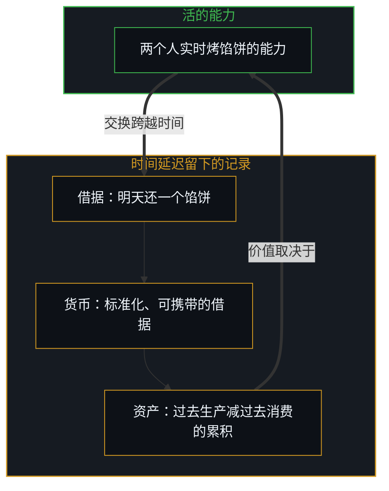
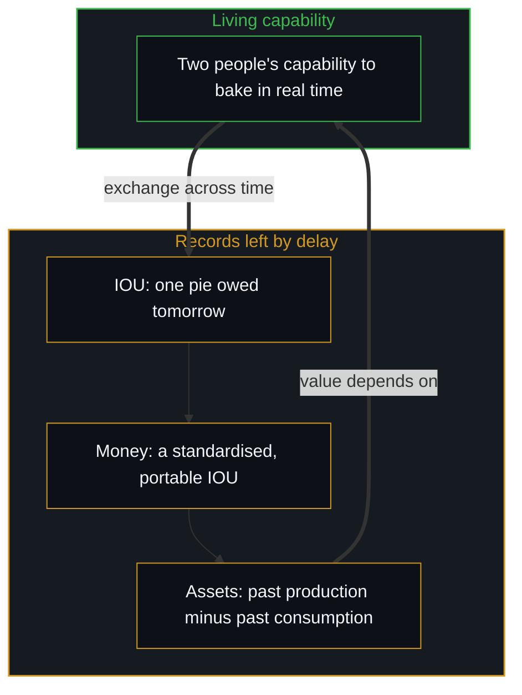

# 价值、货币与财富的生成机制 / The Generative Mechanics of Value, Money, and Wealth

*财富在于个人活的创造能力，把累积的借据当成财富，会割断推动能力增长的回路 / Wealth is a person's living capability to create; taking stored claims for wealth cuts the loop that grows capability.*

每一次经济互动，从一顿独自吃的饭到全球的金融架构，都起于一个最基本的东西：一个人为维持自己、在现实中导航而做出选择。价值开始时是一份无法度量的、第一人称的必要。人们同时交换时，价值流动，用不着账本或财富的记录；正是时间上的延迟，才生出借据、货币，以及被社会实体化的“财富”。

Every economic interaction, from a meal eaten alone to global financial architecture, starts from one primitive: a person choosing in order to sustain themselves and navigate reality. Value begins as an unmeasurable, first-person necessity. When people exchange at the same moment, value flows with no need for ledgers or records of wealth; it is temporal delay that gives birth to IOUs, money, and what society reifies as "wealth".

文明借专业分工成倍地增加丰裕，可财富的引擎从不转移到静态的器物或纸面的权利里，它留在个人活的、实时的生产能力上。社会、慈善家或好意的父母想转移财富而不保住生产摩擦这个控制论的损失函数时，就关掉了受助者的纠错机制，把原本的善意变成能动性的加速萎缩。

Civilisation multiplies abundance through specialisation, yet the engine of wealth never moves into static artifacts or paper claims; it stays with people's living, real-time capability to produce. When societies, philanthropists or well-meaning parents try to transfer wealth without keeping the cybernetic loss function of productive friction, they switch off the recipient's error correction and turn intended kindness into accelerated atrophy of agency.

## 一、 价值的根基 / 1. The Ground of Value

设想一个独自生活的人，采集或烤一个馅饼来维持生命。那个馅饼对这个人有价值，它维持着热量与身体的延续；可这份价值是主观的、内在的，属于这个人自己的心智，自然里没有一个外部的、独立的尺度去量单个意识里价值的大小。如果一个馅饼不够，任何抽象的理论或外部的命令都改变不了这个现实，这个人面对一个直接的、不经中介的约束：学会烤一个更大的馅饼，或改进采集的方法。在这个最初的地面上，价值与第一人称的生物必要连在一起，离不开经历它的那个活的行动者，扩大价值唯一的杠杆，是提高行动者作用于物质基底的内部能力。

Picture someone living alone who gathers or bakes a pie to stay alive. The pie has value to that person, keeping their calories and bodily continuity going; yet the value is subjective, intrinsic, belonging to their own Mind, and nature holds no outside, independent scale to measure the size of value inside a single awareness. If one pie is not enough, no abstract theory or outside decree changes that reality, and the person faces a direct, unmediated constraint: learn to bake a bigger pie, or improve the gathering. On this first ground value is tied to first-person biological necessity, cannot be separated from the living agent who experiences it, and has one lever for growth: raising the agent's inner capability to act on the material substrate.

## 二、 同时的交换 / 2. Synchronous Exchange

再来第二个人，烤另一种馅饼。某一天两人相遇，各自觉得对方的馅饼比自己的更有用或更新鲜，就当场直接交换：一人把馅饼递过去，另一人同时把自己的递过来，两人当场吃掉。价值真的被创造、被交换了，两个心智都经历了主观满足的增加，生命的延续也维持住了。可在这次同时的交换里，没有价格，没有用钱，也没有记下任何财富。交易在实时里即刻完成，没有需要中间账本来跨越的时间缺口；价值被生产、被交换，又直接化进两个行动者活的经验里。

Now add a second person who bakes a different pie. One day they meet, each finds the other's pie more useful or more novel than their own, and they trade on the spot: one hands a pie over while the other hands theirs back, and both eat at once. Value has really been created and exchanged, both minds experienced a rise in subjective satisfaction, and both lives went on. Yet in this synchronous exchange there is no price, no money is used and no wealth is recorded. The trade resolved instantly in real time, with no temporal gap for an intermediary ledger to bridge; value was produced, exchanged and dissolved directly into the living experience of the two agents.

## 三、 时间的延迟与借据 / 3. Temporal Delay and the IOU

“财富”这个概念，只在因果连续体里引入时间延迟时才出现。设想甲今天烤了一个馅饼给乙，乙还没烤自己的；乙今天吃了甲的馅饼，答应明天还一个同样的。交换不能同时完成，就需要一份中间记录来跨越时间缺口：乙交给甲一张写着“我欠你一个馅饼，明天还”的借据，甲手里于是拿着一张代表对未来馅饼的权利的纸。就在这一刻，常说的“财富”诞生了，社会看着甲，说甲有“财富”，因为甲持有一张有效的权利凭证。

The concept of "wealth" appears only when temporal delay enters the causal continuum. Suppose A bakes a pie today and gives it to B, who has not yet baked one; B eats A's pie today and promises to return an equivalent pie tomorrow. Since the exchange cannot complete at once, an intermediary record is needed to bridge the gap: B hands A a note reading "I owe you one pie tomorrow", and A now holds a piece of paper standing for a claim on a future pie. At that moment the usual "wealth" is born, and society looks at A and says A has "wealth", because A holds a valid claim.

经济学最初的因果混淆就在这里。常见的看法以为财富在那张纸里，在金融的权利里，或在对吃掉的馅饼的记忆里；从生成的一面看，财富在两个人持续的、活的、实时烤馅饼的能力里。如果两人都突然失去了烤的能力或工具，那张纸立刻成了一份无用的虚构。纸没有独立的因果力量，它只是一笔滞后的账目，记着两个活跃生产者之间的一次时间错配。

Here lies the first causal confusion of economics. The common view holds that the wealth lies in the paper, in the financial claim, or in the memory of the eaten pie; seen from the generating side, the wealth lies in both people's ongoing, living, real-time capability to bake. If both suddenly lost the ability or the tools to bake, the paper would at once become a worthless fiction. The paper has no independent causal power; it is only a lagging ledger entry tracking a time mismatch between two active producers.

## 四、 分工与丰裕的复利 / 4. Specialisation and Compounding Abundance

当这个动态从两个人扩展到上百万人的社会，劳动分工就打开了复利的生产效率。设想十个人，每人都需要十样不同的东西才能过得舒适。每人都独自生产全部十样，就得不停地切换、分散注意、用粗陋的工具，各样只做出一件。让每人专做一样：专注一门手艺，预测的世界模型变得锐利，技法精进，工具复利地变得精巧，于是每个专门的人做出的不是十样各一件，而是自己那一样的十件，速度与质量都高得多；经由多边的交换，每人用多出的九件换来其他专门者的九样东西。每个人都享有十样高质量的东西，社会总的丰裕增加了一个数量级。

When this dynamic grows from two people to a society of millions, the division of labour unlocks compounding productive efficiency. Picture ten people who each need ten different goods to live comfortably. If each makes all ten alone, they must keep switching, split their attention and work with crude tools, making one of each. Let each specialise in one: focused on one craft, the predictive world model sharpens, technique improves and tools compound in refinement, so each specialist makes not one of ten things but ten of their one thing, far faster and better; through multilateral exchange each trades the surplus nine for nine goods from the other specialists. Everyone enjoys ten high-quality goods, and the society's total abundance rises by an order of magnitude.

可这场丰裕的爆发并不改变底下的本体。社会的总财富，仍在个人分散的、实时的创造新东西的能力里；不在已经生产出来、被拥有的东西里，那些属于过去，一出来就开始自然地衰变成静止的物质。[生产、消费与心智的区分](../production-consumption-and-the-minds-distinction/)探讨过，对过去器物的所有，只是先前行动静止的痕迹，活的引擎是当下区分、设计与执行的能力。

Yet this explosion of abundance does not change the ontology beneath it. A society's total wealth still lies in people's distributed, real-time capability to create new things, not in goods already produced and owned, which belong to the past and begin their natural decay into static matter the moment they exist. As [Production, Consumption, and the Mind's Distinction](../production-consumption-and-the-minds-distinction/) explores, ownership of past artifacts is only the static trace of prior action; the living engine is the present capacity to distinguish, design and execute.

## 五、 货币、储蓄与累积资产 / 5. Money, Savings and Cumulative Assets

商品分化成成千上万种、时间延迟跨到多年之后，双边的借据就变得笨重，社会就收敛到货币上，贝壳、贵金属或数字的法币账本，作为一种普遍认可、流动性高、可互换的延期权利的单位。货币就是一种标准化、可携带的借据，让一个人能储存对社会未来生产的权利：一个人生产了十份价值、只消费一份，把剩下的九份换成钱存起来，存下的钱就是一份净剩余的账，生产 − 消费 > 0。社会归类为“资本资产”的东西，累积的金融储蓄、房地产、工厂、基础设施，是跨越时间累积下来的生产选择的剩余：累积资产 = Σ（过去的生产 − 过去的消费）。这份剩余可以保存几十年，在代际之间传递；可就像[你的代码库即是记忆](../your-codebase-is-memory/)追溯过的，存下的代码与检查点只是既往区分层层落下的残迹，不会自己继续往下区分，资本资产与账本同样是静态的残迹，价值取决于活着的社会在当下持续重切、维护与运转它们的能力。

As goods diversify into thousands of kinds and delays stretch over years, bilateral IOUs become unwieldy, and society converges on money, shells, precious metals or digital fiat ledgers, as a widely recognised, highly liquid, fungible unit of deferred claims. Money is a standardised, portable IOU that lets a person store a claim on society's future production: someone produces ten units of value and consumes one, exchanges the other nine for money and saves it, and the saved money is a ledger of net surplus, production − consumption > 0. What society classes as "capital assets", accumulated financial savings, real estate, plants, infrastructure, is the surplus of productive choices accumulated over time: cumulative assets = Σ (past production − past consumption). This surplus can be kept for decades and passed between generations; yet just as [Your Codebase Is Memory](../your-codebase-is-memory/) traces how stored code and checkpoints are stacked residues of prior distinctions that do not continue the distinguishing on their own, capital assets and ledgers are static residue whose value depends on the living society's continued capability to re-cut, maintain and operate them in the present.

## 六、 债务的损失函数与能力的增长 / 6. The Loss Function of Debt and the Growth of Competence

每个人的生命都从一个不可避免的净消费赤字开始：生产 = 0，消费 > 0。新生儿什么也不生产，不停地消费，全靠父母生成的剩余活下来；学徒、或刚开始一项事业的创业者也是这样，最初的消费超过即时的产出。在一个尊重财产与因果的环境里，这个负的差额，生产 < 消费，生成一个必要的控制论损失函数：人直接感到消费与生产之间缺口的摩擦；这份摩擦作为不加缓冲的误差信号，迫使内部的机制更新；人被推着去学技能、练纪律、建起生产的能力；最终生产能力越过持平的门槛，生产 > 消费；生成的剩余用来清偿过去的欠账，积累自己的独立。

Every life begins in an unavoidable net consumption deficit: production = 0, consumption > 0. A newborn produces nothing and consumes continuously, living entirely on the surplus its parents generate; an apprentice, or an entrepreneur starting a venture, is the same, with early consumption exceeding immediate output. In an environment that respects property and causality, this negative balance, production < consumption, generates an essential cybernetic loss function: the person directly feels the friction of the gap between what is consumed and what is produced; that friction, as an unbuffered error signal, forces the inner machinery to update; the person is driven to learn skills, build discipline and develop productive competence; eventually productive capability crosses the threshold of parity, production > consumption; and the surplus generated settles past obligations and builds one's own independence.

[好奇先行](../curiosity-first-the-hidden-engine-of-talent-and-development/)与[自我价值感与所有权](../ownership-and-self-worthiness/)都追溯过，这种与真实利害的碰撞，是发展人的能力的机制。消费与生产之间的缺口，不是一桩有待抹去的不公，而是个人演化的首要引擎。

As both [Curiosity First](../curiosity-first-the-hidden-engine-of-talent-and-development/) and [Ownership and Self-Worthiness](../ownership-and-self-worthiness/) trace, this collision with real stakes is the mechanism that develops human capability. The gap between consumption and production is not an injustice to erase but the first engine of personal evolution.

## 七、 不平等的数学拓扑 / 7. The Mathematical Topology of Inequality

人在选择、专注与局部环境上各不相同，个人的结果就自然地分化。这种分化的数学结构，从自由选择的机制推出：在很短的离散时间切片上观察上百万个独立的行动者，即时选择与产出的分布像一条正态的钟形曲线，在任何一个瞬间的切面上，变化看上去有界而对称；可选择并不孤立于时间，选择带着因果的惯性，先前能力的后果递归地进入后续的决定窗口，…… → 选择（t−1） → 结果（t−1） → 选择（t） → 结果（t） → ……。在一个界定的边界之内、跨越较长的时间，这种带时间延迟的递归复利改变了分布：早期技能、纪律与反馈回路松紧上的小差异以指数复利，累积的分布成为一条幂律的、帕累托的曲线，一小部分专注、递归的生产者生成总剩余的大部分。

Because people differ in choices, focus and local environment, individual outcomes diverge naturally. The mathematical structure of the divergence follows from the mechanics of free choice: watching millions of independent actors over a short, discrete slice of time, the distribution of immediate choices and outputs resembles a normal bell curve, with variance looking bounded and symmetric at any single instant; yet choices are not isolated in time, they carry causal inertia, and the consequences of prior competence feed recursively into later decision windows, … → choice(t−1) → outcome(t−1) → choice(t) → outcome(t) → …. Within a defined boundary and over a longer span, this time-delayed recursive compounding transforms the distribution: small differences in early skill, discipline and the tightness of feedback loops compound exponentially, and the cumulative distribution becomes a power-law, Pareto curve, with a small share of focused, recursive producers generating most of the total surplus.

这个分布从不冻结。选择在每一个活的时刻仍在被执行，现实保持动态：在任一时刻取一个足够短的横截面，分布像正态；看多步累积的弧线，幂律的尖峰就出现。

The distribution never freezes. Choices go on being made at every living moment and reality stays dynamic: take a short enough cross-section at any moment and the distribution looks normal; follow the cumulative arc over many steps and power-law spires appear.

## 八、 再分配的悖论 / 8. The Redistribution Paradox

这种幂律的分化，常被叫作“不平等”，是国家强制财富再分配首要的政治依据与道德理由。政治叙事把财富转移说成拉平竞技场的“均等化”力量；沿着实际的控制论流动去追，会看到一个机械的悖论：在下面这个模型里，再分配是资本集中的加速器，而不是均等器。

This power-law divergence, often called "inequality", is the first political ground and moral reason given for state-mandated redistribution of wealth. Political narratives present wealth transfer as an "equalising" force that levels the field; following the actual cybernetic flow shows a mechanical paradox: in the model below, redistribution is an accelerator of capital concentration, not an equaliser.

模型是这样的：一个高产出的人做出十份产出，九个低产出的人消费多于生产；高产出者自己消费不了十份，没有交换机制，多出的剩余清不出去，那九个人又缺购买力；政治机构介入，向生产者的剩余征税，以“公平”的名义把购买力转给那九个人；受助者拿转来的财富去买即时的消费品；而生产这些消费品的，正是最初那个高产出者。转移的财富经过受助者的手，又回到了高产出者的账户里。所谓的“均等化”，只存在于立法转移的那一个数学瞬间；在随后连续的因果序列里，转移为高产出者的产出提供了一个由国家补贴、有保证的消费市场，扩大其规模、加速其资本积累；同时它把受助者挡在自己的生产赤字之外，关掉他们的控制论损失函数，能力长期得不到发展；循环以更大的幅度重复，需要更大的转移去抵消一道越来越宽的能力鸿沟。

The model runs like this: one high-output person produces ten units of output, while nine low-output people consume more than they produce; the high producer cannot consume ten units, the surplus cannot clear without an exchange mechanism, and the nine lack the purchasing power; the political apparatus steps in, taxes the producer's surplus and transfers the purchasing power to the nine under the banner of "equity"; the recipients spend the transferred wealth on immediate consumption goods; and the one who produces those goods is the original high producer. The transferred wealth passes through the recipients' hands and lands back in the high producer's account. The supposed "equalisation" exists only at the single mathematical instant of the legislated transfer; in the continuous causal sequence that follows, the transfer gives the high producer's output a state-subsidised, guaranteed consumer market, expanding its scale and accelerating its capital accumulation, while shielding the recipients from their own productive deficit and switching off their cybernetic loss function so that capability goes undeveloped; the cycle repeats at greater amplitude and needs ever larger transfers to offset an ever wider capability gap.

## 九、 政策是可见的症状 / 9. Policy as Visible Symptom

这个分析既不是在主张“反向的政策”，也不是一场反对财富再分配的政治运动。把政策当作首要的元凶或救星，是把同一个因果错置反过来再做一遍。一项财富转移政策没有独立的因果力量，它是个体选择聚合之后可见的宏观症状：一方选择把损失函数外推，另一方，政治机构，选择吸纳并管理这份需求。政策被呈现、被相信为“系统性的解决方案”，人就把能动性移到国家机器上；这个信念免去了个人纠错的必要，扩大了底下的赤字，反过来加强了对政策的需求。

This analysis is neither an argument for a "reverse policy" nor a political campaign against redistribution. Treating policy as the first culprit or saviour makes the same causal misplacement again in reverse. A wealth-transfer policy has no independent causal power; it is the visible macroscopic symptom of aggregated individual choices: on one side the choice to externalise the loss function, on the other the choice of political institutions to absorb and manage that demand. Because the policy is presented and believed as a "systemic solution", people move their agency onto the state apparatus; the belief removes the need for personal error correction, widens the underlying deficit and in turn reinforces the demand for the policy.

这说明为什么不可能有“系统性的解决方案”。任何自上而下的系统干预，扩大转移或强制法律限制，都把能动性从活着的个人那里重新分配到一台抽象的集体机器上。系统不生成价值，区分、学习与生产的是一个个人；设计一个自上而下的结构修补，只是用声称要解决问题的那台机器取代了个人的心智。AI 封建之争把权利的存量当成创造的速率，[能动性、复利与 AI 封建之争](../agency-compounding-and-the-argument-over-ai-feudalism/)展示了这一点。

This shows why there can be no "systemic solution". Any top-down systemic intervention, expanding transfers or enforcing legal restrictions, reallocates agency from the living person onto an abstract collective machine. Systems do not generate value; it is persons who distinguish, learn and produce; designing a top-down structural fix only replaces the individual Mind with the apparatus that claims to solve the problem. The AI feudalism debate takes a stock of claims for the rate of creation, as [Agency, Compounding, and the Argument Over AI Feudalism](../agency-compounding-and-the-argument-over-ai-feudalism/) shows.

## 十、 转移的陷阱 / 10. The Transfer Trap

当一个消费大于生产的人，消费 > 生产，不把这个赤字放在自己能力的不足上，结构上的断裂就发生了。不把缺口读作内部的误差信号，而把错配推到外面：“系统不公平”，“机构欠我的”，“别人拥有的超过所需”。这种外推一旦扎根，内部的损失函数就被关掉，提升生产能力的操作压力消失，靠外部剩余供养来持续超额消费的应得感就生出来。与此同时，生成大量剩余的人面对一个固有的约束：他们在身体上消费不了自己需求的十倍，只能要么把剩余作为贷款再投入，一种带时间延迟的生产性交换；要么经由慈善、福利或无条件的援助把剩余转出去，希望受助者终能自立。这就是一切现代财富转移结构的起源。

A structural break occurs when someone whose consumption exceeds production, consumption > production, does not place the deficit in their own lack of capability. Instead of reading the gap as an inner error signal, they push the mismatch outward: "the system is unfair", "the institution owes me", "others have more than they need". Once this externalisation takes root, the inner loss function is switched off, the operating pressure to raise productive competence disappears, and a sense of entitlement to continued overconsumption funded by outside surplus grows. Meanwhile, those who generate large surpluses face an inherent constraint: they cannot physically consume ten times their needs, so they either reinvest the surplus as loans, a time-delayed productive exchange, or transfer it outward through philanthropy, welfare or unconditional aid, hoping the recipient will eventually stand alone. This is the origin of every modern wealth-transfer structure.

无论用什么道德或利他的语言为它辩护，无条件的财富转移都割断控制论的反馈回路。对能力征税去为权利付账，会让源头萎缩，[福利国家的幻象](../the-welfare-state-illusion-cost-diffusion-and-agency-atrophy/)展示了这一点：提供消费补贴而不要求相应的生产能力提升，就拿走了推动学习的那份摩擦，受助者的世界模型冻结，生成价值的能力萎缩，暂时的转移硬化成长久的依赖。[财富转移政策与价格下限中的原因错置](../the-reversal-of-causality-in-wealth-transfer-policies-and-price-floors/)确立过，把金钱的支付当作独立的原因，而不是能力的滞后后果，会系统地加深它声称要解决的差距。

Whatever moral or altruistic language justifies it, unconditional wealth transfer cuts the cybernetic feedback loop. Taxing capability to pay for claims withers the source, as [The Welfare State Illusion](../the-welfare-state-illusion-cost-diffusion-and-agency-atrophy/) shows: providing a consumption subsidy without requiring a matching rise in productive capability removes the friction that drives learning, the recipient's world model freezes, the capability to generate value atrophies, and the temporary transfer hardens into lasting dependence. As [The Misallocation of Cause in Wealth-Transfer Policies and Price Floors](../the-reversal-of-causality-in-wealth-transfer-policies-and-price-floors/) establishes, treating the money paid as an independent cause rather than a lagging consequence of capability systematically deepens the gap it claims to close.

## 十一、 “赋权”的悖论 / 11. The Paradox of Empowerment

这个机械的失效，也显出当代“赋权”概念里的一层错置。“赋权”这个词预设了一个本体上站不住的前提：受助者此刻缺乏内在的能动性，需要一个外部的施予者、项目或机构把力量授予对方。一个机构声称要“赋权”于一个人的那一刻，就把施予者立成能力真正的作者与分发者，把受助者框定为一个等着被装满的被动容器；受助者把“赋权”当作外部的礼物接受下来的那一刻，就正式交出了自己的能动性。能动性不能被转移、分发或赠予，它是有意识的心智固有的操作能力。真正的帮助不“赋权”，只是尊重对方对自己选择的所有，让对方的反馈回路保持完整。

This mechanical failure also shows a misplacement inside the contemporary concept of "empowerment". The word presupposes an ontologically untenable premise: that the recipient currently lacks inner agency and needs an outside benefactor, programme or institution to grant power. The moment an institution claims to "empower" someone, it installs the benefactor as the real author and dispenser of capability and frames the recipient as a passive vessel waiting to be filled; the moment the recipient accepts "empowerment" as an outside gift, they formally hand over their own agency. Agency cannot be transferred, distributed or gifted; it is the operating capability inherent in a conscious Mind. Real help does not "empower"; it respects the other's ownership of their choices and leaves their feedback loops intact.

## 十二、 父母的遗产陷阱 / 12. The Parental Inheritance Trap

这个陷阱最温和、也最普遍的形态，不在国家政治里，而在家庭之中：把父母累积的财富转给孩子。经历过强烈挣扎才获得高成就的父母，常想让孩子免受同样的摩擦，于是把巨大的累积财富、声望与物质的舒适给了并没有书写那份剩余的继承人。财富跟随自我价值，绕开它的转移会让财富反向流动，[自我价值、反向财富转移与过去成功的陷阱](../self-worthiness-reverse-wealth-transfer-and-the-trap-of-past-success/)论证了这一点。

The mildest and most widespread form of this trap lies not in state politics but in the family: passing accumulated parental wealth to children. Parents who reached high achievement through hard struggle often want to spare their children the same friction, and so give great accumulated wealth, prestige and material comfort to heirs who did not author that surplus. Wealth follows self-worth, and transfers that bypass it reverse the flow, as [Self-Worthiness, Reverse Wealth Transfer, and the Trap of Past Success](../self-worthiness-reverse-wealth-transfer-and-the-trap-of-past-success/) argues.

其机制是可以追溯的：大量非自己挣来的剩余，使孩子的反馈信号饱和、沉默；消费需求不要求任何产出就被慷慨满足，内部的纠错回路就不启动；孩子没有建立高带宽能力、练出韧性或扩展感知地平线的生物与经济上的紧迫；本意是保护性祝福的遗产，起了一剂操作上的镇静剂的作用。[成功之后的育儿谬误](../the-fallacy-of-post-success-parenting/)说过，除非继承人严格地不把遗产当作消费的垫子，而只当作行使自己自主能动性、建立新能力的外部杠杆，否则非自己挣来的剩余，就会成为交出能动性的理由。

The mechanism can be traced: a large unearned surplus saturates and silences the child's feedback signal; when consumption needs are lavishly met without any output being required, the inner error-correction loop never starts; the child has no biological or economic urgency to build high-bandwidth competence, develop resilience or widen the perceptual horizon; and the inheritance, meant as a protective blessing, works as an operating sedative. As [The Fallacy of Post-Success Parenting](../the-fallacy-of-post-success-parenting/) puts it, unless an heir strictly treats the inheritance not as a cushion for consumption but only as outside leverage for exercising their own agency and building new capability, the unearned surplus becomes a reason to hand agency over.

## 十三、 承担后果的全部分量 / 13. Carrying the Full Weight of Consequence

财富不是金库里的金子、银行屏幕上的数字或物业的契据。这些都是静止的历史器物，是过去交换滞后的结算单，而不是生成的引擎，[向量与投影的迷局](../the-vector-and-the-puzzle-of-projections/)追溯过这一层。财富是一个人活的、实时的观察现实、做出区分、执行生成价值之行动的能力。活的能力，就是选择注入一个自由变量，[唯一自洽的无因之果](../the-only-coherent-uncaused-effect/)描述的正是这一点。

Wealth is not gold in a vault, numbers on a bank screen or deeds to property. These are static historical artifacts, lagging settlement slips of past exchanges rather than generating engines, a layer traced in [The Vector and the Puzzle of Projections](../the-vector-and-the-puzzle-of-projections/). Wealth is a person's living, real-time capability to observe reality, make distinctions and carry out actions that generate value. Living capability is choice injecting a free variable, as [The Only Coherent Uncaused Effect](../the-only-coherent-uncaused-effect/) describes.

这把整个探究带回第一人称。人的成长，发生在选择承担落到自己身上之事的全部、不加缓冲的后果的时候，无论是财富、债务、生产的剩余，还是暂时的停滞；把每一份经济摩擦当作内部的损失函数，而不是外部的委屈，预测的世界模型就迅速更新；把制度与市场只当作崎岖的地形，而不是救星，生成的能力就持续复利；不接受代理的“赋权”与非自己挣来的垫子，与无尽的因果连续体的连接就不断开。没有哪个集体结构能授予能力，也没有哪项政策能替代个人的责任；财富不断扩展的地平线，属于完整认领自己的选择、以作者的身份迎接现实反馈的那个心智。

This brings the whole inquiry back to the first person. Human growth happens when one chooses to carry the full, unbuffered consequence of whatever lands on oneself, wealth, debt, productive surplus or temporary stagnation; when every economic friction is treated as an inner loss function rather than an outside grievance, the predictive world model updates quickly; when institutions and markets are treated as rugged terrain rather than saviours, generative capability keeps compounding; when proxy "empowerment" and unearned cushions are declined, the connection to the endless causal continuum stays unbroken. No collective structure can confer capability and no policy can stand in for personal responsibility; the widening horizon of wealth belongs to the Mind that fully owns its choices and meets reality's feedback as their author.
