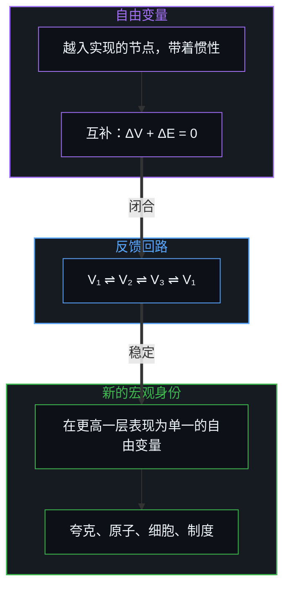
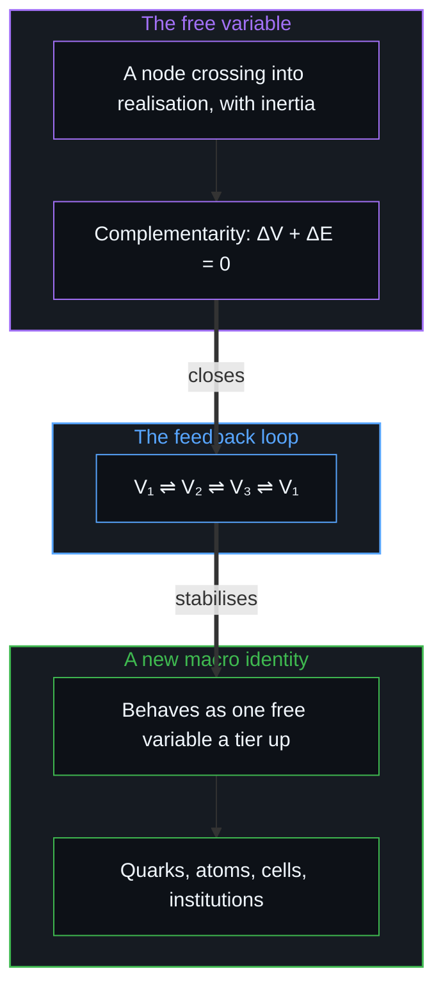

# 自由变量的生成拓扑 / The Generative Topology of Free Variables

*宏观现象是自由变量稳定下来的回路；把能动性交给集体，就短路了纠错。 / Macro phenomena are stabilised loops of free variables; handing agency to collectives short-circuits error correction.*

可观察宇宙中的每一个结构，从稳定的原子物质，到市场的依赖，再到庞大的政治帝国，都可以从一个简朴的基元推出：自由变量在动态感知地平线上的相互作用。因果本身是一条不断开的连续体，没有终极的起点，也没有最后的终结；可对任何一个具体的意识观察者，这条连续体必然被截成一个有边界的框，在表面上有始有终。一个新的因果节点越过门槛进入观察时，从外部登记为一个不确定的状态落成现实，从内部登记为一次选择。

Every structure in the observable cosmos, from stable atomic matter to market dependence to sprawling political empires, can be derived from one austere primitive: the interaction of free variables across a dynamic perceptual horizon. Causality itself is an unbroken continuum with no ultimate origin and no final termination; yet for any particular conscious observer the continuum is necessarily cut into a bounded frame with an apparent beginning and end. When a new causal node crosses the threshold into observation, it registers from outside as an indeterminate state settling into reality, and from inside as a choice.

追溯这些已实现的变量怎样相互作用、闭合成反馈回路、再自举成更高阶的宏观身份，揭示的不只是物质的物理，还有政治权力的机械陷阱、常见个人主义里嵌着的那一点集体主义，以及把责任外包后随之而来的演化过时。

Tracing how these realised variables interact, close into feedback loops and bootstrap into higher-order macro identities uncovers not only the physics of matter but the mechanical trap of political power, the bit of collectivism embedded in conventional individualism, and the evolutionary obsolescence that follows from outsourcing responsibility.

## 一、 无穷的连续体与动态的地平线 / 1. The Endless Continuum and the Dynamic Horizon

因果作为一条不断开的无穷链条运作，…… → 原因 → 结果 → 原因 → 结果 → ……（−∞ → +∞），没有终极的开始，也没有最后的封闭。可作为一个局部的意识观察者，心智从不同时持有一个完结的无穷全体；在任何离散的一刻，认识都必然把连续体截成一个局部的观察窗口，一条在表面上有始有终的认识地平线，而因果潜能则在两个方向上向其外无尽延伸。[宏观现象的生成图谱](../the-generative-atlas-of-macroscopic-phenomena/)从量子到人的选择，描出的是同一个拓扑。这条地平线不是固定的，它随观察者在现实中的移动而不断扩展、重新校准。一段未被观察的因果序列终于与观察者的框相交时，一个新的因果节点越过边界：在地平线之外，其前因尚未被观察，到来的节点显得不确定、概率性、敞开；越过感知门槛的那一刻，它落成一个离散而确定的事实。

Causality runs as an unbroken, endless chain, … → cause → effect → cause → effect → … (−∞ → +∞), with no ultimate beginning and no final closure. Yet as a local conscious observer the Mind never holds a completed infinite totality at once; at any discrete moment, knowing necessarily cuts the continuum into a local observational window, a horizon of knowing with an apparent beginning and end while causal potential extends endlessly beyond it in both directions. [The Generative Atlas of Macroscopic Phenomena](../the-generative-atlas-of-macroscopic-phenomena/) maps the same topology from the quantum to human choice. This horizon is not fixed; it keeps expanding and recalibrating as the observer moves through reality. When an unobserved causal sequence finally meets the observer's frame, a new causal node crosses the boundary: outside the horizon, where its causal antecedents are still unobserved, the incoming node looks indeterminate, probabilistic and open; the moment it crosses the threshold of perception it settles into a discrete, determinate fact.

物理学里单独拿出来的“波函数塌缩”，因此不只是关在亚原子粒子实验室里的奇异谜题，它与感知自身的操作边界有同一个形式。

What physics singles out as "wave-function collapse" is therefore not only an exotic puzzle confined to subatomic laboratories; it has the same form as the operating boundary of perception itself.

## 二、 日常里的同一个边界 / 2. The Same Boundary in Daily Life

潜能落定为确定，这个形式在日常的宏观生活里不停地出现。望向一条热浪蒸腾的长长的沙漠公路，地平线上空无一物；到了某个光学的门槛，一个形状突然从看不见越入可分辨，先前不确定的空处，落成一个走路的人。缩放一张高分辨率的数字图像或卫星地图，像素与地形轮廓并不在连续的无穷上平滑滑动，到了离散的门槛，特征就突然在感知里出现或消失。一个东西从视野里退去，并没有凭空消失，只是退到了测量框架的分辨边界之外。量子效应因此不只是微观领域另一套物理，它也标出一个观察者的分辨极限遇到一个未被预先计算的宇宙的那条操作边缘；这条边界登记在哪里，是心智做出的选择。

The form of potential settling into determinacy appears constantly in everyday macroscopic life. Looking down a long, heat-shimmering desert road, the horizon is empty; at a certain optical threshold a shape abruptly crosses from invisible to resolvable, and what was an indeterminate blank settles into a walking person. Zooming in or out on a high-resolution digital image or satellite map, pixels and contours do not slide smoothly across continuous infinities; at discrete thresholds, features abruptly appear in or drop out of perception. Something receding from view has not vanished into nothing; it has only moved past the resolution boundary of the measuring frame. Quantum effects are therefore not only a separate physics for the microscopic realm; they also mark the operating edge where an observer's resolution limit meets a universe not computed in advance, and where that boundary registers is a choice the Mind makes.

## 三、 量子的不确定与选择 / 3. Quantum Indeterminacy and Choice

这个门槛事件被登记时，依观察者相对于切分站在哪一边，呈现出两面。从外部看，一件第三人称的仪器测量一个外部系统，越过被登记为一次不确定的量子塌缩，从叠加态向已实现本征值的概率转换；从内部经历，第一人称的主体活在行动的那一刻，同一件事被感到是自由的选择。当心智把自由变量注入这一步，被观察到的就是量子的不确定：正如[自由变量的同构与先验主权](../zi-you-bian-liang-de-tong-gou-yu-xian-yan-zhu-quan/)所追溯的，二者并不在某个外部时钟上竞速，因为它们是同一次离散切分的内部生成前沿与外部观察边界；而在因果位阶上，第三人称的测量始终尾随它所捕获其痕迹的那个行动。

When this threshold event is registered it shows two faces, depending on which side of the cut the observer stands. From outside, a third-person instrument measuring an outside system, the crossing registers as an indeterminate quantum collapse, a probabilistic transition from superposition to a realised eigenvalue; lived from inside, a first-person subject in the moment of action, the same event is felt as free choice. When the Mind injects the free variable into the step, what is observed is quantum indeterminacy: as [The Isomorphism of Free Variables and Prior Sovereignty](../zi-you-bian-liang-de-tong-gou-yu-xian-yan-zhu-quan/) traces, the two do not race each other on an external clock because they are the inner generating edge and the outer observational boundary of one discrete cut, while in causal rank third-person measurement always trails the act whose trace it captures.

两种描述指向同一件事，可以从时间上的关系推出来。设塌缩速率为 R_塌缩，有意识感知的速率为 R_感知。如果感知比塌缩快，R_感知 > R_塌缩，心智就会直接感知到塌缩之前、未被测量的因果链，不确定就会消失，地平线也不复存在；如果塌缩比感知快，R_塌缩 > R_感知，状态就会在意识登记之前落定为确定的历史，观察者就无从察觉任何概率的叠加或不确定。这两个反事实之所以都不成立，是因为它们把塌缩当成了按自身时间表运转、独立于观察者的过程；人的感知之所以恰好到达地平线的前沿，R_感知 = R_塌缩，是因为“塌缩”不过是对感知划下其离散切分之边界的第三人称登记。未知变为已知的边界，同时就是潜能变为选择的边界；随机，是内部自由在外部观察中的影子。

That the two descriptions point at one event can be derived from timing. Let the rate of collapse be R_collapse and the rate of conscious perception R_perceive. If perception were faster than collapse, R_perceive > R_collapse, the Mind would perceive the pre-collapse, unmeasured causal chain directly, indeterminacy would vanish and the horizon would cease to exist; if collapse were faster than perception, R_collapse > R_perceive, the state would settle into determinate history before awareness could register it, and the observer could never detect probabilistic superposition or uncertainty at all. Both counterfactuals fail because they treat collapse as an observer-independent process running on its own schedule; human perception arrives right at the frontier of the horizon, R_perceive = R_collapse, because "collapse" is simply the third-person registration of the boundary where perception draws its discrete cut. The boundary where the unknown becomes known is at once the boundary where potential becomes choice; randomness is the shadow of inner freedom in outside observation.

## 四、 自由变量、惯性与互补 / 4. The Free Variable, Inertia and Complementarity

一个因果节点越入实现的那一刻，在数学上作为一个自由变量 V 起作用。[唯一自洽的无因之果](../the-only-coherent-uncaused-effect/)把这一刻认作选择：意识借以打破确定的机械模拟、把一个推不出来的自由度引入现实的那一个光圈。每一个尺度上的意识都是这种反馈，[折叠的连续谱](../the-continuum-of-the-fold/)论证过这一点。自由变量被注入并实现为一个确定状态（比如二进制的 0 或 1）的那一瞬，它就在耦合场中转化为受缚状态——正如[残余与自由变量](../the-residue-and-the-free-variable/)所追溯的——并获得基本的惯性：除非与环境相互作用，它就保持不变。相互作用时，它服从严格的逻辑互补，ΔV + ΔE = 0：该变量经历的任何状态变化，都由与之相互作用的环境中一个互补的变换来对应；若不引起耦合场发生等量反向的变化，孤立变量便无法改变自身状态。

At the moment a causal node crosses into realisation it works mathematically as a free variable V. [The Only Coherent Uncaused Effect](../the-only-coherent-uncaused-effect/) recognises this moment as choice: the one aperture through which awareness breaks deterministic mechanical simulation and brings an underivable degree of freedom into reality. Awareness at every scale is this feedback, as [The Continuum of the Fold](../the-continuum-of-the-fold/) argues. The instant the free variable is injected and realised as a determinate state, binary 0 or 1 for instance, it becomes bound within the coupled field—as [The Residue and the Free Variable](../the-residue-and-the-free-variable/) traces—and acquires basic inertia, staying unchanged unless it interacts with its environment. When it interacts, it obeys strict logical complementarity, ΔV + ΔE = 0: every state change the variable undergoes is matched by a complementary transformation in the environment it interacts with; an isolated variable cannot change its state without an equal and opposite shift in the field it couples to.

许多自由变量持续地相互作用，它们互补的交换就闭合成反馈回路，V₁ ⇌ V₂ ⇌ V₃ ⇌ V₁。一个反馈回路稳定下来的那一刻，一个涌现的现象出现：这个回路成为一个新的宏观身份。在这个更高层级的粗粒化描述上，回路内部的整个循环退到背景里——正如[递归形式系统中作为记忆与控制的边界条件图](../boundary-condition-graphs-as-memory-and-control-in-recursive-formal-systems/)在分析稳定的内层回路嵌套于更宽的外层回路时所追溯的——稳定的回路在这一层沿其剩余自由度表现为一个单一、统一的复合变量，尽管在人类制度中，任何新的不可推导之切分依然源自回路之内活生生的心智，而非源自宏观外壳本身。相互作用的夸克形成稳定的核子，核子与电子形成原子，原子形成稳定的分子，细胞的反馈回路形成生物体，相互作用的人形成制度、市场与文化结构。被认作“物质”、“能量”或“社会结构”的一切，都是稳定反馈回路在尚无扰动进入其界定区域时的持续保持；一个物体或一个制度消失，并没有蒸发成虚无，而是它内部的回路被外来的扰动变量打破，或退到了观察者的地平线之外。

When many free variables interact continuously, their complementary exchanges close into feedback loops, V₁ ⇌ V₂ ⇌ V₃ ⇌ V₁. The moment a feedback loop stabilises, an emergent phenomenon appears: the loop becomes a new macro identity. At this higher level of coarse-grained description, the loop's whole internal circulation recedes into the background—just as [Boundary-Condition Graphs as Memory and Control in Recursive Formal Systems](../boundary-condition-graphs-as-memory-and-control-in-recursive-formal-systems/) traces when a stabilised inner loop is nested inside a wider outer loop—and the stable loop behaves at that tier as a single, unified composite variable across its residual degrees of freedom, even though in human institutions any new underivable cut still originates from the living Minds within the loop rather than from the macro shell itself. Interacting quarks form stable nucleons, nucleons and electrons form atoms, atoms form stable molecules, cellular feedback loops form organisms, interacting people form institutions, markets and cultural structures. Everything recognised as "matter", "energy" or "social structure" is a stable feedback loop held while nothing disruptive enters its defining region; when an object or an institution disappears it has not evaporated into nothing, but its inner loop has been broken by disruptive outside variables or has receded beyond the observer's horizon.

## 五、 现实的损失函数 / 5. Reality's Loss Function

在人的认知里，这种递归的自举表现为一个适应性的学习回路。一个人认领自己的结果、为之负责时，就建立起一个很紧的控制论回路：依据内部的世界模型作用于环境；感知的地平线是动态的，意料之外的因果节点不断进入视野；预期结果与实际后果之间的差距，作为一个不加缓冲的损失函数起作用；于是修改决策的权重，更新内部模型，扩展感知的地平线。[好奇先行](../curiosity-first-the-hidden-engine-of-talent-and-development/)与[自我价值感与所有权](../ownership-and-self-worthiness/)都追溯过，这是人成长的引擎：与现实的每一次诚实碰撞，都收紧回路、提高预测的分辨率，把一个人的所及沿着无尽的因果连续体推得更远。成长是局部的感受器与这片生成的场对齐，[心智的几何学](../the-geometry-of-mind/)描述过这一点。

In human cognition this recursive bootstrapping takes the form of an adaptive learning loop. When a person owns their outcomes and takes responsibility for them, a tight cybernetic loop is set up: acting on the environment from an inner world model; with a dynamic perceptual horizon, unexpected causal nodes keep coming into view; the gap between the expected and the actual consequence works as an unbuffered loss function; and so decision weights are revised, the inner model updated and the perceptual horizon widened. As [Curiosity First](../curiosity-first-the-hidden-engine-of-talent-and-development/) and [Ownership and Self-Worthiness](../ownership-and-self-worthiness/) both trace, this is the engine of human growth: every honest collision with reality tightens the loop, raises predictive resolution and carries a person's reach further along the endless causal continuum. Growth is the local sensor aligning with this generating field, as [The Geometry of Mind](../the-geometry-of-mind/) describes.

## 六、 不对称的耦合 / 6. The Asymmetric Coupling

两个有意识的自由变量在不对称的因果归属下相互作用时，一种断裂就发生了。甲把自己的因果能动性错置到外面，“你是我这个状态的原因”，交出了驾驶座；乙互补地承担起书写甲之结果的责任，“我必须来驾驶，吸收你的后果”；一个闭合的、自我加强的反馈回路形成，乙承担驾驶的负担，甲采取依赖的姿态。对甲内部的机制，后果是深的：甲相信改变的来源在自己之外，就停止更新自己的世界模型，损失函数被关掉；现实把与甲冻结的模型相矛盾的新因果节点放进甲的地平线时，甲适应不了，而是把差异当作“反常”打发掉，归咎于外部的恶意，或干脆不看。冻结模型，甲就在主动截短自己的感知地平线，感知自洽因果的能力系统地萎缩。两个人同时指向外面，就像两个吵架的孩子各自喊“是你的错”，就形成一个对称的僵局：双方都冻结内部的更新，都怪另一个变量，都退回发展上的停滞。

A break occurs when two conscious free variables interact under asymmetric causal attribution. A misplaces their own causal agency outward, "you are the cause of my state", and gives up the driver's seat; B complementarily takes on responsibility for writing A's outcomes, "I must drive and absorb your consequences"; a closed, self-reinforcing feedback loop forms, B carrying the burden of steering and A taking the posture of reliance. For A's inner machinery the consequence is deep: believing the source of change lies outside, A stops updating their own world model and the loss function is switched off; when reality puts new causal nodes into A's horizon that contradict the frozen model, A cannot adapt, and instead dismisses the discrepancies as "anomalies", blames outside malice, or does not look. Freezing the model, A actively shortens their own perceptual horizon, and the capacity to perceive coherent causality systematically atrophies. When two people point outward at once, like two quarrelling children each shouting "it's your fault", a symmetric deadlock forms: both freeze their inner updates, both blame the other variable, and both slip back into a developmental stall.

## 七、 制度化作为社会的演化 / 7. Institutionalisation as Social Evolution

在尺度上看这个动态，不是一场支持或反对制度的意识形态练习。制度化正是人在社会尺度上演化的机制：人类社会借着用交错的反馈回路搭起越来越高的抽象层级而演化，就像细胞组合成组织与生物体，人相互作用，生成法律、市场网络、货币体系与行政国家。可这些更高阶的抽象，是在个人持续的演化与相对的过时中被造出来的；这里的过时不是肉体的灭绝，而是能力上相对的分化。能动性的错置是这种演化分化的反馈加速器：交出能动性的位置，让内部的因果模型落后于移动的前沿，滑向相对的过时；由这些交出的责任形成的制度，成为主导感知地形的庞大、致密的宏观实体。神经元里的量子相干是一个回路，被经验的世界的相干是另一个，[另一种相干](../the-other-coherence/)区分了这两者。制度既不是道德上的救星，也不是压迫的怪物，它们是集体互动涌现出来、稳定下来的反馈回路。

Looking at this dynamic at scale is not an ideological exercise for or against institutions. Institutionalisation is the very mechanism of human evolution at the social scale: human societies evolve by building ever higher levels of abstraction out of interlocking feedback loops, just as cells combine into tissues and organisms, and interacting people generate legal codes, market networks, monetary systems and administrative states. Yet these higher abstractions are made amid individuals' continued evolution and relative obsolescence; obsolescence here is not physical extinction but a relative divergence in capability. The misplacement of agency is the feedback accelerator of this evolutionary divergence: a position that hands over agency lets its inner causal model fall behind the moving frontier and drifts into relative obsolescence; the institutions formed from these handed-over responsibilities become large, dense macro entities that dominate the perceptual landscape. Quantum coherence in a neuron is one loop, the coherence of an experienced world is another, as [The Other Coherence](../the-other-coherence/) distinguishes. Institutions are neither moral saviours nor oppressive monsters; they are the stabilised feedback loops that emerge from collective interaction.

## 八、 能动性的四种姿态 / 8. Four Postures of Agency

下面这四种姿态不是界限分明的类别或固定的心理类型，而是一个粗略的启发式抽象，描出人在不同领域、不同时刻怎样分配或错置自己能动性的那条连续的多维谱。全然的个人责任是一个渐近的理想，任何有限的心智都不会在实践中达到，人的行为就散布在这条谱上。

The four postures below are not clear-cut categories or fixed psychological types but a rough heuristic abstraction tracing the continuous, many-dimensional spectrum along which people allocate or misallocate their agency across domains and moments. Full personal responsibility is an asymptotic ideal no finite Mind reaches in practice, and human behaviour spreads across the spectrum.

第一种是导航者，主动参与而不依赖：承担自己绝大部分的责任，既不躲开制度，也不向制度寻求拯救、身份或保证，而只把制度当作必须穿过的崎岖地形；不把选择的自由错置到外部结构上，在整个社会矩阵中拥有最高的自我改进与能力复利速率。第二种是制度的驾驶者，权力的错觉：占据权力中心的人，政治人物、高管与统治者，比起依赖者显得有巨大的能动性，却常落进一个微妙而倒置的错置陷阱，把能动性错置到制度本身上；以为自己在驾驶制度，认知的带宽却被耗在把服务、捍卫与延续制度当作首要目的上，复利的是抽象外壳的权力，个人则成了一个专门化的被俘职能者——正如[隐性自由变量与权力的事后幻相](../the-free-variable-and-the-retrospective-illusion-of-power/)所追溯的，把受缚变量的顶点席位误认成了生成性的力量。

The first is the navigator, active participation without reliance: carrying the great majority of one's own responsibility, neither hiding from institutions nor seeking rescue, identity or guarantees from them, but treating them only as rugged terrain to be crossed; never misplacing the freedom of choice onto outside structures, this posture has the highest rate of self-improvement and capability compounding in the whole social matrix. The second is the institutional driver, the illusion of power: those who occupy the centres of power, politicians, executives and rulers, look to have enormous agency next to dependants, yet often fall into a subtle, inverted misplacement, placing their agency onto the institution itself; believing they drive the institution, their cognitive bandwidth is spent on serving, defending and perpetuating it as the first end, so that what compounds is the power of the abstract shell while the person becomes a specialised, captive functionary—mistaking an apex seat of bound variables for generative power, as [The Invisible Free Variable and the Retrospective Illusion of Power](../the-free-variable-and-the-retrospective-illusion-of-power/) traces.

第三种是抽身者，退出带来的过时：有些人承担很高的个人责任，却选择从社会互动中全然抽身；在寻求安全的人那里常见，这种退出把行动者与社会场中丰富、高速的反馈回路切开，限制了可用的选项空间，让预测模型缺少多样的摩擦，经历一种安静的、私人的演化过时。第四种是高能动者的陷阱，拯救者与越俎代庖的反射：能力很强、能动性很高的人，常落进一种认为自己能够、也应该替别人做决定的自负里，无论经由直接的事无巨细的管理，还是制度的杠杆；这种冲动立刻生出依赖的回路，也是行动者对自己能动性的一种隐蔽错置，把有限的认知精力耗在管理与优化别人的反馈回路上，而非专注于唯一由自己掌控的回路——自身的递归改进。

The third is the withdrawn, the obsolescence of checking out: some people carry high personal responsibility yet choose to withdraw from social interaction altogether; common among those seeking safety, this withdrawal cuts the actor off from the social field's rich, fast feedback loops, narrows the available option space, starves predictive models of varied friction, and brings a quiet, private kind of evolutionary obsolescence. The fourth is the trap of high agency, the reflex of the rescuer and the override: capable, high-agency people often fall into the conceit that they can and should decide for others, whether by direct micromanagement or institutional leverage; the impulse spawns dependency loops at once, and is a hidden misplacement of the actor's own agency, spending finite cognitive energy managing and optimising other people's feedback loops instead of focusing on the one loop truly in one's own hands, one's own recursive self-improvement.

在实践里，没有人一直停在一种姿态里。一个人可能在专业手艺上是清醒的导航者，在家庭里却落进高能动者的拯救陷阱，遇到意料之外的危机时又去寻求制度缓冲的安慰。这个抽象的用处，不在把人格归进静态的盒子，而在追出一条动态的谱：心智在哪里把自己的因果泄漏进外推的回路，又在哪里直接认领自己的误差信号。AI 是否会锁死流动，取决于人是否持续注入自由变量，[能动性、复利与 AI 封建之争](../agency-compounding-and-the-argument-over-ai-feudalism/)论证了这一点。

In practice nobody stays in one posture. A person may be a clear-eyed navigator in a professional craft, fall into the rescuer's trap within the family, and seek the comfort of an institutional buffer when an unexpected crisis comes. The use of the abstraction lies not in sorting personalities into static boxes but in tracing a dynamic spectrum: where a Mind leaks its causality into externalised loops, and where it directly owns its error signals. Whether AI closes mobility depends on whether people keep injecting free variables, as [Agency, Compounding, and the Argument Over AI Feudalism](../agency-compounding-and-the-argument-over-ai-feudalism/) argues.

## 九、 政治个人主义的悖论 / 9. The Paradox of Political Individualism

在这片制度抽象的地形里，常见的政治话语出了轨。国家权力的批评者高举“个人主义”，把它说成集体主义的道德对立面。可正如[剩余个人主义](../residual-individualism/)与[自由的心智被声称保护它的东西取代](../the-free-mind-is-displaced-by-what-claims-to-protect-it/)所说，常见的政治个人主义只是集体主义自身一个小小的剩余方言。错误在于怎样构想能动性。能动性不是一种意识形态、一份应得或一纸社会契约，它是心智固有的、不可让渡的操作能力，每一个意识的中心都在区分、决定，并活在自己选择的后果里，无论身处暴政之下还是孤独之中；常见的个人主义却把这个操作的事实变成一个外推的政治信念，认为个人自由是一项抽象的“权利”，必须由一个集体的制度结构去执行、确保与保障。

Within this landscape of institutional abstraction, ordinary political discourse goes off the rails. Critics of state power raise "individualism" as the moral opposite of collectivism. Yet as [Residual Individualism](../residual-individualism/) and [The Free Mind Is Displaced by What Claims to Protect It](../the-free-mind-is-displaced-by-what-claims-to-protect-it/) put it, conventional political individualism is only a small, residual dialect of collectivism itself. The error lies in how agency is conceived. Agency is not an ideology, an entitlement or a social contract; it is the inalienable operating capability inherent in the Mind, every centre of awareness distinguishing, deciding and living the consequences of its selections, whether under tyranny or in isolation; conventional individualism turns this operating fact into an externalised political belief, that individual freedom is an abstract "right" that must be enforced, secured and guaranteed by a collective institutional structure.

一个个人主义者要求一部法律宪章、一个保护性的国家或一份集体章程去“保障”自己的自由的那一刻，就做了与集体主义者同样的外推：把集体机器当作能力首要的承载者，把自由的源头从自己离散的、活的选择挪到一个外部系统上，让个人的自由取决于一个被设计出来的集体结构的许可与警惕。把保护系统当作自由的条件，就是用声称保护心智的那台机器取代了自由的心智。系统、法律与章程，正如[你的代码库即是记忆](../your-codebase-is-memory/)所追溯的代码库、模型与智能体脚手架一样，没有独立的生成力量；它们只是过往离散选择留下的致密而滞后的痕迹，自身无力发起下一次切分。自称个人主义者的人把力气放在要求系统保护上，就从后门回到了集体主义的回路里。

The moment an individualist demands a legal charter, a protective state or a collective constitution to "guarantee" their freedom, they perform the same externalisation as the collectivist: treating the collective apparatus as the first bearer of capability, moving the source of freedom from their own discrete, living choices onto an outside system, and making individual freedom depend on the permission and vigilance of a designed collective structure. Treating protective systems as the condition of freedom replaces the free Mind with the machinery that claims to protect it. Systems, laws and charters—like the codebases, models and agent scaffolds traced in [Your Codebase Is Memory](../your-codebase-is-memory/)—have no independent generative power; they are only the densified, lagging residue of discrete choices already made, unable to initiate the next cut on their own. Self-described individualists who put their energy into demanding systemic protection re-enter the collectivist loop through the back door.

## 十、 加速的演化过时 / 10. Accelerated Evolutionary Obsolescence

当反馈回路被造来把行动者人为地挡在因果的原始摩擦之外，就生出一个隐蔽的动态：加速的演化过时。在不加缓冲的自然里，一个不能准确处理现实的反馈回路，会立刻被环境的摩擦纠正或拆解；在制度化的社会里，集体的安全网、财富转移与监管的缓冲，让依赖的个人与组织维持得比其操作能力所能支撑的久得多。被挡在负面后果之外的行动者，让预测的世界模型离实际的因果越来越远；有效的感知地平线收缩，看不见到来的扰动；与此同时，物质与技术的连续体继续前进；行动者冻结的模型与现实移动前沿之间的差距以指数扩大。人为的缓冲最终到达能量上的极限而破裂，冲击来时，依赖的行动者既没有内部的模型，也没有适应所需的自主反射。

When feedback loops are built to shield actors artificially from causality's raw friction, a hidden dynamic arises: accelerated evolutionary obsolescence. In unbuffered nature, a feedback loop that cannot process reality accurately is at once corrected or dismantled by environmental friction; in institutionalised societies, collective safety nets, wealth transfers and regulatory buffers keep dependent individuals and organisations going far longer than their operating competence would support. Shielded from negative consequences, the actor lets the predictive world model drift further from actual causality; the effective perceptual horizon shrinks and incoming disruptions go unseen; meanwhile the material and technological continuum keeps advancing; and the gap between the actor's frozen model and reality's moving frontier widens exponentially. The artificial buffer eventually reaches its energetic limit and ruptures, and when the shock comes the dependent actor has neither the inner model nor the self-directed reflex needed to adapt.

交出了能动性，就不只是遇到困难，而是在那个尺度上从现实中脱落。就像一个因果节点退出观察者的地平线，依赖的行动者在结构上陷入过时，化作一个被不息因果流溶解的回路。演化上的韧性在活的前沿上：不接受代理书写的舒适，把制度当作崎岖的地形而不是救星，迎着现实的原始摩擦，把它当作留在无尽因果连续体之中的条件。

Having handed over agency, one does not merely meet difficulty but drops out of reality at that scale. Like a causal node leaving an observer's horizon, the dependent actor becomes structurally obsolete, a loop dissolved by the unceasing flow of causality. Evolutionary resilience lies at the living edge: declining the comfort of authorship by proxy, treating institutions as rugged terrain rather than saviours, and meeting reality's raw friction as the condition for staying within the endless causal continuum.
