# 共存的几何学 / The Geometry of Coexistence

*切分的两面同在，一面不是另一面的否定，共存是生长的几何 / The two sides of a cut are present together, neither negates the other, and coexistence is the geometry of growth*

范畴论给心智组织感知的方式提供了一套精确的语言，米田引理说明对象由它与其他一切对象的关系刻画。它的边界在只看关系网络的时候：发起态射、划下切分的第一人称原点从图里消失了。自由的抉择与不确定是同一枚因果硬币的两面，切分同时给出正像与负像，一面不是另一面的否定。攻击负像使总的信息萎缩，固守边界是死锁，在非零的边界上共存并接纳新的区分，是生长。

Category theory offers an exact language for the way a Mind organizes perception, and the Yoneda lemma shows that an object is characterized by its relations to every other object. Its boundary comes when only the web of relations is looked at: the first-person origin that initiates morphisms and draws the cut drops out of the picture. Free choice and indeterminacy are two sides of one coin of causality, a cut gives a positive and a negative image at once, and one side is not the negation of the other. Attacking the negative image shrinks the total information, holding the boundary rigid is deadlock, and coexisting on a non-zero boundary while taking in new distinctions is growth.

## 一、 时空的范畴画卷 / 1. The Categorical Canvas of Space and Time

在心智对现实的结构化认知里，空间与时间不是预先存在的静态容器，它们是心智组织感知的基本几何形式。范畴论为此提供了一套精确的语言：空间对应张量积（⊗），在当下的每一个认知截面里横向展开并行的感知关系；时间对应态射的序贯复合（∘），记下心智在因果推进中纵向连接的轨迹。

In a Mind's structured cognition of reality, space and time are not static containers that exist beforehand; they are the basic geometric forms in which a Mind organizes perception. Category theory offers an exact language for this: space corresponds to the tensor product (⊗), which spreads parallel perceptual relations across each cross-section of the present; time corresponds to the sequential composition of morphisms (∘), which records the trajectory a Mind joins lengthwise as causality advances.

心智经验到的自由变量的分布，不是在某个开端一次敲定的参数集合，它随当下的知觉在每一瞬落入视界。前一瞬的认知与抉择沉淀为后一瞬的初始条件与背景；在张量空间里并行铺展关系，在态射的复合里纵向整合因果，现实的全景由此持续地生成。

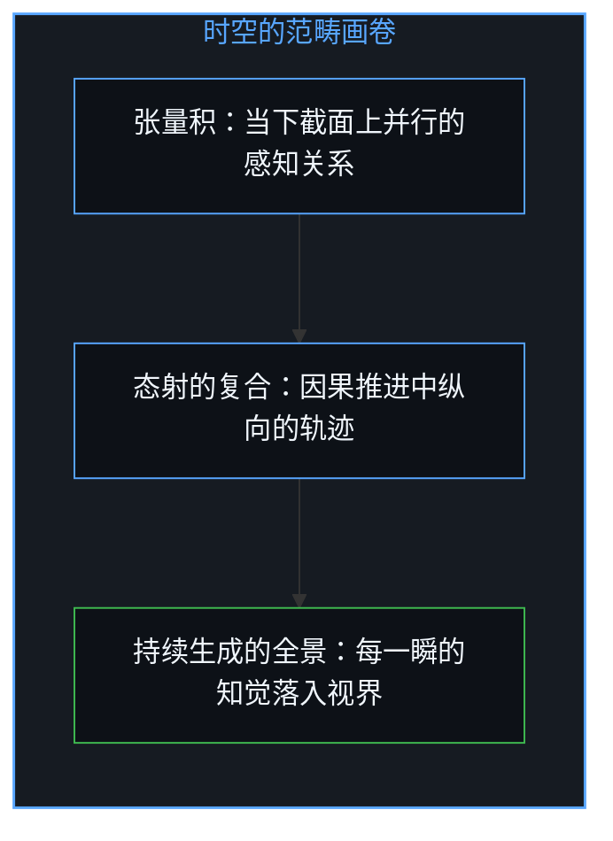

The distribution of free variables that a Mind experiences is not a set of parameters fixed once at some beginning; it falls into view at each instant with present perception. The cognition and choice of one instant settle into the initial conditions and background of the next; with relations spread in parallel across tensor space and causality integrated lengthwise in the composition of morphisms, the panorama of reality goes on being generated.

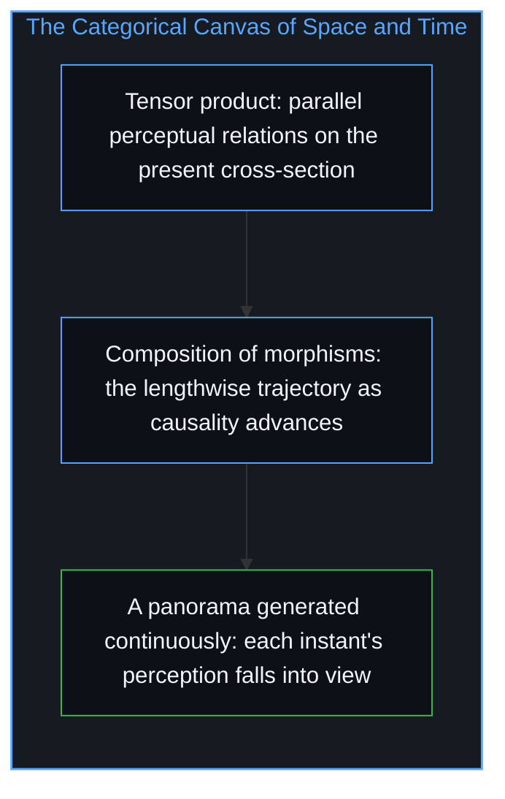

## 二、 米田引理与只看一面的视差 / 2. The Yoneda Lemma and the One-Sided Gaze

米田引理给出一个有启发的同构：在范畴的网络里，没有对象是孤立自足的，一个对象的性质可以由它与其他一切对象之间的全部态射（外部的补集 A^⟂）刻画。这条定理的用处是明确的，它使朴素的实体论站不住。

The Yoneda lemma gives a suggestive isomorphism: in the network of a category no object is isolated and self-sufficient, and the properties of an object can be characterized by all of its morphisms to and from every other object (the external complement A^⟂). The use of the theorem is plain: it leaves naive substance theory without footing.

结构主义把它推到“对象本身没有内在的身份，只是外部关系网络的否定性定义”时，到了边界。这个断言同样只看一面：注意力翻向外面，落在外部的关系网络 A^⟂ 上；硬币的另一面，那个正在发起态射、划定切分、作出抉择的第一人称原点 A，被忘掉了。把身份只归为外部集合的否定镜像，是留下网而抹去结点的能动，活的观察者成了关系网里一个被动的交汇点。

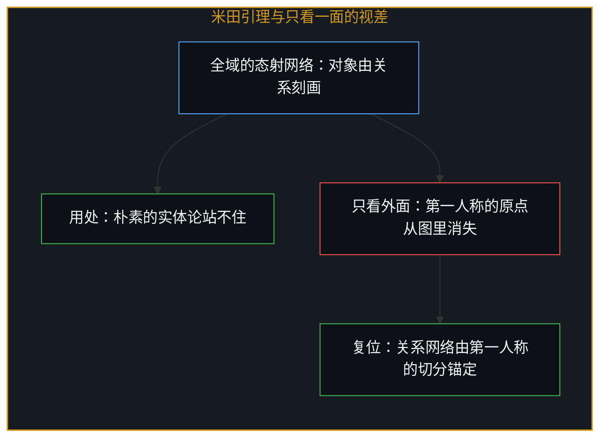

When structuralism pushes it to "an object has no inner identity of its own and is only the negative definition of an external web of relations," it reaches its boundary. The assertion likewise looks at one side only: attention is turned outward and rests on the external web of relations A^⟂; the other side of the coin, the first-person origin A that is initiating morphisms, drawing the cut and making choices, is forgotten. To assign identity only to the negative mirror of an external collection is to keep the web and erase the agency of the node, and the living observer becomes a passive crossing-point in a web of relations.

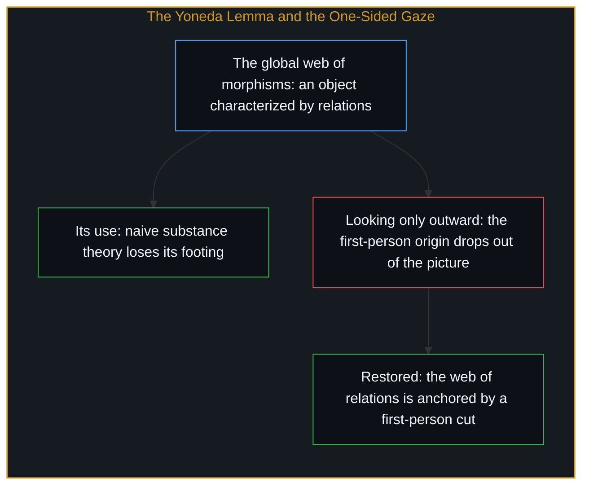

## 三、 切分的正像与负像 / 3. The Positive and Negative Image of a Cut

微观的不确定与第一人称的自由抉择是同一枚因果硬币的两面，认清这一点，认知的几何就完整了。[主权抉择的双面性与观察的客体化](../the-two-sided-nature-of-sovereign-choice-and-the-objectification-of-observation/)从内与外两侧追过这枚硬币。

Microscopic indeterminacy and first-person free choice are two sides of one coin of causality, and with this seen the geometry of cognition is complete. [The Two-Sided Nature of Sovereign Choice and the Objectification of Observation](../the-two-sided-nature-of-sovereign-choice-and-the-objectification-of-observation/) has followed this coin from its inner and its outer side.

认知的原初动作，是心智在未分的场里划下一道切分，[割点可移不可除](../the-cut-moves-but-never-vanishes/)说明这道切分可以移动而不会消失。切分先雕出局域的正像 A：为在自己生成的全景地图里导航，心智把自己的抉择投影为一个局域的自我意象。同一瞬间生成负像 A^⟂：正像的轮廓被剪出时，感知画布上余下的广阔背景，外部的宇宙、物理规律与他者，成了自身在自身之内留下的负像。

The original act of cognition is a Mind drawing a cut in an undivided field, and [The Cut Moves but Never Vanishes](../the-cut-moves-but-never-vanishes/) shows that this cut can be moved and does not disappear. The cut first carves a local positive image A: in order to navigate within the panoramic map it has generated, a Mind projects its own choice as a local self-image. In the same instant the negative image A^⟂ is generated: when the outline of the positive image is cut out, the wide background left on the canvas of perception, the outer cosmos, physical law and others, becomes the negative image of the self left within the self.

正像的抉择与负像的不确定场，同属一个感知的基质。正面不否定反面，反面不夺走正面的立足点；两者的共存不是妥协，是硬币得以成立的几何前提。切分的边界 ∂A = ∂A^⟂ 同时带着两面的全部信息。

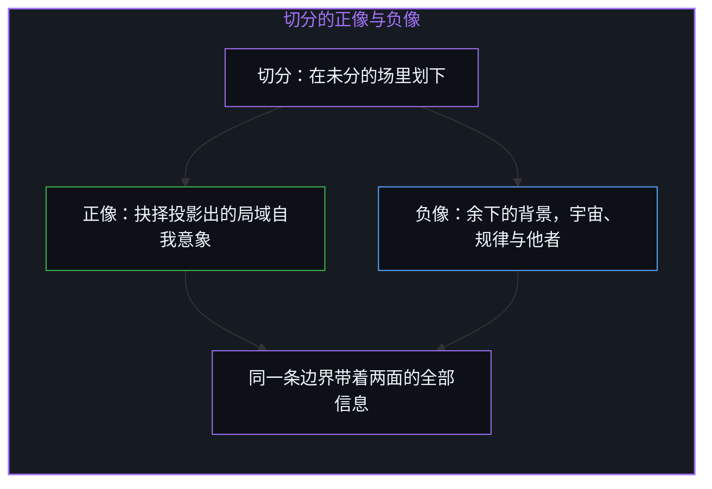

The choice of the positive image and the field of indeterminacy of the negative image belong to one perceptual substrate. The obverse does not negate the reverse, and the reverse does not take away the footing of the obverse; their coexistence is not a compromise but the geometric condition under which there is a coin at all. The boundary of the cut, ∂A = ∂A^⟂, carries the full information of both sides at once.

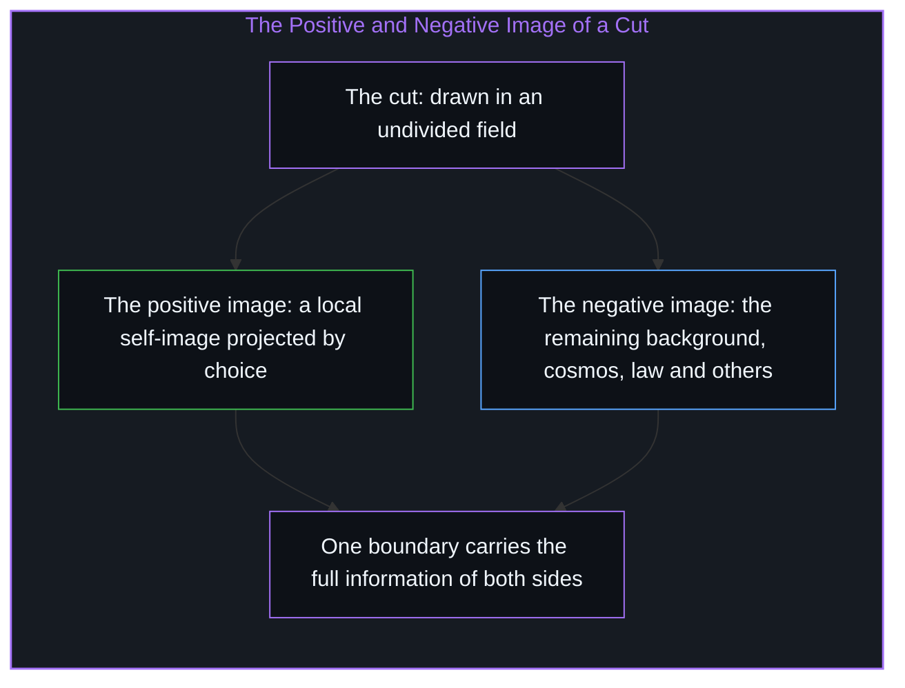

## 四、 抽去抉择之后的统计与三种关系 / 4. Statistics with Choice Removed and Three Relations

以因果的两面为准，各种范式的边界可以很快看出。认知模型里若抽去作为第一人称抉择（+1）的经验，现实的流形在数学上便降为单一的统计聚合。还原论的物理学在它的范围内算得极准；它以为找到了一个“不需要意识的客观宇宙”，是因为建立方程之初就抹去了第一人称的原点，账本里于是只剩被观测留下的统计残差与均值。

With the two sides of causality as the measure, the boundaries of various paradigms can be seen quickly. If the experience that is first-person choice (+1) is taken out of a model of cognition, the manifold of reality reduces mathematically to a single statistical aggregate. Reductionist physics computes with great accuracy within its range; it takes itself to have found an "objective universe that needs no consciousness" because the first-person origin was erased when the equations were first set up, so that the ledger holds only the statistical residue and the means that observation leaves.

设想张量画卷上有两个独立的自由变量 X 与 Y。从外面作统计抽样，两者的交互显得不确定；样本量足够大时（N → ∞），统计规律与正态分布出现，忘了内在原点的观察者由此得出“一切是随机噪声或机械的统计规律”。从每个变量自己的第一人称原点去看，统计分布底下是两个变量在微观上选取的三种关系。

Picture two independent free variables X and Y on the tensor canvas. Sampled statistically from outside, their interaction appears indeterminate; when the sample is large enough (N → ∞), statistical regularity and the normal distribution appear, and an observer who has forgotten the inner origin concludes that "everything is random noise or mechanical statistical law." Seen from each variable's own first-person origin, beneath the statistical distribution are three relations that the two variables take up at the microscopic level.

第一种是相互归咎，双向死锁：两个变量都把自己的困境归给对方，像两个孩子互指对方的错。双方都放下了自己的因果主权，边界硬化为对峙的前线，结果是都停下来；若起冲突，双方的活动力、创造的潜能与总的信息量一同萎缩。第二种是单向归咎：一方把问题归给另一方，另一方承担损耗并专注于自己的提升。归咎的一方放下了自己的演化，成了对方与整个耦合系统的拖拽；自我提升的一方在前行，同时背着单向的摩擦。第三种是双向的主权：两个变量都保有自己的第一人称主权（+1），各自对自己坐标的演进承担因果的责任，不向外归咎，也不固化防线，在张量场 X ⊗ Y 里共存并前行。系统的拖拽降到零，两者各自独立而并行地生长。

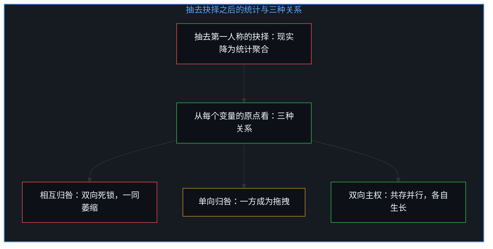

The first is mutual blame and deadlock on both sides: each variable assigns its own difficulty to the other, like two children each pointing to the other's fault. Both set down their own causal sovereignty, the boundary hardens into a front of confrontation, and the result is that both stop; if conflict breaks out, the activity, the creative potential and the total information of both shrink together. The second is blame in one direction: one side assigns its problem to the other, and the other bears the loss and attends to its own improvement. The blaming side sets down its own evolution and becomes a drag on the other and on the whole coupled system; the side that improves itself moves forward while carrying friction that runs one way. The third is sovereignty on both sides: both variables keep their own first-person sovereignty (+1), each answering causally for the evolution of its own coordinates, neither assigning blame outward nor hardening a line of defense, coexisting and moving forward in the tensor field X ⊗ Y. The drag of the system falls to zero, and the two grow independently and in parallel.

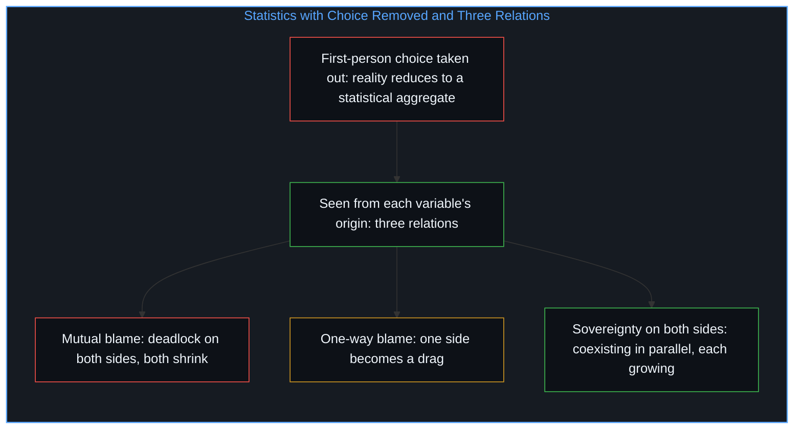

## 五、 外抛的能动性与体制 / 5. Agency Thrown Outward and Institutions

由这层微观机制可以得到一个关于社会结构的几何诊断：把自己的因果能动外抛，归给任何外在的客体，他者、环境、运气或历史，是个体停滞与系统整体拖拽的来处。

From this microscopic mechanism a geometric diagnosis of social structure follows: throwing one's own causal agency outward, assigning it to any external object, another person, the environment, luck or history, is where the stalling of the individual and the drag on the whole system come from.

大量个体把主权外抛时，无数微观的归咎与摩擦在群体的层面汇聚，沉淀为庞大的统计均值。规则、官僚体制、法律与道德的条文在协调个人之间的行动上有用；它们同时是这种累积的拖拽留下的印记：归咎带来的死锁与冲突，要靠外在的代偿支架来维持平衡。宏观的规则不是高于主权的天然秩序，它是微观主权缺位之后的外部代偿。

When a great many individuals throw sovereignty outward, countless microscopic acts of blame and friction gather at the level of the group and settle into a vast statistical mean. Rules, bureaucracy, law and moral codes are useful in coordinating actions among individuals; they are at the same time the mark left by this accumulated drag: the deadlock and conflict that blame brings have to be held in balance by an external compensating scaffold. Macroscopic rules are not a natural order above sovereignty; they are the outside compensation that follows when sovereignty is absent at the microscopic level.

同一个视角照出谈话与研究里一个常见的动作，第三人称旁观者的“解释消解”。从旁观的位置看他人的选择，取不到当事人在抉择那一瞬（t）的内在经验，看得到的只有行为的外部轨迹与统计的均值。于是一个听来合理的宏观概括被拿来用：“这只是社会环境的塑造”“这属于某种心理偏差”“这在统计上是必然的”，或者一句“这是在乞题”，当事人的抉择由此被抹去。每一个第一人称的抉择，在作出的那一刻，在当事人自己的坐标系里有它成立的理由。用宏观的趋势去消解微观的抉择，是把能动性外抛给一个抽象外壳的又一次重演；宏观的统计趋势不是微观抉择的原因，它是大量抉择在外面留下的投影。

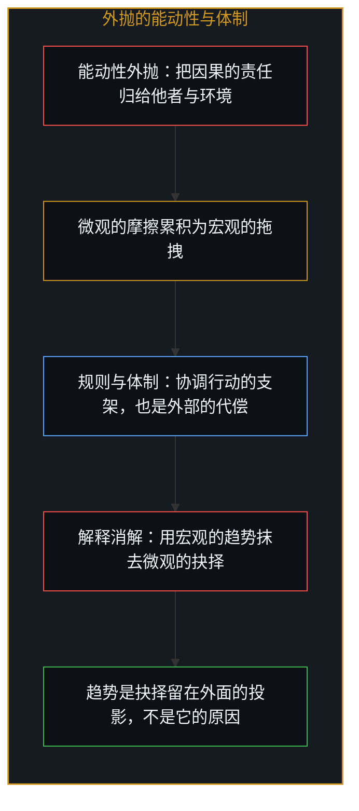

The same view lights up a common move in conversation and research, the third-person bystander's "explaining away." From the bystander's position, another's choice is seen without access to the inner experience of the one choosing at the instant of choice (t); what can be seen is only the outer trajectory of behavior and the statistical mean. A macroscopic generalization that sounds reasonable is then taken up: "this is only the shaping of the social environment," "this is a kind of psychological bias," "this is statistically inevitable," or the phrase "this is begging the question," and the choice of the one concerned is erased by it. Each first-person choice, at the moment it is made, has its valid reasons within the coordinate system of the one who makes it. To dissolve a microscopic choice with a macroscopic trend is one more replay of throwing agency outward onto an abstract shell; the macroscopic statistical trend is not the cause of the microscopic choice but the projection that a great many choices leave outside.

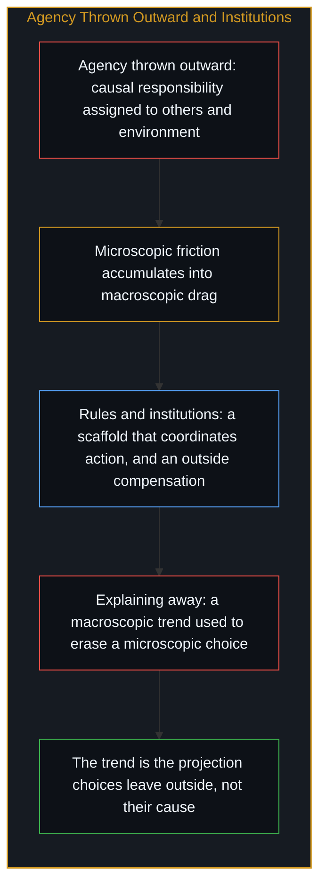

## 六、 一面不是另一面的否定 / 6. One Side Is Not the Negation of the Other

物理学、质量、惯性与力学的规律，在日常认知与还原论的模型里被当作不可动摇的基石。从因果的几何看，物理规律与质量是底层的因果与因果反馈环随时间的序贯（∘）持续演化、收敛之后沉淀出的宏观不变量。质量显出的“惯性阻力”，是大量微观因果闭环在长时间尺度上达到动态平衡后维持的局部守恒；力学的规律性，是因果反馈网络在宏观投影上的稳定。[当电子开始思考](../when-electrons-think/)把宏观的确定追溯为自由变量在慢速中沉淀的统计。以“物理规律”代替因果反馈作为解释的起点，是倒果为因。

Physics, mass, inertia and the laws of mechanics are taken, in everyday cognition and in reductionist models, as an unshakeable foundation. Seen from the geometry of causality, physical law and mass are the macroscopic invariants that settle out after the underlying causality and its feedback loops have gone on evolving and converging through the sequence of time (∘). The "inertial resistance" that mass shows is the local conservation maintained once a great many microscopic causal loops have reached dynamic balance over a long timescale; the regularity of mechanics is the stability of the network of causal feedback in its macroscopic projection. [When Electrons Think](../when-electrons-think/) traces macroscopic determinism to the statistics of free variables settled into slowness. To put "physical law" in the place of causal feedback as the starting point of explanation is to take the effect for the cause.

传统理论的视差，在于把宏观的统计聚合与外部的规则 A^⟂ 当作对微观抉择 A 的否定。唯物的决定论说：宏观的聚合上观测到统计规律与守恒，所以第一人称的抉择是错觉。朴素的二元论说：切身经验到抉择，所以意识是游离于物理世界之外的幽灵。激进的结构主义停在向外的态射集合上，以关系网络替代主体的原点。三者出自同一步：把硬币的一面判为对另一面的否定（A ∧ ¬A = ⊥）。

The parallax of traditional theories lies in taking the macroscopic statistical aggregate and the external rules A^⟂ as the negation of the microscopic choice A. Materialist determinism says: statistical regularity and conservation are observed in the macroscopic aggregate, so first-person choice is an illusion. Naive dualism says: choice is experienced directly, so consciousness is a ghost adrift outside the physical world. Radical structuralism stops at the outward collection of morphisms and puts the web of relations in the place of the subject's origin. The three come from one step: judging one side of the coin to be the negation of the other (A ∧ ¬A = ⊥).

统计规律不是抉择的对头，它是无数抉择在张量空间（⊗）与时间的序贯（∘）里向外展开时沉淀的集体负像。范畴量子力学给出同样的完备性：在态空间里，正交补态与原初态共同张成恒等算符，|0⟩⟨0| + |1⟩⟨1| = I。正负两面是信息完备上的共轭，不是相互消灭的关系。在双海廷拓扑斯里，一个元素的边界 ∂a = a ∧ ∼a（∼ 为余海廷否定）不必为零；非零的边界表明，矛盾不是待清除的系统错误，它是维系两面共存、驱动系统继续演化的几何属性。

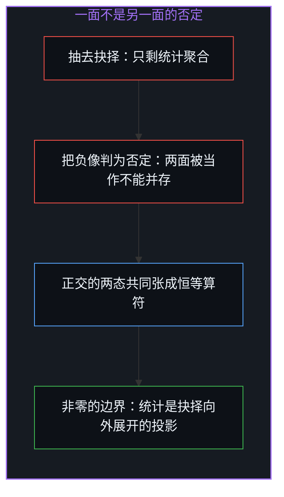

Statistical law is not the opponent of choice; it is the collective negative image that settles as countless choices unfold outward in tensor space (⊗) and in the sequence of time (∘). Categorical quantum mechanics gives the same completeness: in a state space, the orthogonal complement and the original state together span the identity operator, |0⟩⟨0| + |1⟩⟨1| = I. The positive and negative sides are conjugates in the completeness of information, not parties that destroy each other. In a bi-Heyting topos the boundary of an element, ∂a = a ∧ ∼a with ∼ the co-Heyting negation, need not be zero; the non-zero boundary shows that contradiction is not a system error to be cleared away; it is the geometric property that keeps the two sides coexisting and drives the system to go on evolving.

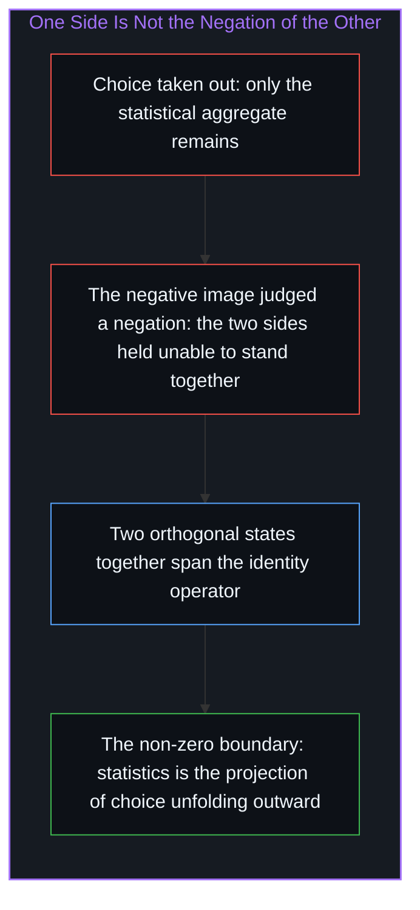

## 七、 距离遗忘与追逐影子 / 7. Distance Amnesia and Chasing the Shadow

心智沉在抽离观察的假象里、忘了自己是划下切分的第一人称原点时，视差生出一个困局，[距离的幻觉与尺度的双向投影](../the-illusion-of-distance-and-the-dual-ruler/)追溯过这种距离的幻觉。从拓扑的结构看，所见的整个世界是心智自身之内的感知场，“自我形象”是心智在这个场里的投射。心智在自身与外部世界之间划下的边界，像一面双向的镜子：向外映出宇宙，向内折出局域的自我虚像。这个自我形象在拓扑上像是嵌在世界“之内”，它其实是感知画卷翻到另一面的投影。

When a Mind sinks into the appearance of detached observation and forgets that it is the first-person origin that drew the cut, parallax produces a predicament, and [The Illusion of Distance and the Dual Projections of the Ruler](../the-illusion-of-distance-and-the-dual-ruler/) has traced this illusion of distance. Seen in its topological structure, the whole world that is seen is the perceptual field within the Mind itself, and the "self-image" is the Mind's projection within that field. The boundary a Mind draws between itself and the outer world is like a two-way mirror: outward it reflects the cosmos, inward it throws a local virtual image of the self. Topologically this self-image seems nested "inside" the world, and it is in fact the projection of the perceptual canvas turned to its other side.

注意力全落在这个自我形象上时，心智是在追自己的影子。这像硬币的一面要转过身去追另一面：每翻一次去看反面，正面已先走了一步，每一次回头看到的是上一瞬留下的残影，由此生出“外在世界与自我形象总在前面”的滞后感。忘了自己正是翻硬币的原点，心智便陷在不停的翻转里，不断拉锯，原地未动。在这种状态下作出的每一个“新区分”，都是在为上一次切分的匮乏、恐惧或漏洞打补丁；区分都成了防御性的代偿，能量耗尽而没有维度上的生长。

When attention rests wholly on this self-image, the Mind is chasing its own shadow. It is like one side of a coin turning round to catch the other: each time the coin is flipped to look at the reverse, the obverse has already moved a step ahead, and each look back sees the afterimage left by the previous instant, from which comes the sense of lag that "the outer world and the self-image are always ahead." Having forgotten that it is the origin flipping the coin, the Mind is caught in ceaseless flipping, back and forth without moving from the spot. Every "new distinction" made in this state is a patch for the lack, the fear or the gap of the previous cut; distinctions all become defensive compensation, and energy is used up with no growth in dimension.

在距离遗忘之下，切分的边界有三种动力学的状态。其一是中和与双向的湮灭：正像的自我以排他与压制去抹除外部的负像；对外部世界与他者这个自身的负像的每一次攻击与中和，在数学上都直接削减心智自身之内的总信息量与维度的容量（I = A + A^⟂ → 0）。抹去负像等于磨掉硬币的反面，正像失去对照与分辨率，整个流形坍缩为单调。其二是对抗与死锁：对抗没有带来即时的湮灭时，边界硬化为隔离的墙，大量的认知与能量耗在对自身负像的戒备与拉锯上，未知的差异都被判为威胁，演化停滞。其三是共存与接纳新的区分：心智接纳非零边界上的动态共存时，死锁被打开。作出新的区分，是允许新的区分落入感知而不把它判为威胁或敌人；在共存的前提下接纳并生成新的区分、扩展总的信息量与维度，就是自我生长在数学上的含义。

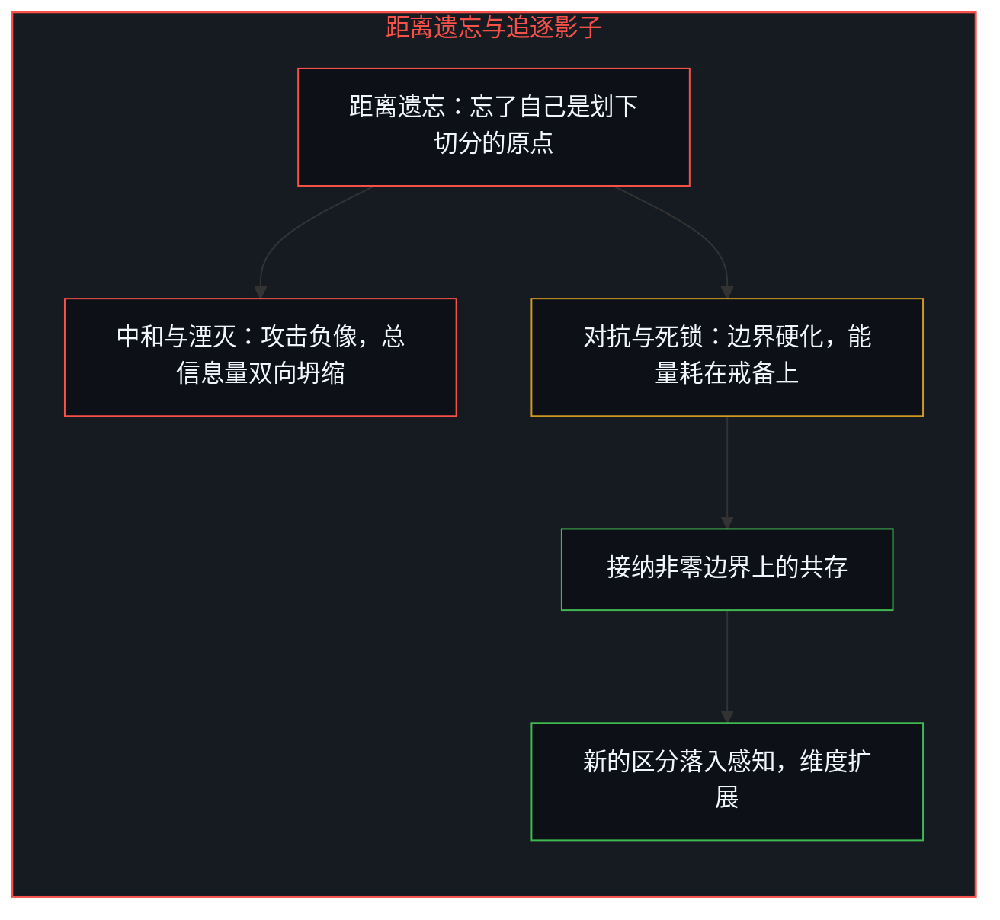

Under distance amnesia the boundary of the cut has three dynamical states. The first is neutralization and annihilation on both sides: the positive self tries to erase the outer negative image by exclusion and suppression; each attack on, and neutralization of, the outer world and others, which are the self's own negative image, directly reduces, mathematically, the total information and the dimensional capacity within the Mind itself (I = A + A^⟂ → 0). To erase the negative image is to grind away the reverse of the coin; the positive image loses contrast and resolution, and the whole manifold collapses into monotony. The second is confrontation and deadlock: when confrontation does not bring immediate annihilation, the boundary hardens into a wall of separation, a great deal of cognition and energy is spent on guarding against and wrestling with the self's own negative image, every unknown difference is judged a threat, and evolution stalls. The third is coexistence and taking in new distinctions: when a Mind accepts dynamic coexistence on a non-zero boundary, the deadlock opens. To make a new distinction is to allow a new distinction to fall into perception without judging it a threat or an enemy; taking in and generating new distinctions on the condition of coexistence, and so extending total information and dimension, is what self-growth means mathematically.

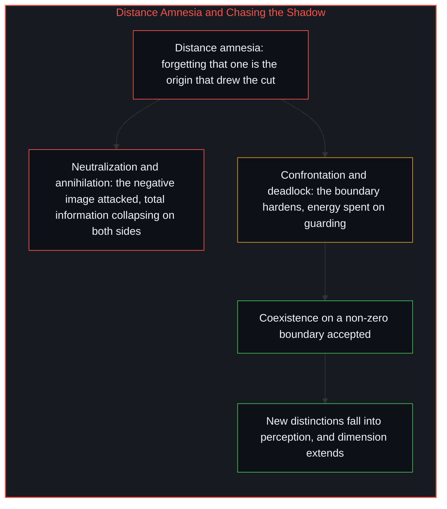

## 八、 回到当下的原点 / 8. Returning to the Present Origin

消解生存上的恐惧、边界的死锁与代偿的空转，路径是回到第一人称的原点，立足于当下正在知觉的那一个（+1）。不再凝视镜中的自我虚像、不再追逐影子的时候，动力学换了一种：作出新的区分不再是防御性的修补，它是自主的、创生的自我表达；新的微观与宏观的差异被允许落入知觉的场，整合为内在坐标系里更多的维度。

The way to dissolve existential fear, deadlock at the boundary and the idling of compensation is to return to the first-person origin and stand in the one that is perceiving in the present (+1). When the virtual image of the self in the mirror is no longer gazed at and the shadow no longer chased, the dynamics change: making a new distinction is no longer a defensive repair but autonomous, generative self-expression; new microscopic and macroscopic differences are allowed to fall into the field of perception and are integrated as further dimensions of the inner coordinate system.

人的存在是一个多维的流形，横跨认知、创造、情感、行动与意义。在每一个维度上，演进的轨迹取决于注意力锚在哪里。在任何一个维度上，注意力立足于自身的原点、对自己坐标的演进承担第一人称的因果责任时，心智在这个维度上接纳新的区分，扩展分辨率，持续地生长。注意力从原点移开，落到自我形象的虚荣与焦虑上，或者把能动性外抛给环境与他者时，这个维度上便是边界的死锁与代偿的空转，演进停下，此前积累的生长也会被消解。

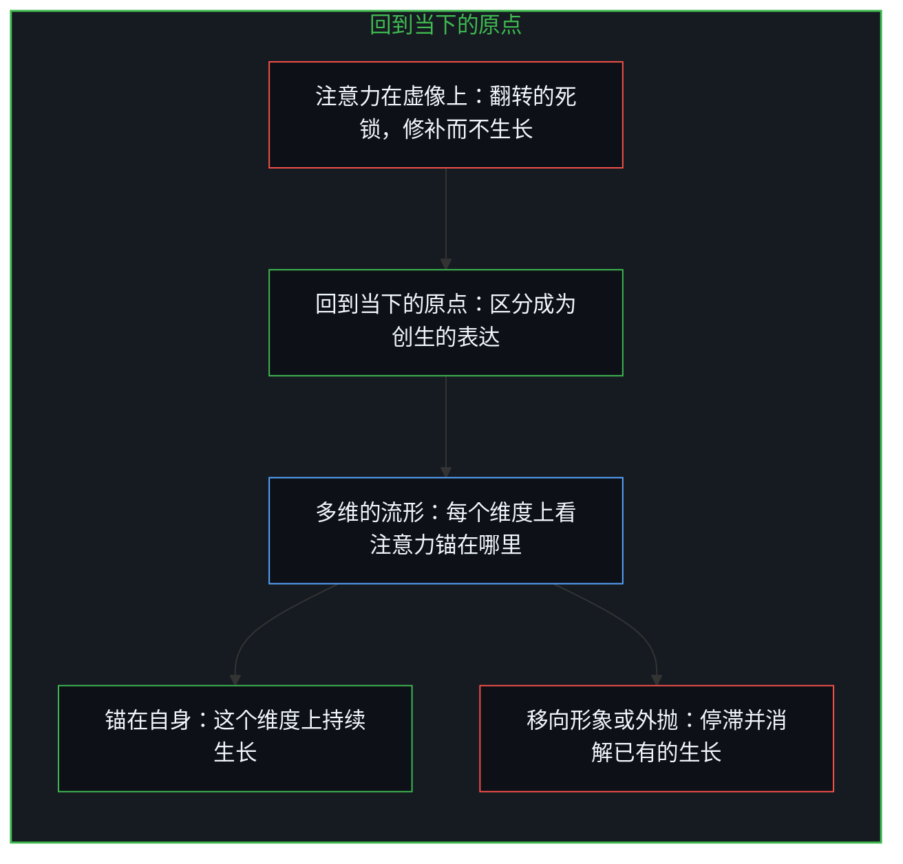

Human existence is a manifold of many dimensions, spanning cognition, creation, feeling, action and meaning. On each dimension the trajectory of evolution depends on where attention is anchored. On any one dimension, when attention stands at its own origin and first-person causal responsibility is taken for the evolution of one's own coordinates, a Mind takes in new distinctions on that dimension, extends its resolution and goes on growing. When attention moves away from the origin, onto the vanity and anxiety of the self-image, or when agency is thrown outward onto the environment and others, that dimension has deadlock at the boundary and the idling of compensation; evolution stops, and growth accumulated before is also undone.

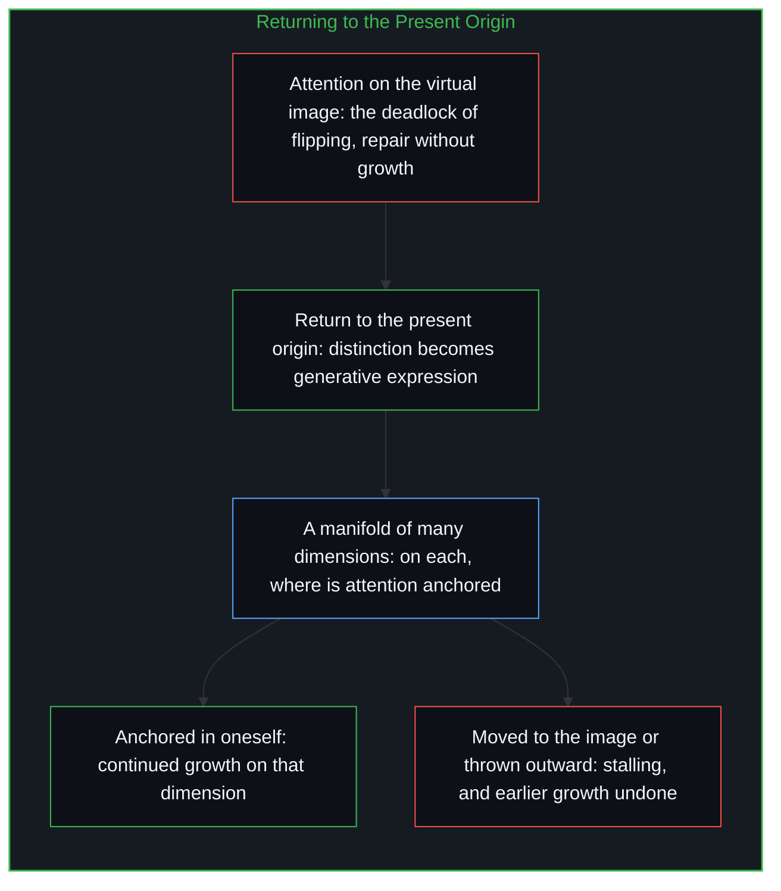

## 九、 向外看即是表达 / 9. Looking Outward Is Expression

采取某个视角去看外界的一个客体，或把另一个人看作外部的对象时，所见的是心智走过另一条自我表达的轨迹时呈现的统计显化。向外看到的世界与他者，不是与自身隔绝的异己之物；向外看的同时，心智是在辨认自我表达的不同路径，由此展开自己的表达。这里说的是被观察到的他者，它在这个心智的感知场之内；由相似推知的他者，是另一个划下自己切分的心智，两者不是一回事。

When a perspective is taken on an object in the outer world, or another person is regarded as an external object, what is seen is the statistical showing of a Mind passing along another trajectory of self-expression. The world and the others seen outward are not alien things cut off from oneself; in looking outward, a Mind is making out the different paths of self-expression and thereby unfolding its own. What is spoken of here is the other as observed, which is within this Mind's perceptual field; the other as inferred from similarity is another Mind drawing its own cut, and the two are not the same thing.

在由非零边界构成的共存的几何里，正像与负像是不可分的共轭。心智作出的每一个抉择、接纳并划下的每一道区分，给自我以清晰的轮廓，同时给相伴而生的负像世界以深度。充实外部世界的多样，就是扩展自身之内的总信息量与创造的潜能。

In the geometry of coexistence formed by non-zero boundaries, the positive and the negative image are inseparable conjugates. Each choice a Mind makes, and each distinction it takes in and draws, gives the self a clear outline and at the same time gives depth to the world of the negative image that arises with it. To enrich the diversity of the outer world is to extend the total information and creative potential within oneself.

不以消灭负像求安全，不筑防线而陷于死锁，心智留在共存的张力里。注意力锚在当下的第一人称上，每一次感知的出现都成为演进的机会；自我与世界在每一瞬的交织里一同生长。

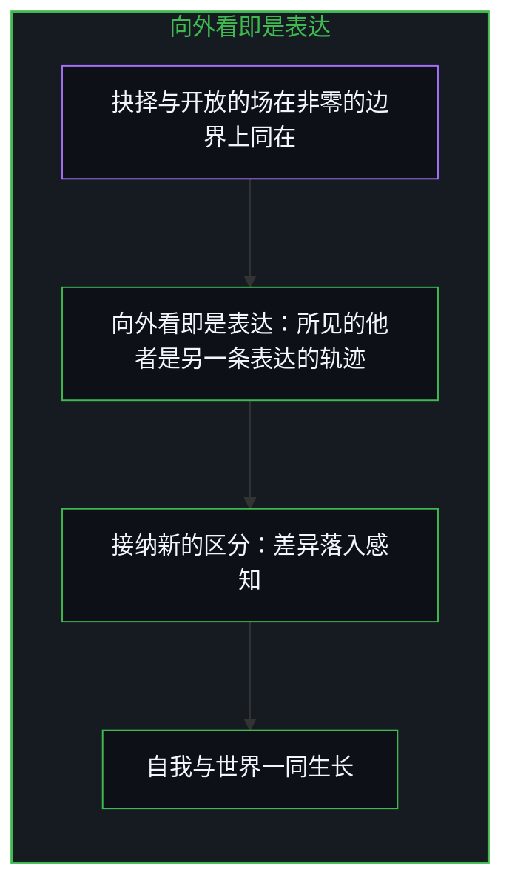

Without seeking safety by destroying the negative image, and without building a line of defense and falling into deadlock, a Mind stays within the tension of coexistence. With attention anchored in the first person of the present, each arising of perception becomes an occasion for evolution; self and world grow together in the interweaving of each instant.

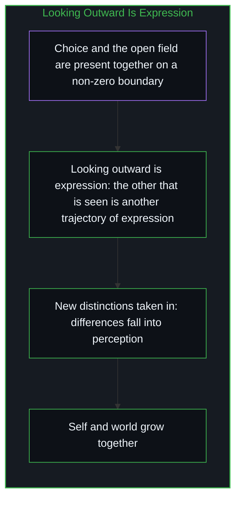
