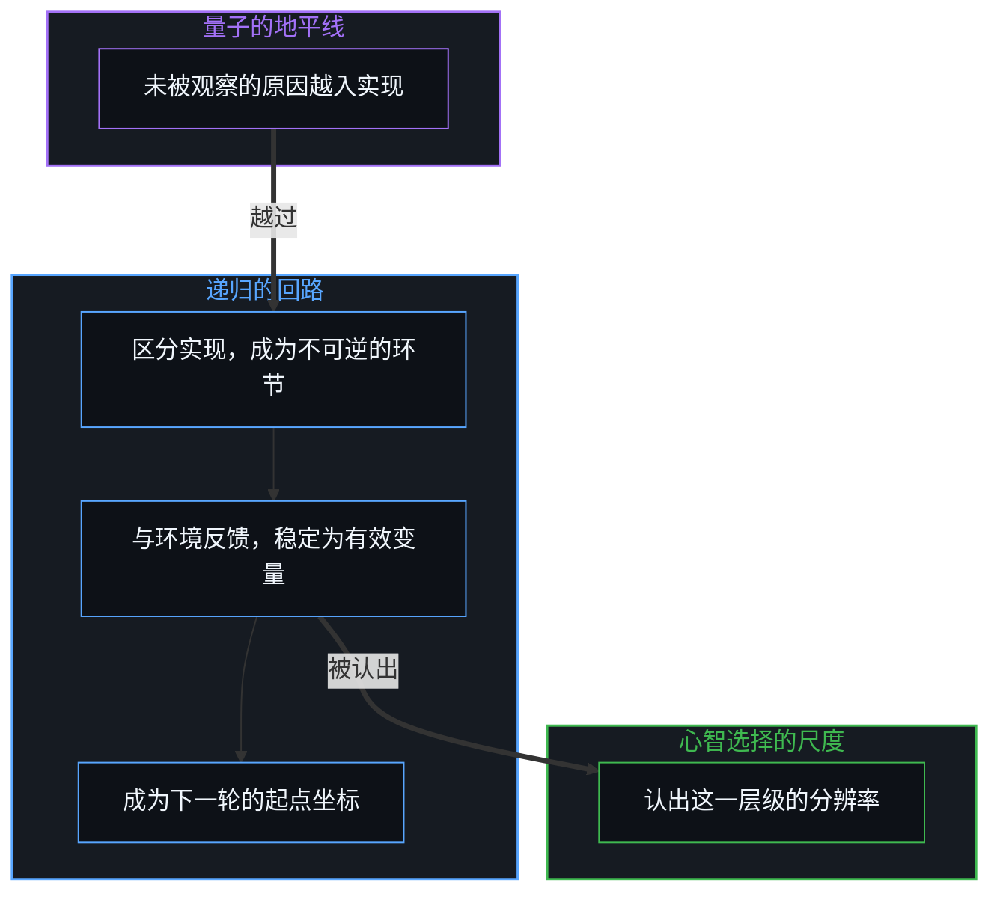
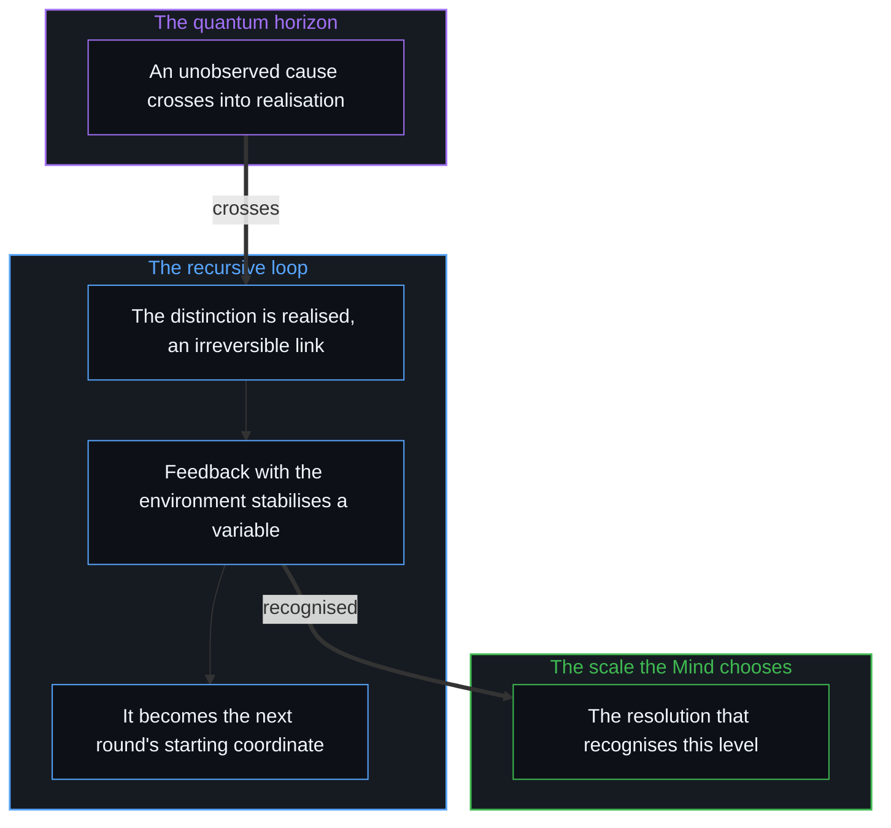

# 涌现的几何学 / The Geometry of Emergence

*涌现是不可观察者变为可观察者的过渡，与心智对分辨率的选择相耦合 / Emergence is the unobservable becoming observable, coupled with the Mind's choice of resolution.*

“涌现”常被搬出来，好像这个词本身就解释了复杂的模式。在物理与哲学的讨论里，一个模式在更大的尺度上出现，涌现就被当作生成它的原因。然而正如[复杂性遮蔽了涌现之为心智的行动](../complexity-obscures-emergence-as-the-act-of-mind/)所追溯的，涌现说的却是一个结果：被叫作涌现的，是不可观察者变为可观察者的那一次过渡，而它总与观察的心智对尺度的主动选择相耦合。

"Emergence" is often brought out as if the word itself explained complex patterns. In physical and philosophical discussion, a pattern appears at a larger scale and emergence is offered as the cause that generated it. Yet as [Complexity Obscures Emergence as the Act of Mind](../complexity-obscures-emergence-as-the-act-of-mind/) traces, emergence names a result: what is called emergence is the crossing where the unobservable becomes observable, and it is always coupled with the observing Mind's active choice of scale.

沿着一层层复杂性向下追原因，遇到的是一条不断开的链。一个社会是个体行动者的结构化构型，一个细胞是分子级联的精细构型，一个有意识的念头是神经转换的特定构型。如果下层的因果链由已经实现的东西决定，上层的描述也同样被决定。改变观察的粒度，是有意识地画一条新的边界：选择把哪些微观的变化整合为背景的不变量，把哪些宏观的规律提到焦点上来。一个确定的过程，换到更宽的宏观状态上重新描述，仍然是确定的。

Chasing causes downward through layer after layer of complexity meets an unbroken chain. A society is a structured configuration of individual agents, a cell an intricate configuration of molecular cascades, a conscious thought a specific configuration of neural transitions. If the lower causal chain is determined by what has already been realised, the higher-level description is determined just as much. Changing the grain of observation is a conscious act of drawing a new boundary: choosing which micro-variations to integrate as background invariants and which macroscopic regularities to bring into focus. A determined process stays determined when redescribed over wider macro-states.

## 一、 量子的地平线 / 1. The Quantum Horizon

因果的回溯在一个独立变量出现的地方到了边界：量子的地平线。在这里，一个结果相对于已经实现的历史链是敞开的。一个未被观察的原因在越入实现之前，是不可观察的潜能；越过的那一刻，它就成为路径依赖的记录中一个可观察的、不可逆的环节。一个实现了的区分与环境相互作用，形成循环的反馈回路，稳定为一个有效的宏观变量；每一个后续的反馈回路都造出一个新的抽象层级，而这个层级能否被认出，取决于观察的心智选了哪一个分辨率的尺度。

Causal regress reaches its boundary where an independent variable appears: the quantum horizon. Here an outcome is open relative to the historical chain already realised. Before an unobserved cause crosses into realisation it is unobservable potential; the moment it crosses, it becomes an observable, irreversible link in the path-dependent record. A realised distinction interacts with its environment, forms circular feedback loops and stabilises into an effective macroscopic variable; each later feedback loop creates a new level of abstraction, and whether that level is recognised depends on which scale of resolution the observing Mind has chosen.

量子的边界是因果织物的活的前沿，是未被观察的因果越入感知、结晶为一个离散区分的那个活的光圈。这条边界登记在哪里，本身就是心智做出的选择，[割点可移不可除](../the-cut-moves-but-never-vanishes/)追溯的正是这一点。把切分的几个方向实体化，就会把这种几何变成形而上学，[切分的三重影子](../the-three-shadows-of-the-cut/)展示了这一步。

The quantum boundary is the living frontier of the causal fabric, the living aperture where unobserved causality crosses into perception and crystallises as a discrete distinction. Where that boundary registers is itself a choice made by the Mind, as [The Cut Moves but Never Vanishes](../the-cut-moves-but-never-vanishes/) traces. Hypostatising the directions of the cut turns this geometry into metaphysics, the step shown in [The Three Shadows of the Cut](../the-three-shadows-of-the-cut/).

## 二、 递归的生成者与经验的清单 / 2. The Recursive Generator and the Empirical Catalogue

对涌现的解释，就是那个递归的生成者。理解一个递归过程，需要的是生成规则，而不是每一个已实现状态的穷尽清单。数学里的后继规则生成全部整数，用不着事先把每一个大数都算出来；在物理世界里，区分、实现与反馈这个递归回路，生成宏观的物质、生命与制度结构。要求从最初的那一刻起，把每一个历史结构都明明白白地展开成一份清单，是把一条递归的生成原则误认成了一本穷尽的历史账簿。不同的宏观层级在自由度与内部约束上各不相同，生成的操作在每一个尺度上都不变。

The explanation of emergence is the recursive generator. Understanding a recursive process takes the generating rule, not an exhaustive inventory of every realised state. In mathematics the successor rule generates every integer without calculating each large number in advance; in physical reality the recursive loop of distinction, realisation and feedback generates macroscopic matter, life and institutional structure. Demanding that every historical structure since the first moment be unrolled into an explicit catalogue mistakes a recursive generating principle for an exhaustive historical ledger. Macroscopic levels differ in their degrees of freedom and internal constraints, while the generating operation stays the same at every scale.

量子力学标出的是因果链活的前沿，而不是一块纯随机的形而上地板。未被观察的原因在越过观察的地平线之前，相对于已经实现的序列是自由的；越过的那一刻，它结晶为一个可测量的区分。最初的涌现就是这次越过本身：因果链的边界伸进敞开的地平线，一个新的区分对着先前痕迹的背景被划出，得到的状态成为后续递归操作的起点坐标，[另一种相干](../the-other-coherence/)与[宏观现象的生成图谱](../the-generative-atlas-of-macroscopic-phenomena/)都从这里推出。

Quantum mechanics marks the living frontier of the causal chain, not a metaphysical floor of sheer randomness. Before an unobserved cause crosses the observational horizon it is free relative to the sequence already realised; the moment it crosses, it crystallises into a measurable distinction. The first emergence is this crossing itself: the boundary of the causal chain extends into the open horizon, a fresh distinction is drawn against the background of prior traces, and the resulting state becomes the starting coordinate for later recursive operations, as both [The Other Coherence](../the-other-coherence/) and [The Generative Atlas of Macroscopic Phenomena](../the-generative-atlas-of-macroscopic-phenomena/) derive.

## 三、 观察者的两面 / 3. The Observer's Two Faces

这一次因果的越过本身带着观察者的两面。从场的第一人称内部直接经历、直接感到，它是意识；从内部经历为历史实现之前的一个敞开的选择，它是自由意志；从第三人称的外部记下，同一次越过是敞开的潜能塌缩为一个已实现的状态，即量子的落定。心智把自由变量注入这一步，被观察到的就是量子的不确定；二者是同一件事的两面，哪一面在先，用言语说不清，从第一人称去体会。

This one causal crossing carries the observer's two faces. Directly undergone and felt from the first-person inside of the field, it is consciousness; lived from inside as an open choice before historical realisation, it is free will; recorded from the third-person outside, the same crossing is open potential collapsing into a realised state, quantum resolution. The Mind injects the free variable into the step, and what is observed is quantum indeterminacy; the two are faces of one thing, and which comes first is not something words settle, only something sensed from the first person.

在这个统一的几何里，心智与意识的区分也清楚了。心智持有一片已经在起作用的区分之场，包括累积的历史痕迹、稳定下来的模型与记忆的结构——无论是内部的召回，还是像[你的代码库即是记忆](../your-codebase-is-memory/)所考察的那样外化为持久的存储库；意识则是这片场的移动前沿，是下一个未被观察的原因变得可及、进入感知的那个活的光圈，也是心智做出切分的地方。场由已经结晶的区分组成，意识是现实继续展开的那条活的前沿。

Within this one geometry the distinction between Mind and consciousness becomes clear as well. The Mind holds a field of distinctions already in play, accumulated historical traces, stabilised models and structures of memory—extending across both internal recall and the durable externalised repositories that [Your Codebase Is Memory](../your-codebase-is-memory/) examines—while consciousness is the moving edge of that field, the living aperture where the next unobserved cause becomes available and enters perception, and where the Mind makes the cut. The field is made of distinctions already crystallised; consciousness is the living edge where reality goes on unfolding.

## 四、 因果链的简单 / 4. The Simplicity of the Causal Chain

这样一来，涌现那些看上去的谜就散了。涌现不需要物理定律被奇迹般地悬置；心智不需要一台脱离因果的独立形而上引擎；复杂性也不会仅靠物质的堆积就自发地造出自由。被叫作涌现的，是不可观察的原因不断越过感知的地平线、成为可观察的区分的过程，在每一个尺度上都与观察的心智对分辨率的有意识选择相耦合。一旦实现，因果就以严格的、不加缓冲的一致向前推进。宏观的现实，就是这同一条因果链，在更宽的观察选择下被看到。每一次从不可观察到可观察的过渡，都是[时间是因果的不可逆方向与离散步长](../time-is-causality-not-a-dimension/)所定义的时间中的一步。

This way the apparent mysteries of emergence fall away. Emergence needs no miraculous suspension of physical law; the Mind needs no independent metaphysical engine detached from causality; and complexity does not spontaneously produce freedom from the mere accumulation of matter. What is called emergence is the process by which unobservable causes keep crossing the perceptual horizon into observable distinctions, coupled at every scale with the observing Mind's conscious choice of resolution. Once realised, causality proceeds with strict, unbuffered consistency. Macroscopic reality is this one causal chain seen under wider choices of observation. Each crossing from unobservable to observable is a step in time as [Time Is the Irreversible Direction and Discrete Step of Causality](../time-is-causality-not-a-dimension/) defines it.
