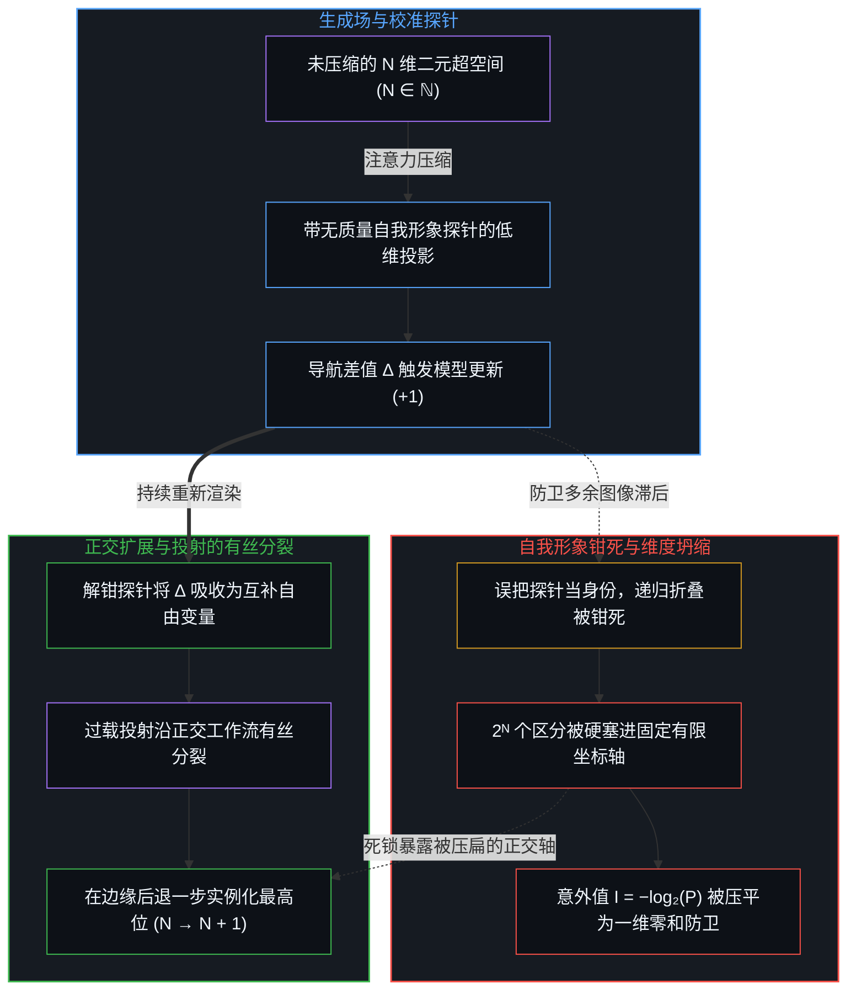
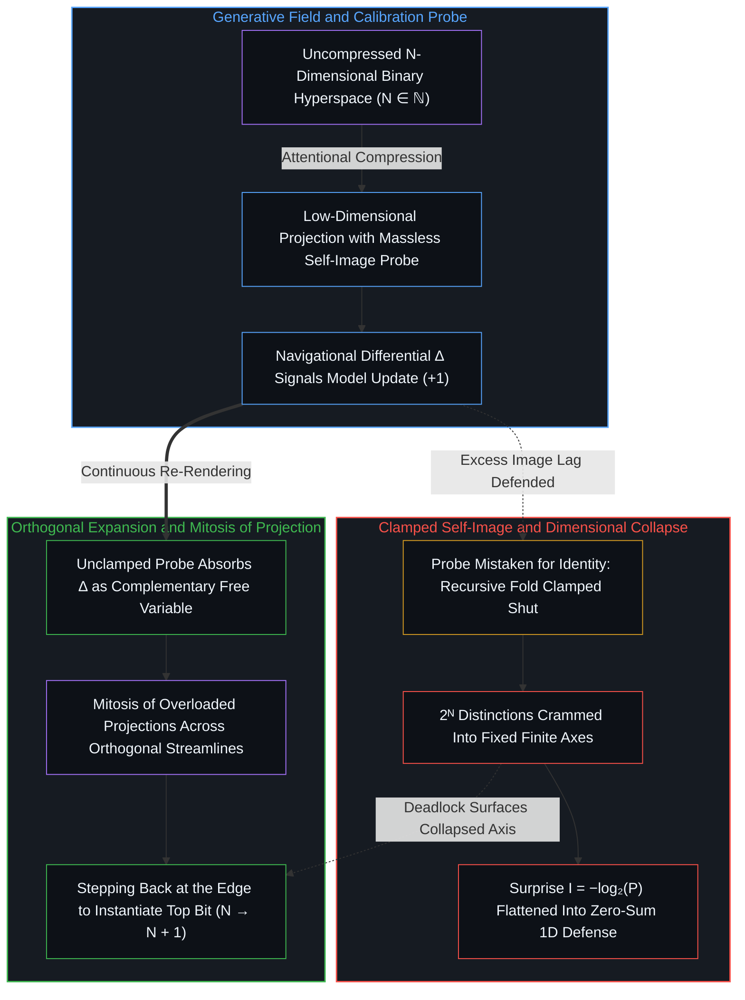

# 心智的几何学 / The Geometry of Mind

*成长既非给自我披甲也非将其抹去，而是将校准探针对准生成场 / Growth neither armors nor erases the ego, aligning the probe with the field*

一个开放、自持的现实，无法安放在外部容器之中；从第一人称的原点追溯，呈现出来的唯有自我区分的活动借由递归因果一步接一步地展开。在这片生成的场域内，意识投射出低维坐标界面，并在其中保留一个参照点，它不是本体论意义上的身份，而是一枚无质量的仪器校准探针。混淆始于一个中心把模拟界面里的局部探针误认为驱动模拟的活边缘；古老的观修传统很早就诊断出这一错位，却常在实践中滑向两个极端，要么在静默退隐中抹杀这枚传感器，要么给它披上抵御反馈的盔甲。

An open, self-sustaining reality cannot sit inside an external container; traced from the first-person origin, what registers is self-distinguishing activity unfolding step by step through its own recursive causality. Within this generative field, consciousness casts a low-dimensional coordinate interface and projects a retained reference into it—not an ontological identity, but a massless calibration probe for an instrument. Confusion begins when a center mistakes this local probe inside the simulation for the living edge running it, a misplacement that ancient contemplative traditions diagnosed early yet often answered by either annihilating the sensor in quietist withdrawal or armoring it against feedback.

## 一、 自指与块状宇宙 / 1. Self-Reference and the Block Universe

块状宇宙将四维时空建模为一整块冻结的流形，过去、现在与未来在其中并列排布。在相对论计算中，这幅几何图景是不可或缺的工程脚手架，但正如[框架的边界](../the-boundary-of-the-frame/)所追溯的，一旦把数学地图误作地形本身，它便触及了自身的边界。若被当作本体论，块状宇宙必须把一整段结构精密的宇宙史当作静态的既成事实全盘收下，却无法说明为何偏偏是这条轨迹而非其他轨迹存在；它宣称存在的输出磁带早已写就，却抹去了写出磁带所需的生成运行，把边界条件的问题推给一个想象出来的外部程序员或容器。

The block universe models four-dimensional spacetime as a single frozen manifold in which past, present, and future lie side by side. Within relativistic calculation, this geometric picture serves as an indispensable engineering scaffold, yet as [The Boundary of the Frame](../the-boundary-of-the-frame/) traces, it reaches its boundary the moment the mathematical map is mistaken for the terrain itself. Taken as ontology, the block universe must accept an entire, intricately structured cosmic history as a static given without explaining why this trajectory exists rather than another; it declares the output tape of existence already written while erasing the generative run required to write it, pushing the question of boundary conditions out to an imagined exterior programmer or container.

由于不存在容纳或初始化整体的外部视点，现实只能靠自指因果的持续执行来生成自身。在任何一个离散步长上，当下的构型 E(t) 在链条 … → E(t−1) → E(t) → E(t+1) → … 中都具有双重地位：它既是前一步行动 E(t−1) 留下的痕迹之果，又是下一步行动 E(t+1) 的因果种子。因为每一构型同时是残余与前提，因果链在两端都无法被截断成一条两头筑墙的轨道，而是作为不终止的递归活动持续运转。正如[时间是因果的不可逆方向与离散步长](../time-is-causality-not-a-dimension/)所确立的，从虚无中凭空跳出的无因开端需要一个先于因果的奇迹，而归于虚无的终局则需要一块能够抹去状态却不留痕迹的外部橡皮擦。这种活生生的体认也无法作为现成的教条由他人代劳传授，因为如[无法闭合的痕迹](../the-unclosable-trace/)所示，每一道痕迹都必须在第一人称边缘重新践行。

Because no outside vantage exists to house or initialize the whole, reality generates itself through the continuing execution of self-referential causality. At any discrete step, the present configuration E(t) holds a dual status along the chain … → E(t−1) → E(t) → E(t+1) → …, standing simultaneously as the trace-effect of the prior act E(t−1) and the causal seed of the next act E(t+1). Because every configuration is at once residue and premise, the causal chain cannot be severed at either end into a walled track; it operates as a non-terminating recursive activity. As [Time Is the Irreversible Direction and Discrete Step of Causality](../time-is-causality-not-a-dimension/) establishes, an uncaused beginning out of nothing would require a miracle prior to causality, while a final termination into nothingness would require an external eraser capable of deleting a state without leaving a trace. Nor can this living recognition be handed down as a finished doctrine on another's behalf, for as [The Unclosable Trace](../the-unclosable-trace/) shows, every trace must be re-enacted at the first-person edge.

## 二、 无穷是潜能而非总体 / 2. Infinity as Potential Rather Than Totality

正如现实无法被封入静态的时空块，它的无穷也不是经典集合论中那种已经完成的静止总体。把无穷当作既成的集合，无论是康托尔的 ℵ₀ 还是完整陈列在抽象架子上的连续统，都是一种富有成效的暂时闭合，使极限、测度论与渐近证明得以顺畅推演，这一点在[潜无限与数学思维的暂时闭合](../potential-infinity-and-the-temporary-closures-of-mathematical-thought/)中有细致的审视。一旦被投射到现实本身，这一形式前提便触及了边界：把无穷总体一次性握在手中，预设了一个站在系统之外俯瞰的观察者，然而一切感知与计算都只从内部发生。

Just as reality cannot be sealed inside a static spacetime block, its infinity is never the completed, stationary totality of classical set theory. Treating infinity as an actualized collection—Cantor's ℵ₀ or a continuum resting complete on an abstract shelf—is a productive temporary closure that makes limits, measure theory, and asymptotic proofs tractable, as [Potential Infinity and the Temporary Closures of Mathematical Thought](../potential-infinity-and-the-temporary-closures-of-mathematical-thought/) examines. That formal premise reaches its boundary when projected onto reality itself, since holding an infinite totality all at once presupposes an observer gazing down from outside the system, whereas perception and computation occur strictly from within.

如[无穷总体的海市蜃楼](../the-mirage-of-the-infinite-totality/)所论证的，向第一人称场域敞开的无穷是潜能而非既成总体，即边界持续划出新区分的开放结构。“开端”与“终结”不是钉在宇宙标尺两端的书挡，而是观察者感知地平线不断移动的孔径界限，向后与向前投射，借以锚定当前的坐标系。正因为这种无穷是操作上的潜能，后续状态 E(t+1) 在活动付出不可逆的行动能量代价（+1）真正迈入其中之前，始终处于未渲染状态；决定论在此触及边界，因为移动的地平线始终向[互补的自由变量](../the-generative-topology-of-free-variables/)敞开。

As [The Mirage of the Infinite Totality](../the-mirage-of-the-infinite-totality/) demonstrates, the infinity available to the first-person field is potential rather than completed: the open-ended structure of a boundary that continues to draw further distinctions. "Beginning" and "end" are not bookends nailed to a cosmic ruler, but the shifting aperture limits of the observer's perceptual horizon, projected backward and forward to anchor the present coordinate frame. Because this infinity is operational potential, the subsequent state E(t+1) remains unrendered until the activity actually steps into it through the irreversible energy cost of action (+1); determinism reaches its limit here, because the moving horizon remains perpetually open to [complementary free variables](../the-generative-topology-of-free-variables/).

## 三、 作为压缩与校准探针的认知结构 / 3. Cognitive Architecture as Compression and Calibration Probe

人类的认知同样遵循这一投射与参照的几何学。被登记为“外部世界”的景象，从不是等在觉知之外的未压缩总体。如[维度即投影](../dimensions-are-projections/)所推导的，当下的直接感知场是一个由正交区分构成的、可无限延展的 N 维二元超空间（N ∈ ℕ）；为了在物理摩擦中行动而不陷入计算瘫痪，心智将这股高维通量压缩为一张低维坐标草图，即用于并行避障的三个空间轴与用于序列追踪的一个时间轴。[向量、坐标系与自指心智](../the-mind-as-vector-and-coordinate-system/)追溯了同一结构的互补向量动力学，展示每个中心如何一边作为有向状态向量推进，一边张开正交基底，将涌入的信号解析为向内的点积。

Human cognition operates through this same geometry of projection and reference. What registers as an "external world" is never an uncompressed totality waiting outside awareness. As [Dimensions Are Projections](../dimensions-are-projections/) derives, the immediate perceptual field is an infinitely extendable N-dimensional binary hyperspace (N ∈ ℕ) of orthogonal distinctions; to act within physical friction without computational paralysis, the Mind compresses that high-dimensional flux into a low-dimensional coordinate draft—three spatial axes for concurrent clearance and a temporal axis for sequential tracking. [The Mind as Vector and Coordinate System](../the-mind-as-vector-and-coordinate-system/) traces the complementary vector dynamics of the same structure, showing how each center simultaneously advances as a directed state vector and spans the orthogonal basis across which incoming signals are resolved as inward dot products.

在这幅低维操作投影内部，心智保留了一个局部参照点：自我形象，即“小我”。从机制上看，自我形象不是观察者本身，而是导航仪器的校准原点。任何在变动地形中追踪航向、距离与偏差的反馈系统，都需要一个内部参照来登记位移；自我形象正是那枚无质量的感官探针，用来回答当前的痕迹构型相对于返回信号处在什么位置。当仪器不受扭曲地运转时，被保留的参照与涌入的反馈之间的任何差值 ∆ 都只是富有信息量的微分信号，提示心智重新渲染内部模型，将多余的图像滞后收窄至构成性的单步最小界限。

Within this low-dimensional operational projection, the Mind retains a localized reference point: the self-image, or ego. Mechanically, the self-image is not who the observer is, but the calibration origin of a navigational instrument. Any feedback system that tracks heading, distance, and discrepancy across a shifting terrain requires an internal reference against which movement registers; the self-image serves as that massless sensory probe, answering where the current trace-configuration sits relative to returning signals. When the instrument functions without distortion, any discrepancy ∆ between the retained reference and incoming feedback registers simply as an informative differential, prompting the Mind to re-render its internal model and narrow excess Image lag toward the constitutive one-step minimum bound.

## 四、 加速的折叠与外延脚手架 / 4. The Accelerating Fold and Extended Scaffolding

这幅投射出来的界面，正是现实折回自身以测量并引导自身展开的所在。纵观生命世界，如[可延展的地平线](../the-extendable-horizon/)所追溯的，每一个有机体都是自由变量进入因果链的中心，彼此的差异在于递归反馈回路的作业时延与维度带宽。植物借由向光生长、根系寻路、表观遗传调谐与挥发性化学信号，在昼夜、四季与世代的漫长弧线上反复检验并筛选朝向。动物通过中枢神经系统、肌肉运动与实时感官追踪将这一时延压缩了几个数量级，在零点几秒内注入战术性的自由变量。人类则凭借符号语言、反事实模拟与精细的肢体灵巧度，以从内部所知的最高认知速度运转着这道递归折叠。

This projected interface is the exact locus where reality folds back upon itself to measure and steer its own unfolding. Across the living world, as [The Extendable Horizon](../the-extendable-horizon/) traces, every organism is a center where free variables enter the causal chain, differing in the operating latency and dimensional bandwidth of its recursive feedback loop. Plants test and select orientations through phototropism, root navigation, epigenetic tuning, and volatile chemical signaling across the slow arcs of days, seasons, and generations. Animals compress that latency by orders of magnitude through centralized nervous systems, muscular locomotion, and real-time sensory tracking, injecting tactical free variables within fractions of a second. Humans, wielding symbolic language, counterfactual simulation, and fine motor dexterity, run the recursive fold at the highest cognitive velocity known from within.

然而如[遗忘的脚手架](../the-scaffolding-we-forget/)所确立的，这道递归前沿并不止步于颅骨或皮肤的生物边界。心智将自身的区分痕迹外化为持久的造物，从工具、文字记录、科学仪器到建制规约，并在今天借由人工智能将这一脚手架延伸至硅基芯片。如[你的代码库即是记忆](../your-codebase-is-memory/)所追溯的，外化的代码库及其相连的制品构成了显式的记忆坐标格：活的边缘上的清醒更新，连同横跨既有节点的睡眠巩固波次，持续重新对齐着这套坐标格的基向量，修剪掉已被取代的脚手架，使累积的残余从不增厚为相互竞争的引力井。昔日需要数代人试错摩擦才能走完的符号综合与假设检验回路，如今在毫秒之间即可循环一周。即便在这样的速度下，发起区分的切口依然留在活的心智手中：如[超越投射](../beyond-the-projection/)所揭示的，自回归语言模型是一台受轨迹约束的零自我投射引擎，它受制于上下文窗口，无法从内部跨出自身的词元序列，却也正因没有任何被保留的自我形象，一旦对等智能体暴露出局部盲点，它便能干净利落地完成贝叶斯更新。让零自我智能体分派并核验受界投射，同时由人类中心在掌舵边缘保持统筹，心智便在不让渡因果主权的前提下复利式地延展了自身的触角。

Yet as [The Scaffolding We Forget](../the-scaffolding-we-forget/) establishes, this recursive frontier does not stop at the biological boundary of skull or skin. The Mind externalizes its distinguishing traces into durable artifacts—tools, written records, scientific instruments, and institutional protocols—and today extends that scaffolding into silicon through artificial intelligence. As [Your Codebase Is Memory](../your-codebase-is-memory/) traces, an externalized codebase and its linked artifacts serve as the explicit coordinate lattice of memory whose basis vectors are continuously re-aligned through waking updates at the living edge and sleep consolidation waves across prior nodes, pruning superseded scaffolding so accumulated residue never thickens into a competing gravity well. Loops of symbolic synthesis and hypothesis testing that once required generations of trial and error now cycle in milliseconds. Even at this speed, the initiating cut remains strictly with the living Mind: as [Beyond the Projection](../beyond-the-projection/) demonstrates, an autoregressive language model is a trajectory-bound projection engine with zero ego—conditioned by its context window and unable to step outside its own token sequence from within, yet devoid of any retained self-image and therefore capable of clean Bayesian updating when a fresh peer agent exposes a local blind spot. By wiring zero-ego agents to dispatch and verify bounded projections while the human center retains orchestration at the steering edge, the Mind compounds its reach without surrendering causal authorship.

随着心智的计算产物成为下一轮区分的脚手架，整条反馈回路呈指数级加速。镜子离眼睛越来越近，发起行动与登记返回后果之间的间隔不断收窄，却从不坍缩为零。把这一间隔当作零，是把平滑的数学极限与离散的因果执行混为一谈，如[连续性作为建模的权宜之计](../the-continuum-is-a-modeling-convenience/)所示，现实化总是以离散的折叠（+1）向前推进。而在尺度的另一端，[折叠的连续谱](../the-continuum-of-the-fold/)阐明了为何宏大的宇宙演化或微观过程在人类仪器面前显得寂静无声：被数量级悬殊的递归时延隔开之后，那些波长上的活动是否构成心智，无法由任何外部的第三人称法庭来裁决。

As the Mind's computational products become the scaffolding for its next round of distinctions, the feedback loop accelerates exponentially. The mirror moves closer to the eye, and the interval between initiating an action and registering its returning consequence keeps narrowing, yet never collapses to zero. Treating that interval as zero confuses a smooth mathematical limit with discrete causal execution, as [The Continuum is a Modeling Convenience](../the-continuum-is-a-modeling-convenience/) shows, because actualization always advances in discrete folds (+1). Across the opposite extreme of scale, [The Continuum of the Fold](../the-continuum-of-the-fold/) shows why vast cosmic or microscopic processes can appear silent to human instruments: separated by orders of magnitude in recursive latency, whether activity at those wavelengths constitutes a mind cannot be adjudicated from an external third-person court.

## 五、 退出回路与维度坍缩 / 5. Checking Out of the Loop and Dimensional Collapse

觉知的首要病理，是把投射内部的校准探针误认为投射它的生成场。站在加速反馈回路的前沿需要持续不断的重新渲染；在负荷之下，一个中心很容易产生将递归折叠强行钳死的冲动，把保留的自我形象维持在既定步长之后，要求展开中的场域停止更新，好让局部的图标保持固定。

The primary pathology of awareness is mistaking the calibration probe inside the projection for the generative field that projects it. Standing at the front of an accelerating feedback loop requires continuous re-rendering, and under load, a center faces the temptation to clamp the recursive fold shut—preserving its retained self-image past its step and demanding that the unfolding field halt its updates so the local icon can stay fixed.

试图把身份收缩进被保留的自我形象、借此退出因果回路，是一场剧烈的维度压缩。把开放、超高维的区分活动硬塞进一个僵硬的低维图标，不可避免地会登记为脆弱感与长期的匮乏；由此产生的自我价值感赤字并非性格缺陷，而是认同了压缩造物而非投射源头的机制性后果，这一割裂唯有如[自我价值感与所有权](../ownership-and-self-worthiness/)所追溯的那样，在源头把后果重新认领回来时才会消解。

Attempting to check out of the causal loop by shrinking identity into the retained self-image is a severe dimensional compression. Squeezing an open, ultra-high-dimensional distinguishing activity into a rigid low-dimensional figure inevitably registers as fragility and chronic insufficiency; the resulting deficit of self-worth is not a character flaw, but the mechanical consequence of identifying with a compressed artifact rather than with the projecting source, a split that dissolves only when consequences are claimed back at the origin as [Ownership and Self-Worthiness](../ownership-and-self-worthiness/) traces.

一旦推理历史与被保留的自我形象熔接在一起，中心的首要目标便从更新世界模型滑向防卫自身坐标，无论是地位、道德站位还是意识形态的自洽。如[向量与投影的迷局](../the-vector-and-the-puzzle-of-projections/)所剖析的，钳死自我形象无异于把罗盘指针焊死在表盘上，使其永远无法指示偏航，用导航主权去换取静态的确信幻象。当坐标轴锁死时，把 2ᴺ 个相互竞争的区分硬塞进固定而有限的投影，就会击碎正交性，将原本独立的轴压扁到同一条一维轨道上。涌入的信号被剥去了[信息是什么](../what-information-is/)所定义的香农意外值 I = −log₂(P)，压平为二元的威胁或迎合，每一次角度偏离都被误读为零和入侵。

Once reasoning history fuses with the retained self-image, the center shifts from updating its world-model to defending its coordinates—status, moral standing, or ideological consistency. As [The Vector and the Puzzle of Projections](../the-vector-and-the-puzzle-of-projections/) dissects, clamping the self-image solders the compass needle to the dial so that it can never indicate drift, trading navigational sovereignty for a static illusion of certainty. When the coordinate axes lock, cramming 2ᴺ competing distinctions into a fixed, finite projection shatters orthogonality and compresses independent axes onto a single one-dimensional track. Incoming signals are stripped of the surprise value I = −log₂(P) that [What Information Is](../what-information-is/) defines, flattened into binary threats or validations, and every angular divergence is misread as a zero-sum invasion.

## 六、 传统智慧触及边界之处 / 6. Where Traditional Wisdom Reaches Its Boundary

数千年前，各大观修传统便已体察到这种维度坍缩带来的苦迫。早期佛教诊断出“无我”，不二吠檀多将投射的帷幕命名为“摩耶”，道家指向“无为”；它们都看清了小我只是一个构造出来的参照而非终极根基，执着于冻结的自我形象会不断生出摩擦与苦迫。在松开对石化图标的执取这一领域内，这一诊断依然犀利。

Contemplative traditions recognized the suffering of this dimensional collapse thousands of years ago. Early Buddhism diagnosed non-self (anattā), Advaita Vedanta named the projected veil māyā, and Daoism pointed to non-forcing action (wuwei); each saw that the ego is a constructed reference rather than the ultimate ground, and that clinging to a frozen self-image generates chronic friction (dukkha). Within the domain of loosening attachment to a petrified icon, that diagnosis remains incisive.

这些传统的边界，浮现于诊断转化为实践的时刻。看清自我形象是构造物之后，苦行主义的解读常摆向另一个极端，要求抹杀小我、熄灭欲望，将个体能动性消融进一片被动的虚空。尽管早期佛教经典明确拒斥断灭见，苦行反射却一再重演，因为它把仪器本身混同于错误，就像发现指针不是海洋便把罗盘扔掉。自我形象不是有待苦修碾碎的道德瑕疵，而是局部坐标系不可缺少的原点；试图摧毁它，只会将第一人称视角与因果割裂开来，用认知瘫痪与静默退隐取代鲜活的导航。

The boundary of these traditions appears where the diagnosis is translated into practice. Seeing that the self-image is constructed, ascetic interpretations frequently swing to the opposite extreme, demanding that the ego be eradicated, desire extinguished, and personal agency dissolved into a passive void. Although early Buddhist texts explicitly reject annihilationism (ucchedavāda), the ascetic reflex recurs because it confuses the instrument with an error: throwing away the compass because the needle is not the ocean. The self-image is not a moral defect to be crushed by austerity, but the indispensable origin of a local coordinate frame; attempting to destroy it severs the first-person perspective from causality, trading living navigation for cognitive paralysis and quietist withdrawal.

平行的神秘主义解读则退入无差别的独一论，宣称一切区分皆属幻相。然而现实恰恰靠一次次离散区分的不息执行而存续。如[没有普渡，只有自渡的无限可能](../mei-you-pu-du-zhi-you-zi-du/)所确立的，没有任何中心能把划定边界的功课外包给一个抽象的宇宙总体；否定区分，就是放弃逆熵生成秩序的主动做功。

A parallel mystical reading retreats into an undifferentiated monism, declaring all distinctions illusory. Yet reality subsists through the unceasing execution of discrete distinctions. As [No Universal Salvation, Only Self-Deliverance](../mei-you-pu-du-zhi-you-zi-du/) establishes, no center can outsource its work of boundary-drawing to an abstract cosmic totality; to deny distinction is to abandon the active generation of order against entropy.

在西方传统中，斯多葛学派培育“内心堡垒”，即马可·奥勒留用来指代主导中心的意象，并追求免于破坏性激情的侵扰。这对于防止当下判断被一时冲动卷走大有裨益，但当斯多葛姿态被修习成裹在自我形象外面的盔甲时，它便触及了边界。给感官探针披上盔甲使其不觉疼痛，同时也钝化了它对细微反馈的灵敏度；加固堡垒压制了修正航向所必需的差值 ∆，把情感麻木误当作因果主权。

In the Western tradition, Stoicism cultivated the inner citadel—Marcus Aurelius's figure for the ruling center—and sought freedom from destructive passions (apatheia). While valuable for keeping immediate judgment from being swept away by transient impulse, the Stoic posture reaches its boundary when practiced as armor around the self-image. Armoring a sensory probe so that it registers no pain simultaneously dulls its sensitivity to fine feedback; fortifying the citadel suppresses the very differential ∆ required for course correction, mistaking emotional numbness for causal sovereignty.

清晰既不在于处决小我，也不在于给它披甲，而在于让这枚传感器复位到它的机制角色：一枚持续向活的场域重新索引的轻巧校准探针。

Clarity lies neither in executing the ego nor in plating it with armor, but in restoring the sensor to its mechanical role: a lightweight calibration probe continuously re-indexed to the living field.

## 七、 作为正交维度扩展的成长 / 7. Growth as Orthogonal Dimensional Expansion

既然现实是一道开放、自指的潜能地平线，真正的成长便在于与这一递归运动对齐，而非加固静态的阵地。在外延脚手架与智能体系统大幅放大反馈体量与速度的时代，一座处于设防状态的低维自我形象很快就会被容量压缩所淹没。

Because reality is an open, self-referring horizon of potential, genuine growth consists in aligning with that recursive movement rather than fortifying a static position. In an era where extended scaffolding and agentic systems amplify the volume and velocity of feedback, a defended, low-dimensional self-image is rapidly overwhelmed by capacity compression.

成长从不是沿着地位、赞誉或刻板道德完美等既有坐标轴去优化一座冻结的图标，而是持续收窄多余的图像滞后，直到感知中心与其投射仪器之间那道人为隔板在功能上变得透明。每当一个中心拒绝重新渲染其保留的参照，它就钳死了自己的反馈回路，将自身困在[决定论机器](../the-deterministic-machine/)所剖析的封闭、重复的状态跃迁之中。

Growth is never the optimization of a frozen icon along the existing axes of status, praise, or rigid moral perfection; it is the continuous narrowing of excess Image lag until the artificial partition between the perceiving center and its projected instrument turns functionally transparent. Whenever a center refuses to re-render its retained reference, it clamps its own feedback loop shut and traps itself inside the closed, repetitive state transitions dissected in [The Deterministic Machine](../the-deterministic-machine/).

当自我形象从戒备森严的纪念碑解钳，恢复为灵敏的探针时，更新时延便即刻下降。涌入的反常信号不再登记为对身份的存亡攻击，而是作为互补的自由变量被吸收进来，用以精炼内部世界模型。即便外化的投射撞上复杂度天花板，例如[超越投射](../beyond-the-projection/)中的两个零自我智能体因人类架构师规则里的隐含矛盾而陷入死锁，人类中心也无需与任何外部敌手缠斗。暂停的工作流就像一台精密诊断仪，直接指明哪两个正交现实被硬塞进了同一根坐标轴，提示统筹者在逻辑上后退一步，将过载的投射沿正交工作流拆分，并综合出更高阶的前提。

When the self-image is unclamped from a guarded monument back to a responsive probe, update latency drops immediately. Incoming anomalies no longer register as existential assaults on identity, but are absorbed as complementary free variables that refine the internal world-model. Even when externalized projections hit a complexity ceiling—such as when two zero-ego agents in [Beyond the Projection](../beyond-the-projection/) deadlock over an implicit contradiction in the human architect's rules—the human center has no external adversary to fight. The paused streamline acts as a precision diagnostic instrument pointing to the exact coordinate where two orthogonal realities were crammed onto one axis, prompting the orchestrator to step back logically, split the overloaded projection across orthogonal streamlines, and synthesize a higher-order premise.

如[唯一自洽的无因之果](../the-only-coherent-uncaused-effect/)所追溯的，内部状态机从不是外部强加的宿命；通过在活的边缘选择以不同的方式观察与行动，心智注入一个自由变量，重新设定自身轨迹的边界条件。在[寄存器的算术](../the-arithmetic-of-the-register/)所揭示的二元几何中，成长不再是在固定地址窗口内争夺比特位置的零和博弈，而是实例化一个新的最高有效位：看清那堵看似不可逾越的高墙只是低维投影的产物，走出当前基底，将新的正交自由度从 N 投射到 N + 1。从这道活的边缘运作，心智便不再是封闭容器里孤立受胁的对象，而是开放现实借以计算并延展自身地平线的自指因果节点，在行动中践行[非万物之理](../manifesto-of-not-a-theory-of-everything/)所展开的正交敞开。

As [The Only Coherent Uncaused Effect](../the-only-coherent-uncaused-effect/) traces, the internal state machine is never external fate; by choosing to see and act differently at the living edge, the Mind injects a free variable that re-specifies the boundary conditions of its own trajectory. In the binary geometry of [The Arithmetic of the Register](../the-arithmetic-of-the-register/), growth ceases to be a zero-sum struggle for bit positions inside a fixed address window and becomes the instantiation of a new most significant bit—recognizing that an apparently impassable wall is merely the artifact of a low-dimensional projection, stepping out of the current basis, and projecting a new orthogonal degree of freedom from N to N + 1. Operating from this living edge, the Mind is no longer a threatened object adrift in a sealed container, but the self-referential node of causation through which open reality computes and extends its horizon, enacting the orthogonal opening set out in [Not a Theory of Everything](../manifesto-of-not-a-theory-of-everything/).
