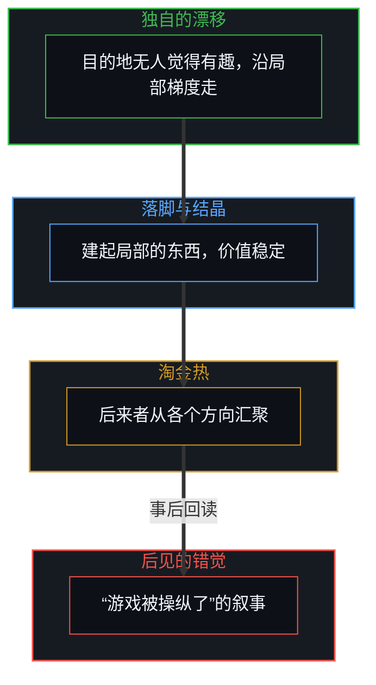
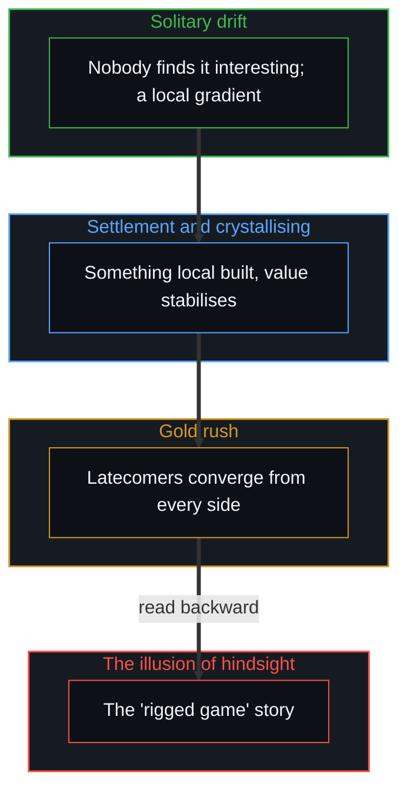

# 成功的几何学 / The Geometry of Success

*成功不是在固定棋盘上赢一场比赛，而是在别人觉得有趣之前迁入未绘图的地带 / Success is not winning on a fixed board but migrating into unmapped territory before anyone finds it interesting.*

社交媒体上流传着一句话，装作是精明务实的智慧：“不成功的人相信游戏被操纵了；成功的人知道游戏被操纵了，并学会怎么玩。”这句格言听上去很深刻，因为它迎合了现代竞争的犬儒，又给出一个可以照做的姿态：承认棋盘是固定的，掌握它腐败的规则，然后赢。

A saying circulates on social media, posing as hard-nosed practical wisdom: "Unsuccessful people believe the game is rigged; successful people know the game is rigged, and learn how to play." It sounds profound because it flatters the cynicism of modern competition while offering a posture one can act on: accept that the board is fixed, master its corrupt rules, and win.

从认识上看，这个叙事犯了倒因为果的错误。它事后去看一个敞开、演化着的现实，把它压成一个边界固定的封闭容器，再发明一个因果神话，去解释探索了新坐标的人与留在原地的人之间的空间差距。

Seen epistemically, the narrative reverses cause and effect. It looks back at an open, evolving reality, compresses it into a closed container with fixed boundaries, and then invents a causal myth to explain the spatial gap between those who explored new coordinates and those who stayed where they were.

## 一、 目的地的模型 / 1. The Destination Model

成功不是赢下一场共享的、事先存在的比赛，而是在别人觉得有趣之前，到达一片物质或思想的地带。一次突破的轨迹经过四个阶段。第一是独自的漂移：目的地对众人看不见或毫无趣味时，开路的人离开熟悉的起点，并不事先知道人们终会在意，只是沿着好奇、用处与试错的局部梯度走。第二是落脚与价值的结晶：凭各自的努力到达那片未绘图的坐标，开路的人建起局部的基础设施，做出可见的东西；价值稳定之后，周围的世界才抬头看。第三是淘金热：这片坐标一旦被证明可行，后来者从各个方向汇聚过来，有的步行，有的开车，有的坐火车。

Success is not winning a shared, pre-existing contest but arriving at a material or intellectual territory before anyone else finds it interesting. A breakthrough's trajectory passes through four stages. First is solitary drift: when the destination is invisible or uninteresting to everyone, the one who opens the way leaves the familiar origin, not knowing in advance that people will one day care, simply following a local gradient of curiosity, use and trial and error. Second is settlement and the crystallising of value: having reached the unmapped coordinates by their own effort, the one who opened the way builds local infrastructure and makes something visible; only after the value stabilises does the surrounding world look up. Third is the gold rush: once the coordinates prove viable, latecomers converge from every direction, some on foot, some by car, some by train.

第四是后见的错觉：后来者发现开路的人已经牢牢地站在新地带的中心，就发明一个回溯的目的论叙事：“开路的人有内幕消息，懂得被操纵的规则，插了队。”[成功学](../cheng-gong-xue/)认出的正是这种认知倒置：事后从幸存者身上打磨原则，把事后的合理化当成打开这片地形的引擎。

Fourth is the illusion of hindsight: finding the one who opened the way already firmly at the centre of the new territory, latecomers invent a backward-looking teleological story: "the one who opened the way had inside knowledge, understood the rigged rules and cut the line." [Theories After Success](../cheng-gong-xue/) recognises exactly this cognitive inversion: polishing principles from survivors after the fact and taking post-hoc rationalisation for the engine that opened the terrain.

## 二、 有限的游戏与敞开的现实 / 2. Finite Games and Open Reality

“游戏被操纵”这种心态的底下，是一个本体上的错误：把一个敞开的现实当作一场封闭的、有限的游戏。未绘图的地带，就是[宏观现象的生成图谱](../the-generative-atlas-of-macroscopic-phenomena/)描出的那个敞开的因果。把现实看作封闭容器的人，在边界固定的前提下运作，于是赢就是零和的：“他们领先了，他们的胜利就是我被剥夺的机械原因。”詹姆斯·卡斯在《有限与无限的游戏》里区分了为赢而玩的有限游戏与为了继续玩下去的无限游戏；即使在一个敞开的宇宙里，选择玩有限游戏的行动者，也会把零和的逻辑加到身边的环境上，把认知与体力耗在破坏被视为对手的人、守护静止的地盘、争抢现有的残羹上，[而不是开出新的路](../the-extendable-horizon/)。在一个敞开的现实里，只把力气花在守地盘上，会生出巨大的拖累，本意是零和的，最后衰变成破坏性的负和。

Beneath the "rigged game" mindset lies an ontological error: treating an open reality as a closed, finite game. The unmapped territory is the open causality mapped in [The Generative Atlas of Macroscopic Phenomena](../the-generative-atlas-of-macroscopic-phenomena/). Someone who sees reality as a closed container works on the premise of fixed bounds, so winning is zero-sum: "they got ahead, so their victory is the mechanical cause of my deprivation." James Carse, in Finite and Infinite Games, distinguished the finite game played to win from the infinite game played to keep playing; even in an open universe, an actor who chooses to play a finite game imposes zero-sum logic on the surrounding environment, spending cognitive and physical energy undermining perceived rivals, guarding static turf and fighting over existing scraps [rather than opening new paths](../the-extendable-horizon/). In an open reality, spending energy only on guarding turf generates great drag, and what was meant to be zero-sum decays into a destructive negative sum.

这也说明为什么早期的赢家常常衰落。到了一个有吸引力的点，就冻结游戏，以为棋盘从此恒久，停止探索的移动，转而守门，守住自己占下的那个坐标的规则；现实在周围继续扩展，静止的堡垒被绕过、变得无关。[封闭的假设把复利挤成 S 曲线](../closed-assumptions-squeeze-compounding-into-s-curves/)与[基准刷榜中的封闭实存](../closed-reality-in-benchmark-maxing/)说清了这种系统性的断裂：把一条封住的边界误认为能力的全部，复利就被扼成人为的停滞。复制自己路径的成功父母，把敞开的地带又变回一张棋盘，[成功之后的育儿谬误](../the-fallacy-of-post-success-parenting/)展示了这一点。

This also explains why early winners often decline. Having reached an attractive point, they freeze the game, assume the board is now permanent, stop exploratory movement and turn to gatekeeping the rules of the coordinate they captured; reality keeps widening around them, and the static fortress is bypassed and made irrelevant. [Closed Assumptions Squeeze Compounding into S-Curves](../closed-assumptions-squeeze-compounding-into-s-curves/) and [Closed Reality in Benchmark Maxing](../closed-reality-in-benchmark-maxing/) spell out this systemic break: when a sealed boundary is taken for the whole of capability, compounding is choked into artificial stagnation. Successful parents who clone their own path turn open territory back into a board, as [The Fallacy of Post-Success Parenting](../the-fallacy-of-post-success-parenting/) shows.

## 三、 制图者与行走者 / 3. Mapmakers and Walkers

这个框架也解开另一个常见的反常：为什么很聪明的人常常不成功。制图者的姿态，把人生当作一场封闭的智力游戏。常规的高智力擅长压缩已知的地形，理论家看着既有的坐标，设计一辆优雅的、理论上最优的车，从一点开到另一点；可透过静态的表征看系统，就会花几十年争论路线的缺陷、修改图纸，从没真正踏进泥里迈出第一步。行走者的姿态，带着动态的谦逊：没有一套关于地理的宏大统一理论，只是向前迈步，靠脚下直接的感官反馈调整平衡；遇到沼泽就转向，碰到墙就攀爬。这是同一个心智在不同事情上会采取的两种姿态，不是两种人。

This framework also resolves another common anomaly: why very clever people are often unsuccessful. The mapmaker's posture treats life as a closed intellectual game. Conventional high intelligence excels at compressing known terrain, and the theorist looks at existing coordinates and designs an elegant, theoretically optimal vehicle to drive from point to point; yet seeing the system through static representations, one can spend decades debating the route's flaws and revising the drawings without ever stepping into the mud. The walker's posture carries a dynamic humility: with no grand unified theory of geography, simply stepping forward and adjusting balance by direct sensory feedback from the ground; meeting a swamp, turning; hitting a wall, climbing. These are two postures one Mind takes on different matters, not two kinds of people.

身体的移动产生实际的地面反作用力，地面反作用力实时地更新内部模型。[印迹与行动](../the-mark-and-the-act/)与[攀登从未离开地面](../climbing-does-not-leave-the-ground/)强调了这个根基上的纪律：制图者的模型保持完好，却与摩擦脱节；行走者的模型被现实不断地打磨、校准。停在原点、优化表征的位置，会把差异归给“被操纵的棋盘”；走进敞开地形的位置，借直接的遭遇开出正和的路。

Bodily movement produces actual ground reaction force, and ground reaction force updates the inner model in real time. [The Mark and the Act](../the-mark-and-the-act/) and [Climbing Does Not Leave the Ground](../climbing-does-not-leave-the-ground/) stress this foundational discipline: the mapmaker's model stays pristine but disconnected from friction, while the walker's is continually hardened and calibrated by reality. A position that stays at the origin optimising representations attributes discrepancies to a "rigged board"; a position that walks into open terrain opens positive-sum paths through direct encounter.

## 四、 工具崇拜与路径依赖的冻结 / 4. Tool Worship and the Freeze of Path Dependence

从甲点到乙点，需要一套特定的工具与动作；从乙点到丙点，又要与陌生的地面重新打交道。把最初的突破归功于那辆车，公式、文凭或某个具体的制度漏洞，而不是自己探索未绘图空间的适应能力，就成了先前成功的人质。[遗忘的脚手架](../the-scaffolding-we-forget/)详述了这个认知陷阱：经验的组织作为世界脱落，却仍是竖起它的那条前沿的工具。赢家停在乙点的车里，拼命想把四周的沼泽变成一条铺好的高速公路，不肯丢下当初让自己成功的工具，于是确保了自己最终的过时。

Getting from A to B takes a particular set of tools and moves; getting from B to C means dealing with unfamiliar ground all over again. Crediting the first breakthrough to the vehicle, a formula, a credential, a particular institutional loophole, rather than to one's own adaptive capacity to explore unmapped space, makes one a hostage of previous success. [The Scaffolding We Forget](../the-scaffolding-we-forget/) details this cognitive trap: organisations of experience drop out as world while remaining instruments of the edge that put them up. The winner stays parked in the vehicle at B, trying hard to turn the surrounding swamp into a paved highway, unwilling to let go of the tool that brought success in the first place, and so ensures eventual obsolescence.

[路口的转向与地平说的行动悖论](../lu-kou-de-zhuan-xiang-yu-di-ping-shuo-de-xing-dong-bei-lun/)、[高维信息的离散折射与认知分层](../gao-wei-xin-xi-de-li-san-zhe-she/)与[自由变量的同构与先验主权](../zi-you-bian-liang-de-tong-gou-yu-xian-yan-zhu-quan/)都确立了：因果的杠杆从不在外部的器物、静止的坐标或别人的评判里，源头总是在每一个未绘图的路口实时做出微观决定的第一人称行动者。

[Turning at the Crossroad and the Flat-Earth Action Paradox](../lu-kou-de-zhuan-xiang-yu-di-ping-shuo-de-xing-dong-bei-lun/), [The Discrete Refraction of High-Dimensional Information](../gao-wei-xin-xi-de-li-san-zhe-she/) and [The Isomorphism of Free Variables and Prior Sovereignty](../zi-you-bian-liang-de-tong-gou-yu-xian-yan-zhu-quan/) all establish that the causal lever never sits in an outside artifact, a static coordinate or other people's judgment; the source is always the first-person actor making real-time micro decisions at each unmapped crossroads.

## 五、 现实没有裁判 / 5. Reality Has No Referee

没有一个中央的游戏主持人，没有一张宏大的阴谋棋盘，也没有一个固定的奖池，要人类为之拼到死。从第一人称看，现实是一片敞开的、不断延展的地形，受不肯让步的因果与逻辑约束。喊“游戏被操纵了”的位置，困在一个自己造出的负和牢笼里，把力气耗在一个封闭房间里争抢旧的脚印。目的地属于这样的行动者：接受每一段人生都是一场独立的、无尽的旅程，走出众人封闭的竞技场，开始独自行走的工作。为了找一个更好的座位去盯着别人，是[选择看见而非搜寻影子](../shou-bu-hui-de-mu-guang-yu-zhi-shi-de-yin-guo-dao-zhi/)所描述的那种搜寻影子。

There is no central game master, no grand conspiratorial board, no fixed prize pool humanity must fight to the death over. Seen from the first person, reality is open, ever-widening terrain bound by unyielding causality and logic. The position that cries "the game is rigged" is caught in a negative-sum cage of its own making, spending its energy fighting over old footprints in a closed room. The destination belongs to the actor who accepts that each life is an independent, endless journey, steps out of the crowd's closed arena, and begins the solitary work of walking. Watching others to find a better seat is the shadow-searching described in [Choosing to See Rather Than Searching for Shadows](../shou-bu-hui-de-mu-guang-yu-zhi-shi-de-yin-guo-dao-zhi/).
