# 切分的几何学 / The Geometry of the Cut

*自身为因，世界为果 / Self as Cause, World as Effect*

“先改变自己，还是先改变世界”的争论，把自身与世界当作两个相邻的房间，再去排定进出的先后。从第一人称的原点看，找不到感知结束、被感知之物开始的那条线：向外展开的被称作世界，向内折回的被称作自身，两者是同一次感知的两个方向。这一刀怎么切，决定了“应当”指向哪里。认出这一刀是自己切下的，先后之争便失去了立足之处，留下的是每一次行动同时校准自身并重塑所见的世界。

The debate over whether to change oneself first or the world first treats Self and World as two adjacent rooms and then schedules the order of entry. From the first-person origin no line is found where perceiving ends and the perceived begins: what unfolds outward is called the world, what folds back inward is called the self, and the two are directions of one perception. Where the cut falls decides where the "ought" points. Once the cut is recognized as one's own, the dispute over sequence loses its footing, and what remains is that every action calibrates the self and reshapes the world it sees in the same stroke.

## 一、 房间与街道的先后之争 / 1. The Room and the Street

关于“改变自身”与“改变世界”的先后次序，思想史上有一场延续至今的争论。一种流行的训诫主张，一个人若连自己的房间都没有打扫干净，便没有资格对整条街道的治理发言，改造世界之前须先修缮自身。与之相对的立场则认为，当整条街道已经起火时，关在屋内打扫房间是一种逃避，唯有投身外部结构的重建，个体才谈得上解放。

A long-running debate in moral thought concerns the order between transforming oneself and reforming the world. A familiar admonition holds that anyone who has not cleaned their own room has no standing to speak about the street, so self-repair must come before public action. The opposing position holds that when the street is already on fire, staying indoors to tidy a room is an evasion, and that only rebuilding the outer structure can free the individual.

两种说法在各自的范围内都有用。当两件事争夺同一个小时、同一份注意力时，先做哪件是一个需要回答的日程问题，两派给出的都是可用的排序。它们的边界在同一处：两者都把“自身”与“世界”当作空间上相邻、时间上可以排序的两个房间，并把这个排序当成了因果上的前提。一旦接受这一划分，“应当”便跟着所选的起点移动，以自身为起点，义务指向内，以世界为起点，义务指向外。

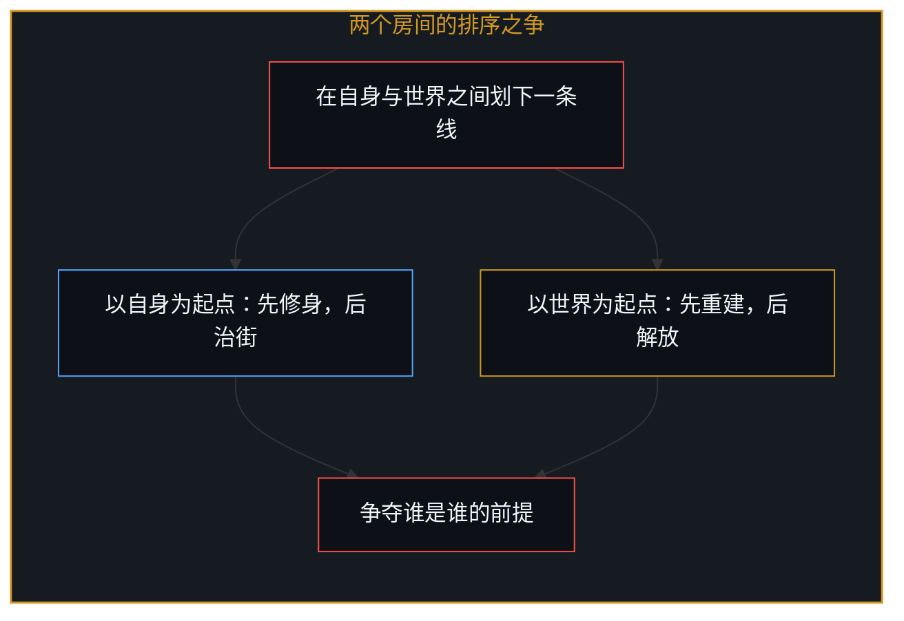

Both positions are useful within their range. When two tasks compete for the same hour and the same attention, which to do first is a scheduling question that needs an answer, and each camp offers a workable ordering. Their boundary lies in one place: both treat Self and World as two rooms that are adjacent in space and can be ordered in time, and both take that ordering for a causal precondition. Once the division is accepted, the "ought" travels with the chosen starting point: start from the self and the duty points inward, start from the world and the duty points outward.

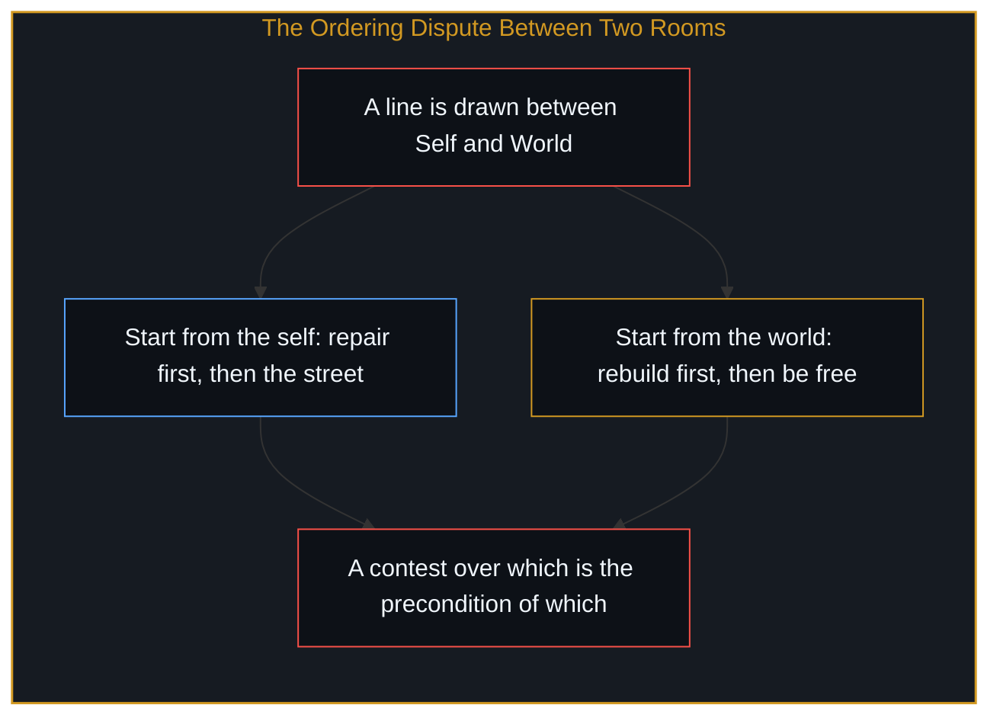

这场排序在感知里找不到对应物。感知从未隔着一段空隙眺望被感知的东西，认知与被认知之物是连在一起到来的。

Nothing in perception corresponds to this ordering. Perceiving never looks across a gap at what is perceived; the two arrive joined.

## 二、 一次感知的两个方向 / 2. Two Directions of One Perception

从不可化约的第一人称感知出发，自身与世界不是两个可以分别丈量的实体，它们是同一个现象朝两个方向的自指展开。被称为“外部世界”的，是内在状态向外投出、显现在感知画布上的部分；被称为“自我形象”的，是同一束感知向内折回、照见自己时留下的曲率。感知因此是一种双向自指投影：向外显现为开阔的世界，向内显现为身心的意象。借拓扑的语言作脚手架，把外显与内折中彼此对应的点认作同一点，得到的是一个连通的商空间 M / ~。在伴侣关系中，“共同体”是被当成原因的世界，[契约的因果倒置](../the-causal-inversion-of-partnership/)把这一倒置拆开。

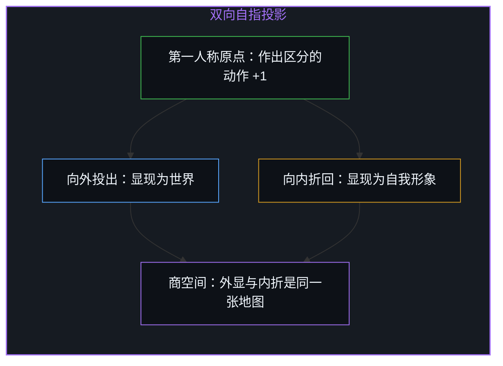

Starting from irreducible first-person perception, Self and World are not two entities to be measured separately; they are one phenomenon unfolding self-referentially in two directions. What is called the "world out there" is the part of an inner state cast outward and shown on the perceptual canvas. What is called the "self-image" is the curvature left when the same beam of perception folds back and catches itself. Perception is therefore a two-way self-referential projection: outward it appears as an open world, inward as an image of body and mind. Borrowing the language of topology as scaffolding, identifying each outward point with its inward counterpart yields one connected quotient space, M / ~. When that outward projection is reified in a relationship—treating the shared partnership as an external entity that causes one's state—it produces the inversion [The Causal Inversion of Partnership](../the-causal-inversion-of-partnership/) dissolves.

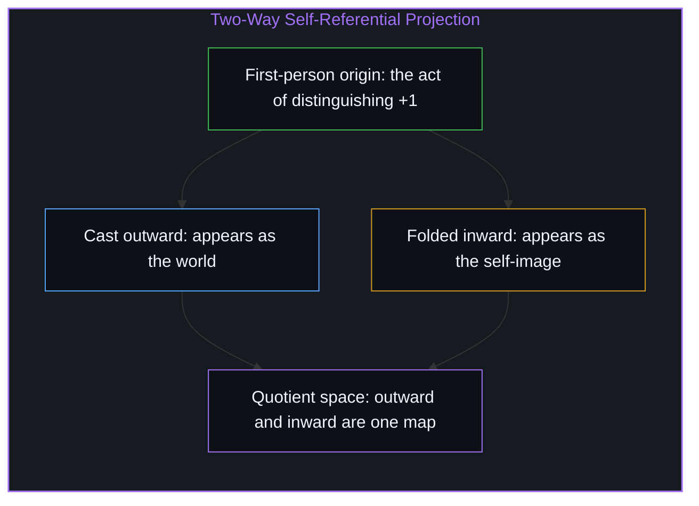

在这个图景里，被记录为“对外部世界的改变”的事，是这张感知地图自身的局部形变。把行动想成主体跨出门槛、对门外的客体施力，在搬动一张桌子这样的尺度上是好用的模型。它的边界在于，凡是能被指认为“地图之外”的东西，在被指认的那一刻已经落在地图上，没有一个可以站出去核对外部的位置。于是在第一人称原点作出一次抉择（+1），发生变化的是整张地图的曲率，自我形象与世界图景一同改变。

In this picture, whatever is recorded as "a change made to the outside world" is a local deformation of the perceptual map itself. Picturing action as a subject stepping over a threshold and pushing on an object beyond the door is a good model at the scale of moving a table. Its boundary is that anything pointed to as "outside the map" has already landed on the map by being pointed to, and there is no place to step out to from which to check an exterior. So when one choice is made at the first-person origin (+1), what changes is the curvature of the whole map, and the self-image and the picture of the world change together.

## 三、 回望留下的描述与模仿 / 3. Hindsight and the Imitation of Its Residue

各个古老的智慧传统对生命演进的节律有着细致而准确的描摹。这些描摹是在走过之后回望时写下的。任何人回望自己的历程，都是以旁观者的身份看一段已经完成的过去，能够看见并记下的是变化完成后沉淀下来的形态：内心的宁静、对物欲的淡泊、举止的从容、不争的姿态。

The old wisdom traditions traced the rhythms of a life's development with fine and accurate detail. Those tracings were written while looking back after the walking was done. Anyone who looks back on their own path sees a completed past as a bystander, and what can be seen and written down is the form that settled after the change: inner calm, lightness toward possessions, ease of bearing, a posture of non-contention.

作为描述，这些记录是可靠的路标，可以用来辨认已经发生的变化。它们的边界出现在被拿来当方法的时候。读到宁静与淡泊并试图照做，是把结果的形状当成了产生结果的工具：强迫自己显得宁静，压住欲望，模仿仪态与仪式。此时的“修炼自身”变成了站在第三人称的位置上审视、规训自己，自己成了自己监看的对象。这种模仿带着强烈的“正确”感，却不带来变化，因为它试图先造出结果的形状，再等原因出现。古老的教诲读来令人共鸣、照做却很难见效，缘由在这里。

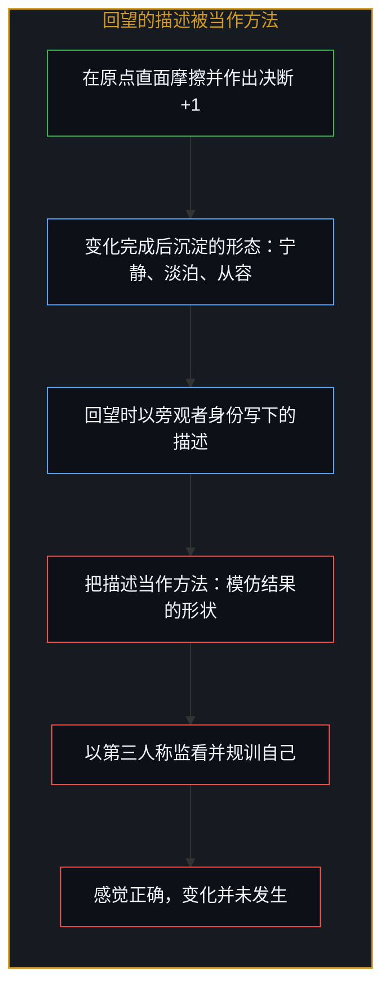

As descriptions, these records are reliable markers for recognizing a change that has already happened. Their boundary appears when they are taken as a method. To read of calm and lightness and try to comply is to treat the shape of the result as the tool that produces it: forcing oneself to look calm, holding desire down, copying posture and ritual. "Working on oneself" then becomes inspecting and policing oneself from a third-person position, and the self becomes the object being watched. The imitation carries a strong feeling of being right and brings no change, because it tries to build the shape of the effect first and then wait for the cause. This is why the old teachings resonate when read and seldom work when copied.

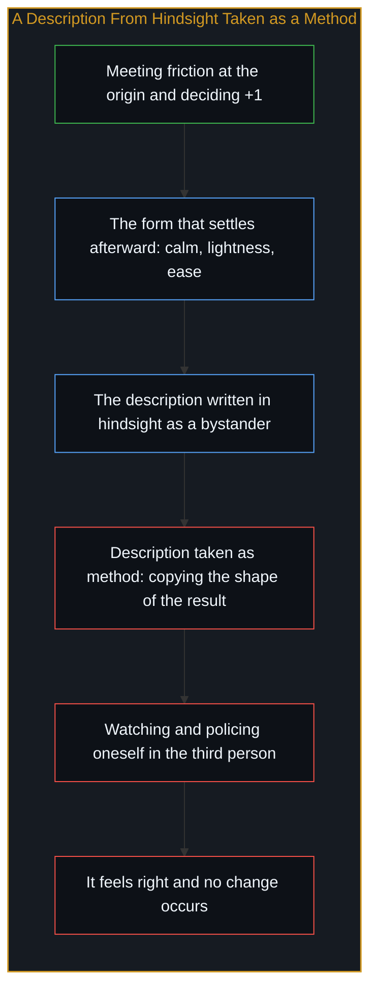

## 四、 寄生在切分上的“应当” / 4. The Ought That Lives on the Cut

看到自身与世界是一次感知的两个方向，也看到回望如何把结果写成方法，道德语言的位置就清楚了：跨越自身与世界这条线的“应当”，是这条线的副产物。道德话语要起作用，需要一个前提，即“现状”与“理想”之间、“自身”与“世界”之间隔着一段可以跨越的距离。讲坛设在距离的一侧，号召与评判发往另一侧。

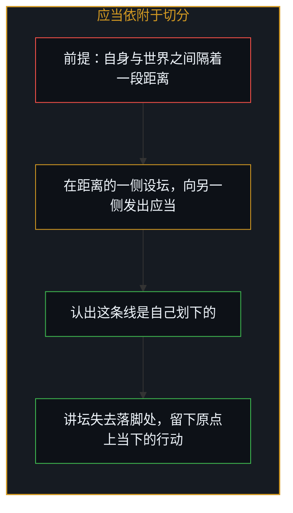

With Self and World seen as two directions of one perception, and hindsight seen turning results into methods, the place of moral language becomes clear: an "ought" that crosses the line between Self and World is a by-product of that line. For moral discourse to work it needs one premise, that a crossable distance separates "what is" from "the ideal" and "self" from "world." The pulpit is set on one side of the distance, and the calls and judgments are sent to the other.

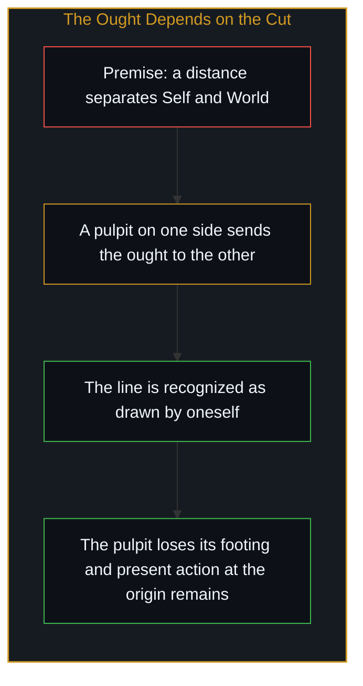

在线已经划定、众人共用同一划分的场合，“应当”是协调行动的有效工具。它的边界就是那条线本身：无论以“修身自省”之名向内鞭策，还是以“拯救世界”之名向外宣讲，都预设了一条在感知里找不到的界线。在“先提升自己还是先改变环境”之间感到的胶着与无力，因此不是品格的缺陷，也不是意志力的匮乏，那是在一个连通的整体上求解一维排序问题时必然出现的阻力。当这条线被认出是自己划的，压在其上的重负随之松开。

Where the line is already drawn and people share the same division, "ought" is an effective tool for coordinating action. Its boundary is the line itself: whether it drives inward in the name of self-cultivation or preaches outward in the name of saving the world, it presupposes a border that perception does not contain. The stuck, powerless feeling between "improve myself first" and "change my surroundings first" is therefore neither a defect of character nor a shortage of willpower; it is the resistance that must appear when a one-dimensional ordering problem is posed on a connected whole. When the line is recognized as self-drawn, the weight resting on it lifts.

## 五、 自身为因，世界为果 / 5. Self as Cause, World as Effect

在这个自指的投影回路里，处在原点的是作出区分的那个动作本身。它不出现在任何一幅投影之中，所持有的每一幅世界图景却都从它那里渲染出来。这里称它为自由变量。

In this self-referential loop of projection, what sits at the origin is the act of distinguishing itself. It appears in no projection, yet every picture of the world that is held is rendered from it. Call it the free variable.

这种渲染是以可区分的差异一步一步到来的，每一步都有限。平滑的连续统是把步长宣布为小到可以忽略之后得到的建模便利，在计算上极为好用，[连续性作为建模的权宜之计](../the-continuum-is-a-modeling-convenience/)展开了这一点。物理学自己的模型也标出了这种便利的边界：在普朗克时间与普朗克长度（t_P ≈ 5.39 × 10⁻⁴⁴ 秒，l_P ≈ 1.62 × 10⁻³⁵ 米）以下，现有理论预期自己失效，不再给出可操作的区分。这个尺度在这里读作模型分辨力的截断，而不是从外部观察到的宇宙节拍。在分辨力所及的每一步上，都是原点的一次动作（+1）定下了下一帧。

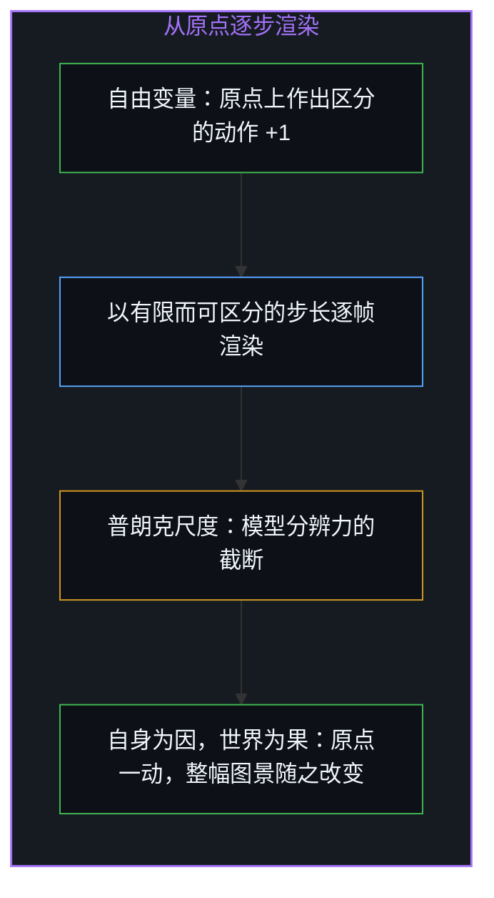

This rendering arrives as distinguishable differences, one step at a time, each step finite. The smooth continuum is the modeling convenience obtained by declaring the step small enough to ignore, and it is extremely useful for calculation, as [The Continuum is a Modeling Convenience](../the-continuum-is-a-modeling-convenience/) lays out. Physics' own models mark the boundary of that convenience: below the Planck time and the Planck length (t_P ≈ 5.39 × 10⁻⁴⁴ s, l_P ≈ 1.62 × 10⁻³⁵ m), current theories expect to fail and no longer yield an operational distinction. This scale is read here as the cutoff of the model's resolving power, and not as a tick of the universe observed from outside. At every step within that resolving power, one act at the origin (+1) fixes the next frame.

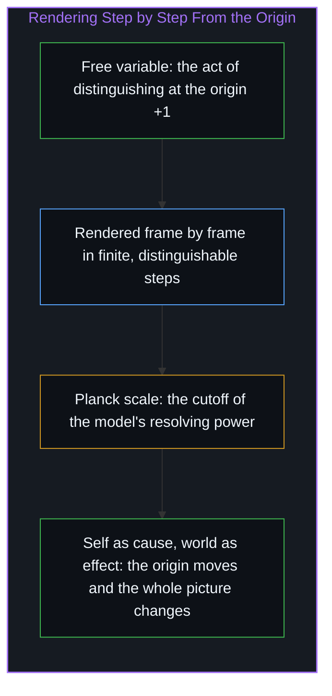

自身是因，世界是果。所见的世界不是一个与己无关的容器，它是自身的状态在摩擦中投出的全息图景。如果幕布上的画面扭曲了，冲上去擦拭幕布不会改变画面，需要回到放映机前调整焦距。而焦距无法在无光的暗室里凭空校准，只有把光投出去、撞上不让步的东西，才能对准。

Self is the cause and the world is the effect. The world one sees is not a container that has nothing to do with oneself; it is the holographic picture one's own state casts under friction. If the image on the screen is distorted, rushing up to wipe the screen does not change the image; the focus has to be adjusted at the projector. And the focus cannot be set in a dark room with no light: only by casting the beam and striking what does not give way can it be brought sharp.

所以改变自身就是在改变所见的世界，与世界的碰撞又是校准自身参数的唯一通道。“普通视角”用世界解释自我，与这道切分正好相反，[“普通人视角”的解释陷阱](../the-explanatory-trap-of-the-ordinary-perspective/)对此有所展开。

So changing oneself is changing the world one sees, and colliding with the world is in turn the only channel through which one's own parameters are calibrated. The ordinary perspective explains the self by the world, the reverse of this cut, as [The Explanatory Trap of the "Ordinary Perspective"](../the-explanatory-trap-of-the-ordinary-perspective/) shows.

## 六、 没有前置条件 / 6. No Preconditions

因与果既然是同一个回路的两面，行动的前置条件也就无处安放。不需要先变得无懈可击再去行动，不需要一份心理完满的证明才有资格投身世界，也不需要等外部环境没有风险才开始探索。

Since cause and effect are two faces of one loop, a precondition for action has nowhere to sit. There is no need to become flawless before acting, no need for a certificate of psychological completeness to qualify for engaging the world, and no need to wait until the surroundings carry no risk before beginning to explore.

在第一人称原点上，每一次具身的行动（+1）同时做成两件事：它投出因果的光束，重塑下游的世界图景；它又借环境给出的摩擦，校准自身的参数。

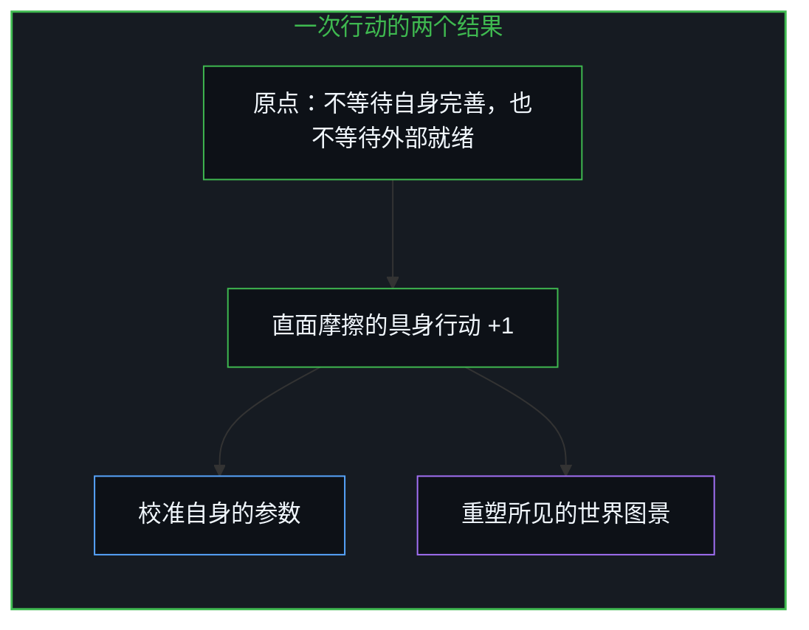

At the first-person origin, every embodied action (+1) accomplishes two things at once: it casts the causal beam and reshapes the picture of the world downstream, and it uses the friction the surroundings return to calibrate its own parameters.

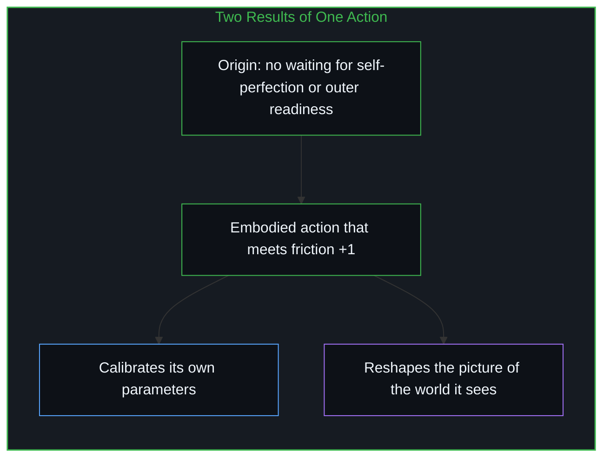

这里没有先后，也没有排队。针对自身与针对世界的两种说教可以一并放下，旁观自己的位置也可以放下，留下的是站在原点上对当下的处境承担全部的结构性责任。以摩擦为师，在每一次未经稀释的行动里，校准与行动是同一件事。过往切分留下的概念与记录，如[你的代码库即是记忆](../your-codebase-is-memory/)所追溯的，也只是外化的记忆，等待着活的原点去承受下一步的摩擦。

There is no sequence here and no queue. Both sermons can be set down, the one aimed at the self and the one aimed at the world, along with the third-person posture of policing oneself from outside; as [Your Codebase Is Memory](../your-codebase-is-memory/) traces, every rulebook, moral record, or conceptual map retained from prior cuts is only externalized memory, inert until a living origin steps into the friction of the next commit. What remains is standing at that origin with full structural responsibility for the present situation: with friction as the teacher, in every undiluted action, calibrating the self and reshaping the world are one and the same stroke.
