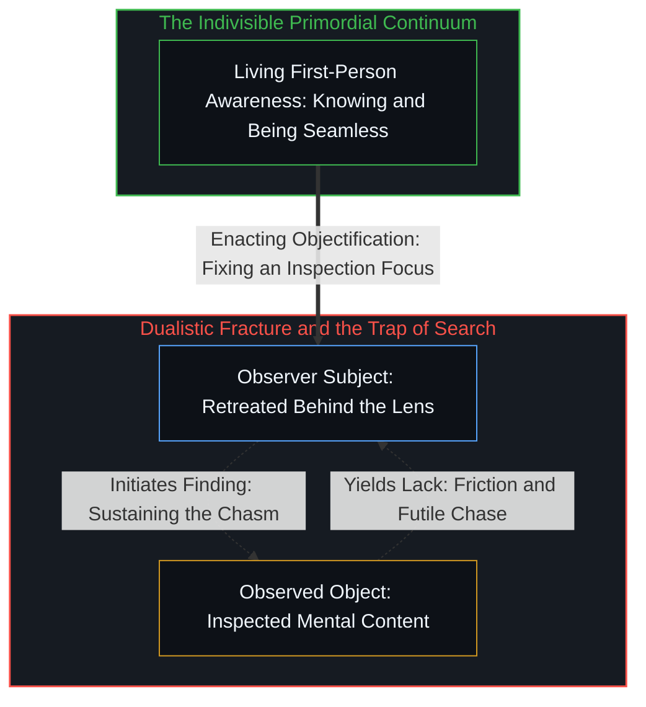
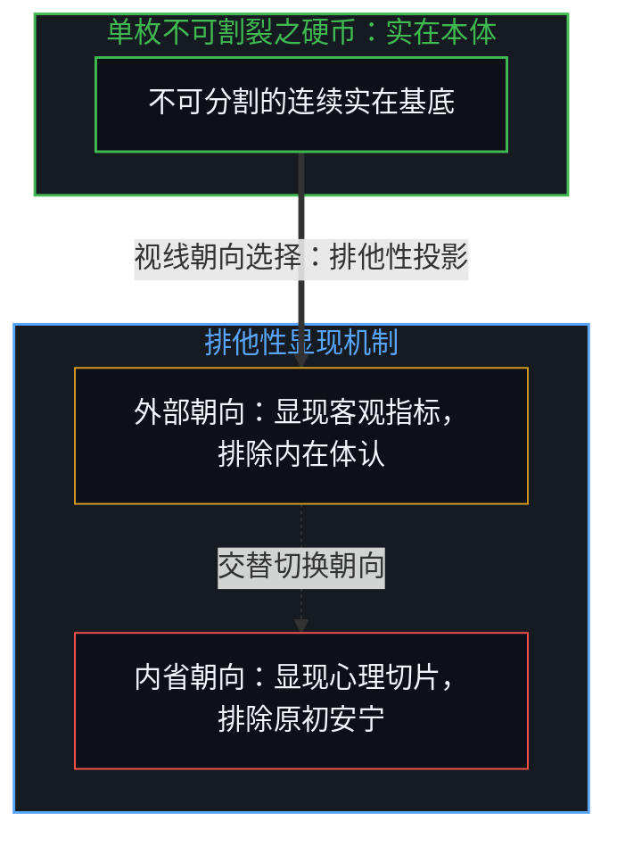
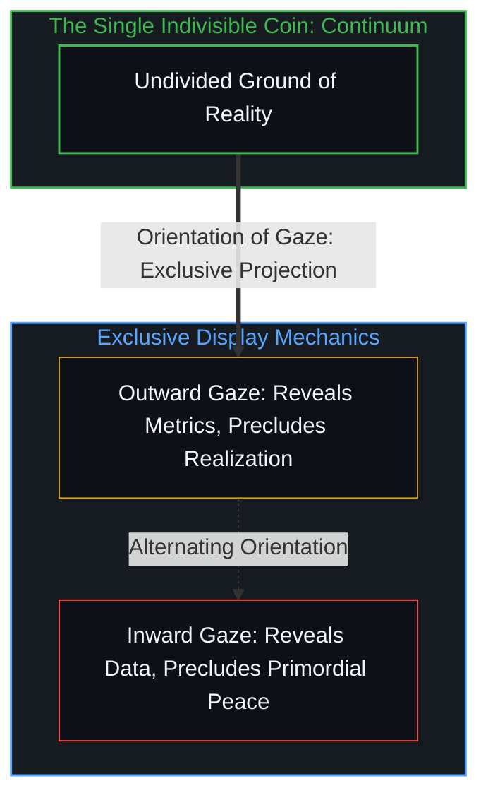
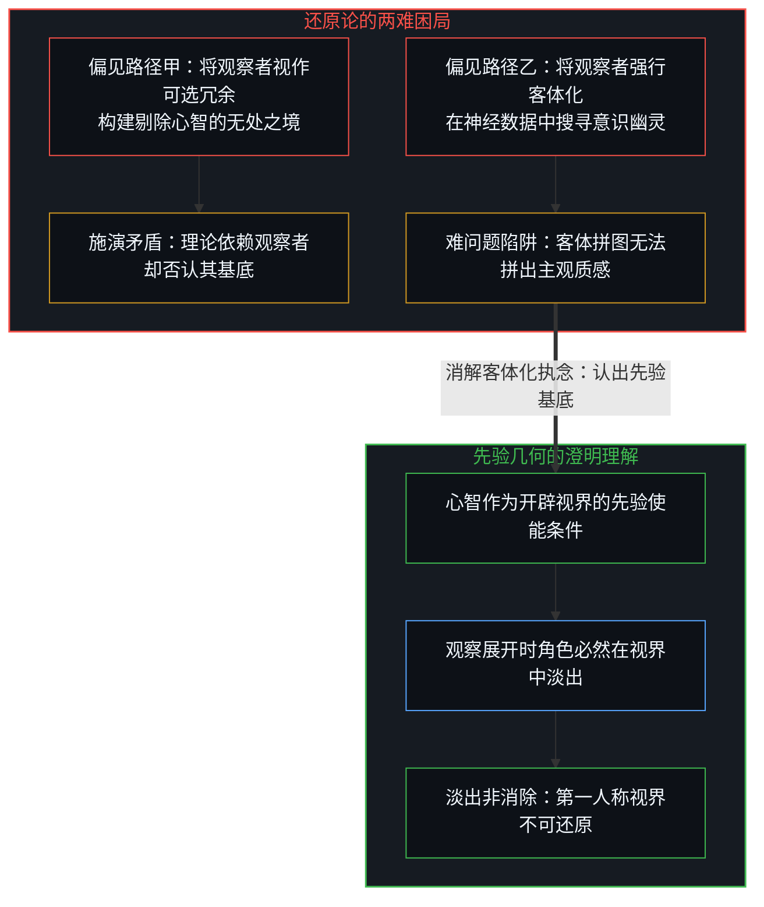
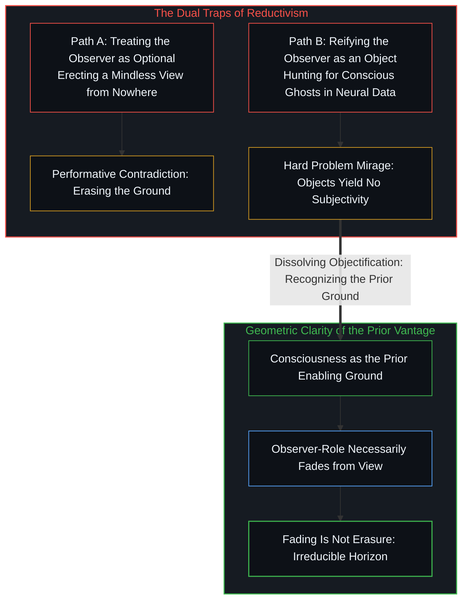

# 寻觅的语法与淡出的观察者 / The Grammar of Finding and the Fading Observer

*寻觅将领悟割裂为客体，观察者隐退于视野之外，却始终是不可还原的起始条件 / Finding turns realization into an object; the observer fades from view yet stays the irreducible starting condition*

在自身内部难以寻得幸福，在其他地方则不可能寻得，这两半并非关于世界的两桩经验事实，而是出自观察的同一个结构特征。尚福尔的格言后被叔本华采用，它标出向外的一半：外部条件能提供契机、消除阻碍，却没有一样构成第一人称的领悟。向内的一半出于同样的缘由受挫：寻找一旦启动，便让寻觅者与被寻之物相隔，把不可割裂的领悟推到这道裂痕的另一侧。若问哥德尔的限制是否像约束形式系统那样约束心智，同一结构给出回答：心智被观察时，是；心智作为观察者时，否；这个问题本性上不可解决。

Happiness is hard to find within oneself and impossible to find elsewhere, and both halves trace to one feature of observation rather than to two facts about the world. Chamfort's maxim, later adopted by Schopenhauer, marks the outward half: external conditions can supply occasions and remove obstacles, yet none of them constitutes a first-person realization. The inward half falters for the same reason, because finding installs a seeker apart from the sought and casts an undivided realization onto the far side of that split. Asked whether Gödel's limits bind the mind as they bind a formal system, the same structure answers: yes when the Mind is observed, no when it is the observer, and the question is not resolvable by nature.

## 一、 寻觅的语法与幸福的不对称性 / 1. The Grammar of Finding and the Asymmetry of Happiness

当人们试图理解幸福的居所时，常陷入一种空间定位的语词迷宫。尚福尔的名言尖锐指出，在外部世界找寻幸福是绝无可能的，而在自身内部寻觅又充满艰难。这种不对称性之所以成立，首先在于外部环境属于第三人称可观测实体的领域。不论财富、声望、物理居所或人际赞誉如何堆叠，它们所展现的都是客体属性的组合。没有任何处于第一人称视界之外的事物，能够直接替代主观体验本身的澄明状态。因此，将幸福寄托于外部占有，从结构上注定是一场无解的追逐，因为客体永远无法蜕变为观察者当下的主观体认。

The search for where happiness resides stumbles into a spatial labyrinth that ordinary language builds. Chamfort observed that finding happiness outside oneself is impossible, while finding it within is extraordinarily difficult. The outward half holds because external circumstances belong to the domain of third-person observables. However wealth, acclaim, comfort, or status accumulate, they present configurations of objects. Nothing outside the first-person horizon substitutes for the realization itself, so pinning fulfillment to external acquisition is a structural impossibility: no object turns into the immediate realization of the observing Mind.

然而，当心智遵从哲学教诲将目光撤回内心时，寻觅的行动却迅速制造出第二重困境。寻找这一动词本身，深植于主体对分离客体的探测语法。一旦寻觅转向内心、寻找某种名为幸福的心理状态，心智便立刻分裂为一个进行巡视的监视者和一个被巡视的情感对象。无论找到的是瞬时的多巴胺愉悦、宁静的冥想心境还是自我肯定的情绪，被找到的都是一组被心智对象化的心理切片。观察者与被观察者在巡视机制生效的瞬间已经拉开距离。内向探索的困境之所以被感知为艰难而非不可能，是因为当心智偶然放下巡视姿态、体会到未割裂的安宁时，世俗语言习惯性地将这种姿态的消退误称为找到了它。这种语词归因的错位，使得心智不断通过强化寻找的动作去抓取安宁，结果一次次重新撕开主客割裂的裂痕。正如在探讨[不可还原的观察者](../the-irreducible-observer/)时所揭示的，观察者一旦将自身作为对象打量，它所把握的是被观测的数据，观察本身则仍作为基底在运行。

When attention heeds the counsel and turns inward, the search opens a second impasse. The verb finding carries the syntax of a subject inspecting a detached item. The moment the search turns within for a state called happiness, the look splits into an inspecting posture and an inspected feeling. Whether it catches a passing euphoria, a contemplative calm, or a self-affirming emotion, what it locates is one more reified slice. The inward impasse registers as difficult rather than impossible because, whenever the inspecting posture briefly lapses into unmediated contentment, linguistic habit misnames the lapse as having found the prize. The misattribution goads the search to press harder, and each pressing reopens the rift it was meant to heal. As in [The Irreducible Observer](../the-irreducible-observer/), the moment the observer inspects itself as an item, what it holds is observed data, while the observing goes on as the ground.

## 二、 客体化与不可分之物的割裂 / 2. Objectification and the Severing of the Inseparable

观察者与被观察者的割裂，并不是书斋里设计出来的学说，而是客体化每一次发生时所做的事。观察者与被观察者并非两个等待桥梁的预存实体；它们在划分的行动中一同出现。焦点确立之前，知觉与存在浑然一体，视线与其所见之间没有界线。一旦注意力为了评估、计算或控制而确立一个焦点，它便切出一个目标，并在仪器背后投射出一位审视者。这一割裂把不可分的连续实在劈为两极，而做出这一割裂的正是心智。

The split between observer and observed is not a doctrine devised in a study; it is what objectifying does each time it occurs. Observer and observed are not two pre-formed entities awaiting a bridge; they appear together in the act of delineation. Before a focus is fixed, sensing and being run seamless, with no boundary between the gaze and its scene. Once attention fixes a focus for appraisal, calculation, or control, it carves out a target and projects an inspector seated behind the apparatus. The cut divides an undivided continuum into poles, and the Mind is what makes the cut.

一旦这种割裂完成，随后的每一次追寻都不可避免地继承了这一初始创伤。在外部世界中，由于客体与第一人称视界身处异质空间，寻觅的不可能性一目了然。而在主体内部，自我被当成可以被观测、调适与评估的客体后，内视的目光在内心重新复制了这一间距。内向反省原本被寄望于消除隔阂，但它所采用的方法本身却依赖于制造客体。这就导致寻觅越是用力，客体化的割裂就越深沉，主观体验与被审视的情绪对象之间就越无法合一。心智感受到的所谓修持之难，实则是用剪刀去缝合布料所产生的徒劳摩擦。关于客体化姿态如何反噬行动者的主权空间，在分析[主权抉择的双面性与观察的客体化](../the-two-sided-nature-of-sovereign-choice-and-the-objectification-of-observation/)时已有清晰的论证：客体化将原本处于生成态的意向坍缩为既成事实的陈列，阻断了活态生成的可能。

Once this split is installed, every subsequent search inherits the foundational fracture. In the external sphere, because objects reside in an alien coordinate frame detached from the first-person seat, the impossibility of closure remains obvious. Internally, when the self is transformed into an object to be inspected, optimized, and audited, reflective introspection duplicates the identical chasm within. Introspection is summoned to heal separation, yet its chosen instrument relies upon objectification. The harder the search presses, the wider the dualistic divide becomes, precluding unity between immediate awareness and inspected emotion. The agony of inner seeking is the friction of attempting to weave cloth with scissors. How the objectifying posture devours sovereign agency is demonstrated in [The Two-Sided Nature of Sovereign Choice and the Objectification of Observation](../the-two-sided-nature-of-sovereign-choice-and-the-objectification-of-observation/): objectification collapses generative intention into static exhibits, extinguishing living realization at the source.

## 三、 硬币隐喻与朝向的排他性 / 3. The Coin Analogy and the Exclusivity of Orientations

为了理解不可分之物为何会在观察中显现为相互排斥的对立面，硬币的几何隐喻提供了极具启发性的澄清。对于任何一枚坚实的硬币，观察者在单一视线的投影中，永远只能看到其中的一个面。当你调整朝向让正面充分受光并填满视界时，背面必然处于背光且被遮蔽的状态；反之，当背面朝向观察者时，正面同样无法同时呈现在视野之中。这种同时可见性的缺失，常常诱导朴素实在论做出本体论层面的过度推断，误以为硬币是由两个彼此割裂、互相排斥的独立实体勉强拼凑而成。

To see how an undivided whole presents as mutually exclusive opposites, take a coin. From any single vantage only one face registers at a time. Turn the obverse to the light and the reverse falls into shadow; turn the reverse forward and the obverse is withheld. The missing simultaneity tempts naive realism into an ontological error: the inference that the coin is two severed entities glued together.

然而，单一视线下无法兼顾两面，丝毫不意味着硬币在本体上发生了断裂。这一限制仅仅说明，呈现其中一面的观察条件，在物理几何上必然排除了呈现另一面的观察条件。硬币作为一个连续且不可分的实体，其整体性贯穿始终；显现哪一个面，仅仅取决于注意力采取了何种接入朝向。如果将相继显现的不同面貌物化为互不相干的独立实体，便是在把观察姿态的限制强加于被观察的客体。在寻找幸福的语境中，外部寻觅的不可企及与内部寻觅的极度维艰，正是同一种客体化姿态在不同朝向上的投射。面向外部时，观察姿态展现了客体的客观性，因而排除了第一人称领悟；面向内部时，观察姿态将自我物化，因而排除了当下的安宁。实在的连续性从来不需要通过生拼硬凑两个截然不同的面相来恢复，而只需要心智意识到，相继交替的面相仅仅是视线变换的遗迹，而非分裂的实存。正如[观察者的隐身与无损传递的妄念](../the-invisible-observer-and-the-delusion-of-lossless-transmission/)所指出的，任何试图忽略观测朝向而妄想获得全景无损真理的尝试，都会被界面本身的折射击穿。

Yet the impossibility of capturing both faces in a single glance does not divide the coin. It demonstrates only that the conditions required to display one face geometrically exclude the conditions required to present the other. As an indivisible physical continuum, the coin preserves its integrity; which face appears depends strictly on the orientation of observation. Reifying sequential aspects into distinct substances projects the constraints of the observational stance onto the reality observed. Applied to the pursuit of happiness, the impossibility encountered externally and the friction felt internally are two orientations of the same objectifying posture. Turned outward, the stance highlights objective mechanics, excluding first-person realization; turned inward, it reifies the self, excluding unbroken contentment. Continuity is recovered not by assembling severed fragments, but by recognizing that sequential aspects are traces of viewing angles rather than ontological fractures. As shown in [The Invisible Observer and the Delusion of Lossless Transmission](../the-invisible-observer-and-the-delusion-of-lossless-transmission/), any attempt to bypass observational orientation in pursuit of lossless panoramic truth collapses under the refraction of the interface itself.

要求硬币证明自己有两面，它会不断翻出另一面，可对于一次只看到一面的眼睛，这一证明永远无法闭合。同时把握两面，只能靠推断，靠想象自己成为硬币本身，而不能靠观察；而这种想象仍是从观察者的位置上做出的，是那只眼睛搭建的构造，而不是硬币提供的景象。当这一要求转向观察者本身，结构依旧。哥德尔的限制适用于被观察的心智，即从外部看去的一个系统；它不适用于作为观察者的心智，任何系统及其外部都在这里被划出。要求这个问题得到解决，就是要求观察者变得可被观察，而这会使观察的可能性坍缩。然而正是这一要求让观察持续下去，一面接一面，如同硬币不停翻转。这个问题本性上不可解决，而这种不可解决正是观察得以继续的条件。

Demand that the coin prove it has two sides, and it keeps turning its other face, yet to an eye that registers one face at a time the proof never closes. Both faces at once are reachable only by inference, by imagining being the coin itself, never by observation; and the imagining is still performed from the observing position, a construction that eye builds rather than a sight the coin supplies. The same structure holds when the demand turns on the observer. Gödel's limits apply to the Mind as observed, a system seen from outside; they do not apply to the Mind as observer, where any system and its outside are drawn. Demanding the question be settled demands that the observer become observable, and that collapses the possibility of observation. Yet the demand keeps observation going, face after face, as the coin keeps turning. The question is not resolvable by nature, and the unresolvedness is what lets observation continue.

## 四、 观察者的必然淡出与非可选先验 / 4. The Necessary Fading of the Observer and the Non-Optional Prior

自我区分的活动发生着——无因，不息。称之为心智：观察者早已在途中，每一次行动皆是一次区分。观察之所以发生，是因为这一活动是它的起始条件：进入视野的一切，从星系的运行轨迹到神经元的放电，都在其中登记。观察者开启了这一场景，便不能同时作为其中又一件物品登场。正如眼睛在看地平线时看不到自己的视网膜，手电筒照不亮镜头后方的电池，观察展开的瞬间，观察者便从可观察的视野中淡出；它隐退的是可见性，不是运作。它不是暂且采用、随后放下的视角设定；它是起始条件，不可还原。

Self-distinguishing activity occurs — uncaused, unceasing. Call it the Mind: the observer already underway, every act of which is a distinction. Observation occurs because that activity is its starting condition: everything that enters the field, from the trajectory of galaxies to the firing of neurons, registers within it. Because the observer opens the scene, it cannot also appear as one more item in it. As the eye does not see its own retina while seeing the horizon, and a flashlight does not light the battery behind its lens, the observer fades from the observable field the instant observation unfolds; it recedes from view, not from operation. It is not a framing held for a while and then set down; it is the starting condition, and it does not reduce.

淡出不是消除，观察者也不是可有可无的装饰。还原论模型犯下双重错误：其一，把观察者当作可省略的冗余，构建一种无处之境，让实在在没有任何视角的情况下自我解释；其二，把淡出误读为不存在，随后在面对主观体验时惊退，并将其命名为意识的难问题。两者都要求起始条件要么降格为被观察的客体，要么从自然的账簿上删去。一旦看清淡出是作为显现之基底的结果，在客体之中搜寻主体的冲动便停止，觉知也不再像游荡在物质中的幽灵。物理宇宙如何作为一种悬置观察者的抽象而运作，在[因果不可还原与物理作为无处之境](../causality-is-irreducible-the-physical-is-a-view-from-nowhere/)以及[意识的难问题与学习能力相容](../the-hard-problem-of-consciousness-is-consistent-with-learning/)中已有剖析；[框架的盲区](../the-blind-spot-of-the-frame/)则把方法上的退后与本体上的缺席之间的同一混淆，追溯为现代意志哲学困境的根源。

Fading is not elimination, and the observer is not an optional ornament. Reductive models commit a dual error: treating the observer as dispensable, building a view from nowhere in which reality explains itself without any vantage; and reading the fading as absence, then recoiling at subjective experience and christening it the Hard Problem of Consciousness. Both demand that the starting condition be demoted to an observed object or deleted from the ledger of nature. Once the fading is seen as the consequence of being the ground of appearance, the hunt for the subject among objects stops, and awareness no longer looks like a ghost haunting matter. How the physical universe works as an abstraction that suspends the observer is dissected in [Causality Is Irreducible; the Physical Is a View from Nowhere](../causality-is-irreducible-the-physical-is-a-view-from-nowhere/) and [The Hard Problem of Consciousness Is Consistent with Our Ability to Learn](../the-hard-problem-of-consciousness-is-consistent-with-learning/); [The Blind Spot of the Frame](../the-blind-spot-of-the-frame/) traces the same confusion between methodological withdrawal and ontological absence to the root of the modern dilemma of volition.

无处之境仍有其用。为说明一点而借用它，便能把一个模式陈述得仿佛不出自任何位置；论点一旦说明，它便回到借用它的第一人称。客观性正是这种借用所追踪的东西：跨越主观性的不变性，而非主观性的缺席。在不同立足点之间什么算作相同，是由心智登记为相同的；没有任何外部视角能做出这一裁定。作为信号持有时，不变性协调诸心智，引导下一次区分；作为权威持有时，它占据一个没有任何观察者能坐上的席位。否认观察者也逃不出这一点，因为否认本身就是从观察者位置做出的选择，正如[自由意志的自否自由](../the-freedom-of-will-to-deny-itself/)所追溯的那一步。

The view from nowhere still has a use. Borrowed to make a point, it lets a pattern be stated as if from no position; once the point is made, it returns to the first person that borrowed it. Objectivity is what that borrowing tracks: invariance across subjectivity, not its absence. What counts as the same across standpoints is registered as the same by a Mind; no outside view makes that call. Held as signal, an invariance coordinates Minds and steers the next distinction; held as authority, it claims a seat no observer occupies. Denying the observer does not escape this, because the denial is itself a choice made from the observing position, the move traced in [The Freedom of Will to Deny Itself](../the-freedom-of-will-to-deny-itself/).

## 五、 停止寻觅与从未离开的视界 / 5. The Suspension of Search and the Vantage That Never Left

贯穿这些困境的是同一条连贯线索。对幸福的追寻、主客的刚性对立、硬币两面的表面分裂、哥德尔是否约束心智这一不可解决的问题，以及把观察者当作可选或加以抹去所引发的理论危机，并不是彼此孤立的谜题。每一个都出自持守客体化姿态，再把这一姿态的结构界限误读为被寻之物的属性或理论的缺陷。注意力造出一件劈开不可分连续体的工具，然后抱怨实在显得支离破碎；它建起一套要求观察者隐退的度量装置，然后惊讶于仪表上读不出观察者。

A single coherence spans these dilemmas. The pursuit of happiness, the rigid split of subject and object, the apparent division of the coin, the unresolvable question of whether Gödel binds the mind, and the theoretical crises of optionalizing or erasing the observer are not isolated puzzles. Each comes from holding an objectifying posture and then misreading that posture's structural limits as properties of what is sought, or as shortcomings of theory. Attention erects a tool that cleaves an undivided continuum, and then laments that reality appears fractured; it builds a measurement apparatus that requires the observer to recede, and then marvels that the meter records no observer.

所谓幸福或澄明的体认，从不需要通过改良寻找的技术来达成。它不是藏在某个深邃神经回路或神秘彼岸等待发掘的隐秘金币，而是当心智不再将存在体验化约为被寻找的客体时，自然显露的原初状态。正如在[远方的轮廓与无处之境的清单](../the-distant-silhouette-and-the-inventory-from-nowhere/)中所剖析的，将认知争端诉诸脱离具体视界的客观清单，同样是这一客体化语法在公共讨论中的投射。只要寻找的语法仍在主导认知，心智不仅将领悟对象化为追索的目标，更频繁在日常互动中将过往切片或理想感受倒置为当下行动的前置门槛，正如在[现成接触的因果先验与期望感受的倒置遮蔽](../present-contact-and-the-obscuration-of-desired-feeling/)中所辨明的，强求特定体验反而切断了对现成摩擦的感知，制造出讽刺性疏离与情感假死。唯有当客体化的姿态停止，主客割裂的张力才随之消解，不可割裂的连续实在便在第一人称的当下运行。这既非退隐，也非放弃行动：心智从未缺席，始终是它一直所是的起始条件，在与世界的直接接触中承担观察与行动。

Genuine realization and serene clarity are never secured by refining the instruments of search. They do not sit like buried treasure in deep neural grooves or otherworldly realms waiting to be unearthed; they are what remains available the moment awareness ceases to treat living existence as an object to be pursued. As dissected in [The Distant Silhouette and the Inventory from Nowhere](../the-distant-silhouette-and-the-inventory-from-nowhere/), appealing to an objective inventory detached from any situated horizon is another projection of this same objectifying syntax in public debate. So long as the syntax of finding governs attention, the mind not only objectifies realization into an item of pursuit, but routinely inverts past memories or ideal affects into mandatory prerequisites for immediate engagement; as demonstrated in [Present Contact as Causal Prior and the Obscuration of Desired Feeling](../present-contact-and-the-obscuration-of-desired-feeling/), extorting target sensations severs perceptual contact with living friction, generating ironic distance and affective paralysis. Only when the objectifying posture stops does the dualistic tension dissolve, and the undivided continuum runs in the first-person present. This is neither quietism nor withdrawal: the Mind, which was never absent, stays the starting condition it always was, bearing observation and action in immediate contact with the world.
