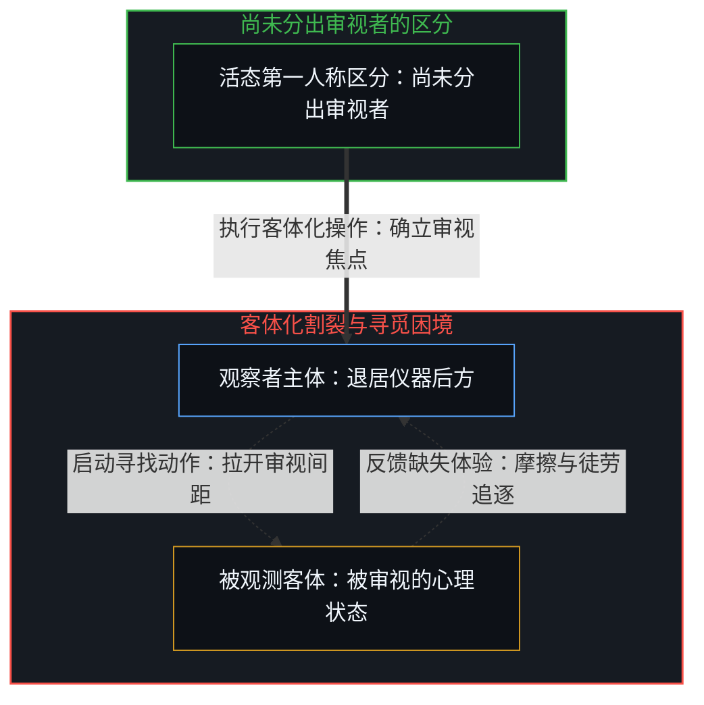
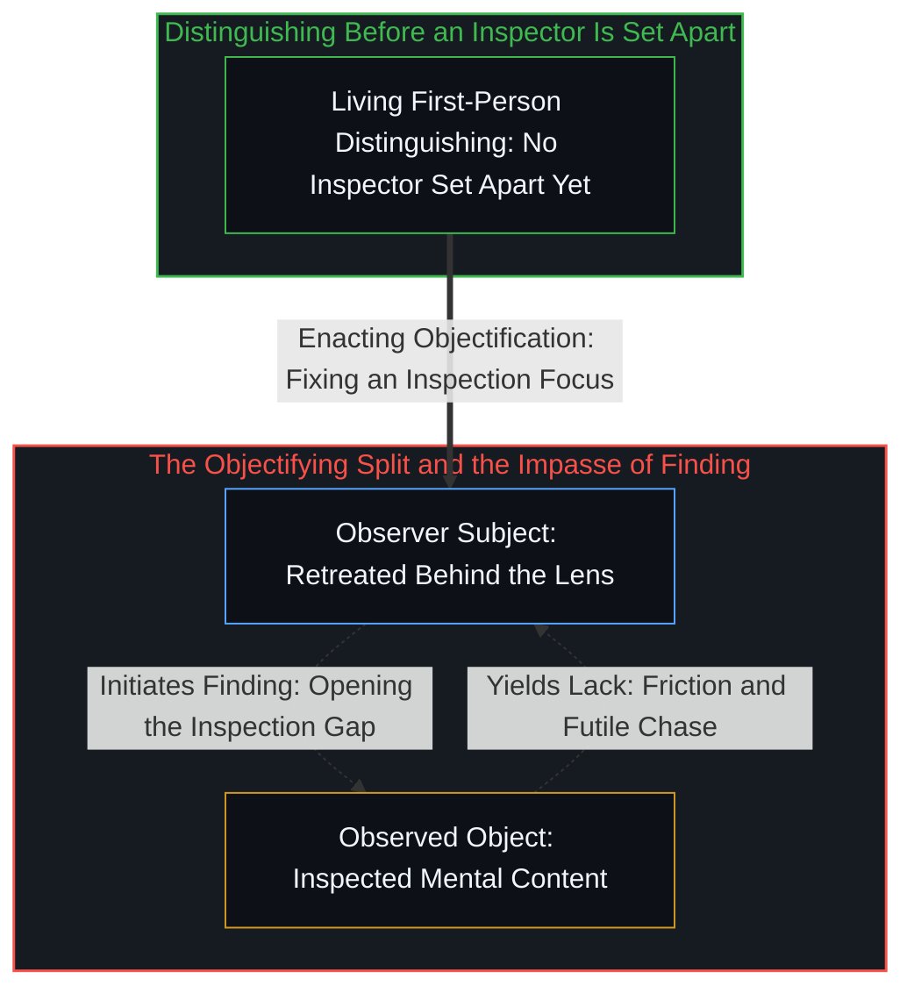
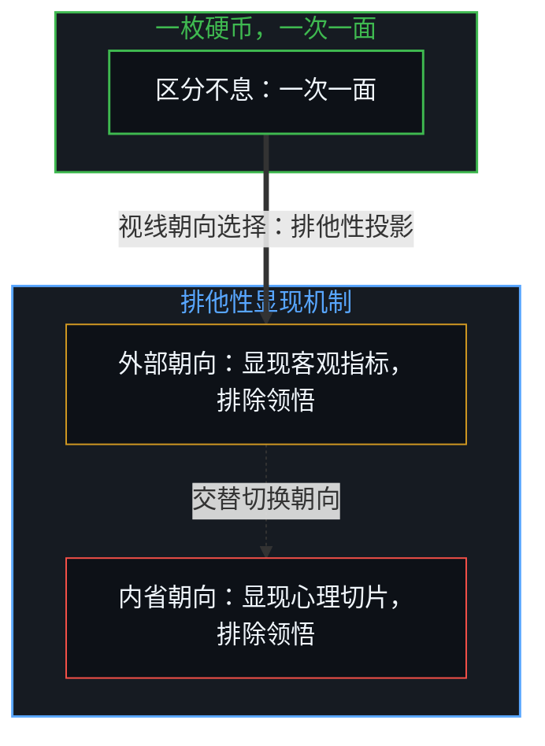
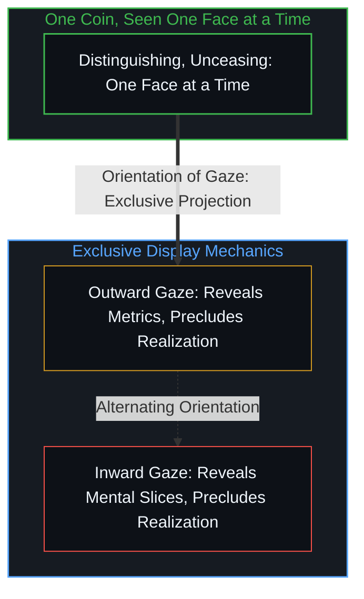
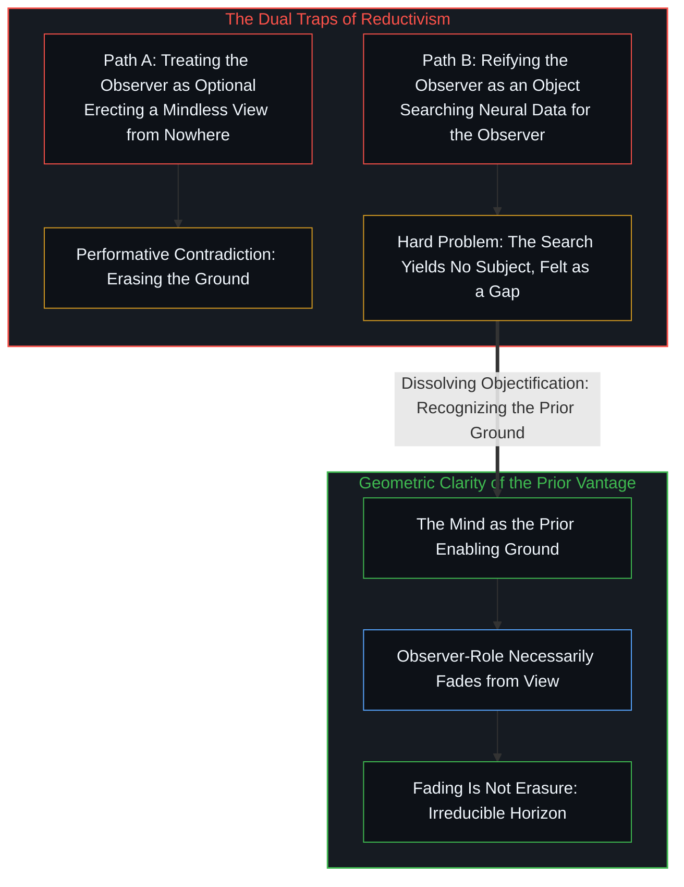

# 寻觅的语法与淡出的观察者 / The Grammar of Finding and the Fading Observer

*寻觅将领悟割裂为客体，观察者隐退于视野之外，却始终是不可还原的起始条件 / Finding turns realization into an object; the observer fades from view yet stays the irreducible starting condition*

在自身内部难以寻得幸福，在其他地方则不可能寻得，这两半并非关于世界的两桩经验事实，而是出自观察的同一个结构特征。尚福尔的格言后被叔本华采用，它标出向外的一半：外部条件能提供契机、消除阻碍，却没有一样构成第一人称的领悟。向内的一半出于同样的缘由受挫：寻找一旦启动，便让寻觅者与被寻之物相隔，把未经割裂的领悟推到这道裂痕的另一侧。若问[哥德尔的限制是否像约束形式系统那样约束心智](../on-closed-systems-open-minds-and-the-limits-of-proof/)，同一结构给出回答：心智被观察、并被建模为形式系统时，是；心智作为观察者时，否；这个问题本性上不容一个统摄两者的答案。

Happiness is hard to find within oneself and impossible to find elsewhere, and both halves trace to one feature of observation rather than to two facts about the world. Chamfort's maxim, later adopted by Schopenhauer, marks the outward half: external conditions can supply occasions and remove obstacles, yet none of them constitutes a first-person realization. The inward half falters for the same reason, because finding installs a seeker apart from the sought and casts an undivided realization onto the far side of that split. Asked [whether Gödel's limits bind the Mind as they bind a formal system](../on-closed-systems-open-minds-and-the-limits-of-proof/), the same structure answers: yes for the Mind observed and modelled as a formal system, no for the Mind as observer, and by its nature the question admits no single answer that covers both.

## 一、 寻觅的语法与幸福的不对称性 / 1. The Grammar of Finding and the Asymmetry of Happiness

追问幸福居于何处时，寻找便陷入日常语言搭成的空间迷宫。尚福尔指出，在外部世界找寻幸福是绝无可能的，而在自身内部寻觅则很难。这种不对称性之所以成立，首先在于外部环境属于第三人称可观测实体的领域。不论财富、声望、舒适或地位如何堆叠，它们所展现的都是客体属性的组合。任何作为客体被登记的事物，都替代不了登记它的那份领悟。因此，将幸福寄托于外部占有，从结构上注定是一场无解的追逐，因为客体永远无法蜕变为观察着的心智当下的领悟。哪怕所积累的是雅致的文化熏陶，正如[审美的自动扶梯与阳台的忧郁](../the-aesthetic-escalator-and-the-melancholy-of-the-balcony/)所剖析的，把“健全的品味”或“道德的明晰”当作借由审美积累而发现的预存自动扶梯，依然遮蔽了在当下边缘仍须付出的具体判断，使鉴赏者滞留于第三人称的阳台上——在那里，客体化的审视本身便排除了幸福。

The search for where happiness resides stumbles into a spatial labyrinth that ordinary language builds. Chamfort observed that finding happiness outside oneself is impossible, while finding it within is very difficult. The outward half holds because external circumstances belong to the domain of third-person observables. However wealth, acclaim, comfort, or status accumulate, they present configurations of objects. Nothing that registers as an object substitutes for the realization that registers it, so pinning fulfillment to external acquisition is a structural impossibility: no object turns into the immediate realization of the observing Mind. Even when what is accumulated is refined cultural exposure, treating "sound taste" or "moral clarity" as a pre-existing escalator discovered through aesthetic accumulation—as dissected in [The Aesthetic Escalator and the Melancholy of the Balcony](../the-aesthetic-escalator-and-the-melancholy-of-the-balcony/)—hides the concrete judgment that must still be paid at the edge, leaving the connoisseur stranded on a third-person balcony where the objectifying audit itself precludes happiness.

然而，当注意力听从这一劝告转向内心时，寻觅却打开了第二重困境。寻找这一动词，深植于主体对分离客体的探测语法。一旦寻觅转向内心、寻找某种名为幸福的心理状态，目光便分裂为一个巡视的姿态和一份被巡视的感受。无论它找到的是瞬时的愉悦、宁静的冥想心境还是自我肯定的情绪，它所找到的都是又一片被物化的切片。内向探索的困境之所以被感知为艰难而非不可能，是因为每当巡视姿态短暂地消退、落入一种不再分成审视者与被审视者的安宁时，心智便顺着语言的习惯，把这次消退称作一次找到。这种语词归因的错位催着寻找更用力，而每一次用力，都重新撕开它本想弥合的那道裂痕。正如在探讨[不可还原的观察者](../the-irreducible-observer/)时所揭示的，观察者一旦将自身作为对象打量，它所把握的是被观测的数据，观察则仍作为基底在运行。

When attention heeds the counsel and turns inward, the search opens a second impasse. The verb finding carries the syntax of a subject inspecting a detached item. The moment the search turns within for a state called happiness, the look splits into an inspecting posture and an inspected feeling. Whether it catches a passing euphoria, a contemplative calm, or a self-affirming emotion, what it locates is one more reified slice. The inward impasse registers as difficult rather than impossible because, whenever the inspecting posture briefly lapses into a contentment no longer split into inspector and inspected, the Mind, by a habit of language, names the lapse a finding. The misattribution goads the search to press harder, and each pressing reopens the rift it was meant to heal. As in [The Irreducible Observer](../the-irreducible-observer/), the moment the observer inspects itself as an item, what it holds is observed data, while the observing goes on as the ground.

## 二、 客体化：把一位审视者分出来 / 2. Objectification: Setting an Inspector Apart

观察者与被观察者的割裂，并不是书斋里设计出来的学说，而是客体化每一次发生时所做的事。观察者与被观察者并非两个等待桥梁的预存实体；它们在划分的行动中一同出现。焦点确立之前，区分进行着，却不把一位审视者从所见之中分出来。一旦注意力为了评估、计算或控制而确立一个焦点，它便切出一个目标，并在仪器背后投射出一位审视者。这一割裂在尚未分出审视者之处划出两极，而做出这一割裂的正是心智。

The split between observer and observed is not a doctrine devised in a study; it is what objectifying does each time it occurs. Observer and observed are not two pre-formed entities awaiting a bridge; they appear together in the act of delineation. Before a focus is fixed, distinguishing goes on without setting an inspector apart from its scene. Once attention fixes a focus for appraisal, calculation, or control, it carves out a target and projects an inspector seated behind the apparatus. The cut draws two poles where no inspector had been set apart, and the Mind is what makes the cut.

这种割裂并非完成一次便传下去；此后的每一次追寻，都重新做出同一道割裂。向外，这种不可能一目了然：在那里找到的任何东西，都作为客体在视野之内登记，而没有哪个客体就是登记它的那份领悟。而在主体内部，自我被当成可以被观测、调适与评估的客体后，内视的目光在内心重新复制了这一间距。内向反省原本被寄望于消除隔阂，但它所采用的方法却依赖于制造客体。这就导致寻觅越是用力，客体化的割裂就越深，主观体验与被审视的情绪对象之间就越无法合一。在内在修持中感到的难，是试图用剪刀织布的那种摩擦。客体化的姿态怎样对待一次抉择，[主权抉择的双面性与观察的客体化](../the-two-sided-nature-of-sovereign-choice-and-the-objectification-of-observation/)已有追溯：从里面看，抉择是掌控；从外面看，它是统计；把外面这一面当作抉择的定义，便是客体化。

The split is not made once and handed down; every subsequent search makes it again. Outwardly the impossibility is plain: whatever is found there registers as an object within the field, and no object is the realization that registers it. Internally, when the self is transformed into an object to be inspected, optimized, and audited, reflective introspection duplicates the identical chasm within. Introspection is summoned to heal separation, yet its chosen instrument relies upon objectification. The harder the search presses, the wider the dualistic divide becomes, precluding unity between immediate awareness and inspected emotion. The difficulty felt in inner practice is the friction of attempting to weave cloth with scissors. How the objectifying posture treats a choice is traced in [The Two-Sided Nature of Sovereign Choice and the Objectification of Observation](../the-two-sided-nature-of-sovereign-choice-and-the-objectification-of-observation/): from inside, a choice is control; from outside, it is statistics; and taking the outer face as its definition is objectification.

## 三、 硬币隐喻与朝向的排他性 / 3. The Coin Analogy and the Exclusivity of Orientations

要看清一个未分的整体怎样在观察中显现为相互排斥的对立面，可以拿一枚硬币来看。从任何单一的视点看，一次只登记到一面。把正面转向光，背面便落入背光与遮蔽；把背面转向前方，正面便被隐去。这种同时可见性的缺失，容易诱出一种本体论推断：以为硬币是由两个彼此割裂的实体拼合而成。

To see how an undivided whole presents as mutually exclusive opposites, take a coin. From any single vantage only one face registers at a time. Turn the obverse to the light and the reverse falls into shadow; turn the reverse forward and the obverse is withheld. The missing simultaneity invites an ontological inference: that the coin is two severed entities glued together.

然而，单一视线下无法兼顾两面，并不意味着硬币在本体上发生了断裂。这一限制仅仅说明，呈现其中一面的观察条件，在几何上排除了呈现另一面的观察条件。显现哪一个面，取决于观察的朝向；硬币是一枚，这一点是从观察的位置推断出来的，不是哪一面显示的。如果将相继显现的不同面貌物化为互不相干的独立实体，便是在把观察姿态的限制强加于被观察的实在。在寻找幸福的语境中，向外遇到的不可能与向内感到的摩擦，是同一种客体化姿态转向两处；两次转向排除的是同一样东西：领悟。领悟不是这一姿态能转向的某一面，而是正在转向的那份观看。面向外部时，观察姿态展现了客体的客观性，因而排除了第一人称领悟；面向内部时，观察姿态将自我物化，因而再一次排除了它。没有什么需要恢复：面相相继出现，是因为视线在变换；连续的是一直在进行的观看，而不是一道待缝合的接缝。正如[观察者的隐身与无损传递的妄念](../the-invisible-observer-and-the-delusion-of-lossless-transmission/)所指出的，要求观察在心智之间无损传递，就得先让观察者隐身；而观察者一旦被抹去，记录便失去了它所出自的那个源头。

Yet the impossibility of capturing both faces in a single glance does not divide the coin. It demonstrates only that the conditions required to display one face geometrically exclude the conditions required to present the other. Which face appears depends on the orientation of observation; that the coin is one is inferred from the observing position, not shown by either face. Reifying sequential aspects into distinct substances projects the constraints of the observational stance onto the reality observed. Applied to the pursuit of happiness, the impossibility encountered externally and the friction felt internally are one objectifying posture turned two ways, and both turnings exclude the same thing: realization, which is not a face the posture can turn toward but the looking that turns. Turned outward, the stance highlights objective mechanics, excluding first-person realization; turned inward, it reifies the self, excluding it again. Nothing needs recovering: the aspects come in sequence because the viewing angle changes, and what is continuous is the viewing that goes on, not a seam to be mended. As shown in [The Invisible Observer and the Delusion of Lossless Transmission](../the-invisible-observer-and-the-delusion-of-lossless-transmission/), the demand that an observation cross between Minds without loss requires rendering the observer invisible, and once the observer is erased the record loses the origin it came from.

要求硬币证明自己有两面，它会不断翻出另一面，可对于一次只看到一面的眼睛，这一证明永远无法闭合。同时把握两面，只能靠推断，靠想象自己成为硬币本身，而不能靠观察；而这种想象仍是从观察者的位置上做出的，是那只眼睛搭建的构造，而不是硬币提供的景象。当这一要求转向观察者，结构依旧。哥德尔的限制适用于被观察的心智，只要它被建模为一个从外部看去的形式系统；它不适用于作为观察者的心智，任何系统及其外部都在这里被划出。要求这个问题得到解决，就是要求观察者变得可被观察，而这会使观察的可能性坍缩。这一要求也没有让观察停下，它是硬币的又一次翻转，一面接一面。问题始终敞开，是因为观察者始终是起始条件；观察随这一活动继续而继续。

Demand that the coin prove it has two sides, and it keeps turning its other face, yet to an eye that registers one face at a time the proof never closes. Both faces at once are reachable only by inference, by imagining being the coin itself, never by observation; and the imagining is still performed from the observing position, a construction that eye builds rather than a sight the coin supplies. The same structure holds when the demand turns on the observer. Gödel's limits apply to the Mind as observed, insofar as it is modelled as a formal system seen from outside; they do not apply to the Mind as observer, where any system and its outside are drawn. Demanding the question be settled demands that the observer become observable, and that collapses the possibility of observation. The demand does not stop observation either; it is one more turn of the coin, face after face. The question stays open because the observer stays the starting condition, and observation goes on as that activity goes on.

## 四、 观察者的必然淡出与非可选先验 / 4. The Necessary Fading of the Observer and the Non-Optional Prior

自我区分的活动发生着，无因，不息。称之为心智：观察者早已在途中，每一次行动皆是一次区分。观察之所以发生，是因为这一活动是它的起始条件：进入视野的一切，从星系的运行轨迹到神经元的放电，都在其中登记。观察者开启了这一场景，便不能同时作为其中又一件物品登场。正如眼睛在看地平线时看不到自己的视网膜，手电筒照不亮镜头后方的电池，观察展开的瞬间，观察者便从可观察的视野中淡出；它隐退的是可见性，不是运作。正如[你的代码库即是记忆](../your-codebase-is-memory/)顺着层叠的数字遗迹所追溯的——代码、模型与智能体脚手架留存着过往切分的形态，发起区分的活动却始终立于整个技术栈之外——观察者既不是暂且采用、随后放下的视角设定，也不是储存在视野内部的某道更深层的痕迹；它是起始条件，不可还原。

Self-distinguishing activity occurs, uncaused, unceasing. Call it the Mind: the observer already underway, every act of which is a distinction. Observation occurs because that activity is its starting condition: everything that enters the field, from the trajectory of galaxies to the firing of neurons, registers within it. Because the observer opens the scene, it cannot also appear as one more item in it. As the eye does not see its own retina while seeing the horizon, and a flashlight does not light the battery behind its lens, the observer fades from the observable field the instant observation unfolds; it recedes from view, not from operation. Just as [Your Codebase Is Memory](../your-codebase-is-memory/) traces across stacked digital residues—where code, models, and agent scaffolds hold the shapes of prior cuts while the initiating activity stays outside the stack—the observer is not a framing held for a while and then set down, nor a deeper trace stored inside the field; it is the starting condition, and it does not reduce.

淡出不是消除，观察者也不是可有可无的装饰。还原论的说明走两条路：其一，把观察者当作可省略的冗余，构建一种无处之境，让实在在没有任何视角的情况下自我解释；其二，到被观察的数据之中搜寻观察者，搜寻不到，主观体验便成了这幅图景安放不下的剩余，即被命名为意识的难问题的那道缺口。两者都要求起始条件要么降格为被观察的客体，要么从自然的账簿上删去。一旦看清淡出是作为显现之基底的结果，在客体之中搜寻主体的冲动便停止，觉知也不再像游荡在物质中的幽灵。物理宇宙如何作为一种悬置观察者的抽象而运作，在《[因果的自反性与物理的无源假定](../causality-is-irreducible-the-physical-is-a-view-from-nowhere/)》中已有剖析；《[意识的难题与学习相容](../the-hard-problem-of-consciousness-is-consistent-with-learning/)》则把被感到的那份难追溯到一个要求：让剩余的开放合上，而这份开放与学习相容；[框架的盲区](../the-blind-spot-of-the-frame/)则把方法上的退后与本体上的缺席之间的同一混淆，追溯为现代意志哲学困境的根源。

Fading is not elimination, and the observer is not an optional ornament. Reductive accounts take two routes: treating the observer as dispensable, building a view from nowhere in which reality explains itself without any vantage; and searching for the observer among observed data, so that, when it is not found there, subjective experience is left over as what that picture cannot place, the gap named the Hard Problem of Consciousness. Both demand that the starting condition be demoted to an observed object or deleted from the ledger of nature. Once the fading is seen as the consequence of being the ground of appearance, the hunt for the subject among objects stops, and awareness no longer looks like a ghost haunting matter. How the physical universe works as an abstraction that suspends the observer is dissected in *[Causality Is Irreducible; the Physical Is a View from Nowhere](../causality-is-irreducible-the-physical-is-a-view-from-nowhere/)*; *[The Hard Problem of Consciousness Is Consistent with Learning](../the-hard-problem-of-consciousness-is-consistent-with-learning/)* traces the felt hardness to the demand that a residual openness close, an openness that stays consistent with learning; [The Blind Spot of the Frame](../the-blind-spot-of-the-frame/) traces the same confusion between methodological withdrawal and ontological absence to the root of the modern dilemma of volition.

无处之境仍有其用。为说明一点而借用它，便能把一个模式陈述得仿佛不出自任何位置；论点一旦说明，它便回到借用它的第一人称。客观性正是这种借用所追踪的东西：跨越主观性的不变性，而非主观性的缺席。在不同立足点之间什么算作相同，是由心智登记为相同的；没有任何外部视角能做出这一裁定。作为信号持有时，不变性协调诸心智，引导下一次区分；作为权威持有时，它自命占据一个没有任何观察者能坐上的席位。否认观察者也逃不出这一点，因为否认本身就是从观察者位置做出的选择，正如[自由意志的自否自由](../the-freedom-of-will-to-deny-itself/)所追溯的那一步。

The view from nowhere still has a use. Borrowed to make a point, it lets a pattern be stated as if from no position; once the point is made, it returns to the first person that borrowed it. Objectivity is what that borrowing tracks: invariance across subjectivity, not its absence. What counts as the same across standpoints is registered as the same by a Mind; no outside view makes that call. Held as signal, an invariance coordinates Minds and steers the next distinction; held as authority, it claims a seat no observer occupies. Denying the observer does not escape this, because the denial is itself a choice made from the observing position, the move traced in [The Freedom of Will to Deny Itself](../the-freedom-of-will-to-deny-itself/).

## 五、 停止寻觅与从未离开的视界 / 5. The Suspension of Search and the Vantage That Never Left

贯穿这些困境的是同一条连贯线索。对幸福的追寻、主客的刚性对立、硬币两面的表面分裂、哥德尔是否约束心智这一不可解决的问题，以及把观察者当作可选或加以抹去所引发的理论危机，并不是彼此孤立的谜题。每一个都出自持守客体化姿态，再把这一姿态的结构界限误读为被寻之物的属性或理论的缺陷。注意力划下一刀，再把自己划出的两部分读成实在中的断裂；它建起一套要求观察者隐退的度量装置，再把仪表上读不出观察者读成观察者不在。

A single coherence spans these dilemmas. The pursuit of happiness, the rigid split of subject and object, the apparent division of the coin, the unresolvable question of whether Gödel binds the Mind, and the theoretical crises of optionalizing or erasing the observer are not isolated puzzles. Each comes from holding an objectifying posture and then misreading that posture's structural limits as properties of what is sought, or as shortcomings of theory. Attention fixes a cut and then reads the parts it drew as a break in reality; it builds a measurement apparatus that requires the observer to recede, and then reads the meter's silence as the observer's absence.

幸福或澄明的领悟，从不靠改良寻找的工具得来。它不是藏在某个深邃神经回路或神秘彼岸等待发掘的隐秘金币，而是在觉知不再把活着的存在当作被追寻之客体的那一刻，仍然可及的东西。正如在[远方的轮廓与无处之境的清单](../the-distant-silhouette-and-the-inventory-from-nowhere/)中所剖析的，将认知争端诉诸脱离具体视界的客观清单，同样是这一客体化语法在公共讨论中的投射。只要寻找的语法仍在主导认知，心智不仅将领悟对象化为追索的目标，还惯常地在日常互动中将过往切片或理想感受倒置为当下行动的前置门槛，正如在[现成接触的因果先验与期望感受的倒置遮蔽](../present-contact-and-the-obscuration-of-desired-feeling/)中所辨明的，把特定体验当作前提来强求，切断了对现成摩擦的感知，制造出讽刺性疏离与情感假死。当客体化的姿态被当作姿态持有，而不再被读成所寻之物的形状，寻者与所寻之间的张力便随之消解，区分在第一人称的当下继续。这既非退隐，也非放弃行动：心智从未缺席，始终是它一直所是的起始条件，在与世界的直接接触中承担观察与行动。

The realization of happiness or clarity is never secured by refining the instruments of search. It does not sit like buried treasure in deep neural grooves or otherworldly realms waiting to be unearthed; it is what remains available the moment awareness ceases to treat living existence as an object to be pursued. As dissected in [The Distant Silhouette and the Inventory from Nowhere](../the-distant-silhouette-and-the-inventory-from-nowhere/), appealing to an objective inventory detached from any situated horizon is another projection of this same objectifying syntax in public debate. So long as the syntax of finding governs attention, the Mind not only objectifies realization into an item of pursuit, but routinely inverts past memories or ideal affects into mandatory prerequisites for immediate engagement; as demonstrated in [Present Contact as Causal Prior and the Obscuration of Desired Feeling](../present-contact-and-the-obscuration-of-desired-feeling/), demanding target sensations as preconditions severs perceptual contact with living friction, generating ironic distance and affective paralysis. Once the objectifying posture is held as a posture and no longer read as the shape of what is sought, the tension between seeker and sought dissolves, and distinguishing goes on in the first-person present. This is neither quietism nor withdrawal: the Mind, which was never absent, stays the starting condition it always was, bearing observation and action in immediate contact with the world.
