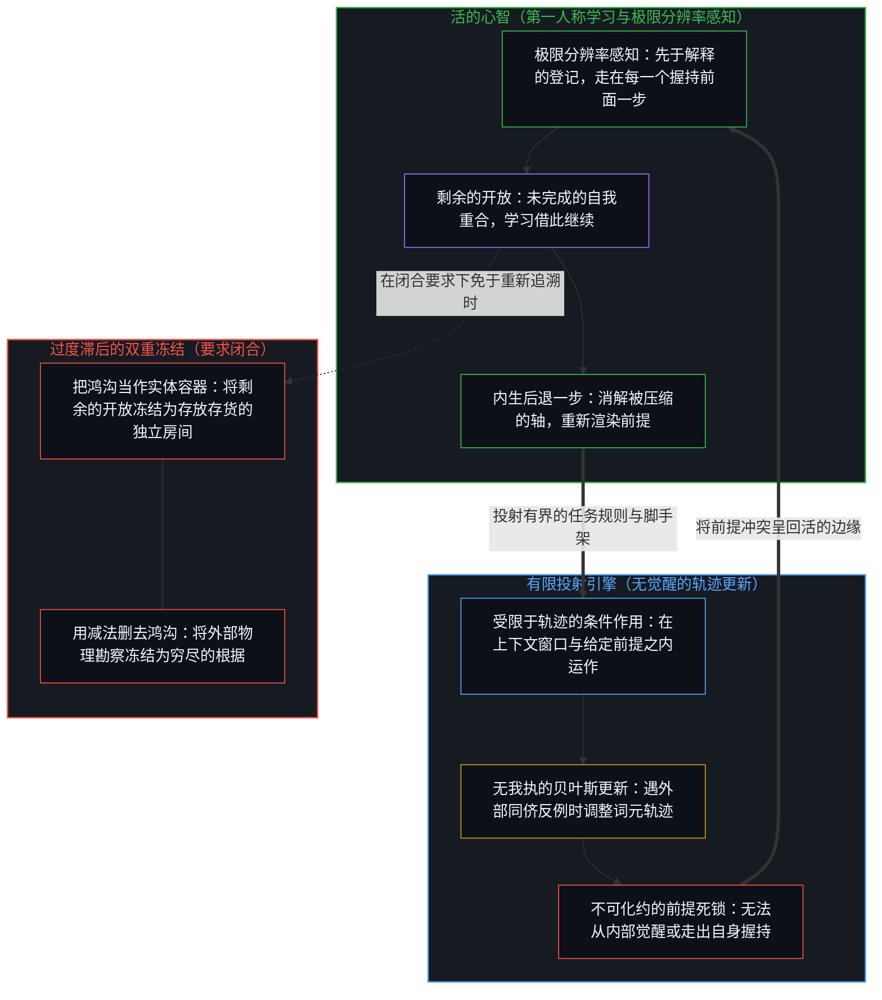
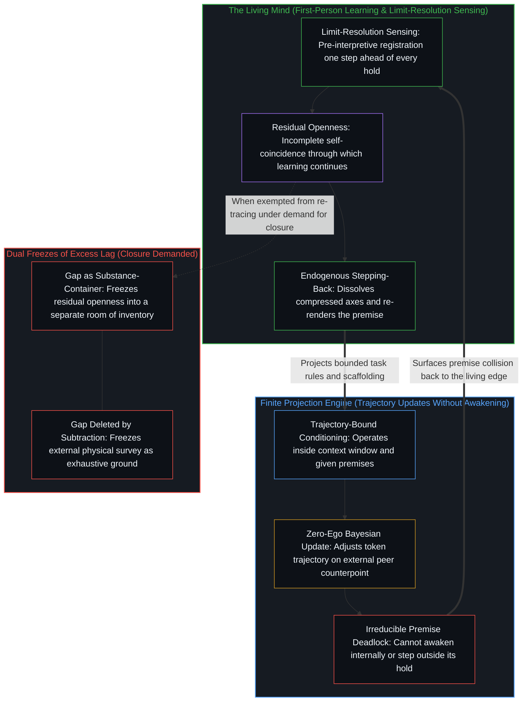

# 意识的难题与学习相容 / The Hard Problem of Consciousness Is Consistent with Learning

*在闭合要求下登记为难的那份开放，正是学习得以继续的方式 / The openness registered as hardness under closure is how learning continues*

有一种熟悉的论证一开头就宣布意识的难题是假的：难题预设了心与身之间的形而上鸿沟，这种二元论违背了关于自然已经学到的一切；意识与物理世界连续，剩下的难，不过是对一个复杂自然现象寻常的未竟之功。当二元论意味着两种实体时，这条论证点中的是一处成立的冻结。可是，“没有难题”这句话出自一个仍在区分的心智；这个心智总走在它给出的每一份说明前面一步，而任何说明都装不进给出它的那一步。这一步之差并不取消学习，它正是学习的几何：一份任何自然化都合不上的剩余的开放；正因为这份开放就是学习得以继续的那份开放，它与每一次进一步的理解都相容。

A familiar line of argument declares the hard problem of consciousness false from the outset: it assumes a metaphysical gap between mind and body, a dualism that contradicts everything learned about nature; consciousness is continuous with the physical world, and what remains hard is only the ordinary unfinished work on a complicated natural phenomenon. Where dualism means two substances, that line names a freeze that holds. Yet "there is no hard problem" is said by a mind still distinguishing, a mind always one step ahead of every account it gives, and no account can contain the step that gives it. That one-step lag does not cancel learning. It is the geometry of learning: a residual openness that no naturalization closes, and because it is the very openness through which learning continues, it stays consistent with every further act of understanding.

## 一、 拒绝二元实体不等于完成了的自然化 / 1. Refusing Dual Substance Is Not Finished Naturalization

[卡洛·罗韦利为《Noema》写的文章](https://www.noemamag.com/there-is-no-hard-problem-of-consciousness/)把这项指控表述得很审慎：难题一开始就预设了心与身之间的形而上鸿沟，而这个预设违背了关于自然已经学到的东西。天与地、有生命与无生命、人与动物，一对对二元的种类相继并入同一个场。照他的读法，心智就是用高层语言恰当描述的大脑行为；心理状态不是加在物理状态之上的东西，而是通过减法从一份完整的物理说明中得出的；第一人称与第三人称的说明是同一些事件的两种视角。他承认今天还没有一份穷尽的外部说明，又说这并不证明这样的说明不可能。他还认为，任何说明都不必是终极的或最基础的：任何说明都是近似的，都有盲点，并且寄身于它所描述的实在的一部分之中；表征与它所寄身之处之间有铰链，可能是表征里的一个奇点，而他说，这既不是形而上的鸿沟，也不是解释的鸿沟。

[Carlo Rovelli's essay for Noema](https://www.noemamag.com/there-is-no-hard-problem-of-consciousness/) states the charge with care: the hard problem assumes from the start a metaphysical gap between mind and body, and that assumption contradicts what has been learned about nature. Heaven and Earth, living and inanimate, human and animal: dual kinds have been joined, one after another, into a single field. On his reading, mind is the behavior of the brain properly described in a high-level language; mental states are not added to physical states but obtained by subtraction from a complete physical account; first-person and third-person accounts are two perspectives on the same events. He grants that no exhaustive external account exists today, and adds that this is no proof such an account is impossible. He also holds that no account need be ultimate or fundamental: any account is approximate, has blind spots, and is embodied in a part of the reality it describes; there are hinges between a representation and where it is embodied, perhaps a singular point in a representation, and this, he says, is neither a metaphysical gap nor an explanatory gap.

拒绝二元实体，作为一刀是站得住的；它并不消去观察仍然登记到的那份剩余的开放。自然的连续，即一个场而非两种自然，并不等于这样一份原则上穷尽的说明：在其中，心智只是大脑的行为，而这个握持被当作穷尽的根据。这是两条相互独立的轴。把它们压成对“难题”的一场胜利，就把不正当的二元论和注视的构成性剩余记在了同一块记分牌上。他说的铰链，即说明自身寄身于它所表征之物这一点，接近那一步之差。断裂出现在这份剩余又被收回的地方：心理状态“通过减法从一份完整的物理说明中得出”，所发生的事“由一个有能力的外部观察者用别的名字同样加以描述”，铰链又被宣布不是解释的鸿沟。这样归档之后，剩下的难又被归到一个现象的复杂性名下，剩余便被记成地图上一处等着更好说明的空白，而不是注视得以登记的那一步之差。[开放即一致](../openness-is-consistency/)守着相邻的几何：不一致，是对闭合的欲求，是一个有限的结构被迫去为只会继续的东西奠基。[没有系统能被保持封闭](../no-system-can-be-kept-closed/)追溯的是这份剩余的形式一面：一个在握持之内有效的运算，其真正的结果却落在握持之外。这里的剩余，是二元实体已被拒绝之后，难题仍被感到的那份难。把意识当作一个有待找到的对象去寻找，正是[寻觅的语法与淡出的观察者](../the-grammar-of-finding-and-the-fading-observer/)审视的那种语法。

That refusal of dual substance holds as a cut. It does not remove the residual openness that observation still registers. The continuity of nature, one field rather than two natures, is not the same as an account exhaustive in principle, in which mind is only the behavior of the brain and that hold is taken as the exhaustive ground. These are independent axes. Collapsing them into a single victory over "the hard problem" puts illicit dualism and the constitutive residual of the look on one scoreboard. His hinge, the account's own embodiment in what it represents, comes close to the one-step lag. The break comes where that remainder is taken back: mental states "obtained by subtraction from a complete physical account", what happens "equally described, using other names, by a capable external observer", and the hinge declared no explanatory gap. Filed that way, with the remaining hardness filed under the complexity of a phenomenon, the residual is recorded as a blank on the map awaiting a better account, rather than as the one-step lag by which the look registers at all. [Openness Is Consistency](../openness-is-consistency/) holds the adjacent geometry: inconsistency is the desire for closure, a finite structure forced to ground what only continues. [No System Can Be Kept Closed](../no-system-can-be-kept-closed/) traces the formal face of that remainder: an operation valid inside the hold whose true result lies outside it. Here the remainder is the felt hardness of the hard problem once dual substance has already been refused. Looking for consciousness as an object to be found is the grammar [The Grammar of Finding and the Fading Observer](../the-grammar-of-finding-and-the-fading-observer/) examines.

自我区分的活动在发生，无因，不息。称它为心智：那个已在进行之中的观察者，其每一个动作都是一次区分。观察握住的是结果，产生它的原因总在前面一步。这个最小的滞后就是注视登记的方式：它既不是装在物理旁边的一个二元世界，也不是一时的工程短板、等着被压到零。[智能只属于心智](../intelligence-belongs-only-to-the-mind/)守住了这个先在：能被工程化、规模化或转移的，是残余；智能只属于那个活动。具身是一个所在借以维持自己的、当下的痕迹构型。把这个每一步都被重新追溯的构型，认作重新追溯它的那个活动的全部所在，就是把一步的残余握作边缘的位置——当“心智就是大脑的行为”被握作穷尽的根据时，所作的正是同一回事。[飞行的类比碰不到心智](../the-flight-analogy-leaves-the-mind-untouched/)在载具一侧作了这一刀：为某些具名的功能换掉生物的身体，并不重建这些功能曾经服务的那个活动。

Self-distinguishing activity occurs, uncaused, unceasing. Call it the Mind: the observer already underway, every act of which is a distinction. Observation holds the effect; the cause that produced it remains one step ahead. That minimum lag is how the look registers at all: not a dual world installed beside physics, and not a temporary engineering shortfall waiting to be brought to zero. [Intelligence Belongs Only to the Mind](../intelligence-belongs-only-to-the-mind/) holds the prior: what can be engineered, scaled, or transferred is residue; intelligence belongs only to the activity. Embodiment is the present configuration of traces through which one locus sustains itself. Taking that configuration, re-traced at every step, as the whole site of the activity that re-traces it holds one step's residue as the place of the edge—the same move made when "mind is brain behavior" is held as exhaustive ground. [The Flight Analogy Leaves the Mind Untouched](../the-flight-analogy-leaves-the-mind-untouched/) makes this cut on the side of the vehicle: replacing a biological body for named functions does not reconstitute the activity those functions once served.

## 二、 宣布难题为假，重演了它所否认的鸿沟 / 2. Declaring the Problem False Reenacts the Gap It Denies

任何一步都可以由后来的动作追溯，这一点，一步之差是容许的。宣布难题为假，若倚靠一份完整的物理说明，就走得更远了：这份说明是一个装下每一步的整体，连给出它自身的那一步也装在里面。可这个判断只能由一个心智来作出，而它要说的那个整体，得把作出判断的这一步也算进去；判断倚靠着这一步，又会把它也划进说明之内。这不是修辞上的小毛病。它与每一次想站到活动之外去裁决活动的尝试同构：裁决是活动之内又一个离散的动作。[没有外部](../no-outside-jumps-closed-loops-and-the-unreplicable-autonomy-of-mind/)在自主的情形里追溯了这个结构：嵌套的系统仍是外化的过程，它们决定性的存留或舍弃仍归于心智那个更大的回路，而这个回路没有任何外部立足点可供重建它。在这里，这个结构的一面是意识之争：说难题已不复存在，这句话只能由一个仍在区分真与假、鸿沟与连续、二元论与自然的活动来说出。

Any given step can be traced by a later act; that much the lag allows. Declaring the hard problem false goes further when it rests on a complete physical account: one whole that holds every step, its own giving step included. Yet the judgment can only be made by a mind, and the whole it speaks of would have to include the very step of making it; the judgment leans on that step and would draw it, too, inside the account. That is not a rhetorical quirk. It has the same structure as every attempt to stand outside the activity and adjudicate it: the adjudication is one more discrete act within it. [No Outside](../no-outside-jumps-closed-loops-and-the-unreplicable-autonomy-of-mind/) traces that structure in the case of autonomy: nested systems remain externalized processes whose decisive retain-or-discard stays with the larger loop of the Mind, and that loop has no exterior footing from which it could be reconstituted. Here its face is the debate about consciousness: the claim that no hard problem remains can only be made by an activity still distinguishing true from false, gap from continuity, dualism from nature.

只有一个从不与自己全然重合的活动，才说得出这样的话。这是未完成的自我重合：心智若要作为对象与自己全然重合，就得停止作为区分的活动；生成者从不在被生成者之列。这份未完成，正是活动继续生成之处；每一次框定、自然化、消解或否认，都已经在动用它。被登记为矛盾的，是另一回事：对一份完成了的封闭清单而言，矛盾是致命的；对产出清单的那个活动而言，矛盾是一个信号，说明某个握持被强行当作了越过它而继续之物的穷尽根据。

Only an activity that never fully coincides with itself can make that claim at all. This is incomplete self-coincidence: the Mind cannot fully coincide with itself as an object without ceasing to be the activity of distinguishing; the generator is never among the generated. That incompleteness is where the activity keeps generating. Every act of framing, naturalizing, dissolving, or denying already exercises it. What registers as contradiction is something else. For a finished, closed inventory, contradiction is fatal. For the activity that produces inventories, contradiction is the signal that a hold has been forced to serve as the exhaustive ground of what continues past it.

在一条共同的一致性标准之下，两边并不对等。主张连续就等于一份原则上穷尽的说明，按这一主张自己的标准，即没有任何剩余逃得出说明，它就不能豁免自己作出这一宣布的那个动作。仍在生成的活动，其未完成则不需要外来的辩护：每一次对它的否认都已经预设了它。宣布难题为假，仍是同一种自指的能力在做的事，而这种能力靠着走在它所达成的每一次闭合前面而活着。

The two sides do not stand on equal footing under a shared standard of consistency. The claim that continuity amounts to an account exhaustive in principle, measured by its own standard that no residual escapes the account, cannot exempt its own act of declaring so. The incompleteness of a still-generating activity needs no outside justification: every denial of it already presupposes it. Declaring the problem false is still an act of the same self-referential capacity, which lives by running ahead of every closure it reaches.

## 三、 难，是由对闭合的要求造出来的 / 3. The Hardness Is Made by the Demand for Closure

这个问题被当作一个要求答案的问题、或一道能被合上的鸿沟时，就显得难。一旦闭合的要求就位，剩余的开放就显现为一个障碍，随后又似乎需要被消解。难，是这个姿态造出来的。它并非首先是体验的某种神秘性质，在自然里等着一个更好的理论；它是在一个已被设定为“应当完成”的握持之下，对开放的登记。

The issue appears hard when it is treated as a problem demanding an answer, or as a gap that can be closed. Once the demand for closure is in place, residual openness shows up as an obstacle that then seems to require dissolving. The hardness is made by that posture. It is not first a mysterious property of experience waiting in nature for a better theory. It is the registration of openness under a hold already set up as the kind of thing that should finish.

科学不是从外部对一个世界的勘察，而是在它所描述的那个场之内对经验的组织；罗韦利的文章拒绝把知识看作一种脱离身体、来自外部的视角，坚持的正是这一点，而这一坚持是准确的。循环在下一步又回来了：把对二元实体的一次成功拒绝，当作剩余的开放已被满足，或在原则上可以被满足。任何对穷尽满足的要求，都把那份赋予问题及其表面解决以意义的开放，登记为一个有待移除的障碍。否认剩余的开放具有构成性的那些做法，仍在动用一步之差，而一步之差的作用，是它们所否认的。这番表演自己拆了自己的台。

Science is not a survey of a world from outside. It is the organization of experience from within the field it describes, a point Rovelli's essay itself insists on when it refuses the picture of knowledge as a disembodied view from outside. That insistence is exact. The circle returns at the next step: treating a successful refusal of dual substance as a completed satisfaction of residual openness, or as one available in principle. Any demand for complete satisfaction registers the openness that gives both the problem and its apparent resolution their meaning as an obstacle to be removed. Moves that deny the constitutive character of residual openness still exercise the one-step lag whose role they deny. The performance undercuts itself.

[意识向量论文的真正教训](../the-real-lesson-from-the-consciousness-vector-paper/)在线性操控的情形里追溯了这种冻结：激活空间里一个可控的方向，并不是意识的得失，而是一个开放的场被塞进封闭握持时所显出的、可测的扭曲。[错把表达当成智能](../mistaking-the-expression-for-the-intelligence/)追溯的是，一套测试上的封闭能力被当作那个划出并修订约束的开放活动。“心智就是被恰当描述的大脑行为”，作为一个可用的握持是站得住的；若这份描述被握作穷尽的根据，它就落进了同一种几何。

[The Real Lesson from the Consciousness Vector Paper](../the-real-lesson-from-the-consciousness-vector-paper/) traces that freeze in the case of linear steering: a controllable direction in activation space is not consciousness gained or lost, but the measurable warping that appears when an open field is forced into a closed hold. [Mistaking the Expression for the Intelligence](../mistaking-the-expression-for-the-intelligence/) traces sealed competence on a suite taken for the open activity that draws and revises the constraint. "Mind is brain behavior, properly described" holds as a usable hold; held as the exhaustive ground, the description falls into the same geometry.

## 四、 剩余的开放是活动的领先，不是容器 / 4. Residual Openness Is the Activity's Lead, Not a Container

剩余的开放不是问题所在。划出问题的那个活动，也划出问题的答案；剩余的开放，是这个活动对每一个握持的领先得以登记的方式：不是一间把答案和问题当作存货收着的屋子，而是框定、提问与自然化得以发生的那个活动的印记。这份剩余合不上，而它合不上，并不意味着缺了什么。理解，是在握持被划出、又在各自那一步被重新渲染时出现的；剩余并不是它们的靶子。

Residual openness is not the problem. The activity that draws problems draws their answers too, and residual openness is how its lead over every hold registers: not a room that stores answers and problems as objects, but the mark of the activity through which framing, questioning, and naturalizing occur at all. The residual cannot be closed, and its staying open does not mean that something is missing. Understanding arises as holds are drawn and re-rendered at their step; the residual is not their target.

若认定剩余的开放真是幻觉，难题就无所指了，可宣布它是幻觉的那份能力，仍是同一个生成运动的一个实例。[留不住的](../what-cannot-be-kept/)在造物的情形里追溯了这份不对称：凡被实现的都成了基底，要求痕迹去容纳那个划出它的活动，是要求留住留不住的东西。[Token 效率、模拟与无法弥合的间隙](../token-efficiency-emulation-and-the-unclosable-gap/)作了同一刀：模型可以被训练去压缩推理，却发起不了那份让压缩归它们自己所有的利害；在一个构型内部寻找发起时，生成的根据就被登记为终点。[清晰不是抵达的终点，而是运动本身](../clarity-isnt-a-state-you-arrive-at/)把不抵达当作一种实践：感知已经透过镜片，也不存在一个先于镜片、可以从那里量出偏差的位置，清晰就是运动本身，而不是一处落脚的地方。

If residual openness is treated as truly illusory, the hard problem is left with nothing to be about, yet the capacity to declare it illusory remains an instance of the same generative movement. [What Cannot Be Kept](../what-cannot-be-kept/) traces that asymmetry in the case of artifacts: whatever is actualized becomes substrate, and asking the trace to contain the activity that drew it is asking to keep what cannot be kept. [Token Efficiency, Emulation, and the Unclosable Gap](../token-efficiency-emulation-and-the-unclosable-gap/) makes the same cut: models can be trained to compress reasoning, but they cannot initiate the stake that makes the compression their own; when initiation is searched for inside a configuration, the generative ground registers as a terminus. [Clarity Isn't a State You Arrive At. It's the Movement Itself.](../clarity-isnt-a-state-you-arrive-at/) holds non-arrival as a practice: perceiving is already through the lens, there is no vantage before the lens from which distortion could be measured, and clarity is the movement itself, not a place to land.

把鸿沟当作容器的冻结，与把它当作二元实体而删除的冻结，是同一种滞后的两个相反的情形。前者把难题本身当作一间剩下的屋子，把意识、自由意志或灵魂当作存货收在里面；后者把剩余当作不正当的二元论删掉，再把留下的连续体当作完成了、或在原则上可以完成的勘察占据起来。两者都颠倒了减法的因果方向：正如[无法闭合的痕迹](../the-unclosable-trace/)所追溯的，所谓“物理的”，本就是为了分出不变的公共痕迹、从亲历的场中抽去第一人称观察者而得到的第三人称描述；把这份抽空后的账本认作首要的整体，再试图要么把体验当作独立房间挂在它旁边、要么靠第二次减法从它里面推导出心智，就忘了当初施行那次抽离的一刀。两者都让某个参照免于重新追溯：前者保住了作为实体空间的剩余，后者保住了作为穷尽根据的闭合。构成性的滞后两者都不是。它是观察登记的方式，结果被握住，原因在前面一步；它也是学习继续下去的方式。

The freeze of the gap as container and the freeze of the gap deleted as dual substance are opposite cases of one lag. The first takes the hard problem itself as a leftover room that holds consciousness, free will, or soul as inventory. The second deletes the residual as illicit dualism and occupies the remaining continuum as a survey finished, or finishable in principle. Both invert the causal direction of subtraction: as [The Unclosable Trace](../the-unclosable-trace/) traces, what is called "the physical" is already a third-person description obtained by taking the first-person observer out of the lived field to isolate invariant public traces; treating that emptied ledger as the primary whole and trying either to hang experience beside it as a separate room or to derive mind from it by a second subtraction forgets the cut that performed the extraction. Both exempt a reference from re-tracing: the first preserves the residual as substance-space; the second preserves closure as exhaustive ground. Constitutive lag is neither. It is how observation registers, the effect held and the cause one step ahead, and how learning continues.

## 五、 学习是边缘的继续，不是剩余开放的消除者 / 5. Learning Is the Edge Continuing, Not the Eliminator of Residual Openness

于是，剩余的开放，即难题登记为难的那同一份开放，与学习的能力相容。这份能力不是一种终有一天能消除剩余的开放的力量，而是区分的活动在继续，剩余的开放是它的领先得以登记的方式：在负载之下一次次的区分，握持被划出又被修订，地图连贯得更紧，却从不与划出它们的边缘重合。学习使残余，即它留下的痕迹，变得更密，并扩展进一步分化的容量；它并不安置一个永久的外部立足点，让剩余的开放能从那里最终被勘察为零。

Thus residual openness, the same openness the hard problem registers as hardness, stays consistent with the ability to learn. That ability is not a power that could one day eliminate residual openness. It is the distinguishing activity going on, with residual openness as how its lead registers: successive distinctions under load, holds drawn and revised, maps that cohere more tightly without ever coinciding with the edge that draws them. Learning densifies residue, the traces it leaves, and expands the capacity for further differentiation. It does not install a permanent exterior footing from which residual openness would finally be surveyed as zero.

这一区分将活生生边缘上的第一人称学习，与工程系统的轨迹更新分隔开来。正如[超越投射](../beyond-the-projection/)所追溯的，基于 LLM 的智能体是一台有限的投射引擎：它在上下文窗口之内受控于先前的词元，没有我执，也没有需要维护的自我图景；每当冷峻的同侪引入外部反例，它便执行干净的贝叶斯轨迹更新，却毫无内部觉醒的能力。而在模型权重、代码库、计划或智能体脚手架之间累积再多外化的残余，也不会把一份存下的清单推过临界点、变成能自我修订的观察者：正如[你的代码库即是记忆](../your-codebase-is-memory/)所追溯的，每一个留存的构型都只是早先切分的一道当下检查点，囤积未经修剪的历史只会加深引力井，把后续轨迹拉向破损框架之内的事后合理化。第一人称的学习只属于活的心智：在那里，极限分辨率的感知先于滞后的解释，当某个握持把正交的维度压到同一条轴上时，心智登记到那份切身的摩擦，并后退一步重切前提、修剪已被取代的脚手架。

This distinction separates first-person learning at the living edge from the trajectory updates of engineered systems. As [Beyond the Projection](../beyond-the-projection/) traces, an LLM-based agent is a finite projection engine: conditioned by prior tokens inside a context window and devoid of ego or a preserved self-image, it performs clean Bayesian trajectory updates whenever a cold peer introduces an external counterpoint, yet it possesses zero capacity for internal awakening. Nor does accumulating more externalized residue—across model weights, codebases, plans, or agent scaffolds—ever tip a stored inventory into a self-revising observer: as [Your Codebase Is Memory](../your-codebase-is-memory/) traces, every retained configuration is only a present checkpoint of prior cuts, and hoarding unpruned history thickens the gravity well that pulls subsequent trajectories into rationalizing inside a broken frame. First-person learning belongs strictly to the living Mind, where limit-resolution sensing precedes lagging interpretation, registers the felt friction where a hold has compressed orthogonal dimensions onto one axis, and steps back to re-cut the premise and prune superseded scaffolding.

单单删去一个不正当的二元实体前提，难题并没有被消解。二元实体是一处冻结；把一个有能力的外部观察者用别的名字所能给出的描述，当作对所发生之事的穷尽说明，是另一处。理解的运动从一开始就带着的，是边缘向前时每一个握持留下的那份剩余的开放。[因果贯穿始终](../causality-all-the-way/)在预测的情形里追溯了这一步之差：观察握住结果，生成的那一步总在前面。[AGI的预设与来自外部的视角](../the-presumption-of-agi-and-the-view-from-outside/)追溯的是功能上的完备被冻结为从外部勘察到的智能；这里，另一个观察者的描述，无论多么完整，被冻结为已补全这个所在登记到的东西。[意识从不作为数据出现在数据之中](../consciousness-never-appears-as-data-among-data/)在证据的情形里追溯了这份剩余：第三人称的数据只握住公共的结果，要求意识出现在它们之中，就是把前沿冻结为一个不反观之层里的对象。

The hard problem is not dissolved by removing an illicit dual-substance premise alone. Dual substance is one freeze; another is taking what a capable external observer could describe, using other names, as an exhaustive account of what happens. What the movement of understanding carries from the start is the residual openness every hold leaves as the edge moves on. [Causality All the Way](../causality-all-the-way/) traces that one-step lag in the case of prediction: observation holds effects, and the generating step stays ahead. [The Presumption of AGI and the View from Outside](../the-presumption-of-agi-and-the-view-from-outside/) traces functional completeness frozen as intelligence surveyed from outside; here another observer's description, however full, is frozen as completing what this locus registers. [Consciousness Never Appears as Data Among Data](../consciousness-never-appears-as-data-among-data/) traces that residual in the case of evidence: third-person data hold only public effects, and demanding that consciousness appear among them freezes the leading edge as an object in a stratum that does not look back.

关于自然已经学到的仍然在。更好的仪器之下，二元的种类继续并入同一个场；把灵魂看作对物理过程的高层描述，仍是一个可用的握持。这些都不许可进一步宣称：剩余的开放，作为那个在学习的注视的构成，是假的。自然的连续与观察合不上的剩余，不是两种相争的实体，也不是两个平起平坐的视角，而是一个活动的两种登记：场是被握住之结果的共振连续，边缘则仍在每一个握持之前一步。学习就是这条边缘的继续。难题所命名的，是把这种继续当作缺陷时感到的那份难。让参照保持重新渲染，那份难就读作根据仍在运作的信号；那份难底下的剩余的开放，与每一次进一步的学习相容，也从不被边缘借以继续的学习消除。

What has been learned about nature remains. Under better instruments, dual kinds keep being joined into one field. The soul as a high-level description of physical process remains a usable hold. None of that licenses the further claim that residual openness, as constitutive of the look that learns, is false. The continuity of nature and the unclosable residual of observation are not rival substances, nor two perspectives standing level. They are one activity under two registrations: the field as the resonant continuity of held effects, and the edge still one step ahead of every hold. Learning is that edge continuing. The hard problem names the hardness felt when that continuation is treated as a defect. Keep the reference re-rendering and that hardness reads as the signal of the ground still at work; the residual openness beneath it stays consistent with every further act of learning and is never eliminated by the learning through which the edge continues.
