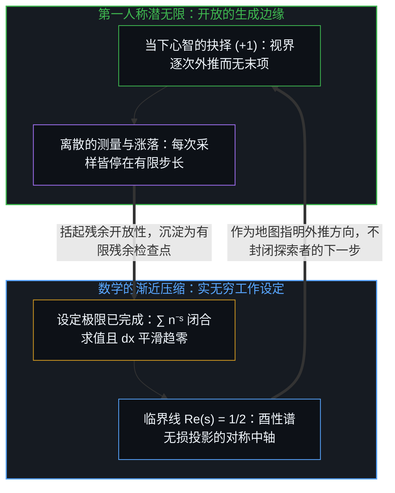
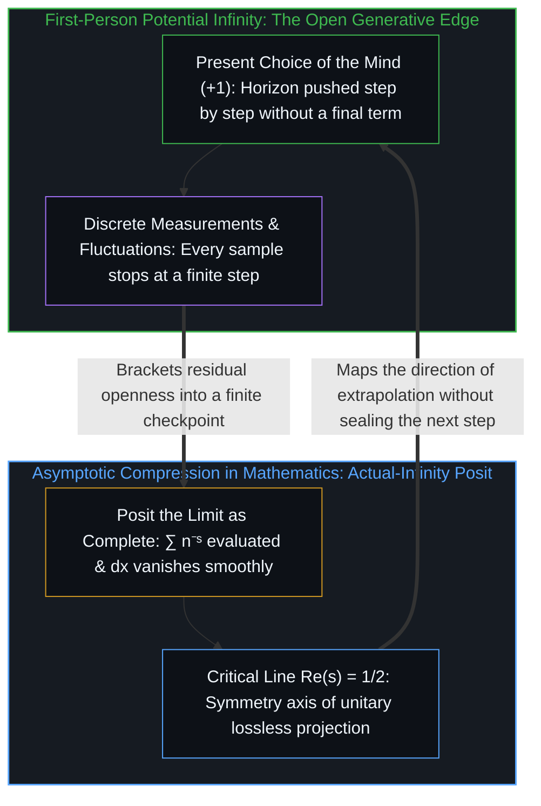

# 全息回声 / The Holographic Echo

*通过黎曼猜想逆向工程量子不确定性 / Reverse-Engineering Quantum Indeterminacy via the Riemann Zeta Function*

黎曼猜想断言 ζ 函数的非平凡零点都落在一条线上，而这些零点的间距统计与量子混沌系统的能级统计吻合。把两者放在一起，数论是一种渐近的压缩：它描摹无限多个涨落在极限处给出的图景，而这个极限被设定为已经完成。实无穷是数学的工作设定，计算在其中可靠。在第一人称的经验里，无穷只以潜能的方式出现，永远还有下一步，把这份潜能宣告为一个封闭的整体，是欲望的急躁。

The Riemann Hypothesis asserts that the non-trivial zeros of the zeta function all lie on one line, and the spacing statistics of those zeros match the level statistics of quantum chaotic systems. Set side by side, the two show number theory as an asymptotic compression: it traces the picture that infinitely many fluctuations give at the limit, with that limit posited as already complete. Actual infinity is the working posit of mathematics, and calculation is reliable inside it. In first-person experience infinity appears only as potential, with a next step always remaining, and declaring that potential a closed totality is the impatience of desire.

## 一、 作为有界投影的临界带 / 1. The Critical Strip as a Bounded Projection

一个半世纪以来，黎曼猜想一直被看作解析数论里分量最重的未决问题。1859 年，波恩哈德·黎曼提出：ζ(s) 在临界带 0 < Re(s) < 1 内的所有非平凡零点，实部都等于 1/2，也就是都落在临界线 Re(s) = 1/2 上。

For a century and a half the Riemann Hypothesis has been regarded as the weightiest open problem in analytic number theory. In 1859 Bernhard Riemann proposed that every non-trivial zero of ζ(s) inside the critical strip 0 < Re(s) < 1 has real part equal to 1/2, which is to say that all of them lie on the critical line Re(s) = 1/2.

常规的算术方法长期未能证明它。一种读法是，数论在这里所做的更像是在逆向工程一组渐近的边界条件，而不只是在自己搭起的结构里推演。按这种读法，无限多个涨落的自由度被投到一条有界的、类似二进制的通道上。这是脚手架，它的用处在于把几件原本分开的事实摆到一起看。

Standard arithmetic methods have long failed to prove it. One reading is that number theory is here doing something closer to reverse-engineering a set of asymptotic boundary conditions than to deriving consequences inside a structure of its own making. On this reading, infinitely many fluctuating degrees of freedom are projected onto a bounded, binary-like channel. This is scaffolding, and its use is to set several otherwise separate facts side by side.

ζ 函数定义在复平面上，它的非平凡内容却都收在一条窄走廊里，即实部介于 0 与 1 之间的临界带。在 s = 1 处是极点，对应调和级数 ∑ 1/n 的发散，是不受约束的累加。s = 0 一侧经由函数方程的反射对称与 s = 1 系在一起：把 ζ(s) 乘上 π 与 Γ 函数构成的修正因子，记作 Λ(s)，便有 Λ(s) = Λ(1 − s)。Re(s) = 1/2 是这面镜子的中轴。

The zeta function is defined on the complex plane, yet its non-trivial content is all gathered in a narrow corridor, the critical strip where the real part lies between 0 and 1. At s = 1 there is a pole, corresponding to the divergence of the harmonic series ∑ 1/n, accumulation without constraint. The side at s = 0 is tied to s = 1 by the reflection symmetry of the functional equation: multiply ζ(s) by a correction factor built from π and the Γ function, call the result Λ(s), and Λ(s) = Λ(1 − s). Re(s) = 1/2 is the central axis of that mirror.

在全息物理学里，例如 AdS/CFT 对偶，较高维度的体内动力学对应于较低维度边界上的状态。借用这幅图景，临界带是投影的屏幕，Re(s) = 1/2 这条线是酉性的对称轴。量子力学要求时间演化保持酉性，全部概率之和恒为 1。按下一节的希尔伯特与波利亚的设想去读，若在 0.51 + iγ 处出现一个非平凡零点，对应的本征值便不是实数，算符不再自伴，在量子的语言里就是概率不守恒的演化。

In holographic physics, the AdS/CFT correspondence for example, dynamics in a higher-dimensional bulk correspond to states on a lower-dimensional boundary. Borrowing that picture, the critical strip is the projection screen and the line Re(s) = 1/2 is the axis of unitarity. Quantum mechanics requires time evolution to be unitary, with all probabilities summing to 1. Read through the Hilbert and Pólya proposal of the next section, a non-trivial zero at 0.51 + iγ would mean an eigenvalue that is not real and an operator that is no longer self-adjoint, which in quantum language is an evolution that does not conserve probability.

## 二、 量子不确定性与素数的确定 / 2. Quantum Indeterminacy and the Determinacy of Primes

在经典力学的模型里没有自由变量：给定初始位置与动量，轨迹便已定下。量子力学的模型在单次结果上留了空，测不准关系、真空涨落与测量的单次读数都属于此。这是模型自己标出的边界，它在此处不再给出单次的结果。这道空白与心智的抉择是同一件事的两面：从描述之内看，是一处合不上的地方；从第一人称看，是作出抉择的自由变量，正如[自由的测不准](../zi-you-de-ce-bu-zhun/)所追溯的那样。

In the model of classical mechanics there is no free variable: given initial positions and momenta, the trajectory is settled. The model of quantum mechanics leaves the single outcome blank; the uncertainty relation, vacuum fluctuations and the individual reading of a measurement all belong here. This is a boundary the model marks for itself, the place where it no longer yields a single result. That blank and the Mind's choosing are two faces of one thing: seen from inside the description, a place that will not close; seen from the first person, the free variable that chooses, as [The Uncertainty of Freedom](../zi-you-de-ce-bu-zhun/) traces.

黎曼猜想所管辖的对象却是确定性的范本。素数是算术里最坚固的东西，17 不会因为谁的意愿而变成合数。

The objects the Riemann Hypothesis governs are, by contrast, the very model of determinacy. Primes are the most solid things in arithmetic, and 17 does not become composite at anyone's wish.

两者在零点的统计上相遇。1972 年，休·蒙哥马利提出了黎曼零点对关联函数的猜想形式，弗里曼·戴森认出其中的 1 − (sin πx / πx)² 正是随机矩阵理论中高斯酉系综的对关联。这个形式只在受限的范围内得到证明，安德鲁·奥德利兹科后来的大规模数值计算与它吻合。随机矩阵理论由维格纳与戴森等人发展出来，原本用于刻画铀-238 这类重核的复杂能级。

The two meet in the statistics of the zeros. In 1972 Hugh Montgomery conjectured the form of the pair correlation function of the Riemann zeros, and Freeman Dyson recognized its term 1 − (sin πx / πx)² as the pair correlation of the Gaussian Unitary Ensemble in random matrix theory. The form is proven only in a restricted range, and Andrew Odlyzko's later large-scale numerical computations agree with it. Random matrix theory had been developed by Wigner, Dyson and others to describe the complex energy levels of heavy nuclei such as uranium-238.

希尔伯特与波利亚的设想由此有了依托：零点的虚部 γₙ 是某个尚未找到的自伴算符的本征值，Ĥ ψₙ = γₙ ψₙ。这一设想至今未获证明。若它成立，寻找黎曼猜想的证明便是在寻找一个量子系统的谱，素数则可以读作一条连续的谱在叠加干涉时留下的离散结点；联系素数与零点的显式公式给了这种读法一个落脚处，而[算符的潜无限与记录的有限边界](../the-potential-infinity-of-operators-and-the-finite-horizon-of-records/)则表明，这样的算符谱编码的是供干涉使用的相位权重，而非一份已经穷尽的有限记录清单。

The proposal of Hilbert and Pólya finds its support here: the imaginary parts γₙ of the zeros are the eigenvalues of some self-adjoint operator not yet found, Ĥ ψₙ = γₙ ψₙ. The proposal remains unproven. If it holds, seeking a proof of the Riemann Hypothesis is seeking the spectrum of a quantum system, and the primes can be read as the discrete nodes a continuous spectrum leaves when it superposes and interferes; the explicit formula linking primes and zeros gives that reading a foothold, while [The Potential Infinity of Operators and the Finite Horizon of Records](../the-potential-infinity-of-operators-and-the-finite-horizon-of-records/) shows that such an operator spectrum encodes phase weights for interference rather than an already exhausted inventory of finite records.

## 三、 极限处的确定 / 3. Determinacy at the Limit

不确定的涨落如何给出素数那样的刚性？经由渐近的行为。单次抛硬币的结果未定，是 0 或 1。抛掷的次数不断增加时，正面的比例以概率 1 收敛到 1/2，大数定律把局部的不可测洗成了整体的锐利。

How do indeterminate fluctuations yield a rigidity like that of the primes? Through asymptotic behavior. The outcome of a single coin toss is undetermined, 0 or 1. As the number of tosses keeps growing, the proportion of heads converges to 1/2 with probability 1, and the law of large numbers washes local unpredictability into sharpness of the whole.

黎曼猜想有一个等价的表述，说的正是涨落的幅度：素数计数函数 π(x) 与对数积分 Li(x) 之差满足 π(x) − Li(x) = O(√x · ln x)。其中的指数 1/2 与一段 x 步的随机游走的涨落同阶，是独立随机步伐趋向平衡时留下的指纹。

The Riemann Hypothesis has an equivalent statement that speaks of exactly the size of fluctuations: the difference between the prime-counting function π(x) and the logarithmic integral Li(x) satisfies π(x) − Li(x) = O(√x · ln x). The exponent 1/2 is of the same order as the fluctuation of a random walk of x steps, the fingerprint left when independent random steps settle toward equilibrium.

零点按高斯酉系综的统计彼此排斥，不像互不相关的随机事件那样扎堆，底层的自由度因此是相互关联的。照这样读，确定与不确定不是两条对立的定律；正如[确定性是微观不确定性的统计签名](../determinism-is-the-statistical-signature-of-micro-indeterminism/)所追溯的，确定是不确定的涨落在无界的范围上求和之后给出的东西。这个求和只在极限处完成，下一节看的正是这个极限。

The zeros repel one another according to Gaussian Unitary Ensemble statistics and do not cluster the way uncorrelated random events do, so the underlying degrees of freedom are correlated with one another. Read this way, determinacy and indeterminacy are not two opposing laws; as [Determinism is the Statistical Signature of Micro-Indeterminism](../determinism-is-the-statistical-signature-of-micro-indeterminism/) traces, determinacy is what indeterminate fluctuations give once summed over an unbounded range. That sum is completed only at the limit, and the limit is what the next section looks at.

## 四、 无穷这堵墙 / 4. The Wall of Infinity

数学在实无穷的设定里工作。它把无穷级数 ∑ n⁻ˢ 当作一个已经完成、可以直接求值的对象，实数的连续统则要求微元 dx 可以不受限制地趋于零。分析学的可靠与威力来自这个设定。

Mathematics works within the posit of actual infinity. It treats the infinite series ∑ n⁻ˢ as a completed object that can be evaluated outright, and the continuum of real numbers requires that the element dx may approach zero without restriction. The reliability and power of analysis come from this posit.

物理学自己的模型标出了这个设定在测量中不再可用的地方。贝肯斯坦上限与马戈勒斯和列维京的定理给出：能量有限的有限区域，能容纳的比特数有限，每秒能完成的操作数也有限。在测量所及之处，无穷是一条渐近线。

Physics' own models mark where this posit stops being available to measurement. The Bekenstein bound and the theorem of Margolus and Levitin state that a finite region with finite energy can hold a finite number of bits and carry out a finite number of operations per second. Wherever measurement reaches, infinity is an asymptote.

微元 dx 也是如此。测不准关系 Δx · Δp ≥ ħ/2 要求，位置的间隔压得越小，动量的不确定度就越大。把足够多的能量集中到足够小的区域，广义相对论给出的是视界的形成。到了这个尺度，比值 dy/dx 不再对应任何一次测量，现有的模型在普朗克长度 ℓ_P ≈ 1.6 × 10⁻³⁵ 米附近预期自己失效。这个尺度是模型分辨力的截断，标出了[连续性作为建模的权宜之计](../the-continuum-is-a-modeling-convenience/)与形式分析为闭合方程而令其归零的非零因果间隔相遇之处。

The same holds for the element dx. The uncertainty relation Δx · Δp ≥ ħ/2 requires that the smaller the interval of position is squeezed, the larger the uncertainty of momentum becomes. Concentrate enough energy in a small enough region and general relativity gives the formation of a horizon. At that scale the ratio dy/dx no longer corresponds to any measurement, and current models expect to fail near the Planck length, ℓ_P ≈ 1.6 × 10⁻³⁵ m. This scale is the cutoff of the models' resolving power, marking where [The Continuum is a Modeling Convenience](../the-continuum-is-a-modeling-convenience/) meets the non-zero causal interval that formal analysis sets to zero to close its equations.

## 五、 数学作为渐近压缩 / 5. Mathematics as Asymptotic Compression

于是黎曼猜想是对一个理想化极限的压缩。设定无穷可以抵达、dx 可以平滑地消失之后，数学画出了无限多个涨落的自由度在极限处构成的平衡图景。

The Riemann Hypothesis is thus the compression of an idealized limit. Having posited that infinity can be reached and that dx can vanish smoothly, mathematics draws the picture of equilibrium that infinitely many fluctuating degrees of freedom form at the limit.

非平凡零点排在 Re(s) = 1/2 上，是因为只有在这个位置，一个保持酉性的谱才能无损地投出来。测量停在有限的步长上，到不了实无穷，黎曼猜想因此是一张地图，画的是视界不断外推时过程所指的方向。地图在它的设定之内可靠，边界出现在它被当作一个已经走遍的整体的时候。临界线上零点所占比例的下界，也是在这样的闭合之内可靠，[潜无限与数学思维的暂时闭合](../potential-infinity-and-the-temporary-closures-of-mathematical-thought/)展开了这一点。同样地，无论是形式数论写下的渐近定理，还是[你的代码库即是记忆](../your-codebase-is-memory/)所剖析的外部化代码库与活书架构，被封存在记录里的始终是既往区分层叠留下的有限残余检查点；检查点让下一步计算得以稳固推进，但推进视界的那一刀始终留在记录之外的当下心智手中。

The non-trivial zeros line up on Re(s) = 1/2 because only at that position can a spectrum that stays unitary be projected without loss. Measurement stops at finite steps and does not arrive at actual infinity, so the Riemann Hypothesis is a map, drawing the direction in which the process points as the horizon is pushed ever outward. The map is reliable inside its posit, and its boundary appears when it is taken for a whole that has already been surveyed. The lower bounds on the proportion of zeros on the critical line are likewise reliable inside such a closure, as [Potential Infinity and the Temporary Closures of Mathematical Thought](../potential-infinity-and-the-temporary-closures-of-mathematical-thought/) lays out. In the same way, whether in an asymptotic theorem of formal number theory or in the externalized codebase and living book examined in [Your Codebase Is Memory](../your-codebase-is-memory/), what is fixed inside the record is always a finite checkpoint of stacked prior residues; the checkpoint gives subsequent derivation firm footing, while the cut that pushes the horizon further remains with the living Mind outside the archive.

## 六、 潜无限与整体 / 6. Potential Infinity and Totality

这里需要一个区分：实在不等于物理学所描述的世界。那个有确定质量、空间坐标、刚性几何与钟表读数的宏观世界，是经过无数次测量与相互作用之后沉淀并稳定下来的宏观症状，它不是先于一切视角的基底。

A distinction is needed here: reality is not the same as the world physics describes. That macroscopic world of definite mass, spatial coordinates, rigid geometry and clock readings is a macroscopic symptom that has settled and stabilized after countless measurements and interactions; it is not a foundation prior to every perspective.

说物理学描述的是一个不依赖任何人的世界，需要一个站在一切视角之外的位置，一个无处之境。这幅图景有它的用处，它让结果可以不提是谁测的就写下来。它的边界在于那个位置无人占据：被登记到的一切，都是从某个第一人称的原点登记到的。

To say that physics describes a world independent of anyone requires a position outside every perspective, a view from nowhere. The picture has its use; it lets results be written down without mention of who measured them. Its boundary is that no one occupies that position: everything registered is registered from some first-person origin.

随之而来的还有一层更细的倒置：把自己的感知归为“只是主观的”，仿佛心智之外另立着一个更高一阶的“客观世界”。“客观”所指的是不变性，即视角变换时进行感知的心智察觉不到差别的那一部分。它标出的是此刻理解所及的边界，不是另一个领域。客观与主观的这条线，因此划在第一人称的经验之内，不在它与别的什么之间。

With it comes a subtler inversion: classing one's own perception as "merely subjective," as though a higher-order "objective world" stood apart from the mind. What "objective" names is invariance, the part in which the perceiving Mind detects no difference as the viewpoint changes. It marks the boundary that understanding reaches at this moment, and not another realm. The line between objective and subjective is therefore drawn inside first-person experience, and not between it and something else.

看到这一点，潜无限与整体之间的张力才显出来。在每一道视界的边缘遇到的无限潜能，正是在第一人称中切身经验到的意识本身。执意把它捕获并宣告为一个封闭整体的冲动，是欲望的急躁。

With this in view, the tension between potential infinity and totality shows itself. The infinite potential met at the edge of every horizon is the very consciousness lived in the first person. The urge to capture it and declare it a closed totality is the impatience of desire.

在数学的形式系统里，无穷被处理成一个可以打包并完成求值的对象。在第一人称的生命实践里，无穷从来不是一张已经结清的账单，它是潜无限，一道始终留有未决之处、等着下一次具体决断的地平线。

In the formal systems of mathematics, infinity is handled as an object that can be packaged and fully evaluated. In lived first-person practice infinity is never a settled bill; it is potential infinity, a horizon that always leaves something undecided and waits for the next concrete decision.

意识的自由与量子的间隙不是两样东西，也无所谓谁从谁那里借来。权衡、感受、赋予意义并在可能性中作出抉择，是从第一人称看到的这一面；模型中那道合不上的间隙，是同一种开放被从外部描述时留在描述里的那一面。间隙落在观察的边界上，而边界登记在哪里，是心智作出的抉择，[割点可移不可除](../the-cut-moves-but-never-vanishes/)展开了这一点。

The freedom of consciousness and the quantum gap are not two things, and neither is borrowed from the other. Weighing, feeling, giving meaning and choosing among possibilities are the face seen from the first person; the gap that will not close in the model is the face the same openness leaves in a description when it is described from outside. The gap sits at the boundary of observation, and where that boundary registers is a choice the Mind makes, as [The Cut Moves but Never Vanishes](../the-cut-moves-but-never-vanishes/) lays out.

停留在开放的潜能里，意味着承受时间前行的摩擦，面对不确定，并为每一步不可逆的行动付出代价。急躁在这里生长。因为不耐一步一步的跋涉，也因为对未知与失控的恐惧，心智想把这份潜能一次折现为一个封闭的整体：一套无所不包的万物理论，一个把所有因果一并结清的方程，或一份宣称已经看尽全部历史与未来的清单。

To remain in open potential means bearing the friction of time moving forward, facing uncertainty, and paying the cost of every irreversible step. Impatience grows here. Out of unwillingness to trek one step at a time, and out of fear of the unknown and of losing control, the mind wants to cash this potential in at once as a closed totality: an all-inclusive theory of everything, one equation that settles every cause together, or a list claiming to have seen the whole of history and the future.

黎曼猜想展示了数学在渐近极限处所能压缩出的高度，它沿着临界线描出一座理想化的殿堂。殿堂是第一人称的探索者搭起来的，探索者并不因此被关在其中：正如[为何数学永远解不完](../why-mathematics-can-never-be-solved/)所展示的，没有任何形式抓握能封死架起它的区分活动本身。视界一步一步地保持着敞开，思考、抉择与下一步都在这道敞开里继续。

The Riemann Hypothesis shows the height that mathematics can compress out at the asymptotic limit, tracing an idealized hall along the critical line. The hall was built by explorers in the first person, and the explorers are not thereby shut inside it: as [Why Mathematics Can Never Be Solved](../why-mathematics-can-never-be-solved/) shows, no formal hold seals the distinguishing activity that erected it. The horizon stays open step by step, and thinking, choosing and the next step all continue within that openness.
