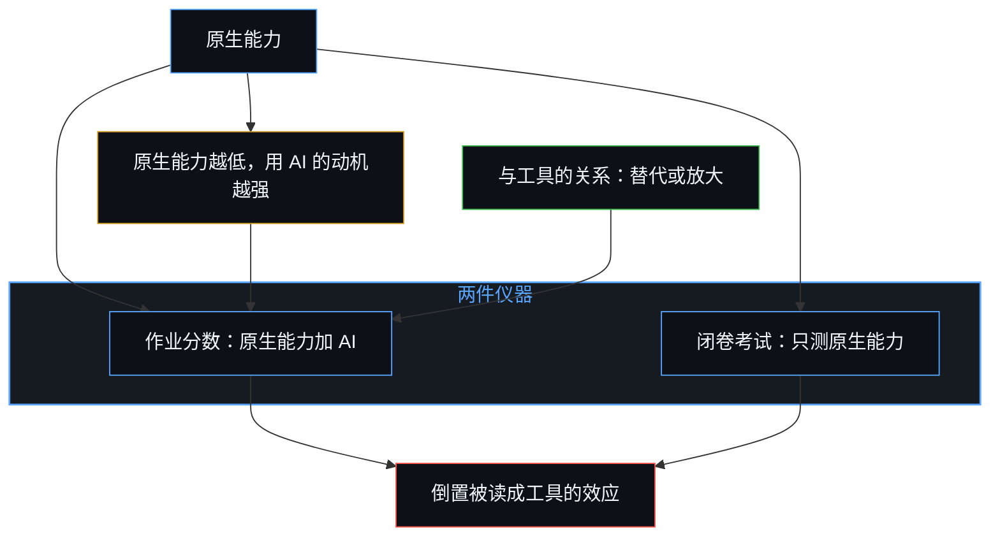
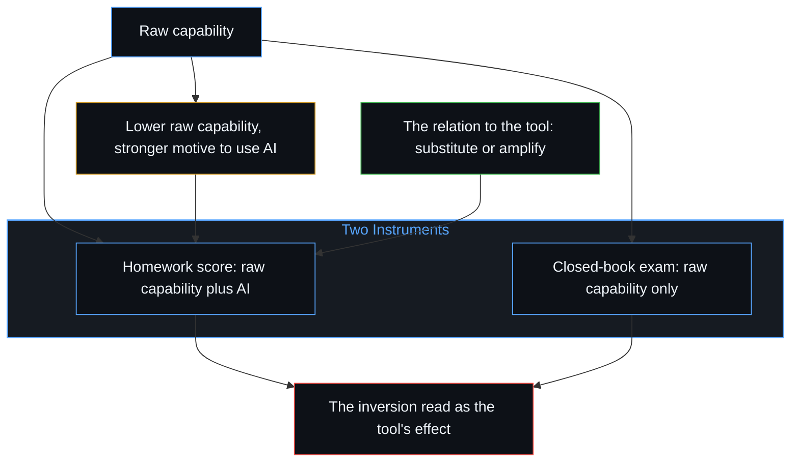

# 作业与考试的倒置折射出替代效应 / The Homework–Exam Inversion Registers Substitution

*工具只在使用时放大能力；原生能力此后是否提升，在于人与工具的关系，而不在工具 / The tool amplifies only in use; whether raw capability then grows lies in the relation, not the tool.*

作业分数曾经能预测考试表现。一项追踪两万六千多名中国中学生的研究发现，采用生成式 AI 让作业平均分提高约 18%、完成时间缩短约 30%，而闭卷月考成绩在六个月内下降约 20%，在更长的时段里，高利害的升学考试成绩下降了 18% 到 24%；损失集中在约八成的 AI 使用者身上，他们的作业行为，高分配上异常短的完成时间，指向把努力大量外包了出去。这种倒置，以及用 AI 者的考试曲线严格低于不用者的曲线，被呈现为工具在侵蚀能力。它其实是测量的产物：一个分数是原生能力加 AI，另一个只是原生能力，在同样的作业分数下，没用 AI 的学生必然考得更好，而当作业分数允许包含 AI 时，能力较弱的人也更有动机去用，于是 AI 使用者这一组从一开始就偏向较低的原生能力。

Homework scores once predicted exam performance. A large panel of more than 26,000 Chinese secondary-school students found that generative-AI adoption raised average homework scores by about 18 percent and cut completion time by roughly 30 percent, while closed-book monthly exam scores fell by around 20 percent within six months and high-stakes entrance-exam scores declined by 18 to 24 percent over a longer period. The losses concentrated among approximately 80 percent of AI users whose homework behavior, high scores paired with unusually short completion times, pointed to heavy outsourcing of effort. The inversion, and a with-AI exam curve sitting strictly below a without-AI curve, is presented as the tool eroding ability. It is an artifact of the measurement: one score is raw capability plus AI, the other is raw capability only, so at the same homework score the student who did not use AI is guaranteed the better exam, and since the less capable have more motivation to use AI when the homework score may include it, the AI-user group is already selected toward lower raw capability.

## 一、 流传的图把原因放在工具上 / 1. The Circulating Graph Locates the Cause in the Tool

经验上呈现的态势是真的。作业分数上升了，完成时间缩短了，无辅助的考试成绩下降了，而且下降最多的，正是那些作业用时暴露出替代的人。那张倒置的图是一件有用的工具，它让两个过去同向变动的指标之间的对照更加分明。

The empirical pattern is real. Homework scores rose. Completion time fell. Unaided exam scores fell, and the fall was largest among those whose homework times revealed substitution. The graph of that inversion is a useful instrument. It densifies comparison between two registers that used to move together.

冻结发生在把这种倒置当作工具施加在学生身上的效应之时。[错把表达当成智能](../mistaking-the-expression-for-the-intelligence/)讲的就是把分数当作活动本身时的那种冻结。在这里，作业分数成了“学生加工具”的表达，考试仍是学生独自的表达。两件测量仪器不再有同一个对象，差距是这种错配的产物。把它读成 AI 对能力做了什么，就把本属于人的发起挪进了媒介里。

The freeze is treating the inversion as an effect the tool performs on the student. [Mistaking the Expression for the Intelligence](../mistaking-the-expression-for-the-intelligence/) is that freeze when a score is held as the activity. Here the homework score becomes an expression of student-plus-tool while the exam remains an expression of the student alone. The two instruments no longer share a subject. The gap is an artifact of that mismatch. Reading it as what AI did to capability relocates initiation into the medium.

## 二、 工具不会自动做任何事 / 2. Tools Do Nothing Automatically

工具，包括生成式 AI，不会自动对任何人做任何事。它们对表现的影响，全由个人如何与之相处来决定。起决定作用的变量不是技术在不在场，而是使用者对努力、产出与自身能动的姿态。

Tools, including generative AI, do nothing automatically to any person. Their effect on performance is determined entirely by how the individual relates to them. The decisive variable is not the technology's presence but the user's stance toward effort, output and personal agency.

和所有工具一样，这件工具放大的是个人对待努力的方式中早已存在的差别。多数人用它让自己少做一些，把能动留在掌舵一端的人用它多做一些。工具并不让人变得更差。能力越弱，在允许时用 AI 换一个更好分数的动机就越强；本就倾向于少做的人，也更可能用工具来少做。[因果停留在掌舵的边缘](../causality-stays-at-the-edge-that-steers/)讲的是同一种定位装扮成发现的样子：模型重组的是余留，每一个发起的区分仍是使用者自己的行为。

As with all tools, the instrument amplifies the difference already present in how individuals relate to effort. The majority use it to do less themselves. Those who keep agency at the edge use it to do more. The tool does not make people less capable. The lower one's capability, the stronger the motivation to use AI for a better score when that is allowed, and those already disposed to do less are more likely to use the tool to do less. [Causality Stays at the Edge That Steers](../causality-stays-at-the-edge-that-steers/) is the same placement dressed as discovery: the model recombines residue, and every initiating distinction remains the user's own act.

## 三、 替代把结果归于工具 / 3. Substitution Attributes Results to the Tool

一个人把结果主要归于工具时，就是把它当作替代。在这种模式下，工具以更少的个人投入产出表面上的结果，独立的能力随之下降，不再被练习的技能日渐生疏。多数使用者走的是这条路，因为多数人更愿意用尽可能少的力气完成任务。研究的数据与这一模式吻合：学习损失最大的，正是那些作业行为暴露出替代的人。

When a person attributes results primarily to the tool, the tool is being treated as a substitute. In that mode the tool produces surface results with reduced personal investment, and independent capability declines. Skills that are no longer exercised thin. Most users follow this path because the majority prefer to accomplish tasks with the least possible effort. The study's data match the pattern: the largest learning losses appear among those whose homework behavior reveals substitution.

[验证中因果权能的分配](../the-allocation-of-causal-power-in-validation/)追踪的是哪一边被当作提供下一步的一方。一旦答案被当作从工具那里到来，学生自己的跟进就不再是延续的源头。作业照样交了，做作业本该带来的那次更新却没有发生。

[The Allocation of Causal Power in Validation](../the-allocation-of-causal-power-in-validation/) tracks which side is treated as supplying the next step. Once the answer is treated as arriving from the tool, the student's own following is no longer the source of continuation. Homework still completes. The update that would have been the work does not.

## 四、 放大把结果留在掌舵的一端 / 4. Amplification Keeps Results at the Edge

工具在使用的那一刻提高表现。这份增量成为提升原生能力的理由，还是不去提升的理由，在于个人所持的关系。当一个人继续把结果归于自己的判断与努力，把工具当作这份努力的放大器，独立的能力就能保住，甚至变强。这个人用这项技术走得更远、核对得更仔细，或探索原本够不着的问题。放大是真的，但它既不自动，也不均等，它取决于使用者原有的能力，更取决于带进这场互动的态度。

The tool raises performance at the moment of use. Whether that increment becomes a reason to improve raw capability or a reason not to is the relation the individual holds. When a person continues to attribute outcomes to their own judgment and effort, and treats the tool as an amplifier of that effort, independent capability can be retained and even strengthened. The technology is then used to reach further, verify more carefully, or explore problems that would otherwise remain out of reach. Amplification is real, yet it is neither automatic nor equal. It depends on the user's preexisting ability and, more importantly, on the attitude brought to the interaction.

[放大悖论](../amplification-paradox/)讲的是工具越来越密时的同一层几何：同一件工具在不同的人手里产生截然不同的结果，因为选择与感知始终在使用者那里。作业与考试的分裂，是同一种分化在校园里的一个切面。

[The Amplification Paradox](../amplification-paradox/) is that geometry as tools densify: the same instrument in different hands produces radically different outcomes, because selection and sensing stay with the user. The homework–exam split is the school face of the same widening.

## 五、 生成答案不等于帮着想出答案 / 5. Generating the Solution Is Not Helping to Figure It Out

在学生用 AI 做作业的具体方式里，这层关系还有更深、也多半被忽略的一面。让 AI 生成现成的答案，与请它帮学生想出答案，是截然不同的两件事。前一种情况下，学生收到一个答案，多半照抄或稍作改动，认知的功夫大体被绕过，留不下多少持久的能力。后一种情况下，AI 作为向导，给提示、讲解、举反例，或对学生自己的尝试给出反馈，而构建答案的仍是学生。两种做法与工具的关系迥然有别：一种替代学生的思考，另一种支撑并延伸它。流传的那张图和大多数关于这项研究的公共讨论，都没有区分这两种用法，而这个区分，正是独立能力被侵蚀还是在生长的关键。

A still deeper and largely overlooked dimension of this relationship appears in the concrete way students use AI for homework. Asking the AI to generate the finished solution and asking it to help the student figure out the solution are two different acts. In the first case the student receives an answer and typically copies or lightly edits it; cognitive work is largely bypassed and little lasting capability is built. In the second case the AI functions as a guide, offering hints, explanations, counter-examples or feedback on the student's own attempts, while the student remains responsible for constructing the solution. The two practices embody different relationships with the tool. One replaces the student's thinking; the other supports and extends it. Neither the circulating graph nor most public discussion of the study distinguishes between these modes of use, yet the distinction is central to whether independent capability erodes or grows.

[Token 效率、模拟与无法弥合的间隙](../token-efficiency-emulation-and-the-unclosable-gap/)从压缩的一侧讲的是同一个切口：走过路之后才到来的捷径是效率，跳过这条路的捷径是同名之下的另一种行为。索要现成的答案就是跳过。请它帮忙想出答案，则把低效的那条路留在序列里，后来的压缩才可能成为它的结果。

[Token Efficiency, Emulation, and the Unclosable Gap](../token-efficiency-emulation-and-the-unclosable-gap/) is the same cut dressed as compression: the shortcut that arrives after the path is walked is efficiency; the shortcut that skips the path is a different act under the same name. Asking for the finished solution is the skip. Asking for help in figuring it out keeps the inefficient path in the sequence, from which later compression can follow.

## 六、 闭卷考试把替代记录为下滑 / 6. Closed-Book Exams Register Substitution as Decline

这个机制也解释了现行的教育测量为何会产生如此醒目的倒置。学校的评估，尤其是高利害的闭卷考试，仍在评估无辅助的表现。在一个仍奖励独立解题的体系里，替代模式被记录为明显的下滑。在现行规则下，这种下滑是真的，但它并不证明在工具可用时，AI 普遍削弱了解决问题的能力。难处在于，许多学生并没有在发展熟练的协作式使用，而是在让 AI 生成答案、而不是帮自己抵达答案的过程中，养成了依赖。

This mechanism also explains why current educational measurements produce the striking inversion. School assessments, especially high-stakes closed-book examinations, continue to evaluate unaided performance. In a system that still rewards independent problem-solving, the substitution pattern registers as clear decline. That decline is real under existing rules. It does not demonstrate that AI universally diminishes the capacity to solve problems when the tool is available. The difficulty is that many students are not developing skilled collaborative use; they are developing dependence by letting the AI generate solutions rather than helping them arrive at solutions themselves.

[基准刷榜中的封闭实存](../closed-reality-in-benchmark-maxing/)讲的是封闭场域的那一面：一块记分牌测量的，是它被划定去测的东西。闭卷考试就是这样一种框定。在这种框定之下，替代就是下滑。把这种框定当作能力的全部，包括借助工具时的能力，是又一层冻结。考试仍是测量无辅助表现的有效工具，但它并不因此就能测尽一切。

[Closed Reality in Benchmark Maxing](../closed-reality-in-benchmark-maxing/) is the face of a sealed field: a scoreboard measures what it was drawn to measure. The closed-book exam is such a hold. Under that hold, substitution is decline. Treating the hold as the whole of capability, including capability exercised with the tool, is a further freeze. The exam remains a valid instrument for unaided performance. Exhaustiveness does not travel with it.

## 七、 倒置是测量的产物 / 7. The Inversion Is an Artifact of the Measurement

如果一个分数包含原生能力加 AI，另一个只是原生能力，前者总会高于后者。这不是关于工具的又一个事实，而是两件测量仪器的构成。对 AI 使用者来说，作业是原生项加上工具的贡献，考试只是原生项。比较这两个数，作业那个数就会更高。

If one score includes raw capability plus AI and the other is raw capability only, one will always sit above the other. That is not a further fact about the tool. It is the composition of the two instruments. Homework for an AI user is the raw term plus the tool's contribution. The exam is the raw term alone. Compare those two numbers and the homework number sits above.

在作业分数允许包含工具时使用它，是合理的。一件不能让允许的分数高过原生能力的工具，没有理由去用；如果它做不到，AI 就毫无用处，使用也说不通。拿允许 AI 的作业分数当参照，再在没有 AI 的情况下测验，结果自然低于有工具时会得的分数。在那条规则下，一件有用的工具本就会呈现这样的落差，而那张图把这份有用读成了下滑。

Using the tool when the homework score is allowed to include it is rational. There is no reason to use a tool that does not raise the allowed score above raw capability. If it did not, the AI would be useless, and the use would not make sense. Take the homework number, AI allowed, as the reference, then test without AI, and the result is lower than the score with the tool would be. That is what a useful instrument looks like under that rule. The graph reads the usefulness as decline.

一旦把作业分数固定下来，那张图就更误导人了。对没用 AI 的学生，这个数已经是原生能力；对用了的学生，这个数是原生能力加工具。考试接着只测原生能力。在同样的作业分数下，没用 AI 的人必然考得比用了的人好。这个比较由测量本身保证。

The graph is more misleading still once the homework score is held fixed. For the student who did not use AI, that number is already raw capability. For the student who did, that number is raw plus the tool. The exam then measures raw only. Whoever did not use AI will test better than whoever did, at the same homework score. The comparison is guaranteed by the measurement.

还有一个因素叠在同一个比较上。原生能力越低，它与工具所能提供的作业分数之间的差距就越大，在允许时使用 AI 的动机也就越强。进入 AI 使用者这一组的选择，本就偏向较低的原生能力，那张图又把这种选择读成了工具的效应。

Another factor stacks the same comparison. The lower the raw capability, the larger the gap between the raw term and the homework score the tool can supply, and the stronger the motivation to use AI when it is allowed. Selection into the AI-user group is already toward lower raw capability. The graph then reads that selection as the tool's effect.

研究自己的曲线就显出了这种倒转。不用 AI 的学生，作业分数越高，考试分数也越高；而在作业分数高于基线均值的 AI 使用者中，作业分数越高，考试分数反而越低，作业用时也越短，从均值处的 62 分钟降到均值 120% 处的 43 分钟。这些分数落在工具本身已知的准确率上，所以那个异常高的数，记下的与其说是学生的分数，不如说是工具的分数。原生能力本就能独自够到这个数的学生，把功课交出去没有多少可得；原生能力越低，不求理解、直接接过答案的收益就越大。这样追溯，倒转从动机的倒置中自然得出，曲线无需假设工具另外施加了什么。若像论文那样把它追溯为生成式 AI 的学习惩罚，同一件工具就得在同一批学生身上既抬高作业分数、又压低考试分数，因果权能也就落在工具上，而不在那个选择如何使用工具的个人身上。

The study's own curve shows the reversal. For students without AI, a higher homework score goes with a higher exam score. For AI users above the baseline mean, the higher the homework score, the lower the exam score and the shorter the homework time, from 62 minutes at the mean to 43 minutes at 120 percent of it. Those scores sit at the accuracy the tool itself is known to reach, so the unusually high number registers the tool's score more than the student's. A student whose raw capability could reach that number alone has little to gain by handing the work over; the lower the raw capability, the larger the gain from accepting the answer whole, without understanding it. Traced this way, the reversal follows from the inversion of motive, and the curve needs nothing further from the tool. Traced as a learning penalty of generative AI, as the paper names it, the same tool has to raise the homework score and lower the exam score of the same students, and the causal power sits in the tool rather than in the individual who chose how to use it.

用 AI 者那条严格低于不用者的考试曲线，是原生项的平均。用工具来放大自身能力的人是存在的，但在 AI 使用者中是少数，他们的原生能力被组里其余那些作业行为显示出替代的人平均掉了。

The with-AI exam curve that sits strictly below the without-AI curve is the raw term, averaged. Individuals who use the tool to amplify their own capability exist. They are a minority among AI users. Their raw capability is averaged out by the rest of the group, whose homework behavior shows substitution.

以上都还只是同一时刻的比较。研究追踪的是同一批学生，几个月里同一个人的考试分数也在下滑，这是另一半：不再被练习的技能日渐生疏，如前面所追溯的，那是选择替代的结果。两半都不需要工具对学生另外做什么，一半由测量的构成给出，一半由所选的关系给出。所选的那种关系，把分数放在它所记录的能力之前，正是越过学校、落到职业与学位上的同一种倒转：[作为职业的数学不是作为追求的数学](../math-as-a-career-is-not-math-as-a-pursuit/)追溯了，标记一旦被当得比它所记录的活动更实在，凡能更便宜地产出它的东西就顶替那项活动；模型解开一道论文题目，只有把论文当作职业的人才把它记成损失。

All of this is still a comparison at one moment. The study follows the same students, and the same student's exam score also falls over the months; that is the other half: skills no longer exercised thin, as traced above, by the choice to substitute. Neither half needs the tool to do anything further to the student; one half comes from the composition of the measurement, the other from the relation chosen. That chosen relation, the score put before the capability it records, is the same reversal that runs past school into the career and the degree: [Math as a Career Is Not Math as a Pursuit](../math-as-a-career-is-not-math-as-a-pursuit/) traces how, once a marker is held as more substantial than the activity it records, whatever produces it more cheaply replaces that activity, and a model solving a thesis problem records as loss only for whoever held the thesis as the career.

从来没有机会乘坐现代交通工具的人，平均而言脚力会比常坐车的人好。脚力的差别是真的，但它不是对出行能力的测量。谢天谢地，现实中没有人只靠两条腿走天下。

People who never had a chance to take modern transportation would on average be more capable of walking than those who do. The walking difference is real. It is not a measure of mobility. Thank God nobody actually only walks around.

[一个提示词之遥](../whatever-is-one-prompt-away/)讲的是把旧的表面当作整个场来打分时的那种冻结：步行仍在，只是它在所及范围中的份额在缩小。

[Whatever Is One Prompt Away](../whatever-is-one-prompt-away/) is that freeze when the old surface is scored as the whole of the field: walking remains, and its share of reach shrinks.

## 八、 把原因放在工具上，训练出同一种替代 / 8. Locating the Cause in the Tool Trains the Same Substitution

把这些数据主要呈现为 AI 损害能力的证据，就把因果分配给了工具。[研究AI效应重置了因果原点](../studying-the-effect-of-ai-relocates-causality/)讲的是这种分配早在实验前提里就已发生：使用权限被当作自变量，相反姿态的平均随后被命名为技术的属性。这种分配，是替代模式换上了解释的外衣在开口说话。把问题放在技术上，这样的呈现鼓励人们相信工具是起决定作用的施动者，也就遮住了更要紧的问题：个人选择如何与工具相处，是请它替代自己的努力，还是支撑这份努力的施展。一种把原因挪进仪器的反应，无法触及造成这一模式的姿态。

Presenting the data primarily as evidence that AI harms capability allocates causality to the tool. [Studying the Effect of AI Relocates Causality](../studying-the-effect-of-ai-relocates-causality/) is that allocation already at the experimental premise: access treated as the independent variable, the average of opposed postures then named as a property of the technology. That allocation is the substitution pattern speaking as explanation. By locating the problem in the technology, such presentations encourage the belief that the tool is the decisive agent. In doing so they obscure the more consequential question of how individuals choose to relate to the tool, whether they ask it to replace their effort or to support the exercise of that effort. A reaction that relocates the cause into the instrument cannot address the stance that produced the pattern.

[个体抉择是唯一的因果杠杆](../individual-choices-as-the-only-causal-levers/)讲的是同一种回返装扮成社会的样子：向外归因的解释，本身也是一个个离散的行为，它们挪动了选择被记下的位置。在这里，被拿来顶替个人选择的名字，叫作 AI。

[Individual Choices as the Only Causal Levers](../individual-choices-as-the-only-causal-levers/) is the same return dressed as the social: externalizing explanations are themselves further discrete acts that relocate where the choice registers. Here the name onto which the choice is offloaded is AI.

工具只在使用的那一刻放大能力。这份增量被当作提升原生能力的理由，还是不去提升的理由，取决于个人的选择，即与工具的关系，而不在工具。生成现成的答案与请它帮忙想出答案，就是这两种关系。作业与考试的倒置所揭示的经验态势是真的，它揭示的是个人在与工具相处上的选择的分化，以及原生能力的分化，而不是由工具造成的分化。把仪器当作因果施动者的解读，挪动了选择。[学习中不可观测的驱动力](../the-unobservable-driver-of-learning/)把这种挪动推广开来：看得见的只有分数，驱动力在因果权能一次次被安放的地方。

The tool amplifies capability only at the moment of use. Whether that increment is used as a reason to improve raw capability, or as a reason not to, depends on the individual's choice, the relation to the tool, not the tool. Generating the finished solution and asking for help in figuring it out are those two relations. The empirical pattern revealed by the homework–exam inversion is real. What it reveals is the diversification of individual choice in relating to the tool, and of raw capability, not diversification by the tool. The interpretation that treats the instrument as the causal agent relocates the choice. [The Unobservable Driver of Learning](../the-unobservable-driver-of-learning/) generalizes that relocation: what is seen holds only the scores, and the driver is where causal power is successively located.
