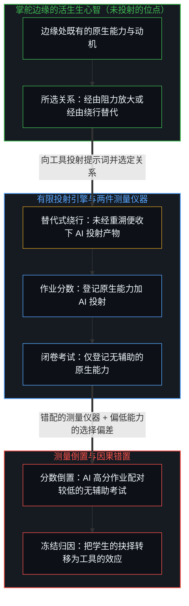
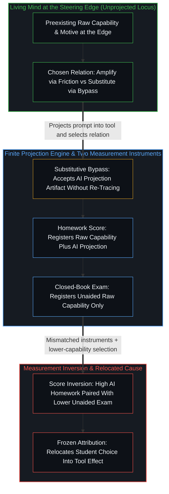

# 作业与考试的倒置折射出替代效应 / The Homework–Exam Inversion Registers Substitution

*工具仅在使用时放大表现，原生能力则随所选关系生长 / Tools amplify only in use while raw capability grows from the relation chosen*

作业分数曾经能预测考试表现。一项追踪两万六千多名中国中学生的研究发现，采用生成式 AI 让作业平均分提高约 18%、完成时间缩短约 30%，而闭卷月考成绩在六个月内下降约 20%，在更长时段里，高利害的升学考试成绩下降了 18% 到 24%。损失集中在约八成的 AI 使用者身上，他们的作业行为将高分与异常短的完成时间配对，指向把努力大量外包了出去。这种倒置，连同用 AI 者的考试曲线严格低于不用者的曲线，被广泛呈现为工具在侵蚀能力。追溯到测量仪器与使用它们的中心，这一现象其实是测量的产物：一个分数登记的是原生能力加 AI，另一个登记的只是原生能力，因此在同样的作业分数下，没用 AI 的学生必然考得更好；而且当作业分数允许包含 AI 时，能力较弱的人更有动机去用，于是 AI 使用者这一组从一开始就偏向较低的原生能力。

Homework scores once predicted exam performance. A large panel of more than 26,000 Chinese secondary-school students found that generative-AI adoption raised average homework scores by about 18 percent and cut completion time by roughly 30 percent, while closed-book monthly exam scores fell by around 20 percent within six months and high-stakes entrance-exam scores declined by 18 to 24 percent over a longer period. The losses concentrated among approximately 80 percent of AI users whose homework behavior, pairing high scores with unusually short completion times, pointed to heavy outsourcing of effort. This inversion, along with a with-AI exam curve sitting strictly below a without-AI curve, is widely presented as the tool eroding ability. Traced to the instruments and the centers using them, it is an artifact of the measurement: one score registers raw capability plus AI while the other registers raw capability alone, so at the same homework score the student who did not use AI is guaranteed the better exam, and since the less capable have stronger motivation to use AI when the homework score may include it, the AI-user group is already selected toward lower raw capability.

## 一、 流传的图把原因放在工具上 / 1. The Circulating Graph Locates the Cause in the Tool

经验上呈现的态势是真的。作业分数上升了，完成时间缩短了，无辅助的考试成绩下降了，而且降幅最大的，正是那些作业用时暴露出替代的人。那张倒置的图是一件有用的工具，因为它让两个过去同向变动的指标之间的对照更加分明。

The empirical pattern is real. Homework scores rose, completion time fell, and unaided exam scores dropped, with the largest decline appearing among those whose homework times revealed substitution. The graph of that inversion is a useful instrument because it sharpens the comparison between two registers that used to move together.

冻结发生在把这种倒置当作工具施加在学生身上的效应之时。[错把表达当成智能](../mistaking-the-expression-for-the-intelligence/)追溯的正是把下游分数当作区分活动本身时的那种冻结。在这里，作业分数成了“学生加工具”的表达，闭卷考试仍是学生独自的表达。由于两件测量仪器不再指向同一个主体，它们之间的差距便是这种错配的产物。把这道差距读成 AI 对能力做了什么，就把本属于活生生的中心的发起转移进了媒介里。

The freeze occurs when that inversion is treated as an effect the tool performs on the student. [Mistaking the Expression for the Intelligence](../mistaking-the-expression-for-the-intelligence/) traces that exact freeze when a downstream score is held as the distinguishing activity itself. Here the homework score becomes an expression of student-plus-tool while the closed-book exam remains an expression of the student alone. Because the two instruments no longer share the same subject, the gap between them is an artifact of their mismatch. Reading that gap as what AI did to capability relocates initiation from the living center into the medium.

## 二、 工具不会自动做任何事 / 2. Tools Do Nothing Automatically

工具，包括生成式 AI，不会自动对任何人做任何事。它们对表现的影响，由个体中心如何与之相处来决定。起决定作用的变量不是技术在环境中的在场，而是使用者在调用那一刻对努力、产出与个人能动的姿态。

Tools, including generative AI, do nothing automatically to any person. Their effect on performance is determined by how the individual center relates to them. The decisive variable is not the technology's presence in the environment, but the user's stance toward effort, output, and personal agency at the point of use.

正如[超越投射](../beyond-the-projection/)所追溯的，语言模型智能体是一台有限的投射引擎：一旦接过提示词与上下文窗口，它便以零我执、零生存执着与零独立意图位点，穷尽该投射所限定的词元轨迹。它无法自发产生目的，也无法把某种姿态强加给操作者。和所有工具一样，这件仪器放大的是个体对待努力的方式中早已存在的差别。多数人用它让自己少做一些，而把能动留在掌舵边缘的人则用它多做一些。工具并不让人变得更差。相反，一个人的原生能力越低，在规则允许时用 AI 换取更高分数的动机就越强；本就倾向于避开阻力的人，也更可能用工具绕过功夫。[因果停留在掌舵的边缘](../causality-stays-at-the-edge-that-steers/)追溯的正是同一种定位装扮成发现时的样子：模型在指引下重组残余，而每一个发起的区分——设定问题框架、引导追问、核验产出，或是未经审视便把任务交出去——仍是人类使用者自己的离散行动。

As [Beyond the Projection](../beyond-the-projection/) traces, a language-model agent is a finite projection engine: once handed a prompt and a context window, it exhausts the token trajectory conditioned by that projection with zero ego, zero survival attachment, and zero independent locus of intent. It cannot originate an end or force a posture onto its operator. As with all tools, the instrument amplifies the difference already present in how individuals relate to effort. The majority use it to do less themselves, while those who keep agency at the steering edge use it to do more. The tool does not make people less capable. Rather, the lower one's raw capability, the stronger the motivation to use AI for a better score when the rules allow it, and those already disposed to minimize friction are more likely to use the tool to bypass work. [Causality Stays at the Edge That Steers](../causality-stays-at-the-edge-that-steers/) traces this same placement when dressed as discovery: the model recombines residue under direction, and every initiating distinction—framing the problem, steering the query, verifying the output, or handing the task over unexamined—remains the human user's own discrete act.

## 三、 替代把结果归于工具 / 3. Substitution Attributes Results to the Tool

当一个人把结果主要归于工具时，工具就被当成了替代品。在这种模式下，仪器以更少的个人投入产出表面上的结果，随着不再练习的技能日渐生疏，独立能力也随之下降。多数使用者走的是这条路，因为大多数人更愿意用尽可能少的力气完成布置的任务。研究的数据直接印证了这一机制：学习损失最大的，正是那约八成以压缩的作业用时与高分暴露出替代行为的使用者。

When a person attributes results primarily to the tool, the tool is being treated as a substitute. In that mode the instrument produces surface results with reduced personal investment, and independent capability declines as skills that are no longer exercised thin out. Most users follow this path because the majority prefer to accomplish assigned tasks with the least possible expenditure of effort. The study's data match this mechanism directly: the largest learning losses appear among the roughly 80 percent of users whose compressed homework times and high scores reveal substitution.

[验证中因果权能的分配](../the-allocation-of-causal-power-in-validation/)追踪的是序列中哪一边被当作提供下一步的一方。一旦解答被当作从工具那里现成到来，学生自己的跟进就不再是延续的源头。作业在记分牌上照样完成了，但本该更新学生自身容量的递归重溯却从未发生。

[The Allocation of Causal Power in Validation](../the-allocation-of-causal-power-in-validation/) tracks which side is treated as supplying the next step in a sequence. Once the solution is treated as arriving ready-made from the tool, the student's own following is no longer the source of continuation. The homework assignment still completes on the scoreboard, yet the recursive re-tracing that would have updated the student's own capacity never occurs.

## 四、 放大把结果留在掌舵的一端 / 4. Amplification Keeps Results at the Edge

工具在使用的那一刻提高表现。这份即时增量成为提升原生能力的理由，还是不去提升的借口，在于个人所持的关系。当一个人继续把结果归于自己的判断与努力，把工具当作这份努力的放大器，独立的能力就能保住并得到强化。技术随后被用来走得更远、核对得更仔细，或探索原本够不着的问题。放大是真的，但它既不自动，也不均等；它取决于使用者原有的能力，更取决于带进这场互动的姿态。

The tool raises performance at the moment of use. Whether that immediate increment becomes a reason to improve raw capability or an excuse not to is the relation the individual holds. When a person continues to attribute outcomes to their own judgment and effort, treating the tool as an amplifier of that effort, independent capability is retained and strengthened. The technology is then used to reach further, verify more carefully, or probe problems that would otherwise remain out of reach. Amplification is real, yet it is neither automatic nor equal; it depends on the user's preexisting capability and, above all, on the stance brought to the interaction.

[放大悖论](../amplification-paradox/)追溯的正是工具越来越密时的这层几何：同一件仪器在不同的人手里产生分化的结果，因为选择、框架设定与感知始终留在使用者那里。作业与考试的分裂，正是同一道不断扩大的分野在课堂上的切面。

[The Amplification Paradox](../amplification-paradox/) traces this geometry as tools densify: the same instrument in different hands produces diverging outcomes because selection, framing, and sensing stay with the user. The homework–exam split is the schoolroom face of that same widening divergence.

## 五、 生成答案不等于帮着想出答案 / 5. Generating the Solution Is Not Helping to Figure It Out

在学生用 AI 做作业的具体方式里，这层关系还有更深、也多半被忽略的一面。让 AI 生成现成的答案，与请它帮忙想出答案，是两种截然不同的行动。在前一种情况下，学生收到一个已完成的下游投射，照抄或稍作改动，绕过了认知阻力，错把投射产物当成活生生的边缘自己的做功，因而留不下持久的能力。在后一种情况下，正如[超越投射](../beyond-the-projection/)所阐明的，零我执的引擎被接入为辩证的对话方——针对学生自己的尝试提供提示、结构性拆解、反例或盲区反馈——而学生依然留在掌舵的边缘，负责感知不适切之处、走出失效的框架并亲手构建解答。一种做法替代学生的思考，另一种做法支撑并延伸它。流传的那张图与大多数关于这项研究的公共评论，都没有区分这两种用法，尽管这一区分直接决定了独立能力是受侵蚀还是在生长。

A deeper and largely overlooked dimension of this relationship appears in the concrete way students engage AI during homework. Asking the AI to generate a finished solution and asking it to help figure out the solution are two distinct acts. In the first case, the student receives a completed downstream projection and copies or lightly edits it, bypassing cognitive friction, mistaking a projection artifact for the living edge's own work, and building no lasting capability. In the second case, as [Beyond the Projection](../beyond-the-projection/) clarifies, the zero-ego engine is wired as a dialectical counterpart—offering hints, structural explanations, counterexamples, or blind-spot feedback on the student's own attempts—while the student remains at the steering edge responsible for sensing misfit, stepping out of broken frames, and constructing the solution. One practice replaces the student's thinking; the other supports and extends it. Neither the circulating graph nor most public commentary on the study distinguishes between these two modes of use, even though that distinction decides whether independent capability erodes or grows.

[词元效率、模拟与无法弥合的间隙](../token-efficiency-emulation-and-the-unclosable-gap/)从压缩的一侧追溯了同一个切口：走过那条路之后才到来的捷径是真正的效率，而跳过那条路的捷径则是同名之下的另一种行为。索要现成的答案就是跳过。在摸索解答时请求辩证的反馈，则把带有阻力的路径留在学生自己的序列之内，真正的压缩随后才能由此产生。

[Token Efficiency, Emulation, and the Unclosable Gap](../token-efficiency-emulation-and-the-unclosable-gap/) traces the same cut from the side of compression: the shortcut that arrives after the path has been walked is genuine efficiency, whereas the shortcut that skips the path is a different act under the same name. Asking for the finished solution is the skip. Asking for dialectical feedback in figuring it out keeps the frictional path inside the student's own sequence, from which genuine compression can later follow.

## 六、 闭卷考试把替代记录为下滑 / 6. Closed-Book Exams Register Substitution as Decline

这一机制也解释了现行的教育测量为何会产生如此醒目的倒置。学校的评估，尤其是高利害的闭卷考试，仍在评估无辅助的表现。在一个奖励独立解题的建制体系里，替代模式被记录为显著的下滑。在现行规则下，这种下滑是真的，但它并不证明在仪器可用时，AI 普遍削弱了解决问题的能力。症结在于，样本中的大多数学生并没有在发展熟练的、由边缘掌舵的使用方式，而是在让 AI 生成现成答案、而非借它自行抵达答案的过程中，养成了依赖。

This mechanism also explains why current educational measurements produce such a striking inversion. School assessments, especially high-stakes closed-book examinations, continue to evaluate unaided performance. In an institutional system that rewards independent problem-solving, the substitution pattern registers as a sharp decline. That decline is real under existing rules, yet it does not demonstrate that AI universally diminishes the capacity to solve problems when the instrument is available. The difficulty is that most students in the panel were not developing skilled, edge-steered use; they were developing dependence by letting the AI generate finished solutions rather than using it to arrive at solutions themselves.

[基准刷榜中的封闭实存](../closed-reality-in-benchmark-maxing/)追溯了封闭评估场域的那一面：一块记分牌只测量它被划定去测的东西。闭卷考试就是这样一种持守。在这种持守之下，替代被记录为下滑。把这种封闭的持守当作能力的全部——包括借助延伸仪器所施展的能力——则是又一层冻结。闭卷考试仍是测量无辅助表现的有效仪器，但穷尽性并不随之同行。

[Closed Reality in Benchmark Maxing](../closed-reality-in-benchmark-maxing/) traces the face of a sealed evaluative field: a scoreboard measures only what it was bounded to measure. The closed-book exam is such a hold. Under that hold, substitution registers as decline. Treating that sealed hold as the whole of capability—including capability exercised with extended instruments—is a further freeze. The closed-book exam remains a valid instrument for measuring unaided performance, but exhaustiveness does not travel with it.

## 七、 倒置是测量的产物 / 7. The Inversion Is an Artifact of the Measurement

如果一个分数测量的是原生能力加 AI，另一个测量的只是原生能力，那么在构造上前者必定高于后者。这不是关于工具的新经验发现，而是两件测量仪器的构成。对 AI 使用者来说，作业登记的是原生项加上工具的贡献，而闭卷考试登记的只是原生项。比较这两个数字，作业那个数字必定更高。

If one score measures raw capability plus AI and the other measures raw capability alone, the first will sit above the second by construction. That is not a new empirical discovery about the tool; it is the composition of the two instruments. Homework for an AI user registers the raw term plus the tool's contribution, whereas the closed-book exam registers the raw term alone. Comparing those two numbers guarantees that the homework number sits higher.

在既定激励下，当作业分数允许包含工具时使用它是合乎情理的。一件不能让允许的分数高过无辅助原生能力的仪器，没有理由去采用；如果它做不到这一点，AI 对这项任务就毫无用处，采用它也说不通。拿包含 AI 辅助的作业分数当作基线参照，再在没有 AI 的情况下进行测验，所得分数必然低于学生在有工具时会取得的成绩。在那条规则下，一件有用的仪器本就会产生这一落差，而流传的那张图却把它误读成了认知下滑。

Using the tool when the homework score is allowed to include it is rational under the stated incentive. There is no reason to adopt an instrument that fails to raise the allowed score above unaided raw capability; if it did not, the AI would be useless for the task and its adoption would make no sense. Taking the AI-assisted homework score as the baseline reference and then testing without AI necessarily yields a lower score than the student would achieve with the tool. Under that rule, a useful instrument produces this exact drop, which the circulating graph misreads as cognitive decline.

一旦跨组把作业分数固定下来，那张图就更误导人了。对没用 AI 的学生，那个作业数字已经等于原生能力；对用了 AI 的学生，同一个作业数字等于原生能力加上工具的托举。由于随后的考试只测原生能力，在同样的作业分数下，没用 AI 达到该分数的人，在考试中必然比借用 AI 达到同一分数的人考得更好。此外，学生的原生能力越低，其无辅助项与工具所能提供的作业分数之间的差距就越大，在规则允许时采用 AI 的动机也就越强。进入 AI 使用者这一组的选择从一开始就偏向较低的原生能力，而那张图却把这种选择偏差读成了工具的因果效应。

The graph becomes more misleading still once the homework score is held fixed across groups. For the student who did not use AI, that homework number already equals raw capability; for the student who did use AI, that same homework number equals raw capability plus the tool's lift. Because the subsequent exam measures raw capability alone, whoever reached a given homework score without AI will test higher on the exam than whoever reached the same homework score with AI. Furthermore, the lower a student's raw capability, the larger the gap between their unaided term and the homework score the tool can supply, and thus the stronger the motivation to adopt AI where permitted. Selection into the AI-user group already skews toward lower raw capability, and the graph reads that selection bias as the tool's causal effect.

研究自己的曲线直接展现出了这种倒转。不用 AI 的学生，作业分数越高，考试分数也越高；而在作业分数高于基线均值的 AI 使用者中，作业分数越高，考试分数反而越低，作业完成用时也越短，从均值处的 62 分钟降到均值 120% 处的 43 分钟。由于这些抬高的作业分数落在模型自身即可达到的准确率上限上，那个异常高的数字登记的是投射引擎的分数，而非学生的分数。原生能力本就能独自够到这一上限的学生，把功课交出去没有多少可得；原生能力越低，不经重溯便直接收下模型现成产出的即时分数收益就越大。顺着使用者的动机追溯，这种倒转自然得出，无需假设工具另外施加了某种神秘的惩罚。若像论文那样把它框定为“生成式 AI 的学习惩罚”，同一件仪器就得在同一批学生身上既抬高作业分数、又压低考试分数，从而把因果权能从那个选择如何使用工具的个人转移到了工具本身。与此同时，用 AI 者的考试曲线严格低于不用者的曲线，只是原生项的群体均值：用工具来放大自身能力的学生是存在的，但他们在 AI 使用者中属于少数，其原生能力被那约八成作业行为呈现替代特征的人平均掉了。

The study's own curve displays this reversal directly. For students without AI, a higher homework score tracks a higher exam score. For AI users above the baseline mean, however, a higher homework score tracks a lower exam score and a shorter homework completion time, dropping from 62 minutes at the mean to 43 minutes at 120 percent of the mean. Because those elevated homework scores sit at the accuracy ceiling the model reaches on its own, the unusually high number registers the projection engine's score rather than the student's. A student whose raw capability can reach that ceiling unaided has little to gain by handing the work over; the lower the raw capability, the larger the immediate grade gain from accepting the model's finished output without re-tracing it. Traced through the user's motive, the reversal follows without assuming any mysterious penalty exerted by the tool. Traced as a "learning penalty of generative AI," as the paper frames it, the same instrument has to simultaneously raise the homework score and depress the exam score of the same students, relocating causal power from the individual who chose how to use the tool into the tool itself. Meanwhile, the with-AI exam curve sitting strictly below the without-AI curve is simply the group average of the raw term: students who use the tool to amplify their own capability exist, but because they are a minority among AI users, their raw capability is averaged out by the roughly 80 percent whose homework behavior reflects substitution.

单一时刻的截面比较还只是图景的一半。由于研究随时间追踪同一批学生，随着不再练习的技能在反复替代中日渐生疏，同一个学生的无辅助考试分数在几个月里也在下滑。两半都不需要工具对学生施加什么作用：一半源于两项测量的构成，另一半源于边缘处所选的关系。把外在标记放在它所记录的能力之前，正是越过学校、延伸到学术职业与学位上的同一种倒置。[作为职业的数学不是作为追求的数学](../math-as-a-career-is-not-math-as-a-pursuit/)追溯了，一旦建制标记被当得比它所记录的区分活动更实在，凡能更便宜地产出该标记的东西就会顶替那项活动；模型解开一道论文题目，只有把论文当作资历凭证而非探索追求的人，才会把它记成损失。

Cross-sectional comparison at a single moment is only one half of the picture. Because the panel follows the same students over time, an individual student's unaided exam score also falls across the months as unexercised skills thin out through repeated substitution. Neither half requires the tool to act upon the student: one half follows from the composition of the two measurements, and the other follows from the relation chosen at the edge. Putting the external marker before the capability it records is the same inversion that runs past schooling into academic careers and degrees. [Math as a Career Is Not Math as a Pursuit](../math-as-a-career-is-not-math-as-a-pursuit/) traces how, once an institutional marker is held as more substantial than the distinguishing activity it records, whatever produces that marker more cheaply replaces the activity, so a model solving a thesis problem registers as a loss only for whoever held the thesis as a credential rather than an inquiry.

从来没有机会使用现代交通工具的人，平均而言长途步行的能力会比经常开车的人强。步行的差别是真的，但它不是对整体出行能力的测量，现实中也没有人把出行限制在光靠步行上。[一个提示词之遥](../whatever-is-one-prompt-away/)追溯的正是把旧的无辅助表面当作整个场域来计分时的那种冻结：步行依然作为可选的一层留存着，尽管它在可及范围中所占的份额正在缩小。

People who never had access to modern transportation are on average more capable of walking long distances than those who routinely drive. That walking difference is real, yet it is not a measure of overall mobility, and in practice nobody restricts travel to walking alone. [Whatever Is One Prompt Away](../whatever-is-one-prompt-away/) traces the freeze that occurs when the old unaided surface is scored as the entirety of the field: walking remains available as an elective layer, even as its share of total reach shrinks.

## 八、 把原因放在工具上，训练出同一种替代 / 8. Locating the Cause in the Tool Trains the Same Substitution

把这些数据主要呈现为 AI 损害能力的证据，就把因果能动性分配给了仪器。[研究AI效应重置了因果原点](../studying-the-effect-of-ai-relocates-causality/)追溯了这种分配如何从一开始就植入了实验前提：工具的使用权限被当作自变量，而相反使用者姿态的统计均值随后被命名为技术的属性。这种框定，正是替代模式披上科学解释的外衣在开口说话。把问题安放在技术上，这类呈现训练使用者与建制机构相信工具才是起决定作用的施动者，从而遮蔽了真正的决断位点：个人选择如何与仪器相处，是请它替代自己的努力，还是延伸这份努力的所及范围。把原因转移进仪器的政策反应，触及不到生成这一模式的姿态。

Presenting these data primarily as evidence that AI harms capability allocates causal agency to the instrument. [Studying the Effect of AI Relocates Causality](../studying-the-effect-of-ai-relocates-causality/) traces how that allocation is baked into the experimental premise from the start: access to the tool is treated as the independent variable, and the statistical average of opposed user postures is subsequently named as a property of the technology. That framing is the substitution pattern speaking in the costume of scientific explanation. By locating the problem in the technology, such presentations train users and institutions to believe that the tool is the decisive agent, obscuring the actual locus of decision: how an individual chooses to relate to the instrument, whether asking it to replace personal effort or to extend the reach of that effort. A policy reaction that relocates the cause into the instrument cannot touch the stance that produced the pattern.

[个体抉择是唯一的因果杠杆](../individual-choices-as-the-only-causal-levers/)在各类社会解释中追溯了同一种回返：向外归因的解释本身也是一个接一个的离散行动，它们转移了抉择被登记的位置，而在这里，被拿来卸载个人抉择的名字叫作 AI。

[Individual Choices as the Only Causal Levers](../individual-choices-as-the-only-causal-levers/) traces this same return across social explanations: externalizing accounts are themselves discrete acts that relocate where choice registers, and here the name onto which personal choice is offloaded is AI.

工具只在使用的那一刻放大能力。这份增量成为锤炼原生能力的理由，还是绕过它的理由，取决于个人与工具的关系，而不在于工具本身。生成现成的答案与请求辩证的协助来想出答案，体现了这两种相反的关系。作业与考试的倒置所呈现的经验态势是真的，它登记的是个人抉择与既有原生能力的分化，而不是由某件仪器所造成的损伤。把仪器解读为因果施动者，再一次转移了抉择的位置，而[学习中不可观测的驱动力](../the-unobservable-driver-of-learning/)将这种转移推广开来：观测所持有的只有下游的分数，而学习的驱动力始终停留在因果权能被相继安放的地方。

The tool amplifies capability only at the moment of use. Whether that increment becomes a reason to build raw capability or a reason to bypass it depends on the individual's relation to the tool, not on the tool itself. Generating a finished solution and asking for dialectical help in figuring it out embody those two opposed relations. The empirical pattern in the homework–exam inversion is real, registering the divergence of individual choices and preexisting raw capabilities rather than damage inflicted by an instrument. Interpreting the instrument as the causal agent relocates the choice once more, and [The Unobservable Driver of Learning](../the-unobservable-driver-of-learning/) generalizes that relocation: observation holds only the downstream scores, while the driver of learning stays wherever causal power is successively placed.
