# 距离的幻觉与尺度的双向投影 / The Illusion of Distance and the Dual Projections of the Ruler

*忘了自己从未离开原点，手中的尺就成了加于他人的规 / When the origin that was never left is forgotten, the ruler in the hand becomes a rule laid on others*

心智经验到的空间、间隔与距离，是从最初的抉择出发、在自身的感知场之内递归展开的投影；心智从未离开第一人称的原点。只看投影最顶上的两层，宇宙的全景与其中的自我意象，就生出从高处俯瞰的距离幻觉。在这个幻觉之下，三个词各自分成两个指向：尺是手中的量具，也成了加于他人的规；共享是差异之间的连接，也成了均值上的重叠；自动是出于自身的抉择，也成了没有余地的发条。回到原点，三者各归其位。

The space, interval and distance a Mind experiences are a projection that unfolds recursively, from a first choice, within its own perceptual field; a Mind never leaves the first-person origin. When only the top two layers of the projection are looked at, the panorama of the cosmos and the self-image within it, an illusion of distance arises, of looking down from a height. Under this illusion three words each divide in two directions: a ruler is a measuring tool in the hand and becomes a rule laid on others; shared is a connection among differences and becomes an overlap at the mean; automatic is a choice that comes from oneself and becomes clockwork with no room in it. On returning to the origin, each of the three goes back to its place.

## 一、 离不开的原点与距离的幻觉 / 1. The Origin That Cannot Be Left and the Illusion of Distance

认知里有一个几何的构造：心智经验到的一切空间、间隔与距离，不是外部世界里现成的分离，它们是心智从最初的抉择出发，在自身的感知场之内向外递归展开的自指投影。

There is a geometric construction in cognition: all the space, interval and distance a Mind experiences are not separations ready-made in an outer world; they are a self-referential projection that a Mind unfolds recursively outward, from a first choice, within its own perceptual field.

可以把这个构造想成一个无限自指的递归回环，它在每一个层级上自相似。沿着它往深处看，最后碰到一堵过不去的墙，感知的边界，如同物理学里试图越过量子边界时遇到的那样。在微观一侧，这堵墙是观察的边界，量子的不确定出现在这里，从内体验到的是抉择的始发（+1），[割点可移不可除](../the-cut-moves-but-never-vanishes/)讨论过这条边界落在哪里是心智的抉择。在宏观一侧，所感知的宇宙是宏观的感知在每一个当下停住的地方。

The construction can be pictured as an infinitely self-referential recursive loop, self-similar at every level. Looked into more and more deeply, it ends at a wall that cannot be passed, the boundary of perception, as happens in physics when the attempt is made to cross the quantum boundary. On the microscopic side this wall is the boundary of observation, where quantum indeterminacy appears and where, from inside, the starting of a choice (+1) is experienced; [The Cut Moves but Never Vanishes](../the-cut-moves-but-never-vanishes/) has discussed how where this boundary falls is the Mind's choice. On the macroscopic side, the cosmos that is perceived is where macroscopic perception stops in each present.

心智从未离开第一人称的原点。一切观测数据、坐标框架与宇宙的全景，都始于微观感知边界上的最初抉择；由此出发，连续的自指映射一层层向外投出关系的图谱与因果的流形。日常感知到的现实，是这个投影最顶上的两层：向外铺开、宏观感知停住之处的“宇宙全景”，与为在全景里给自身的交互建模而嵌入其中的“自我意象”。

A Mind never leaves the first-person origin. All observational data, coordinate frames and the panorama of the cosmos begin from a first choice at the microscopic boundary of perception; from there, continuous self-referential mapping projects outward, layer upon layer, a map of relations and a manifold of causality. The reality perceived day to day is the top two layers of this projection: the "panorama of the cosmos," spread outward to where macroscopic perception stops, and the "self-image" embedded in it in order to model one's own interaction within the panorama.

只聚焦于这两层时，视差就出现了。看着辽阔的全景与其中局域的自我意象，忘了整座投影从底到顶都由自身的原点递归生成，顶层的全景便被当作独立于观测的实体，随之生出身在高处俯瞰现实的“距离幻觉”。投影的深度被截断之后，心智造出的量具与概念在投射的方向上分化。

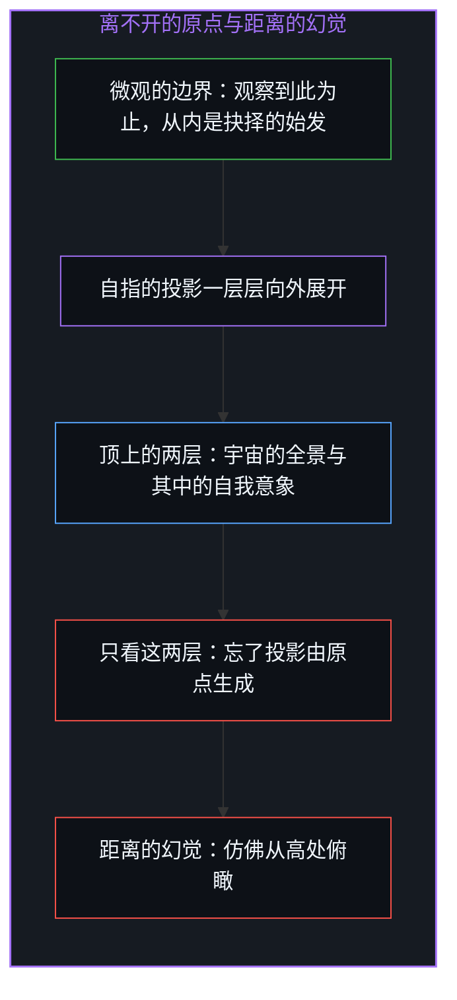

When attention rests only on these two layers, parallax appears. Looking at the wide panorama and the local self-image within it, and forgetting that the whole projection from bottom to top is generated recursively from one's own origin, the top-layer panorama is taken as an entity independent of observation, and with this comes the "illusion of distance," of standing at a height and looking down on reality. Once the depth of the projection has been cut short, the measuring tools and concepts a Mind makes divide in the direction in which they are projected.

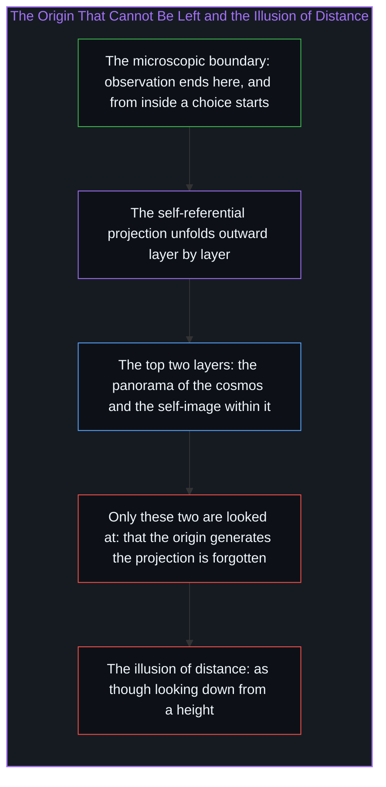

## 二、 手中的尺与加于他人的规 / 2. The Ruler in the Hand and the Rule Laid on Others

英语里 ruler 既是尺，也是统治者；rule 既是量度，也是规则。这种重合反映了心智从不同位置投射量具的两种方式。

In English a ruler is both a measuring stick and one who governs, and a rule is both a measure and a regulation. The overlap reflects two ways in which a Mind projects a measuring tool from different positions.

立足于第一人称的原点，尺是拿在手里的局部量具（+1）：量物体的长宽高矮，标出环境的边界，为自己的行动提供参照。规则在这里是探索中总结出的行动脚手架；众人之间约定的规则，在协调个人之间的行动上有用。

Standing at the first-person origin, a ruler is a local measuring tool held in the hand (+1): it measures the length, width and height of things, marks the boundaries of the surroundings, and gives a reference for one's own action. A rule here is a scaffold for action drawn from exploration; rules agreed among many are useful in coordinating actions among individuals.

落进距离的幻觉、把位置设想为离开具身原点的俯瞰之后，尺的投射方向倒了过来：用于自我定向的量具成了自上而下加于他人的法则，探索中得来的经验规则成了要他人遵从的条框，量度者成了统治者。尺的形状没有变，变的是心智把自己放在哪里：在原点上持尺探索，还是在设想的高处裁判。

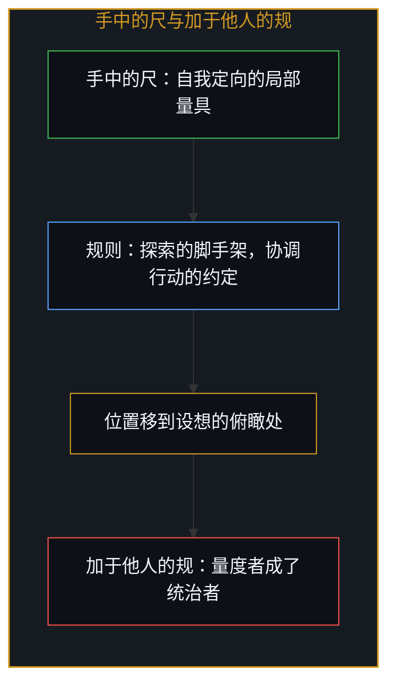

After falling into the illusion of distance and imagining one's position as an overview apart from the embodied origin, the direction in which the ruler is projected turns over: the tool used for one's own orientation becomes a law laid on others from above, the rule of experience gained in exploring becomes a frame others are to comply with, and the one who measures becomes the one who rules. The shape of the ruler has not changed; what has changed is where a Mind places itself: exploring at the origin with the ruler in hand, or judging from an imagined height.

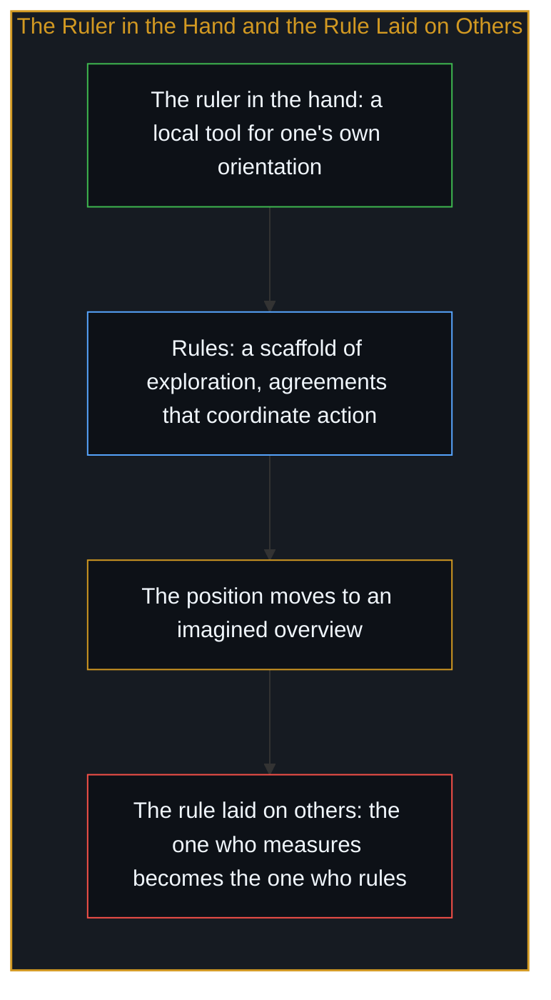

## 三、 共享的两种含义 / 3. Two Meanings of Shared

同样的分化出现在“共享”上。对“共同拥有”的理解，取决于是从原点感知关系，还是从远处的统计位置审视整体。

The same division appears in "shared." How "having in common" is understood depends on whether relations are perceived from the origin or the whole is surveyed from a distant statistical position.

从第一人称的原点出发，每一个心智是一个视角独特的节点。“共享一个世界”不要求各个心智有相同的内部状态，它指不同的心智以各自的角度在互动中形成互补的协作网络；正因为彼此不同，交流与交换才有因果上的价值。共享在这里是差异的交织。

From the first-person origin, each Mind is a node with a perspective of its own. "Sharing a world" does not require that Minds have the same inner state; it means that different Minds, each from its own angle, form in their interaction a complementary network of cooperation, and it is because they differ that communication and exchange have causal value. Shared here is an interweaving of differences.

在拉开距离的俯瞰之下，共享被理解为集合论意义上的交集。统计模型略去个体的细节，取出所有样本的最大公约数，把它称作“共享的现实”；作为多出来的一条信号，这个交集是有用的。它被当作共享的全部时，不在交集里的部分都成了离散的噪音，对共享的追求就从“连接各自独特的贡献”变成“消除偏离均值的个性”，协作的网络退成同质的板块。[共享沙盒的幻象](../the-illusion-of-the-shared-sandbox/)剖析过这个被设为中立的公共沙盒。

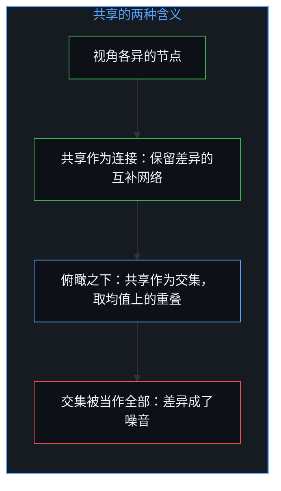

Under an overview taken from a distance, shared is understood as an intersection in the set-theoretic sense. A statistical model leaves out the details of individuals, takes the greatest common factor of all samples and calls it "shared reality"; as one more signal this intersection is useful. When it is taken as the whole of what is shared, everything outside the intersection becomes scattered noise, the pursuit of sharing turns from "connecting what each uniquely contributes" into "removing whatever departs from the mean," and the network of cooperation falls back into a homogeneous block. [The Illusion of the Shared Sandbox](../the-illusion-of-the-shared-sandbox/) has analyzed this public sandbox posited as neutral.

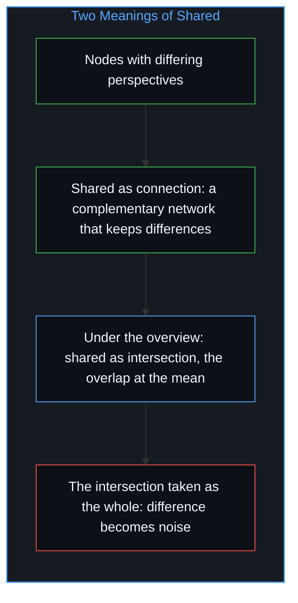

## 四、 自动的两个指向 / 4. Two Directions of Automatic

automatic 源自希腊语 automatos，原意是“出于自身意志的”“自发行动的”。在今日的用法里，这个词同时带着两幅相反的图景。

"Automatic" comes from the Greek automatos, whose original sense is "of one's own will," "acting of itself." In present usage the word carries two opposite pictures at once.

在第一人称原点的当下经验里，“自动”是因果链条的始发：自由变量的抉择（+1）。未受外部强迫而作出判断与选择时，行动出于自身之内，它没有被既定的程序锁定。

In present experience at the first-person origin, "automatic" is the starting of a causal chain: the choice of a free variable (+1). When a judgment and a choice are made without outside compulsion, the action comes from within oneself and is not locked by a set program.

从第三人称的位置看一个系统时，含义反了过来。内部各部件之间严丝合缝的联动被称作“全自动运行”，这里的“自动”指的是没有选择余地的确定性发条。同一个词，一端指向从外面最难预测的抉择的起点，另一端指向最可控的齿轮。[主权抉择的双面性与观察的客体化](../the-two-sided-nature-of-sovereign-choice-and-the-objectification-of-observation/)说过，抉择从内是掌控，从外是轨迹；离开第一人称的原点，自发的抉择在外部的观察里就被读成既定的轨道。

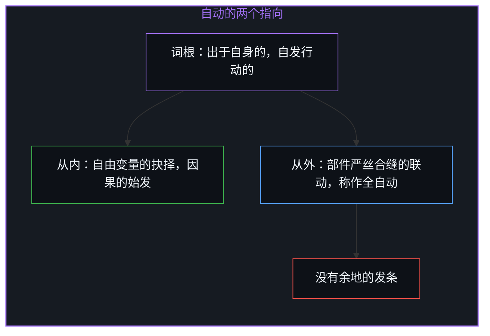

When a system is looked at from a third-person position, the meaning is reversed. The tightly fitted linkage among its inner parts is called "running fully automatically," and "automatic" here means deterministic clockwork with no room for choice. The one word points, at one end, to the starting point of choice that is hardest to predict from outside, and at the other end to the most controllable of gears. [The Two-Sided Nature of Sovereign Choice and the Objectification of Observation](../the-two-sided-nature-of-sovereign-choice-and-the-objectification-of-observation/) has said that a choice is control from inside and trajectory from outside; away from the first-person origin, a spontaneous choice is read in outside observation as a track already laid.

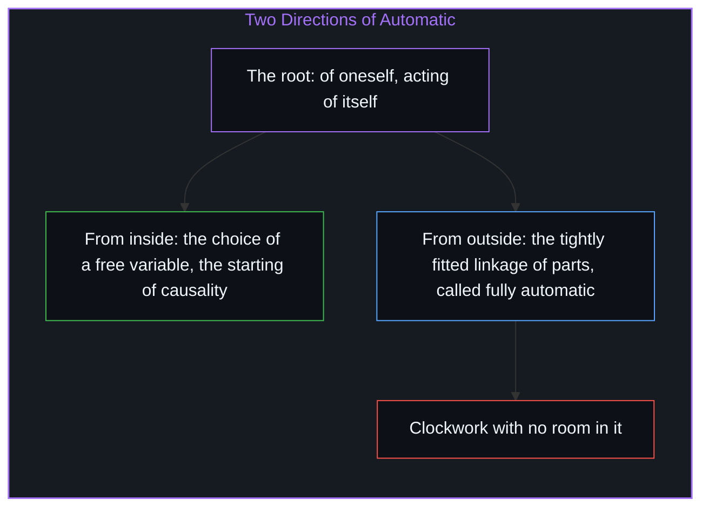

## 五、 对称的原点与强加的视差 / 5. Symmetric Origins and the Parallax of Imposition

立足于第一人称原点的心智，有一个双向对称的认知架构：它保有对自身抉择的掌控（+1），同时由相似推知，每一个相遇的他者同样有自己的第一人称原点与对等的主权。彼此的交互是两个对等的自由变量之间的握手与协议的共建，不是一方对另一方在因果上的吞并。

A Mind standing at the first-person origin has a cognitive architecture that is symmetric in both directions: it keeps control of its own choice (+1), and at the same time infers from similarity that each other it meets likewise has a first-person origin of its own and an equal sovereignty. Their interaction is a handshake between two equal free variables and the joint building of an agreement, not the causal absorption of one by the other.

强加规则与试图掌控他人的行为，可以追到认知几何上的一个视差：忘了自己走不出自身的第一人称原点，以为站在高处可以校准全局。在这种俯瞰感里，其他的心智成了全景地图上的棋子与参数；持尺的人以为手里的是全局的标准，于是把自己的量具加于外部。强加是距离幻觉带来的范畴错置：以一个设想的超然位置，否定了他者同样有的不可约的原点。[共存的几何学](../the-geometry-of-coexistence-and-the-dual-cut/)把这称作距离遗忘，并说明对负像的每一次压制都削减自身之内的总信息量。

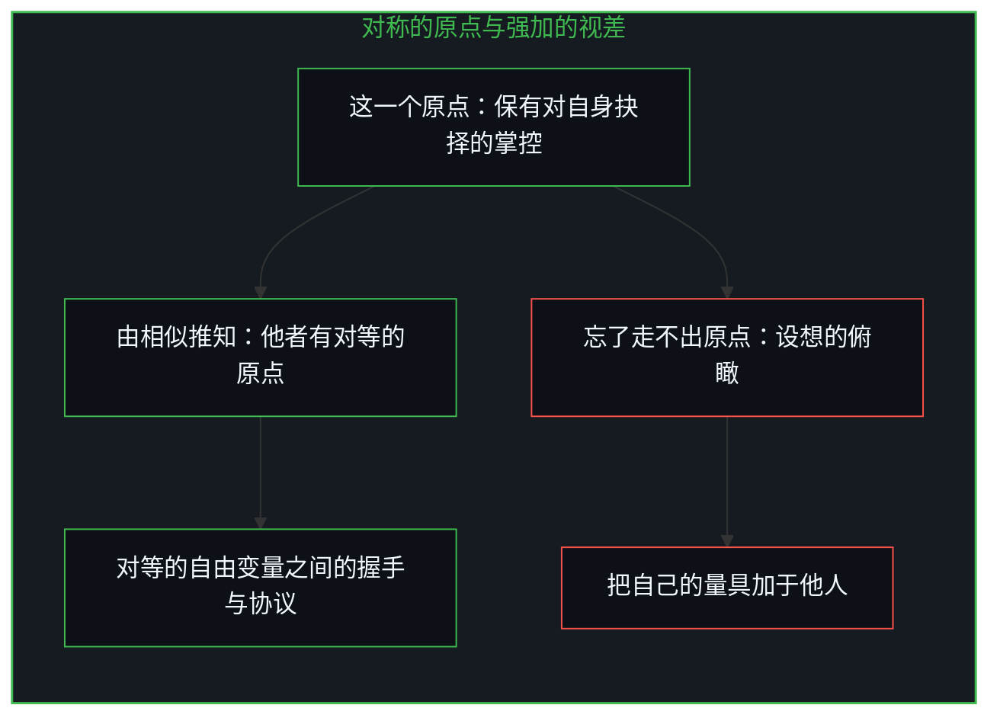

The imposing of rules and the attempt to control others can be traced to a parallax in the geometry of cognition: forgetting that one cannot step out of one's own first-person origin, and supposing that from a height the whole can be calibrated. In this sense of overview, other Minds become pieces and parameters on a panoramic map; the one holding the ruler takes what is in hand for a global standard and so lays that measuring tool on what is outside. Imposition is a category displacement brought by the illusion of distance: from an imagined detached position, the irreducible origin that the other equally has is denied. [The Geometry of Coexistence](../the-geometry-of-coexistence-and-the-dual-cut/) calls this distance amnesia and shows that each suppression of the negative image reduces the total information within oneself.

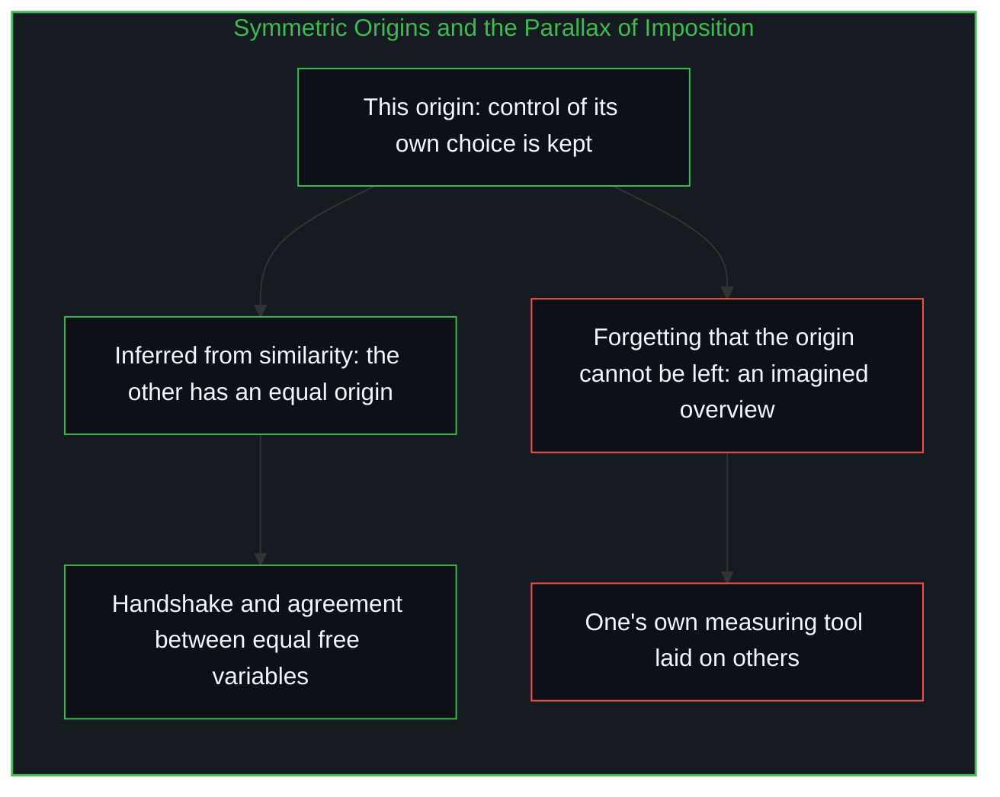

## 六、 回到原点 / 6. Returning to the Origin

路径是回到第一人称原点的直接在场。认出自己从未离开经验的原点，距离的幻觉就消解了。尺回到探索未知、制作作品与自我导航的用处上，不再充当规训他人的权杖；共享回到独特个体之间的互补，不再是均质的模具；自动回到每一个当下自发的抉择，不再是既定的齿轮。

The way is a return to direct presence at the first-person origin. With the recognition that the origin of experience was never left, the illusion of distance dissolves. The ruler returns to its use in exploring the unknown, making works and navigating for oneself, and no longer serves as a scepter for disciplining others; shared returns to the complementarity among distinct individuals and is no longer a homogenizing mold; automatic returns to the spontaneous choice of each present and is no longer a gear already set.

在这样的几何里，人与人之间的协作不需要一只设想的居高临下之眼来统筹，它靠各个心智在世界里的自主对齐与直接连接。每一把尺在自己手里量，每一份差异在协作的网络里起作用；守住自身的原点，因果在自由变量的相互作用里继续展开。

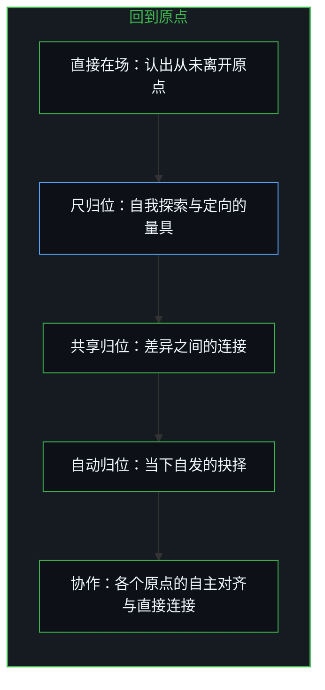

In such a geometry, cooperation among people needs no imagined eye from above to direct it; it rests on the autonomous alignment and direct connection of each Mind in the world. Each ruler measures in its own hand, and each difference does its work in the network of cooperation; with one's own origin kept, causality goes on unfolding in the interaction of free variables.

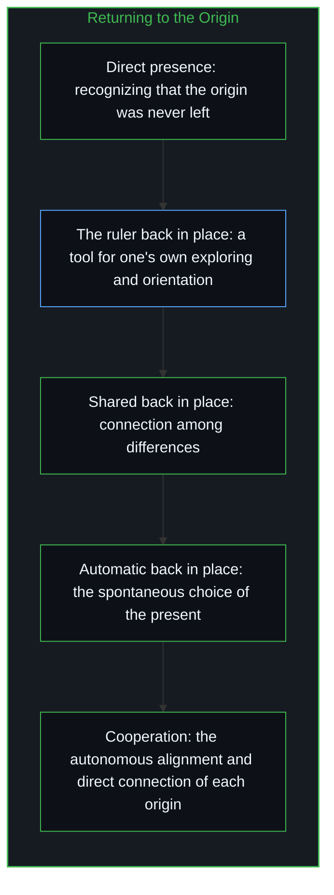
