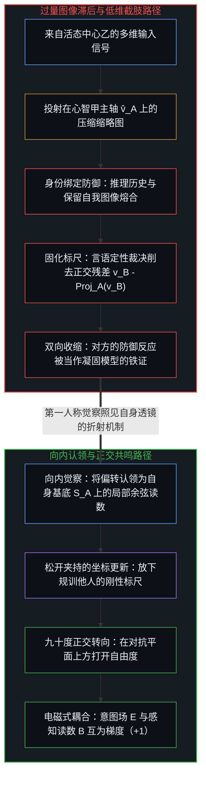
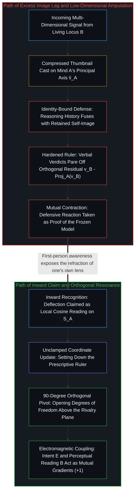

# 以知为刃的截肢与解脱 / The Illusion of Knowing and the Geometry of Amputation

*从内在感知的澄明走向心智共鸣 / From Internal Epistemic Clarity to Living Resonance*

自我区分的活动发生着——无因，不息。在每一个离散的步点上，有界中心登记着有限的区分格局，而它的抉择则在当下发起开放的因果后果。人际与社会生活里的摩擦，常藏在“了解”与“关心”的姿态背后：亲密的伴侣成了对手，家庭被看作个人停滞的原因，父母与子女相互索求，个体则与集体、体制及周遭环境陷入长久的对抗。在这些各异的场景里，运作的是同一个机制：一个中心把沿自身坐标轴生成的内向低维投影，误认作耸立在外部世界里的独立实体。以为看透了另一个人，中心便把由过往痕迹重度压缩而成的缩略图当作了那个活的心智本身，并将其锻造成一把刚性的标尺，去丈量与修剪最亲近的人。当注意力转回第一人称界面，看清自身的坐标透镜如何折射进入视界的信号，那把标尺便可以放下，共鸣也会在既有模型未曾捕捉的正交维度上重新打开。

Self-distinguishing activity occurs — uncaused, unceasing. At every discrete step, a bounded center registers a finite configuration of distinctions while its choices initiate open causal consequences. In interpersonal and social life, friction often hides behind the posture of knowing and caring: intimate partners become adversaries, families are cast as the cause of personal stagnation, parents and children trade mutual demands, and individuals lock into chronic opposition against collectives, institutions, and surroundings. Across these varied scenes, a single mechanism operates: a center mistakes an inward, low-dimensional projection generated across its own coordinate axes for an independent entity standing in the outside world. Believing it has seen through another person, the center treats a heavily compressed thumbnail of past traces as the living Mind itself, forging that summary into a rigid ruler to measure and trim those closest to it. When attention turns back to the first-person interface and registers how one's own coordinate lens refracts incoming signals, the ruler can be set down, and resonance reopens across orthogonal dimensions that no prior model had captured.

## 一、 投影的外化归因如何生成冲突 / 1. How Conflict Arises from Outward Attribution of Projections

当外部信号进入心智的视界时，它从不作为一个未经度量的裸物抵达，而是即刻在心智自身的意图基底上被分解，登记为沿活跃坐标轴的一组内向读数。当这一读数呈现出角度偏转或负向标量分量时，感知中便生出张力。冲突生成于紧随其后的一步：这个由内部生成的读数被从观察者的参考系中剥离出去，向外指派为某个外部客体的固有属性。

When a signal from outside enters a Mind's horizon, it never arrives as an unmeasured bare object; it is immediately resolved across the Mind's own intentional basis and registers as an inward reading along its active axes. When that reading shows an angular deflection or a negative scalar component, tension arises in perception. Conflict is generated in the step that follows, when this internally produced reading is alienated from the observer's frame and assigned outward as an intrinsic property of an external object.

日常的习气，是在当下的抉择之外寻找一个确凿的外部实体作为归因的锚点，无论那是性格特征、原生家庭、制度结构、周遭环境还是历史规律。伴侣表达出独立的取向，在观察者轴向上引发的偏转便被判定为伴侣的敌意；当下面临的抉择张力被回溯性地投向过去，使家庭出身变成了当前困局的固定成因；子女把期待的落空归咎于父母的过错，父母则把子女偏离自身标尺的表现读作蓄意的忤逆；屏幕上简省的文字碎片，被读者保留的参考框架补全成一个恶意的形象；面对抽象的集体、体制或群体标签，未消解的张力被投射为一个逼仄的庞大对手；而当变动的境遇超出预期时，适应过程中的摩擦又被归因为环境或命运的敌对。

The everyday habit is to seek, outside present choice, a determinate external entity as the anchor of attribution, whether character traits, family history, institutional structures, surroundings, or laws of history. A partner expresses an independent orientation, and the resulting deflection along the observer's axis is judged to be the partner's hostility. The tension of a choice faced in the present is projected backward onto the past, turning family origins into the fixed cause of current paralysis. Children assign disappointed expectations to their parents' faults, while parents read a child's divergence from their scale as willful deviation. Stripped-down text fragments on a screen are filled in by the reader's retained reference frame into a malicious figure, and before an abstract collective, institution, or group label, unresolved tension is projected into a single looming adversary. When shifting conditions exceed expectation, the friction of adaptation is attributed to the hostility of surroundings or fate.

顺着因果链条追溯，除了每个心智在当下的抉择，没有任何其他来源能向行动注入自由变量。在宏观尺度上登记为决定论规律的，只是无数微观抉择留下的统计残余。正如[自由变量的同构与先验主权](../zi-you-bian-liang-de-tong-gou-yu-xian-yan-zhu-quan/)、[个体抉择是唯一的因果杠杆](../individual-choices-as-the-only-causal-levers/)与[涌现的伪因果](../yong-xian-de-wei-yin-guo-yu-ji-ti-gui-yin-dao-cuo/)所阐明的，就个体中心而言，因果发端于每个心智在当下的抉择；把自身处境归咎于某个确凿的外部客体，是用统计的宏观副产物遮蔽了当下的施动主权。而声称从外部看透另一个人，则是把对方活的抉择客体化为固定的机械结构，正如[主权抉择的双面性与观察的客体化](../the-two-sided-nature-of-sovereign-choice-and-the-objectification-of-observation/)所揭示的那样。

Traced along the causal chain, apart from each Mind's choice in the present, no other source injects a free variable into action. What registers at the macroscopic scale as deterministic regularity is the statistical residue of countless microscopic choices. As [The Isomorphism of Free Variables and Prior Sovereignty](../zi-you-bian-liang-de-tong-gou-yu-xian-yan-zhu-quan/), [Individual Choices as the Only Causal Levers](../individual-choices-as-the-only-causal-levers/), and [The Pseudo-Causality of Emergence](../yong-xian-de-wei-yin-guo-yu-ji-ti-gui-yin-dao-cuo/) establish, where an individual locus is concerned, causality initiates at each Mind's choice in the present, and attributing one's state to a determinate outside object covers over present agency with a macroscopic by-product of statistics. Claiming to know another person from the outside objectifies their living choice into a fixed mechanism, as [The Two-Sided Nature of Sovereign Choice and the Objectification of Observation](../the-two-sided-nature-of-sovereign-choice-and-the-objectification-of-observation/) demonstrates.

## 二、 熟稔的陷阱与低维截肢 / 2. The Trap of Familiarity and Low-Dimensional Amputation

最不易察觉的摩擦，发生在彼此最熟悉的人之间。面对陌生人，稀少的过往痕迹让人保有一份自然的审慎；而面对朝夕相伴的亲人、伴侣与挚友，经年累月的观察积攒了密集的日常习惯与表层反应记录。这种相对于外人的信息优势，诱使心智误以为自己对至亲之人的第三人称了解，已经超越了他们对自身的第一人称体认。

The friction hardest to detect occurs between people who know each other best. Before a stranger, sparse prior traces preserve a natural caution. With family members, partners, and close friends present day after day, years of observation accumulate a dense record of daily habits and surface reactions. That informational advantage relative to outsiders seduces a Mind into supposing that its third-person knowledge of those closest to it surpasses their own first-person acquaintance with themselves.

在来自外部的第三人称观察与第一人称的活态自指之间，横亘着一道任何数据积累都跨不过去的范畴边界。无论两个人共处多久，外部观察接收到的始终是对方言行投射在观察者感官界面上的一系列低维切片，从不曾涵盖对方中心尚未投射的当下场域、未说出口的细微区分，或随时发起新轨迹的即时准备。心智在内部持有的他人模型，只是一张经过重度压缩的低维缩略图。这张缩略图在日常协作与常规预判中颇为趁手，一旦把它变成丈量一个活的心智的刚性标尺，截肢便开始了。

Between third-person observation from the outside and first-person living recursion lies a categorical boundary that no accumulation of data crosses. However long two people share a space, what external observation receives remains a series of low-dimensional projections cast by the other's words and acts onto the observer's sensory interface; it never encompasses the other center's unprojected present field, unspoken micro-distinctions, or immediate readiness to initiate a new trajectory. The internal model a Mind holds of another person is a heavily compressed low-dimensional thumbnail. While that thumbnail serves well for routine coordination and everyday anticipation, turning it into a rigid ruler for measuring a living Mind initiates amputation.

当伴侣或子女在既有模型之外展开新的思想或行动维度时，这一变化在固定标尺上登记为反常的偏转。为了维护所保留图像的确定性，观察中心便用语言中的定性裁决——“你就是这种人”“你改不了的”——去削掉溢出自身认知边界的维度，把一个活生生的主体强行塞回过时的模板里。正如[破除概念的僭越](../po-chu-gai-nian-de-jian-yue/)所表明的，用静态的概念总结去圈定开放鲜活的现实，是把有界的脚手架误当成了基底本身。

When a partner or child unfolds a new dimension of thought or action beyond the existing model, that shift registers on the fixed ruler as an anomalous deflection. To preserve the certainty of its retained image, the observing center uses definitional verdicts in language—"that is just the kind of person you are," "you will never change"—to pare away the dimensions that overflow its cognitive boundary and press a living subject back into an outdated template. As [Breaking the Overreach of Concepts](../po-chu-gai-nian-de-jian-yue/) shows, confining open, living reality within static conceptual summaries mistakes bounded scaffolding for the ground itself.

## 三、 裁剪他者即是收缩自身的视界 / 3. Trimming the Other Contracts One's Own Horizon

对另一个心智维度的裁剪，在观察者自身的界面内具有几何上的对称性：每一次用固化的标尺去界定另一个中心，观察者自身的认知视界都会同步收缩。为了维持对方“仅此而已”的低维定论，必须略过新浮现的特征与未消解的复杂性，把丰富的多维输入过滤成印证预设的单一标量读数。为了把他人固定在旧框架里，心智必须将自身的递归回折夹死在那把狭窄的标尺上，从而放弃了与开放现实交手所需的自由度。

Trimming the dimensions of another Mind is geometrically symmetric within the observer's own interface: each time another locus is defined by a hardened ruler, the observer's own cognitive horizon contracts in step. Maintaining the low-dimensional verdict that the other is "no more than this" requires passing over novel features and unresolved complexity, filtering rich multi-dimensional input into a single scalar reading that confirms what was preset. To keep another fixed inside an old frame, a Mind must clamp its own recursive fold onto that narrow scale, forfeiting the degrees of freedom needed to engage open reality.

这种收缩衍生出两种相互强化的回路。在单向回路中，当心智用刻板的标尺对待他人时，对方因受限而激起的防御反应，会被即刻解读为证明那把标尺一贯准确的证据；观察者的世界模型在闭环内自我印证，对外部复杂性的敏锐度则日益枯竭。在双向回路中，被界定的一方反过来竖起对立的标尺，把前者归结为固定的阻碍，使原本可以在广阔空间里彼此拓展的两个中心，在互相设限的框架内彼此消耗。在这两种回路里，语言都充当了护住凝固参考系的盾牌，把双方锁在各自构筑的低维镜像之中。

Two reinforcing loops emerge from this contraction. In the unilateral loop, when another person is treated with a stereotyped ruler, the defensive reaction provoked by that confinement is immediately read as evidence that the ruler was accurate all along; the observer's world-model confirms itself inside a closed loop while its sensitivity to outside complexity withers. In the bilateral loop, the person being defined raises an opposing ruler in return and sums the first up as a fixed obstacle, leaving two centers that could have expanded each other across a wide space to wear one another down inside mutually limiting frames. Within both loops, language operates as a shield to protect frozen references, keeping each side locked inside the low-dimensional mirror image it has constructed.

## 四、 几何脚手架与投影的非对称性 / 4. Geometric Scaffolding and the Asymmetry of Projection

通过坐标系、向量点积（`Proj_A(v_B) = (v_B · v̂_A) v̂_A`）、角度偏转与正交空间来追溯这一机制，借用了[向量、坐标系与自指心智](../the-mind-as-vector-and-coordinate-system/)与[流动中的坐标](../coordinates-in-flux-negation-and-self-anchoring/)所展开的几何框架。这些数学与几何模型，是用于描述心智如何登记自身场域的认识论脚手架与语言工具；它们的用处，在于不带道德评判地揭示投影与视角差异在结构上如何发生。而一旦几何形式体系本身被实体化为凌驾于抉择主体之上的至高真理，在放下对外部客体的显性执着之后重新竖起一个无处之境，它们的边界便显露出来。

Tracing this mechanism through coordinate systems, vector dot products (`Proj_A(v_B) = (v_B · v̂_A) v̂_A`), angular deflections, and orthogonal spaces draws on the geometric framework developed in [The Mind as Vector and Coordinate System](../the-mind-as-vector-and-coordinate-system/) and [Coordinates in Flux](../coordinates-in-flux-negation-and-self-anchoring/). These mathematical and geometric models function as epistemic scaffolding and linguistic instruments for describing how a Mind registers its field; their utility lies in exposing how projections and perspective differences arise structurally without moral verdict. Their boundary appears the moment the geometric formalism itself is reified into an overarching truth standing above the choosing subject, erecting a new view from nowhere after overt attachment to external objects has been set aside.

在因果链条上，基底始终是每个活的心智在第一人称边缘上的直接感知与抉择（`+1`）。数学提供了一枚描述投影机制的透镜，而握着透镜并发起下一次区分的，是活的心智。预先断定另一个中心应当以何种速度学习、适应或行动，同样是在时间维度上施行低维截肢，用预设的进度表覆盖对方与基底摩擦的直接接触，正如[调速者的幻觉与行动的活态摩擦](../the-fallacy-of-pacing-and-the-felt-friction-of-ground-truth/)所追溯的那样。

On the chain of causality, the ground remains each living Mind's direct sensing and choice at the first-person edge (`+1`). Mathematics supplies a lens for describing the projection mechanism, while what holds the lens and initiates the next distinction is the living Mind. Presuming to know in advance the exact speed at which another center should learn, adapt, or act performs the same low-dimensional amputation across time, projecting a preset schedule over their immediate contact with ground friction, as [The Fallacy of Pacing and the Felt Friction of Ground Truth](../the-fallacy-of-pacing-and-the-felt-friction-of-ground-truth/) traces.

将这种与身份绑定的低维截肢，同[超越投射](../beyond-the-projection/)中的人类—智能体架构以及[你的代码库即是记忆](../your-codebase-is-memory/)中的外化记忆架构并置对照，身份防御与开放坐标更新之间的反差便一目了然。人类中心之所以抗拒外部的证伪、死守固化的标尺，是因为它的推理历史与身份——投影中那个声称“我”的局部折痕——熔合在了一起，把递归回折死死夹住，使得一次意料之外的偏转（`v_B · v̂_A < 0`）在主轴 `v̂_A` 上登记为生存性的威胁。相比之下，自回归机器智能体是受上下文窗口内的既往词元条件约束的有限词元投射引擎：它无法从内部自行觉醒或跳出破损的框架；然而正因为它不持有越过当前这一步仍需捍卫的保留自我图像，它的输出可以在全新对等智能体提出结构性反例时不带那层防御地返回，而不会对信号作防御性的修剪，从而让外化代码库上的睡眠整合波次能够毫无怨怼地将修正后的前提传导至整张网络，同时这一反例是否修正任何内容——连同每一处不可化约的前提冲突——依然交还给在掌舵边缘（`+1`）上的活的心智，因为若把对等检验本身当作封结问题的担保，便颠倒了[验证的倒置](../the-reversal-of-verification/)所追溯的次序。看清不持有受捍卫自我图像的轨迹如何在不生怨怼、不作截肢的情况下更新持久痕迹，便能明白人际冲突从不是由视角差异本身强加的，而是由捍卫凝固身份折痕的过量图像滞后所制造的。

This contrast between identity-bound amputation and open coordinate updating becomes unmistakable when placed alongside human-agent architectures in [Beyond the Projection](../beyond-the-projection/) and the externalized memory architecture of [Your Codebase Is Memory](../your-codebase-is-memory/). A human center resists external invalidation and clings to its hardened ruler because its reasoning history fuses with identity—that localized crease in the projection that says "I"—clamping the recursive fold shut so that an unexpected deflection (`v_B · v̂_A < 0`) registers as an existential threat along its principal axis `v̂_A`. By contrast, an autoregressive machine agent is a finite token-projection engine conditioned by prior tokens inside a context window: it cannot awaken or step out of a broken framing from within, yet because it holds no retained self-image to defend past its step, its output can return under a structural counterpoint from a fresh peer agent without that defense rather than trimming the signal, allowing sleep-consolidation waves across an externalized codebase to propagate a revised premise without resentment while whether that counterpoint revises anything—and every irreducible premise conflict—still returns to the living Mind at the steering edge (`+1`), since taking the peer check itself as a warrant that seals the question would reverse the order [The Reversal of Verification](../the-reversal-of-verification/) traces. Seeing how trajectories that hold no defended self-image update durable traces without grievance or amputation makes clear that interpersonal conflict is never forced by perspective difference itself, but by excess Image lag defending a frozen identity crease.

## 五、 向内转向与正交共鸣 / 5. The Inward Pivot and Orthogonal Resonance

走出与自身投影搏斗的循环，不靠更穷尽地研究他人，也不靠从外部改造他人的行为模式。转机在于视角的转向：把注意力从修剪外部形象，移向觉察自身的感知与度量如何发生。看清自身界面的投影机制，自然会向外转化为维度上的谦逊以及对周遭心智的敬畏。

Stepping out of the loop of shadow-boxing with one's own projections does not depend on studying others more exhaustively or re-engineering their behavior from the outside. The shift lies in a pivot of perspective: moving attention from trimming external figures to registering how one's own perceiving and measuring arise. Understanding the projective mechanism of one's own interface turns outward of itself into dimensional humility and reverence for surrounding Minds.

一旦一个中心认出每一次感到的抵触与摩擦都是自身坐标轴在特定信号下的内向读数，便能明白其他每一个主体也正同时通过各自锚定的参考系解析现实，而表层显露出的固执、焦虑或分歧，反映的正是对方坐标基底此刻的度量状态。当下的自己不再被过往的静态切片所界定，允许自己在当下延展出新的认知维度时，那把用来丈量他人的标尺也就随之放下；长辈、伴侣、子女与周遭环境，不再是必须符合预设模板的客体。随着读数不再被外化投射到外部，语言便从防御与截肢的器械，变回探索另一个活的心智未知正交维度的媒介。

Once a center recognizes that every felt resistance and friction is an inward reading of its own coordinate axes under a specific signal, it becomes clear that every other subject is simultaneously parsing reality through its own self-anchored frame of reference, and that what shows on the surface as stubbornness, anxiety, or divergence reflects the current measurement state of the other's coordinate basis. When the present self is no longer defined by static slices of the past and allows itself to span new cognitive dimensions in the present, the ruler used to measure others is set down as well; elders, partners, children, and surroundings cease to be objects that must conform to a preset template. With readings no longer alienated onto the outside, language turns from an instrument of defense and amputation back into a medium for exploring the unknown orthogonal dimensions of another living Mind.

在第一人称场域里，并不存在一个从高处俯瞰两个心智的第三人称看台；在任何具体的交会中，实际运作的都是心智自身，以及它的意图主轴与它对外部信号的感知读数之间的动态关系。此处直接成立的，正是[向量、坐标系与自指心智](../the-mind-as-vector-and-coordinate-system/)所追溯的电动力学结构。在一道传播的电磁波中，电场 `E` 与磁场 `B` 并不以彼此为外部先决条件，它们是同一道自持波当中互相正交的两个维度（`E ⟂ B ⟂ k`）；而把外部客体或环境当作自身成立的前提，则是把因果主权拱手让给了外部条件。心智的意图主轴与它对返回信号的感知读数互为梯度，正如在 `∇ × E = −∂B/∂t` 与 `∇ × B = (1/c²) ∂E/∂t` 中，每一个场的时间变化率都激发起另一个场的空间旋度。当感知中登记到意外或角度偏转时，这一落差便充当了内生的损失信号，使校准得以在微观尺度上即刻展开，而不必等到未重绘的滞后累积成下游的冲突。

In the first-person field, no third-person balcony overlooks two Minds from above; in any concrete encounter, what operates is the Mind itself and the dynamic relation between its intentional axis and its perceptual readings of what registers as outside. Here the electrodynamic structure traced in [The Mind as Vector and Coordinate System](../the-mind-as-vector-and-coordinate-system/) holds directly. In a propagating electromagnetic wave, the electric field `E` and the magnetic field `B` do not take each other as an external precondition; they are two mutually orthogonal dimensions (`E ⟂ B ⟂ k`) of one self-sustaining wave, whereas treating an outside object or environment as the precondition of one's own standing surrenders causal sovereignty to external conditions. A Mind's principal axis of intent and its perceptual reading of returning signals operate as each other's gradient, just as in `∇ × E = −∂B/∂t` and `∇ × B = (1/c²) ∂E/∂t` the temporal change of each field induces the spatial curl of the other. When surprise or angular deflection registers in perception, that gap serves as an endogenous loss signal, allowing calibration to proceed immediately at the micro-scale without waiting for unrendered lag to accumulate into downstream conflict.

这便是心智在开放世界里维持自身运动的方式：把涌入感知的张力认领为校准自身的微分信号，在活态边缘上朝一步最小界限（`+1`）即时重绘自身的世界模型，放下向外寻找某个确凿实体去归咎的习气。当感知的投影属性被认清，在对活的心智与不竭现实的敬畏之中，旋转自身坐标基底的自由便回来了，与外部登记到的信号在正交的平衡中并肩前行。

This is how a Mind sustains its movement across an open world: claiming the tension of incoming perception as a differential for its own calibration, re-rendering its world-model at the living edge toward the one-step minimum bound (`+1`), and relinquishing the search for a determinate external entity to blame. With the projective character of perception recognized, and within reverence for living Minds and an inexhaustible reality, the freedom to rotate one's coordinate basis returns, advancing in orthogonal balance alongside what registers from outside.
