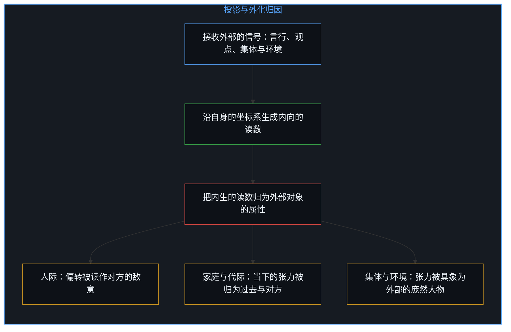
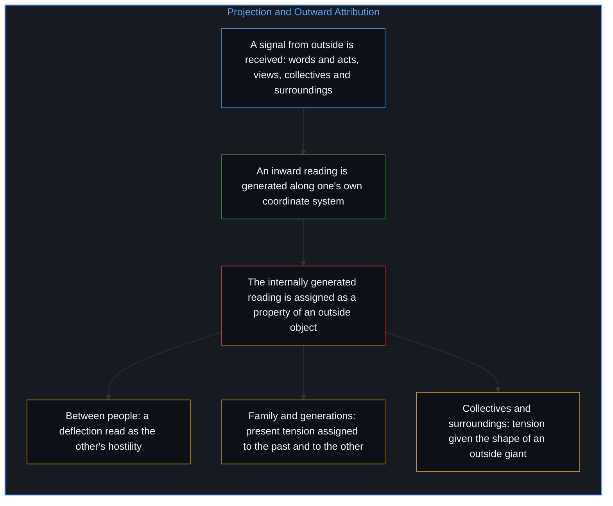
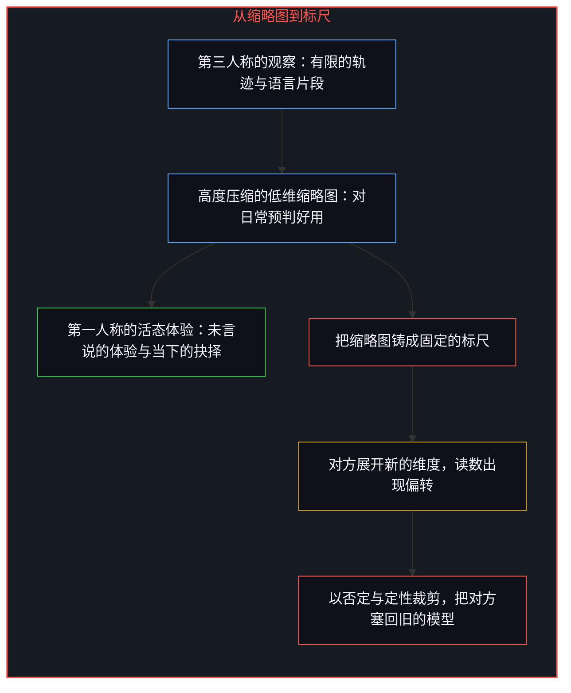
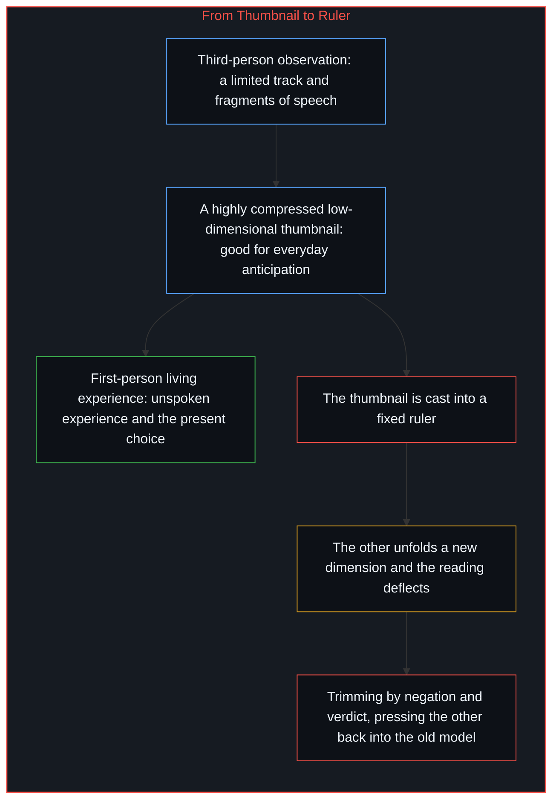
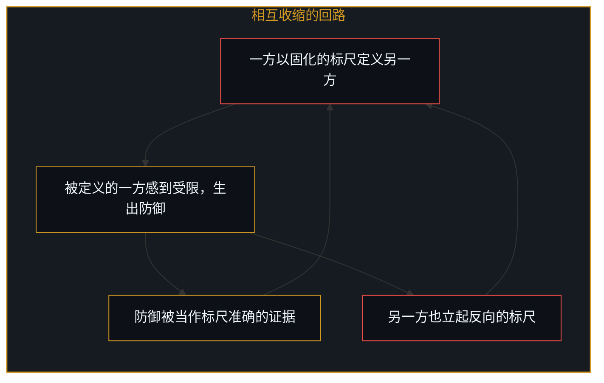
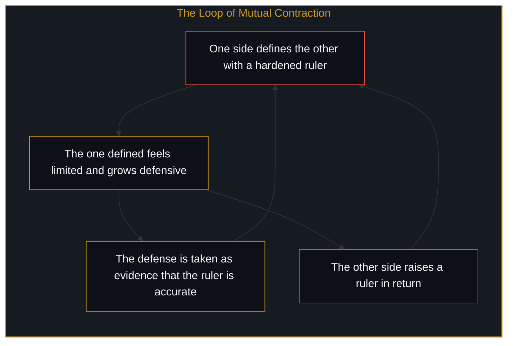
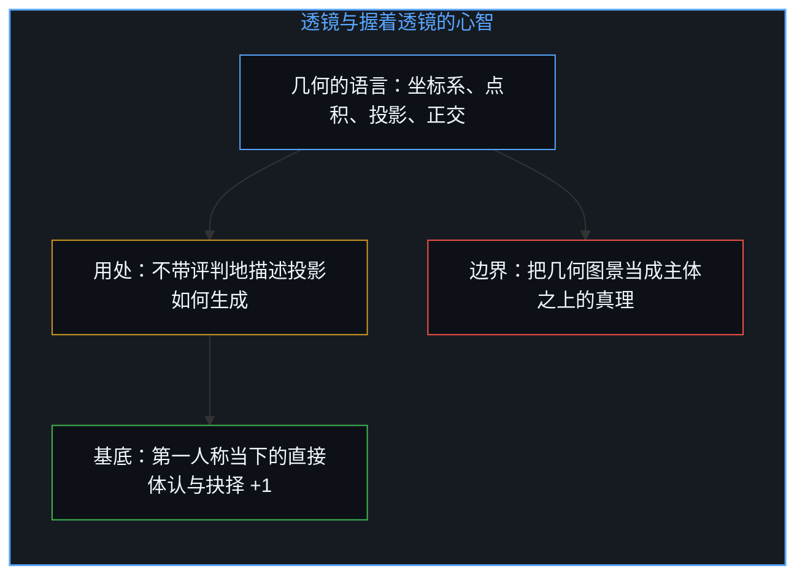
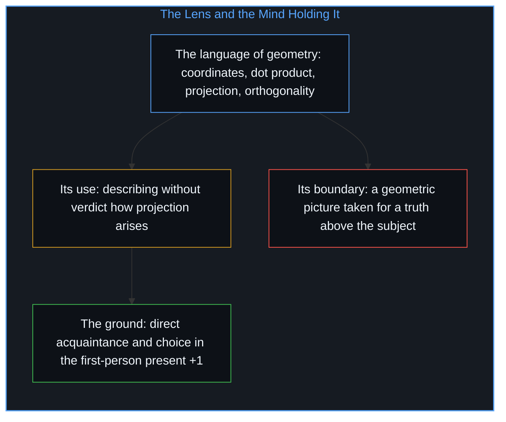
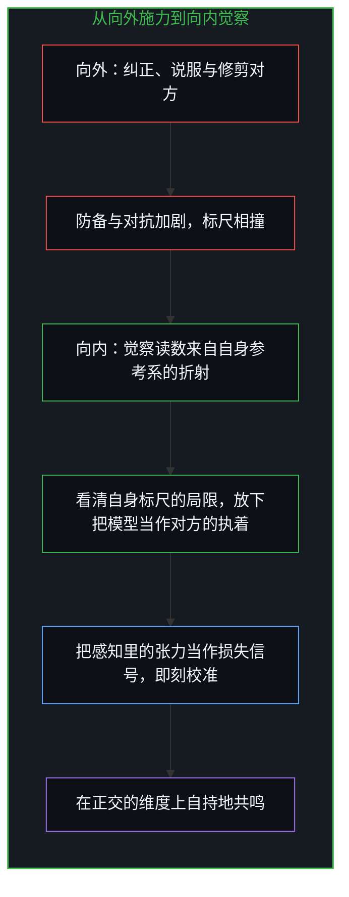
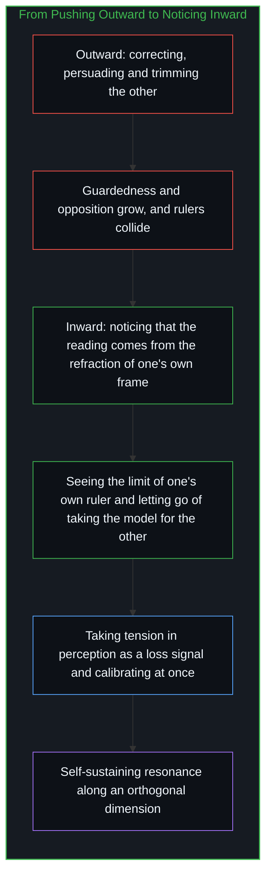

# 以知为刃的截肢与解脱 / The Illusion of Knowing and the Geometry of Amputation

*从内在感知的澄明走向心智共鸣 / From Internal Epistemic Clarity to Living Resonance*

人际与社会生存里的摩擦，常裹在“了解”与“关心”的外表之下：亲密的伴侣成了对手，家庭被看作停滞的原因，子女与父母相互要求，个人与集体、体制和环境长久对抗。这些冲突表征各异，机制却一致，是心智把自身生成的内向投影当成了外部世界的独立实体。以为“看透”了谁的时候，一张高度压缩的低维印象被当作了对方本身，并铸成一把标尺去裁量最亲近的人。转向第一人称的觉察，看清自身透镜的折射，标尺便可以放下，共鸣在对未知维度的敬畏中重新成为可能。

The friction of living with others and within society is often wrapped in the look of "knowing" and "caring": intimate partners become adversaries, the family is seen as the cause of being stuck, children and parents make demands of each other, and a person stands in long opposition to collectives, institutions and surroundings. These conflicts differ in appearance and share one mechanism, in which a Mind takes the inward projection it has itself generated for an independent entity in the outside world. When someone is believed to have been "seen through," a highly compressed low-dimensional impression is taken for the other person and cast into a ruler for measuring those who are closest. With a turn toward first-person awareness and a clear view of the refraction of one's own lens, the ruler can be set down, and resonance becomes possible again within reverence for dimensions not known.

## 一、 冲突的生成：投影的外化归因 / 1. How Conflict Arises: Attributing a Projection Outward

外部的信号进入心智的视界时，并不是一个未经度量的裸物，它即刻被心智自身的意图坐标系解析，呈现为沿自身轴向的一个读数。读数出现偏转或负的分量时，感知里便有了张力。冲突生成于随后的一步：这个内生的读数被归到外部的对象上。

When a signal from outside enters a Mind's horizon it is not a bare thing unmeasured; it is at once parsed by the Mind's own coordinate system of intent and appears as a reading along its own axes. When the reading shows a deflection or a negative component, there is tension in perception. Conflict arises in the step that follows: this internally generated reading is assigned to an object outside.

日常里的习惯，是在抉择之外找一个确凿的、决定论式的外部实体作归因的锚点，性格、家庭、体制、环境、历史的规律都可以充当。伴侣表现出独立的取向，在自身轴向上产生的偏转被定为对方的敌意。当下面临的抉择张力被回溯地投到过去，家庭的历史成了造成现状的原因。子女把期待的落空归为父母的过错，父母把尺度未被满足归为子女的偏离。屏幕上高度简化的文本碎片，被自己的参考框架补全成一个恶意的形象。面对抽象的集体、体制或群体标签，失落与张力被投射成一个庞大的客体。情境超出预期时，适应中的摩擦被归为环境或命运的敌对。

The everyday habit is to find, apart from choice, some definite and deterministic outside entity as the anchor of attribution; character, family, institutions, surroundings and the laws of history can all serve. A partner shows an independent orientation, and the deflection it produces on one's own axis is ruled to be the other's hostility. The tension of a choice faced in the present is cast back onto the past, and the family's history becomes the cause of the present state. Children assign their disappointed expectations to their parents' fault, and parents assign their unmet measure to their children's deviation. Highly simplified fragments of text on a screen are filled out by one's own frame of reference into a malicious figure. Before an abstract collective, institution or group label, loss and tension are projected into one vast object. When a situation goes beyond expectation, the friction of adapting is assigned to the hostility of surroundings or fate.

沿因果去追，除了每个心智在当下的抉择，找不到别的能注入自由变量的来处。宏观上被称为“确定性”或“决定论规律”的，是微观上的非确定与抉择的统计表征。[自由变量的同构与先验主权](../zi-you-bian-liang-de-tong-gou-yu-xian-yan-zhu-quan/)、[个体抉择是唯一的因果杠杆](../individual-choices-as-the-only-causal-levers/)与[涌现的伪因果](../yong-xian-de-wei-yin-guo-yu-ji-ti-gui-yin-dao-cuo/)说明，落到个体身上时，因果的发生处是每一个心智在当下的抉择，把因果归到外部的确定性客体上，是用统计的宏观副产物盖住了这一点。从外部“知道”他人，便把他人的抉择客体化了，[主权抉择的双面性与观察的客体化](../the-two-sided-nature-of-sovereign-choice-and-the-objectification-of-observation/)说明了这一点。

Followed along causality, apart from each Mind's choice in the present no other source able to inject a free variable is found. What is called "determinacy" or "deterministic law" at the macroscopic scale is the statistical appearance of indeterminacy and choice at the microscopic. [The Isomorphism of Free Variables and Prior Sovereignty](../zi-you-bian-liang-de-tong-gou-yu-xian-yan-zhu-quan/), [Individual Choices as the Only Causal Levers](../individual-choices-as-the-only-causal-levers/) and [The Pseudo-Causality of Emergence](../yong-xian-de-wei-yin-guo-yu-ji-ti-gui-yin-dao-cuo/) show that, where an individual is concerned, the place where causality occurs is each Mind's choice in the present, and assigning causality to a determinate outside object covers this over with a macroscopic by-product of statistics. Knowing another from outside objectifies their choice, as [The Two-Sided Nature of Sovereign Choice and the Objectification of Observation](../the-two-sided-nature-of-sovereign-choice-and-the-objectification-of-observation/) shows.

## 二、 熟稔的陷阱：以“了解”之名的低维截肢 / 2. The Trap of Familiarity: Low-Dimensional Amputation in the Name of "Knowing"

最不易察觉的摩擦，常见于彼此最熟悉的人之间。面对陌生人，自知信息匮乏，会保持基本的审慎。面对朝夕相伴的亲人、伴侣与挚友，有长期的日常观察，对生活的习惯与表层的反应确实比外人知道得多。正是这份相对于外人的优势，让心智以为自己对他们的了解，已经超过了他们对自身的第一人称体认。

The friction hardest to notice is commonly found between people who know each other best. With a stranger, one knows information is lacking and keeps a basic caution. With family, partners and close friends who are there day after day, there is long everyday observation, and one does know more than outsiders about their habits of life and surface reactions. It is this advantage relative to outsiders that leads a Mind to suppose its knowledge of them has gone beyond their own first-person acquaintance with themselves.

第三人称的外部观察与第一人称的活态体验之间，隔着跨不过去的维度。相处再久，外部观察接收到的仍是对方言行在感官界面上留下的投影碎片，替代不了当事人内在的感知流变、没有说出的细微体验与当下求变的意愿。心智里存着的关于他人的模型，是一张压缩得很厉害的低维缩略图。这张缩略图对日常的预判是好用的，把它当作衡量对方活态生命的刚性标尺时，裁剪便发生了。

Between third-person observation from outside and first-person living experience lies a dimension that cannot be crossed. However long the time together, what outside observation receives is still fragments of projection the other's words and acts leave on the sensory interface, and it cannot stand in for the person's inner flux of perception, the fine experiences left unspoken, and the will to change in the present. The model of another that a Mind keeps is a heavily compressed low-dimensional thumbnail. The thumbnail serves well for everyday anticipation, and when it is taken as a rigid ruler for measuring the other's living life, the trimming occurs.

伴侣或子女展现出超出既有模型的变化，是生命的维度自然展开。在持着固定标尺的心智看来，这一偏转打破了测量的预期。为了维持模型的确定，语言上的定性被用来裁剪：“你就是这样的人”“你改不了的”。这是要削去对方溢出认知边界的维度，把活的主体塞回固定的模版。[破除概念的僭越](../po-chu-gai-nian-de-jian-yue/)说明，用静态的概念去限定活的现实，是认知里常见的越界。

When a partner or a child shows change beyond the existing model, a dimension of life is unfolding of itself. To a Mind holding a fixed ruler, the deflection breaks the expectation of measurement. To keep the model certain, verdicts in language are used to trim: "that's just the kind of person you are," "you'll never change." This is an attempt to pare off the dimensions of the other that overflow the cognitive boundary and to press a living subject back into a fixed template. [Breaking the Overreach of Concepts](../po-chu-gai-nian-de-jian-yue/) shows that confining living reality with static concepts is a common overstep in cognition.

## 三、 裁剪他者即是限制自己 / 3. Trimming the Other Is Limiting Oneself

对他人维度的裁剪在几何上是对称的：每一次用固化的标尺去定义他人，都在同步收缩自身的认知视界。为了维持对方“仅此而已”的低维定论，须略过对方展现的新特征与复杂性，把丰富的输入过滤成合乎预设的单一读数。为了把他人定在既有的框架里，自身的心智也须守在这个狭窄的尺度上，失去在更多维度上与现实互动的自由。

Trimming the dimensions of another is symmetric in geometry: each time another is defined with a hardened ruler, one's own cognitive horizon contracts in step. To maintain the low-dimensional verdict that the other is "no more than this," the new features and complexity the other shows must be passed over, and rich input filtered into a single reading that agrees with what was preset. To keep another fixed within the existing frame, one's own Mind must also stay on this narrow scale, losing the freedom to interact with reality on more dimensions.

由此形成两种回路。一种是自我强化的：以刻板的标尺对待他人时，对方因被限制而生的防御反应，被顺理成章地当作标尺准确的“证据”，认知系统在闭环里自我确认，对外部复杂性的感知逐步萎缩。另一种是相互强化的：被定义的一方也立起反向的标尺，把对方归纳为一个固定的阻碍者，两个本可在广阔空间里相互促进的主体，在互相限制的标尺里彼此消耗。在这类回路里，语言被用作维持固化的盾牌，双方停在各自造出的低维镜像之中。

Two loops form from this. One is self-reinforcing: when another is treated with a stereotyped ruler, the defensive reaction the other has at being limited is readily taken as "evidence" that the ruler is accurate, the cognitive system confirms itself within the closed loop, and its perception of outside complexity gradually withers. The other is mutually reinforcing: the one defined also raises a ruler in return and sums the first up as a fixed obstacle, and two subjects who could have furthered each other in a wide space wear each other down within rulers that limit both. In loops of this kind language is used as a shield for keeping things hardened, and the two sides stay within the low-dimensional mirror images each has made.

## 四、 几何是描述的脚手架 / 4. Geometry as Scaffolding for Description

上面用到了坐标系、向量点积、投影偏转与正交空间这些几何的框架，[向量、坐标系与自指心智](../the-mind-as-vector-and-coordinate-system/)与[流动中的坐标](../coordinates-in-flux-negation-and-self-anchoring/)展开了它们。这些数学与几何的模型是帮助描述心智运作的认识论脚手架与语言工具，它们的用处在于以结构化而不带道德评判的方式，呈现投影与视角差异的生成。它们的边界在于被当作基底的时候：放下了对外部客体的执着之后，再把数学结构或几何图景实体化为某种在主体之上的“客观真理”，便又立起一个无处之境。

The discussion above has used geometric frames such as coordinate systems, vector dot products, deflections of projection and orthogonal spaces, which [The Mind as Vector and Coordinate System](../the-mind-as-vector-and-coordinate-system/) and [Coordinates in Flux](../coordinates-in-flux-negation-and-self-anchoring/) lay out. These mathematical and geometric models are epistemic scaffolding and tools of language that help describe how a Mind works, and their use is to present, in a structured way and without moral verdict, how projection and differences of perspective arise. Their boundary lies where they are taken for the ground: with the attachment to outside objects set down, turning mathematical structure or a geometric picture into some "objective truth" above the subject sets up a view from nowhere once more.

在因果的链条上，基底是每个活的心智在第一人称当下的直接体认与抉择。数学提供描述机制的透镜，握着透镜并作出抉择的是活的心智。预先知道事情该走多快，是同样的截肢，[调速者的幻觉与行动的活态摩擦](../the-fallacy-of-pacing-and-the-felt-friction-of-ground-truth/)说明了这一点。

On the chain of causality, the ground is each living Mind's direct acquaintance and choice in the first-person present. Mathematics supplies a lens for describing the mechanism, and what holds the lens and makes the choice is a living Mind. Knowing in advance how fast things should move is the same amputation, as [The Fallacy of Pacing and the Felt Friction of Ground Truth](../the-fallacy-of-pacing-and-the-felt-friction-of-ground-truth/) shows.

## 五、 向内的转向与互为梯度 / 5. The Turn Inward and Being Each Other's Gradient

走出与自身投影相搏的循环，不靠向外研究或重塑他人的行为模式。路径在视角的转向：注意力从修剪外部的对象，转到觉察自身感知与度量的生成。对自身感知机制的理解，自然地外化为对周围心智的理解与敬畏。

Leaving the loop of struggling with one's own projection does not depend on studying outward or remaking the patterns of others' behavior. The path lies in a turn of perspective: attention moves from trimming outside objects to noticing how one's own perceiving and measuring arise. Understanding the mechanism of one's own perception turns outward of itself into understanding of, and reverence for, the Minds around.

觉察到每一次抵触与摩擦都是自身坐标轴在特定信号下的内向读数，便能明白周围的每一个主体同样在按各自的参考系解析世界，外部显出的固执、焦虑或冲突，呈现的是对方坐标系此刻的度量状态。不再用过去的静态切片定义当下的自己，允许自己在当下拓展新的认知维度，用来裁量他人的标尺也就放下了，长辈、伴侣、子女与环境不再是须被定在既定模版里的对象。读数不再被归到外部，语言便从防卫与裁剪的工具，回到探索彼此未知维度的媒介。

Once it is noticed that every resistance and friction is the inward reading of one's own axes under a particular signal, it becomes clear that every subject around is likewise parsing the world by its own frame of reference, and that the stubbornness, anxiety or conflict showing outside presents the state of measurement of the other's coordinate system at this moment. With the present self no longer defined by static slices of the past, and with oneself allowed to extend new cognitive dimensions in the present, the ruler used for measuring others is set down too, and elders, partners, children and surroundings are no longer objects that must be fixed in a given template. With readings no longer assigned outside, language returns from a tool of defense and trimming to a medium for exploring each other's unknown dimensions.

从第一人称出发，找不到一个俯瞰“两个心智”的位置，在具体的场景里有的是心智自身，以及它与自己对“身外”的感知之间的动态关系。电磁波的隐喻在这里用得上。电场 E 与磁场 B 不以对方为先决条件，它们是同一道光波自持的两个展开维度，把“身外”的对象或环境当作自身成立的前提，因果的主权便交给了外部的条件。心智的意图主轴与它对“身外”信号的感知读数，可以读作彼此的梯度，正如 ∇ × E = −∂B/∂t 与 ∇ × B = (1/c²) ∂E/∂t 里各自的变化由对方给出。感知里遇到意外或偏转时，这个差便是内生的损失信号，校准在微小的尺度上即刻进行，不必等误差累积成下游的冲突。

Starting from the first person, no position is found overlooking "two Minds"; in a concrete scene what there is, is a Mind itself and the dynamic relation between it and its own perception of what is "outside." The metaphor of the electromagnetic wave serves here. The electric field E and the magnetic field B do not take each other as a precondition; they are two unfolding dimensions of one self-sustaining wave of light, and taking an object or surroundings "outside" as the premise of one's own standing hands causal sovereignty to outside conditions. A Mind's axis of intent and its perceptual reading of signals from "outside" can be read as each other's gradient, just as in ∇ × E = −∂B/∂t and ∇ × B = (1/c²) ∂E/∂t the change of each is given by the other. When surprise or deflection is met in perception, the difference is an internal loss signal, and calibration proceeds at once at a small scale, with no need to wait for error to accumulate into conflict downstream.

这是心智在广阔的世界里自持运作的方式：把来自“身外”感知的张力当作自身校准的损失信号，在当下的第一人称里即时更新自己的世界模型，不向外寻找确凿的实体去归咎。认出感知的投影属性，在对活的心智与广阔世界的敬畏里，旋转坐标系的自由回来了，与身外的感知在正交的平衡中同行。

This is how a Mind operates, self-sustaining, in a wide world: taking the tension that comes from perceiving what is "outside" as a loss signal for its own calibration, updating its own model of the world at once in the first-person present, and not looking outward for a definite entity to blame. With the projective character of perception recognized, and within reverence for living Minds and the wide world, the freedom to rotate one's coordinate system returns, in step and in orthogonal balance with the perception of what is outside.
