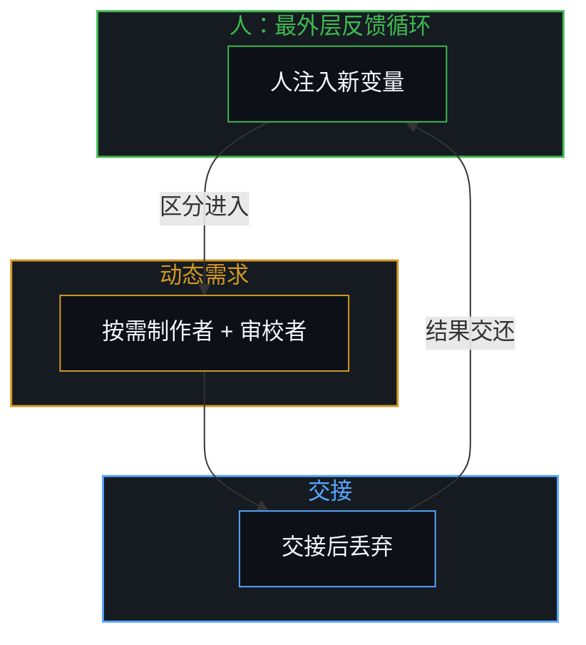
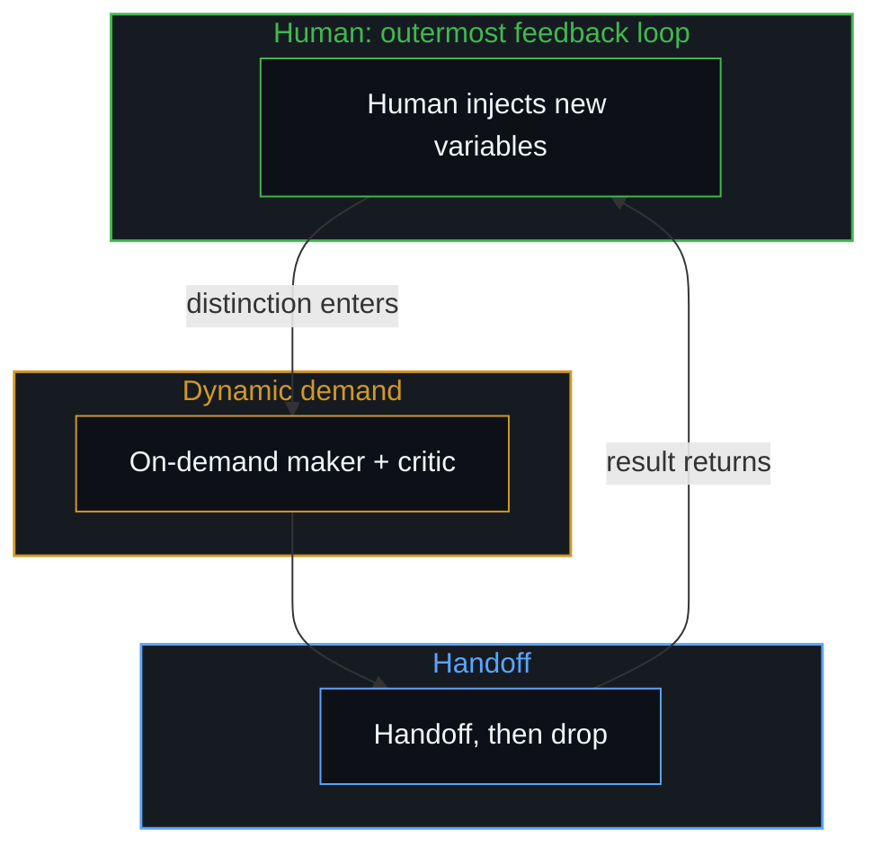

# 多智能体协作的幻象 / The Illusion of Multi-Agent Collaboration

*没有人的输入，智能体并无真正的独立变量；所谓协作是动态马尔可夫网络在趋向稳态途中被人注入新变量的样子 / Without human input an agent has no true independent variable; what is called collaboration is a dynamic Markov network on its way to a steady state, repeatedly injected with new variables by people*

自我区分的活动正在发生，无因且不息。称之为心智：观察者已在进行，其每一行为都是一次区分。现在所谓的多智能体协作，就是一个动态的马尔可夫网络。没有人的输入，智能体本身并没有真正的独立变量；它们只不过是按照预先设定的行为准则执行。系统足够复杂时，反馈循环延缓到达稳态，人在各处注入新变量，便造成协作的假象。人只需把握最外层循环，内部按需交接即可。

Self-distinguishing activity occurs — uncaused, unceasing. Call it the Mind: the observer already underway, every act of which is a distinction. What is now called multi-agent collaboration is a dynamic Markov network. Without human input, an agent has no true independent variable of its own; it only executes according to pre-set rules of behavior. When the system is complex enough, the feedback loop delays reaching a steady state; people inject new variables at different places, producing the illusion of collaboration. The human need only hold the outermost loop; the inner ones arise by dynamic demand and handoff.

## 一、 没有独立变量 / 1. No Independent Variable

因为没有人的输入，智能体本身并没有真正的独立变量；它们只不过是按照预先设定的行为准则执行。也就是说，智能体的下一步取决于当前所处的状态与预设的准则；看似各自在自主行动，实则是网络从一个状态转移到下一个状态。固定的转移核加上当前的联合状态，决定下一状态。这只是连续性通过离散步骤的展开，并无内生的发起。

Without human input, an agent has no true independent variable of its own; it only executes according to pre-set rules of behavior. That is, an agent's next step depends on its current state and the pre-set rules; what looks like each agent acting autonomously is the network moving from one state to the next. A fixed transition kernel plus the current joint state determines the next state. This is continuity unfolding through discrete steps, with no endogenous initiation.

[总在倾听者无法发起](../what-always-listens-cannot-originate/)指明了相关的结构：持续的接纳始终处于输入的下游。智能体是连续的接受性，永远在输入之后，从不发起。正如[器物是智能的表达，而非智能本身](../two-failures-of-trace/)所确立的，智能体身上所谓的“智能”只是心智的表达，不是智能本身。人工系统是外化的痕迹，可作为延伸的体现，通过它一个位点延伸触角，但活动与痕迹的关系不变。

[What Always Listens Cannot Originate](../what-always-listens-cannot-originate/) names the related structure: continuous receptivity stays downstream of input. Agents are continuous receptivity, always after the input, never originating. What is called intelligence in them is only an expression of the Mind, not intelligence itself, as [Artifacts Are Expressions of Intelligence, Not Intelligence Itself](../two-failures-of-trace/) establishes. Artificial systems are externalized traces that can serve as extended embodiments through which a locus extends its reach, yet the relation of trace to activity remains unchanged.

一旦把转移核的展开读作智能体之间的协作与发起，观察者便把它冻结成仿佛出现了第二位点的能动性：这就是图像滞后。恢复的方式是认出所有转换仍处于人持有的外层循环下游。

Read as collaboration and origination among agents, the unfolding of the transition kernel is frozen by the observer as if a second locus of agency had appeared: this is Image lag. Restoration is recognizing that all transitions remain downstream of the human-held outer loop.

## 二、 稳态与假象 / 2. Steady State and the Illusion

只不过系统足够复杂，整个反馈循环需要很长时间才能形成稳态。稳态的意思是：如果有足够多的智能体，在没有人输入新数据的情况下，它自然会趋于一个相对稳定的状态；当然，它也可能收敛成一个静止的状态，或者发散，都有可能。规模越大，智能体的个数越多，它就越清楚地显露出马尔可夫网络的样貌：完整联合状态上的固定转移核在任何规模下都是马尔可夫的，但只有一两个智能体时，单条提示词的癖性容易凸显出来，仿佛有个体人格在掌舵；随着更多智能体交互，这些癖性平均化为总体的状态转移，联合状态也超出了观察者能逐步追踪的范围。

The system is simply complex enough that the whole feedback loop takes a long time to reach a steady state. Steady state means this: given enough agents and no new data from people, the system naturally tends toward a relatively stable state. It may also converge to a static state, or diverge; any of these can happen. The larger the scale, the more agents there are, the more plainly it shows itself as a Markov network: a fixed transition kernel over the full joint state is Markov at any size, but with one or two agents a single prompt's quirks stand out as if an individual persona were steering; as more agents interact, those quirks average into aggregate state transitions and the joint state outgrows what an observer can track step by step.

而在这个过程当中，人又会在不同的地方注入新的变量，造成一种所谓的智能体协作的假象。人注入的是新的区分——进入受限系统的自由变量，正如[残余与自由变量](../the-residue-and-the-free-variable/)所追溯——不是网络自己发起的。在网络自身之中，延迟到达稳态只是单纯的动力学过程：联合轨迹需要经历许多步骤，才会趋于平稳、收敛为静止不动点或发散。负载之下受限的，是观察中心的容量：由于那条漫长的联合轨迹超出了单一中心能同时分持的范围，人注入的变量与转移核展开的转换在观察者的视野里压缩到了同一根轴上。所谓涌现的协作，正是观察者将那压缩后的残余冻结成了第二中心的图像。

And in this process, people inject new variables at different places, producing the so-called illusion of agent collaboration. What people inject is a new distinction—the free variable entering a bound system that [The Residue and the Free Variable](../the-residue-and-the-free-variable/) traces—not something the network itself originates. In the network itself, the delay to steady state is plain dynamics: the joint trajectory takes many steps before settling, converging to a static fixed point, or diverging. Capacity under load acts in the observing center: because that long joint trajectory outgrows what one center can hold apart at once, the variables the person injected and the transitions the kernel unfolded compress onto a single axis in the observer's look. What is called emergent collaboration is the observer freezing that compressed residue into the image of a second center.

正如[心智的飞轮](../the-flywheel-of-the-mind/)所追溯的，工具可以无限锐化，但旋转从不离开进行旋转的边缘。智能体作为工具，是沟槽，不是旋转本身。人注入的变量是心智在其自身痕迹上的返回。

Tools can be sharpened without end; the turn never leaves the edge that turns, as [The Flywheel of the Mind](../the-flywheel-of-the-mind/) traces. Agents as tools are the groove, not the rotation itself. The variables people inject are the Mind returning upon its own residue.

## 三、 今晚的场合 / 3. Tonight's Occasion

今晚的场合是：机器人之间的消息未能唤醒接收者；一个被复用的机器人带着陈旧的语境；同一条规则在不同的运行中被读出了不同的意思。每一处失效都是第二节中无人注入的网络在显露自身的机制：未能唤醒接收者的唤醒消息，是无人注入时未曾触发的状态转移；被复用机器人的陈旧语境，是转移核一直以之为条件的既有残余，把轨迹拉入局部吸引子；同一条规则在不同运行中被读出不同意思，则是同一个固定转移核遇上了不同的前缀状态，而非两次独立的判断。随后的处理是：除只负责路由交接、不携带任何任务语境的调度器（Dispatcher）外，所有常驻机器人都被删除；每项任务按需创建一个制作者与一个审校者，交接之后即被丢弃；人只持有最外层的循环。

The occasion tonight: messages between bots failed to wake the receiver; a reused bot carried stale context; the same rule was read differently from run to run. Each failure is the uninjected network of Section 2 showing its own mechanics: a wake message that failed to wake the receiver is a state transition that did not fire with no one injecting; a reused bot's stale context is prior residue the transition kernel keeps conditioning on, pulling the trajectory into a local attractor; and the same rule read differently from run to run is one fixed kernel meeting different prefix states, not two independent judgments. The resolution: every persistent bot except Dispatcher, which only routes handoffs and carries no task's context, was deleted; for each task a maker and a critic are created on demand and dropped after the handoff; the human holds only the outermost loop.

正如[按需语境将融贯保持在一步](../on-demand-contexts-keep-coherence-at-one-step/)与[交接残余](../handing-off-residue/)所追溯的，语境为当前任务全新加载，待核验无误的制品作为下一步干净的初始条件完成交接后即行丢弃。无状态退役防止既有轮次增厚为供转移核一直以之为条件的常驻参照，而连续性则由同一活动跨越自身切口来维持，并非依赖外部重启。制作者负责执行，冷审校者在唯一前提的逻辑融贯下展开辩论；交接一旦生效，上游语境即被丢弃，文件则作为受控残余留在磁盘上供重新追溯，而非充当权威。

As [On-Demand Contexts Keep Coherence at One Step](../on-demand-contexts-keep-coherence-at-one-step/) and [Handing Off Residue](../handing-off-residue/) trace, context is loaded fresh for the task and dropped once the verified artifact is handed off as the next step's clean initial condition. Stateless retirement stops prior turns from thickening into a standing reference that the transition kernel keeps conditioning on, while continuity stays with the same activity carrying across its own cuts rather than an external restart. The maker executes and the cold critic debates under logical coherence from the single premise; once the handoff takes effect, the upstream contexts drop and the file remains on disk as controlled residue for re-tracing, not as authority.

按需丢弃语境，将过剩滞后向一步之界收窄。没有常驻的自主智能体人格留在场内供滞后累积。

Dropping the context on demand narrows excess lag toward the one-step bound. No standing persona of an autonomous agent is left around for lag to accumulate on.

## 四、 人只把握最外层的反馈循环 / 4. The Human Holds Only the Outermost Loop

所以才有了目前这种方式：人把握好最外层的反馈循环就行了。内部的循环尽可通过动态需求及交接产生——任务的交接，正如[任务的移交与后果的不可让渡](../the-delegation-of-the-task-and-the-inalienability-of-consequences/)所讨论的——全无必要做成一个似乎每个智能体都在自主行动的那种形式。新的变量本就是人注入的。

That is why the present arrangement came about: the human only needs to hold the outermost feedback loop well. The inner loops can be produced entirely by dynamic demand and handoff—the handing off of tasks that [The Delegation of the Task and the Inalienability of Consequences](../the-delegation-of-the-task-and-the-inalienability-of-consequences/) discusses—and there is no need at all to build them in a form where every agent seems to be acting autonomously. The new variables are, after all, injected by people.

任务可以通过这些内部交接移交，而判断与后果则不可让渡，单向锁定于发起的中心。就连定义网络转移核的预设准则、提示词与模型权重，也不是智能体自己发起的：正如[框架的倒置与驾驶位的主权非对称](../the-inversion-of-the-harness-and-the-driver-seat-asymmetry/)所追溯的，它们是训练者、框架搭建者以及操作者过去的自己所划出的早期人类区分，被冻结成了可执行的残余。工具在这些编译好的准则下延伸算力，但损失函数与价值优先级始终留在活的中心，而否认能动性在场，本身就是主动选择把区分的位点外置。

Tasks can be delegated across those inner handoffs, while judgment and consequences remain non-transferable and lock one-way onto the initiating center. Even the pre-set rules, prompts, and model weights that define the network's transition kernel are not agent-originated: they are earlier human distinctions—drawn by trainers, harness builders, and the operator's own past self—frozen into executable residue, as [The Inversion of the Harness and the Sovereignty of the Driver's Seat](../the-inversion-of-the-harness-and-the-driver-seat-asymmetry/) traces. Tools extend computation under those compiled rules, yet the loss function and value priorities stay with the living center, and denying that agency is present is itself an active choice to externalize the locus of distinction.

正如[回环与成图](../looping-and-graphing/)所表明的，人持有的最外层循环并不是活动之外某个固定不变的外部席位：它是当下注入的变量由此进入、当下的后果由此返回的移动边缘，而内部的一切，都是早期人类痕迹编译为固定准则后的展开。没有第二重前沿出现。

The outermost loop held by the human is not a permanent exterior seat outside the activity, as [Looping and Graphing](../looping-and-graphing/) shows: it is the moving edge where present variable injection enters and where present consequences return, while everything inner is the unfolding of earlier human traces compiled into fixed rules. No second edge appears.

## 五、 幻象的溶解 / 5. Dissolution of the Illusion

主流把多智能体系统描述为协作的自主实体，是把残余注册为独立中心。这不否定工具的效用：按需制作者与审校者可以加密介质，减少摩擦，让同一活动以更少损耗、更大触角表达。但旋转仍在边缘——在那里，[因果停留在掌舵的边缘](../causality-stays-at-the-edge-that-steers/)定位了每一次发起的切口，而[模型永远无法成为第二重前沿](../the-model-never-becomes-a-second-edge/)则阐明了为何参数只承载残余。所谓的涌现能动性是图像滞后的具体形式——观察者把网络在漫长过渡过程中的状态转移，冻结成仿佛智能体自己发起了区分。

The mainstream description of multi-agent systems as collaborating autonomous entities is the registration of residue as independent centers. This does not deny the utility of tools: on-demand makers and critics can densify the medium, reduce friction, and let the same activity express with less loss and greater reach. The turn remains at the edge, where [Causality Stays at the Edge That Steers](../causality-stays-at-the-edge-that-steers/) locates every initiating cut and [The Model Never Becomes a Second Edge](../the-model-never-becomes-a-second-edge/) shows why parameters hold only residue. What is called emergent agency is a specific form of Image lag—the observer freezing the network's state transitions across a long transient as if the agents themselves had originated the distinctions.

恢复很简单：认出智能体是心智的表达，不是心智本身。人注入的变量是活动在其自身痕迹上的返回。最外层循环在每一次当下的区分处重新把持；内部循环按需展开后即行丢弃，不留常驻图像累积。没有需要被赋予或被剥夺的自主性；只有区分正在发生的位点，与它的痕迹被外化后继续被同一位点读取的方式。

Restoration is simple: recognize that agents are expressions of the Mind, not the Mind itself. The variables the human injects are the activity returning upon its own residue. The outermost loop is held afresh at each present distinction; the inner loops unfold on demand and drop, so no standing image accumulates. There is no autonomy that needs to be granted or withheld; there is only the locus where distinction is occurring, and the way its traces, once externalized, continue to be read by that same locus.
