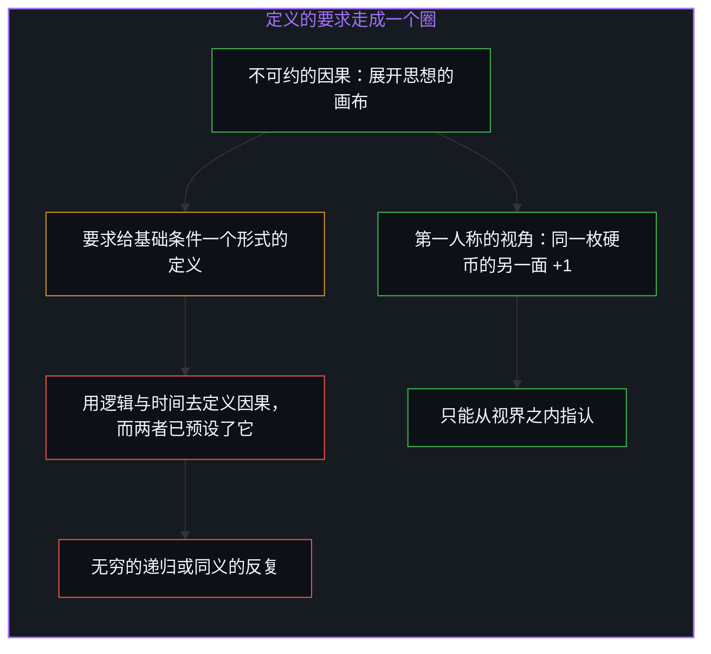
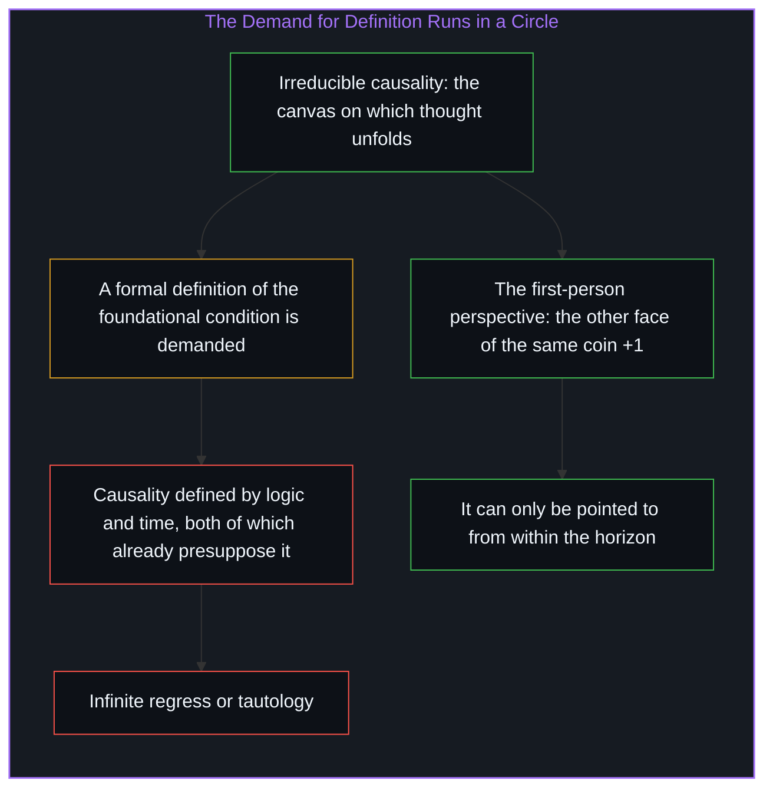
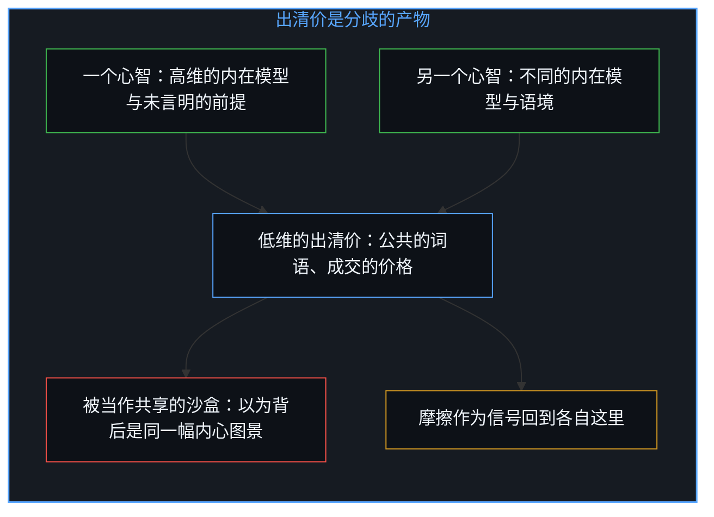
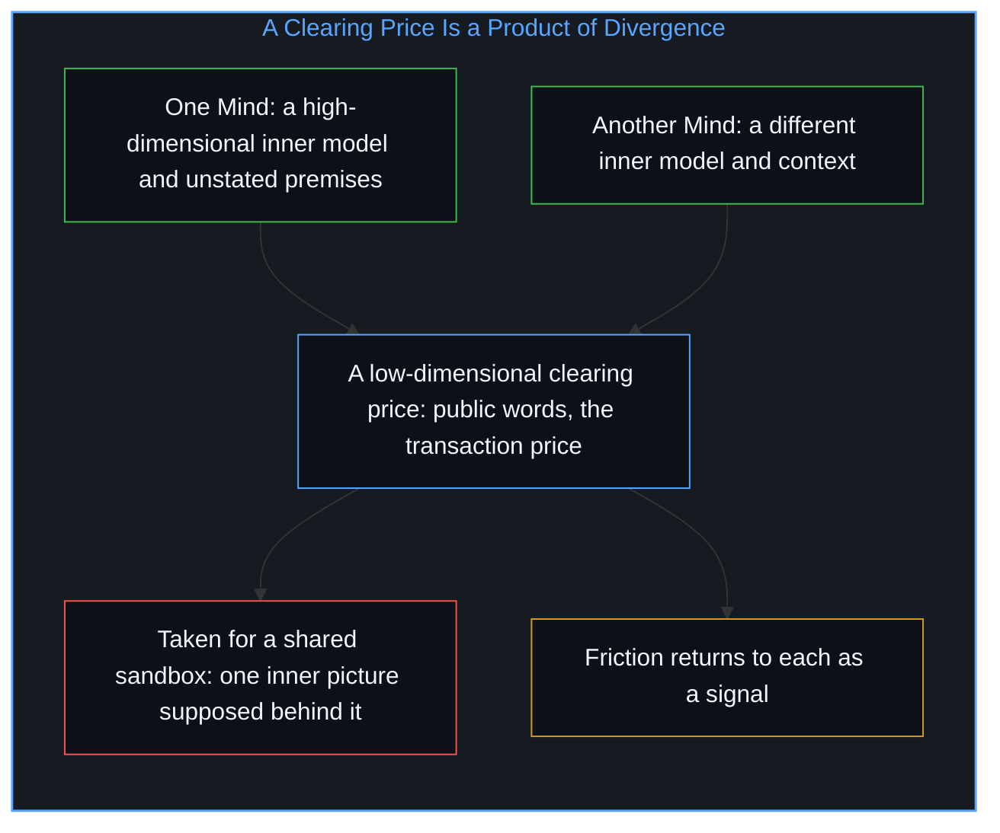

# 共享沙盒的幻象 / The Illusion of the Shared Sandbox

*内心世界、压缩与定义的陷阱 / Interiority, Compression, and the Trap of Definition*

因果不是画作内部的一个对象，它是一切理论得以落笔的画布。公共的语言不是直通他人心智的通道，它是高维的分歧在摩擦中达成的低维出清价。把这个出清价当作一块众人共处其中的沙盒，便会向对方索要定义，并把摩擦当作须在对方身上消除的东西，而摩擦是校准自身的信号。

Causality is not an object inside the painting; it is the canvas on which every theory is set down. Public language is not a channel running straight into another's Mind; it is the low-dimensional clearing price that high-dimensional divergence arrives at within friction. Take this clearing price for a sandbox in which everyone stands together, and definitions come to be demanded of the other and friction treated as something to be removed in the other, while friction is the signal by which one calibrates oneself.

## 一、 第三人称的定义要求与解释的闭环 / 1. The Third-Person Demand for Definition and the Closed Circle of Explanation

交流立在一项没有审视过的设定上：内在的认知可以打包进语言的符号，越过公共的通道，在另一个意识内部完好地解包。这个设定带来对称理解的印象。从第一人称去看，找不到这种对称。心智是离散的因果中心，彼此之间没有直接互通的高维接口。被看作相互理解或普遍共识的，不是内部认知架构的重合，而是一个操作上的出清价，是相互独立的系统在行动中暂停摩擦的粗略坐标。

Communication rests on a posit that has not been examined: inner cognition can be packed into the symbols of language, sent across a public channel and unpacked intact inside another consciousness. The posit gives the impression of symmetric understanding. Looked at from the first person, no such symmetry is found. Minds are discrete causal centers with no direct high-dimensional interface between them. What is seen as mutual understanding or general consensus is not a coincidence of inner cognitive architectures but an operational clearing price, a rough coordinate at which mutually independent systems pause their friction in action.

定义在协调行动时是有用的。要求对方先提供形式的定义与公理的前提，则可以起到另一种作用：把一个自主的主体收拢为一个可预测的对象。对方的言说被框进既定的公理之后，观察的一方便有了一块便于处置的沙盒，对方未决的自由带来的不确定被平复，自己的裁判席位得以保持。伴侣之间的“共同体”，就是两个人尺度上的共享沙盒，[契约的因果倒置](../the-causal-inversion-of-partnership/)对此有所揭示。

Definitions are useful in coordinating action. Requiring the other to supply formal definitions and axiomatic premises first can serve a different function: gathering an autonomous subject into a predictable object. Once the other's speech is framed within given axioms, the observing side has a sandbox that is easy to handle, the uncertainty brought by the other's undecided freedom is quieted, and one's own seat as judge is kept. The "mutual entity" between partners is the shared sandbox at the scale of two, as [The Causal Inversion of Partnership](../the-causal-inversion-of-partnership/) shows.

对基础条件要求定义，次序便倒了。要求给“不可约的因果”一个形式的定义，是要求把先在的基础条件拆成派生的构件。把因果定义为“逻辑在时间中的展开”，解释的圈随即收紧：接下来须定义“逻辑”与“时间”，而两者已经预设了它们要去解释的那个不对称的生成序列。一个为所有观察者共享的冻结宇宙，正是[双生子佯谬与隐秘观察者](../the-twin-paradox-and-the-hidden-observer/)在相对论里拆开的那个沙盒。

Demanding a definition of a foundational condition reverses the order. Asking for a formal definition of "irreducible causality" is asking that a prior, foundational condition be taken apart into derived components. Define causality as "logic unfolding in time," and the circle of explanation tightens at once: "logic" and "time" must next be defined, and both already presuppose the asymmetric generative sequence they are meant to explain. A frozen universe shared by all observers is the sandbox that [The Twin Paradox and the Hidden Observer](../the-twin-paradox-and-the-hidden-observer/) takes apart in relativity.

[因果的自反性与物理的无源假定](../causality-is-irreducible-the-physical-is-a-view-from-nowhere/)说明，因果不是在思想的风景内部被发现的对象，它是展开思想的画布。搭一个三段论，说一句话，提一个问题，都已经预设了在前的动作会带来在后的结果。[破除概念的僭越](../po-chu-gai-nian-de-jian-yue/)拆解过纸面上的等式：为可能性的条件索要外部的证明，得到的是无穷的递归或同义的反复。不可约的因果无法以形式的符号从外部证实，它与第一人称的视角是同一枚硬币的两面，只能从视界之内指认。

[Causality is Irreducible; The Physical is a View from Nowhere](../causality-is-irreducible-the-physical-is-a-view-from-nowhere/) shows that causality is not an object found inside the landscape of thought; it is the canvas on which thought unfolds. To build a syllogism, to speak a sentence, to put a question already presupposes that the act before will bring the result after. [Breaking the Overreach of Concepts](../po-chu-gai-nian-de-jian-yue/) has taken apart the equation on paper: demanding an outside proof of a condition of possibility yields infinite regress or tautology. Irreducible causality cannot be verified from outside by formal symbols; it and the first-person perspective are two faces of one coin, and it can only be pointed to from within the horizon.

## 二、 共识与出清价 / 2. Consensus and the Clearing Price

第一人称的经验无法直接外移，公共的词表便充当低维的桥。两个行动者用同一批词，“选择”“因果”“真相”，各自的心智里运行的却是无法通约的模型，局部的功能重合被当成了共识。

First-person experience cannot be moved out directly, so the public vocabulary serves as a low-dimensional bridge. Two actors use the same words, "choice," "causality," "truth," while models that are not commensurable run in their respective Minds, and a local overlap of function is taken for consensus.

这与金融市场的出清相应，[价格是言说，理解是交易](../price-as-utterance-understanding-as-trade/)展开过这一点。出清的价格不代表买卖双方对资产的内在价值有共同的信念。交易之所以发生，正因为双方的估值相反：买方认为资产比现金值钱，卖方认为现金比资产值钱。成交价是分歧在某个时刻达成的结构性产物。同样，“共识目标价”是相互矛盾的预测的算术平均，场内没有哪一位分析师持有这个数字。

This corresponds to clearing in financial markets, which [Price as Utterance, Understanding as Trade](../price-as-utterance-understanding-as-trade/) has laid out. A clearing price does not stand for a shared belief of buyer and seller about the intrinsic value of an asset. A trade happens precisely because the two valuations are opposed: the buyer holds the asset worth more than the cash, the seller holds the cash worth more than the asset. The transaction price is a structural product that divergence arrives at in a given moment. Likewise a "consensus price target" is the arithmetic mean of mutually contradicting forecasts, a number no analyst in the room holds.

这一机制放到群体的协作上，生出两种构念。一种是作为多元无知的“常识”：公共的话语并不锚在具体心智的信念上，而是锚在一个设想出来的中位观察者上，交流的人用被认可的词汇来降低摩擦，由此加固了一套双方私下都不认同、公开却一同维持的规范。另一种是作为制度性停火的“既定科学”：对非专业的人而言，复杂的物理范式不是经由直接的经验或数学的推演而持有的，它是制度上的出清价，人们因下游的技术构件运转稳定而接受它的结论，工程上的操作性休战便被当成了对现实的最终阐释。[索求万物理论是在将当下冻结为清单](../demanding-a-toe-freezes-time-into-a-catalog/)说明，自称合上了现实的清单，是特定观测窗口下的局部投影；[你的代码库即是记忆](../your-codebase-is-memory/)在软件与知识库中定位了同一结构：跨会话与智能体共享的代码库，并非装载着相同内在理解的共享心智沙盒，而是一张由显式接口、不变量与核验检查构成的出清网络，让各条独立的流线在其中登记摩擦并校准下一步行动。

Carried over to cooperation in groups, the mechanism produces two constructs. One is "common sense" as pluralistic ignorance: public discourse is anchored not in the beliefs of particular Minds but in an imagined median observer, and those communicating use approved vocabulary to lower friction, thereby reinforcing a norm that neither side privately shares and both publicly maintain. The other is "settled science" as an institutional truce: for those who are not specialists, a complex physical paradigm is not held through direct experience or mathematical derivation; it is an institutional clearing price, its conclusions accepted because the technical components downstream run stably, and an operational armistice in engineering is taken for the final account of reality. [Demanding a Theory of Everything Freezes Time into a Catalog](../demanding-a-toe-freezes-time-into-a-catalog/) shows that a catalog claiming to have closed reality is a local projection under a particular window of observation, and [Your Codebase Is Memory](../your-codebase-is-memory/) locates the same structure in software and knowledge repositories: a codebase shared across sessions and agents is not a shared mental sandbox containing identical inner understanding, but an externalized lattice of durable traces, invariants, and audit checks where independent streamlines register friction to calibrate their next move and return irreducible premise conflicts to the living Mind at the steering edge.

## 三、 外部的摩擦是损失信号 / 3. Outer Friction as a Loss Signal

这些现象底下的错位，是把高度压缩的宏观投影等同于生成它的微观活动。[确定性是微观不确定性的统计签名](../determinism-is-the-statistical-signature-of-micro-indeterminism/)剖析过，词语、价格、选票与行为的选择都是维度极低的切片。观测到这些压平了的信号时，心智容易向它们背后投出一幅整齐划一的内心图景。物理学把一个取样框外推为宇宙，由此搭起它的沙盒，[黑白采样帧与外推宇宙](../the-black-and-white-sample-frame-and-the-extrapolated-universe/)说明了这一点。

The displacement underneath these phenomena is equating a highly compressed macroscopic projection with what is microscopic and generates it. [Determinism is the Statistical Signature of Micro-Indeterminism](../determinism-is-the-statistical-signature-of-micro-indeterminism/) has analyzed how words, prices, votes and choices of behavior are slices of very low dimension. On observing these flattened signals, a Mind readily casts behind them an inner picture that is neat and uniform. Physics extrapolates one sample frame into the cosmos and builds its sandbox that way, as [The Black-and-White Sample Frame and the Extrapolated Universe](../the-black-and-white-sample-frame-and-the-extrapolated-universe/) shows.

关于交流的目的，常见的想法是它的价值在于把人与人之间的外部摩擦降到最低：抚平异见，达成共识，或以定义来约束对方、消解认知上的冲突。外部的摩擦是离散的因果中心相撞时必有的产物，改写对方的内部模型消除不了它。交流的价值，在于把自身内部感到的不自洽降到最低。

A common idea about the purpose of communication is that its value lies in bringing the outer friction between people to a minimum: smoothing over disagreement, reaching consensus, or constraining the other with definitions so as to dissolve cognitive conflict. Outer friction is a necessary product of discrete causal centers colliding, and rewriting the other's inner model does not remove it. The value of communication lies in bringing the incoherence felt within oneself to a minimum.

外部的摩擦因此是一套不可替代的一阶损失信号。感官的输入、语言的反馈、阻力与卡壳，提供了行动者更新内部权重所需的信号。这个损失靠约束对方或向外归因平复不了，它经由第一人称的内部校准而消除：看清是自己哪一个粗略的前提引出了断裂，补上缺失的自由变量，内心的不自洽便自然消解。

Outer friction is therefore an irreplaceable first-order loss signal. Sensory input, the feedback of language, resistance and getting stuck provide the signals an actor needs to update inner weights. This loss is not quieted by constraining the other or by attributing outward; it is removed through first-person calibration within: seeing which rough premise of one's own brought the break and supplying the missing free variable, the incoherence within dissolves of itself.

外部的观察有明确的用处，它是自身导航的数据。边界出现在外部的测量被当作对被观察者的最终判定的时候。[残余与自由变量](../the-residue-and-the-free-variable/)分析过界面上的姿态与事后的认领：说外部的观测穷尽了另一个主体的全部，是把传感器的读数等同于引擎的运转，把地图等同于地形。承认第一人称视角的不可约，给出一条清楚的界线：用外部的摩擦校准自己的行动轨迹，同时认定生成这些模式的源头无法从外部全景地封口。

Observation from outside has a definite use: it is data for one's own navigation. The boundary appears when an outside measurement is taken as the final determination of the one observed. [The Residue and the Free Variable](../the-residue-and-the-free-variable/) has analyzed postures at the interface and claims made afterward: saying that outside observation has exhausted the whole of another subject equates the sensor's reading with the running of the engine, and the map with the terrain. Acknowledging the irreducibility of the first-person perspective gives a clear line: outer friction is used to calibrate one's own course of action, and the source generating these patterns is held to be something that cannot be sealed in panorama from outside.
