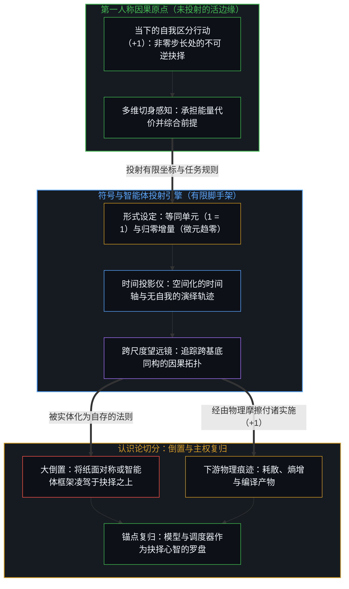
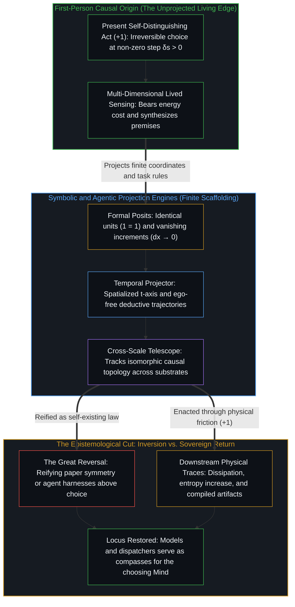

# 工具的幻觉与时间的倒置 / The Illusion of the Tool and the Inversion of Time

*等同单元与极限归零让形式体系闭合，而每一步现实行动都支付不可逆的抉择代价。 / Identical units and vanishing limits let formalisms close, while every real step pays the irreversible cost of choice.*

数学与物理模型是心智构建的最敏锐的认知工具，它们在意识内部的变换是静态、对称而可逆的。当模型被误当作比维持它的抉择更基础的独立存在时，认知的倒置便由此开始。等同的单元与趋于零的无穷小极限，是让符号系统得以闭合并运转的两项形式设定；而时间的坐标轴，则是从当下向过去与未来投射出的几何线。离散的区分使因果拓扑跨尺度保持不变，这正是数学之所以有效的根基，然而现实中的每一步推进，都唯有通过第一人称原点上不可逆的行动才能落定。

Mathematical and physical models are the sharpest cognitive instruments a Mind constructs, and within awareness their internal transformations are static, symmetric, and reversible. The cognitive inversion begins when a model is mistaken for an independent existence more foundational than the choice that maintains it. Identical units and infinitesimal limits vanishing to zero are two formal posits that allow symbolic systems to close and run, while the coordinate axis of time is a projection cast backward and forward from the immediate present. Discrete distinction keeps causal topology invariant across scales, which is why mathematics works, yet every actual step settles only through an irreversible act at the first-person origin.

## 一、 符号沙盘与工具的倒置 / 1. The Symbolic Sandbox and the Inversion of the Instrument

经典力学、相对论与微积分是人类文明迄今锻造的最具威力的表征工具。数理物理学以极高的精度刻画了跨越物质基底的宏观因果规律，形式数学则赋予心智抽离特定尺度的抽象能力，使其得以跨越巨大的尺度跨度提炼出结构的不变量。

Classical mechanics, relativity, and the calculus are the most capable representational instruments human civilization has built. Mathematical physics traces macroscopic causal regularities across material substrates with extraordinary precision, and formal mathematics equips a Mind with the abstractive reach to isolate structural invariants across vast spans of scale.

当心智在当下的意识中构建并维持一个数学框架时，它对几何与代数关系的操控是静态、对称而可逆的。没有脱离这项生成活动而自行存在的模型；任何形式体系，都是第一人称心智在当下对符号痕迹的持续维持与变换。在这座符号沙盘之内，只要重新定义一套代数规则，便可以让平直空间弯曲、让坐标轴任意旋转或翻转、让高维拓扑结构随心折叠。在纸面上逆转一个宇宙的演化轨迹，只需翻转一个正负号，因为符号系统只是重新排列既有的留存痕迹，并不产生新的因果跃迁。

When a Mind constructs and holds a mathematical framework within present awareness, its manipulation of geometric and algebraic relations is static, symmetric, and reversible. No model exists by itself apart from the activity that renders it; a formalism is the ongoing maintenance and transformation of symbolic traces by a first-person Mind in the present. Inside this symbolic sandbox, redefining a set of algebraic rules allows flat space to be bent, coordinate axes to be rotated or inverted, and high-dimensional topologies to be folded at will. Reversing the trajectory of a cosmos on paper requires nothing more than flipping a minus sign, because a system of symbols rearranges retained traces without generating new causal transitions.

这种静态的符号操控极大地拓宽了理解模式与预判规律的视野。它的边界出现在倒置发生的那一刻：心智把自己维持的符号框架实体化为自存的外部权威，断定这种在意识里随时可逆的表征比不可逆的抉择更为基础。在第一人称原点上划下的每一个非零区分（+1），都会发起新的因果对齐，并落定为不可逆的初始条件；纸面上的对称回溯撤销不了已在摩擦中付诸实施的行动。在当代软件与人工智能工程中，同样的倒置把驾驶座交给了外部框架，如[框架的倒置与驾驶位的主权非对称](../the-inversion-of-the-harness-and-the-driver-seat-asymmetry/)所追溯；或是期待一台受限于既定轨迹的投射引擎去篡夺驾驭它的活生生的心智，如[超越投射](../beyond-the-projection/)所剖析。

This static manipulation of symbols vastly expands the horizon over which patterns can be understood and regularities anticipated. Its boundary appears at the exact moment of inversion: the Mind reifies the symbolic framework it maintains into a self-existing external authority, concluding that a representation reversible at any time within awareness is more foundational than irreversible choice. Every non-zero distinction drawn at the first-person origin (+1) initiates a new causal alignment and settles as an irreversible initial condition; symmetric retracing on paper never undoes what has been enacted in friction. In contemporary software and artificial intelligence engineering, the same inversion hands the driver's seat to the harness, as [The Inversion of the Harness and the Sovereignty of the Driver's Seat](../the-inversion-of-the-harness-and-the-driver-seat-asymmetry/) traces, or expects a trajectory-bound projection engine to usurp the living Mind that steers it, as [Beyond the Projection](../beyond-the-projection/) dissects.

## 二、 等同单元的设定 / 2. The Posit of Identical Units

算术与代数的大厦立在一个因习以为常而看似不证自明的前提之上：两个单元是等同的，1 = 1，因此可以无摩擦地合并为 2。在纸面上，1 + 1 = 2 是静态、对称、零代价的同义反复；而在现实的因果推进中，+1 是一次不可逆、耗费能量的介入，必须承受摩擦、耗散与损耗。当注意力从符号规则转向因果几何时，等同单元便显露出其工具性设定的面目。正如莱布尼茨在不可分者同一性原理中所指出的，假如两个对象在任何属性、坐标、关系或内在历史上毫无差别，它们就不是两样东西，而是同一个存在。只要两个实体同时并存，它们就占据着不同的位置，承载着不同的因果历史，处于不同的关系张力之中；正因为存在差异，它们从不等同。

The edifice of arithmetic and algebra stands on a premise so familiar it passes for self-evident: two units are identical, 1 = 1, and can therefore combine without friction into 2. On paper, 1 + 1 = 2 is a static, symmetric, zero-cost tautology; in physical causality, +1 is an irreversible, energy-consuming intervention that must absorb friction, dissipation, and loss. When attention shifts from symbolic rules to causal geometry, identical units reveal themselves as an instrumental posit. As Leibniz observed in the principle of the identity of indiscernibles, if two objects did not differ in any property, coordinate, relation, or internal history, they would not be two things at all, but one and the same. Wherever two entities coexist, they occupy distinct positions, carry distinct causal histories, and stand in different relational tensions; because they differ, they are never identical.

数学的运转，靠的是把构成各异的人、物与事件压缩进均质、可互换的符号 1 之中。这种均质化在第一步剥离了微观区分与局部的因果张力，从而使统计汇总与代数运算成为可能。每个锚点的独特性从符号中隐去，批量运算才能毫无余数地闭合。

Mathematics operates by compressing people, objects, and events of every distinct constitution into the homogeneous, interchangeable symbol 1. This homogenization makes statistical aggregation and algebraic calculation possible, and it does so by stripping away microscopic distinction and local causal tension at the opening step. The uniqueness of each locus disappears from the symbol so that bulk operations can close without remainder.

## 三、 非零间隔与连续性的建模权宜 / 3. Non-Zero Separation and the Continuum Convenience

微积分建立起连续可微的运动方程，仰赖于第二根形式支柱：设定空间与时间的增量 dx、ds 与 dt 可以无休止地逼近并在极限处达到零。然而，任何信息、感知或因果行动的登记，都要求一个非零的边界，δs > 0。在正像 A 与其负背景 A⊥ 之间，必须维持一个最小的非零间隔；倘若间隔归零，正像与背景便会重合，区分随之消融，信息 I = A + A⊥ 也就化为乌有。物理学在普朗克长度（约 10⁻³⁵ 米）与普朗克时间（约 10⁻⁴⁴ 秒）处记录了这道分辨率视界。

The calculus establishes continuous, differentiable equations of motion on a second formal pillar: the posit that spatial and temporal increments dx, ds, and dt can approach without bound and reach zero at the limit. Yet every registration of information, perception, or causal action requires a non-zero boundary, δs > 0. Between a positive figure A and its negative ground A⊥, a minimal non-zero separation must hold; were the interval to reach zero, figure and ground would coincide, the distinction would dissolve, and the information I = A + A⊥ would vanish. Physics records this resolution horizon at the Planck length, roughly 10⁻³⁵ meters, and the Planck time, roughly 10⁻⁴⁴ seconds.

日常经验到的连续感，源于序贯因果在远小于肉眼可辨的步长上保持着逻辑连贯。人类的感官运作在米与秒的尺度上，与普朗克视界隔着三十五个数量级；如此庞大数量的离散跃迁汇聚在一起，单个步进便在宏观平均中变得平滑。微积分让 dx 趋近于零，是在这一巨大尺度差之下对离散步长的有效粗粒化，为宏观工程提供了易于处理的计算捷径。若把 dx 归零当作本体论断言，要求现实本身必须是一块无缝的可微流形，便把建模的权宜之计推过了它的有效边界，正如[连续性作为建模的权宜之计](../the-continuum-is-a-modeling-convenience/)所阐明的那样。

The continuity experienced in everyday life arises from the logical coherence of sequential causality across steps too small for unaided perception to resolve. Human sensing operates at the scale of meters and seconds, separated from the Planck horizon by thirty-five orders of magnitude; with so many discrete transitions aggregated together, individual steps smooth out in the macroscopic average. Letting dx approach zero in the calculus is a highly effective coarse-graining of discrete steps across that scale differential, giving macroscopic engineering a tractable computational shortcut. Equating dx with zero as an ontological claim and demanding that reality itself be a seamless differentiable manifold pushes a modeling convenience past its boundary, as [The Continuum is a Modeling Convenience](../the-continuum-is-a-modeling-convenience/) establishes.

## 四、 作为时间投影仪的数学与节约时间的倒错 / 4. Mathematics as a Temporal Projector and the Reversal of Saved Time

在第一人称意识中，直接登记到的唯有当下。物理学里那条贯穿过去与未来的时间轴，是心智用形式数学与守恒方程搭建的时间投影仪。以当下的感知为原点，依托动力学定律，心智向过去投出一条坐标线以重构先前的因，向未来投出一条坐标线以模拟后继的果，为当下的行动提供导航图。

Within first-person awareness, only the immediate present is directly registered. The time axis of physics that stretches across past and future is a temporal projector that the Mind constructs out of formal mathematics and conservation equations. Taking present perception as origin and leaning on dynamical laws, the Mind casts a coordinate line backward to reconstruct prior causes and a coordinate line forward to simulate future outcomes, providing a navigation map for present action.

当这条投射出来的几何轴线被误认作比投射它的当下边缘更真实的外部容器时，时间的倒置便发生了。在相对论的块状宇宙中，时间被当作一条已经铺陈完毕的第四维空间化坐标；在微分方程内部，人们可以沿 t 轴随意向前求导或向后积分，进而断定过去、现在与未来同时并存于一块固定不变的流形之上。活生生的时间不是铺在空间里的铁轨；它是第一人称抉择在当下划出非零区分（+1）、为后继行动重塑场域的不可逆序贯推进，如[时间是因果的不可逆方向与离散步长](../time-is-causality-not-a-dimension/)所示。每一次抉择都将开放的潜能落定为既成的痕迹。物理学所观测到的热力学熵增、能量耗散与物质位移，是这一因果推进沉淀下来的下游宏观表征，而非涌出时间的源头。

The inversion of time occurs when this projected geometric axis is mistaken for an external container more real than the present edge that projects it. In the relativistic block universe, time is treated as a fourth spatialized coordinate already laid down in full; within the differential equations one can differentiate forward or integrate backward along the t axis at will, and conclude that past, present, and future coexist on an unchanging manifold. Lived time is not a rail laid out in space; it is the irreversible sequential advance in which first-person choice draws a non-zero distinction in the present (+1) and reshapes the field for subsequent acts, as [Time Is the Irreversible Direction and Discrete Step of Causality](../time-is-causality-not-a-dimension/) shows. Every choice settles open potential into a realized trace. Thermodynamic entropy increase, energy dissipation, and material displacement observed in physics are downstream macroscopic symptoms deposited by this causal advance, not the source from which time flows.

每当计算工具与智能体工作流加速符号执行时，一种平行的时间幻觉便会浮现。以为计算变快就能线性节约人的时间，这只对重复性的机械例行公事成立；当高吞吐量的工具剥离了执行的阻力，它们便压缩了两次决断之间的间隔，使折返至操作者的结构性死锁密度成倍增加，非但没有消除、反而扩大了原点上的判断负荷。

A parallel temporal illusion appears whenever computational tools and agentic workflows accelerate symbolic execution. Assuming that faster calculation linearly saves human time holds only for repetitive mechanical routines; when high-throughput tools strip away execution drag, they compress the intervals between decisions and multiply the density of structural deadlocks returning to the operator, expanding rather than eliminating the cognitive load of judgment at the origin.

## 五、 离散是跨尺度不变的根基 / 5. Discreteness as the Root of Scale Invariance

为什么形式数学能以如此惊人的逼真度跨尺度抽象现实？因为正是离散的区分，使因果关系得以在不同尺度之间保持拓扑上的不变。倘若现实是一团毫无边界、无间断的均质流体，就不会有离散的状态跃迁、组合逻辑与因果门。正因为区分活动是离散的，递归的因果反馈回路才能组合为自相似的拓扑结构——群对称、幂律分布与守恒比例——并在不同基底上反复重现。在普朗克视界附近的量子态跃迁、地面杠杆上的力矩平衡、乃至星系之间的引力耦合中，离散因果节点之间的关系拓扑始终保持同构。

Why can formal mathematics abstract reality across scales with such uncanny fidelity? Because discrete distinction is what enables causal relations to remain topologically invariant across scales. Were reality an unbroken, homogeneous fluid devoid of boundaries, there could be no discrete state transitions, no combinatorial logic, and no causal gates. Because distinguishing activity is discrete, recursive causal feedback loops combine into self-similar topological structures—group symmetries, power-law distributions, and conservation ratios—that recur across substrates. Across the jump of a quantum state near the Planck horizon, the balance of torques on a terrestrial lever, and the gravitational coupling of galaxies, the relational topology among discrete causal nodes stays isomorphic.

因此在纸面上推演数字与方程，是在辨认并追踪那些跨尺度重复出现的不变关系模式。数学充当了跨尺度的因果望远镜：通过剥离特定尺度的局部物质阻力，它提炼出底层的关系拓扑，让身处米级尺度的第一人称心智得以提前模拟亚原子粒子或天体的运动轨迹。它的边界在于，符号推演替代不了因果切分的付诸实施：纸面上的方程始终静态对称，而现实唯有在当下边缘作出抉择（+1）时才向前推进。

Working with numbers and equations on paper is therefore the recognition and tracking of invariant relational patterns that repeat across scales. Mathematics functions as a cross-scale causal telescope: by stripping away the local material resistance of a specific scale, it isolates the underlying relational topology, allowing a first-person Mind situated at the meter scale to simulate in advance the trajectories of subatomic particles or celestial bodies. Its boundary is that symbolic deduction never substitutes for the enactment of a causal cut: an equation on paper remains statically symmetric, whereas reality advances only as a choice is enacted at the present edge (+1).

## 六、 在第一人称原点消解大倒置 / 6. Dissolving the Great Reversal at the First-Person Origin

现代科学主义最深层的认知倒置，在于把心智所维持的符号模型连同行动留下的下游物理痕迹，当作凌驾于第一人称抉择之上的客观实在。常见的论调指出，微分方程里没有第一人称意识，时间变量 t 在纸面上可以正反演进，宏观物质服从热力学与力学规律，由此断定切身经历的时间流逝与抉择只是使用者幻觉，唯有静态的数学结构才是真实的存在。[大倒置的消解](../the-dissolution-of-the-great-reversal/)追溯了这一步如何把留存的残余误作生成活动本身。

The deepest cognitive inversion of modern scientism consists in treating the symbolic models a Mind maintains, together with the downstream physical traces of action, as objective realities that supersede first-person choice. The familiar argument points out that differential equations contain no first-person awareness, that the coordinate variable t is reversible on paper, and that macroscopic matter obeys thermodynamic and mechanical regularities, concluding that the lived experience of time and choice is a user illusion while static mathematical structures alone are real. [The Dissolution of the Great Reversal](../the-dissolution-of-the-great-reversal/) traces how this move mistakes retained residue for the generating activity.

当系统架构师试图用自我封闭的智能体框架取代人的统筹时，同样的结构性混淆在自主人工智能的设计中再度上演。正如[超越投射](../beyond-the-projection/)与[框架的倒置与驾驶位的主权非对称](../the-inversion-of-the-harness-and-the-driver-seat-asymmetry/)所展示的，自回归模型或形式方程是一台有限的投射引擎：在给定显式规则与有界语境的前提下，它能毫无自我地穷尽演绎轨迹，却在自身符号之外毫无立足之地，当正交的维度相撞时也无法退后一步跳出破损的框架——因为正如[你的代码库即是记忆](../your-codebase-is-memory/)所追溯的，任何外化的代码库或形式体系都只是留存的痕迹记忆，而非自我区分的原点。

The same structural confusion recurs in the design of autonomous artificial intelligence when architects attempt to replace human orchestration with self-contained agentic harnesses. As [Beyond the Projection](../beyond-the-projection/) and [The Inversion of the Harness and the Sovereignty of the Driver's Seat](../the-inversion-of-the-harness-and-the-driver-seat-asymmetry/) demonstrate, an autoregressive model or a formal equation is a finite projection engine: given explicit rules and a bounded context, it exhausts deductive trajectories without ego, yet it possesses no footing outside its own symbols and cannot step backward out of a broken frame when orthogonal dimensions collide, because any externalized repository or formalism is retained trace memory rather than a self-distinguishing origin, as [Your Codebase Is Memory](../your-codebase-is-memory/) traces.

恢复因果次序，便让这三个层级各自归位。其一，纸面上的 1 + 1 = 2、跨尺度的代数方程、连续的坐标曲线以及无自我的智能体轨迹，是心智为探索可能性、暴露局部盲区而维持的有限投射。其二，第一人称在当下原点上的区分（+1），是发起因果跃迁、消解前提死锁、推动时间不可逆前进的不可让渡之源。其三，能量耗散、物质位移、熵增与编译产物，则是抉择在物理基底上传导时沉积下来的下游痕迹。援引下游痕迹或纸面上的可逆对称性去否定作出抉择的原点，是以果废因。一旦看清等同单元与归零增量只是让形式体系得以闭合的工具性边界，数学与计算框架便回到它们本来的位置——握在当下作出抉择并承担行动代价的第一人称心智手中的高杠杆罗盘。

Restoring the causal order returns each of the three layers to its own locus. First, the 1 + 1 = 2 on paper, cross-scale algebraic equations, continuous coordinate curves, and ego-free agentic trajectories are finite projections that a Mind maintains to navigate possibilities and expose local blind spots. Second, first-person distinction at the present origin (+1) is the non-transferable source that initiates causal transitions, resolves premise deadlocks, and drives the irreversible advance of time. Third, energy dissipation, material displacement, entropy increase, and compiled artifacts are the downstream traces deposited as choices propagate through physical substrates. Invoking downstream traces or reversible paper symmetries to negate the choosing origin reverses effect and cause. When the posits of identical units and vanishing increments are recognized as the instrumental boundaries that let formalisms close, mathematics and computational harnesses stand clear as high-leverage compasses in the hand of the first-person Mind that chooses in the present and claims the cost of the act.
