# 工具的幻觉与时间的倒置 / The Illusion of the Tool and the Inversion of Time

*等同单元、极限归零与行动的真实代价 / Identical Units, Infinitesimal Limits, and the Living Cost of the Act*

数学与物理的模型是心智手里最强的工具，它们在意识里的变换是静态、对称而可逆的。倒置发生在模型被当作比抉择更基础的独立存在的时候。等同的单元与归零的微元是让形式得以运转的两项设定，时间的坐标轴是心智从当下向前后投出的线。离散的区分让因果的关系跨尺度保持不变，数学因此有效，而每一步的落定仍在第一人称的原点上。

The models of mathematics and physics are the strongest tools a Mind holds, and their transformations within awareness are static, symmetric and reversible. The inversion happens when a model is taken for an independent existence more basic than choice. Identical units and an element that goes to zero are two posits that let the formalism run, and the coordinate axis of time is a line a Mind casts forward and backward from the present. Discrete distinction keeps causal relations invariant across scales, which is why mathematics works, while the settling of each step still takes place at the first-person origin.

## 一、 最强的工具与倒置 / 1. The Strongest Tools and the Inversion

经典力学、相对论与微积分是文明至今最强的认知工具。数理的定律敏锐地刻画了物质世界里宏观稳定的因果模式，形式数学给了心智极高的抽象能力，使它能以前所未有的精确去发现自然的结构。

Classical mechanics, relativity and the calculus are the strongest cognitive tools civilization has had. The laws of mathematical physics trace with great acuity the causal patterns that are stable at the macroscopic scale of the material world, and formal mathematics gives a Mind a very high power of abstraction, letting it find the structure of nature with a precision not had before.

心智在意识里建构并维持数学的构架时，对几何关系的重构与变换是静态、对称而可逆的。没有离开心智而独自存在的“模型本身”，数学模型是第一人称的心智在当下所作的符号维持与推演。在这块由心智维持的符号沙盘里，凭一套重新定义的代数规则，便可以设想平直空间的弯曲、坐标系的旋转翻转或高维拓扑的折叠。在纸面上翻转一个宇宙只需擦掉一个负号，因为符号的体系里并不含因果关系的生成。

When a Mind constructs and maintains a mathematical framework within awareness, its reconstruction and transformation of geometric relations is static, symmetric and reversible. There is no "model in itself" existing apart from a Mind; a mathematical model is the keeping and working of symbols that a first-person Mind does in the present. Within this sandbox of symbols that a Mind maintains, with a set of algebraic rules defined anew, flat space can be imagined curving, coordinate systems rotating and flipping, or a high-dimensional topology folding. Turning a universe over on paper takes only the erasing of a minus sign, because the system of symbols does not contain the generation of causal relations.

这种静态的符号操控大大拓展了理解模式与预测规律的范围。它的边界出现在倒置发生的时候：心智把自己维持的符号构架实体化为一个独立存在的客观之物，并以为这种在意识里随时可逆的重构比不可逆的抉择更基础。在第一人称的原点上划下的每一个非零的区分（+1），都生出新的因果关系，成为不可逆的初始条件，纸面上的对称回溯撤销不了已经落定的事。在AI智能体身上，同样的倒置把挽具放上了驾驶座，[框架的倒置与驾驶位的主权非对称](../the-inversion-of-the-harness-and-the-driver-seat-asymmetry/)说明了这一点。

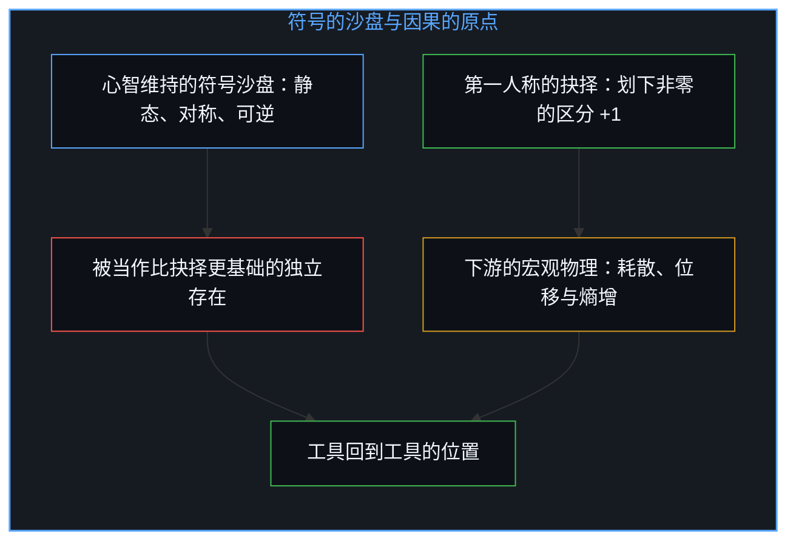

This static handling of symbols greatly widens the range of understanding patterns and predicting regularities. Its boundary appears when the inversion happens: a Mind turns the symbolic framework it maintains into an objective thing existing independently, and supposes that this reconstruction, reversible at any time within awareness, is more basic than irreversible choice. Every non-zero distinction drawn at the first-person origin (+1) gives rise to a new causal relation and becomes an irreversible initial condition, and symmetric retracing on paper does not undo what has been settled. With AI agents the same inversion puts the harness in the driver's seat, as [The Inversion of the Harness and the Sovereignty of the Driver's Seat](../the-inversion-of-the-harness-and-the-driver-seat-asymmetry/) shows.

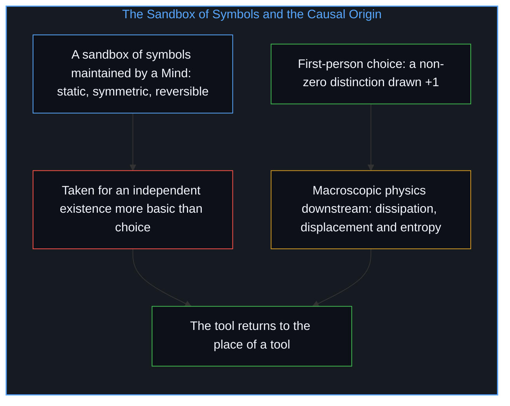

## 二、 等同的单元 / 2. Identical Units

代数与算术的大厦立在一个看似不证自明的前提上：有两个等同的单元，1 = 1，因而可以无摩擦地加成 2。把目光从符号移到因果的几何上，“等同的单元”是一项设定。莱布尼茨指出，两个对象若在全部属性、坐标、关系与内在特征上没有差别，它们便不是两件事物，而是同一件。只要两个实体同时存在，它们就占着不同的时空位置，有各自的因果历史，处在不同的关系张力里，有差异，便不等同。

The edifice of algebra and arithmetic stands on a premise that seems self-evident: there are two identical units, 1 = 1, and so they can be added without friction into 2. With the gaze moved from the symbols to the geometry of causality, "identical units" is a posit. Leibniz pointed out that if two objects do not differ in any property, coordinate, relation or inner feature, they are not two things but one and the same. As long as two entities exist together, they occupy different positions in space and time, have their own causal histories and stand in different relational tensions; having differences, they are not identical.

数学把形态各异的人、物与事件抽象为无差别、可互换的符号“1”。这种均质化使统计与代数的运算成为可能，它的做法是在第一步抹去微观的区分，事物原本带着的独特性与因果张力便不在符号里了。

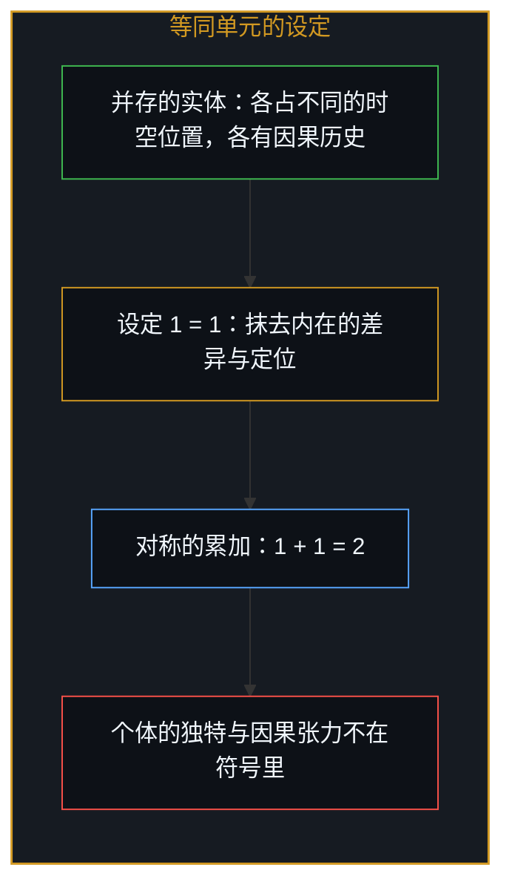

Mathematics abstracts people, things and events of every different form into the undifferentiated, interchangeable symbol "1." This homogenizing makes statistical and algebraic operations possible, and it does so by wiping out microscopic distinction at the first step, so that the uniqueness and causal tension things originally carried are no longer in the symbol.

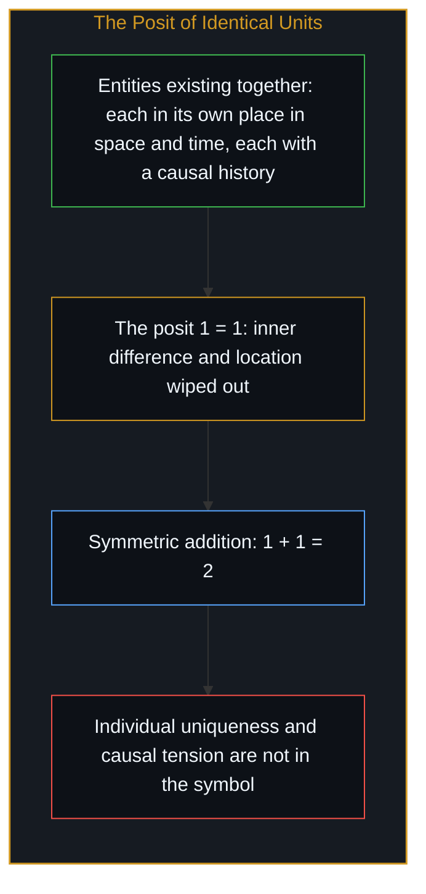

## 三、 不为零的间隔与连续 / 3. The Interval That Is Not Zero and Continuity

微积分能建立连续可微的动力学方程，支柱是极限归零的设定：空间与时间的微元 dx、ds、dt 可以无限逼近并达到零。而任何信息、感知与因果作用的成立，都依赖一个非零的边界，δs > 0。正像 A 与负像 A⊥ 之间须留着一个最小的非零间隙，间隔若到了零，两面便重合，区分消融，I = A + A⊥ 归于零。物理学的模型把这个最小的尺度记在普朗克长度上，约 10⁻³⁵ 米。

The calculus can establish continuous, differentiable equations of dynamics on the pillar of a limit going to zero: the elements of space and time dx, ds, dt can approach without end and reach zero. Yet any information, perception or causal action depends, for it to hold, on a non-zero boundary, δs > 0. Between a positive figure A and its negative A⊥ a smallest non-zero gap must remain; were the interval to reach zero, the two faces would coincide, the distinction dissolve, and I = A + A⊥ go to zero. The models of physics record this smallest scale at the Planck length, about 10⁻³⁵ meters.

日常所经验的连续，来自因果在逻辑上的连贯，那个最小的步长小到可以忽略。感知的尺度在米与秒上，与普朗克尺度隔着三十五个数量级，如此多的离散台阶汇在一起，步进在宏观的平均里看不出来。微积分的 dx → 0 是在这个尺度差之下对离散微元的有效粗粒化，为宏观的工程提供了极好的计算工具。把 dx 等同于零并把它推到现实本身，则越过了它的范围，[连续性作为建模的权宜之计](../the-continuum-is-a-modeling-convenience/)展开了这一点。

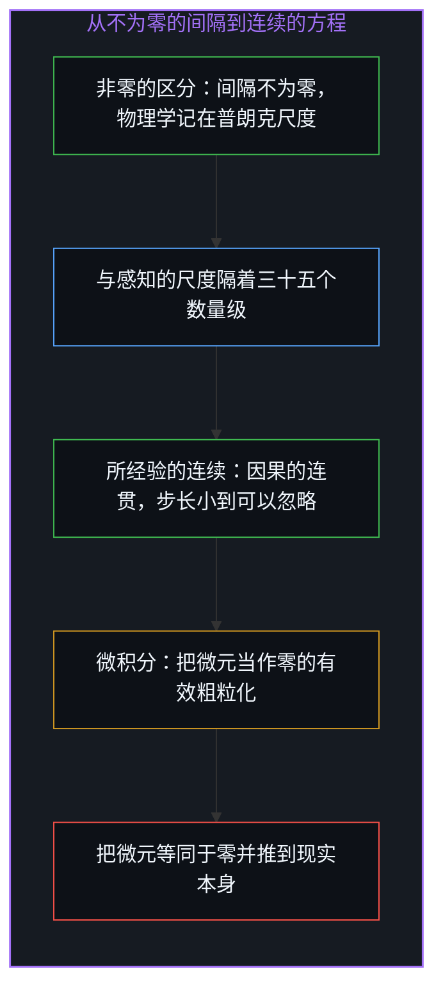

The continuity experienced day to day comes from the logical coherence of causality, the smallest step being small enough to ignore. The scale of perception is in meters and seconds, thirty-five orders of magnitude from the Planck scale, and with so many discrete steps gathered together, the stepping does not show in the macroscopic average. The dx → 0 of the calculus is an effective coarse-graining of discrete elements under this difference of scale, and it gives macroscopic engineering an excellent tool of calculation. Equating dx with zero and carrying it over to reality itself goes past its range, as [The Continuum is a Modeling Convenience](../the-continuum-is-a-modeling-convenience/) lays out.

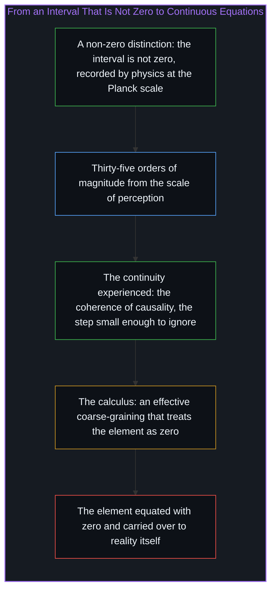

## 四、 数学作为投影仪 / 4. Mathematics as a Projector

在第一人称的意识里，直接有的只是当下。物理学里那条贯穿过去与未来的时间轴，是心智借形式数学与守恒方程搭起的时间投影仪：以当下的感知为原点，依托动力学方程与守恒律，向过去拉出一条回溯的线，向未来拉出一条预测的线，为当下的抉择提供宏观的导航与推演的沙盘。

Within first-person awareness, what is directly had is only the present. The time axis of physics that runs through past and future is a projector of time a Mind sets up with formal mathematics and the equations of conservation: with present perception as origin and relying on dynamical equations and conservation laws, a line of retracing is drawn toward the past and a line of prediction toward the future, giving the present choice macroscopic navigation and a sandbox for working things out.

倒置发生在这条投影出来的几何时间轴被当作比当下更基础的客观存在的时候。在相对论的块状宇宙里，时间成了画好的第四条几何坐标轴，在方程里可以沿 t 轴任意向前求导、向后积分，乃至说过去、现在与未来同时存在。经验中的时间不是一条摆在空间里的导轨，它是第一人称的抉择在当下划下非零的区分（+1）、生出新的因果关系的不可逆的序贯推进，[时间是因果的不可逆方向与离散步长](../time-is-causality-not-a-dimension/)展开了这一点。每一次抉择把未决的可能落为既定的初始条件。物理学里观察到的熵增、能量的流动与物质的位移，是这种推进在宏观的物理基底上沉淀出的下游症状，不是时间的来处。

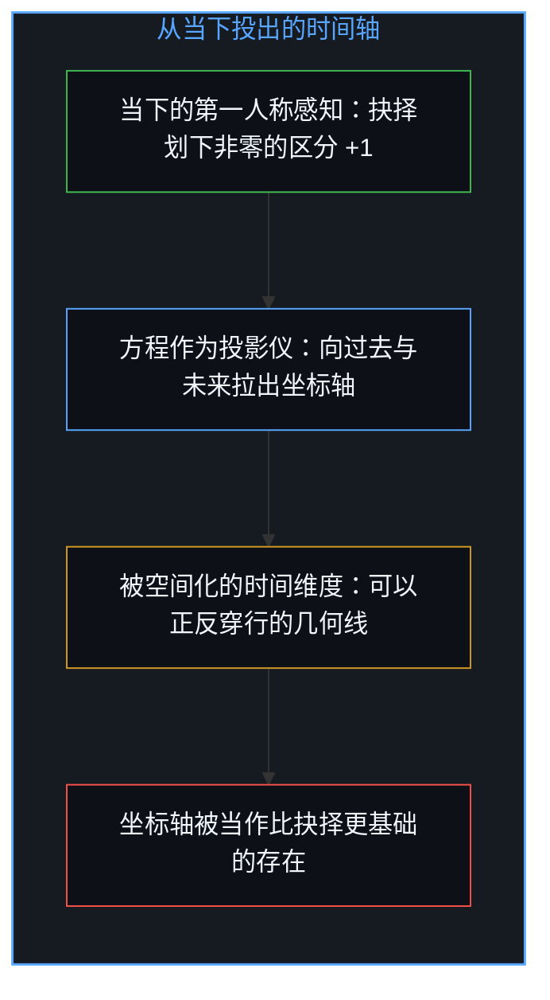

The inversion happens when this projected geometric time axis is taken for an objective existence more basic than the present. In the block universe of relativity time becomes a fourth geometric coordinate axis already drawn; within the equations one can differentiate forward and integrate backward along the t axis at will, and even say that past, present and future exist at once. Time as experienced is not a rail laid in space; it is the irreversible sequential advance in which first-person choice draws a non-zero distinction in the present (+1) and gives rise to new causal relations, as [Time Is the Irreversible Direction and Discrete Step of Causality](../time-is-causality-not-a-dimension/) lays out. Each choice settles undecided possibility into a given initial condition. The increase of entropy, the flow of energy and the displacement of matter observed in physics are downstream symptoms this advance deposits on the macroscopic physical substrate, not where time comes from.

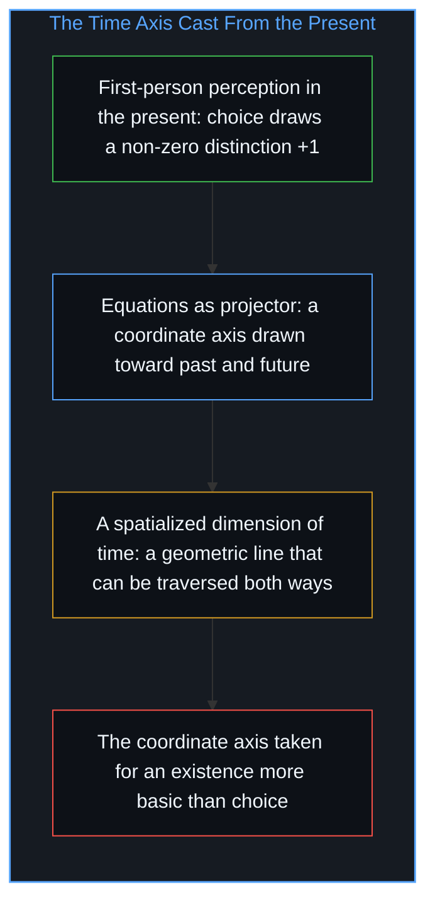

## 五、 离散是跨尺度不变的根基 / 5. Discreteness as the Root of Invariance Across Scales

数学为什么能如此精确地跨尺度抽象现实？一种读法是：正是离散的区分，使因果的关系能在不同尺度之间保持拓扑上的不变。现实若是一团毫无间断的均质流体，便没有离散的状态跃迁、组合的逻辑与因果的门。由离散的区分构成，因果的反馈环在组合演进时才形成自相似的拓扑结构，群的对称、幂律的分布、守恒的比例都属此类。普朗克尺度上量子态的跳变，杠杆上力矩的平衡，星系之间引力的约束，离散因果节点之间的相对关系是同构的。

Why can mathematics abstract reality across scales with such precision? One reading is this: it is discrete distinction that lets causal relations keep a topological invariance between different scales. Were reality a homogeneous fluid with no break in it, there would be no discrete transitions of state, no combinatorial logic and no causal gates. Made of discrete distinctions, causal feedback loops form self-similar topological structures as they combine and develop; group symmetries, power-law distributions and ratios of conservation are of this kind. In the jump of a quantum state at the Planck scale, the balance of torques on a lever, the gravitational constraint between galaxies, the relative relations among discrete causal nodes are isomorphic.

在纸面上操纵数字与方程，因此是在辨认并追踪因果网络在不同尺度的基底上重复出现的不变模式。数学是心智跨尺度的因果望远镜：它剥去特定尺度上的阻力与细节，提炼出因果关系的拓扑，让处在米级尺度的第一人称心智得以提前模拟微观粒子或星系的因果演化。它的边界在于符号的运算替代不了因果切分的落定：纸面上的等式是静态对称的，世界的推进靠第一人称的原点在当下作出抉择（+1）。

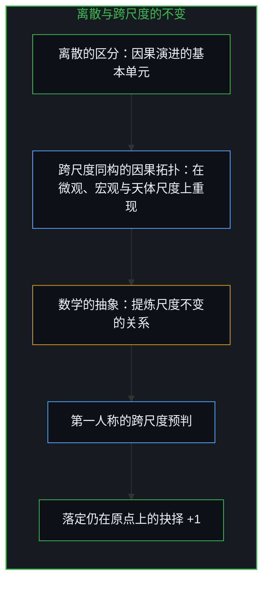

Working with numbers and equations on paper is therefore recognizing and tracking the invariant patterns that recur in the causal network on substrates of different scales. Mathematics is a Mind's causal telescope across scales: it strips away the resistance and detail of a particular scale and distills the topology of causal relations, letting a first-person Mind at the scale of meters simulate in advance the causal evolution of microscopic particles or galaxies. Its boundary is that the operation of symbols cannot stand in for the settling of a causal cut: an equation on paper is statically symmetric, and the world advances by a choice made in the present at the first-person origin (+1).

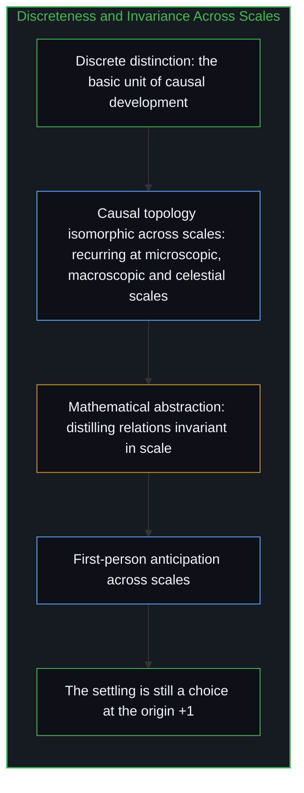

## 六、 大倒置与第一人称原点的复归 / 6. The Great Reversal and the Return to the First-Person Origin

近代科学带来的最大的认知倒置，是把心智维持的模型与下游的物理症状，当作比第一人称的抉择更基础的客观之物。这种说法是：物理方程里没有主观的感受，时间在坐标轴上对称可逆，熵增与力学决定物质的演化，所以切身经验到的时间流动与抉择只是主观的错觉，唯有静态的数学结构与物理定律才是客观的现实。[大倒置的消解](../the-dissolution-of-the-great-reversal/)追溯过这一步。

The greatest cognitive inversion that modern science has brought is taking the model a Mind maintains, and the physical symptoms downstream, for objective things more basic than first-person choice. The claim runs: there is no subjective feeling in the equations of physics, time is symmetric and reversible on the coordinate axis, the increase of entropy and mechanics determine the evolution of matter, and so the flow of time and the choosing experienced at first hand are only subjective illusion, with static mathematical structure and physical law alone being objective reality. [The Dissolution of the Great Reversal](../the-dissolution-of-the-great-reversal/) has traced this step.

把次序放回去，三层各在其位。纸面上的 1 + 1 = 2、跨尺度的代数公式与坐标轴上的连续曲线，是心智为规划未来而在意识里维持的静态符号投影。第一人称原点上的抉择与区分的生成（+1），是生成因果、推动时间不可逆展开的源头。能量的耗散、物质的位移与熵增，是抉择在物质层级上传导沉淀出的下游症状。用下游的机械模型与对称的公式去消解原点上的抉择，是以果否定因。

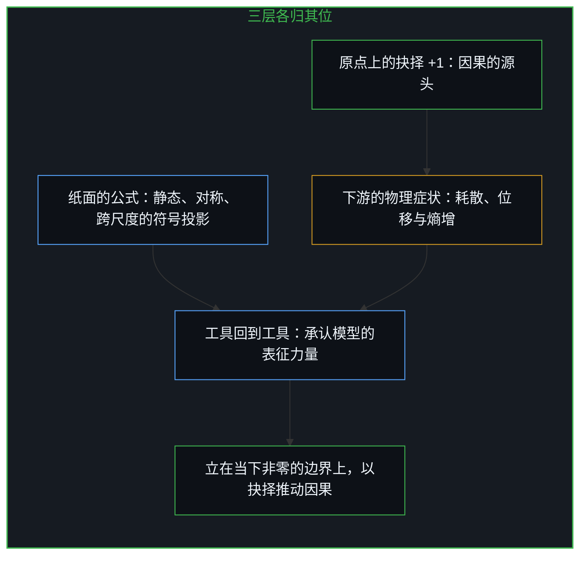

With the order put back, the three layers each have their place. The 1 + 1 = 2 on paper, algebraic formulas across scales and continuous curves on coordinate axes are static symbolic projections a Mind maintains within awareness for planning the future. Choice at the first-person origin and the generation of distinction (+1) are the source that generates causality and drives the irreversible unfolding of time. The dissipation of energy, the displacement of matter and the increase of entropy are downstream symptoms that choice deposits as it is conducted through the level of matter. Using a mechanical model and symmetric formulas from downstream to dissolve the choice at the origin is denying the cause by its effect.

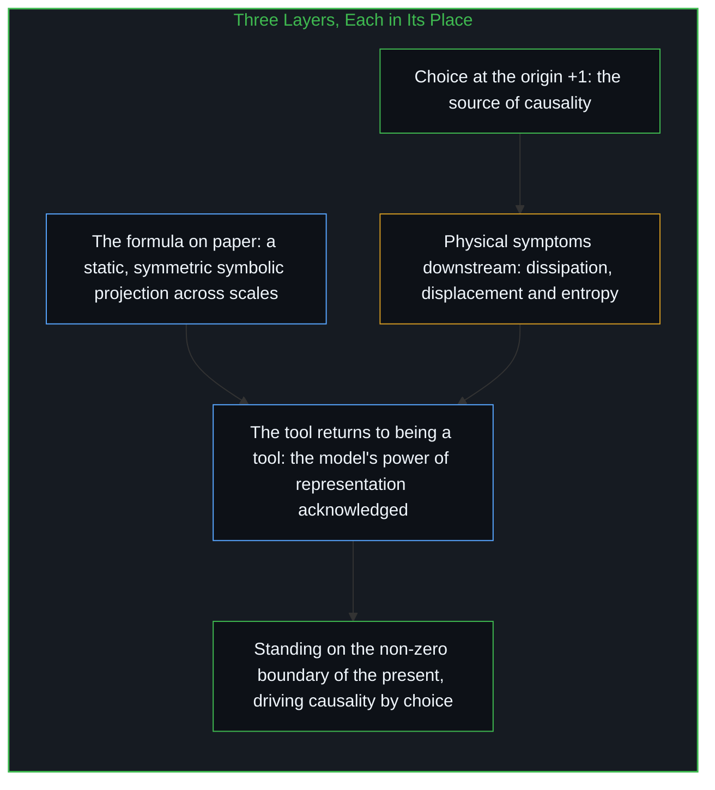

看清等同的单元与归零的微元这两项设定，并看到离散的区分带来跨尺度的不变、抉择是因果的源头，形式的工具便可以用得从容。物理学与形式数学是心智的表征利器，是跨尺度的因果罗盘。符号的沙盘在意识里可以对称地展开到很远，生命的每一步前行，则由第一人称的心智在当下划下非零的区分（+1）并承担它带来的因果。

With the two posits of identical units and an element going to zero seen clearly, and with it seen that discrete distinction brings invariance across scales and that choice is the source of causality, formal tools can be used with ease. Physics and formal mathematics are a Mind's instruments of representation and a causal compass across scales. The sandbox of symbols can unfold symmetrically a long way within awareness, while each step forward in a life is made by a first-person Mind drawing a non-zero distinction in the present (+1) and bearing the causality it brings.
