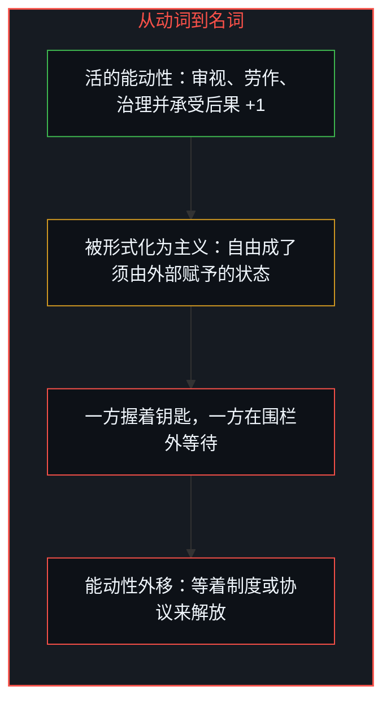
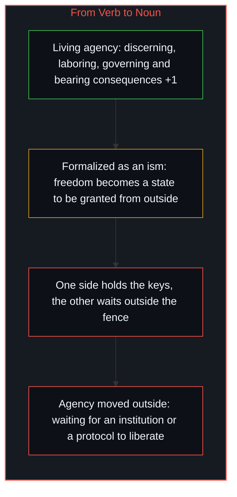
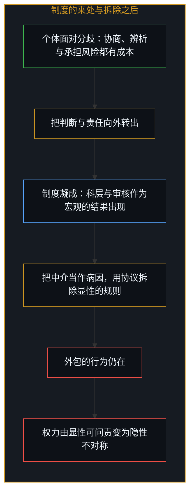
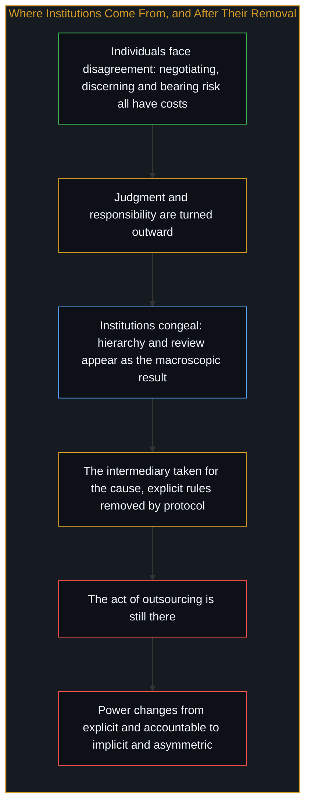
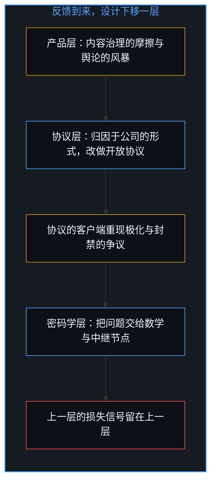
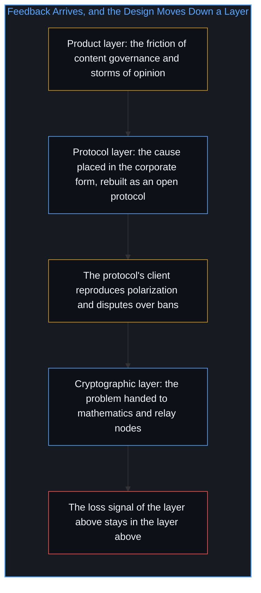
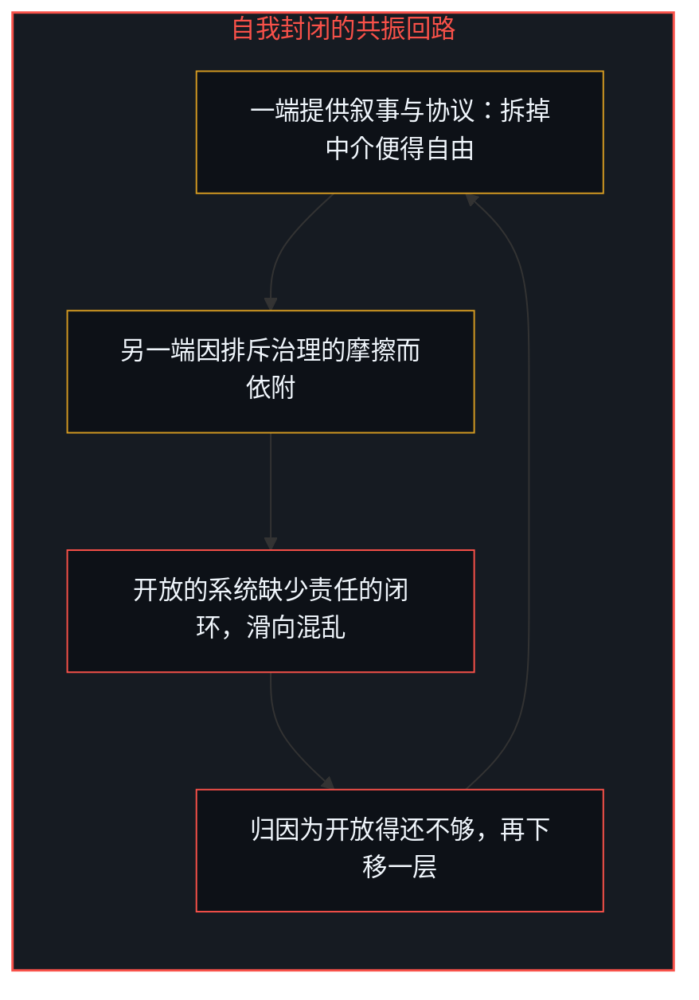
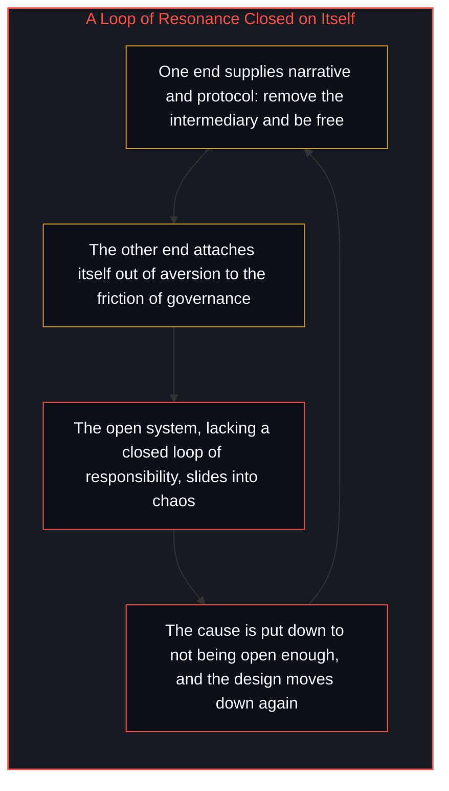
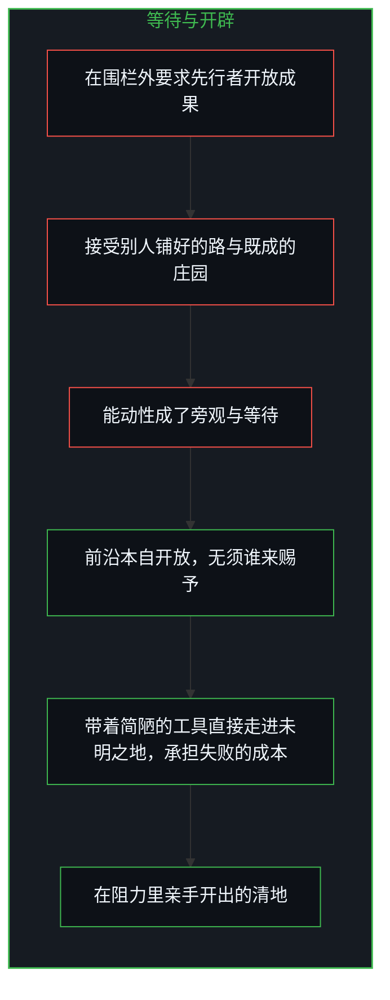
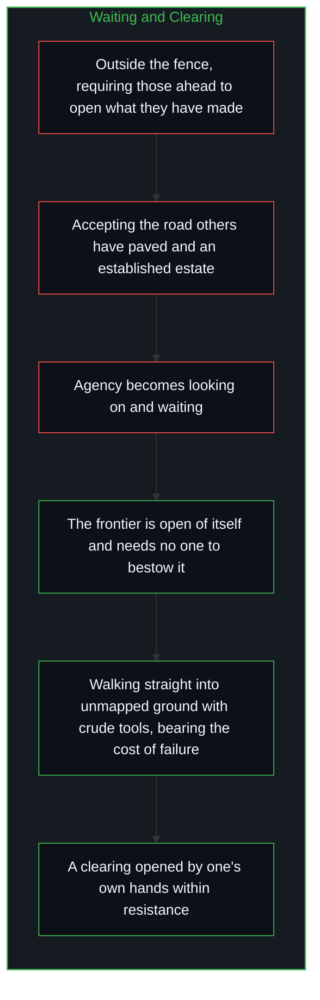

# “非中介化”的幻象 / The Illusion of the Unmediated

*等别人打开的前沿已不是前沿，被赐予的自由也不是自由 / A frontier waited on to be opened is no longer a frontier, and freedom bestowed is not freedom*

推特的联合创始人杰克·多西发表宣言，呼吁“开放前沿”，舆论随即分成赞颂开源民主的一方与批评其脱离商业与安全现实的一方。两种反应都略过了这个诉求本身的结构：前沿在定义上是开放的，由别人勘测、铺平并交到手里的，已是一座既成的庄园。“主义”把活的能动性凝成静态的名词，制度是个体把判断与责任外包之后凝成的宏观现象，拆掉中介并不带来自由。多西二十年的四次实践显出同一个模式，现实的反馈每回到来，设计便向更抽象的一层下移，而自由只在第一人称直接承受摩擦的开辟里出现。

Jack Dorsey, a co-founder of Twitter, published a manifesto calling to "open the frontier," and opinion divided at once into those praising open-source democracy and those criticizing it as detached from commercial and safety realities. Both reactions pass over the structure of the demand itself: a frontier is open by definition, and what others have surveyed, paved and handed over is already an established estate. An "-ism" sets living agency into a static noun, institutions are the macroscopic phenomenon that congeals after individuals outsource judgment and responsibility, and taking down intermediaries does not bring freedom. Dorsey's four undertakings over twenty years show one pattern, in which each time the feedback of reality arrives the design moves down to a more abstract layer, while freedom appears only in a clearing made by bearing friction directly in the first person.

## 一、 被打开的前沿已不是前沿 / 1. A Frontier Opened by Others Is No Longer a Frontier

站在一片刚刚展开的高维探索地带前，要求那些付出资源去勘探、清理并确立坐标的开拓者向所有人“开放”前沿，这个诉求显出对“前沿”这一范畴的错位。前沿不是一座由守门人上了锁的私家园子。它在定义上是一片未知、高熵而多险阻的未勘测之地，那里的每一次探路都伴着计算的损耗、物理的摩擦与无法预知的试错成本。

To stand before a high-dimensional zone of exploration that has only just opened and require the pioneers who spent resources surveying, clearing and fixing coordinates to "open" the frontier to everyone shows a displacement of the category "frontier." A frontier is not a private garden locked by a gatekeeper. By definition it is unsurveyed ground, unknown, high in entropy and full of hazard, where every act of pathfinding comes with computational loss, physical friction and costs of trial and error that cannot be known beforehand.

前沿在定义上一直是开放的。站在围栏外要求先行者为自己开门，说话的位置已是跟随的位置。更关键的一点是，一片未知之地若由别人排了雷、铺了路再打包相赠，它便不再是前沿，而是一座已由别人划定了规范与规则的既成庄园。要求一片“被开放的前沿”，因此是一个反复出现的结构：把自由当作一种可以由外部自上而下赐予的静态资产，而自由只在第一人称直接承受摩擦的行动里，作为一种活的能力被开辟出来。

A frontier has been open by definition all along. To stand outside a fence and ask those ahead to open the gate is already to speak from the position of following. More to the point, if a stretch of unknown ground has been cleared of mines and paved by others and then handed over in a package, it is no longer a frontier but an established estate whose norms and rules others have already set. Asking for an "opened frontier" is therefore a recurring structure: freedom is taken for a static asset that can be bestowed from outside and from above, while freedom is opened up as a living capacity only in action that bears friction directly in the first person.

## 二、 “主义”的倒置与能动性的外移 / 2. The Inversion of the "-ism" and the Outward Shift of Agency

以“主义”结尾的思想运动，从集体主义、社会主义、启蒙的理性主义，到个人主义、自由意志主义与开源主义，在实践的演进里都容易走到创立初衷的反面。这不出于创立者的居心或追随者的诚意。它出于把一种活的心智实践形式化为抽象的“主义”时的一步：自由被设为一种须由外部体系赋予的客观状态，原本属于行动者的能动性便被移到了外面。

Movements of thought ending in "-ism," from collectivism, socialism and Enlightenment rationalism to individualism, libertarianism and open-sourcism, readily arrive, in the course of practice, at the opposite of what they were founded for. This does not come from the founders' motives or the followers' sincerity. It comes from one step taken when a living practice of Mind is formalized into an abstract "-ism": freedom is set up as an objective state that must be granted by an outside system, and the agency that belonged to the actor is moved outside.

自由一旦被物化为一种意识形态或制度，便不再是当下的动词，审视、航行、劳作、治理与承受后果，而凝成一个名词：一项法定的权利，一种开源协议，一组公开的权重，或一张机构发放的牌照。[数字火箭、同行审查与因果闭环的稀释](../the-dilution-of-the-causal-loop-and-the-misallocation-of-agency/)与[框架的倒置与驾驶位的主权非对称](../the-inversion-of-the-harness-and-the-driver-seat-asymmetry/)说明，人造物是行动留下的痕迹，把行动交给某个抽象的系统时，一套依附的结构便立了起来：一方握着大门的钥匙，是先知、协议的设计者、赞助人或监管机构，另一方聚在围栏外等着被“解放”。医疗规程以同样的方式赐予自由，却让第一人称的校准沉默，[规程的倒置与因果回路的消声](../the-inversion-of-the-protocol-and-the-silencing-of-the-causal-loop/)对此有所展开。

Once freedom is turned into an ideology or an institution it is no longer a verb in the present, discerning, navigating, laboring, governing and bearing consequences; it sets into a noun: a legal right, an open-source license, a set of published weights, or a permit issued by an institution. [Digital Rockets, Peer Review, and the Dilution of the Causal Loop](../the-dilution-of-the-causal-loop-and-the-misallocation-of-agency/) and [The Inversion of the Harness and the Sovereignty of the Driver's Seat](../the-inversion-of-the-harness-and-the-driver-seat-asymmetry/) show that artifacts are traces left by action, and when action is handed to some abstract system a structure of dependence is set up: one side holds the keys to the gate, as prophet, designer of the protocol, patron or regulator, and the other gathers outside the fence waiting to be "liberated." Medical protocols bestow freedom in the same way and silence first-person calibration, as [The Inversion of the Protocol and the Silencing of the Causal Loop](../the-inversion-of-the-protocol-and-the-silencing-of-the-causal-loop/) lays out.

把个体的主权放在最高处的自由意志主义，一旦把诉求寄托在某种“完美的加密协议”或“国家的消亡”上，也走了同一步。注意力离开了日常里具体的自我求证、社区的协同与技能的打磨，转去期待某种代码架构在某一天到来，自动免去自我治理、化解冲突与直面责任的负担。把能动性设为一份有待接收的馈赠，而不是在阻力里持续锻炼的肌肉，这类意识形态在宣称解放个体的同一步里，已经把自主放到了个体之外。

Libertarianism, which places individual sovereignty highest, takes the same step once it rests its hopes on some "perfect cryptographic protocol" or "the withering of the state." Attention leaves the concrete checking of things for oneself, the cooperation of a community and the honing of skill in daily life, and turns to expecting some architecture of code to arrive one day and automatically lift the burden of governing oneself, resolving conflict and facing responsibility. By setting agency up as a gift awaiting receipt instead of a muscle exercised continually against resistance, ideologies of this kind have, in the same step in which they claim to liberate the individual, already placed autonomy outside the individual.

## 三、 协同即计算与制度的因果原点 / 3. Coordination as Computation and the Causal Origin of Institutions

多西的公共构想与工程叙事里贯穿着一个思维模型：协同等同于计算。按这个模型，人与人互动里的摩擦，政治的博弈、群体的纷争、科层的制度与妥协的泥泞，是外在的、可以用数学消除的杂质，只要以优雅的算法去掉居中的审核者，群体的协同便能像分布式计算那样顺畅运转。协议对搭建可互通的开放网络确实有用。

A mental model runs through Dorsey's public vision and engineering narrative: coordination is equivalent to computation. On this model the friction in interaction between people, political contest, disputes among groups, hierarchical institutions and the mud of compromise, is an external impurity that mathematics can remove, and once the reviewer in the middle is taken out by an elegant algorithm, the coordination of a group can run as smoothly as distributed computing. Protocols are indeed useful for building open networks that interoperate.

它的边界在于制度的来处。[“物理学才是定律”的障眼法](../the-sleight-of-hand-in-physics-is-the-law-and-the-friction-of-reality/)说明，制度不是外在于人、压在人之上的因果源头，它是许多个体把判断与责任外包时呈现的宏观现象。自由的受损不始于某一项强加的法令，它的起点是个体为了避开直面现实去求证的痛感、协商的繁琐与承担风险的代价，把判断与责任向外转出。个体不承担相互辨析与自我约束的责任，裁决便向上让渡，一个管理的机构便应运而生，以维持基本的秩序。

Its boundary lies in where institutions come from. [The Sleight of Hand in "Physics Is the Law"](../the-sleight-of-hand-in-physics-is-the-law-and-the-friction-of-reality/) shows that an institution is not a causal source outside people and pressing down on them; it is the macroscopic phenomenon that appears when many individuals outsource judgment and responsibility. The loss of freedom does not begin with some decree imposed; its starting point is the individual turning judgment and responsibility outward in order to avoid the pain of checking against reality directly, the tedium of negotiation and the cost of bearing risk. When individuals do not bear the responsibility of discerning with one another and restraining themselves, the ruling is yielded upward, and an administering body arises to keep basic order.

把制度这个宏观的结果当作起因，想凭几行代码绕开它，带来的是次生的后果。没有约束的状态与承重的自律能力是两回事。未经治理的空间不是真空：在外包没有消除的情形下拆掉显性的规约，权力并不蒸发，它从显性、可问责、可申诉的形态，变成隐性、不对称而不透明的形态，由握着最大的未经调谐杠杆的个体或节点接手。[抉择本身并不沉重](../choice-itself-has-no-inherent-weight/)说明，状态的跃迁本身不带内在的阻力，寄望于无中介的协议一步到位，绕开的是渐进试错与微步校准的切身经验。[任务的移交与后果的不可让渡](../the-delegation-of-the-task-and-the-inalienability-of-consequences/)说的也是这一点：任务与计算可以移交，承受摩擦的责任转让不了。

Taking the institution, a macroscopic result, for the origin and trying to get around it with a few lines of code brings secondary consequences. A state without constraint and a load-bearing capacity for self-discipline are two different things. An ungoverned space is not a vacuum: with explicit rules taken down while outsourcing has not been removed, power does not evaporate; it changes from a form that is explicit, accountable and open to appeal into one that is implicit, asymmetric and opaque, taken over by whichever individuals or nodes hold the largest untuned leverage. [Choice Itself Has No Inherent Weight](../choice-itself-has-no-inherent-weight/) shows that a transition of state carries no inner resistance in itself, and what is bypassed by hoping an unmediated protocol will arrive in one step is the first-hand experience of gradual trial and error and calibration by small steps. [The Delegation of the Task and the Inalienability of Consequences](../the-delegation-of-the-task-and-the-inalienability-of-consequences/) says the same: tasks and computation can be handed over, and the responsibility of bearing friction cannot be transferred.

## 四、 四次向下一层的移动 / 4. Four Moves Down a Layer

回看多西二十年的产品探索与创业的轨迹，可以读出一个恒定的模式：来自现实的反馈没有回到理论的假设上，引出的是实践形态的调整。在控制论与机器学习的优化里，一个智能体只有直接承受损失信号，内在的模型才会收敛与更新。这条轨迹上的每一步，都是在所建的系统与人的摩擦相撞、产生强烈的负反馈之后，向更底层的抽象移动一层：从商业产品，到开放平台，到分布式协议，到底层的密码学。

Looking back over Dorsey's twenty years of product exploration and company-building, a constant pattern can be read: feedback from reality did not return to the assumptions of the theory, and what it drew out was an adjustment in the form of practice. In cybernetics and in the optimization of machine learning, an agent's inner model converges and updates only when it bears the loss signal directly. Each step on this trajectory is a move one layer down toward lower-level abstraction, after the system that was built collided with human friction and produced strong negative feedback: from commercial product, to open platform, to distributed protocol, to cryptography underneath.

在推特，平台被设想为类似公共事业的市政广场，一个无须内容裁决、人人可以发声的地方。平台成为地缘政治博弈与文化撕裂交火之处时，因果的反馈回路是断开的：去中心化的理念与现场运营里推荐算法、网络暴力的次生后果之间，没有一个承担后果的位置。决断的空间并不因此消失，它由内部的审核委员会、临时成立的信任与安全小组以及外部的政治压力填上。

At Twitter the platform was conceived as a municipal square resembling a public utility, a place needing no ruling on content where anyone could speak. When the platform became a place of crossfire for geopolitical contest and cultural division, the causal feedback loop was open: between the idea of decentralization and the secondary consequences of recommendation algorithms and online abuse in day-to-day operation there was no position that bore the consequences. The space of decision did not disappear for that; it was filled by internal review committees, a trust and safety group set up for the occasion, and political pressure from outside.

随后的 Bluesky 把问题归在“推特是一家商业公司”这层形式上：把它做成开放的协议，便没有人能拥有它。协议的官方客户端重现了封闭社交群体的极化与封禁的争议之后，多西辞去董事会的职务，说人类重蹈了推特的覆辙，转而投入更底层的密码学网络 Nostr。每下移一层，上一层的损失信号便留在了上一层。

Bluesky, which followed, placed the problem in the form "Twitter is a commercial company": make it an open protocol and no one can own it. After the protocol's official client reproduced the polarization of closed social groups and the disputes over bans, Dorsey left the board, said humanity had repeated Twitter's errors, and turned to Nostr, a cryptographic network at a lower level. With each move down a layer, the loss signal of the layer above stayed in the layer above.

Square 是这条轨迹上扎在实处的创造。它的成立与兴起，来自直面并解决一个明确而具体的痛点：一个小巧的音频插孔读卡器，让手工艺人与街头餐车的小贩随时随地可以接受刷卡，去掉了经济生活里的一处物理阻力。积累了资本与声誉之后，公司更名为 Block，核心的工程资源投向名为“Web5”的去中心化身份框架，大笔资本用于自研比特币挖矿芯片。方向从那个具体的痛点，移到了与市场上的摩擦相距较远的议题上。

Square is the creation on this trajectory that was rooted in the concrete. It was founded and grew by facing and solving a definite, specific pain: a small card reader for the audio jack let craftspeople and street food-truck vendors accept card payments anywhere and at any time, removing a point of physical resistance in economic life. After capital and reputation had accumulated, the company was renamed Block, core engineering resources went into a decentralized identity framework called "Web5," and large sums of capital went into developing its own Bitcoin mining chips. The direction moved from that specific pain to topics at some distance from friction in the market.

慈善的实践里有同样的断开。经由社交网络上的现金派发活动与数十亿美元规模的慈善基金，大笔资金在“激进信任”的名义下无条件地发放。信任是有价值的。它的边界在于它替代了对后果的追踪：资金撒进信息流之后，不看它是否培育了生产的技能，也不问受助者是否有了自己造血的能力，因与果之间的检验便没有合上，受助的一方仍在等着下一次的给予。

The practice of philanthropy has the same opening. Through cash giveaways on social networks and a charitable fund on the scale of billions of dollars, large sums are given out unconditionally in the name of "radical trust." Trust has value. Its boundary is where it stands in for following the consequences: once money is scattered into a feed with no look at whether it fostered productive skill and no question of whether recipients gained the capacity to sustain themselves, the check between cause and effect is not closed, and the receiving side goes on waiting for the next giving.

## 五、 耦合的回路 / 5. The Coupled Loop

把这二十年读成一位有魅力的科技人物对大众的误导，同样略过了因果的机制。这是一个耦合的共振回路。一端提供资本、开源的代码与“拆掉中介便得自由”的叙事，财富的缓冲容易被当作理论模型成立的证据。另一端提供认同、声量与离开现实治理的强烈愿望，外部显性把关人的消除容易被当作自身有了独立生存的能力。

Reading these twenty years as a charismatic figure in technology misleading the public likewise passes over the causal mechanism. This is a coupled loop of resonance. One end supplies capital, open-source code and the narrative that "removing the intermediary yields freedom," and the cushion of wealth is easily taken as evidence that the theoretical model holds. The other end supplies identification, volume and a strong wish to leave the governance of reality behind, and the removal of explicit outside gatekeepers is easily taken for having gained the capacity to live independently.

两端共有一种倾向：对群体治理所需的迟缓、繁琐而充满摩擦的协调工作的排斥，以及对一个算法替代裁判、代码替代法治、财富经一次点击流入钱包的世界的期待。因为双方共有一个没有检验过的前提，即中介本身是祸根，这个回路便诊断不了自己的失败。一个宣称开放的系统滑向混乱，或一个没有显性规则的空间成了极化的回音壁时，得出的结论是“开放得还不够”，治理的失灵以更激进的去中心化来医，协议的失灵被归于协议嵌套得不够深。

The two ends share a tendency: an aversion to the slow, tedious and friction-filled work of coordination that governing a group requires, and an expectation of a world in which algorithms replace judges, code replaces the rule of law, and wealth flows into a wallet at one click. Because both sides share a premise that has not been examined, that the intermediary is itself the root of the trouble, the loop cannot diagnose its own failure. When a system that declares itself open slides into chaos, or a space with no explicit rules becomes an echo chamber of polarization, the conclusion drawn is that it "was not open enough"; failed governance is treated with more radical decentralization, and the failure of a protocol is put down to the protocol not being nested deeply enough.

这个回路能长久维持，在于财富的壁垒足以支撑反复的试错。数百亿美元的缓冲，使试验失败的后果不必回到设计者身上，一个平台停摆之后可以抽身离开，再宣告下一片未受沾染的前沿。

The loop can last because the wall of wealth is enough to sustain repeated trial and error. With a cushion of tens of billions of dollars, the consequences of a failed experiment need not return to the designer, who can withdraw after one platform stalls and then announce the next untouched frontier.

## 六、 自由不是被赐予的空地 / 6. Freedom Is Not a Clearing That Is Bestowed

“开放”的意识形态许诺最宽的解放，同时把信奉它的位置安排成了等待的位置。进步被框定为实验室是否向社会“开放”它们的权重、代码与财富时，有独立意志的主体便成了围栏外的等待者，等路由别人修平，等门由别人打开，等工具由别人相赠。

The ideology of "open" promises the widest liberation and at the same time arranges the position of believing in it as a position of waiting. When progress is framed as whether laboratories "open" their weights, code and wealth to society, a subject with a will of its own becomes someone waiting outside the fence, waiting for the road to be leveled by others, the gate opened by others, the tools given by others.

主权走的是相反的因果。它不要求走在前面的侦察者回头交出指南针，不等大公司公开权重才开始向认知的深水区探索，不把权威身影的消失当作自由能力的获得，也清楚制度的缺陷无法靠退入更深的数学抽象来抹平，摩擦须在具体的建造里化解。

Sovereignty follows the opposite causality. It does not require the scout walking ahead to turn back and hand over the compass, does not wait for large companies to publish weights before beginning to explore the deep water of cognition, does not take the disappearance of an authority's figure for the gaining of a capacity for freedom, and is clear that the defects of institutions cannot be smoothed over by retreating into deeper mathematical abstraction, and that friction has to be worked through in concrete building.

前沿是开放的，不是因为有谁打开了门锁，而是因为未知无人能锁。它属于在没有铺路的地形里向前走、愿意承受攀登的疲惫的行动。自由不是哪位架构师在图纸上预留的一处空地，它是在粗粝的阻力里，以自己的双手、心智与全部的责任开出的一片清地。

The frontier is open not because someone undid a lock but because no one can lock the unknown. It belongs to action that goes forward over ground with no road laid and is willing to bear the fatigue of the climb. Freedom is not a clearing some architect has reserved on a blueprint; it is a clearing opened within coarse resistance with one's own hands, Mind and full responsibility.
