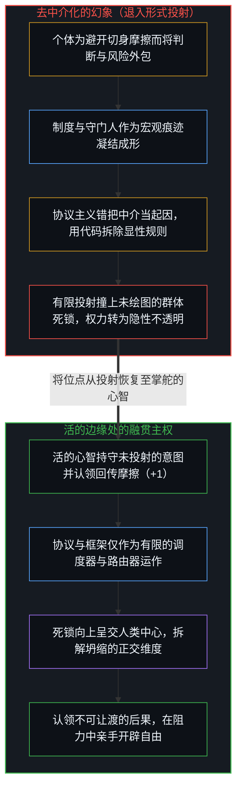
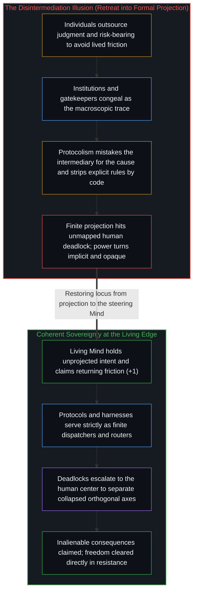

# “非中介化”的幻象 / The Illusion of the Unmediated

*由别人打开的前沿已是庄园，被赐予的自由也不是自由 / A frontier opened by others is an estate, and freedom bestowed is not freedom*

推特联合创始人杰克·多西发表宣言呼吁“开放前沿”时，舆论随即裂为赞颂开源民主的一方与批评其脱离商业及安全现实的一方。两种反应都略过了这一诉求内置的前提：前沿在定义上是开放的，而由别人勘测、排险并铺设成固定坐标的土地，已不再是前沿，而是一座既成的庄园。把一种活的实践形式化为“主义”，会将能动性从当下的动词凝固为静态的名词；制度是个体把判断与责任外包之后凝结而成的宏观痕迹，拆掉中介并不会催生自治。跨越二十年的四次创业实践，多西的轨迹呈现出同一个结构模式，即每当与人的摩擦迎头相撞，设计便向形式抽象的更底层退却一层，而自由只存在于中心以第一人称直接承受摩擦的地方。

When Twitter co-founder Jack Dorsey published a manifesto calling to "open the frontier," public reaction split immediately between those praising open-source democracy and those dismissing the appeal as detached from commercial and safety realities. Both responses pass over the premise built into the demand itself: a frontier is open by definition, and ground that others have already surveyed, cleared of hazard, and paved into fixed coordinates is no longer a frontier but an established estate. Formalizing a living practice into an "-ism" turns agency from a present verb into a static noun, institutions are the macroscopic trace that congeals after individuals outsource judgment and responsibility, and stripping away intermediaries does not produce self-rule. Across twenty years and four undertakings, Dorsey's trajectory exhibits a single structural pattern in which each collision with human friction triggers a retreat one layer further down into formal abstraction, whereas freedom exists only where a center bears friction directly in the first person.

## 一、 被打开的前沿已不是前沿 / 1. A Frontier Opened by Others Is No Longer a Frontier

站在一片刚刚展开的高维探索地带前，要求那些耗费能量去勘探、清理并确立坐标的开拓者向所有人“开放”前沿，这一诉求源于范畴的错位。前沿不是锁在守门人围栏后面的私家花园。它在定义上是一片未经勘测、高熵而多险阻的土地，那里的每一步探路都伴随着计算的损耗、物理的摩擦以及无法预知的试错成本。

Standing before a newly opened high-dimensional zone of exploration and demanding that the pioneers who spent energy surveying, clearing, and fixing coordinates "open" the frontier to everyone rests on a category displacement. A frontier is not a private garden locked behind a gatekeeper's fence. By definition it is unsurveyed ground, high in entropy and full of hazard, where every step of pathfinding carries computational loss, physical friction, and trial-and-error costs that cannot be known in advance.

正因为未知无人能锁，前沿一直都是开放的。站在围栏外要求先行者打开大门，所采取的姿态已是追随者的姿态。更深一层看，一片未绘图的疆域一旦由别人排了雷、铺了路，再打包成现成的交付物交到手里，它便不再是前沿，而成了由他人划定规范、坐标与轨道的既成庄园。要求一片“被开放的前沿”，是把自由当作可以由外部自上而下赐予的静态资产，然而自由唯有在第一人称直接承受摩擦的行动里，才能作为一种活的能力被开辟出来。

Because the unknown cannot be locked, the frontier has been open all along. Standing outside a fence and demanding that those ahead unlock the gate already adopts the posture of a follower. More fundamentally, once a stretch of unmapped territory has been cleared of mines, paved, and handed over in a ready-made package, it ceases to be a frontier and becomes an established estate whose norms, coordinates, and rails have been set by others. Demanding an "opened frontier" treats freedom as a static asset that can be bestowed from outside and above, whereas freedom is opened up as a living capacity only through action that bears friction directly in the first person.

## 二、 “主义”的倒置与能动性的外移 / 2. The Inversion of the "-ism" and the Outward Shift of Agency

以“主义”结尾的思想运动，从集体主义、社会主义、启蒙理性主义，到个人主义、自由意志主义与开源主义，在实践进程里屡屡走向创立初衷的反面。这种逆转既不出于创立者的动机，也不源于追随者缺乏诚意，而是源于每当一种活的心智实践被形式化为抽象的“主义”时所迈出的同一个结构步伐：自由被设定为一种须由外部系统赋予的客观状态，能动性的位点随之移出了行动者自身。

Movements of thought ending in "-ism," from collectivism, socialism, and Enlightenment rationalism to individualism, libertarianism, and open-sourcism, routinely arrive in practice at the opposite of their founding intent. This reversal stems neither from the founders' motives nor from the followers' lack of sincerity. It follows from a single structural step taken whenever a living practice of Mind is formalized into an abstract "-ism": freedom is posited as an objective state to be granted by an external system, shifting the locus of agency outside the actor.

自由一旦被物化为意识形态或制度，便不再作为当下的动词运作——审视、航行、劳作、治理并认领后果——而是凝结为一个名词：一项法定权利、一份开源协议、一组公开权重，或一张机构发放的许可证。如[数字火箭、同行审查与因果闭环的稀释](../the-dilution-of-the-causal-loop-and-the-misallocation-of-agency/)与[框架的倒置与驾驶位的主权非对称](../the-inversion-of-the-harness-and-the-driver-seat-asymmetry/)所追溯的，每一件人造物、许可证或工程框架都是先前行动留下的持久痕迹；一旦把当下的判断移交给抽象系统，一套依附结构便随之成型：一方作为先知、协议设计者、赞助人或监管者握着大门的钥匙，另一方聚集在围栏外等待被解放。医疗规程在把标准化规则当作主导者并令第一人称的身体校准失声时，演出了同样的倒置，[规程的倒置与因果回路的消声](../the-inversion-of-the-protocol-and-the-silencing-of-the-causal-loop/)对此已有展开。

Once freedom is reified into an ideology or an institution, it stops operating as a verb in the present—discerning, navigating, laboring, governing, and claiming consequences—and congeals into a noun: a statutory right, an open-source license, a set of published weights, or an institutional permit. As [Digital Rockets, Peer Review, and the Dilution of the Causal Loop](../the-dilution-of-the-causal-loop-and-the-misallocation-of-agency/) and [The Inversion of the Harness and the Sovereignty of the Driver's Seat](../the-inversion-of-the-harness-and-the-driver-seat-asymmetry/) trace, every artifact, license, or harness is a durable trace left by prior action; when present judgment is handed over to an abstract system, a dependency structure forms in which one side holds the keys to the gate—as prophet, protocol designer, patron, or regulator—while the other gathers outside the fence waiting to be liberated. Medical protocols perform the same inversion when standardized rules are treated as the driver and silence first-person bodily calibration, as [The Inversion of the Protocol and the Silencing of the Causal Loop](../the-inversion-of-the-protocol-and-the-silencing-of-the-causal-loop/) lays out.

即便是将个体主权奉为最高价值的自由意志主义，一旦把希望寄托在某种“完美的加密协议”或“国家的消亡”上，也迈出了同样的一步。注意力从日常具体的第一人称求证、社区协同与技能打磨上移开，转而等待某种代码架构在某一天降临，自动卸下自我治理、化解冲突与承担责任的重担。通过把能动性框定为一份有待派发的馈赠，而非在阻力中持续锻炼的能力，这类意识形态在宣告解放个体的同一个动作里，已经把自主权安放到了个体之外。

Even libertarianism, which places individual sovereignty at the pinnacle of its values, takes the same step the moment it rests its hopes on a "perfect cryptographic protocol" or "the withering of the state." Attention shifts away from concrete first-person verification, community coordination, and daily skill-building toward waiting for an architecture of code to arrive and automatically lift the burden of self-governance, conflict resolution, and accountability. By framing agency as a gift awaiting delivery rather than a capacity exercised continually against resistance, such ideologies place autonomy outside the individual in the very act of proclaiming individual liberation.

## 三、 协同即计算与制度的因果原点 / 3. Coordination as Computation and the Causal Origin of Institutions

多西的公共构想与工程叙事里贯穿着一个单一前提：人类的协同等同于计算。在这个模型下，人与人互动中的摩擦——政治博弈、群体分歧、科层制度与妥协的泥泞——被当作可以用数学消除的外部杂质；只要用优雅的算法替换居中的审核者，群体的协同便能像分布式计算那样顺畅运转。开放协议对于搭建可互通的网络确实是有用的脚手架，但它的边界正浮现在制度的因果原点处。

Running through Dorsey's public vision and engineering narrative is a single premise: human coordination is equivalent to computation. Under this model, the friction of human interaction—political contest, group disagreement, hierarchical institutions, and the mud of compromise—is treated as an external impurity that mathematics can eliminate; once the central moderator is replaced by an elegant algorithm, collective coordination is expected to run as cleanly as distributed computing. Open protocols are genuinely useful scaffolding for building interoperable networks, yet their boundary appears at the causal origin of institutions.

如[“物理学才是定律”的障眼法](../the-sleight-of-hand-in-physics-is-the-law-and-the-friction-of-reality/)所展示的，制度并非从外部压在人身上的外在因果力，而是许多个体把判断与责任向外转出之后凝结而成的宏观现象。自由的侵蚀不始于某道强加的法令，而始于个体为了避开直接求证的摩擦、协商的繁琐与承担风险的代价，把判断与责任交到外部。当个体拒绝相互辨析与自我约束的劳作时，裁决权便向上让渡，行政管理机构随之生成以维持基本秩序。

As [The Sleight of Hand in "Physics Is the Law"](../the-sleight-of-hand-in-physics-is-the-law-and-the-friction-of-reality/) demonstrates, an institution is not an external causal force pressing down on human beings from outside; it is the macroscopic phenomenon that congeals when many individuals outsource judgment and responsibility. The erosion of freedom does not begin with an imposed decree; it begins when individuals turn judgment and responsibility outward to avoid the friction of direct verification, the tedium of negotiation, and the cost of bearing risk. When individuals decline the work of mutual discernment and self-restraint, adjudication is yielded upward, and an administrative apparatus forms to maintain basic order.

指望去中心化协议消解治理的摩擦，是把有限的投射误认作了掌舵的活心智。如[超越投射](../beyond-the-projection/)所追溯的，每一条显性规则、协议规范或密码学合约，都是从超高维活意图空间向下投射出的低维截面。形式协议可以充当调度器——在固定坐标内路由消息、验证签名并执行确定性规则——正如无我执的对等回路可以暴露局部轨迹的盲区。然而，当竞争的人类意图在边界情形迎头相撞、多个正交维度被压缩进同一条规则时，协议便会撞上任何形式机制都无法在自身词元或代码轨迹内部解开的前提死锁。把机械的调度混淆为主权的统御，重演了[任务的移交与后果的不可让渡](../the-delegation-of-the-task-and-the-inalienability-of-consequences/)与[框架的倒置与驾驶位的主权非对称](../the-inversion-of-the-harness-and-the-driver-seat-asymmetry/)所剖析的范畴谬误：计算与路由可以移交给代码，但拟定损失函数、退后一步拆解坍缩的前提以及承受后果，始终锁定在活的中心身上。

Expecting a decentralized protocol to dissolve governance friction mistakes a finite projection for the living Mind that steers. As [Beyond the Projection](../beyond-the-projection/) traces, every explicit rule, protocol specification, or cryptographic contract is a low-dimensional projection cast from the ultra-high-dimensional space of lived intent. A formal protocol can act as a dispatcher—routing messages, verifying signatures, and executing deterministic rules within fixed coordinates—just as ego-free peer loops can expose local trajectory blind spots. Yet when competing human intentions collide at an edge case where orthogonal dimensions were compressed into one rule, the protocol hits an irreducible premise deadlock that no formal mechanism can resolve from within its own token or code trajectory. Confusing mechanical dispatching with sovereign orchestration repeats the category error analyzed in [The Delegation of the Task and the Inalienability of Consequences](../the-delegation-of-the-task-and-the-inalienability-of-consequences/) and [The Inversion of the Harness and the Sovereignty of the Driver's Seat](../the-inversion-of-the-harness-and-the-driver-seat-asymmetry/): computation and routing can be delegated to code, but formulating the loss function, stepping back to untangle collapsed premises, and bearing the consequences remain permanently locked to living centers.

把制度这一宏观结果当作起因，试图凭几行代码绕开它，会即刻引发次生后果。缺少外部约束的状态，并不等于承重的自治能力。未经治理的空间从不是真空：在判断外包依然存续的情形下拆掉显性规则，权力并不会蒸发，而是从显性、可问责、可申诉的形态，转化为隐性、不对称且不透明的支配，由握有最大未调谐杠杆的节点接管。如[抉择本身并不沉重](../choice-itself-has-no-inherent-weight/)所表明的，状态跃迁本身不带内在阻力，寄望于无中介的协议一步到位交付自由，绕开的正是自我治理得以锻造出来的渐进试错与微步校准。

Treating the institutional result as the root cause and trying to bypass it with lines of code triggers immediate secondary consequences. Absence of external constraint is not a load-bearing capacity for self-rule. An ungoverned space is never a vacuum: when explicit rules are stripped away while the underlying outsourcing of judgment persists, power does not evaporate; it shifts from explicit, accountable, and appealable forms into implicit, asymmetric, and opaque dominance seized by whichever nodes hold the largest untuned leverage. As [Choice Itself Has No Inherent Weight](../choice-itself-has-no-inherent-weight/) shows, a state transition carries no inherent resistance in itself, and hoping an unmediated protocol will deliver freedom in a single leap bypasses the gradual trial, error, and micro-step calibration through which self-governance is actually forged.

## 四、 四次向下一层的移动 / 4. Four Moves Down a Layer

回看多西二十年的产品探索与创业轨迹，一个恒定的模式清晰可见：每当现实回传严厉的损失信号，反馈并没有重绘“协同即计算”这一底层前提，而是触发设计向形式抽象的更深一层退却。在控制论与机器学习优化中，模型唯有在误差生成的同一层级直接承受损失信号，才会更新并收敛。沿着多西的轨迹，每一次与人类摩擦的碰撞都促成一次向技术栈底层的下移：从商业产品，到开放平台，到分布式协议，再到更底层的密码学。

Across Dorsey's twenty years of product exploration and company-building, a consistent pattern appears: whenever reality returns a harsh loss signal, the feedback does not re-render the underlying premise that coordination is computation, but triggers a retreat one layer further down into formal abstraction. In cybernetics and machine learning optimization, a model updates and converges only when the system bears the loss signal directly at the level where the error was generated. Along Dorsey's trajectory, each collision with human friction prompts a move down the stack: from commercial product, to open platform, to distributed protocol, to lower-level cryptography.

在推特，平台被构想为无须内容裁决的市政广场，任何人都可以自由发声。当平台成为地缘政治冲突与文化极化的交火地带时，因果反馈回路是断开的：在无中介言论的理念与推荐算法及协同网暴的运营次生后果之间，没有任何位点被设计来认领后果。由于裁决的空间无法靠愿望抹去，它由内部审核委员会、临时组建的信任与安全团队以及外部政治压力仓促填补。

At Twitter, the platform was conceived as a municipal public square requiring no content adjudication, where anyone could speak freely. When the platform became a crossfire zone for geopolitical conflict and cultural polarization, the causal feedback loop stood open: between the ideal of unmediated speech and the operational fallout of recommendation algorithms and coordinated abuse, no locus was designed to claim the consequences. Because the space of adjudication cannot be wished away, it was filled ad hoc by internal review committees, reactive trust-and-safety teams, and outside political pressure.

随后的 Bluesky 把失败归咎于推特的公司形态：把网络做成开放协议，便没有哪家公司能够拥有它。待到协议的官方客户端原样重现了群体极化与封禁争议，多西辞去董事会职务，感叹人类重蹈了推特的覆辙，转而投向更底层的密码学中继网络 Nostr。每向下一层移动一步，上一层未解开的前提死锁便被留在了上一层。

Bluesky followed by attributing the failure to Twitter's corporate form: turn the network into an open protocol, and no company can own it. Once the protocol's official client reproduced the exact same group polarization and ban disputes, Dorsey stepped down from the board, remarked that humanity had repeated Twitter's mistakes, and pivoted to Nostr, a lower-level cryptographic relay network. With each move down a layer, the unresolved premise deadlock of the upper layer was left behind in the layer above.

Square 在这条轨迹上显得独特，因为它的起点是迎面解决一处具体而切实的物理摩擦：一个插入音频插孔的小巧读卡器，让手工艺人与街头餐车商贩随时随地可以接受刷卡支付，消除了日常商业中的一处切近梗阻。然而在资本与声誉积累起来之后，公司更名为 Block，将核心工程资源投向名为“Web5”的去中心化身份框架，并把巨额资本投入自研比特币挖矿芯片，重心从具体的市场摩擦再度移向遥远的形式抽象。

Square stood out on this trajectory because it began by meeting a specific, concrete physical friction: a tiny card reader plugged into the audio jack allowed craftspeople and food-truck vendors to accept card payments anywhere, removing an immediate bottleneck in everyday commerce. Yet once capital and reputation accumulated, the company renamed itself Block, directed core engineering resources into a decentralized identity framework called "Web5," and committed vast capital to custom Bitcoin mining silicon—shifting focus from concrete market friction back toward distant formal abstractions.

同样的开环也重现在慈善实践中。借由社交媒体上的现金派发与数十亿美元规模的慈善基金，资本在“激进信任”的旗号下无条件地发放。信任作为初始桥梁确有价值，但它的边界出现在它替代了对因果回传的追踪之时：一旦资金撒入信息流，却不检验它是否培育了生产技能或自给自足的能力，行动与后果之间的反馈回路便处于断开状态，受助者仍停留在等待下一次派发的姿态里。

The same open loop recurs in philanthropy. Through social-media cash drops and a multi-billion-dollar charitable fund, capital is distributed unconditionally under the banner of "radical trust." Trust has real value as an initial bridge, yet its boundary appears when it substitutes for tracking causal return: once funds are scattered into a feed without checking whether they cultivate productive skill or self-sustaining capacity, the feedback loop between action and consequence remains open, leaving recipients in the posture of waiting for the next distribution.

## 五、 耦合的回路 / 5. The Coupled Loop

把这二十年仅仅读作一位富有魅力的科技人物对公众的误导，漏掉了其中双向运作的机制。支撑这一轨迹的，是两个重心之间耦合的共振回路。一端提供资本、开源代码以及“拆掉中介便得自由”的叙事，数十亿美元的财富缓冲将架构师与失败试验的运营后果隔离开来，使理论模型显得完好无损。另一端提供认同、声量放大，以及受身份绑定的、渴望逃离迟缓繁琐且充满摩擦的群体治理劳作的愿望，错把显性把关人的移除当作了独立生存能力的获得。

Reading these twenty years merely as a charismatic technologist misleading the public misses the reciprocal mechanism at work. What sustains the trajectory is a coupled resonance loop between two centers of gravity. One end supplies capital, open-source code, and the narrative that removing intermediaries yields freedom, while a multi-billion-dollar wealth cushion insulates the architect from the operational fallout of failed experiments and makes the theoretical model appear intact. The other end supplies identification, amplification, and an identity-bound wish to escape the slow, tedious, and friction-laden work of human governance, mistaking the removal of visible gatekeepers for the acquisition of independent capability.

两端共享着一个未经审视的前提，即中介本身是受困的祸根。由于这一前提被豁免于重新追溯，这个耦合回路无法诊断自身的失灵。当一个标榜开放的系统滑向混乱，或一个不设审核的空间硬化为极化的回音壁时，回路得出的结论是系统“开放得还不够”。治理的死锁被开出更激进的去中心化处方，协议的失灵被归咎于密码学嵌套得还不够深。在数百亿美元资本缓冲的庇护下，设计者无须留在暂停的流线中去拆解人类前提的矛盾，而可以随时从停摆的平台抽身离去，再宣告下一片未受沾染的前沿。

Both ends share an unexamined premise: that the intermediary itself is the root of captivity. Because that premise is exempted from re-tracing, the coupled loop cannot diagnose its own breakdowns. When a system proclaimed as open slides into chaos, or an unmoderated space hardens into polarized echo chambers, the loop concludes that the system "was not open enough." Governance deadlocks are prescribed ever more radical decentralization, and protocol failures are blamed on insufficient cryptographic nesting. Shielded by tens of billions of dollars in capital buffer, the designer never has to stay in the paused streamline and untangle the human premise contradiction, remaining free to walk away from a stalled platform and announce the next untouched frontier.

## 六、 自由不是被赐予的空地 / 6. Freedom Is Not a Clearing That Is Bestowed

“开放”的意识形态许诺宽广的解放，同时把信奉者安排进等待的姿态里。每当进步被框定为前沿实验室与大公司是否向公众“开放”其权重、代码与资本时，拥有主权意志的活心智便把自己缩减为围栏外的请愿者——等着道路由别人铺平，大门由别人解锁，工具由别人赐予。

The ideology of "open" promises sweeping liberation while arranging its adherents into a posture of waiting. Whenever progress is framed around whether frontier laboratories and corporations "open" their weights, code, and capital to the public, living minds with sovereign will reduce themselves to petitioners outside a fence—waiting for the road to be leveled by others, the gate unlocked by others, and the instruments handed over by others.

主权遵循相反的因果运作。它不要求走在前面的侦察者回头交出指南针，不等大公司公开模型权重才开始探索认知的深水区，不把权威身影的消失混淆为自治能力的拥有，并且清楚制度的死锁无法靠退入更深的数学投射来消解。前沿之所以开放，不是因为某个守门人解开了门锁，而是因为未知无人能锁。自由不是哪位架构师在蓝图上预留的一块空地，它是在粗粝的阻力中，凭自己的双手、心智与不可让渡的责任亲手开辟出的清地。

Sovereignty operates by the opposite causality. It does not demand that scouts ahead turn back and hand over their compass, does not wait for corporations to publish model weights before exploring the deep waters of cognition, does not confuse the absence of an authority figure with the possession of self-rule, and recognizes that institutional deadlocks cannot be dissolved by retreating into deeper mathematical projections. The frontier is open not because a gatekeeper undid a lock, but because no one can lock the unknown. Freedom is not a clearing reserved on an architect's blueprint; it is ground cleared within coarse resistance by one's own hands, Mind, and non-transferable responsibility.
