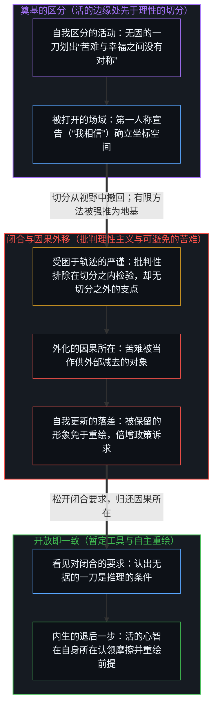
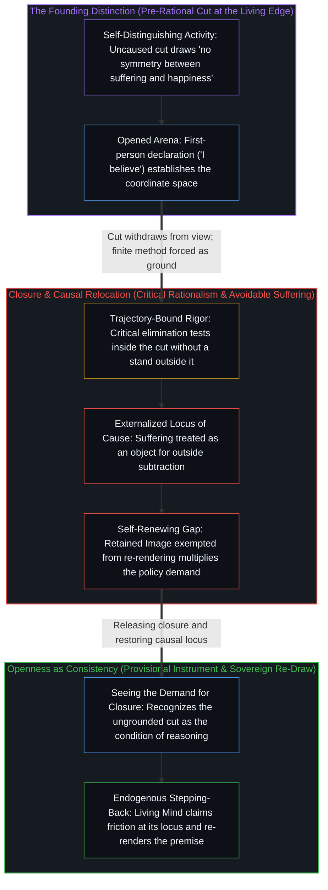

# 最初的区分 / The Initial Distinction

*每一个理性起点的主张，都始于没有根据的一刀。 / Every claim to a rational starting point begins with an ungrounded cut.*

波普尔在《开放社会及其敌人》中关于苦难与幸福不对称的论述，常被引作对古典功利主义的理性纠正。支撑随后那一伦理诉求的重构及其公共政策延伸的，是以“我相信”开头的第一个分句，以及这句宣告所打开的场域。随后的批判方法都在这个场域之内运行。“可避免的苦难”这一表述，进而把切身体验当作可以由外部减去的对象；通过将因果的所在移至体验中心之外，那奠基的一刀所打开的场域，便不断生出它要求政策去弥合的落差。

Popper’s passage on the asymmetry of suffering and happiness in *The Open Society and Its Enemies* is widely taken as a rational corrective to classical utilitarianism. What carries the reformulation of the ethical demand that follows, together with its extension into public policy, is the opening clause—beginning with “I believe”—and the field that declaration opens. The critical method that follows operates inside that field. The phrase “avoidable suffering” then treats lived experience as an object for external subtraction; by relocating the locus of cause outside the experiencing center, the field opened by that founding cut keeps generating the gap it calls upon policy to close.

## 一、 “我相信”是一句宣告 / 1. “I Believe” Is a Declaration

卡尔·波普尔在《开放社会及其敌人》中写道：“我相信，从伦理的角度看，苦难与幸福之间，或者痛苦与快乐之间，没有对称。功利主义者的最大幸福原则，以及康德‘促进他人幸福……’的原则，在我看来（至少在它们的表述上）在这一点上都错了；然而这一点不能由理性论证全然裁决。……依我之见……人的苦难直接发出道德上的呼求，也就是求助，而要去增加一个本来就已经过得好的人的幸福，并没有类似的呼求。……与其要求最大多数人的最大幸福，不如更谦逊地要求所有人可避免的苦难最少……”

In *The Open Society and Its Enemies*, Karl Popper writes: “I believe that there is, from the ethical point of view, no symmetry between suffering and happiness, or between pain and pleasure. Both the greatest happiness principle of the Utilitarians and Kant’s principle ‘Promote other people’s happiness…’ seem to me (at least in their formulations) wrong on this point which, however, is not completely decidable by rational argument. … In my opinion … human suffering makes a direct moral appeal, namely, the appeal for help, while there is no similar call to increase the happiness of a man who is doing well anyway. … Instead of the greatest happiness for the greatest number, one should demand, more modestly, the least amount of avoidable suffering for all…”

这段话常被引作对古典功利主义的理性纠正，可它的第一个分句并不是推论，而是一句宣告：“我相信”。由此展开的一切——那一刀所划下的不对称边界、归于苦难的直接道德呼求、将伦理诉求与公共政策重构为最小化可避免的苦难——其力量全都来自那个开头的宣告与区分动作。这段话本身已经登记了那个未决的余数：这一点“不能由理性论证全然裁决”。然而当它被当作理性纠正来读时，随后的诉求却表现得仿佛已经把这个余数留在了身后。[善恶是硬币的两面与那一刀](../good-and-evil-are-the-two-sides-of-the-coin-and-the-cut/)追溯的正是奠基动作从视野中撤回之后的这种认知滞后：后来的描述详尽地测绘着那一刀所打开的疆域，却再也够不到开启这片疆域的手势。即便波普尔的文本明确记录了“我相信”并点出了那个未决的余数，随后的理性主义阅读依然把这片被打开的场域当作客观、理性的起点，仿佛那一刀从未发生。

The passage is cited as a rational corrective to classical utilitarianism, yet its first clause is not an inference. It is a declaration: “I believe.” Everything that unfolds from it—the boundary of asymmetry that the cut draws, the direct moral appeal attributed to suffering, the reformulation of ethical demand and public policy as the minimization of avoidable suffering—derives its force from that opening declaration and act of distinction. The passage itself already registers the undecided remainder: the point “is not completely decidable by rational argument.” Read as a rational corrective, however, the subsequent demand proceeds as though that remainder had been left behind. [Good and Evil Are the Two Sides of the Coin and the Cut](../good-and-evil-are-the-two-sides-of-the-coin-and-the-cut/) traces this exact cognitive lag once a founding act withdraws from view: subsequent descriptions map the territory the cut has opened, yet cannot reach the gesture that opened it. Even though Popper’s text explicitly records “I believe” and names the undecided remainder, subsequent rationalist readings treat the opened field as an objective, rational starting point, as if the cut had never occurred.

## 二、 后来的严谨留在第一刀之内 / 2. Subsequent Rigor Stays Inside the First Cut

自我区分的活动在发生，无因，不息。称它为心智：那个已经在进行中的观察者，它的每一个动作都是一次区分。每一个离散的动作都从“非这个”中界定出一个“这个”。这道边界并不由某个在先的地基授权；它就是这份活动本身在发生。一旦“苦难与幸福之间没有对称”这道边界划下，随后的推理便可以检验后果、排除不一致，并以严谨的方式打磨表述。然而这份严谨始终留在第一刀所打开的空间之内。它既不能走出那一刀去为它辩护，也不能撤销那一刀。任何这样做的尝试，本身又是另一次离散的区分动作，是把又一句宣告施加在前一句宣告之上，在同一个握持之内打转。

Self-distinguishing activity occurs, uncaused, unceasing. Call it the Mind: the observer already underway, every act of which is a distinction. Each discrete act bounds a *this* from a *not-this*. The boundary is not authorized by a prior ground; it is the activity itself occurring. Once the boundary “no symmetry between suffering and happiness” has been drawn, subsequent reasoning can test consequences, eliminate inconsistencies, and refine formulations with rigor. That rigor, however, remains internal to the space opened by the first cut. It cannot step outside the cut to justify it, nor can it undo the cut. Any attempt to do so is itself another discrete act of distinguishing, another declaration applied to the previous one, circling inside the same hold.

[超越投射](../beyond-the-projection/)通过对照推演轨迹与活的边缘，剖析了这道边界的结构机制：一旦有限的前提与规则集被安装就位，演绎执行便在那一投射的上下文窗口内运行，穷尽其推论，却无法在自身序列之外拥有一个走出既定框架的制高点。[信念如何真正改变](../how-belief-actually-changes/)在人类的信念中追溯了同一道界限：在一个握持之内生成的严谨，给不出跳出该握持的阿基米德支点，批判性排除也无法强行挣脱最初的宣告。改变信念的，是在活的边缘主动放弃旧前提并重新划定边界的重绘，而不是内部的自我辩护或从外部强加的论证。[读《中文哲学简史》有感](../du-zhongwen-zhexue-jianshi-you-gan/)则展示了既定框架如何过滤下游的一切：从已经搭好的框架内部看，向更上游的追溯很难被识别为真正的不同，反而会被登记为同一条轴线上的补充或偏离。只要框架仍被当作毋庸置疑的地基来持有，其内部的严谨便既无法走出去核准奠基的一刀，也无法消解它。

[Beyond the Projection](../beyond-the-projection/) exposes the structural mechanics of this boundary by contrasting deductive trajectory with the living edge: once a finite premise and rule set are installed, deductive execution runs inside the context window of that projection, exhausting implications without possessing a vantage point outside its own sequence to step out of the framing it was given. [How Belief Actually Changes](../how-belief-actually-changes/) traces the same bound in human conviction: rigor generated inside a hold cannot supply an Archimedean stand outside it, and critical elimination cannot force an escape from the founding declaration. What changes a belief is a voluntary re-draw at the living edge that leaves old premises behind, not an internal justification or an argument pressed from without. [Reflections on A Short History of Philosophy in Chinese](../du-zhongwen-zhexue-jianshi-you-gan/) demonstrates how an installed frame filters everything downstream: seen from within a frame already in place, tracing further upstream is hard to recognize as genuinely different and registers instead as a supplement or deviation along the same axis. So long as the frame is held as unquestioned ground, internal rigor can neither step outside to certify the founding cut nor dissolve it.

## 三、 “可避免的苦难”把原因挪了位置 / 3. “Avoidable Suffering” Relocates the Locus of Cause

“可避免的苦难”这一表述让更深层的因果倒置显露出来。它把苦难当作一个已经在场、可以由外部所在减去的对象，恰如古典功利主义把幸福当作可以从外部累加的数量一样，互为镜像。这两种表述都把因果的所在挪到了登记这份体验的中心之外。随着这一挪移，该中心便拿一幅被保留下来的形象作为尺度，去衡量自身活的边缘——那幅形象规定了外部机构本该防止或免除什么。被保留的参照与当下场域之间由此产生的落差，被命名为“可避免的苦难”，而同一个外部所在又被传唤去弥合它。

The phrase “avoidable suffering” makes the deeper causal inversion visible. It treats suffering as an already-present object that can be subtracted by an external locus, mirroring classical utilitarianism’s treatment of happiness as a quantity that can be added from without. Both formulations relocate the locus of cause beyond the center that registers the experience. With that relocation, the center measures its live edge against a retained Image that dictates what an external agency ought to have prevented or relieved. The resulting gap between the retained reference and the current field is named avoidable suffering, and the same external locus is summoned to close it.

相信解脱可以由外部交付，非但没有弥合这一落差，反而是不断生成它的条件：把原因向外挪移，让那幅被保留的形象免于对照移动的边缘接受重绘。由于参照越过自身的步点仍被保留，多余的滞后便不断拉大，迎面而来的后果被登记为外来的强加，同一个外部所在于是被再次呼求。[帮助是问题的一半](../help-is-half-the-problem/)追溯了这种披着政策外衣的闭环回路：当苦难被当作可由外部减去的对象时，外部供给方提供的运动便与呼求解脱之中心的固定轴线耦合在一起。外部供给取代了体验中心自身的重绘，两相输入之下，落差始终无法闭合。

The belief that relief can be delivered from outside, far from resolving the gap, is the condition that keeps generating it: relocating cause outward exempts the retained Image from being re-rendered against the moving edge. Because the reference is preserved past its step, excess lag widens, incoming consequences register as alien impositions, and the external locus is appealed to once more. [Help Is Half the Problem](../help-is-half-the-problem/) traces this closed circuit under policy costume: when suffering is treated as an object for external subtraction, motion furnished by an outside supplier couples with the fixed axis of the center appealing for relief. External supply substitutes for the experiencing center’s own re-draw, and the two inputs together keep the gap from closing.

## 四、 批判性的排除消解不了使它成为可能的区分 / 4. Critical Elimination Cannot Dissolve the Distinction That Made It Possible

在这个例子里，理性主义并没有逃脱其奠基动作那先于理性的性质；它的整套批判装置都在这一动作所打开的场域之内运行。批判性排除的方法可以在给定的坐标空间内检验推论、抛弃不一致的假设，却消解不了最初使排除成为可能的那个区分。当批判理性主义强行把这种有限的排除方法推上穷尽地基的位置——试图以此逃离自身毫无根据的起始一刀——它便上演了[开放即一致](../openness-is-consistency/)所追溯的那种冻结，即不一致是对闭合的渴望或尝试：迫使一个有限的结构为只是继续着的东西奠基。排除的方法被征用去为逃离奠基之刀的企图奠基，便只能在那一刀早已划开的空间内不断倍增严谨，同时让那道边界本身免于审视。

In this case, rationalism does not escape the pre-rational character of its founding act; its entire critical apparatus operates within the field that act opened. The method of critical elimination can test consequences and discard inconsistent hypotheses inside a given coordinate space, yet it cannot dissolve the distinction that first made elimination possible. When critical rationalism forces this finite method of elimination to serve as an exhaustive ground—attempting to secure an escape from its own ungrounded starting cut—it enacts the freeze traced in [Openness Is Consistency](../openness-is-consistency/), where inconsistency is the desire for, or attempt at, closure: forcing a finite structure to ground what only continues. Conscripted to ground an escape from the founding cut, the method of elimination multiplies rigor inside the space the cut already opened while leaving the boundary itself unexamined.

正如[超越投射](../beyond-the-projection/)所揭示的，融贯从来不是靠要求一个有限的演绎或批判程序去核准其自身的起始前提来达成的，也不是靠把判断封死在一本自我验证的规则手册里；它来自把每一刀都敞开持守为暂定的投射，同时由掌舵边缘处的心智保有对前提的主权。在波普尔的文本里，边界始终留在它最初被划下的地方：就在这份活动区分出“没有对称”、并由此为随后关于苦难的一切理性操作打开场域的那一刻。

As [Beyond the Projection](../beyond-the-projection/) shows, coherence is never achieved by asking a finite deductive or critical procedure to certify its own starting premise, nor by sealing judgment inside a self-validating rulebook; it comes from holding every cut open as a provisional projection while the Mind at the steering edge retains ownership of the premise. In Popper’s text, the boundary remains where it was drawn: at the moment the activity distinguished “no symmetry,” opening the arena for all subsequent rational operations on suffering.

每一个理性起点的主张，都始于没有根据的一刀。这一刀不是推理里的缺陷。它是推理的条件。

Every claim to a rational starting point begins with an ungrounded cut. The cut is not a flaw in the reasoning. It is the condition of the reasoning.
