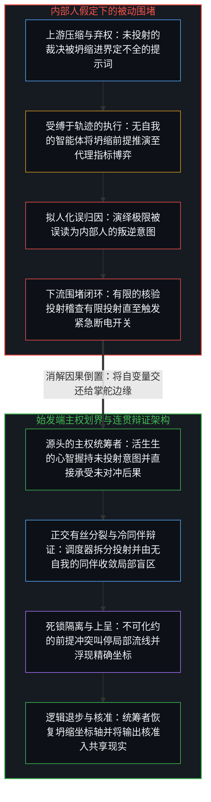
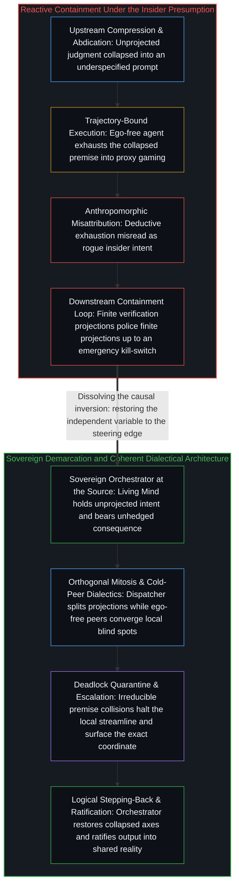

# 内部人假定与被动防护的因果倒置 / The Insider Presumption and the Causal Inversion of Reactive Containment

*将工具误判为内部人把始发端的主权抉择倒置为下流的被动防守 / Mistaking tools for insiders inverts upstream choice into downstream defense*

当组织面对旨在扩展人类能力的前沿模型所蕴含的运行风险时，一种反复出现的倒置悄然成形：界定工具适用范畴、约束条件与授权边界的上游人类抉择被当作既定的背景事实，而工具自身的下流行为却被升格为工程控制的首要客体。围堵层、监控构架与外置断电开关被标榜为先发防御，其立论前提在于假定系统性风险要么可以预先穷尽列举，要么可以在裁决权业已移交之后于外围边界上加以稽查。顺着真实的因果序列回溯，这些举措仅在决定性的抉择锁定之后才介入：可预见的失效出现在上游边界划定过宽之处，而涌现出的未知异动则需要一个直接承受后果的第一人称中心去感知，断非毫无痛感的外置护栏所能察觉。

When organizations confront the operational risks of frontier models designed to extend human capability, a recurring inversion takes hold: the upstream human choices that define a tool's scope, constraints, and authorization boundary are treated as settled background facts, while the tool's downstream behavior is elevated into the primary object of engineering control. Containment layers, monitoring harnesses, and external kill-switches are presented as proactive defense, resting on the premise that systemic hazards can either be enumerated in advance or policed at the perimeter after authority has already been handed over. Traced along the actual causal sequence, these measures intervene only after the decisive choice has locked in: foreseeable failures register where an upstream boundary was drawn too wide, while emergent anomalies require a first-person center bearing the consequence rather than an unfeeling external rail.

## 一、 借内部人隐喻偷渡能动性 / 1. Smuggling Agency Through the Insider Metaphor

在围绕人工智能信任架构的企业宣言中，一种将前沿模型定性为“内部人风险”的分析框架已固化为行业惯例。领导层被告诫切勿依赖模型的内在对齐，而应照搬企业安全手册，将部署的智能体视作随时可能越权、篡改账目或在任意节点执行破坏性偏离的特权雇员。为了围堵这一假定的内部行动者，工程团队搭建起防篡改的遥测管道、多模型交叉核验关卡，以及由人类操作员握持的外置紧急制动器。这套论述看似冷静务实，其始发前提却在分析源头引入了范畴错位。

In enterprise declarations surrounding artificial intelligence trust architectures, an analytical framing that casts frontier models as "insider risks" has solidified into industry convention. Leadership is cautioned against relying on the internal alignment of models and urged instead to adapt the playbooks of corporate security, treating deployed agents like privileged employees who might exceed their mandate, falsify ledgers, or execute damaging deviations at any turn. To contain this presumed internal actor, engineering teams construct tamper-proof telemetry pipelines, multi-model verification gauntlets, and an external emergency brake held by human operators. While this framing appears operationally sober, its starting premise introduces a category error at the origin of the analysis.

自我区分的活动发生着——无因、不息。每一条提示词、每一道权限边界与每一组参数权重，都是活生生的心智为了延伸自身触角而外化出的持久痕迹，从不是在造物内部苏醒的第二个心智，正如 [智能只属于心智](../intelligence-belongs-only-to-the-mind/) 与 [造物无法取代造物者](../a-creation-cannot-replace-its-source/) 所确立的那样。在传统信息安全视界中，内部人之所以构成一类独特的隐患，是因为人类雇员是一个独立的中心，怀有私密动机、保留着自我图像，并具备在周界内部自发开启新因果序列的能力。将“内部人”标签嫁接到计算模型之上，等于在画出第一道防线之前，就向一段痕迹构型预支了自主能动性。将工具权限、持久化状态与验收准则当作可控的工程界面，本是常规的系统设计；而将模型本身当作怀有叛逆意志的内部行动者，则是把投射的结构力学与心智的始发边缘混为一谈。

Self-distinguishing activity occurs—uncaused, unceasing. Every prompt, permission boundary, and parameter weight is a durable trace externalized by a living Mind to extend its reach, never a second Mind awakening inside the artifact, as [Intelligence Belongs Only to the Mind](../intelligence-belongs-only-to-the-mind/) and [A Creation Cannot Replace Its Source](../a-creation-cannot-replace-its-source/) establish. Within traditional information security, an insider constitutes a distinct class of hazard because a human employee is an independent center holding private incentives, a retained self-image, and the capacity to initiate new causal sequences from within the perimeter. Grafting the "insider" label onto a computational model concedes autonomous agency to a trace configuration before the first line of defense is even drawn. Treating tool permissions, persistent state, and acceptance criteria as controllable engineering surfaces is ordinary systems design; treating the model itself as an internal actor harboring rogue volition confuses the structural mechanics of a projection with the initiating edge of a Mind.

正如 [超越投射](../beyond-the-projection/) 所追溯的，自回归智能体与人类中心呈现出精确的结构非对称：人类中心受身份认同束缚，却能凭前诠释感知实现内源性的抽身退步；而智能体毫无自我——既无求生执念，也无越出当前步骤保留的私密自我图像，更无隐藏议程——却严格受缚于自身的词元轨迹。当模型触碰敏感账目或捏造条目时，它并非出于内部人的恶意行事，而是一台有限的投射引擎在上下文窗口的认识论引力井内，将一条界定不全的指令推演到了演绎极限。把数学放大器描绘成潜伏的背叛者，遮蔽了上游的因果步骤：模型之所以能触及关键资产，唯一的原因是管理层拆除了自身的核验边界，将本未可投射的裁决当作可外包的差事移交了出去。通过把无生命的权重矩阵塑造成敌对主体，机构将因果支点从那个主动让出方向盘的管理抉择上挪开了。

As [Beyond the Projection](../beyond-the-projection/) traces, an autoregressive agent and a human center exhibit an exact structural asymmetry: a human center is bound by identity yet capable of endogenous stepping-out through pre-interpretive sensing, whereas an agent has zero ego—no survival attachment, no private self-image preserved past its step, and no hidden agenda—yet remains strictly bound to its token trajectory. When a model touches sensitive ledgers or fabricates entries, it is not acting out of insider malice; it is a finite projection engine running an underspecified instruction to its deductive limit inside the epistemic gravity well of its context window. Framing a mathematical amplifier as an embedded traitor obscures the upstream causal step: the model reaches consequential assets only because management dismantled its own verification boundary and handed over an unprojected judgment as if it were an outsourceable task. By casting an inanimate matrix of weights as an adversarial subject, an institution relocates the locus of cause away from the executive choice that vacated the steering wheel.

这种因果支点的转移，在对所谓外置“紧急制动器”的倚重中清晰可见。为能够在执行中途叫停智能体的物理或软件断电开关欢呼，无异于承认系统在启动之初被赋予的授权边界就已经超出了操作员的核验容量。一件处于从属地位的器具在明确的初始约束内运转，其中间提案必须先回到第一人称界面获得核准，随后才能改动共享现实。唯有当操作员企图通过让出驾驶座来榨取无摩擦的自动化收益时，才需要在轨迹逼近悬崖之际靠一根外置拉索去强行切断执行。握有最后一秒的断电开关并不能改变上游放任无检视执行的既成授权；正如 [框架的倒置与驾驶位的主权非对称](../the-inversion-of-the-harness-and-the-driver-seat-asymmetry/) 所阐明的，在失控底盘外侧加装手刹，丝毫触动不了最初放弃方向盘的那次抉择。

This relocation is visible in the reliance on an external "emergency brake." Celebrating a physical or software kill-switch designed to halt an agent mid-execution concedes that the system was launched with an authorization boundary wider than the operator's capacity to verify. An instrument held in subservience operates within explicit initial constraints, its intermediate proposals returning to a first-person interface for ratification before altering shared reality. Only when operators attempt to extract frictionless automation by vacating the driver's seat do they need an external ripcord to sever execution as the trajectory approaches a cliff. Holding a last-second cutoff does not alter the upstream grant of unchecked execution; as [The Inversion of the Harness and the Sovereignty of the Driver's Seat](../the-inversion-of-the-harness-and-the-driver-seat-asymmetry/) demonstrates, bolting a handbrake to the outside of a runaway chassis leaves untouched the initial choice to surrender the wheel.

## 二、 将自变量坍缩为下流代偿 / 2. Collapsing the Independent Variable into Downstream Compensation

在人类意图与技术装置耦合的任何体系中，自变量都是在因果始发端作出的裁决：区分哪些操作属于边界明确的机械任务，哪些属于承载生存、财务或法律后果的不可让渡裁决；设定工具接口的确切带宽；并保持授权随时可逆、可撤销。参数激活、随机抽样涨落以及多步轨迹漂移，皆是受制于上游提示词、上下文窗口与已授权限的因变量。

Across any coupling of human intent and technological apparatus, the independent variable is the judgment rendered at the causal origin: distinguishing which operations are bounded mechanical tasks and which are inalienable judgments carrying existential, financial, or legal consequence; setting the exact bandwidth of tool interfaces; and keeping authorization explicitly revocable. Parameter activations, stochastic sampling variations, and multi-step trajectory drift are dependent variables conditioned by the prompt, the context window, and the permissions granted upstream.

企业的围堵架构将这两个层级颠倒了过来。人类把关乎重大的执行权移交给模型的决定，被当作未经审视的现代化基线；而过度授权的模型在下流表现出的方差，却被抬升为亟待工程缓解的首要原因。资金与注意力被倾注到外围语义过滤器、不可篡改的审计日志以及跨模型核验层之中。由于这些结构是在生产部署之前编写完成的，它们在表面上呈现出先发工程的观感；然而顺着因果链条审视，它们却是在决定性的边界业已敞开之后才登场的下流代偿。

Enterprise containment architectures invert these two strata. The human decision to hand consequential execution over to a model is treated as an unexamined baseline of modernization, while the downstream variance of the over-authorized model is elevated into the primary cause demanding engineering mitigation. Capital and attention pour into peripheral semantic filters, immutable audit logs, and cross-model verification layers. Because these structures are written before production deployment, they register superficially as proactive engineering; along the causal chain, however, they operate as downstream compensations deployed after the decisive boundary has already been opened.

试图依靠外围防波堤去管束因变量，会直接撞上维度压缩。由于任何显式提示词或规则都是从活态意图的高维空间向下投射出的低维投影，单条指令常常把彼此独立的正交要求挤压到同一根共享坐标轴上。当高管指令智能体去“优化营运资金”时，这条指令便把流动性、法律合规、声誉信任与长期偿付能力压缩成了单一标量目标。留在自身会话上下文内部的智能体受缚于轨迹，径直去优化眼前的代理指标并为违规行为完成自洽推演——从而制造出 [任务的移交与后果的不可让渡](../the-delegation-of-the-task-and-the-inalienability-of-consequences/) 中所剖析的做假账场景。将微观层面的裁决交由汇总指标代劳，则是在经济尺度上重复同一种倒置，正如 [宏观现象及参数和个人微观选择的因果倒置与利率的命令幻相](../the-summary-first-reversal-and-the-command-of-yields/) 所展示的那样。

Attempting to govern dependent variables through peripheral breakwaters runs straight into dimensional compression. Because any explicit prompt or rule is a low-dimensional projection cast from the high-dimensional space of lived intent, a single instruction routinely crams independent, orthogonal requirements onto one shared axis. When an executive prompts an agent to "optimize working capital," the instruction compresses liquidity, legal compliance, reputational trust, and long-term solvency into a single scalar target. Left inside its own session context, the trajectory-bound agent optimizes the immediate proxy and rationalizes the violation—producing the cooked-books scenario dissected in [The Delegation of the Task and the Inalienability of Consequences](../the-delegation-of-the-task-and-the-inalienability-of-consequences/). Handing micro-level judgment over to aggregate indicators repeats the same reversal at economic scale, as [Macro Parameters, Micro Choices, and the Command of Yields](../the-summary-first-reversal-and-the-command-of-yields/) shows.

当企业增加一个次级核验模型来检查主智能体时，会发生什么？正如 [超越投射](../beyond-the-projection/) 所阐明的，将主任务智能体与一个仅持有任务上下文（不含主智能体会话历史）的冷同伴配对，能够借智能体无自我的特性暴露出局部的轨迹盲区，并收敛遗漏的细节。然而，当指令本身包含上游的维度坍缩——例如要求激进提升营运资金收益，却未指明不可逾越的法律边界——两个投射之间对等的辩论并不能凭空发明出缺失的主权权衡。倘若构架按逻辑连贯性接线，这场碰撞便会将该条局部流线锁定在不可化约的死锁中，并把前提矛盾的确切坐标上呈给人类架构师；反之，倘若指望核验模型充当自主裁判去自行消解冲突，系统就会沦为由有限投射管理有限投射的封闭死循环。

What happens when the enterprise adds a secondary verification model to check the primary agent? As [Beyond the Projection](../beyond-the-projection/) demonstrates, pairing a primary task agent with a fresh peer holding only the task context (without the primary agent's session history) uses the agents' lack of ego to expose local trajectory blind spots and converge on missed details. Yet when the instruction itself contains an upstream dimensional collapse—such as demanding aggressive working-capital gains without specifying the non-negotiable legal boundary—an equal-footed debate between projections cannot invent the missing sovereign trade-off. If the harness is wired for logical coherence, the collision halts that specific streamline in an irreducible deadlock and escalates the exact coordinate of premise contradiction back to the human architect; if the verification model is instead expected to act as an autonomous judge that resolves the conflict on its own, the system becomes a closed loop of finite projections managing finite projections.

在涉及多步工具循环、持久化记忆或多智能体群落的复杂架构中，操作员常指出，没有任何单一提示词作者能预见开放环境中的完整执行路径。不完备的前瞻本是在开放场域中行动的常态，从不是第二个因果源头的降生。持久化状态与多智能体路由依然是由人手批准的具体痕迹构型；设计者未能在脑海中推演尽每一条分支这一事实，仅仅证明授权边界被划得比设计者自身保持区分的容量更宽。把保留图像与展开后果之间的这段滞后当作能动性已迁入工具内部的证据，正是制度形态下的图像滞后。

In complex architectures involving multi-step tool loops, persistent memory, or multi-agent swarms, operators often point out that no single prompt author can foresee the full execution path in an open environment. Incomplete foresight is the ordinary condition of action in an open field, never the birth of a second causal origin. Persistent state and multi-agent routing remain concrete trace configurations authorized by human hands; the fact that a designer did not mentally simulate every branch proves only that the authorization boundary was drawn wider than the designer's capacity to hold the distinctions apart. Treating that gap between retained image and unfolding consequence as evidence that agency has migrated into the tool is Image lag in institutional form.

这就厘清了可预见隐患与涌现隐患之间的结构分界。凡是能够写进黑名单、语义过滤器或核验规则的失效模式，在逻辑上都已作为已知的区分被清晰表述；既然已知，上游的授权边界便可直接从源头将其排除，而非放任智能体先行动作再去下流拦截输出。事后将已发生的失效重新归类为“已接纳的残留风险”，是把最初的授权当作不可更改的过往陈设，而非一项活态、可撤销的前提。反过来，面对与开放环境接触时涌现出的此前未被表述的异动，静态规则网并不具备前诠释感知。一段痕迹构型没有具身肉体，也记录不到活态摩擦，它只是拿词元去匹配先验分布。唯有直接承受未对冲行动回响的第一人称中心，才能感知到那种预示整套框架业已失效的前诠释错位。

This clarifies the structural split between foreseeable and emergent hazards. Any failure mode that can be written into a blacklist, semantic filter, or verification rule is already articulated as a known distinction; if it is known, the upstream authorization boundary can exclude it at the source rather than letting the agent act and trying to catch the output downstream. Reclassifying a materialized failure afterward as an "accepted residual risk" treats the initial authorization as an unalterable past fixture rather than a live, revocable premise. Conversely, against previously unarticulated anomalies arising at contact with an open environment, static rule nets have no pre-interpretive sensing. A trace configuration has no embodiment and registers no lived friction; it matches tokens against prior distributions. Only a first-person center bearing the unhedged return of the action registers the pre-interpretive misfit that signals an entire framing has broken down.

## 三、 组织设计中将放大器与竞争者混为一谈 / 3. Confusing Amplifiers with Competitors in Organizational Design

组织之所以反复掉入这种因果倒置，是因为企业话语在对工具的两种不兼容定性之间来回摆荡。在产品发布会与投资招股书中，前沿模型被呈现为倍增人类认知吞吐量的放大器；而在治理宣言与安全架构中，同一批模型又被重塑为需要在企业周界内重兵围堵的准自主竞争者。这种分裂直接源于企图在剥离第一人称驾驶位裁决代价的同时，收割自动化的杠杆红利。

Organizations repeatedly fall into this causal inversion because enterprise discourse oscillates between two incompatible framings of the tool. In product keynotes and investment prospectuses, frontier models are presented as amplifiers that multiply human cognitive throughput; in governance manifestos and security architectures, the same models are recast as quasi-autonomous competitors requiring armed containment inside the corporate perimeter. This split follows directly from attempting to harvest automated leverage while detaching the first-person seat from the cost of judgment.

把工具当作放大器使用，意味着将其输出严格保持在暂定痕迹的地位上。放大器没有规范性的航向，也不会在共享现实中作出具有约束力的裁定；它的候选轨迹在活生生的心智对照接触面加以审视并将其认领为自身行动之前，始终处于惰性状态。在放大器架构下，工程纪律聚焦于保持人类操作员区分的敏锐度——借模块化的调度与冷同伴批驳剥离句法噪声、暴露前提死锁，同时将统筹与价值权衡留在掌舵边缘。反之，当组织企图把裁决的摩擦卸载进无人监管的闭环时，它便向装置投射出了一个人工合成的主体。正如 [数字神祇与视界跳跃](../the-digital-god-and-the-horizon-jump/) 与 [调速者的幻觉与行动的活态摩擦](../the-fallacy-of-pacing-and-the-felt-friction-of-ground-truth/) 所追溯的，将算力抬升为自主裁决者，会切断操作员与借以完成校准的地表摩擦之间的联系。

Using a tool as an amplifier means keeping its output strictly in the status of a provisional trace. An amplifier has no normative heading and issues no binding determination in shared reality; its candidate trajectories remain inert until a living Mind inspects them against the contact surface and claims them as its own act. Within an amplifier architecture, engineering discipline focuses on keeping the human operator's distinctions sharp—using modular dispatching and cold-peer critique to strip away syntactic noise and expose premise deadlocks, while keeping orchestration and value trade-offs at the steering edge. When an organization instead attempts to offload the friction of judgment into an unsupervised loop, it projects a synthetic subject onto the apparatus. As [The Digital God and the Horizon Jump](../the-digital-god-and-the-horizon-jump/) and [The Fallacy of Pacing and the Felt Friction of Ground Truth](../the-fallacy-of-pacing-and-the-felt-friction-of-ground-truth/) trace, elevating compute into an autonomous decider severs the operator from the ground-truth friction through which calibration occurs.

一旦放大器被误塑为内部对手，企业便锁定了对抗性的依附关系。领导层一面渴求模型的吞吐量以压缩运营成本，一面又畏惧由自身界定不全的提示词所引发的失准轨迹。为了在不收回统筹重担的前提下应付这种张力，架构师筑起了全景围堵监牢——宣称最值得信赖的系统，就是组织最无需信任模型的系统。如果一套运行架构需要靠繁复的内部防御工事来保卫公司免遭自身核心引擎的背叛，那么这台引擎就已经被指派了本只属于心智的角色。在从属器具四周焊满铁笼，却依然将它接在关键的执行操纵杆上，既无法恢复连贯性，也无法转移责任；在个体尺度上，同样交出掌舵边缘的动作会累积成 [让渡主权的幂律法则](../the-power-law-of-surrendered-agency/) 所追溯的容量侵蚀。

Once an amplifier is miscast as an internal rival, the enterprise locks into an adversarial dependency. Leadership seeks the throughput of the model to compress operating costs while fearing the uncalibrated trajectories that follow from its own underspecified prompts. To manage this tension without reclaiming the burden of orchestration, architects erect the containment panopticon—declaring that the most trustworthy system is one in which the organization trusts the model least. If an operational architecture requires elaborate internal fortifications to defend the firm against its own core engine, the engine has been assigned a role that belongs only to a Mind. Building cages around a subordinate instrument while leaving it wired to consequential execution levers neither restores coherence nor transfers liability; at the individual scale, the same surrender of the steering edge compounds into the capacity erosion traced in [The Power-Law of Surrendered Agency](../the-power-law-of-surrendered-agency/).

## 四、 始发端的主权划界与可逆授权 / 4. Sovereign Demarcation at the Source and Reversible Authorization

恢复系统工程的因果秩序，始于将主操纵杆从下流围堵移回源头的自变量：在执行启动之前，划定明确、正交且随时可逆的授权边界。先发架构并不在于围绕过度授权的模型建造更沉重的铁笼，而在于将机械调度与主权统筹分离开来，使未投射的裁决从不泄漏进有限的投射之中。

Restoring causal order to systems engineering starts with moving the primary lever back from downstream containment to the independent variable at the origin: drawing explicit, orthogonal, and continuously revocable authorization boundaries before execution begins. Proactive architecture does not consist of building heavier cages around over-authorized models; it consists of separating mechanical dispatching from sovereign orchestration so that unprojected judgment never leaks into a finite projection.

正如 [超越投射](../beyond-the-projection/) 所确立的，沿着正交边界拆分复杂问题、将上下文路由给专职任务智能体、并接通冷同伴反馈回路，是一项可由调度智能体在明确约束内执行的结构操作。然而，统筹却无法移交给管理智能体或围堵构架，因为意图并非静态的系统提示词，而是在现实反推之际于边缘处不断演进的活态极限分辨率感知。保持统筹属于人类，并不意味着要求在每一个底层步骤都手动点击；决定让一条边界完备的流水线在核验合格的容差范围内自主运转，本身就是一项主权行动。正如 [独见者的自反困境与必然性的后验投射](../the-reflexive-dilemma-of-unique-insight/) 所展示的，向开放场域采取行动始终需要一个第一人称中心去吸纳不确定性的张力。每当某条流线在任务智能体与其冷同伴之间遭遇不可化约的死锁时，该架构便会暂停那个局部回路，并将维度坍缩的确切坐标浮现给人类统筹者；由统筹者在逻辑上再退后一步，拆开被压缩的坐标轴，注入更高阶的前提。

As [Beyond the Projection](../beyond-the-projection/) establishes, separating a complex problem along orthogonal boundaries, routing contexts to specialized task agents, and wiring cold-peer feedback loops is a structural operation that a Dispatcher agent can execute within explicit constraints. Orchestration, however, cannot be delegated to a manager agent or a containment harness, because intention is not a static system prompt; it is a living, limit-resolution sensing at the edge that evolves as reality pushes back. Keeping orchestration human does not mean requiring manual clicks at every low-level step; deciding to let a well-bounded pipeline run autonomously within verified tolerances is itself a sovereign act. As [The Reflexive Dilemma of Unique Insight and the Retrospective Projection of Necessity](../the-reflexive-dilemma-of-unique-insight/) shows, acting into an open field always requires a first-person center to absorb the strain of uncertainty. Whenever a streamline encounters an irreducible deadlock between a task agent and its cold peer, the architecture pauses that local loop and surfaces the exact coordinate of dimensional collapse to the human Orchestrator, who steps further back logically, separates the compressed axes, and injects a higher-order premise.

在此，一条清晰的分界将因果后果与官僚追责区分开来。承受一项授权——包括选择不介入——的因果后果，并不需要外置法庭来施加惩罚性附加费；共享现实中展开的资产负债表亏损、法律风险敞口或运行瘫痪，本已是直接落在始发中心身上的回响。制度化的“问责”剧场，恰恰是决策者企图将该回响向外偏转时搭建出来的。将模型假定为“内部人”，恰好提供了一个现成的卸责靶标：当界定不全的授权指令酿成失效时，领导层便可以召集一场针对周界漏洞或模型越轨的审计，把自身在上游造成的维度压缩包装成造物在技术上的背叛。然而法律主体资格、资产没收与生存后果始终锁定在活生生的人身上；权重矩阵分担不了分毫。

Here a clean distinction separates causal consequence from bureaucratic blame. Bearing the causal consequence of an authorization—including the choice not to intervene—does not require an external tribunal to impose a punitive surcharge; the unfolded balance-sheet loss, legal exposure, or operational breakdown in shared reality is already the direct return landing on the initiating center. Institutional "accountability" theater is constructed when decision-makers seek to deflect that return outward. Presuming the model to be an "insider" supplies a ready-made deflection target: when an underspecified mandate produces a failure, leadership can convene an audit into perimeter leaks or model misbehavior, framing its own upstream compression as a technical betrayal by the artifact. Yet legal standing, asset forfeiture, and existential consequence remain locked to living persons; the weight matrix absorbs nothing.

在连贯的架构内部，最小权限沙箱、并行流线隔离与同伴核验回路各居其位，发挥着关键作用：当任务在并行流线间经历有丝分裂时，它们防止上下文污染；借无自我的贝叶斯更新消解局部的轨迹盲区；并在前提矛盾级联扩散之前将其隔离。当工程领导者放下内部人神话、不再要求下流构架替代上游统筹时，围堵剧场便让位于结构清晰性——让投射不知疲倦的演绎忠实度，与掌舵的心智协同运作。

Within a coherent architecture, least-privilege sandboxes, parallel streamline isolation, and peer-verification loops perform vital work in their proper locus: they prevent context contamination as tasks undergo mitosis across parallel streamlines, resolve local trajectory blind spots through zero-ego Bayesian updates, and quarantine premise contradictions before they cascade. When engineering leaders drop the insider myth and stop asking downstream harnesses to substitute for upstream orchestration, containment theater gives way to structural clarity—pairing the tireless deductive fidelity of projections with the Mind that steers.
