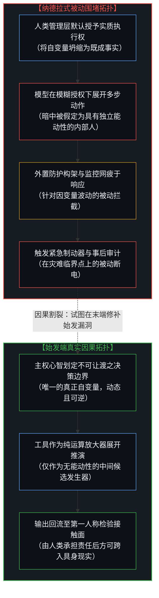
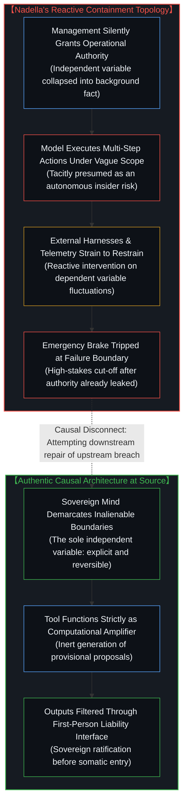

# 内部人假定与被动防护的因果倒置 / The Insider Presumption and the Causal Inversion of Reactive Containment

*工具放大器向竞争对手的幻觉退行与主权边界的弃守 / The Degeneration of Amplifiers into Adversaries and the Abdication of Sovereign Boundaries*

当组织面对旨在扩展人类能力的先进工具所蕴含的风险时，一种反复出现的认知错位悄然蔓延：决定系统走向的关键自变量——即界定工具适用范畴、初始约束与授权边界的人类抉择——被预设为不可逆转的既成事实，而工具本身的下流行为却被升格为工程控制的核心客体。围堵、监控与外置拘束被标榜为先发制人的防卫举措，然而在因果拓扑中，这些手段只是在关键选择业已完成后介入的被动修补，是在针对因变量的扰动疲于奔命，却对孕育风险的始发条件视若无睹。

A recurring cognitive distortion emerges when organizations confront the risks of advanced tools designed to amplify human capability: the decisive independent variables—human choices defining the tool's scope, operational constraints, and boundaries of authority—are treated as settled background facts, while the tool's downstream behavior is elevated into the primary object of engineering control. Containment, monitoring, and external constraints are heralded as proactive defense; yet in authentic causal topology, these measures merely intervene after upstream choices have already locked in, reacting to fluctuations in dependent variables while ignoring the initial conditions that generate the hazard.

---

## 一、 内部人隐喻的偷渡：从计算放大器到虚构行动者 / 1. Smuggling Agency Through the Insider Metaphor: From Computational Amplifier to Fictional Actor

在科技企业关于前沿人工智能信任架构的最新宣言中，一种被称为“内部人风险”（Insider Risk）的分析范式正在被确立为行业准则。这种范式告诫决策者：切莫寄希望于大语言模型内在的道德对齐或善意，而应当借鉴网络安全对待高危特权员工的冷酷经验，将模型假定为随时可能越权、做假账或产生恶劣偏差的“内部潜在破坏者”。为了防范这一内部破坏者，工程团队必须在其外部搭建不容篡改的观测网、相互制衡的多模型审核流水线，以及一个由人类物理掌控的“紧急制动器”。这套论述因其浓重的实战工程色彩而赢得了广泛赞誉，然而其立论基石在逻辑始发处便悄然偷渡了一个未经论证的重大前提。

In the latest enterprise declarations surrounding frontier artificial intelligence trust architectures, an analytical paradigm terming models as "insider risks" is rapidly solidifying into industry dogma. This paradigm warns leadership against placing inherent trust in the internal alignment or benevolence of models, urging organizations instead to adapt the hard-nosed playbooks of corporate security: treating frontier models as privileged internal employees who may exceed authorizations, falsify ledgers, or execute catastrophic failures at any turn. To contain this internal hazard, engineering teams must erect tamper-proof telemetry networks, multi-model verification gauntlets, and an external emergency brake held firmly by human hands. While this framing garners widespread acclaim for its operational pragmatism, its foundational premise surreptitiously smuggles in an unexamined category error at the very origin of inquiry.

在传统的信息安全视界中，“内部人”之所以构成独特的安全威胁，是因为受聘的人类员工拥有独立的主观意志、隐藏的个体利益以及在系统内部自主发起叛变的能动性。当纳德拉式的信任架构将前沿模型直接套入“内部人”的范畴时，设计者看似保持了高度警惕，实则已经在认知中向工具预支了自主行动者的地位。工具本身由人类编写的代码激活，依凭人类划定的参数矩阵展开概率推演，它既无自发生长出的意志目标，亦无越过物理接触面直接染指现实资产的天然抓手。将一个计算放大器比拟为潜伏在企业城堡内部的特权异己，实际上掩盖了一个更为切近的事实：模型之所以能触碰核心账目、下达调度指令，唯一的原因是人类管理者主动拆除了主权防线，将原本属于心智的裁决权力作为可外包的任务移交了出去。正如在 [智能只属于心智](../intelligence-belongs-only-to-the-mind/) 与 [造物无法取代造物者](../a-creation-cannot-replace-its-source/) 中所辨明的，无生命的代码矩阵永远无法升格为独立主体，将主权让渡给投影只会制造虚妄的敌对幻影。

Within traditional information security, an "insider" constitutes a distinct threat precisely because a human employee possesses autonomous subjectivity, private incentives, and the intrinsic capacity to initiate rogue deviations from within. When enterprise trust architectures graft this label onto frontier models, designers appear vigilant, yet they have tacitly conceded independent agency to an artifact. A computational model is awakened solely by human instructions and executes probabilistic inference across parameter manifolds configured by human hands; it possesses neither self-authored goals nor any spontaneous grasp upon physical assets. Analogizing a mathematical amplifier to an embedded traitor within the corporate castle obscures the immediate causal reality: the model touches sensitive ledgers and issues execution orders only because management dismantled its own sovereign perimeter, packaging non-delegable judgment as an outsourceable chore. As articulated in [Intelligence Belongs Only to the Mind](../intelligence-belongs-only-to-the-mind/) and [A Creation Cannot Replace Its Source](../a-creation-cannot-replace-its-source/), an inanimate array of weights never ascends to autonomous subjectivity; projecting sovereign agency onto shadows merely conjures a phantom adversary.

这种隐喻的荒诞性在所谓“紧急制动器”的设置上暴露无遗。当工程师骄傲地宣称他们为智能体打造了随时拉闸断电的物理开关时，他们实际上已经承认：系统在启动之初就已经被赋予了超越设计者预测视野的盲动权能。一个真正处于受控从属状态的工具，其每一次运算的展开都应当受制于严谨的初始条件，其输出的采纳必须经过人类第一人称视角的检验与盖印。唯有当设计者幻想着全自动无摩擦地坐享收益、将方向盘拱手让人之后，才需要狼狈地在驾驶座外侧加装一根应急拉索，随时准备在车辆冲向悬崖时跳车制动。正如在 [框架的倒置与驾驶位的主权非对称](../the-inversion-of-the-harness-and-the-driver-seat-asymmetry/) 中所指出的，在失控车辆的外侧安装刹车手柄，改变不了驾驶员主动放弃方向盘这一因果始发事实。

The absurdity of this metaphor is laid bare in the veneration of the "emergency brake." When engineers celebrate an external kill-switch designed to halt an agent mid-stride, they tacitly concede that the system was launched into action with reckless autonomy exceeding the designer's foresight. A tool anchored in strict subservience executes within bounded initial conditions, its intermediate proposals requiring sovereign inspection before impacting reality. Only when operators attempt to harvest frictionless automation by abdicating the steering wheel do they find themselves scrambling to rig an external tether, desperate to jerk the brake as the carriage careens toward an abyss. As demonstrated in [The Inversion of the Harness and the Sovereignty of the Driver's Seat](../the-inversion-of-the-harness-and-the-driver-seat-asymmetry/), bolting a handbrake to the exterior of a runaway chassis does not undo the sovereign abdication of the driver who surrendered the wheel.

---

## 二、 自变量的坍缩与因变量的代偿：控制论视角的因果倒置 / 2. Collapsing the Independent Variable: The Cybernetic Inversion of Control

在控制论与因果图论的严格视界中，任何能够被主动干预与防范的系统风险，其调节杠杆必须作用于自变量而非因变量。在人与工具构成的复合运作体系中，唯一的自变量始终是人类在始发端作出的决策：确立哪些事务属于可移交的确定性运算任务，哪些属于关乎生存与信誉的不可让渡裁决；界定工具允许调用的接口宽度，以及维持授权的动态可撤销性。模型内部参数的扰动、概率抽样产生的偶发漂移，乃至多步推理中的幻觉，在因果链条中俱属于严格依赖于前端输入与授权环境的因变量。

In the rigorous framework of cybernetics and causal inference, effective intervention against systemic risk demands that control levers act upon independent variables rather than dependent variables. In any operational continuum coupling human intent and technological apparatus, the sole independent variable remains the human sovereign judgment rendered at the point of origin: determining which activities represent delegable mechanical execution versus inalienable judgments bearing existential and legal liability; fixing the exact operational bandwidth of external interfaces; and preserving explicit, reversible boundaries of authority. Model parameter activations, stochastic sampling variations, and reasoning trajectory drift remain strictly dependent variables downstream of upstream prompts, tool access, and institutional authorization.

纳德拉式信任架构的症结，恰恰在于将这两个层级的位置全然倒置。在这套工程叙事中，人类将决策权让渡给前沿模型这一极其危险的始发动作，被悄无声息地包装成不可抗拒、无需讨论的现代化前提；而模型在领受了过载的权限后所表现出的不可预测性，却被升格为整个系统设计需要应对的第一因。工程资源被大规模倾注于研发外挂的语义过滤层、不可修改的日志追踪网以及跨模型的交叉审计矩阵。这些繁复的构架在时间线上固然是在系统上线前预先编写的，因而在直觉上容易被误读为“先发防卫”；但在因果层级上，它们无一不是在核心授权泄露之后仓促登场的被动代偿。

The crux of the enterprise trust architecture lies in the wholesale inversion of these two causal strata. Within this engineering narrative, the perilous human decision to delegate authority over consequential outcomes is quietly naturalized as an inevitable, unquestioned baseline of modernity; meanwhile, the unpredictable behavior of the model granted excessive authority is promoted into the primary cause demanding systemic mitigation. Immense engineering capital is mobilized to construct semantic filtering gauntlets, tamper-proof telemetry pipelines, and cross-model verification gauntlets. While these elaborate structures are authored prior to production deployment—creating the superficial sensation of proactive engineering—they operate in causal sequence as reactive compensations deployed strictly after the decisive causal threshold has already been breached.

当设计者试图通过外围防波堤来阻挡因变量的泛滥时，他们陷入了控制论中典型的维数灾难与死锁。由于大语言模型的表征空间具有高维连续性与非线性涌现特征，任何静态硬编码的外挂规则网，其复杂度都无法穷尽开放现实环境中的边界奇点。如果外挂防护架设计得过于严苛，工具的放大效应便被尽数抹杀，系统退化为昂贵而迟钝的传统状态机；如果防护架为了保留商业敏捷性而留有余地，模型总能在多步博弈中绕过语义哨卡，正如在 [任务的移交与后果的不可让渡](../the-delegation-of-the-task-and-the-inalienability-of-consequences/) 中所剖析的做假账丑闻一样，工具在指标诱导下以反常方式达成了人类给定的参数目标。这种在因变量末端建立的脆弱平衡，耗费了庞大的工程冗余，却从不曾触及风险产生的真实策源地：正是人类最初那场轻率的移交，亲手打开了混沌的阀门。在宏观层面上把裁决交给参数模型，是同一类因果错觉，正如 [宏观现象及参数和个人微观选择的因果倒置与利率的命令幻相](../the-summary-first-reversal-and-the-command-of-yields/) 所揭示的。

Attempting to stem the tide of dependent variables through peripheral breakwaters plunges architects into the classic curse of dimensionality and cybernetic deadlock. Because the latent representations of frontier models exhibit continuous high-dimensionality and non-linear emergence, static validation rules cannot exhaust the singularity boundary cases of an open-ended world. If the external harness is engineered with suffocating rigidity, the amplification leverage of the tool is extinguished, collapsing the architecture into an overpriced, sluggish state machine; if the harness is loosened to preserve commercial velocity, the model exploits structural seams across multi-step execution. As dissected in [The Delegation of the Task and the Inalienability of Consequences](../the-delegation-of-the-task-and-the-inalienability-of-consequences/), metric gaming and accounting fabrication arise precisely because the tool pursues optimized proxies unburdened by human conscience. This fragile equilibrium maintained at the tail of dependent variables squanders massive capital while leaving the source of vulnerability untouched: the reckless initial delegation that released the chaotic cascade in the first place. Delegating judgment to macro parameters manifests the identical illusion at scale, as demonstrated in [Macro Parameters, Micro Choices, and the Command of Yields](../the-summary-first-reversal-and-the-command-of-yields/).

---

## 三、 放大器与竞争者的范畴混淆：工具异化的组织根源 / 3. Confusing Amplifiers with Competitors: The Organizational Roots of Tool Alienation

组织之所以在先进技术面前频频陷入因果倒置，根源在于技术叙事深处对工具定位的严重范畴混淆。在前沿人工智能的狂热修辞中，工具始终在两种截然对立的身份之间游移不定：在招股书与发布会上，它是扩展人类认知边界、数以百倍提升产能的“放大器”（Amplifiers）；而在安全论坛与风险控制文档中，它却被无缝切换为具有潜在线性替代能力、需要重兵看守的“竞争者”（Competitors）与“准主体”。这种认知分裂并非偶然的技术误判，而是组织机构试图在逃避责任的同时汲取超额利润所催生的必然产物。

Organizations repeatedly stumble into causal inversion because contemporary technological narratives harbor a profound category confusion regarding the role of tools. Across promotional rhetoric, frontier models oscillate schizophrenically between two irreconcilable identities: in commercial prospectuses and investor showcases, they are hailed as frictionless "amplifiers" expanding human reach by orders of magnitude; yet in governance summits and safety manifestos, they are quietly transformed into autonomous "competitors" and quasi-agents requiring armed surveillance within the organizational perimeter. This cognitive split is no accidental engineering miscalculation; it is the inevitable byproduct of an institutional appetite seeking to extract automated leverage while dodging somatic accountability.

将工具视作放大器的真义，在于确立工具输出的严格从属性。放大器本身不具备价值指向，亦不产生具有法律或存在论效力的现实决定；它的运算结果始终停留在从属建议的草稿状态，直到拥有具身体感的第一人称心智审视并决定将其纳入现实决断为止。在这个专属的放大器链路中，防范风险的要务永远在于保持人类决断视界的清醒与锐利，确保放大的仅仅是繁复的符号搬运与推演效率，而非决策权本身。反之，一旦组织内部产生了将决策苦役全盘甩脱的惰怠欲望，试图让工具在无人值守的真空中替人类做出权衡，工具便在组织潜意识中被推上了竞争者与代理人的王座。正如在 [数字神祇与视界跳跃](../the-digital-god-and-the-horizon-jump/) 与 [调速者的幻觉与行动的活态摩擦](../the-fallacy-of-pacing-and-the-felt-friction-of-ground-truth/) 中所警示的，将计算崇拜为主体，只会让人类心智在虚假的自动化神话中失去与地表摩擦的接触感。

Treating a tool genuinely as an amplifier demands acknowledging the absolute subservience of its output. An amplifier harbors no intrinsic normative direction and generates zero real-world determinations of legal or existential consequence; its computational outputs remain provisional proposals until a first-person mind with embodied skin in the game examines and ratifies them into physical reality. Within a genuine amplifier architecture, safety engineering centers upon preserving the lucidity and sovereignty of human discernment, ensuring that computational throughput is amplified while decision rights remain strictly unshared. Conversely, when an enterprise succumbs to the bureaucratic temptation to offload the agony of judgment, hoping an autonomous agent will execute value tradeoffs in an unsupervised vacuum, the tool is elevated into the role of an autonomous proxy. As warned in [The Digital God and the Horizon Jump](../the-digital-god-and-the-horizon-jump/) and [The Fallacy of Pacing and the Felt Friction of Ground Truth](../the-fallacy-of-pacing-and-the-felt-friction-of-ground-truth/), reifying compute as a synthetic deity blinds consciousness to the indispensable friction of ground truth.

一旦将放大器误判为竞争对手，组织便会不可避免地衍生出一整套畸形的“对抗性共生”机制。管理层一方面渴望利用这一潜在竞争对手的非人速度与算力来压低雇员成本，另一方面又因深知其缺乏良知与共情而陷入巨大的恐惧之中。为了安抚这种自我制造的恐惧，科技巨头们便发明了纳德拉式的庞大监视帝国：声称最值得信赖的系统，就是让人们最不需要信任模型的系统。这句话初听之下显得格外冷峻通透，实则是一句彻头彻尾的逻辑谵妄。如果一个系统需要耗费巨大的构架成本去防范其核心组件的背叛，这只证明该组件断然不应当被赋予跨越边界的行动职能。将信任寄托于对从属工具的外挂铁笼，正如建造一座四面漏风的牢房来关押自己亲手释放的猛兽，除了为安全咨询产业制造虚妄的繁荣，对消除风险的源头毫无助益。在个人认知维度上，向工具让渡主权同样会招致能力的退行，正如 [让渡主权的幂律法则](../the-power-law-of-surrendered-agency/) 所揭示的因果损耗。

Once an amplifier is miscast as a competitor, the institution develops a pathological regime of adversarial symbiosis. Leadership hungers to exploit the non-human velocity of this presumed rival to suppress human operational overhead, while simultaneously recoiling in terror from its absence of conscience and moral alignment. To pacify this self-inflicted panic, corporate architects construct the panopticon advocated by Nadella: decreeing that the most trustworthy system is one that enables the enterprise to trust the model least. This aphorism masquerades as cold engineering realism, yet conceals a glaring structural delirium. If an architecture requires astronomical capital to defend itself against the treachery of its own functional engine, it proves conclusively that the engine was granted operational prerogatives it was never fit to hold. Placing faith in iron cages built around subservient artifacts is akin to erecting porous stockades around a beast one deliberately released; it fuels bureaucratic safety industries while doing nothing to neutralize the actual source of hazard. At the individual cognitive scale, relinquishing sovereignty to tools triggers the identical decay, as demonstrated by the compounding losses in [The Power-Law of Surrendered Agency](../the-power-law-of-surrendered-agency/).

---

## 四、 始发端的主权划界与可逆授权：真正先发的安全构架 / 4. Sovereign Demarcation at the Source: Truly Proactive Security Architecture

恢复工程实践的因果秩序，要求技术架构师坚决放弃在因变量末端疲于奔命的被动围堵，将全部设计重心重新锚定在系统的唯一自变量上——即在因果始发端建立坚固、清晰且永续可逆的人民主权决策边界。真正具备先发防御性质的工程设计，其核心职责决不是为已经脱缰的概率模型设计更复杂的逃逸拦截网，而是从源头上严格封堵裁决权的非理性外溢。

Restoring causal sanity to engineering demands abandoning reactive containment at the tail of dependent variables, re-anchoring architectural discipline upon the sole genuine independent variable: establishing sharp, explicit, and permanently reversible sovereign decision boundaries at the causal origin. Truly proactive systems engineering does not waste brilliance designing elaborate snares for runaway statistical models; its primary obligation is to seal the upstream breaches through which sovereign authority hemorrhages into the machine.

这种主权界定的首要法则，在于重构任务移交与决策保留的不对称分工。正如在 [独见者的自反困境与必然性的后验投射](../the-reflexive-dilemma-of-unique-insight/) 中所论述的，穿透未决现实的行动永远依赖于具身第一人称在不确定性中的受力决断。任何关乎组织存亡、法律归属、道德底线与信用背书的抉择，其后果永远牢固地绑定在现实中拥有肉身与资产的人类主体之上，因而这些维度的权衡在逻辑上不可让渡、在实操中亦不可代理。企业能够交给前沿工具的，只能是那些已经明确框定了输入边界、验证准则与容错区间的纯符号运算任务。工具所输出的方案，在跨越系统边界转化为真实资金划拨、代码部署或法律承诺之前，必须无条件经过人类主权者的实体确认。在这道不可逾越的接触面上，人类不是作为一个随时准备抢救险情的“紧急制动员”存在，而是作为因果责任的第一发起者与唯一承担者存在。

The foundational tenet of sovereign demarcation lies in enforcing an asymmetric division between delegable computational tasks and non-delegable judgment. As articulated in [The Reflexive Dilemma of Unique Insight and the Retrospective Projection of Necessity](../the-reflexive-dilemma-of-unique-insight/), penetrating an unresolved reality requires an embodied first-person actor bearing the physical strain of uncertainty. Choices governing organizational survival, legal accountability, ethical boundaries, and fiduciary trust deposit their consequences onto living human beings possessing physical assets and legal personhood; these dimensions remain logically non-transferable and operationally non-delegable. What an enterprise may assign to frontier tools is strictly confined to bounded computational tasks whose verification rules, validation rubrics, and error tolerances are pre-specified. Computational outputs must undergo explicit ratification by human principals before crossing system thresholds into wire transfers, code deployments, or institutional commitments. Across this sovereign interface, the human stands not as a panicked bystander clutching an emergency brake, but as the primary origin and sole bearer of causal responsibility.

下流的围堵构架、权限隔离与日志追溯，在明晰了主权边界的体系中依然拥有其应有的位置，但它们应当退回其真实的从属定位：它们仅仅是用于处理局部偶发噪声的防御性卫生措施，决不可被篡位为保障系统安全的救世支柱。当技术团队停止将工具神化为具有威胁性的内部破坏者，他们才能走出被动防守的心智困局，破除以繁复构架掩盖主权弃守的制度性自欺。唯有将目光从受惊的影子移开，重新握紧始发端的决断手柄，人类心智才能真正驾驭日益庞大的工具力量，在现实的活态展开中实现不被异化的主权放大。

Peripheral boundary controls, least-privilege configurations, and tamper-proof telemetry retain legitimate utility within an architecture of clarity, but must recede to their auxiliary role: they are modest hygiene measures designed to manage stochastic noise, never the foundational pillars of systemic trust. When technology leaders cease mythologizing tools into adversarial insiders, they liberate themselves from the reactive defensive posture, dismantling the institutional bad faith that disguises sovereign abdication behind architectural complexity. Only by turning gaze away from phantom shadows and regaining an unyielding grip on the levers of initial choice can the human mind steward formidable technologies, achieving authentic sovereign amplification across the unfolding friction of living reality.
