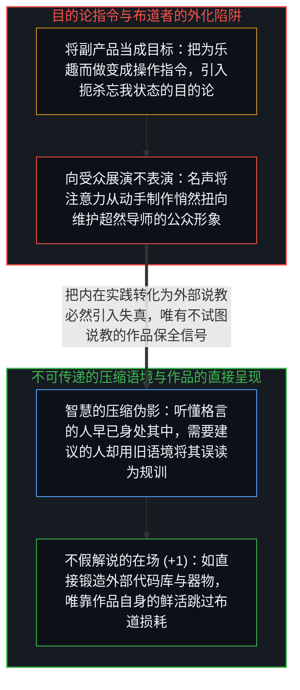
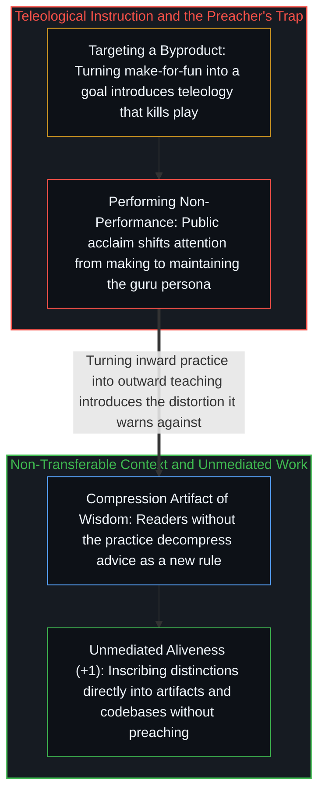

# 里克·鲁宾的奇特案例与不可瞄准的乐趣 / The Interesting Case of Rubin

*乐趣是忘我创作的副产品而非可瞄准的靶心，将其外化为法则便落入布道者悖论 / Fun is a byproduct of absorption rather than an aimable target, and preaching it externalizes the play*

里克·鲁宾劝告创作者“只为乐趣而做东西”——不为取悦任何人，不计利害，不问后果，只为自己。这是一条真诚的好建议，但它内部却嵌着一个鲁宾本人也无法逃脱的结构性矛盾；这并非因为他虚伪，而是因为这条建议所指向的状态一旦被表述为指令，就会在几何结构上否定自身。

Rick Rubin advises creators to make things solely for fun—not for an audience, without stakes or consequences, strictly for themselves. The counsel is earnest, yet it contains a contradiction Rubin cannot escape—not out of hypocrisy, but because the geometry of the advice negates itself the moment it is issued as an instruction.

## 一、 无法被瞄准的副产品与布道者的陷阱 / 1. The Byproduct That Cannot Be Aimed At and the Preacher's Trap

鲁宾所描述的那种乐趣，并不是一个可以事先立在远方去追逐的目标，而是心智与创作活动处于特定关系时自然析出的副产品——在那里，外在评判退场，动手制作本身就是全部意义。一旦把“为乐趣而创作”当成一条操作守则下达给自己，目的论便已悄然潜入：“我应当努力从这次创作中获得乐趣。”而这种把乐趣当成靶心的姿态，恰恰扼杀了乐趣赖以生发的无中介投入。人无法去追逐一道副产品，正如[框内延伸与维度跃迁](../extension-and-shift/)与[从未作为战略的副业与被观察扼杀的自发性](../the-strategy-that-wasnt/)所揭示的那样。

The fun Rubin describes is not a target one can aim at; it is a byproduct of a specific relationship to the work in which external judgment is absent and the making itself is the entire point. The moment "make things for fun" is adopted as an instruction, teleology enters—one tries to have fun, and that goal-directed posture dissolves the unmediated engagement from which the byproduct arises. A residue cannot be chased directly, as traced in [Extension and Shift](../extension-and-shift/) and [The Strategy That Wasn't](../the-strategy-that-wasnt/).

这也正是鲁宾的处境在结构上如此微妙的原因：他通过书籍、播客与访谈建立起了一个广为人知的公众身份，而这个身份的核心主题却是“创作应当摆脱外在认可”。然而，向数百万听众阐发一条关于“内在自足”的原则，这一阐发行为本身就是面向外部接收而展开的展演。一如執着于被人看见“毫不执着”的禅师，或是把“本真”经营成个人品牌的网红，当鲁宾向千万人布道“不要在乎千万人的看法”越成功，他的身份就越深地绑定在“传授这一洞见的导师”这一外部反馈回路之上（参见[自我模型维护悖论](../the-maintenance-paradox/)）。

Here Rubin's position becomes structurally revealing: he has built a public identity across books, podcasts, and interviews around the principle that creative work should remain free of external validation, yet articulating a principle to an audience is an act oriented toward reception. Like a mindfulness teacher attached to being seen as unattached, the more effectively one preaches non-performance, the more one's identity becomes mediated by the very external validation loop the teaching warns against (see [The Maintenance Paradox](../the-maintenance-paradox/)).

## 二、 压缩伪影与不假解说的鲜活作品 / 2. Compression Artifacts and Work That Speaks Without Instruction

更深一层的困境在于，这类关于存在状态的领悟在结构上是无法靠格言直接过户的。能够听懂“乐趣在于制作过程而非结果”并心领神会的人，原本就已经在以这种方式创作了，他们并不需要这条建议；而那些真正被外在评判困住、急需解脱的人，则会用自己现有的焦虑语境去解压这句话，将其听成另一条必须达标的考核指令——“我必须养成享受过程的习惯”。鲁宾将一生的创作实践压缩进了一句格言，但解压这句话恰恰需要生成这句话的那份实践语境；在消费智慧的交易里，流通的只是洞见的外壳，而非洞见所指涉的状态。

A deeper barrier is that wisdom of this kind cannot be transferred as an aphorism. Those who hear "the fun lies in the making rather than the goal" and grasp it immediately are already working in that mode and do not need the advice, whereas those who need it decompress the phrase through their existing anxious frame and hear a new obligation to optimize for enjoyment. What circulates in the economy of wisdom is the linguistic shell of the insight rather than the state that generated it.

不仅如此，布道的成功还会反向侵蚀布道者自身的创作车间：原本出于自发乐趣而分享的领悟，随着赞誉与名声的涌入，会在不经意间把“只为自己而做”偷换成“为了那个因倡导‘只为自己’而备受敬仰的自我形象而做”。尽管鲁宾在具体创作中依然比绝大多数评论者更贴近鲜活的源头，但只要把内在实践转化为向外的说教，这笔结构性损耗便无可避免。唯一不背负这笔损耗的传递，是从不试图去说教的传递——就像直接将区分与品味铸入[你的代码库即是记忆](../your-codebase-is-memory/)所揭示的外部器物与作品本身，让造物凭自身的鲜活去与相遇者共振，而不附带任何关于“应当如何制造它”的训导。

Success in communicating the insight gradually reorients the communicator's own workshop: fame feels like validation of the process, quietly shifting "only for yourself" toward "for the persona celebrated for saying only for yourself." While Rubin remains closer to the living source of making than most commentators, turning inward practice into outward instruction inevitably introduces the distortion it warns against. The only transmission exempt from that cost is the one that does not preach at all—the work itself, inscribed directly into living artifacts and externalized memory as traced in [Your Codebase Is Memory](../your-codebase-is-memory/), encountered through its own aliveness rather than an explanation of how it was made.
