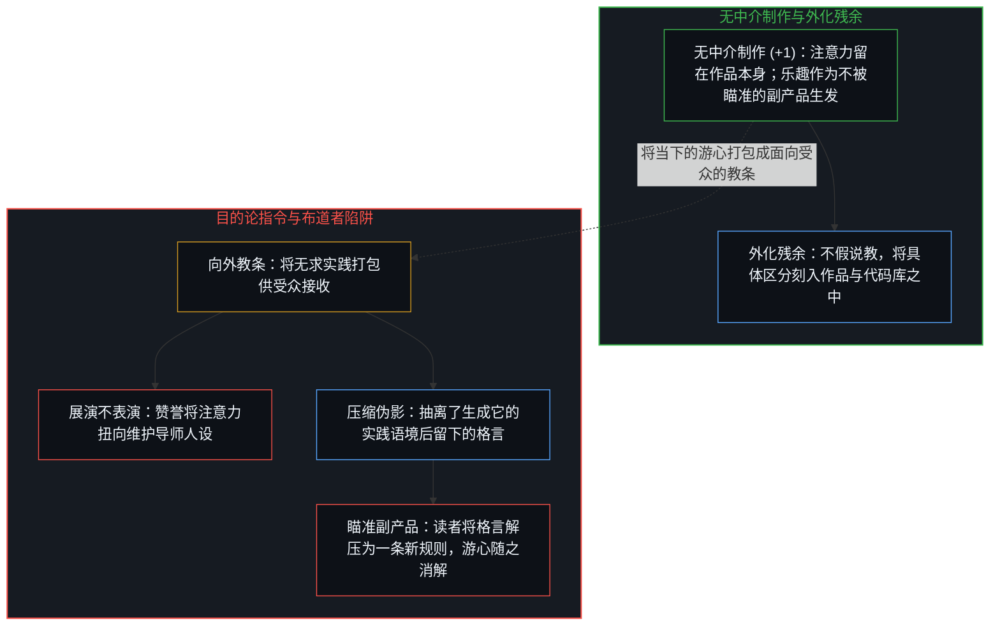
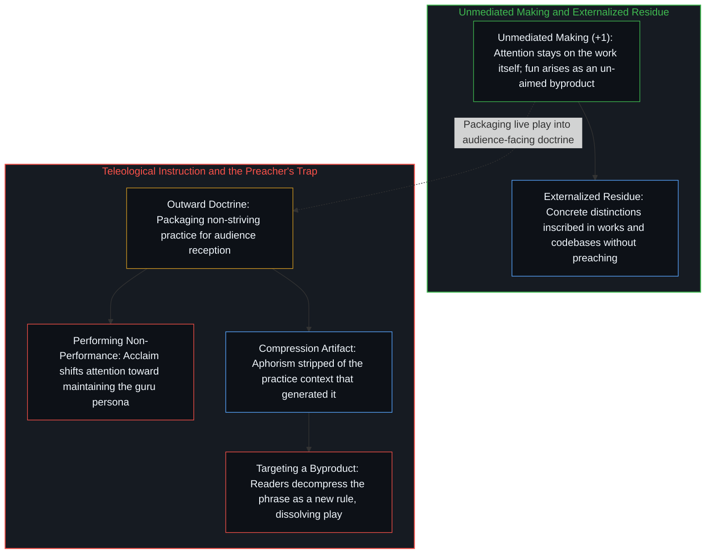

# 里克·鲁宾的奇特案例与不可瞄准的乐趣 / The Interesting Case of Rubin

*乐趣是全神沉浸的副产品而非可瞄准的靶心，拿来布道便将这份游心外化 / Fun is a byproduct of absorption rather than an aimable target, and preaching it externalizes the play*

里克·鲁宾劝告创作者只为乐趣而做东西——不为受众，不计利害，不问后果，只为自己。这番劝告固然真诚，其中却嵌着一个鲁宾本人也无法逃脱的矛盾；这并非出于虚伪，而是因为这条建议一旦作为指令发出，它在几何结构上便会自我否定。

Rick Rubin advises creators to make things solely for fun—not for an audience, without stakes or consequences, strictly for themselves. The counsel is earnest, yet it contains a contradiction Rubin cannot escape—not out of hypocrisy, but because the geometry of the advice negates itself the moment it is issued as an instruction.

## 一、 无法被瞄准的副产品与布道者的陷阱 / 1. The Byproduct That Cannot Be Aimed At and the Preacher's Trap

鲁宾所描述的那种乐趣，并不是一个可以拿来瞄准的目标，而是心智与作品处于特定关系时自然析出的副产品——在那里，外在评判退场，动手制作本身就是全部意义。一旦把“为乐趣而做”当作指令采纳下来，目的论便随即介入——人开始刻意寻求乐趣，而这种目标导向的姿态，恰恰消解了这一副产品赖以生发的无中介投入。副产品无法被直接追逐；把自发制作变成一条明文规则，只会瓦解它企图保全的那份无中介投入，正如[从未作为战略的副业与被观察扼杀的自发性](../the-strategy-that-wasnt/)所追溯的那样。

The fun Rubin describes is not a target one can aim at; it is a byproduct of a specific relationship to the work in which external judgment is absent and the making itself is the entire point. The moment "make things for fun" is adopted as an instruction, teleology enters—one tries to have fun, and that goal-directed posture dissolves the unmediated engagement from which the byproduct arises. A byproduct cannot be chased directly; turning spontaneous making into an explicit rule dissolves the unmediated engagement it aims to preserve, as traced in [The Strategy That Wasn't](../the-strategy-that-wasnt/).

到了这里，鲁宾的处境在结构上颇能说明问题：他通过书籍、播客与访谈，围绕“创作应当摆脱外在认可”这一原则建立起公众身份；然而，面向受众阐发一条原则，这个阐发本身就是朝向外部接收的行动。一如执着于被人看见“毫不执着”的正念导师，或是把“本真”拿来变现的网红，鲁宾向千万人布道“不要在乎千万人的看法”越有成效，他的身份便越深地由这套教导所警示的那条外部认可回路来中介——这正是[框内延伸与维度跃迁](../extension-and-shift/)所追溯的从建造滑向公开宣告的牵引，也是[自我模型维护悖论](../the-maintenance-paradox/)所追溯的自我形象陷阱。

Here Rubin's position becomes structurally revealing: he has built a public identity across books, podcasts, and interviews around the principle that creative work should remain free of external validation, yet articulating a principle to an audience is an act oriented toward reception. Like a mindfulness teacher attached to being seen as unattached, or an influencer monetizing authenticity, the more effectively Rubin preaches to millions not to care about millions, the more his identity becomes mediated by the very external validation loop the teaching warns against—the pull from building toward public declaration traced in [Extension and Shift](../extension-and-shift/) and the self-image trap traced in [The Maintenance Paradox](../the-maintenance-paradox/).

## 二、 压缩伪影与不附训导的作品 / 2. Compression Artifacts and Work Left Without Instruction

更深一层的障碍在于，这类智慧无法作为格言直接过户。一听见“乐趣在于制作而非目标”便立刻领会的人，原本就熟知支撑它的实践；而被结果焦虑困住的人，则会借由既有的焦虑框架去解压这句话，把它听成又一条须为获得乐趣而刻意优化的新义务。鲁宾将一生的创作实践压缩进了一句格言，但解压这句话恰恰需要生成它的那份实践语境；在消费智慧的经济里，流通的只是这份洞见的语言外壳，而非生成它的那种状态。

A deeper barrier is that wisdom of this kind cannot be transferred as an aphorism. Those who hear "the fun lies in the making rather than the goal" and grasp it immediately already know the practice that grounds it, whereas those trapped in outcome anxiety decompress the phrase through their existing anxious frame and hear a new obligation to optimize for enjoyment. Rubin compressed a lifetime of creative practice into a maxim, yet decompressing it requires the practice context that generated it; what circulates in the economy of wisdom is the linguistic shell of the insight rather than the state that generated it.

传达这份洞见一旦成功，便会逐步调转传达者自己创作车间的朝向：名声让人感觉像是对这一过程本身的印证，于是悄然将“只为自己”推向“为了那个因宣称‘只为自己’而备受赞誉的人设”。尽管鲁宾依然比绝大多数评论者更贴近制作的活水源头，但只要把内在实践转化为向外布道，便必然引入它自身所警示的失真。没有任何器物能够跨心智传递生机，也无法令相遇者免于投射——外化的作品与代码库始终只是惰性残余，正如[你的代码库即是记忆](../your-codebase-is-memory/)所追溯的那样，另一个心智只能在自身负荷之下将其重新追溯。避开布道者这种失真，靠的只是把区分直接留在作品本身，而不围绕“如何制作它”打包出一条规则，从而让制作者自身的回环没有需要捍卫的人设，留下的则是具体的结构，而非一纸空洞的药方。

Success in communicating the insight gradually reorients the communicator's own workshop: fame feels like validation of the process, quietly shifting "only for yourself" toward "for the persona celebrated for saying only for yourself." While Rubin remains closer to the living source of making than most commentators, turning inward practice into outward preaching inevitably introduces the distortion it warns against. No artifact transmits aliveness across minds or exempts an encounterer from projection—externalized works and codebases remain inert residue, as traced in [Your Codebase Is Memory](../your-codebase-is-memory/), that another Mind can only re-trace under its own load. What avoids the preacher's distortion is simply leaving distinctions in the work itself rather than packaging a rule around how to make it, keeping the maker's own loop free of a persona to defend and leaving concrete structure rather than an empty prescription.
