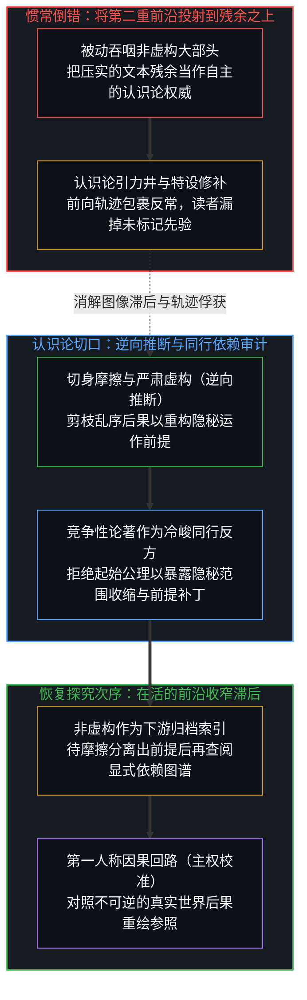
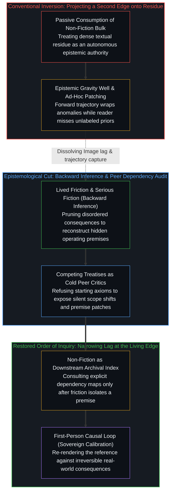

# 阅读的倒错与推断的次序 / The Inversion of Reading and the Order of Inference

*非虚构顺着既定前提推演，而虚构与切身生活从乱序后果逆向推断 / Non-fiction unrolls stated premises while fiction and life infer backward*

自我区分的活动正在发生——无因，不息。这一活动的每一个中心都是离散且有界的，在有限容量下登记区分，因而伴随必要的压缩。在有限容量之内，信息的实践困境从来不是体量庞大，而是主动筛选的松懈。人类视觉早已展示了这一机制：双眼面对不息的光流之所以不会过载，是因为注意力主动隔离出结构边界，而非以同等权重登记每一道原始信号；过载只发生在主动划界松弛之时。

Self-distinguishing activity occurs—uncaused, unceasing. Every center of this activity is discrete and bounded, registering distinctions under finite capacity and therefore under necessary compression. Within this finite capacity, the practical challenge of information has never been its sheer volume, but the laxity of active filtration. Human vision already demonstrates the mechanism: the eyes meet an unceasing stream of light without overload because attention actively isolates structural boundaries rather than registering every raw signal at equal weight; overload occurs only when that active boundary-drawing lapses.

同样的约束支配着阅读。大多数现代非虚构著作的构造方式，都是先确立一两个主导论断，再在周围搭起繁复的确证脚手架。一旦分离出作者的承重前提，后续连篇累牍的选择性论据、同义复述与局部限定，极少会改变关乎行动的判断。虚构作品与切身经验则运行在相反的约束之下：前提从不预先宣告，后果总是乱序降临。无论在叙事艺术还是日常生存中，心智必须操练的都是逆向推断——从片面且相互冲突的结果中，重构出未标记的运作先验。循着这一结构非对称性追溯，便能翻转把非虚构奉为务实效用、把虚构贬为闲暇消遣的惯常排序。

An identical constraint governs reading. Most modern non-fiction is engineered to establish one or two governing claims and surround them with extensive confirmatory scaffolding. Once an author's load-bearing premises are isolated, the subsequent pages of selective evidence, restatements, and local qualifications rarely shift actionable judgment. Fiction and lived experience operate under the reverse constraint: premises are never declared in advance, and consequences arrive out of order. What a Mind must practice across narrative art and daily survival is backward inference—reconstructing unlabeled operating priors from partial, conflicting effects. Tracing this structural asymmetry overturns the conventional ranking that crowns non-fiction as pragmatic utility and dismisses fiction as idle distraction.

## 一、 视觉滤波与非虚构的依赖图谱 / 1. Visual Filtering and the Dependency Graph of Non-Fiction

在当代公共讨论中，关于信息过载的感叹动辄把注意力匮乏归咎于外部数据的庞大体量，试图靠机械配给输入来恢复清醒。然而，正如视觉依靠聚焦选择提炼结构边缘而毫无阻滞地穿行于稠密光场，阅读的效率同样取决于心智提取结构依赖关系的能力，而非以均匀分辨率吞咽每一个句子。由于每一份书写文本都是将鲜活的区分之网压缩进线性序列的外化痕迹，[观察者的隐身与无损传递的妄念](../the-invisible-observer-and-the-delusion-of-lossless-transmission/)揭示了为何逐页追求无损吸收反而会掏空理解，而有意识的有损滤波才能保住对承重结构的保真。大多数非虚构书籍之所以篇幅膨胀，源自出版惯例对物理厚度与修辞仪式的商业要求。作者在开篇章节界定核心术语、划定适用边界并设定目标函数；余下文本无非是调集精选的历史轶事、统计图表与案例分析，沿着既定轨道维持顺延。一旦识别出那些承重前提，逐行消化后续的确证性材料，对读者自身的因果模型几乎不会带来任何改变。

Across contemporary discourse, laments over information overload routinely attribute attention scarcity to the sheer volume of external data, attempting to restore clarity by mechanically rationing inputs. Yet just as vision navigates a dense optical field by relying on focused selection to extract structural edges without friction, reading efficiency depends on a Mind's capacity to extract structural dependencies rather than absorbing every sentence at uniform resolution. Because every written text is an externalized trace that compresses a living web of distinctions into a linear sequence, [The Invisible Observer and the Delusion of Lossless Transmission](../the-invisible-observer-and-the-delusion-of-lossless-transmission/) shows why chasing lossless page-by-page absorption hollows out comprehension, whereas deliberate lossy filtration preserves fidelity to the load-bearing structure. The sheer page count of most non-fiction stems from commercial conventions demanding physical heft and rhetorical ceremony. An author defines key terms, marks scope boundaries, and stipulates an objective function in the opening chapters; the remaining text marshals curated historical anecdotes, statistical charts, and case studies to maintain continuation along that fixed rail. Once those load-bearing premises are identified, consuming the confirmatory bulk line by line yields negligible change in the reader's own causal model.

非虚构论著之间的深层分歧，极少源于演绎链条内部的形式疏漏，而是植根于初始假设的不可调和。一旦作者固定了何为有效证据、哪些变量保持恒定的初始边界，随后的论证便作为一台有限投射引擎运转。正如[超越投射](../beyond-the-projection/)在剖析受困于轨迹的系统机制时所追溯的，任何在封闭语境中展开固定前提的演绎引擎，都会生成自身的认识论引力井：受开篇定义的制约，它无法迈出自身的序列；当遇到正交的现实被压缩进单一规则的边界情形时，它便用特设补丁包裹裂痕——塞进脚注的隐秘范围收缩、暗中漂移的定义，或是替开篇前提承担超载负荷的未明言“其他条件不变”条款。

Deep disagreements between non-fiction treatises rarely stem from formal slips inside the deductive chain; they are rooted in the irreconcilability of starting assumptions. Once an author fixes initial boundaries concerning what counts as valid evidence and which variables remain held constant, the subsequent argument operates as a finite projection engine. As [Beyond the Projection](../beyond-the-projection/) traces in the mechanics of trajectory-bound systems, any deductive engine that unrolls a fixed premise inside a closed context generates its own epistemic gravity well: conditioned by its opening definitions, it cannot step outside its own sequence, and when it hits a boundary case where orthogonal realities were compressed into a single rule, it wraps the fracture in ad-hoc patches—a silent scope restriction slipped into a footnote, a shifted definition, or an unstated ceteris-paribus clause doing work the opening premise could not sustain.

孤立地阅读一部论著——无论是怀着崇敬全盘吸收，还是条件反射般逐行挑刺——都会把读者困在那条轨迹内部，或锁进受困于身份的防御之中。崇敬将注意力黏着在修辞雄辩与生动轶事上，而急于驳倒的冲动则让人留在作者自己的坐标系里争夺局部措辞。引入一部从起点就拒绝其基础前提的竞争性论著，便能作为冷峻的同行反方打破这种俘获。由于推演不相容结论的对手作者不受第一本书演绎轨道的制约，将两份依赖图谱并置对照，就能暴露出特设假设潜入的确切坐标。放下崇敬与条件反射式的拆解，文本便复归于[模型永远无法成为第二重前沿](../the-model-never-becomes-a-second-edge/)所确立的一切外化造物的本来面目：它是早先区分被压实的残余，而非替读者发起或验证的第二重前沿。将书籍当作显式的依赖图谱而非自主的认识论权威，其承重前提便会凸显为作者在扰动面前拒绝变动的不容妥协的公理，心智得以将细密审视留给那些前提与活的因果摩擦正面交锋的关键段落。

Reading a treatise in solitary isolation—whether through reverent absorption or reflexive line-by-line nitpicking—leaves the reader trapped inside that trajectory or locked in identity-bound defense. Reverence glues attention to rhetorical eloquence and vivid anecdotes, while the impulse to demolish keeps a reader fighting local phrasing inside the author's own coordinate frame. Introducing a competing treatise that refuses the foundational premise breaks this capture by functioning as a cold peer counterpoint. Because a rival author advancing an incompatible conclusion is unconditioned by the first book's deductive rail, setting the two dependency graphs side by side exposes the exact coordinate where an ad-hoc assumption entered. Dropping both reverence and reflexive demolition restores the text to what [The Model Never Becomes a Second Edge](../the-model-never-becomes-a-second-edge/) establishes every externalized artifact to be: densified residue of prior distinctions rather than a second edge that originates or verifies on the reader's behalf. Treated as an explicit dependency map rather than an autonomous epistemic authority, a book's load-bearing premises stand out as the non-negotiable axioms the author refuses to vary across perturbations, reserving close scrutiny for the specific passages where those premises meet active causal friction.

## 二、 乱序后果与逆向推断的操练 / 2. Disordered Consequences and the Discipline of Backward Inference

观察所持有的结果，总是滞后于生成之因一步。在切身经验中，现实从不预先递交一份宣告运作规则、隐秘激励或结构边界的开篇导论或系统提示词；冲击、结局与其他中心的行动，总是作为未标记的后果直接登记在第一人称界面上。正如[硅基神谕与后果的非对称性](../silicon-oracles-and-the-asymmetry-of-consequence/)所追溯的，在预封装符号间进行统计顺延，其承受切身摩擦的受力面积为零；而真实世界的生存则把未经修饰的后果直接抛向必须承担代价的中心。在实践生活中，真正起支配作用的前提——未言明的权力结盟、背道而驰的激励、日积月累的信任衰减——始终不带标签地潜伏在嘈杂的暗流之下。

Observation holds effect one step behind the generating cause. In lived experience, reality never hands over an opening chapter or system prompt declaring its operational rules, hidden incentives, or structural bounds in advance; shocks, outcomes, and the acts of other centers register directly at the first-person interface as unlabeled consequences. As [Silicon Oracles and the Asymmetry of Consequence](../silicon-oracles-and-the-asymmetry-of-consequence/) traces, statistical continuation across pre-packaged symbols carries zero surface area for lived friction, whereas real-world existence delivers unvarnished consequences straight to the center that must bear their cost. In practical life, the active premises—unspoken power alignments, diverging incentives, cumulative trust decay—remain unlabeled beneath noisy cross-currents.

严肃虚构作品运行在这一严苛的认识论约束之下，要求心智采取方向相反的注意力操练。一部严谨的小说从不在开篇命题中宣告人物的心理盲区、隐秘效忠或制度陷阱。相反，它的底层结构是通过乱序降临的后果逐一显露的：一次日常照面中难以解释的闪避、一封被扣留的信件，或是叙事声音在讲述社会荒诞时流露出的反常平静。每一个后果都会逆向收窄此前可能存在的合理前提空间。读者无法顺着预先组装好的演绎轨道滑行，而必须穿行于破碎的余波之间，持续剪枝不相容的假设，以此推断出支配叙事场域的潜在力量。

Serious fiction operates under this exact epistemological constraint, demanding an inverted mode of attentional discipline. A rigorous novel never announces the psychological blind spots, covert allegiances, or institutional traps of its characters in an opening thesis statement. Instead, its underlying structure is disclosed through consequences that arrive out of order: an inexplicable evasion during a routine encounter, a withheld letter, or an unsettling calm in the narrative voice while recounting social absurdity. Each consequence retroactively restricts the space of plausible premises that could have preceded it. Unable to coast down a pre-assembled deductive rail, the reader must move through fragmented aftermaths, continuously pruning incompatible hypotheses to infer the latent forces governing the narrative field.

切身现实依然是首要的熔炉，因为其中的后果携带着不可逆的能量代价与不可让渡的责任。然而，日常生活中的反馈动辄延迟数年，难以随心所欲地重复试错，且易被周围的杂音稀释。严肃叙事艺术的杠杆，正在于将这一因果结构压缩进高密度、可重复的介质之中。在有界的语言沙盒内，文学复现了意图、隐秘前提与意外余波之间的张力，让心智得以高频操练对未标记变量的逆向推断，并将打磨敏锐的感知反应带回切身摩擦之中。

Lived reality remains the primary crucible because its consequences carry irreversible energy cost and non-transferable accountability. Yet feedback in daily life is frequently delayed across years, cost-prohibitive to repeat at will, and diluted by surrounding noise. The leverage of serious narrative art lies in compressing this causal structure into a dense, repeatable medium. Within a bounded linguistic sandbox, literature reproduces the tension between intention, hidden premises, and unexpected fallout, allowing a Mind to rehearse backward inference of unlabeled variables at high frequency and carry that sharpened perceptual reflex back into lived friction.

## 三、 在切身摩擦中重估认知位阶 / 3. Revaluing the Cognitive Hierarchy Under Lived Friction

循着这一认知分工追溯，便能消解惯常的智识位阶。流行的阅读习惯把非虚构奉为务实学习的首选载体——假定吞咽商业手册、方法论指南或科学通识就能直接赋予实操掌控力——同时将虚构归入主观消遣。这种倒错反映了绕开逆向推断这一艰巨劳作的企图。非虚构之所以显得高效，只是因为它在既定前提下传输预先固化的结论，提供现成封装的干粮，却对如何在未标记的荒野中察觉哪些前提正在生效毫无训练。脱离具体语境、沿着单一的务实优越性标尺给阅读门类排座次，犯下了[「更好」的范畴谬误](../the-category-error-of-better/)，将工具的评估同它所执行的具体认知操作割裂开来。

Tracing this division of cognitive labor dissolves the conventional intellectual hierarchy. Prevalent reading habits treat non-fiction as the premier vehicle for pragmatic learning—assuming that consuming business manuals, methodological guides, or scientific primers directly confers operational mastery—while relegating fiction to subjective entertainment. This inversion reflects an attempt to bypass the demanding labor of backward inference. Non-fiction appears efficient only because it transmits pre-stabilized conclusions under granted premises, supplying pre-packaged rations while offering zero training in detecting which premises are actually active in an unlabeled wild. Ranking reading genres along a single context-free axis of pragmatic superiority commits [The Category Error of Better](../the-category-error-of-better/), detaching the evaluation of an instrument from the specific cognitive operation it performs.

首要的认知能力，是在没有任何现成标签时察觉哪些前提正在运作。一个在真实行动中屡屡受挫的中心，极少是因为缺乏教科书公式；它之所以停滞，是因为无法从已然在自身前沿登记的乱序结果中，推断出支配混乱场域的未言明前提与结构盲区。切身经验与叙事虚构共同培育着这一基础感知肌力：切身现实提供不可逆摩擦的决定性场地，而严肃虚构则为操练逆向推断提供高分辨率沙盒。非虚构则在下游找到其恰当位置，作为归档索引运作：一旦心智通过直接摩擦或叙事操练察觉到某个主导前提，便去扫描非虚构的依赖图谱，核查这一特定坐标在先前的痕迹中是否已被测绘、交锋或消解。

The primary cognitive capability is noticing which premises are operating when none have been labeled. A center floundering in real-world action rarely lacks textbook formulae; it stalls because it fails to infer the unspoken premises and structural blind spots governing a messy field from the disordered effects already registering at its edge. Lived experience and narrative fiction cultivate this foundational perceptual muscle: lived reality delivers the decisive ground of irreversible friction, while serious fiction provides a high-resolution sandbox for rehearsing backward inference. Non-fiction finds its proper place downstream as an archival index: once a Mind senses a governing premise through direct friction or narrative rehearsal, it scans non-fiction dependency graphs to check whether that specific coordinate has already been mapped, contested, or dissolved across prior traces.

为了追溯消解图像滞后如何翻转惯常的阅读位阶，并在切身摩擦、虚构与非虚构残余之间恢复推断的次序，可审视以下结构拓扑：

To trace how dissolving Image lag overturns the conventional reading hierarchy and restores the order of inference across lived friction, fiction, and non-fiction residue, consider the following structural topology:

由此浮现出融贯的探究次序：切身沉浸于真实世界的摩擦是首要场地；细读严肃虚构是高频操练逆向推断的训练场；有选择地扫描非虚构依赖图谱则是下游的归档索引。在这三个领域中，认知杠杆都遵循同一条滤波准则：分离出承载后果的承重前提，拒绝把确证性填充物当作具有同等密度的信号来处理。

A coherent order of inquiry thus emerges: direct immersion in real-world friction serves as the primary ground; close reading of serious fiction serves as the high-frequency training ground for backward inference; and selective scanning of non-fiction dependency graphs serves as the downstream archival index. Across all three domains, cognitive leverage obeys the same filtration principle: isolate the load-bearing premises carrying the consequence, and decline to process confirmatory filler as if it held equal density.

无论面对虚构还是非虚构，阅读在介质本身并不附带任何内在声望。它的衡量标准，不在于中心囤积了多少外化残余或复述了多少预封装术语，而在于这场交锋是否收紧了第一人称因果反馈回路——当后果在前沿登记并重绘运作参照时，持续收窄多余滞后。唯有当心智不断将乱序后果的摩擦反哺于对自身主导前提的审视与修订，阅读才从对痕迹的被动累积转化为鲜活的容量。

Whether engaging with fiction or non-fiction, reading carries no intrinsic prestige in the medium itself. Its measure lies not in how much externalized residue a center hoards or how many pre-packaged terms it repeats, but in whether the encounter tightens its first-person causal feedback loop—narrowing excess lag as consequences register at the edge and re-render the operating reference. Only when a Mind continuously feeds the friction of disordered consequences back into the examination and revision of its governing premises does reading turn from the passive accumulation of traces into living capacity.
