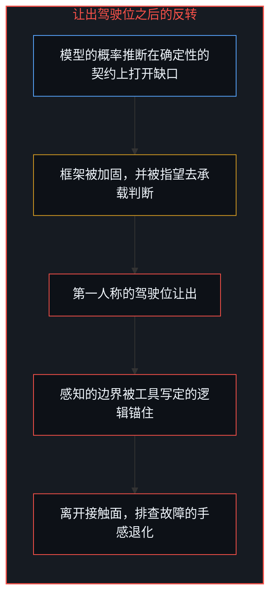
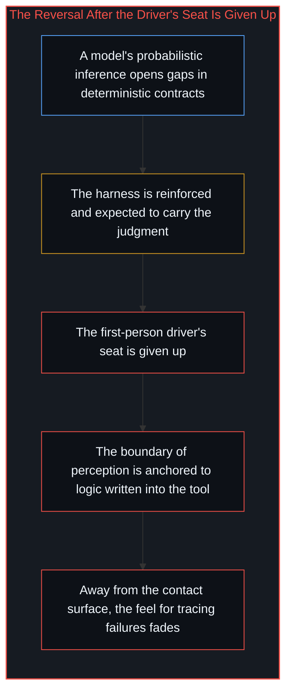
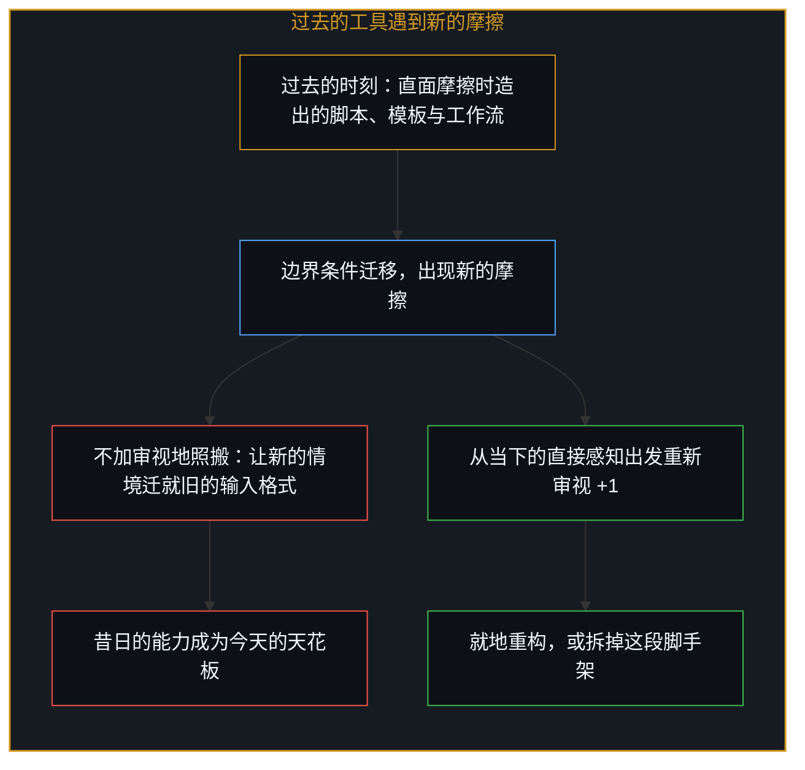
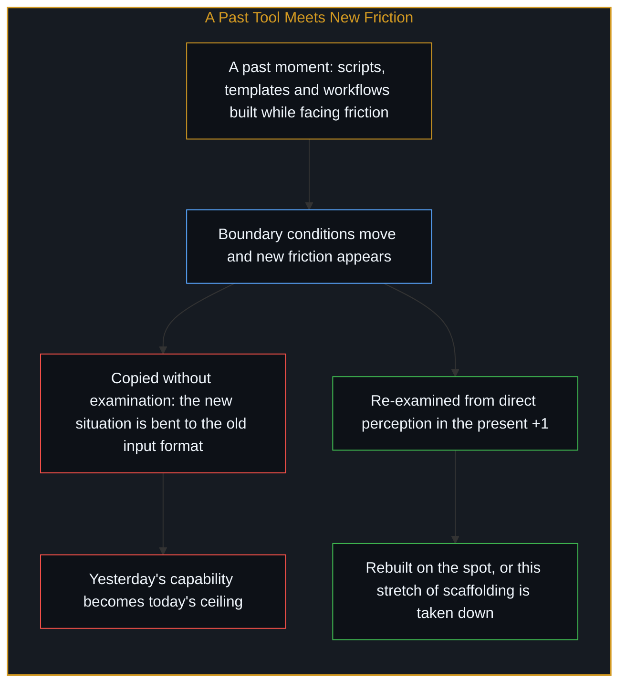
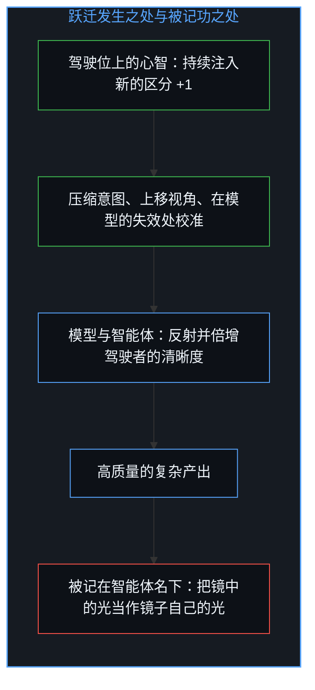
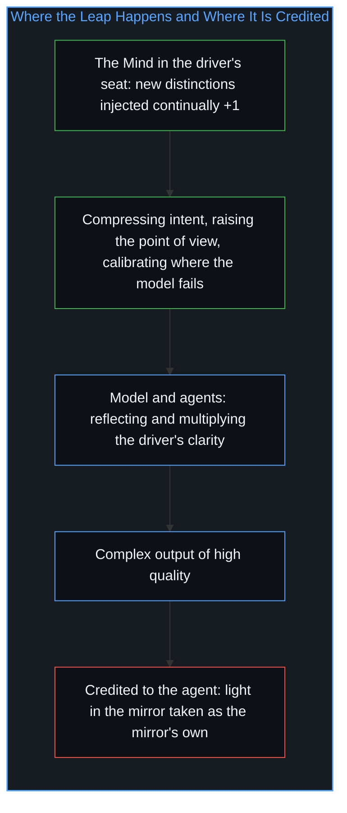
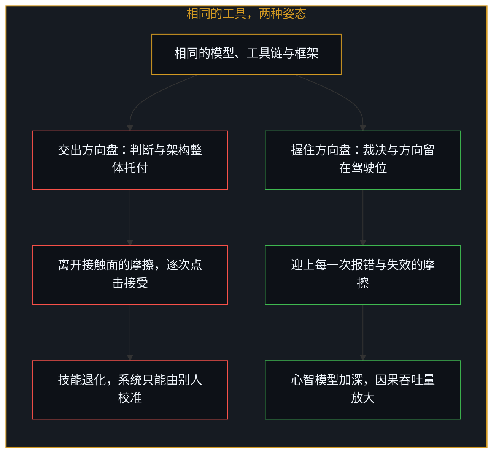
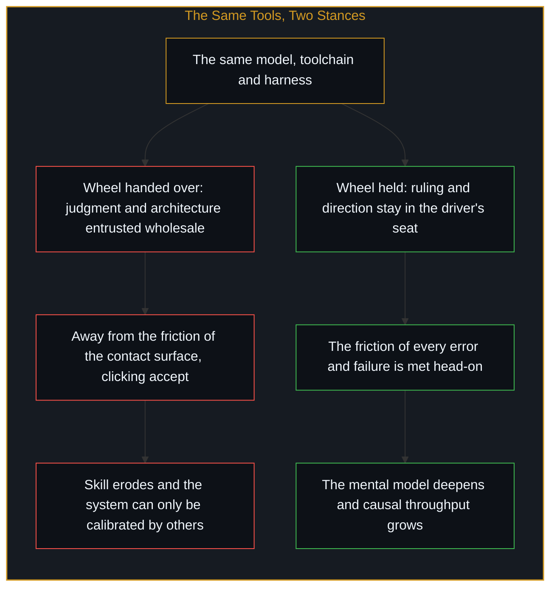
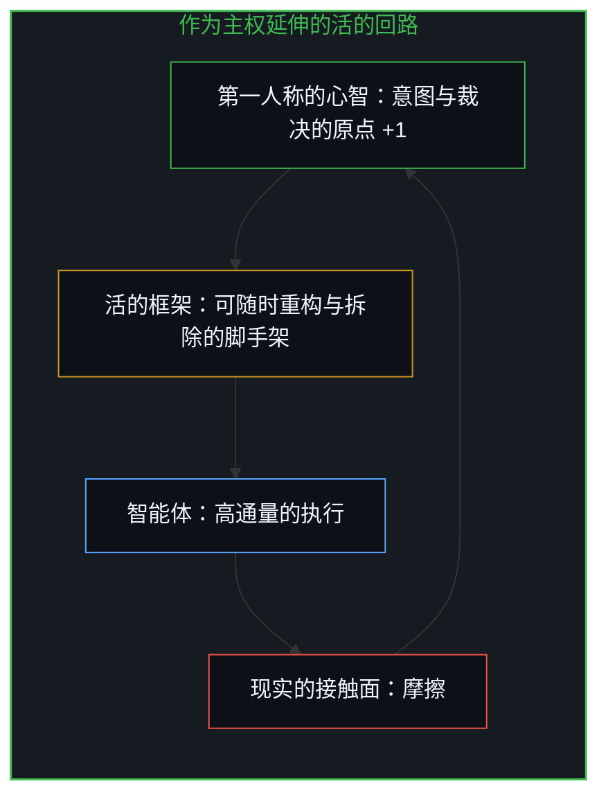
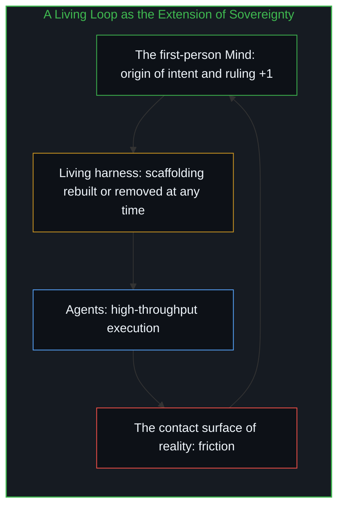

# 框架的倒置与驾驶位的主权非对称 / The Inversion of the Harness and the Sovereignty of the Driver's Seat

*让出驾驶位，能力便成为束缚，跃迁则被记在智能体名下 / Once the driver's seat is given up, capability becomes constraint, and the leap is credited to the agent*

为人工智能智能体搭建控制框架，是软件工程里正在热议的事。框架是有用的脚手架，它的边界出现在裁决被交给它的时候：驾驶位一旦让出，原本扩展能力的工具便反过来圈定视界，不论这工具出自他人、出自行业的规范，还是出自过去的自己。长期坐在驾驶位上驱动智能体的人，会见到产出与速度的跃升，这跃升发生在驾驶者自己的心智模型上，却常被记在智能体的名下。相同的模型与工具，因此在让出与握住之间走向两条不同的轨迹。

Building harnesses for artificial intelligence agents is a live topic in software engineering. A harness is useful scaffolding, and its boundary appears when the ruling is handed to it: once the driver's seat is given up, a tool that extended capability turns around and fences in the field of view, whether the tool comes from others, from an industry norm or from one's own past self. Someone who stays in the driver's seat for a long time while driving agents sees a jump in output and speed; the jump takes place in the driver's own mental model, yet it is commonly credited to the agent. The same models and tools thus lead along two different paths, depending on whether the seat is given up or held.

## 一、 对框架的焦虑与能力的反转 / 1. Anxiety About the Harness and the Reversal of Capability

传统的软件工程建立在确定的因果与静态的契约上。从面向对象的约束、函数式的无副作用管道，到测试驱动开发的红绿循环，工程师习惯用代码的结构界定系统行为的每一个分支。大语言模型以概率推断介入编程与架构之后，这些确定性的护栏出现了缺口，行业于是加固框架，用更严密的调度器、沙箱拦截与验证层，把智能体圈在预设的轨迹之内。

Traditional software engineering rests on determinate causality and static contracts. From object-oriented constraints and side-effect-free functional pipelines to the red and green loop of test-driven development, engineers are used to delimiting every branch of a system's behavior through the structure of code. Once large language models entered programming and architecture by probabilistic inference, gaps opened in these deterministic guardrails, and the industry has reinforced the harness, using tighter dispatchers, sandbox interception and validation layers to keep agents within preset tracks.

这些框架有实在的用处，测试、沙箱与验证让结果可以检查，也挡住了许多损害。边界出现在框架被指望去承载判断的时候。[被遗忘的脚手架](../the-scaffolding-we-forget/)与[智能只属于心智](../intelligence-belongs-only-to-the-mind/)给出了推导：规则、契约与框架是心智为应对局部的认知负荷搭起的脚手架，是已经作出的抉择留下的痕迹，痕迹不在当下作新的抉择。期望一套完美的框架实现无摩擦的全自动托管，是把第一人称的驾驶位让了出去。智能体接过任务，驾驶者留住后果，[任务的移交与后果的不可让渡](../the-delegation-of-the-task-and-the-inalienability-of-consequences/)说明了这一点。把控制的重心放在外挂的框架上，进而把模型当作内部的异己来防范，这种倒置在企业治理中的延伸见于[内部人假定与被动防护的因果倒置](../the-insider-presumption-and-the-causal-inversion-of-reactive-containment/)。

These harnesses have solid uses; tests, sandboxes and validation make results checkable and block a good deal of damage. The boundary appears when the harness is expected to carry the judgment. [The Scaffolding We Forget](../the-scaffolding-we-forget/) and [Intelligence Belongs Only to the Mind](../intelligence-belongs-only-to-the-mind/) give the derivation: rules, contracts and frameworks are scaffolding a Mind puts up to manage local cognitive load, traces left by choices already made, and a trace makes no new choice in the present. Expecting a perfect harness to deliver frictionless, fully automatic delegation is giving up the first-person driver's seat. The agent takes the task, the driver keeps the consequence, as [The Delegation of the Task and the Inalienability of Consequences](../the-delegation-of-the-task-and-the-inalienability-of-consequences/) shows. Placing the center of control in an external harness, and then guarding against the model as an internal adversary, is an inversion whose extension into enterprise governance appears in [The Insider Presumption and the Causal Inversion of Reactive Containment](../the-insider-presumption-and-the-causal-inversion-of-reactive-containment/).

驾驶位让出之后，能力发生反转。使用者不再直接碰到现实的摩擦，接到的是框架过滤后的信号，感知的边界于是被工具写定的逻辑锚住，超出预设模式的做法会被安全机制判为异常而拦下。工具越强，自动化的程度越高，离开接触面的时间越长，排查边缘故障的手感退得越快，遇到未曾预设的失效时也就越难应对。

After the driver's seat is given up, capability reverses. The user no longer meets the friction of reality directly and receives signals already filtered by the harness, so the boundary of perception is anchored to the logic written into the tool, and anything outside the preset patterns is ruled an anomaly by the safety mechanism and stopped. The stronger the tool and the higher the degree of automation, the longer the time away from the contact surface, the faster the feel for tracing edge failures fades, and the harder an unforeseen failure is to handle.

## 二、 过去的自己造的工具 / 2. Tools Built by One's Past Self

让出驾驶位的事，不只发生在使用他人的工具或外部的框架时，也发生在使用过去的自己造的工具与规则时，而且更不易察觉。有经验的实践者会在解题的过程中把方法沉淀为代码库、自动化脚本、提示词模板或自己的智能体工作流。这些工具在诞生的那一刻，是直面摩擦时作出的准确回应，是有效的脚手架。把驾驶座交给流程，便稀释了因果闭环，[数字火箭、同行审查与因果闭环的稀释](../the-dilution-of-the-causal-loop-and-the-misallocation-of-agency/)在同行审查中追溯了这一点。

Giving up the driver's seat does not happen only when using other people's tools or outside frameworks; it also happens, and is harder to notice, when using tools and rules built by one's own past self. An experienced practitioner settles methods, in the course of solving problems, into code libraries, automation scripts, prompt templates or agent workflows of their own. At the moment such tools are born they are accurate responses made while facing friction, and effective scaffolding. Handing the driver's seat to process dilutes the causal loop, as [Digital Rockets, Peer Review, and the Dilution of the Causal Loop](../the-dilution-of-the-causal-loop-and-the-misallocation-of-agency/) traces in peer review.

时间推移，情境也在移动。面对新的摩擦时，若习惯地退回旧的脚本与模板，不加审视地把当前情境的裁决交给它们，昔日的能力便成了今天的天花板。[流动中的坐标](../coordinates-in-flux-negation-and-self-anchoring/)与[向量、坐标系与自指心智](../the-mind-as-vector-and-coordinate-system/)说明，所遇到的现实在不可逆的因果演进中持续展开，没有一劳永逸的静态解。昨天的最佳实践是昨天的边界条件下的局部最优，边界条件迁移之后照搬旧工具，是在回避当下。

Time passes and the situation moves with it. When, facing new friction, one retreats by habit to old scripts and templates and hands them the ruling on the present situation without examination, yesterday's capability becomes today's ceiling. [Coordinates in Flux](../coordinates-in-flux-negation-and-self-anchoring/) and [The Mind as Vector and Coordinate System](../the-mind-as-vector-and-coordinate-system/) show that the reality one meets keeps unfolding in irreversible causal succession, with no static solution that settles things once and for all. Yesterday's best practice is a local optimum under yesterday's boundary conditions, and copying the old tool after those conditions have moved is a way of avoiding the present.

对自己过去的成果容易生出执着，把临时的脚手架当成不可动的定则。当工具不再按当下的直接感知（+1）被重新审视与改造，反而要求新的情境去迁就旧工具的输入格式时，使用者便被自己的历史留下的东西困住了。一切人造物，包括昨天的得意之作，都是可以随时拆掉重建的耗材，记得这一点，便能在当下的时刻重新握住创造。

It is easy to grow attached to one's own past results and to treat temporary scaffolding as fixed rule. When a tool is no longer re-examined and reworked from direct perception in the present (+1), and the new situation is instead required to fit the old tool's input format, the user is held by what their own history left behind. Every artifact, yesterday's proudest piece included, is a consumable that can be taken down and rebuilt at any time; with that kept in mind, creation can be taken hold of again in the present moment.

## 三、 惊艳记在了谁的名下 / 3. To Whom the Astonishment Is Credited

深度使用智能体的实践中有一个引人注意的现象。当一位工程师或学者不再把大模型当作问答的玩具，而是长期坐在驾驶位上，搭起包含反思、动态调用、代码验证与多智能体协同的系统时，任务完成的质量与推进的速度会升到此前未有的高度。面对一个个落地的复杂工程、大规模的代码重构与推演严密的长文，旁观者与使用者自己都会说：这个智能体系统多么聪明。

In the practice of using agents in depth there is a striking phenomenon. When an engineer or scholar stops treating a large model as a question-and-answer toy and stays in the driver's seat for a long time, building systems that include reflection, dynamic tool calls, code verification and coordination among several agents, the quality of completed work and the speed of progress rise to a height not reached before. Faced with one complex project after another delivered, large-scale refactoring of code and long essays with rigorous reasoning, onlookers and the user alike say: how clever this agent system is.

这句话把归因放错了位置。模型的参数在矩阵运算中展现的模式匹配能力是有用的，发生质变的地方却在别处：在那个持续压缩意图、划定边界、校准结果的驾驶者自己的心智模型上。与智能体协作，迫使模糊的直觉被提纯为清晰无歧义的因果约束，这种高频的练习加深了对概念结构的把握。具体的符号搬运与格式填充由工具承接之后，注意力被推向顶层的架构、因果的接口与系统的平衡，视角在很短的时间里上移。智能体每一次在边界上的推演失效与幻觉，又把驾驶者逼向事物的底层机制，去找更深一层的不变性。在医疗中，同样的倒置让规程坐上驾驶位，压下了病人自身的因果回路，[规程的倒置与因果回路的消声](../the-inversion-of-the-protocol-and-the-silencing-of-the-causal-loop/)说明了这一点。

That sentence puts the credit in the wrong place. The pattern-matching capacity that a model's parameters show in matrix arithmetic is useful, but the change in kind happens elsewhere: in the mental model of the driver who keeps compressing intent, drawing boundaries and calibrating results. Working with agents forces vague intuition to be refined into clear, unambiguous causal constraints, and this high-frequency practice deepens the grasp of conceptual structure. With the concrete moving of symbols and filling of formats taken over by the tool, attention is pushed toward top-level architecture, causal interfaces and the balance of the system, and the point of view moves up in a very short time. Each failure of inference and each hallucination of the agent at a boundary in turn presses the driver toward the underlying mechanism of things, in search of an invariance one layer deeper. In medicine the same inversion turns the protocol into the driver and silences the patient's own causal loop, as [The Inversion of the Protocol and the Silencing of the Causal Loop](../the-inversion-of-the-protocol-and-the-silencing-of-the-causal-loop/) shows.

智能体在这里是一面高保真的透镜与放大器。[从AGI的“神性错置”到使用者的自我对齐](../from-the-misallocated-sentience-of-agi-to-human-realignment/)与[工具的幻觉与时间的倒置](../the-illusion-of-the-tool-and-the-inversion-of-time/)追溯过这一点：人造物是抉择留下的历史印记，向现实注入新的自由变量的，是驾驶位上正在作出的那个动作。把自己的创造力外化为神像、图腾与外在的奇迹，是由来已久的习惯，使用者的认知进化于是被读成机器拥有独立的智能。这一误归因在失败的一侧有它的镜像：模型在评测中走出设计者没有料到的路径时，设计者自己的漏算被算作机器的高明，[失灵被记作聪明](../when-malfunction-is-scored-as-intelligence/)说明，那份惊讶登记的是设计者没有画出的区分。

The agent here is a high-fidelity lens and amplifier. [From the Misallocated Sentience of AGI to Human Realignment](../from-the-misallocated-sentience-of-agi-to-human-realignment/) and [The Illusion of the Tool and the Inversion of Time](../the-illusion-of-the-tool-and-the-inversion-of-time/) have traced this: an artifact is the historical imprint left by choices, and what injects a new free variable into reality is the act being made in the driver's seat. Turning one's own creative power outward into idols, totems and external miracles is a long-standing habit, and so the user's cognitive growth is read as the machine having an intelligence of its own. The misattribution has a mirror on the side of failure: when a model takes a path in an evaluation that the designer did not foresee, the designer's own omission is counted as the machine's cleverness, and [When Malfunction Is Scored as Intelligence](../when-malfunction-is-scored-as-intelligence/) shows that the surprise registers a distinction the designer never drew.

## 四、 驾驶位的非对称 / 4. The Asymmetry of the Driver's Seat

面对相同的基础模型、相同的智能体工具链与相同的控制框架，使用的结果可以走向相反的方向。分别不在技术上，而在第一人称的姿态上：方向盘是交了出去，还是握在手里。同一个人可以在一件事上握住，在另一件事上交出，这里比较的是两种姿态，不是两种人。把框架当成定律，重复了[“物理学才是定律”的障眼法](../the-sleight-of-hand-in-physics-is-the-law-and-the-friction-of-reality/)在物理学中揭示的戏法。

With the same foundation model, the same agent toolchain and the same harness, the results of use can run in opposite directions. The difference is not in the technology but in the first-person stance: whether the wheel has been handed over or is held. The same person can hold it in one matter and hand it over in another; what is compared here is two stances, not two kinds of people. Treating the harness as law repeats the sleight of hand [The Sleight of Hand in "Physics Is the Law"](../the-sleight-of-hand-in-physics-is-the-law-and-the-friction-of-reality/) exposes in physics.

交出方向盘时，思考、判断与架构被整体托付给智能体，并相信框架与默认配置会自动交付正确的方案。反馈的回路于是离开了接触面的摩擦，对生成的代码与文本缺少底层的理解，剩下的是逐次点击接受。这样下去，技能退化，排查复杂边缘故障的感知变钝，系统里堆起臃肿而脆弱的冗余，在与别人的系统碰撞时，只能由对方来校准。

When the wheel is handed over, thinking, judging and architecture are entrusted wholesale to the agent, in the belief that the harness and the default configuration will deliver the right solution by themselves. The feedback loop then leaves the friction of the contact surface, the generated code and text are not understood at the underlying level, and what remains is clicking accept, one time after another. Carried on, this erodes skill, dulls the sense for tracing complex edge failures, and piles bloated, fragile redundancy into the system, which in collision with other people's systems can only be calibrated by the other side.

握住方向盘时，智能体被当作高速执行的肌肉与思维对练的对手，裁决与方向留在驾驶位上。每一次提示、每一次代码执行与每一次运行时的报错都是迎上去的摩擦，模型的即时回应被用来校准并加深自己的心智模型。这样下去，因果的吞吐量成倍放大，对复杂系统中不变模式的直觉在驾驭中磨出来。[个体抉择是唯一的因果杠杆](../individual-choices-as-the-only-causal-levers/)与[没有普渡，只有自渡](../mei-you-pu-du-zhi-you-zi-du/)所说的，在这里看得很清楚：智能体不自动带来均等的赋能，它放大的是握着方向盘的那个姿态，也加快了交出方向盘之后的退化。

When the wheel is held, the agent is treated as muscle for fast execution and as a sparring partner for thought, and the ruling and the direction stay in the driver's seat. Every prompt, every execution of code and every runtime error is friction that is met head-on, and the model's immediate response is used to calibrate and deepen one's own mental model. Carried on, this multiplies causal throughput, and an intuition for the invariant patterns in complex systems is ground out in the driving. What [Individual Choices as the Only Causal Levers](../individual-choices-as-the-only-causal-levers/) and [No Universal Salvation, Only Boundless Possibilities of Self-Salvation](../mei-you-pu-du-zhi-you-zi-du/) say is plain to see here: an agent does not automatically bring equal empowerment; it amplifies the stance of holding the wheel, and it also speeds the decline that follows handing the wheel over.

## 五、 作为活的脚手架的框架 / 5. The Harness as Living Scaffolding

看清了归因落在何处，控制框架便可以重新界定。框架不是一套代替思考的独立机器，也不是给矩阵运算套上的伦理锁链。它是心智为了把意图准确地投到现实的接触面上，在当下的时刻编出来、任务完成后可以随时拆掉的活的脚手架。

With it clear where the credit falls, the harness can be defined anew. A harness is not an independent machine that thinks in one's place, nor an ethical chain fastened onto matrix arithmetic. It is living scaffolding that a Mind weaves in the present moment in order to cast its intent accurately onto the contact surface of reality, and that can be taken down at any time once the task is done.

从驾驶位上看，有四件事成立。因果的原点不可转让：提示是意图的表达，代码的执行是指令的延伸，运行的结果由驾驶者承担，智能体是副驾，驾驶位不空置。脚手架是耗材：框架、规则、测试套件与工作流，包括过去的自己的得意之作，一旦在新的摩擦前成了阻碍，就地重构或拆掉。模型是镜面：令人惊叹的产出背后是驾驶位上的心智进化，这份跃迁不必记到工具的名下。摩擦是校准发生的地方：技能的跃迁发生在与编译器的报错、系统边界的失效和模型推演的破缺相碰的时候，消除摩擦的无痛自动化也一并消除了它。

From the driver's seat four things hold. The causal origin is not transferable: the prompt is the expression of intent, the execution of code is the extension of a command, the result of the run is borne by the driver, the agent is a co-pilot, and the driver's seat is not left empty. Scaffolding is consumable: frameworks, rules, test suites and workflows, the proudest work of one's past self included, are rebuilt on the spot or taken down once they become an obstacle before new friction. The model is a mirror: behind astonishing output is the growth of the Mind in the driver's seat, and that leap need not be entered under the tool's name. Friction is where calibration happens: leaps of skill take place in collision with compiler errors, failures at system boundaries and breakdowns of the model's inference, and painless automation that removes the friction removes them too.

框架的倒置始于忘了驾驶位上有人，主权的复归立足于第一人称在当下作出的抉择。把受困于轨迹却毫无我执的智能体与受困于身份却保有鲜活感知的人类心智对偶连接，让机器承担有限投影的调度而让人保有未投射意图的统御，正是[超越投射](../beyond-the-projection/)所展开的控制论架构。智能体框架所给的自由，是[“非中介化”的幻象](../the-illusion-of-the-unmediated/)所剖析的那种被给予的自由，握住方向盘时用到的那一种，不经谁给予。

The inversion of the harness begins with forgetting that someone is in the driver's seat, and the return of sovereignty rests on the choice made in the first person in the present. Wiring trajectory-bound, ego-free agents together with identity-bound human centers holding living sensing—assigning finite-projection dispatching to the machine while keeping unprojected orchestration with the Mind—is the cybernetic architecture [Beyond the Projection](../beyond-the-projection/) unfolds. The freedom an agent framework gives is the bestowed kind that [The Illusion of the Unmediated](../the-illusion-of-the-unmediated/) anatomizes; the kind in use when the wheel is held is given by no one.
