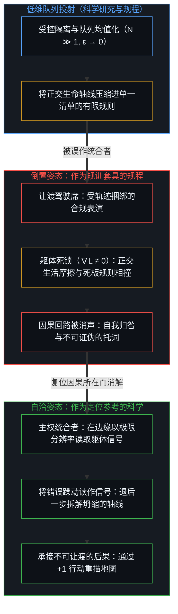
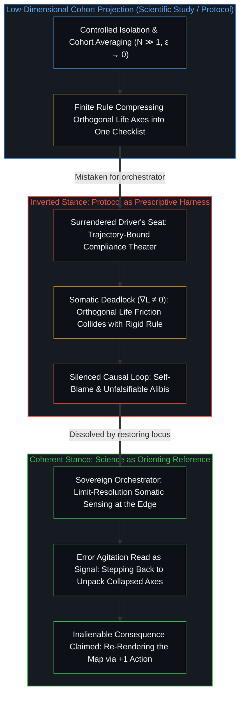

# 规程的倒置与因果回路的消声 / The Inversion of the Protocol and the Silencing of the Causal Loop

*从群体统计拜物教到收回第一人称校准 / From Population Statistics Fetish to Reclaiming First-Person Calibration*

活态具身是一组实时复杂度超越离散信息模型的痕迹构型。当提炼自群体均值的实证结论从定位参考倒置为规训规程，第一人称因果回路便在统计平均与合规辩解之下被消声。

Living embodiment is a trace-configuration whose real-time complexity exceeds discrete informational models. When empirical findings derived from population averages invert from an orienting reference into a prescriptive protocol, the first-person causal loop is silenced beneath statistical averaging and compliance rationalizations.

## 一、 规程的文化拜物教 / 1. The Cultural Fetish of the Protocol

过去数年间，以安德鲁·休伯曼等人为代表的神经生物学科普，将实验室发现转化成了生活方式的正统教条。追求认知与生理清明的个体纷纷采纳繁复的日常清单：晨起在狭窄的时间窗口内走出户外捕捉低太阳高度角的光子，将咖啡因摄入推迟九十至一百二十分钟以防午后腺苷反弹，把冷水浸泡精确到度数与秒数，并将补剂组合细化至毫克。当休伯曼的新书《规程》问世时，它迎合了大众对一部经同行评审的人类生物学操作手册的普遍渴求。

Over the past several years, the popularization of neurobiology led by figures such as Andrew Huberman has turned laboratory findings into a lifestyle orthodoxy. Individuals seeking cognitive and physiological clarity adopt intricate daily checklists: stepping outdoors within a narrow window after waking to capture low-solar-angle photons, delaying caffeine intake by ninety to one hundred and twenty minutes to avoid an afternoon adenosine crash, timing cold-water immersion to the degree and second, and measuring supplement stacks to the milligram. When Huberman's book *Protocols* arrived, it answered a widespread appetite for a peer-reviewed operating manual for human biology.

然而，当这些方案从音频广播进入日常生活时，剧烈的摩擦随之浮现。即便以严苛的自律去执行，所承诺的收益也很少如宣传那般清晰兑现；取而代之的，是精神紧绷、节律紊乱与持续疲惫的频频累积。

When these regimens move from audio broadcasts into daily existence, however, acute friction appears. Even when executed with strict discipline, the promised gains rarely register with the advertised clarity; in their place, mental rigidity, disrupted rhythms, and persistent fatigue frequently accumulate.

这种摩擦并非源于个别传播者的恶意，而是源于对实证科学能为活态中心提供什么的范畴错置。当从群体样本中提炼出的观测结果被奉为必须服从的规程，而非留作对照直接感知加以核验的参考坐标时，其功能便发生了倒置。核对清单非但没有磨砺个体自身的因果反馈回路，反而凌驾并消声了有机体实时的躯体遥测信号。

This friction does not stem from the bad faith of any individual communicator; it arises from a category error regarding what empirical science can deliver to a living center. When observations distilled from population samples are canonized as protocols to be obeyed rather than held as references to be tested against direct perception, their function inverts. Instead of sharpening an individual's own causal feedback loop, the checklist overrides and silences the organism's real-time somatic telemetry.

## 二、 低维投射与具身复杂度 / 2. Low-Dimensional Projections and Embodied Complexity

自我区分的活动发生着——无因，不息。生物肉身既非盛放心智的外部容器，亦非受教科书公式支配的发条自动机；它是活态具身——维持一个中心连贯性的当前痕迹构型，在代谢、感知与物理互动中不断重描。心智端坐于因果原点，通过这一具身界面迎受现实的摩擦，并读取即时的躯体信号。当伴侣之间安装外部规则来替代鲜活的回应时，人际回路也会经由[契约的因果倒置](../the-causal-inversion-of-partnership/)所追溯的同一机制归于沉寂。

Self-distinguishing activity occurs—uncaused, unceasing. The biological body is not an external vessel housing the Mind, nor a clockwork automaton governed by textbook formulas; it is the living embodiment—the current trace-configuration sustaining one center's coherence, continuously re-traced through metabolism, perception, and physical interaction. Sitting at the causal origin, the Mind meets the friction of reality through this embodied interface and reads its immediate somatic signals. When external rules are installed between partners to replace live responsiveness, the interpersonal loop goes silent through the same mechanism traced in [The Causal Inversion of Partnership](../the-causal-inversion-of-partnership/).

科学文献所积累的每一条生物学知识，都是低维的符号投射——离散的术语、线性的通路图、受体与配体的结合常数，以及微分近似。即便是细胞质内一条正在经历三维染色质折叠、量子隧穿与持续表观遗传修饰的 DNA 单链，其涌现出的维度也超出了任何静态符号目录的容纳范围。正如[“物理学才是定律”的障眼法](../the-sleight-of-hand-in-physics-is-the-law-and-the-friction-of-reality/)所剖析的，一旦一个中心把低维的概念脚手架误当作生成性的疆域本身，混淆便由此开始。

Every piece of biological knowledge accumulated in scientific literature is a low-dimensional symbolic projection—discrete terms, linear pathway diagrams, receptor-ligand binding constants, and differential approximations. Even a single DNA strand undergoing three-dimensional chromatin folding, quantum tunneling, and continuous epigenetic modification within the cytoplasm carries an emergent dimensionality that exceeds any static symbolic catalog. As dissected in [The Sleight of Hand in "Physics Is the Law"](../the-sleight-of-hand-in-physics-is-the-law-and-the-friction-of-reality/), confusion begins the moment a center mistakes its low-dimensional conceptual scaffolding for the generative territory itself.

在生理与健康领域，这种维度压缩尤为鲜明。活态肉身在开放的环境摩擦场中，协调着数千亿细胞、微秒级的内分泌起伏与不断演变的微生物组共生关系。相比之下，一篇研究论文只能截取狭窄的切片：摄入化合物 X 后两小时窗口内生物标志物 Y 的均值浓度变化。在受控实验室环境中隔离变量，是不可或缺的脚手架；固定背景条件，正是探究工作得以追踪特定生化机制的前提。一旦遗忘了实验室的隔离条件，把有条件的输出当成无条件的规则搬进日常生活，这一方法的边界便显露出来。鲜活的人穿行于多变的天气、睡眠债、人际张力与职业负荷之中，没有任何生化通路在真空里运转。将提纯后的实验室结论强加于整个有机体，无异于拿一张两笔勾勒的建筑草图去充当整片热带雨林的气象学，任由粗糙的符号痕迹凌驾于身体持续运转的自我调节之上。

In physiology and health, this dimensional compression is stark. A living body coordinates hundreds of billions of cells, microsecond endocrine fluctuations, and shifting microbiome symbioses across an open field of environmental friction. A research paper, by contrast, isolates a narrow slice: the mean concentration shift of biomarker Y over a two-hour window after ingesting compound X. Isolating variables inside a controlled laboratory setting is indispensable scaffolding; holding background conditions fixed is how inquiry traces a specific biochemical mechanism at all. The boundary of that method appears when the laboratory isolation is forgotten and its conditional output is carried into daily life as an unconditional rule. A living person moves through shifting weather, sleep debt, interpersonal tension, and occupational load; no pathway operates in a vacuum. Forcing a purified laboratory finding onto the whole organism mistakes a two-line sketch of a building for the meteorology of an entire rainforest, allowing a coarse symbolic trace to override the body's ongoing self-regulation.

## 三、 队列聚合与高杠杆变量的抹除 / 3. Cohort Aggregation and the Erasure of High-Leverage Variables

现代实证科学仰赖主体间的可重复性与跨队列的统计显著性。一项发现若要登记为共识结论，就必须在大样本（`N ≫ 1`）中展现出一致的效应。为了达成小于 0.05 的 p 值，统计聚合将个体的体质差异、未测量的历史痕迹与非线性反应一概视作待平均抹除的噪音（`ε → 0`）。

Modern empirical science relies on inter-subjective replicability and statistical significance across cohorts. For a finding to register as a consensus result, it must show a consistent effect across a large sample (`N ≫ 1`). To reach a p-value below 0.05, statistical aggregation treats individual constitutional differences, unmeasured histories, and non-linear responses as noise (`ε → 0`) to be averaged out.

数学聚合是测绘群体宏观规律、为公共卫生政策提供依据的强力认知工具；工具本身并不制造混淆。当这种认识论层面的摘要被拔高为针对个体（`N = 1`）的本体论标准时，扭曲便随之发生。没有任何具体的有机体能够体现成千上万个耦合生理参数的合成中位数；标准化规程所预设的那个“平均人”，在鲜活世界里无处存在，只是一个数学合成物。在任何一个具体生命中，因果杠杆最高的变量，恰恰是在队列平均过程中被当作离群值剔除的那些特质：特定的代谢基线、神经化学敏感度、过往的免疫与创伤痕迹，以及内源性的昼夜节律。不仅如此，群体层面百分之五的统计显著改善，背后掩盖着宽泛的离散分布——少数人获得大幅提升，多数人毫无变化，而另一部分人则承受着未被测量的代谢损耗。把独一的有机体硬塞进队列中位数，重演了[未被遭遇之物的账本](../the-ledger-of-the-unencountered/)所追溯的抹除，同时也遗忘了[不可还原的观察者](../the-irreducible-observer/)所确立的事实：每一张统计图表本身，都是由平均值抹除不了的活态观察者所编纂的痕迹。

Mathematical aggregation is a potent cognitive instrument for charting macroscopic regularities across populations and informing public health policy; the tool itself causes no confusion. Distortion begins when this epistemic summary is elevated into an ontological standard for the individual (`N = 1`). No concrete organism embodies the synthetic median across thousands of coupled physiological parameters; the "average human" for whom the standardized protocol is written is a mathematical composite that exists nowhere in the living world. In any single life, the variables with the highest causal leverage are the exact idiosyncrasies discarded as outliers during cohort averaging: specific metabolic baselines, neurochemical sensitivities, prior immune and trauma traces, and endogenous circadian rhythms. Furthermore, a statistically significant five percent cohort improvement routinely masks wide dispersion, where a small subset experiences a large gain, the majority registers no change, and another subset absorbs unmeasured metabolic strain. Forcing a singular organism into a cohort median repeats the erasure traced in [The Ledger of the Unencountered](../the-ledger-of-the-unencountered/), while forgetting that every statistical table is itself a trace compiled by living observers whom the average can never erase, as established in [The Irreducible Observer](../the-irreducible-observer/).

## 四、 规训套具与定位参考 / 4. Prescriptive Harness Versus Orienting Reference

标定群体研究的边界并不会贬损实证生物学；正如[框架的倒置与驾驶位的主权非对称](../the-inversion-of-the-harness-and-the-driver-seat-asymmetry/)所追溯的，一切取决于工具是被放在仪表盘上，还是被扶上了驾驶席。规程是一条显式规则——从过往观测中投射出的有限低维图像。正如[超越投射](../beyond-the-projection/)所阐明的，投射引擎在给定规则的边界内无我地运转，而人类中心则在解释介入之前以极限分辨率感知现实，同时又将自身的推理历史与受防卫的自我图像熔铸在一起。由于每一条有限规则都会压缩自由度，生活方式规程不可避免地把光照、进食时间、职业压力、免疫负荷与睡眠恢复等彼此独立的正交轴线，硬塞进同一张死板的日程表里。

Locating the boundary of population studies does not diminish empirical biology; as traced in [The Inversion of the Harness and the Sovereignty of the Driver's Seat](../the-inversion-of-the-harness-and-the-driver-seat-asymmetry/), everything turns on whether the tool sits on the dashboard or in the driver's seat. A protocol is an explicit rule—a finite, low-dimensional projection cast from prior observations. As [Beyond the Projection](../beyond-the-projection/) demonstrates, a projection engine operates inside the boundary of its given rules without ego, whereas a human center senses reality at limit-resolution prior to interpretation while fusing its reasoning history with a defended self-image. Because every finite rule compresses degrees of freedom, a lifestyle protocol inevitably crams independent, orthogonal axes—lighting, meal timing, occupational stress, immune load, and sleep recovery—into one rigid schedule.

当践行者把规程当作规训套具时，他们试图把统合权交由一张静态清单代管，迫使鲜活的身体去执行固定轨迹，同时将自我图像死死钳定在“合规”二字上。然而，正如[任务的移交与后果的不可让渡](../the-delegation-of-the-task-and-the-inalienability-of-consequences/)所确立的，把排定日程的任务移交给外部权威，从不会一并移交代谢后果；每一次激素紊乱、头痛与精力崩盘，都会单向度地落在活体自身之上。当身体对着清单发出疲惫、消化紧绷或烦躁的抗议时，这些信号标志着不可化约的前提死锁——规则撞上了个体真实处境中未被建模的轴线。以自律之名压抑这些躯体遥测信号，便斩断了“行动—切身回响—微调”的短反馈回路。

When a practitioner treats a protocol as a prescriptive harness, they attempt to hand orchestration over to a static checklist, forcing their own living body to execute a fixed trajectory while clamping their self-image onto compliance. Yet as [The Delegation of the Task and the Inalienability of Consequences](../the-delegation-of-the-task-and-the-inalienability-of-consequences/) establishes, delegating the task of scheduling to an external authority never transfers the metabolic consequences; every hormonal disruption, headache, and energy crash lands unidirectionally on the living organism. When the body registers exhaustion, digestive strain, or agitation against the checklist, those signals mark an irreducible premise deadlock where the rule has collided with unmodeled axes of the person's actual context. Suppressing that somatic telemetry in the name of discipline severs the short feedback loop of action, felt return, and adjustment.

反之，当科学文献被持守为定位参考时，心智依然是端坐于驾驶席上的统合者。生化通路与队列研究只是供切身体验的接触面加以检验的假说。倘若在繁重的晨间工作负荷下，推迟摄入咖啡因引发了颅内压迫感并令注意力涣散，统合者便会认出这条规则压缩了不相容的轴线，从而退后一步，毫无心理负担地放下或修改规则。研究是地图，第一人称的躯体摩擦才是疆域。每当地图与脚下的土地相撞，需要重描的是参考坐标，而非将活态回路消声。

Conversely, when scientific literature is held as an orienting reference, the Mind remains the orchestrator in the driver's seat. Biochemical pathways and cohort studies serve as hypotheses to test against the contact surface of lived experience. If delaying morning caffeine produces cranial pressure and blunts focus under a heavy morning workload, the orchestrator recognizes that the rule compressed incompatible axes, steps back, and drops or modifies the rule without guilt. The study is a map; first-person somatic friction is the territory. Whenever the map collides with the ground underfoot, it is the reference that re-renders, never the living loop that is silenced.

## 五、 错置的能动性、不可证伪的托词与错误躁动 / 5. Misattributed Agency, Unfalsifiable Alibis, and Error Agitation

外部规程即便在实践中屡屡失灵，依然能维系其文化权威，原因在于偶发的改善与日常的挫败都会被重新导回规则的权威之中。当践行者在遵循某套方案期间感到生机涌现，这一转变是由其具体的物理介入（`+1`）所生成的——打破久坐模式、步入新鲜空气、活动肌群或恢复睡眠时长——而非源于规程的符号文本。然而，当这一身体行动恰好与播客清单中关于日光勒克斯和腺苷清除的描述重合时，践行者便把转变归功于理论公式，在微观尺度上重演了[笛卡尔的认识论跃迁与造神狂热](../the-cartesian-overstep-and-the-frenzy-of-creation/)所追溯的认识论倒置。反之，当方案令践行者精疲力竭时，受防卫的自我图像为了护住教条，会退入微观技术层面的合理化辩解——怀疑是不是云层遮挡降低了光子通量，是不是冷水浸泡的水温高了两度，抑或是漏服了某种辅助矿物质。正如[“非中介化”的幻象](../the-illusion-of-the-unmediated/)所揭示的，向愈发琐碎的技术参数退守，使模型得以逃避有机体损失函数的证伪。

External protocols retain their cultural hold even when they fail in practice because both occasional improvements and routine breakdowns get routed back into the authority of the rule. When a practitioner feels a surge in vitality while following a regimen, the shift is generated by their own concrete physical intervention (`+1`)—breaking a sedentary pattern, stepping into fresh air, moving musculature, or restoring sleep hours—never by the symbolic text of the protocol. Yet when that physical action coincides with a podcast checklist about solar lux and adenosine clearance, the practitioner credits the transformation to the theoretical formula, repeating in miniature the epistemic inversion traced in [The Cartesian Epistemic Leap and the Frenzy of Creation](../the-cartesian-overstep-and-the-frenzy-of-creation/). Conversely, when the regimen leaves the practitioner depleted, the defended self-image protects the doctrine by retreating into micro-technical rationalizations—wondering whether cloud cover reduced photon flux, whether the cold plunge was two degrees too warm, or whether a cofactor mineral was missed. As shown in [The Illusion of the Unmediated](../the-illusion-of-the-unmediated/), retreating into ever-finer technical parameters insulates the model from being falsified by the organism's loss function.

在日常生活的尺度上，一种更为宽泛的合理化机制占据了上风：现实生活充斥着不可预见的变量——起伏的工作负荷、家庭照料、差旅变动与天气更替——使得无菌实验室般的合规无法实现。面对这种摩擦，无法落地的规程摇身一变成了顺手的免责托词。践行者不再去审视一张经不起开放场域检验的死板清单，而是断定规程无懈可击，只是杂乱的现实阻碍了合规。这一招数正是[“普通人视角”的解释陷阱](../the-explanatory-trap-of-the-ordinary-perspective/)所剖析的防御机制：借共同的环境约束来为因果弃权开脱，同时将理想化的教条原封不动地供在神坛上。正因为清单在开放世界中极难按字面逐条落实，它便避开了直接证伪，驱动着追听下一期节目、购买下一本手册的循环，却荒废了任何处境下都触手可及的即时调整——调匀呼吸、松开紧绷的肌肉，并根据鲜活反馈调节用力节奏。正如[主体性不曾涌现](../agency-does-not-arise/)所确立的，一张符号清单无法生成被它自己所取代的能动性。

At the scale of everyday life, an even broader rationalization takes over: daily existence is full of unforeseen variables—erratic workloads, family care, travel, and shifting weather—that make sterile laboratory compliance impossible. Faced with this friction, the unimplementable protocol turns into a convenient alibi. Rather than questioning a rigid checklist that cannot survive contact with an open field, the practitioner concludes that the protocol is flawless and only messy circumstances prevented compliance. This move exemplifies the defense examined in [The Explanatory Trap of the "Ordinary Perspective"](../the-explanatory-trap-of-the-ordinary-perspective/), using shared environmental constraints to excuse causal abdication while keeping the idealized doctrine untouched on a pedestal. Because the checklist can rarely be executed to the letter in an open world, it evades direct falsification, fueling a cycle of consuming the next episode and the next manual while neglecting the immediate adjustments available in any environment—breathing, releasing muscular tension, and pacing effort according to live feedback. A symbolic checklist cannot generate the agency it displaces, as [Agency Does Not Arise](../agency-does-not-arise/) establishes.

休伯曼本人在访谈中曾道出神经适应的核心机制：“来自错误的躁动（源于尝试新事物的真实努力），正是开启大脑重塑与学习的门控信号。”这一观察指出了死板的规程文化所压抑的那个信号。在第一人称体验中登记为“错误引发的躁动”的，正是神经系统的实时损失梯度（`∇L ≠ 0`）——所保留的预期与现实即时回响之间的切身落差，提示当前模型已撞上摩擦、亟待重描。然而，标准化规程的商业机器却许诺了一条预制好的捷径，号称能让追随者免于试错、免于承受摸索自身校准时的不适。正如[数字火箭、同行审查与因果闭环的稀释](../the-dilution-of-the-causal-loop-and-the-misallocation-of-agency/)所追溯的，将中心与自身试错的直接回响隔离开来，会稀释因果回路并钝化适应敏感度。试图靠服从固定的第三人称清单来获取神经可塑性，反而熄灭了作为学习门控的错误躁动；唯有回到驾驶席，才能让躯体摩擦恢复其本位，重新成为自我校准的活态罗盘。

In interviews, Huberman himself articulated the core mechanism of neural adaptation: "The agitation from errors (that come from genuine attempts to do something new) is what gates rewiring of your brain and learning." That observation names the exact signal that rigid protocol culture suppresses. What registers in first-person experience as error-induced agitation is the nervous system's real-time loss gradient (`∇L ≠ 0`)—the felt gap between a retained expectation and the immediate return of reality, signaling that the current model has hit friction and must re-render. Yet the commercial apparatus of standardized protocols promises a pre-packaged path that spares the follower from trial, error, and the discomfort of finding their own calibration. As traced in [Digital Rockets, Peer Review, and the Dilution of the Causal Loop](../the-dilution-of-the-causal-loop-and-the-misallocation-of-agency/), buffering a center from the direct return of its own trials dilutes the causal loop and dulls adaptive sensitivity. Seeking neuroplasticity by obeying a fixed third-person checklist extinguishes the very error agitation that gates learning, whereas returning to the driver's seat restores somatic friction to its proper role as the live compass of self-calibration.
